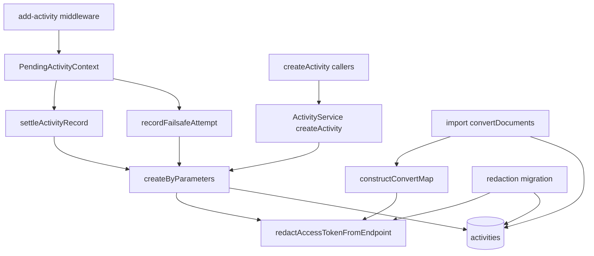
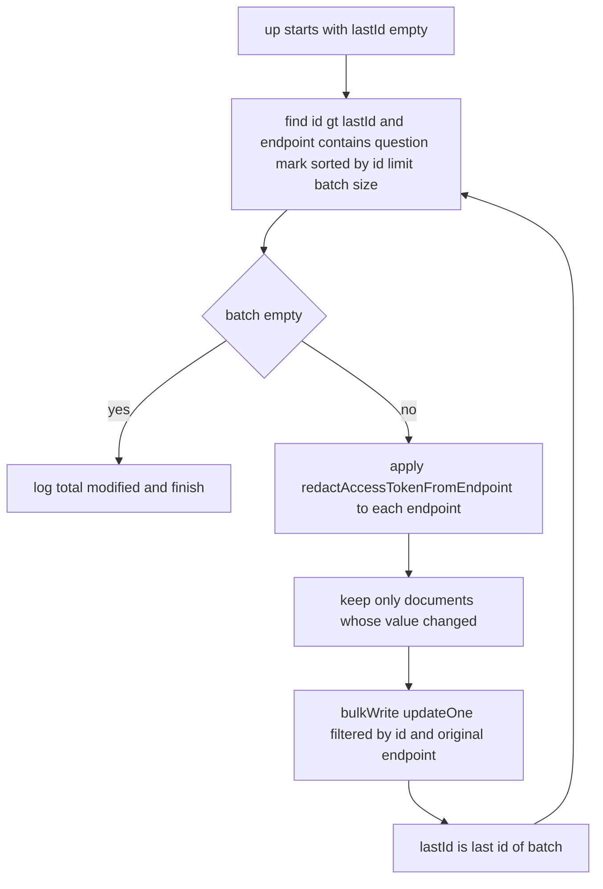

# Design Document

## Overview

**Purpose**: activity の `endpoint` に access_token が平文で残らないようにする。GROWI は access_token をクエリパラメータでも受け付けるため、リクエスト URL をそのまま保存すると認証情報が DB に残る。この spec は、どの経路で activity が DB に入っても伏せ字になること、すでに平文で残っている activity を直すことを約束にする。

**Users**: 監査ログを保管・閲覧する GROWI の管理者と運用者。

**Impact**: 伏せ字の場所を記録用 middleware から activity の保存口（`createByParameters`）に移す。あわせて、データのインポートの変換と、既存の activity を直す migration を足す。

### Goals
- 記録の全経路（settle、fail-safe、`createActivity` の直接呼び出し）で、保存される endpoint の access_token の値を伏せ字にする。
- データのインポートで取り込む activity も伏せ字にする。
- 既存の activity の平文トークンを、migration で伏せ字にする。
- 伏せ字の規則を 1 つの純粋関数にまとめ、3 か所から同じ関数を使う。

### Non-Goals
- `access_token` 以外のクエリパラメータの伏せ字。
- 作成済みの監査ログのエクスポートファイルと、TTL で消えた行の修正。
- endpoint による監査ログの検索・候補表示の仕様の変更。
- 記録ゲート（どの action を記録するか）と fail-safe の挙動の変更。
- HTTP アクセスログ（`@growi/logger` の pino-http）に出るリクエスト URL の伏せ字。

## Amend target

この spec は `activity-log` の amend spec。最後のタスクで以下を activity-log に書き戻し、このディレクトリを削除する（`.claude/rules/spec-lifecycle.md`）。

| activity-log のファイル | 節 | 変わる内容 |
|---|---|---|
| requirements.md | Requirements | Requirement 5〜9 を末尾に追加する（既存の 1〜4 は番号を変えない） |
| requirements.md | Boundary Context | In scope に伏せ字を追加する。本 spec の Out of scope（TTL で消えた行、作成済みのエクスポートファイル、ローリングアップデート中・ロールバック中に古いバージョンが書いた行、access_token 以外のパラメータ、パラメータを将来追加したときの保存済みの行、endpoint 以外の項目、HTTP アクセスログ）を追加する。既存の Out of scope の「既に DB に溜まっている未確定／対象外の残骸行の遡及的な掃除・移行」は残骸の掃除のことで、伏せ字の migration とは別だと分かる書き方にする |
| requirements.md | Boundary Context > Adjacent expectations | 本 spec の Adjacent expectations（全文検索の索引にはクエリ文字列が入らないこと、G2G では activity を転送しないこと）を追加する。記録ゲートと fail-safe を変えないことは既存の項目でカバーされているので足さない |
| design.md | Non-Goals | 「既存残骸の掃除・移行」が伏せ字の migration を含まないことを明記する |
| design.md | This Spec Owns | 「保存する endpoint の伏せ字」を追加する |
| design.md | Out of Boundary | 「既存残骸の掃除・移行」が伏せ字の migration を含まないことを明記する |
| design.md | Allowed Dependencies | `server/util/redact-access-token-from-endpoint.ts` を追加する |
| design.md | Revalidation Triggers | 本 spec の Revalidation Triggers を追加する（下記。**activity-log の Revalidation Triggers に触れる変更**） |
| design.md | Existing Architecture Analysis | endpoint が DB に入る口（`createByParameters` を呼ぶすべての箇所、`updateByParameters`、インポートの bulk 書き込み）と、migrate-mongo が `preserver` で流れることを追加する |
| design.md | Architecture Pattern & Boundary Map | 図に保存口・インポート・migration から伏せ字の関数への矢印を追加し、「保存口で伏せ字にする」パターンの説明を追加する |
| design.md | Technology Stack | MongoDB driver（migrate-mongo の `db`）と migrate-mongo の行を追加する |
| design.md | File Structure Plan | 伏せ字の関数の場所と、migration・インポートの変更を追加する |
| design.md | System Flows | 「migration の処理」のフロー図と説明（条件付き `updateOne` で、読んでから書くまでに変わった文書を上書きしないこと）を追加する |
| design.md | Requirements Traceability | 5.1〜9.3 の行を追加する |
| design.md | Components and Interfaces | 表に redactAccessTokenFromEndpoint・ImportEndpointConverter・RedactionMigration の行を追加し、ActivityExtension.createByParameters の Req Coverage に 5.1, 5.2 を足す |
| design.md | add-activity middleware（変更） | 文脈の `endpoint` は `req.originalUrl` をそのまま持つ（伏せ字は保存口で行う） |
| design.md | Data / 保存口 `createByParameters` | 保存前に endpoint を伏せ字にすることを追加する。`updateByParameters` が endpoint を型でも実行時でも受け付けないことも書く |
| design.md | Data Models | 「スキーマ変更なし」の説明に endpoint の値の約束を加え、本 spec の Invariant を追加する |
| design.md | Error Handling | 伏せ字の関数が例外を投げないこと、migration の失敗時の扱い、インポートの変換の扱いを追加する |
| design.md | Performance & Scalability | 伏せ字の migration の負荷（平文トークンを含む行が多いと起動が延びること、書き換えた件数ぶんの更新イベントを索引への同期処理が読むこと）を追加する |
| design.md | Migration Strategy | 「データ移行なし」を、伏せ字の migration の説明に書き換える |
| design.md | Testing Strategy | 本 spec のテスト項目を追加する |
| design.md | Security Considerations | 節を新設し、本 spec の Security Considerations を移す |
| research.md | Design Decisions | 本 spec の research.md の Decision をすべて移す |
| spec.json | `updated_at` | 更新する（`phase` / `approvals` は変えない） |

## Boundary Commitments

### This Spec Owns
- **endpoint の伏せ字の規則**: どのクエリパラメータを、どの値に置き換えるか。純粋関数 `redactAccessTokenFromEndpoint` が唯一の定義。
- **保存口での伏せ字の適用**: `createByParameters` に渡された endpoint を、保存前に必ず伏せ字にすること。`updateByParameters` で endpoint を書けないようにすること（型と実行時の両方）。
- **インポートでの伏せ字の適用**: `activities.endpoint` の変換関数。
- **既存の activity の伏せ字**: 伏せ字の migration と、その冪等性・再実行性。

### Out of Boundary
- 記録ゲート（どの action を記録するか）、文脈の突き合わせ、fail-safe の判定。activity-log の既存の約束のまま変えない。
- ES の索引に入れる endpoint の整形（`sanitizeEndpointForIndex`）。auditlog-es-sync の change stream の挙動。
- 監査ログの一覧・エクスポート・候補表示の問い合わせ。保存された値をそのまま読む既存の挙動のまま。
- activity の endpoint 以外の項目の伏せ字。
- 残骸行の掃除、TTL の値。

### Allowed Dependencies
- 保存口（`models/activity.ts`）、migration、インポートの変換（`service/import/construct-convert-map.ts`）は、`server/util/redact-access-token-from-endpoint.ts` に依存してよい。
- 伏せ字の関数は何にも依存しない（標準の文字列処理と `decodeURIComponent` だけ）。
- migration は migrate-mongo が渡す `db`（MongoDB driver）だけで書く。Prisma と Mongoose のモデルは使わない。
- 依存してはならない: 保存口から middleware（`server/middlewares/`）への依存。伏せ字の関数から model・service への依存。

### Revalidation Triggers
- **Mongoose の `Activity` モデルの廃止**: インポートの変換表は Mongoose に登録されたモデルの `schema.paths` から作られる。`Activity` の Mongoose モデルがなくなると、`activities.endpoint` の変換関数が黙って外れ、インポートで平文が入るようになる。モデルを廃止するときは、変換表の作り方を見直す。
- **文脈（`PendingActivityContext`）をログに出す変更**: 文脈の `endpoint` は生の URL を持つ。ログに出すなら、出す前に伏せ字にする。
- **activity の endpoint を書く新しい口の追加**: `createByParameters` 以外から endpoint を書く口を足すときは、伏せ字の関数を通す。
- **伏せ字の対象パラメータの追加**: `SENSITIVE_QUERY_PARAMS` に足しても、すでに保存済みの activity には効かない。既存の行を直すなら、新しい migration を足す。

## Architecture

### Existing Architecture Analysis
- activity の行はすべて `prisma.activities.createByParameters` で作られる。呼ぶのは記録の 3 経路（settle、fail-safe、`ActivityService.createActivity`）と、それ以外に直接呼ぶ箇所（inline-comment のサービスなど。リクエストの文脈がないので endpoint は渡さない）。
- `updateByParameters` は本番コードから呼ばれていないが、型は endpoint を受け付ける。
- データのインポートは `import.ts` で変換表を通したあと、モデルを通らずに bulk 書き込みする。
- migration は migrate-mongo で、`server` スクリプトの前（`preserver`）に流れる。

### Architecture Pattern & Boundary Map



**Architecture Integration**:
- Selected pattern: 保存口で伏せ字にする。DB に endpoint が入る口は、保存口・インポート・migration の 3 つ。どれも同じ純粋関数を呼ぶ。
- Existing patterns preserved: 保存口の正規化（`normalizeToId` など）と同じく、呼び出し元を変えずに保存口の中で値を整える。インポートは既存の `SPECIAL_CONVERT_FUNCTIONS` に項目を足す。
- New components rationale: migration だけが新しいファイル。伏せ字の関数は場所を移すだけ。
- Steering compliance: 純粋関数を切り出してラッパーは薄くする。規則は 1 か所で定義する（coding-style）。

**Dependency direction**: `server/util/redact-access-token-from-endpoint` ← `models/activity` / `service/import/construct-convert-map` / `migrations/*`。逆向きの import は禁止。

### Technology Stack

| Layer | Choice / Version | Role in Feature | Notes |
|-------|------------------|-----------------|-------|
| Backend / Services | Prisma 拡張（既存） | 保存口で伏せ字にする | 新しい依存なし |
| Data / Storage | MongoDB driver（migrate-mongo の `db`） | 既存の activity を書き換える | Prisma を使うと `__v` が変わるため使わない |
| Infrastructure / Runtime | migrate-mongo（既存） | サーバ起動前に migration を流す | |

## File Structure Plan

### New Files
- `apps/app/src/migrations/20261120120000-redact-access-token-in-activity-endpoint.js` — 既存の activity の endpoint を伏せ字にする migration。`up` は `_id` の範囲で区切って処理し、`down` は何もしない。
- `apps/app/src/migrations/20261120120000-redact-access-token-in-activity-endpoint.integ.ts` — migration の統合テスト。

### Moved Files
- `apps/app/src/server/middlewares/redact-access-token-from-endpoint.ts` → `apps/app/src/server/util/redact-access-token-from-endpoint.ts` — 伏せ字の規則の唯一の定義。中身は変えない（冪等性はテストで固定する）。
- `apps/app/src/server/middlewares/redact-access-token-from-endpoint.spec.ts` → `apps/app/src/server/util/redact-access-token-from-endpoint.spec.ts` — 冪等性のケースを足す。

### Modified Files
- `apps/app/src/server/models/activity.ts` — `createByParameters` で、`create` に渡す前に `endpoint` を伏せ字にする。`IActivityUpdateParameters` から `endpoint` を外し、`updateByParameters` は実行時にも `endpoint` を取り除いてから `update` に渡す。
- `apps/app/src/server/models/activity-update-by-parameters.integ.ts` — `endpoint` を含む変数を渡しても、保存済みの endpoint が変わらないことのテストを足す。
- `apps/app/src/server/middlewares/add-activity.ts` — 伏せ字の呼び出しを外し、文脈の `endpoint` に `req.originalUrl` をそのまま入れる。
- `apps/app/src/server/service/import/construct-convert-map.ts` — `SPECIAL_CONVERT_FUNCTIONS.activities` に `endpoint` の変換関数を足す。
- `apps/app/src/server/models/activity-create-by-parameters.integ.ts` — 保存口での伏せ字のテストを足す。
- `apps/app/src/server/service/import/construct-convert-map.integ.ts` — `activities.endpoint` の変換関数が表にあり、伏せ字にすることのテストを足す。
- `apps/app/src/server/service/activity/record-gate.integ.ts` — 生の URL を持つ文脈から settle した行が伏せ字で保存されることのテストを足す。
- `apps/app/src/server/service/activity/record-failsafe-attempt.integ.ts` — 生の URL を持つ文脈から作った試行記録が伏せ字で保存されることのテストを足す。
- `apps/app/src/server/service/activity.integ.ts` — `createActivity` の直接呼び出しで伏せ字になることのテストを足す。
- `apps/app/src/server/models/activity-extension.spec.ts` — `updateByParameters` が `endpoint` を受け付けないことの型のテストを足す。

## System Flows

### migration の処理



- 書くのは値が変わる文書だけ。すでに伏せ字の文書、トークンを含まない文書は読むだけで書かない（6.2, 6.4）。
- `updateOne` の条件に元の endpoint を含めるので、読んでから書くまでの間に値が変わった文書は上書きしない。
- 途中で落ちても、再実行すれば先頭から読み直し、残りだけを書く（6.5）。

## Requirements Traceability

| Requirement | Summary | Components | Interfaces | Flows |
|-------------|---------|------------|------------|-------|
| 5.1 | 記録時に access_token を伏せ字 | ActivityExtension, redactAccessTokenFromEndpoint | `createByParameters` | — |
| 5.2 | 記録経路を問わない | ActivityExtension（全経路が通る保存口）, add-activity middleware | `createByParameters`, `IActivityUpdateParameters` | — |
| 5.3 | エンコードされたキー | redactAccessTokenFromEndpoint | `redactAccessTokenFromEndpoint` | — |
| 5.4 | 複数の access_token | redactAccessTokenFromEndpoint | `redactAccessTokenFromEndpoint` | — |
| 5.5 | 他の部分は元のまま | redactAccessTokenFromEndpoint | `redactAccessTokenFromEndpoint` | — |
| 5.6 | トークンなしは変えない | redactAccessTokenFromEndpoint | `redactAccessTokenFromEndpoint` | — |
| 6.1 | 既存の activity を伏せ字 | RedactionMigration | `up(db)` | migration の処理 |
| 6.2 | トークンなしは変えない | RedactionMigration | `up(db)` | migration の処理 |
| 6.3 | endpoint 以外を変えない | RedactionMigration | `up(db)`（`$set: { endpoint }` のみ） | migration の処理 |
| 6.4 | 伏せ字済みは変えない | RedactionMigration, redactAccessTokenFromEndpoint | `up(db)` | migration の処理 |
| 6.5 | 中断後の再実行 | RedactionMigration | `up(db)` | migration の処理 |
| 7.1 | インポートで伏せ字 | ImportEndpointConverter | `SPECIAL_CONVERT_FUNCTIONS.activities.endpoint` | — |
| 7.2 | 他の項目は変えない | ImportEndpointConverter | `SPECIAL_CONVERT_FUNCTIONS.activities` | — |
| 8.1 | 3 経路で同じ結果 | redactAccessTokenFromEndpoint（3 か所から呼ぶ） | `redactAccessTokenFromEndpoint` | — |
| 8.2 | 対象追加が以後の記録・インポートに効く | redactAccessTokenFromEndpoint | `SENSITIVE_QUERY_PARAMS` | — |
| 9.1 | 一覧・エクスポートは保存値のまま | （変更なし） | — | — |
| 9.2 | 検索・候補表示の結果を変えない | （変更なし。候補表示はパス部分でまとめ、ES はクエリ文字列を持たない） | — | — |
| 9.3 | 記録ゲートと fail-safe を変えない | add-activity middleware（文脈の endpoint 以外は変えない） | — | — |

## Components and Interfaces

| Component | Domain/Layer | Intent | Req Coverage | Key Dependencies | Contracts |
|-----------|--------------|--------|--------------|------------------|-----------|
| redactAccessTokenFromEndpoint | server/util | 伏せ字の規則の唯一の定義 | 5.3–5.6, 8.1, 8.2 | なし | Service |
| ActivityExtension（保存口） | Data | 保存前に endpoint を伏せ字にする | 5.1, 5.2 | redactAccessTokenFromEndpoint (P0) | Service |
| add-activity middleware | Middleware | 文脈に生の URL を入れる（伏せ字は保存口） | 5.2, 9.3 | なし | — |
| ImportEndpointConverter | Service / import | インポートで endpoint を伏せ字にする | 7.1, 7.2 | redactAccessTokenFromEndpoint (P0), Mongoose `Activity` モデルの登録 (P1) | Service |
| RedactionMigration | Migration | 既存の activity を伏せ字にする | 6.1–6.5 | redactAccessTokenFromEndpoint (P0), migrate-mongo `db` (P0) | Batch |

### server/util

#### redactAccessTokenFromEndpoint

| Field | Detail |
|-------|--------|
| Intent | endpoint のクエリ文字列から、伏せ字にするパラメータの値を置き換える |
| Requirements | 5.3, 5.4, 5.5, 5.6, 8.1, 8.2 |

**Responsibilities & Constraints**
- 伏せ字にするパラメータ名は定数 `SENSITIVE_QUERY_PARAMS`（今は `['access_token']`）で決める。
- キーはデコードしてから比べる（`access%5Ftoken` も対象）。値は `[REDACTED]` に置き換える。キーの表記はそのまま残す。
- 伏せ字にしない部分（パス、他のパラメータ、順序、エンコード）は 1 バイトも変えない。
- 冪等: `f(f(x)) === f(x)`。

**Contracts**: Service [x]

##### Service Interface
```typescript
export const redactAccessTokenFromEndpoint: (originalUrl: string) => string;
```
- Preconditions: なし（どんな文字列でもよい）。
- Postconditions: 戻り値のクエリ文字列に、伏せ字にするパラメータの元の値は残らない。`?` を含まない入力はそのまま返す。
- Invariants: 冪等。

### Data

#### ActivityExtension（`createByParameters` / `updateByParameters`）

| Field | Detail |
|-------|--------|
| Intent | activity の保存口で endpoint を必ず伏せ字にする |
| Requirements | 5.1, 5.2 |

**Responsibilities & Constraints**
- `createByParameters`: `endpoint` が渡されたら、Prisma の `create` に渡す前に `redactAccessTokenFromEndpoint` を通す。渡されなければ、今までどおり `''` を保存する。
- `updateByParameters`: 更新で endpoint を書く手段をなくす（本番コードの呼び出し元はなく、`emit('update')` の payload にも endpoint はない）。
  - 型: `IActivityUpdateParameters` から `endpoint` を外す。
  - 実行時: `parameters` から `endpoint` を取り除いてから `update` に渡す。型の除外はオブジェクトリテラルで渡したときしか効かず、`endpoint` を持つ変数はそのまま代入できてしまうため。
- 伏せ字は `create` の前に行うので、Prisma の validation error のメッセージ（引数を含む）にも平文は出ない。

**Dependencies**
- Inbound: settleActivityRecord、recordFailsafeAttempt、ActivityService.createActivity、その他の直接の呼び出し元（inline-comment のサービスなど） — 行の作成（P0）
- Outbound: redactAccessTokenFromEndpoint — 伏せ字（P0）

**Contracts**: Service [x]

##### Service Interface
```typescript
// Unchanged signature; postcondition added.
createByParameters(parameters: IActivityParameters): Promise<IActivity>;

// endpoint is no longer accepted.
export type IActivityUpdateParameters = Omit<
  Prisma.activitiesUncheckedUpdateInput,
  'snapshot' | 'endpoint'
> & { snapshot?: ISnapshot };
```
- Postconditions: 保存された行の `endpoint` は `redactAccessTokenFromEndpoint(parameters.endpoint ?? '')` と等しい。`updateByParameters` は、渡された値に `endpoint` があっても保存済みの endpoint を変えない。

### Middleware

#### add-activity middleware（変更）

- 文脈の `endpoint` に `req.originalUrl` をそのまま入れる。伏せ字は保存口に任せる。
- 文脈は、リクエストの間だけプロセス内の Map に置かれる。同じ期間、`req.originalUrl` も生の URL を持つ。文脈をログに出す箇所は今はない（Revalidation Triggers 参照）。HTTP アクセスログ（pino-http）は文脈とは別に、リクエスト URL を伏せ字にせずに出す（本 spec の範囲外）。
- 文脈の他の項目、id の採番、finalizer の登録は変えない（9.3）。

### Service / import

#### ImportEndpointConverter（`SPECIAL_CONVERT_FUNCTIONS.activities.endpoint`）

| Field | Detail |
|-------|--------|
| Intent | データのインポートで取り込む activity の endpoint を伏せ字にする |
| Requirements | 7.1, 7.2 |

**Responsibilities & Constraints**
- 値が文字列なら `redactAccessTokenFromEndpoint` を通す。文字列でなければ、そのまま返す。
- `activities.snapshot` の既存の特例と、他の項目の変換は変えない（7.2）。
- 変換表は Mongoose に登録された `Activity` モデルの `schema.paths` から作られる。`endpoint` は schema にあるので表に載る。

**Contracts**: Service [x]

##### Service Interface
```typescript
// Entry added to the existing table.
const SPECIAL_CONVERT_FUNCTIONS: Record<string, Record<string, OverwriteFunction>>;
// activities.endpoint: (value: unknown) => unknown
```

### Migration

#### RedactionMigration

| Field | Detail |
|-------|--------|
| Intent | 保存済みの activity の endpoint を伏せ字にする |
| Requirements | 6.1, 6.2, 6.3, 6.4, 6.5 |

**Contracts**: Batch [x]

##### Batch / Job Contract
- **Trigger**: migrate-mongo の `up(db)`。`server` スクリプトの前（`preserver`）と `dev:migrate` で流れる。
- **Input / validation**: `activities` から `{ _id: { $gt: lastId }, endpoint: { $regex: '\\?' } }` を `_id` 昇順、`endpoint` だけを射影して 1,000 件ずつ読む。`hint({ _id: 1 })` で `_id` インデックスを使わせる（`endpoint_1` が選ばれると、バッチのたびに endpoint のインデックスを全走査し、並べ替えも挟まるため）。
- **Output / destination**: 値が変わる文書だけを `bulkWrite`（`ordered: false`）で `updateOne({ _id, endpoint: 元の値 }, { $set: { endpoint: 新しい値 } })` する。他の項目と `__v` は変えない。書き換えた件数をログに出す。
- **Idempotency & recovery**: 伏せ字の関数が冪等で、書くのは値が変わる文書だけ。途中で落ちたら migrate-mongo は未適用のまま残すので、次の起動で頭から再実行され、すでに直した文書は書かない。正常に終わったあとは適用済みとして記録され、二度と流れない。
- **down**: 何もしない。伏せ字から元のトークンは戻せない（ログに出す）。

**Implementation Notes**
- Integration: ESM、named export の `up` / `down`（`apps/app/.claude/rules/esm-authoring.md`）。伏せ字の関数は `~/server/util/redact-access-token-from-endpoint` から import する。
- Validation: explain で実行計画を確かめる。合格条件は、`_id_` インデックスの IXSCAN であること、SORT ステージがないこと。
- Risks: 平文トークンを含む activity が多い環境では起動が延びる。activity は既定で 30 日で消えるので、対象は直近の分に限られる。

## Data Models

スキーマの変更はない。`activities.endpoint` の値の約束だけが変わる。

- **Invariant（本 spec の後）**: `activities.endpoint` に入る値は、`redactAccessTokenFromEndpoint` を通したもの。例外は、migration のあとに古いバージョンのコードが書いた行で、TTL で消えるまで残る（要件の範囲外）。該当するのは次の 2 つ。
  - ローリングアップデート中に、古いバージョンのインスタンスが書いた行
  - 古いバージョンにロールバックしている間に書かれた行（migration は適用済みとして記録されているので、再びアップグレードしても流れない）

## Error Handling

- **保存口**: 伏せ字の関数は例外を投げない（キーのデコード失敗は「対象外」として扱う）。保存の失敗は今までどおり呼び出し元が扱う。
- **migration**: `bulkWrite` の失敗はそのまま投げ、migrate-mongo に未適用として残させる。次の起動で再実行する（冪等なので安全）。
- **インポート**: 文字列でない値は変えずに通す。変換で例外は投げない。

## Testing Strategy

### Unit Tests
- `redact-access-token-from-endpoint.spec.ts`（移動）: 既存のケース（単一、他パラメータの保持、エンコードの保持、エンコードされたキー、複数、クエリなし、対象なし）に、冪等性（伏せ字済みの値をもう一度通しても同じ）を足す（5.3–5.6, 6.4）。

### Integration Tests
- `activity-create-by-parameters.integ.ts`: `createByParameters` に `access_token` を含む endpoint を渡すと、保存された行は伏せ字になっている。endpoint を渡さないと `''` のまま（5.1）。
- `record-gate.integ.ts`: 生の URL を持つ文脈から settle した行が伏せ字で保存される。成功した記録の大半が通る経路での確認（5.2）。
- `record-failsafe-attempt.integ.ts`: 生の URL を持つ文脈から試行記録を作ると、保存された行は伏せ字になっている。middleware を通る経路でも保存口で伏せ字になることの確認（5.2）。
- `activity.integ.ts`（`service/`）: `ActivityService.createActivity` を直接呼んだ行が伏せ字で保存される（5.2）。
- migration（`20261120120000-…integ.ts`）: トークンあり・エンコードされたキー・クエリなし・トークンなしのクエリ・伏せ字済みの行を seed して `up` を流し、次を確かめる（6.1–6.5）。
  - トークンを含む行だけが伏せ字になる
  - 他の行は値も `__v` も変わらない
  - endpoint 以外の項目が変わらない
  - 2 回目の `up` のあとも、全行の endpoint・`__v`・他の項目が 1 回目のあとと同じ
  - 1,000 件を超える行（バッチの境目）でも全件直る
- `construct-convert-map.integ.ts`: `activities.endpoint` の変換関数が表にあり、トークンを含む値を伏せ字にし、文字列でない値は変えない（7.1, 7.2）。Mongoose の `Activity` モデルが外れたときに落ちるドリフト検知を兼ねる。
- 同じ endpoint の文字列を、保存口・migration・インポートの変換に通した結果が一致する（8.1）。上の各テストの期待値を `redactAccessTokenFromEndpoint` の戻り値で書く。あわせて各テストで、保存・変換された値にトークンの文字列そのものが残らず、`[REDACTED]` が入っていることも直接確かめる（伏せ字の関数が壊れたときに、期待値も一緒に変わって見逃さないため）。

- `activity-update-by-parameters.integ.ts`: `endpoint` を含む変数（オブジェクトリテラルでない値）を `updateByParameters` に渡しても、保存済みの endpoint が変わらない（5.2）。

### 型のテスト
- `activity-extension.spec.ts`: `updateByParameters` にオブジェクトリテラルで `endpoint` を渡すとコンパイルエラーになる（`@ts-expect-error` で固定する）（5.2）。

## Security Considerations
- 伏せ字は保存口で行うので、Prisma のエラーログにも平文は出ない。
- 文脈（`PendingActivityContext`）は生の URL をリクエストの間だけ持つ。ログに出す変更は Revalidation Trigger とする。
- HTTP アクセスログ（pino-http）は、リクエスト URL を access_token ごとそのまま出す。本 spec は activity の endpoint だけを扱い、アクセスログは範囲外。
- migration の `down` は平文を戻さない（戻せない）。

## Migration Strategy

- **Phase 1（デプロイ）**: 新しいコードは保存口で伏せ字にする。サーバ起動前の migrate で、伏せ字の migration が流れる。
- **Phase 2（ローリングアップデート中）**: 古いバージョンのインスタンスが平文の行を書くことがある。古いバージョンが伏せ字の処理を持たなければすべての経路で、middleware の伏せ字だけを持つなら `createActivity` の直接呼び出しの経路で書く。migrate-mongo は適用済みの migration を `migrations` コレクションに記録し、以後の `up` では流さないので、これらの行を migration で直す手段はなく、TTL で消えるまで残る（要件の範囲外）。
- **ロールバック**: コードを戻しても、伏せ字にした値は戻らない。戻している間は、Phase 2 と同じ条件で古いコードが平文の行を書く。再びアップグレードしても migration は流れないので、これらの行も TTL で消えるまで残る（要件の範囲外）。
- **索引への同期への影響**: change stream は update イベントを読み飛ばし、ES には書かない。負荷は、書き換えた件数ぶんのイベントを読むことと、100 件ごとの resume token の書き込みだけ。
