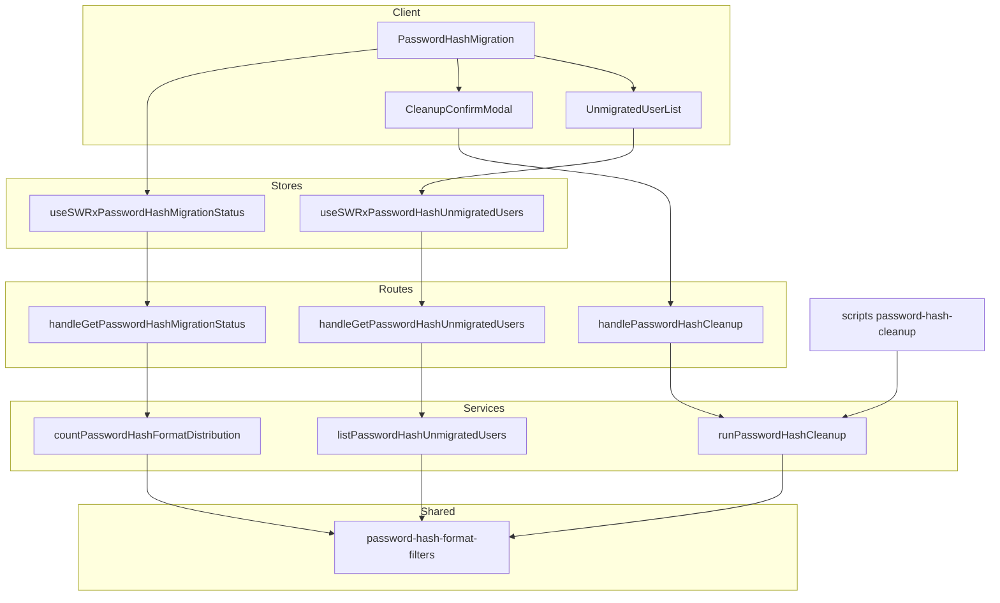
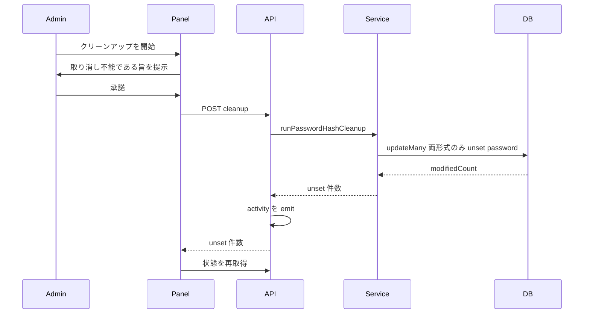
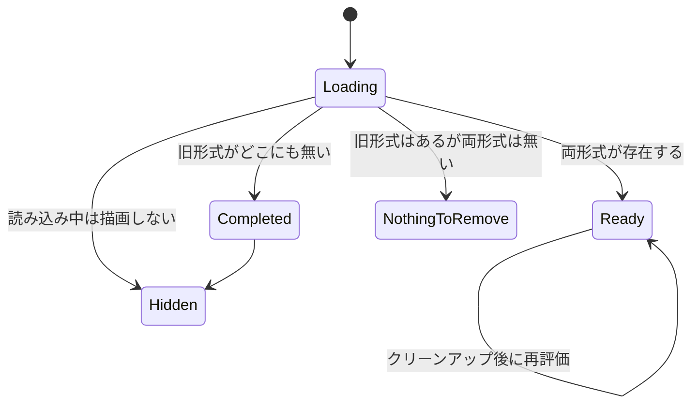

# Design Document

## Overview

**Purpose**: 本機能は、パスワードハッシュ移行の最終段階（旧形式資格情報の削除）を、コンテナシェルを持たない GROWI 管理者に届ける。

**Users**: 管理画面のセキュリティ設定を操作する GROWI 管理者。とりわけ GROWI.cloud のようなマネージドホスティング上のテナント管理者であり、彼らにとって現在この最終段階は到達不能である。

**Impact**: CLI 専用だったクリーンアップを、共有コア + 2 つの入口という構造に変える。あわせて `password-hash-upgrade` から継承した中断規則を撤廃し、移行済みユーザーの分を先に削除できるようにする。

### Goals

- 管理者が資格情報の保存状態を**一貫したスナップショット**として把握できること。
- 未移行者が残っていても、移行済みユーザーの旧形式資格情報を削除できること。
- 未移行者を、人数ではなく**行動可能な一覧**として提示すること。
- 移行が何も残さなくなったらパネルが自律的に消えること。
- CLI と管理画面が削除対象について食い違わないこと。

### Non-Goals

- ハッシュ方式そのもの、および遅延移行の発火条件（`password-hash-upgrade` が所有）。
- 画面から特定ユーザーの移行を強制すること、パスワードリセットメールを送ること。
- ダウングレード準備 / 再アップグレード準備（CLI のまま。実行主体はデプロイ実施者であり、テナント管理者ではない）。
- 永久に移行しないユーザーの解消（削除・凍結など）。本機能は可視化までを担う。
- `PASSWORD_SEED` の撤去手順。環境変数の操作はテナント管理者の権限外である。

## Boundary Commitments

### This Spec Owns

- 資格情報状態の分類結果を**管理者に提示する契約**（分布・完了判定・未移行者一覧）。
- クリーンアップ操作の**実行可否と実行結果の意味**（何件削除したか、何が影響を受けないか）。
- クリーンアップの**対象集合の定義**（両形式を持つユーザーのみ）と、それが CLI / API 双方で同一であること。
- 管理画面パネルの**出現・消滅条件**。

### Out of Boundary

- 資格情報の生成・検証・遅延移行（`password-hash-upgrade` 所有、`service/password-hash.ts` と `service/passport.ts`）。
- 分類フィルタ `password-hash-format-filters.ts` の**意味論**。本 spec はこれを利用するが、「何をもって存在とみなすか」の定義は upstream のものであり変更しない。
- アクティビティログの記録機構（`middlewares/add-activity.ts` / `service/activity.ts`）。本 spec は記録を 1 件追加するだけ。
- ダウングレード準備 / 再アップグレード準備スクリプト。

### Allowed Dependencies

- `server/models/user/password-hash-format-filters` — 分類の単一の出どころ。
- `mongoose.connection.collection('users' | 'externalaccounts')` — 生ドライバ経由。Mongoose モデル層を介さないのは、全件に対する集計・一括更新だからである。
- apiv3 の認可ミドルウェア（`accessTokenParser` / `loginRequiredStrictly` / `adminRequired`）と `addActivity`。
- `PaginationWrapper`、SWR、`client/util/toastr` — 既存の管理画面基盤。

**依存方向**: `filters(型・分類)` → `service` → `routes` → `stores` → `components`。逆流は禁止。とくに `service` は `~/interfaces/*` 以外のクライアント資産を参照しない。

### Revalidation Triggers

以下が起きたら、依存側は統合を再確認すること。

- `password-hash-format-filters` の存在判定の意味が変わる（例: `''` の扱い）。
- `IResPasswordHashMigrationStatus` のフィールド構成が変わる。
- 遅延移行が `password` フィールドを**書き込む**ようになる（現在は書き込まない。後述の D-4 根拠が崩れる）。
- `externalaccounts` のユーザー参照フィールド名が `user` から変わる。
- クリーンアップの対象集合定義（両形式のみ）が変わる。

## Architecture

### Existing Architecture Analysis

本機能は既存構造の**拡張**である。`password-hash-upgrade` が次を確立済みであり、これを尊重する。

- 資格情報 2 フィールド（`password` = 旧 / `passwordHash` = 新）の有無で 4 状態が定まる。
- 分類はクエリフィルタとして `password-hash-format-filters.ts` に集約されている。
- クリーンアップ本体は `service/` にあり、CLI と API の 2 入口から共有される（リポジトリの「executors take their work-set as input」規約）。

**解消する技術的負債**: `runPasswordHashCleanup` が抱える中断分岐。これは `password-hash-upgrade` Requirement 3.4 の実装だが、外部認証ユーザーが ACTIVE かつ未移行のまま滞留するため条件が解消せず、機能を恒久的に封じている（`research.md` に実測の再現を記録）。

### Architecture Pattern & Boundary Map



**Architecture Integration**

- **採用パターン**: 共有コア + 複数入口。`Cleanup` が CLI と API の双方から呼ばれることが Requirement 7 を規律ではなく構造によって保証する。
- **境界**: `Services` は HTTP も `process.exit` も env も知らない。純粋にコレクションを受け取り結果を返す。入口側がそれぞれの関心（終了コード / HTTP ステータス / 監査記録）を持つ。
- **保持する既存パターン**: アクティビティは `res.apiv3()` の**前**に emit（`rules/activity-recording.md`）。`addActivity` は認可チェーンの後ろ。
- **新規要素の根拠**: 新規コンポーネントは無い。既存 3 サービス + 3 ハンドラ + 3 コンポーネントの**改訂**である。

### Technology Stack

| Layer | Choice | Role in Feature | Notes |
|---|---|---|---|
| Frontend | React 18 / Next.js Pages Router | 管理画面パネル | 既存の `Admin/Security` 配下に同居 |
| State | SWR | 状態取得とクリーンアップ後の再検証 | 一覧側は `isEnabled` ゲートで遅延取得（4.5） |
| Backend | Express + apiv3 | 3 ルート | 新規依存なし |
| Data | MongoDB（生ドライバ） | 集計・一覧・一括更新 | Mongoose モデル層を経由しない |
| Index | Mongoose スキーマ宣言 | 部分インデックス | `.claude/rules/model.md` によりインデックス生成は Mongoose が担当 |

新規ライブラリ依存は無い。

## File Structure Plan

### Modified Files

| ファイル | 変更内容 |
|---|---|
| `src/server/service/password-hash-cleanup.ts` | 中断分岐を削除（3.1）。結果型を `{ unset }` のみに縮約し、報告用の集計は持たない。 |
| `src/server/service/password-hash-format-distribution.ts` | 逐次 5 カウントを **`$facet` による 1 パス**へ置換（1.1, 1.2）。既存フィルタを `$match` に流用し、分類の出どころを 1 つに保つ。 |
| `src/server/service/password-hash-unmigrated-users.ts` | 変更なし（契約は現状のまま 4.1–4.3, 4.7 を満たす）。部分インデックスの恩恵を受ける側。 |
| `src/server/scripts/password-hash-cleanup.ts` | 終了コードを `aborted` 由来から「例外時のみ非ゼロ」へ（3.3）。報告が要る場合は `countPasswordHashFormatDistribution` を別途呼ぶ。 |
| `src/server/routes/apiv3/security-settings/password-hash.ts` | 409 分岐を削除。`isCleanupRunnable` をレスポンスから除去（2.8 はクライアントが `both` から導出）。 |
| `src/server/routes/apiv3/security-settings/index.js` | swagger から 409 を削除。 |
| `src/server/models/user/index.js` | 部分インデックスを宣言（4.3 の性能根拠）。 |
| `src/interfaces/password-hash-migration.ts` | `IResPasswordHashMigrationStatus` から `isCleanupRunnable` を除去。 |
| `src/client/.../PasswordHashMigration/PasswordHashMigration.tsx` | `StatusBanner` を 2 状態へ縮約。未移行者への注記を「影響を受けない」枠づけへ（3.4）。 |
| `src/client/.../PasswordHashMigration/UnmigratedUserList.tsx` | 装飾アイコンの `span.material-symbols-outlined` に `aria-hidden="true"` を付与（4.4–4.6 のテスト可能性と a11y）。詳細は下記 UI 節。 |
| `public/static/locales/*/admin.json` (×5) | `blocked` を削除し `unaffected_note` を追加（3.4）。 |
| `.kiro/specs/password-hash-upgrade/requirements.md` | Requirement 3.4 に本 spec による置き換え注記（境界の一貫性）。 |

### Created Files

| ファイル | 責務 |
|---|---|
| `src/client/.../PasswordHashMigration/locale-disclosure.spec.ts` | ロケール文言にアルゴリズム名・CLI 名が混入しないことの drift ガード（6.1, 6.2）。 |

### Referenced but Unchanged

本設計が参照するが変更しないファイル。境界の確認のため明示する。

| ファイル | 役割 | 変更しない理由 |
|---|---|---|
| `src/client/.../PasswordHashMigration/CleanupConfirmModal.tsx` | 同意取得と結果の事前提示（2.2, 2.3） | 中断撤廃の影響を受けない。文言は確定済み。 |
| `src/stores/admin/password-hash-migration.ts` | 状態取得と実行の SWR フック | レスポンスからの `isCleanupRunnable` 除去は型側の変更のみで、フックの形は変わらない。 |
| `src/stores/admin/password-hash-unmigrated-users.ts` | 一覧の SWR フック（`isEnabled` ゲート、4.5） | 変更なし。 |
| `src/server/models/user/password-hash-format-filters.ts` | 分類の単一の出どころ | **upstream 所有。本 spec は利用するのみで意味論を変えない。** |

なお `DistributionTable` と `StatusBanner` は `PasswordHashMigration.tsx` 内の非公開コンポーネントであり、独立したファイルを持たない。

既存テスト（`password-hash-cleanup.integ.ts`, `password-hash.spec.ts`, `PasswordHashMigration.spec.tsx`）は中断前提のケースが反転するため改訂対象。

## System Flows

### クリーンアップ実行（中断撤廃後）



**主要な決定**: 未移行者の人数は結果に含まれるが、**分岐には使われない**。書き込み対象は常に両形式のユーザーのみであり、未移行者の資格情報に触れる経路は存在しない（3.2）。

### パネルの表示状態



中断状態が消えたため、従来の 3 分岐は `Ready` / `NothingToRemove` の 2 つに縮約される（5.3）。

## Requirements Traceability

| Requirement | 概要 | Components | Interfaces | Flows |
|---|---|---|---|---|
| 1.1, 1.2 | 4 状態と ACTIVE 内訳の提示 | `countPasswordHashFormatDistribution`, `DistributionTable` | `IPasswordHashFormatDistribution` | — |
| 1.3 | 取得失敗の提示 | `PasswordHashMigration` | SWR `error` | — |
| 1.4 | 再読み込み不要の更新 | `PasswordHashMigration` | SWR `mutate` | クリーンアップ実行 |
| 1.5 | 集計の認可 | ルート登録 | `adminRequired` + READ スコープ | — |
| 2.1 | 両形式のみ削除 | `runPasswordHashCleanup` | `bothFilter` | クリーンアップ実行 |
| 2.2, 2.3 | 同意と結果の事前提示 | `CleanupConfirmModal` | — | クリーンアップ実行 |
| 2.4, 2.5 | 件数報告 / 失敗報告 | `handlePasswordHashCleanup` | `IResPasswordHashCleanup` | クリーンアップ実行 |
| 2.6 | 監査記録 | `handlePasswordHashCleanup` | `ACTION_ADMIN_PASSWORD_HASH_CLEANUP` | クリーンアップ実行 |
| 2.7 | 実行の認可 | ルート登録 | `adminRequired` + WRITE スコープ | — |
| 2.8 | 対象ゼロなら提供しない | `PasswordHashMigration` | `distribution.both` | パネル表示状態 |
| 2.9 | 冪等性 | `runPasswordHashCleanup` | `modifiedCount` | — |
| 3.1, 3.2 | 未移行者がいても実行 / 触れない | `runPasswordHashCleanup` | `bothFilter` | クリーンアップ実行 |
| 3.3 | CLI も同一規則 | `scripts/password-hash-cleanup.ts` | 終了コード | — |
| 3.4, 3.5 | 影響を受けない旨と移行条件の説明 | `PasswordHashMigration` | ロケールキー | パネル表示状態 |
| 4.1–4.3, 4.7 | ページング / 行の内容 / 並び / 上限 | `listPasswordHashUnmigratedUsers` | `IPasswordHashUnmigratedUserList` | — |
| 4.4 | 非 ACTIVE の明示 | `UnmigratedUserList` | — | — |
| 4.5 | 要求されるまで取得しない | `useSWRxPasswordHashUnmigratedUsers` | `isEnabled` | — |
| 4.6 | 一覧取得失敗の提示 | `UnmigratedUserList` | SWR `error` | — |
| 4.8 | 一覧の認可 | ルート登録 | `adminRequired` | — |
| 5.1, 5.2, 5.3 | パネルの出現・消滅 | `PasswordHashMigration` | `isCleanupCompleted` | パネル表示状態 |
| 6.1, 6.2 | アルゴリズム名 / CLI 名を出さない | ロケール群 | `locale-disclosure.spec.ts` | — |
| 6.3, 6.4 | 強化としての説明 / 全言語 | ロケール群 | — | — |
| 7.1, 7.2 | 2 経路の一致 | `runPasswordHashCleanup` | 共有コア | クリーンアップ実行 |

## Components and Interfaces

| Component | Layer | Intent | Req | Dependencies | Contracts |
|---|---|---|---|---|---|
| `runPasswordHashCleanup` | Service | 両形式ユーザーから旧形式を削除 | 2.1, 2.9, 3.1–3.3, 7.1, 7.2 | filters (P0) | Service |
| `countPasswordHashFormatDistribution` | Service | 一貫スナップショットで 4 状態を数える | 1.1, 1.2 | filters (P0) | Service |
| `listPasswordHashUnmigratedUsers` | Service | 未移行者のページング一覧 | 4.1–4.3, 4.7 | filters (P0), externalaccounts (P1) | Service |
| `password-hash.ts` ハンドラ群 | Route | HTTP と監査の関心 | 1.3–1.5, 2.4–2.8, 4.6, 4.8 | services (P0), activity (P1) | API |
| `PasswordHashMigration` | UI | 分布・バナー・実行導線 | 1.3, 1.4, 2.2, 2.3, 2.8, 3.4, 3.5, 5.1–5.3 | stores (P0) | State |
| `UnmigratedUserList` | UI | 一覧と非 ACTIVE の明示 | 4.4–4.6 | store (P0) | State |

### Service

#### runPasswordHashCleanup

| Field | Detail |
|---|---|
| Intent | 旧形式と新形式を併せ持つユーザーから、旧形式の資格情報のみを削除する |
| Requirements | 2.1, 2.9, 3.1, 3.2, 3.3, 7.1, 7.2 |

**Responsibilities & Constraints**

- 書き込み対象は `bothFilter` に一致する文書のみ。この一点が 3.2 を構造的に保証する。
- 状態（ACTIVE か否か）で書き込みを絞らない。凍結済みユーザーの退役した旧ハッシュも削除対象として正しい。
- 中断しない。未移行者の人数を読む必要すらない。
- **削除だけを行い、報告のための集計は行わない。** 集計は `countPasswordHashFormatDistribution` の責務である。
- HTTP も終了コードも env も接続も知らない。

```typescript
export interface PasswordHashCleanupResult {
  /** 旧形式フィールドを削除した文書数。 */
  unset: number;
}

export function runPasswordHashCleanup(
  usersCollection: Collection,
  baseFilter?: Filter<Document>,
): Promise<PasswordHashCleanupResult>;
```

- **Preconditions**: `usersCollection` が接続済みであること。
- **Postconditions**: `bothFilter` に一致した全文書から `password` が除去されている。それ以外の文書は不変。
- **Invariants**: `legacyOnlyFilter` に一致する文書は、いかなる経路でも変更されない。
- **Idempotency**: 2 回目以降の実行は `unset: 0` を返して正常終了する（2.9）。空集合への `updateMany` は書き込みを行わない。

**Implementation Notes**

- 旧 `aborted` フィールドは削除する。「中断したか」という問いが存在しなくなるため、残せば呼び出し側に恒久的に偽の分岐点を残すことになる。
- **未移行者の件数は結果から外す。** 中断が無くなった以上これらは分岐に使われず、API 経路は破棄し、CLI のログ行のためだけに 2 回の追加走査を払うことになる。さらに悪いことに、それらは `updateMany` の**前に別クエリで**取られるため、状態集計で問題視したのと同じ「別時点のスナップショット」を、同じ設計の中に残すことになる。
- CLI が実行前後の状況を報告したい場合は `countPasswordHashFormatDistribution` を別途呼ぶ。削除と報告を分離することで、どちらも単一の責務を保ち、報告側は一貫スナップショットの恩恵を受ける。

#### countPasswordHashFormatDistribution

| Field | Detail |
|---|---|
| Intent | 4 状態と ACTIVE 内訳を、単一の一貫したスナップショットとして数える |
| Requirements | 1.1, 1.2 |

**Responsibilities & Constraints**

- **1 回の集約パス**で全カウンタを算出する。従来の逐次 5 回 `countDocuments` を置き換える。
- **既存の分類フィルタを `$facet` の各 `$match` にそのまま渡す。** 分類規則を集約式として書き直さない。これにより分類の出どころは `password-hash-format-filters.ts` ひとつのままとなり、意味論がずれる余地が生じない。

```typescript
export function countPasswordHashFormatDistribution(
  usersCollection: Collection,
  baseFilter?: Filter<Document>,
): Promise<IPasswordHashFormatDistribution>;
```

形は次のとおり。`bothFilter` 等は `password-hash-format-filters.ts` の輸出をそのまま使う。

```
[
  // baseFilter は $facet の前段に置く。先頭ステージのみがインデックスを使えるため。
  ...(baseFilter が空でなければ [{ $match: baseFilter }]),
  { $facet: {
      both:         [{ $match: bothFilter },       { $count: 'n' }],
      legacyOnly:   [{ $match: legacyOnlyFilter }, { $count: 'n' }],
      ...
  } },
]
```

- **`baseFilter` は `$facet` の外（前段）に置く。** 各サブパイプラインに重複して入れない。前段に置けば絞り込みが 1 回で済み、かつ先頭ステージとしてインデックスを使える。
- **`$facet` のサブパイプラインはインデックスを使えない**（先頭ステージのみが使える）。これは本設計において劣化ではない — 分類フィルタは `password` / `passwordHash` を述語とし、そこにインデックスは無いため、置換前の `countDocuments` も COLLSCAN だった。得られるのは走査回数 5 → 1 である。
- 空集合のサブパイプラインは `$count` が結果を返さないため、`[]` を 0 として読む。

- **Postconditions**: 返る各カウンタは**同一時点**の文書集合に対する値である。
- **Invariants**: `upgradedOnly + both + legacyOnly + noPassword` は対象集合の総数に等しい。

**Implementation Notes**

- **主たる採用理由は表示の一貫性である。** 逐次カウントは各クエリが別時点を見るため、遅延移行がカウント間に発生すると、そのユーザーはどの状態にも数えられない（`both` のカウント時点では未移行、`legacyOnly` のカウント時点では移行済み）。結果として分布表の合計がユーザー総数と合わなくなり、「未移行 5 人」と表示しながら一覧には 4 行しか出ない、といった齟齬が起きる。活発なインスタンスでは十分起こりうる。
- 最悪ケースとして、旧形式を持つユーザーがちょうど 1 人のインスタンスでその 1 人がカウント間に移行すると、`both` と `legacyOnly` がともに 0 と読まれ `isCleanupCompleted` が真になってパネルが消える。ただしこれは**一時的な表示の誤り**であり、再読み込みで自己修復する。データは失われない。**これを単独の採用理由とするには弱い**ため、一貫性の改善を主たる理由とする。
- 走査回数が 5 → 1 になるのは副次的な利点である。
- 現行コードの「メモリのため逐次」という注記はこの置換を妨げない。`$facet` の各サブパイプラインは `$count` に畳み込まれるため、保持するのは固定個数のカウンタのみであり、所要メモリは入力件数に依存しない。
- **`$group` + `$cond` による実装は採らない。** 同じ単一スナップショット・単一パスの利点が得られる一方で、分類規則をクエリ構文とは別の集約式として書き直す必要があり、出どころが 2 つに増える。`$facet` + `$match` は既存フィルタをそのまま受け取れるため、その重複を構造的に回避できる。開発 DB 上で両方式と逐次カウントが同一結果を返すことを実測確認済み（`research.md`）。

### Route

#### handleGetPasswordHashMigrationStatus / handlePasswordHashCleanup / handleGetPasswordHashUnmigratedUsers

**Contracts**: API

| Method | Endpoint | Response | Errors |
|---|---|---|---|
| GET | `/security-setting/password-hash/migration-status` | `IResPasswordHashMigrationStatus` | 401, 403, 500 |
| GET | `/security-setting/password-hash/unmigrated-users` | `IPasswordHashUnmigratedUserList` | 401, 403, 500 |
| POST | `/security-setting/password-hash/cleanup` | `IResPasswordHashCleanup` | 401, 403, 500 |

```typescript
export interface IResPasswordHashMigrationStatus {
  distribution: IPasswordHashFormatDistribution;
  /**
   * 旧形式資格情報がどこにも残っていない（both と legacyOnly がともに 0）。
   * 「クリーンアップに削除すべきものが無い」とは別概念であるため、
   * クライアントに導出させずサーバが判定して送る。
   */
  isCleanupCompleted: boolean;
}
```

**Implementation Notes**

- **409 を廃止する。** 中断が存在しなくなるため、クリーンアップが業務上の理由で失敗することはない。残る失敗は 5xx のみ。
- **`isCleanupRunnable` をレスポンスから除去する。** 中断撤廃後これは `both > 0` と同値であり、クライアントは `distribution` から同じ判断ができる（2.8）。残すと「サーバが別の規則を持っている」という誤った示唆になる。apiv3 レスポンスからのフィールド除去として swagger を更新する。
- `isCleanupCompleted` は**残す**。これは `both === 0 && legacyOnly === 0` という非自明な規則であり、過去にクライアント側で `both === 0` と誤導出して「未移行者しかいないのに完了」と表示する不具合を起こしている。サーバ側に置くことが再発防止である。
- アクティビティは `res.apiv3()` の前に emit する（`rules/activity-recording.md`）。

### UI

`PasswordHashMigration` と `UnmigratedUserList` は新たな境界を導入しないため、上記の要約表に加えて以下の実装注記のみを持つ。

- `StatusBanner` は `both > 0` → 実行可能、それ以外 → 削除対象なし、の 2 分岐に縮約する（5.3）。
- 未移行者が 1 人以上いる場合、「これらのユーザーはクリーンアップの影響を受けず、資格情報は旧形式のまま残る」旨を常時提示する（3.4）。これは従来の `blocked`（阻害要因としての枠づけ）を置き換える。
- 外部プロバイダ利用者・長命セッション利用者は使い続けるだけでは移行しない旨の注記（3.5）は現行の `migration_trigger_note` を維持する。
- `isLoading` および `isCleanupCompleted` の場合は何も描画しない（5.1, 5.2）。
- **一覧の開閉ボタン内にある装飾アイコンに `aria-hidden="true"` を付ける。** 現状、`span.material-symbols-outlined` の文字列（`expand_more` / `expand_less`）がボタンのアクセシブル名に連結されるため、支援技術は「expand_more 未移行ユーザーを表示」と読み上げる。リポジトリには同じ `span` に `aria-hidden="true"` を付ける先例が 36 箇所ある。これは a11y の修正であると同時に、ボタンをラベルで特定可能にする（現在の `UnmigratedUserList.spec.tsx` の 3 件はこれが原因で失敗している）。

## Data Models

### Physical Data Model

本機能はスキーマを変更しない。`users` コレクションの既存 2 フィールド（`password` / `passwordHash`）の有無のみを読み書きする。

**追加するインデックス**（`users`）:

```
{ lastLoginAt: -1 }
partialFilterExpression: { password: { $exists: true } }
```

**根拠**: 未移行者一覧は「最終サインインの新しい順」で並ぶ（4.3）。ところが未移行者は定義上ログインしていないため `lastLoginAt` が古いか欠損しており、既存の `lastLoginAt_1` は sparse ではないため、欠損値は降順スキャンの**最後尾**に来る。すなわち UX のために選んだ並び順がインデックス走査にとって最悪の順序であり、移行終盤（大多数が移行済み、残り数十人）に 1 ページ目を埋めるだけでコレクション全体を FETCH しうる。部分インデックスは旧形式保持者のみを含むため、この走査を未移行者の集合に限定する。

**検証済み**: 開発 DB 上で `explain` により、この部分インデックスが一覧クエリで `IXSCAN` として採用されることを確認した。一方、カウント側は `lastLoginAt` が述語に含まれないため採用されない（`research.md`）。カウントの改善は上記の集約パス置換が担う。

**性質**: このインデックスは移行が進むほど縮小し、完了時に空になる。インデックス構築は MongoDB 4.2 以降つねにバックグラウンドで行われるため、既存の大規模コレクションに対しても書き込みを止めない。

## Error Handling

### Error Strategy

| 分類 | 状況 | 応答 |
|---|---|---|
| 認可 (401/403) | 管理者以外の要求 | 拒否し、集計・ユーザー情報を一切開示しない（1.5, 2.7, 4.8）。`addActivity` より前段のため監査行は作らない。 |
| システム (500) | 集計 / 一覧 / 削除の失敗 | `ErrorV3` を返し、クライアントは専用のアラートを出す（1.3, 2.5, 4.6）。**ゼロ件表示や空一覧に縮退させない** — 「失敗」と「対象なし」は管理者にとって意味が異なる。 |
| 業務 (4xx) | 該当なし | 中断撤廃により、クリーンアップが業務上の理由で失敗する状態は存在しない。 |

`updateMany` は文書間で原子的ではないため、接続断などで部分完了しうる。これが無害なのは**操作が冪等かつ単調だから**である — 再実行すれば残りが片付き、途中状態でも削除済みユーザーは正常に認証できる。パネルの再取得は常に実際の保存内容を反映する（2.5）。

### Monitoring

- CLI 経路は従来どおり構造化ログへ完了件数と未移行者の内訳を出力する。
- API 経路はアクティビティログに `ACTION_ADMIN_PASSWORD_HASH_CLEANUP` を実行者とともに記録する（2.6）。
- 削除件数 0 は異常ではない（2.9）。警告として扱わない。

## Testing Strategy

受入基準から導出する。既存テストのうち中断を前提とするケースは反転させる。

### Unit / Integration（サーバ）

1. **中断しないこと**: ACTIVE な未移行ユーザーを含む fixture で `runPasswordHashCleanup` を実行し、両形式ユーザーの `password` が削除され、未移行ユーザーの `password` が残ることを確認する（3.1, 3.2）。既存の「中断する」テストの反転。
2. **冪等性**: 同一 fixture に対して連続 2 回実行し、2 回目が `unset: 0` で正常終了することを確認する（2.9）。
3. **分布の一貫性**: `$facet` の結果が、同じフィルタによる逐次 `countDocuments` と全状態で一致することを fixture 上で確認する（1.1, 1.2）。分類の出どころは 1 つなので規則のずれは起こりえない。ここで見るのは集約パイプラインの組み立て誤りである。
4. **CLI の終了コード**: 未移行者が存在しても終了コードが 0 であることを確認する（3.3）。
5. **一覧の並びと内容**: 既存の integ テストを維持（4.1–4.3, 4.7）。

### API

6. **認可**: 3 ルートすべてについて、管理者以外が 403 を受け、情報が漏れないことを確認する（1.5, 2.7, 4.8）。
7. **監査記録**: クリーンアップ成功時に実行者が帰属した activity 行が残ることを確認する（2.6）。応答完了後に emit すると実行者が失われるため、順序の drift テストとして機能する。
8. **409 が存在しないこと**: 未移行者がいる状態でも 200 が返ることを確認する（3.1）。

### Component

9. **パネルの消滅**: `isCleanupCompleted` 時および読み込み中に何も描画しないこと（5.1, 5.2）。
10. **2 状態のバナー**: `both > 0` で実行可能、`both === 0` かつ未移行者ありで「削除対象なし」かつボタン無効（2.8, 5.3）。
11. **影響を受けない旨の提示**: 未移行者がいる場合に 3.4 の注記が出ること。

### 開示ガード

12. **ロケール drift**: 全ロケールの当該キー群に、アルゴリズム名（`sha256` / `scrypt`）および CLI 名（`password-hash:` / `downgrade-prep` / `reupgrade-prep`）が含まれないことを機械的に固定する（6.1, 6.2）。本 spec で唯一機械検証可能な受入基準である。

## Performance & Scalability

| 対象 | 現状 | 本設計後 |
|---|---|---|
| 状態カウント | 逐次 5 回の COLLSCAN。スナップショット不整合あり | `$facet` による 1 パス。一貫したスナップショット |
| 未移行者一覧 | `lastLoginAt_1` の IXSCAN だが、未移行者が走査最後尾に来るため実質全件 FETCH | 部分インデックスにより旧形式保持者のみを走査 |
| クリーンアップ本体 | `bothFilter` の COLLSCAN + `updateMany` | 変更なし（**許容**） |

**クリーンアップ本体を最適化しない判断**: 一度きりの管理操作であり、対象集合は移行完了に向けて単調に減少する。ここにインデックスを足すと、不要になった時点で残骸が残る。管理者が明示的に起動する単発操作として、全走査 1 回を許容する。

## Open Questions / Risks

- **R1（解決済み・2026-10-14）**: 「コンポーネントテストがローカルで実行できない」という懸念は、依存関係の問題ではなく本環境の `node_modules` の不整合だった。`node_modules` を作り直して解消済みであり、package.json の変更は不要。経緯は `research.md` を参照。Testing Strategy 9–11 は通常どおり RED → GREEN で進められる。
- **既知の欠陥（実装で対処）**: `UnmigratedUserList.spec.tsx` の 3 件が現在失敗している。装飾アイコンの文字列がボタンのアクセシブル名に連結されるためで、`aria-hidden="true"` の付与で解消する（上記 UI 節）。
- **R3（上流合意）**: Requirement 3 は PR #11980 のレビュー指摘に沿うものだが、明示的な承認は未記録である。本設計書がその合意形成の資料を兼ねる。
- **`PASSWORD_SEED` の撤去**: 移行完了後、この環境変数は不要になる。本 spec はこれを扱わない（テナント管理者の権限外）。完了後に管理者へ何を案内すべきかは別途の検討事項。
