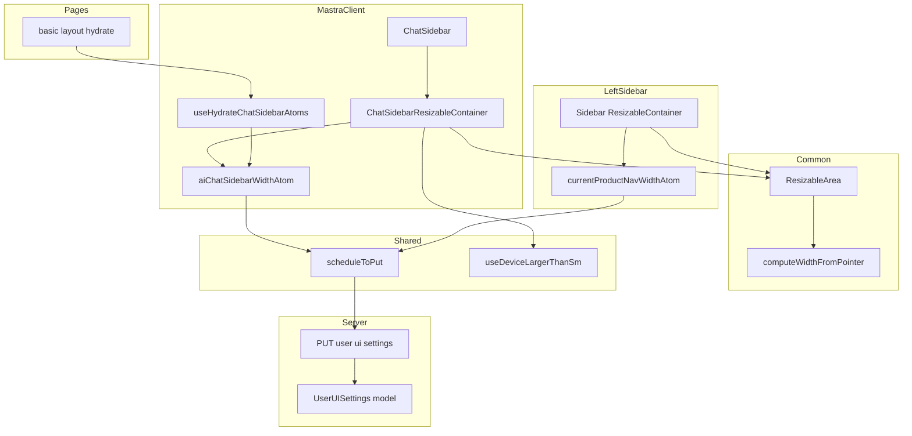
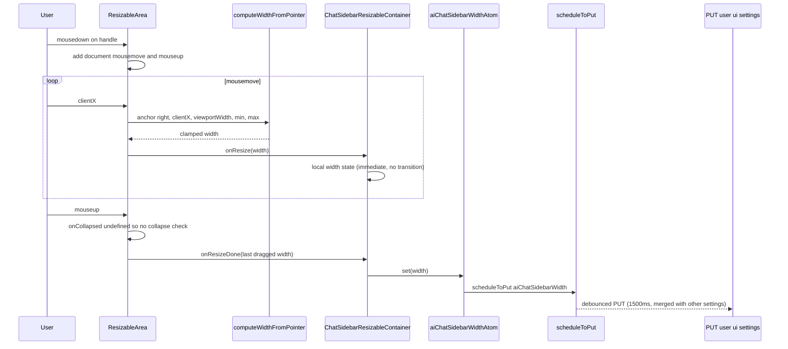

# Technical Design: ai-chat-sidebar-resize

## Overview
**Purpose**: AI チャットサイドバー（画面右端に重なるオーバーレイ）の幅を、左サイドバーと同じドラッグ操作で変更できるようにし、ユーザーごとに保存・復元する。
**Users**: AI チャットを使う全 GROWI ユーザー（ログインユーザーはアカウントに、ゲストはセッションに幅が保存される）。
**Impact**: 既存の左サイドバー用 `ResizableArea` を汎用部品（`Common/`）へ移設して左右アンカーに対応させ、`UserUISettings` に `aiChatSidebarWidth` を追加する。左サイドバーのユーザー可視挙動は変えない。

### Goals
- チャットサイドバー左端のドラッグで幅を変更できる（1.x）
- 幅は 360〜min(960, viewport−320) に収まり、最小未満でも閉じない（2.x）
- 確定幅を `UserUISettings` に保存し、リロード・スレッド切替後も復元する（3.x）
- sm 未満は従来どおり全幅・リサイズ無効（4.x）
- ハンドルがクリップされず、既存のスクロールバー補正と共存する（5.x）
- 左サイドバーの挙動は不変（6.x）

### Non-Goals
- チャットサイドバーの開閉セマンティクス（`close()` が `threadId` を破棄する仕様）の変更
- 本文を押し広げる（非オーバーレイ）レイアウト
- キーボード・タッチによるリサイズ（既存の左サイドバー同様マウスのみ）
- `prisma/schema.prisma` の `useruisettings` 更新（introspection 由来で runtime 未使用。`currentProductNavWidth` / `aiChatSelectedModelKey` も未宣言）

## Boundary Commitments

### This Spec Owns
- `apps/app/src/client/components/Common/ResizableArea/`（移設先）の公開契約: `anchor` / `maxWidth` の追加、`onCollapsed` 省略時のクランプ動作、幅計算の純関数
- `IUserUISettings.aiChatSidebarWidth` の定義・バリデーション・永続化（Mongoose スキーマ、`PUT /user-ui-settings` のバリデータと allow-list、ゲスト session）
- Mastra feature 内の幅 state（`features/mastra/states/`: atom、`scheduleToPut` 連携、hydrate フック、クランプ関数）
- ChatSidebar への ResizableArea 組み込み（外側コンテナの overflow / 幅の持ち方、sm 判定）

### Out of Boundary
- `chat-sidebar.tsx` の開閉 atom（`isOpened` / `threadId` / `openSeq`）の意味
- 左サイドバー（`Sidebar.tsx`）の mode 判定・折りたたみ・幅 atom（import パスの更新のみ行う）
- `PUT /user-ui-settings` の既存フィールドのバリデーション・保存方式
- `useLazyLoader` / `dynamic.tsx` の remount 戦略

### Allowed Dependencies
- `~/client/components/Common/ResizableArea`（本 spec が定義）← `Sidebar.tsx`、Mastra `ChatSidebar`
- `~/client/services/user-ui-settings` の `scheduleToPut`（既存）← Mastra 幅 atom
- `~/states/ui/device` の `useDeviceLargerThanSm`（既存）← Mastra ChatSidebar
- `~/interfaces/user-ui-settings`（既存。フィールド追加のみ）← server / Mastra hydrate
- `pages/basic-layout-page/hydrate.ts` → `~/features/mastra/states` の `useHydrateChatSidebarAtoms`（既存の `useHydrateSidebarAtoms` と同列の合成点。`pages/` は `**/client/**` を static import できないため、states はバレル経由で公開する）
- **禁止**: `~/states/ui/sidebar/**` から `~/features/mastra/**` を import すること。`ResizableArea` から Jotai atom や feature を import すること（純粋な UI 部品に保つ）。

### Revalidation Triggers
- `ResizableAreaProps` の形（`anchor` / `maxWidth` / `onCollapsed` の意味）を変えたとき → `Sidebar.tsx` と ChatSidebar の両方
- `IUserUISettings` のフィールド名 `aiChatSidebarWidth` を変えたとき → server モデル / ルート / spec テスト / Mastra hydrate
- `useHydrateBasicLayoutConfigurationAtoms` のシグネチャを変えたとき → 全 BasicLayout ページ
- 幅の定数（360 / 960 / 320 / 500）を変えたとき → requirements 2.x と hydrate クランプ・テスト

## Architecture

### Existing Architecture Analysis
- 左サイドバー: `ResizableArea`（ドラッグ UI、`Sidebar/` 内部）→ `ResizableContainer`（ローカル state + 幅 atom）→ `currentProductNavWidthAtomExt`（`scheduleToPut`）→ `PUT /user-ui-settings` → SSR props → `useHydrateSidebarAtoms`。
- チャットサイドバー: `BasicLayout` → `ChatSidebarLazyLoaded`（`isOpened` で lazy mount、`threadId`/`openSeq` で remount）→ `ChatSidebar`（fixed オーバーレイ、幅は SCSS 固定）。
- 維持する制約: `.grw-chat-sidebar` の z-index と `margin-right: var(--removed-body-scroll-bar-size)`、`Sidebar.tsx` の `dynamic` + `ResizableAreaFallback` による初回描画幅の再現。

### Architecture Pattern & Boundary Map



**Architecture Integration**:
- Selected pattern: 既存 3 層（UI 部品 / 幅 atom + `scheduleToPut` / `UserUISettings`）の複製。新しい層・API・Provider は作らない。
- Dependency direction: `interfaces` → `server`（model / route）; client は `Common/ResizableArea`（純 UI）← `Sidebar` / `mastra` ← `pages`。`states/ui/sidebar` は mastra を知らない。
- Existing patterns preserved: base atom + 書き込み派生 atom、`scheduleToPut` の debounce、hydrate の合成点、`updateData` allow-list。
- New components rationale: `computeWidthFromPointer`（anchor 差をデータで吸収しテスト可能に）、`ChatSidebarResizableContainer`（ChatSidebar.tsx の肥大化を避け、幅・デバイス判定・atom 接続を 1 責務にまとめる）、`useHydrateChatSidebarAtoms`（feature 内で hydrate を完結）。

### Technology Stack

| Layer | Choice / Version | Role in Feature | Notes |
|-------|------------------|-----------------|-------|
| Frontend | React 18 / Next.js 16 Pages Router / Jotai | ドラッグ UI、幅 state、hydrate | 新規依存なし |
| Backend | Express + express-validator / Mongoose | `aiChatSidebarWidth` の検証・永続化 | 既存ルートに相乗り |
| Styles | SCSS modules + Bootstrap 5.3（sm = 576px） | ハンドル位置（右アンカー）、全幅/可変幅の切替 | |
| Test | Vitest + RTL（happy-dom）+ vitest-mock-extended | 純関数 / 部品 / atom / ルート / ChatSidebar | |

## File Structure Plan

### Directory Structure
```
apps/app/src/
├── client/components/Common/ResizableArea/        # git mv from Sidebar/ResizableArea（移設のみのコミット）
│   ├── index.ts                                    # export { ResizableArea, getViewportWidth }
│   ├── viewport.ts                                 # 新規: getViewportWidth（スクロールバーを除くビューポート幅。ブラウザ専用）
│   ├── props.d.ts                                  # ResizableAreaProps に anchor / maxWidth を追加
│   ├── ResizableArea.tsx                           # 薄いアダプタ: イベント登録と純関数呼び出し、anchor でハンドル配置
│   ├── ResizableArea.module.scss                   # .grw-navigation-draggable-right（right: 100%）を追加
│   ├── ResizableAreaFallback.tsx                   # 変更なし
│   ├── compute-width.ts                            # 新規: computeWidthFromPointer / isCollapseGesture（純関数）
│   ├── compute-width.spec.ts                       # 新規
│   └── ResizableArea.spec.tsx                      # 新規: ドラッグ操作の契約テスト
├── features/mastra/
│   ├── states/                                     # 新規。pages から static import されるため client/ の外に置く（Biome の noRestrictedImports `**/client/**` 対策。features/page-tree/states と同じ配置）
│   │   ├── index.ts                                # バレル: useChatSidebarWidth / getChatSidebarMaxWidth / CHAT_SIDEBAR_WIDTH_MIN / useHydrateChatSidebarAtoms
│   │   ├── chat-sidebar-width.ts                   # 定数、clamp 純関数、atom、useChatSidebarWidth
│   │   ├── chat-sidebar-width.spec.tsx
│   │   ├── hydrate.ts                              # useHydrateChatSidebarAtoms(userUISettings)
│   │   └── hydrate.spec.tsx
│   └── client/components/ChatSidebar/
│       ├── ChatSidebarResizableContainer.tsx       # 新規: fixed ルート・sm 判定・ローカル幅・atom 接続・ResizableArea 配置
│       ├── ChatSidebarResizableContainer.spec.tsx  # 新規
│       ├── ChatSidebarResizableContainer.module.scss # ChatSidebar.module.scss を移設: ルートの z-index・スクロールバー補正・sm 未満の全幅（固定幅は撤去）
│       └── ChatSidebar.tsx                         # 最外の fixed div を ResizableContainer に置き換える
```

### Modified Files
- `apps/app/src/client/components/Sidebar/Sidebar.tsx` — `ResizableArea` / `ResizableAreaFallback` / `ResizableAreaProps` の import を `../Common/ResizableArea` へ変更（挙動変更なし）
- `apps/app/src/interfaces/user-ui-settings.ts` — `aiChatSidebarWidth?: number` を追加
- `apps/app/src/server/models/user-ui-settings.ts` — `aiChatSidebarWidth: { type: Number }` を追加
- `apps/app/src/server/routes/apiv3/user-ui-settings.ts` — バリデータ `isInt({ min: 1 }).toInt()`、`updateData` allow-list、Swagger の request/response に追加
- `apps/app/src/server/routes/apiv3/user-ui-settings.spec.ts` — 永続化・session・バリデータのケースを追加
- `apps/app/src/pages/basic-layout-page/hydrate.ts` — `useHydrateChatSidebarAtoms(userUISettings)` を呼ぶ

## System Flows



- ドラッグ中は `dragging` クラスで width トランジションを止め（1.5）、終了後は既存の 100ms トランジションに戻る（1.6）。
- hydrate 時は `clampChatSidebarWidth(saved)` で固定範囲（360〜960）にだけ丸める（ビューポート非依存）。ビューポート上限は描画・ドラッグ時に `getChatSidebarMaxWidth(viewportWidth)` で適用する（hydrate はビューポートを知らない SSR でも走るため。また狭い画面で開いただけで保存値を書き換えないため）。

## Requirements Traceability

| Requirement | Summary | Components | Interfaces | Flows |
|-------------|---------|------------|------------|-------|
| 1.1 | ハンドル表示 | ResizableArea（anchor right） | `ResizableAreaProps.anchor` | — |
| 1.2 | ホバー時の線・カーソル | ResizableArea.module.scss | — | — |
| 1.3 | ドラッグ追随（右端基準） | ResizableArea, computeWidthFromPointer | `computeWidthFromPointer` | sequence |
| 1.4 | 確定幅採用 | ResizableArea → ChatSidebarResizableContainer | `onResizeDone` | sequence |
| 1.5 | ドラッグ中アニメなし | ResizableArea（`dragging`） | — | sequence |
| 1.6 | 非ドラッグ時の短いアニメ | ResizableArea.module.scss | — | — |
| 1.7 | オーバーレイ維持 | ChatSidebarResizableContainer（fixed ルート）, ChatSidebarResizableContainer.module.scss | — | — |
| 2.1 / 2.2 / 2.5 | 最小・最大・初期値 | chat-sidebar-width（定数, `getChatSidebarMaxWidth`） | `CHAT_SIDEBAR_WIDTH_*` 定数 | — |
| 2.3 | 最小未満で閉じない | ResizableArea（`onCollapsed` 省略時はクランプ） | `isCollapseGesture` | sequence |
| 2.4 | 最大でクランプ | computeWidthFromPointer（`maxWidth`） | — | sequence |
| 3.1 | 確定時に保存 | aiChatSidebarWidthAtomExt → scheduleToPut | State | sequence |
| 3.2 | 保存要求のまとめ | scheduleToPut（既存 debounce） | — | sequence |
| 3.3 | リロード後復元 | useHydrateChatSidebarAtoms, getServerSideUserUISettingsProps（既存） | State | — |
| 3.4 | remount 後も維持 | aiChatSidebarWidthAtom（グローバル atom） | State | — |
| 3.5 | 不正値の丸め | clampChatSidebarWidth（hydrate） | — | — |
| 3.6 | 入力エラー拒否 | user-ui-settings ルート validator | API | — |
| 3.7 | 他設定のみの要求で不変 | ルート（null-strip 既存） | API | — |
| 3.8 | 既存 API 相乗り | ルート（allow-list, Swagger） | API | — |
| 4.1 / 4.2 / 4.3 / 4.4 | sm 判定 | ChatSidebarResizableContainer（ハンドル有無は `useDeviceLargerThanSm`、全幅は ChatSidebarResizableContainer.module.scss のメディアクエリ） | — | — |
| 5.1 | ハンドルがクリップされない | ChatSidebar（外側 overflow 撤去）, ChatSidebarResizableContainer（内側 overflow-hidden） | — | — |
| 5.2 | スクロールバー補正維持 | ChatSidebarResizableContainer.module.scss（`margin-right` 維持） | — | — |
| 5.3 | 横スクロールなし | ChatSidebarResizableContainer（内側 `overflow-hidden`） | — | — |
| 6.1 / 6.2 / 6.3 | 左サイドバー不変 | Sidebar.tsx（import のみ変更）, ResizableArea（デフォルト anchor left） | `ResizableAreaProps` 後方互換 | — |

## Components and Interfaces

| Component | Domain/Layer | Intent | Req Coverage | Key Dependencies | Contracts |
|-----------|--------------|--------|--------------|------------------|-----------|
| computeWidthFromPointer / isCollapseGesture | Common / pure | anchor 別の幅計算とクランプ、折りたたみ判定 | 1.3, 2.3, 2.4 | なし | Service |
| ResizableArea | Common / UI | ドラッグイベントを純関数へ橋渡し、anchor でハンドル配置 | 1.1, 1.2, 1.4, 1.5, 1.6, 2.3, 6.x | computeWidthFromPointer (P0) | Props |
| chat-sidebar-width（`features/mastra/states/`） | mastra / state | 定数、クランプ、atom、`scheduleToPut` 連携 | 2.1, 2.2, 2.5, 3.1, 3.4, 3.5 | scheduleToPut (P0) | State |
| useHydrateChatSidebarAtoms | mastra / state | SSR props から幅 atom を初期化 | 3.3, 3.5 | chat-sidebar-width (P0) | State |
| ChatSidebarResizableContainer | mastra / UI | fixed ルート・sm 判定・ローカル幅・atom 接続・ResizableArea 配置 | 1.4, 1.7, 4.x, 5.1, 5.3 | ResizableArea (P0), useDeviceLargerThanSm (P0), chat-sidebar-width (P0) | Props |
| user-ui-settings ルート/モデル | server | `aiChatSidebarWidth` の検証と保存 | 3.1, 3.6, 3.7, 3.8 | UserUISettings model (P0) | API |

### Common

#### computeWidthFromPointer / isCollapseGesture

| Field | Detail |
|-------|--------|
| Intent | ポインタ位置から anchor に応じた幅を求め、[minWidth, maxWidth] に丸める純関数 |
| Requirements | 1.3, 2.3, 2.4 |

**Contracts**: Service [x]

```typescript
export type ResizableAnchor = 'left' | 'right';

type ComputeWidthInput = {
  readonly anchor: ResizableAnchor;
  readonly pointerX: number;        // MouseEvent.clientX
  readonly viewportWidth: number;   // document.documentElement.clientWidth
  readonly minWidth: number;
  readonly maxWidth?: number;       // undefined = 上限なし
};

/** anchor が left なら pointerX、right なら viewportWidth - pointerX を min/max に丸めて返す */
export const computeWidthFromPointer = (input: ComputeWidthInput): number;

/** 生の幅（丸める前）が minWidth / 2 未満なら true。呼び出し側は onCollapsed がある場合のみ参照する */
export const isCollapseGesture = (input: Omit<ComputeWidthInput, 'maxWidth'>): boolean;
```
- Preconditions: `minWidth >= 0`。`maxWidth` 指定時は `maxWidth >= minWidth`（下回る場合は `minWidth` を優先）。
- Postconditions: 戻り値は常に `>= minWidth`。NaN を返さない。

#### ResizableArea

| Field | Detail |
|-------|--------|
| Intent | document への mousemove/mouseup 登録と純関数呼び出しだけを担う薄いアダプタ |
| Requirements | 1.1, 1.2, 1.4, 1.5, 1.6, 2.3, 6.1, 6.2, 6.3 |

**Contracts**: Props [x]

```typescript
export type ResizableAreaProps = {
  className?: string;
  width?: number;
  minWidth?: number;              // default 0
  maxWidth?: number;              // 新規。undefined = 上限なし
  anchor?: ResizableAnchor;       // 新規。default 'left'（左サイドバーは変更不要）
  disabled?: boolean;
  children?: React.ReactNode;
  onResize?: (newWidth: number) => void;
  onResizeDone?: (newWidth: number) => void;
  onCollapsed?: () => void;       // 省略時は折りたたみ判定を行わず minWidth にクランプ
};
```
- 挙動: mousemove で `computeWidthFromPointer` の結果を `onResize` に通知し `dragging` クラスを付ける。mouseup で `onCollapsed != null && isCollapseGesture(...)` なら `onCollapsed`、それ以外は最後の mousemove で計算した幅を `onResizeDone` に通知し（一度も動かしていなければ通知しない）、`dragging` を外す。
- ハンドル配置: `anchor === 'left'` → 既存の `.grw-navigation-draggable`（`left: 100%`）、`'right'` → 追加の修飾クラスで `right: 100%`（`left` は auto）。ハンドルは親の positioned 要素（外側コンテナ）基準で絶対配置されるため、**親は `overflow: hidden` にしてはならない**（5.1）。
- 後方互換: `anchor` / `maxWidth` 省略時は既存の左サイドバー挙動（`pointerX` → `clientX` への変更のみ）。

**Implementation Notes**
- Integration: `Sidebar.tsx` は import パス変更のみ。`withLoadingProps` + `dynamic` 構造と `ResizableAreaFallback` は維持。
- Validation: `ResizableArea.spec.tsx` で happy-dom 上の mousedown → document mousemove/mouseup を発火して契約を検証（詳細は Testing Strategy）。
- Risks: `pageX` → `clientX`。横スクロール無しでは同値。

### Mastra client

#### chat-sidebar-width（state）

| Field | Detail |
|-------|--------|
| Intent | 幅の定数・クランプ・atom・永続化スケジューリングを 1 ファイルに集約 |
| Requirements | 2.1, 2.2, 2.5, 3.1, 3.4, 3.5 |

**Contracts**: State [x]

```typescript
export const CHAT_SIDEBAR_WIDTH_DEFAULT = 500;
export const CHAT_SIDEBAR_WIDTH_MIN = 360;
export const CHAT_SIDEBAR_WIDTH_MAX = 960;
const CHAT_SIDEBAR_VIEWPORT_RESERVE = 320;

/** max(MIN, min(MAX, viewportWidth - RESERVE)) */
export const getChatSidebarMaxWidth = (viewportWidth: number): number;

/** 非有限値・非数は DEFAULT、それ以外は [MIN, MAX] に丸める（viewport 非依存。hydrate 用） */
export const clampChatSidebarWidth = (width: number | undefined): number;

export const aiChatSidebarWidthAtom: PrimitiveAtom<number>;           // base（hydrate 用に export）
export const useChatSidebarWidth: () => [number, (width: number) => void]; // 派生 atom: set 時に整数へ丸めて scheduleToPut({ aiChatSidebarWidth })
```
- State model: base atom（初期値 DEFAULT）＋ 書き込み派生 atom。`~/states/ui/sidebar` の `currentProductNavWidthAtomExt` と同型。
- Persistence: `scheduleToPut` の debounce（1500ms）に相乗り。既存設定と同じ PUT にまとまる（3.2）。
- Concurrency: remount をまたいで同じ store に残るため、スレッド切替後も幅を維持（3.4）。

#### useHydrateChatSidebarAtoms

| Field | Detail |
|-------|--------|
| Intent | `userUISettings?.aiChatSidebarWidth` を `clampChatSidebarWidth` で丸めて base atom に hydrate |
| Requirements | 3.3, 3.5 |

**Contracts**: State [x]

```typescript
export const useHydrateChatSidebarAtoms = (userUISettings?: IUserUISettings): void;
```
- `useHydrateAtoms([[aiChatSidebarWidthAtom, clampChatSidebarWidth(userUISettings?.aiChatSidebarWidth)]])`。
- 呼び出し元: `pages/basic-layout-page/hydrate.ts` の `useHydrateBasicLayoutConfigurationAtoms`（`useHydrateSidebarAtoms` の直後）。

#### ChatSidebarResizableContainer

| Field | Detail |
|-------|--------|
| Intent | ChatSidebar 本体を ResizableArea で包み、sm 判定・ドラッグ中のローカル幅・確定時の atom 更新を担う |
| Requirements | 1.4, 1.7, 4.1, 4.2, 4.3, 4.4, 5.1, 5.3 |

**Contracts**: Props [x]

```typescript
type Props = { children: React.ReactNode };
export const ChatSidebarResizableContainer = (props: Props): JSX.Element;
```
- `width` は sm 判定によらず常に現在幅（ドラッグ中はローカル state、それ以外は atom）を渡す。sm 未満の全幅は `ChatSidebarResizableContainer.module.scss` のメディアクエリが inline width を `!important` で上書きして実現する。`isLargerThanSm` は `disabled`（ハンドルの有無）にだけ使う。
- 上限幅 `maxWidth = getChatSidebarMaxWidth(viewportWidth)` を `resize` イベントで追従する state として持つ（ビューポート幅ではなく上限を持つので、上限が変わらない resize では再描画しない）。描画する幅は `min(ドラッグ中の幅 ?? 保存幅, maxWidth)` とし、より広い画面で保存された幅や、ウィンドウ縮小後の幅もその場で上限に収める（保存値そのものは書き換えない。2.2 / 3.5）。
- `onResize` → ローカル state、`onResizeDone` → `setChatSidebarWidth`（atom → `scheduleToPut`）。
- パネルの fixed ルートもこのコンテナが描画し、その直下に ResizableArea を置く。ハンドルはルート基準で配置されるため、ルートには `overflow-hidden` も幅指定も置かず（5.1）、内側 div に `h-100 overflow-hidden` を置く（5.3）。ルートは `position: fixed` の shrink-to-fit で内側幅に一致する。ルートとハンドルの配置制約を 1 ファイルに閉じ込めるため、ルートは ChatSidebar 側に残さない。

**Implementation Notes**
- Integration: `ChatSidebar.tsx` の最外 div（`tw-root position-fixed top-0 end-0 h-100 border-start bg-body shadow-sm`）を `ChatSidebarResizableContainer` に置き換え、そのクラスはコンテナのルートへ移す（`overflow-hidden` は除く）。`ChatSidebar.module.scss` は `ChatSidebarResizableContainer.module.scss` へ移し、`width: 100%` を sm 未満のみに限定、sm 以上の `width: 500px` を削除。`z-index` と `margin-right` 補正は維持（5.2）。
- Validation: `ChatSidebarResizableContainer.spec.tsx`（`~/states/ui/device` をモックして両分岐）。`ChatSidebar.spec.tsx` は既存モックのまま描画できることを確認。
- Risks: `useDeviceLargerThanSm` は初期値 `false` で mount 後に確定するため、全幅の切替に使うとデスクトップで初回描画が全幅になる。全幅は CSS に任せ、判定はハンドルの有無にだけ使う（research.md「デバイス判定」）。

### Server

#### user-ui-settings ルート / モデル

| Field | Detail |
|-------|--------|
| Intent | `aiChatSidebarWidth` を既存 PUT に追加 |
| Requirements | 3.1, 3.6, 3.7, 3.8 |

**Contracts**: API [x]

| Method | Endpoint | Request | Response | Errors |
|--------|----------|---------|----------|--------|
| PUT | /_api/v3/user-ui-settings | `{ settings: { aiChatSidebarWidth?: number, ...既存 } }` | 保存後の `IUserUISettings`（既存形式） | 400（`isInt({ min: 1 })` 違反、apiV3FormValidator）、500 |

- バリデータ: `body('settings.aiChatSidebarWidth').optional().isInt({ min: 1 }).toInt()`。`toInt()` で数値文字列を数値に変換し、ゲストの session にも数値で保存する。
- ハンドラ: `updateData` に `aiChatSidebarWidth: settings.aiChatSidebarWidth` を追加（null-strip は既存ロジックで 3.7 を満たす）。ゲストは `req.session.uiSettings` へ（既存ループ）。
- モデル: `aiChatSidebarWidth: { type: Number }`（default なし。未設定時はクライアントの DEFAULT）。
- Swagger: requestBody と 200 response の properties に追加。

## Data Models

### Logical Data Model
- `UserUISettings`（user ごとに 1 document、`user` unique）に `aiChatSidebarWidth: Number`（optional）を追加。
- ゲスト: `req.session.uiSettings.aiChatSidebarWidth`。
- 整合性: サーバーは形式（正の整数）のみ保証。実用範囲（360〜960、ビューポート上限）はクライアントで保証（research.md の Decision 参照）。

## Error Handling
- 400: `aiChatSidebarWidth` が非整数・1 未満・非数 → 既存の `apiV3FormValidator` のエラー形式（3.6）。
- 保存失敗（500）: 既存のログ＋`ErrorV3`。クライアントは `scheduleToPut` の fire-and-forget のまま（既存の幅設定と同じ。UI 上の幅は維持される）。
- 不正な永続値（範囲外・欠損）: hydrate 時に `clampChatSidebarWidth` で DEFAULT または範囲内へ（3.5）。例外は投げない。

## Testing Strategy

### Unit Tests
- `compute-width.spec.ts`: left/right の幅計算、min/max クランプ、`maxWidth < minWidth` 時に min 優先、`isCollapseGesture` の境界（`minWidth / 2` ちょうどは false）。
- `chat-sidebar-width.spec.tsx`: `getChatSidebarMaxWidth`（960 上限、viewport−320、min 下回り時は 360）、`clampChatSidebarWidth`（undefined/NaN → 500、範囲外 → 丸め）、`useChatSidebarWidth` の set で `scheduleToPut` が `{ aiChatSidebarWidth }` で呼ばれ、小数は整数に丸められる（`~/client/services/user-ui-settings` をモック）。
- `hydrate.spec.tsx`: `userUISettings` あり/なし/範囲外で base atom の値（Jotai `Provider` + `renderHook`）。
- `user-ui-settings.spec.ts`（追加）: `aiChatSidebarWidth` が `$set` に到達、省略時は `$set` に含まれない、ゲストは session に書かれる、validator が `500` を受理し `'abc'` / `0` / `12.5` を拒否する。数値文字列 `'640'` は数値 `640` に変換される（`toInt()`）。

### Component Tests (happy-dom)
- `ResizableArea.spec.tsx`: `anchor="right"` で mousedown → mousemove(clientX) → `onResize` に `viewportWidth - clientX`（min/max 丸め済み）が渡る。mouseup で最後の幅が `onResizeDone` に渡り、移動せずに離したときは呼ばれない。`onCollapsed` なしで最小未満の mouseup → `onCollapsed` なし・`onResizeDone` あり。`onCollapsed` ありで最小/2 未満 → `onCollapsed`（左サイドバー互換）。`disabled` → ハンドルが描画されない。
- `ChatSidebarResizableContainer.spec.tsx`: `useDeviceLargerThanSm` が true → atom の幅が style に反映されハンドルが存在、false → ハンドルなし（全幅はメディアクエリのため happy-dom では検証しない）。判定が false のままでも初回描画から保存幅が style に反映される。`onResizeDone` 経由で atom が更新される。fixed ルートに `overflow-hidden` が無くハンドルがその配下に描画されること。ビューポート 1000px でドラッグ上限が 680（= 1000 − 320）になること、保存幅 900 が描画時に 680 へ収まり保存値は書き換えられないこと、`resize` 後に上限へ追従すること。
- `ChatSidebar.spec.tsx`（既存）: ResizableContainer をモックせずに既存ケースが通ること。幅・ドラッグ・sm 判定・ルートとハンドルの配置は `ChatSidebarResizableContainer.spec.tsx` が担い、ここでは重複させない。

### Manual Smoke
- 左サイドバー: ドック時のドラッグ、最小幅 348px、半分未満で折りたたみ、保存、ドロワー/折りたたみ時はハンドルなし、初回描画で幅が飛ばない（6.x）。
- チャット: リサイズ → リロードで復元 → スレッド切替で維持 → モデル選択ドロップダウン表示中にパネルがずれない（5.2）→ ウィンドウを 576px 未満にして全幅。
