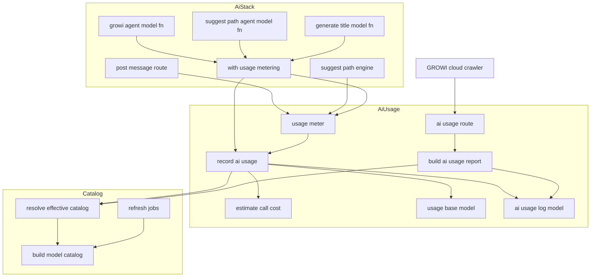
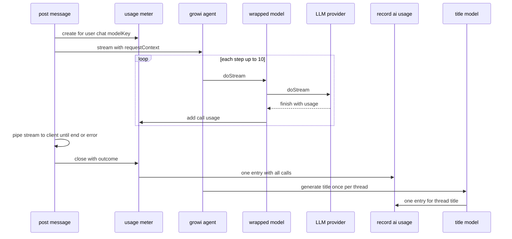
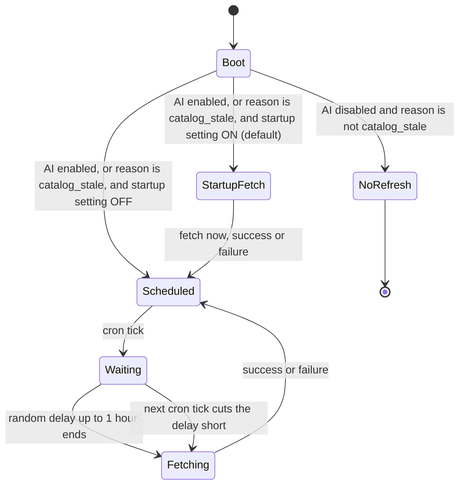

# Design Document

## Overview

**Purpose**: GROWI の AI 機能が LLM を呼んだときの使用量を記録し、GrowiApp 単位の合計とカタログの鮮度を、認証なしの API で外から読めるようにする。合計は生のトークン数ではなく、モデルの単価差を反映した「基準モデルに対する倍率」（重み付き消費量）で出す。

**Users**: GROWI.cloud の運営は、Hosted の組織に属する GrowiApp の合計を集めて、上限を超えた組織やカタログが古い組織を止めるのに使う。GROWI の管理者は、自分の GROWI の AI 利用量を監視するのに使う。

**Impact**: 次の 4 つを変える。

- モデルカタログに単価（段階料金を含む）を持たせる。
- 3 か所の LLM 呼び出し（チャット、suggest-path、スレッドタイトルの生成）で使用量を記録する。
- 停止理由が「カタログが古い」のときだけ、AI が無効でもカタログをリフレッシュする。
- 定期リフレッシュの取得時刻を GROWI ごとにずらす。

### Goals

- 3 か所の LLM 呼び出しの使用量を、1 つの仕組みで漏れなく記録する。
- 重み付き消費量を、記録した時点の単価で確定させる。
- AI が無効でも、メンテナンスモード中でも、AI を一度も使っていない GROWI でも、公開 API が軽く応答する。
- 「カタログが古い」で止まった GrowiApp が、人手を介さずに自動で復旧する。

### Non-Goals

- 停止理由やゲージを画面に出すこと、GROWI.cloud のゲージ API を呼ぶこと（`ai-usage-growi-cloud`）
- ユーザー単位の上限の判定（`ai-usage-fair-use`）
- 組織単位の合計、上限の判定、`AI_ENABLED` による停止の指示（GROWI.cloud 側）
- 呼び出しごとの内訳を記録に残すこと、長期の利用傾向の分析
- 応答の途中でクライアントが切断したときに、LLM の実行を止めること（今の振る舞いのまま、最後まで実行して記録する）

## Boundary Commitments

### This Spec Owns

- モデルカタログの単価（`pricing`）の取り込み、保存、読み込み。リリース前に同梱カタログを作る経路と、実行中にリフレッシュする経路の両方を含む。
- どちらのカタログを採用したかと、その中身を取得した日時を返す関数（`resolveEffectiveCatalog`）
- 使用量の記録のコレクション `aiusagelogs` とその TTL。このコレクションへ書き込むのは、この spec の部品だけである。
- 推定費用と重み付き消費量の計算
- LLM の呼び出しを包んで使用量を集める仕組み（`withUsageMetering` と UsageMeter）
- 公開 API `GET /_api/v3/ai-usage` の応答の形
- 設定キー `ai:usageBaseModel`（基準モデル）と `ai:disabledReason`（停止理由）の定義と読み方、停止理由のコード `catalog_stale` の定数
- カタログリフレッシュを動かす条件と、取得時刻のずらし方

### Out of Boundary

- 停止理由の表示、`aiReadyGuard` の振る舞いの変更（`ai-usage-growi-cloud`）
- `catalog_stale` 以外の停止理由のコードの意味づけ。この spec は値をそのまま読めるようにするだけで、`catalog_stale` 以外には反応しない。
- ユーザー単位の集計と、そのためのインデックス（`ai-usage-fair-use`）
- 起動時以外のタイミングで基準モデルの設定を検証し直すこと
- 公開 API を外部から呼べないようにすること（GROWI.cloud の運用）

### Allowed Dependencies

- `features/ai-usage` が依存してよいもの:
  - `features/mastra/interfaces/*`（`model-key`、`ai-provider`）
  - `features/mastra/server/services/ai-sdk-modules/` のうち、カタログの軽いモジュール（`build-model-catalog`、`effective-model-catalog`）
  - `~/utils/prisma`、Mongoose、`configManager`、logger
  - `@mastra/*`・`@ai-sdk/*`・`ai` は**静的に import してはいけない**。公開 API の import の範囲を軽く保つためである。
- `features/mastra` から `features/ai-usage` への依存は、次に限る: 集計器（`createUsageMeter`）、`recordAiUsage`、`readAiDisabledReason`、停止理由の定数、型。
- `features/mastra/server/services/usage-metering/` は `ai`（`wrapLanguageModel`）に依存してよい。このディレクトリは、遅延読み込みされる AI スタックの中からしか読まれない。
- 依存の向き: `features/ai-usage/interfaces` → `features/ai-usage/server/{models, services}` → `features/ai-usage/server/routes`。`models/ai-usage-log.ts` は `~/utils/prisma` の値を import しない（型だけ）。`utils/prisma.ts` から読まれるため、値を import すると循環する。`features/mastra` の AI スタックは `features/ai-usage/server/services` を使うが、その逆向きの依存は作らない。

### Revalidation Triggers

- `GET /_api/v3/ai-usage` の応答の形（項目名、単位、開始時刻の数の上限）を変えたとき → GROWI.cloud のクロール処理と `ai-usage-growi-cloud`
- `aiusagelogs` の項目（特に `userId`・`inputTokens`・`outputTokens`・`createdAt`）を変えたとき → `ai-usage-fair-use`
- 重み付き消費量の定義（基準モデルの出力単価で割る）を変えたとき → GROWI.cloud の上限値（重み付き消費量で設定される）
- env 名 `AI_USAGE_BASE_MODEL` と `AI_DISABLED_REASON`、コード `catalog_stale` を変えたとき → GROWI.cloud の注入処理と `ai-usage-growi-cloud`
- カタログの要素の形（`pricing`）を変えたとき → 同梱カタログの再生成と、`ai-provider-model-picker` の Data Contracts

## Amend target

この spec は、完了済みの spec `ai-provider-model-picker` と `ai-provider-multi-vendor` の約束を変える。spec-lifecycle のルールに従い、最後のタスクで変えた内容を書き戻す。この spec 自体は新しい機能なので、削除はしない（umbrella の roadmap の Amend target と同じ）。

| 対象 | 今の約束 | 変更後 |
|---|---|---|
| 要件 9.2 | 起動時のリフレッシュは、AI が有効で、かつ設定が ON のときだけ動く。設定は既定で OFF | 設定の既定値を ON にする。AI が無効で停止理由が `catalog_stale` のときも、設定が ON なら動く。AI を有効にしたセルフホストの GROWI も、起動するたびに 1 回取りに行く。止めたいときは設定を OFF にする |
| 要件 9.3 | 定期リフレッシュは、AI が有効なときに、スケジュールどおり動く | AI が有効なとき、または停止理由が `catalog_stale` のときに動く。取得はスケジュールの時刻から 0〜1 時間ずらす |
| 要件 9.6 | 起動時・定期のリフレッシュは、AI が有効なときだけ動く | 停止理由が `catalog_stale` のときも動く。「既定構成の GROWI は外部と通信しない」という約束は変えない（停止理由は既定で未設定） |
| Data Contracts「`provider → {id,name}[]`」と、要件の「既知の制約」にある同じ形の記述 | カタログの要素は id と name だけ | 要素に省略可能な `pricing` を足す。要件 7.1（モデル一覧の応答は id と name だけ）は変えず、応答では `pricing` を取り除く |
| Revalidation Triggers「同梱カタログの形の変更」 | — | この変更そのものが該当する。同梱カタログを再生成する |
| 導入・対象範囲・リフレッシュの経路の記述（要件の説明文、設計の概要・対象範囲・リフレッシュの節・図・部品表・設定表） | 「AI が有効なときだけ」「起動時のリフレッシュは既定で OFF」「定期リフレッシュは時刻どおり」 | 上の 9.2・9.3・9.6 の変更後の振る舞いに合わせて書き直す |
| `ai-provider-multi-vendor` の設計「AI の env 固定グループの固定対象」 | `app:aiEnabled`・`ai:providers`・`ai:providerApiKeys` の 3 つ | `ai:usageBaseModel` と `ai:disabledReason` を足して 5 つにする。モデルの設定（`ai:allowedModels`）を外す方針は変えない。同じ spec の再検証が必要になる条件（固定対象の変更）に当たる |

## Architecture

### Existing Architecture Analysis

- AI スタック（`@mastra/*`、`@ai-sdk/*`、約 140MB）は、`aiReadyGuard` を通った最初のリクエストで遅延読み込みされる。起動時の import の範囲に入っていないことは、`no-eager-ai-imports.spec.ts` が検査している。
- エージェントのモデルは、`model: ({ requestContext }) => resolveMastraModel(...)` の形で、呼び出しのたびに解決される。`resolveMastraModel` は解決したモデルをキャッシュし、リクエストの間で使い回す。
- カタログは、同梱カタログ（`resource/model-catalog-data.json`）と、リフレッシュ済みカタログ（Prisma の `mastrarefreshedmodelcatalogs`、1 件だけ）のうち、新しい方を採用する（`effective-model-catalog.ts`）。
- `/_api/v3` には 3 つのルーターがある。`routerForAdmin` と `routerForAuth` はメンテナンスモードの判定より前に、`router` はその後ろに載っている。

### Architecture Pattern & Boundary Map



**Architecture Integration**:

- **方式**: LLM のモデルを包んで、呼び出しのたびに使用量を受け取る（AI SDK の言語モデルのミドルウェア）。集計と保存は、AI スタックに依存しない `features/ai-usage` に置く。
- **境界**: AI スタックの中にあるのは、モデルを包む薄い部品（`with-usage-metering`）だけである。費用の計算、保存、集計、公開 API は `features/ai-usage` が持つ。公開 API は AI スタックを読み込まない。
- **既存の形を保つ点**: カタログの newer-wins、`routerForAdmin` の前例（healthcheck）、Mongoose がインデックスを作り Prisma が問い合わせる形（`page-redirect.ts`）、`randomSleep` と `Math.random` を固定するテスト。
- **steering との整合**: 機能単位のディレクトリ（`features/ai-usage`）、ファイルは小さく責務を 1 つに、計算は純粋関数に切り出す、重い SDK を起動時に読み込まない。

### Technology Stack

| Layer | Choice / Version | Role in Feature | Notes |
|---|---|---|---|
| Backend / Services | `ai` 6.0.197（`wrapLanguageModel`） | LLM の呼び出しを包み、呼び出しごとの使用量を受け取る | 既存の依存。AI スタックの中でだけ使う |
| Backend / Services | `@mastra/core` 1.41.0、`@mastra/memory` 1.20.2 | エージェントの `model` 関数と `generateTitle.model` を、包んだモデルを返す関数に替える | 既存の依存。振る舞いは実測で確認済み（research.md） |
| Backend / Services | Express 4、express-validator | 公開 API とその入力の検証 | 既存 |
| Backend / Services | `rate-limiter-flexible`（`features/rate-limiter`） | 公開 API の回数制限 | 既定値を 1 件足すだけ |
| Data / Storage | MongoDB、Mongoose（インデックス）、Prisma（問い合わせ） | 使用量の記録と集計 | 新しいコレクション `aiusagelogs` |
| Infrastructure / Runtime | node-cron 3.0.3（`CronService`） | 定期リフレッシュ | 新しい依存は足さない |

## File Structure Plan

### Directory Structure

```
apps/app/src/features/ai-usage/
├── interfaces/
│   ├── ai-usage-report.ts          # 公開 API の応答の型（クライアントからも読める）
│   ├── ai-usage-feature.ts         # 記録の種類（chat / suggest-path / thread-title）の型と定数
│   ├── ai-usage-retention.ts       # 記録の保持日数（90 日）。TTL と公開 API の since の上限が共有する
│   └── ai-disabled-reason.ts       # 停止理由のコードの定数（catalog_stale）
└── server/
    ├── index.ts                    # 外へ出す入口: ルーター、集計器、起動時の検証
    ├── models/
    │   └── ai-usage-log.ts         # Mongoose スキーマ（TTL インデックス）＋ Prisma 拡張（書き込みと集計）
    ├── services/
    │   ├── token-usage.ts          # TokenUsage 型と、値なしを保ったまま足し合わせる純粋関数
    │   ├── estimate-call-cost.ts   # 呼び出し 1 回の推定費用（段階料金・キャッシュ単価）を出す純粋関数
    │   ├── usage-base-model.ts     # 基準モデルの設定を読む、起動時に検証する
    │   ├── ai-disabled-reason.ts   # 停止理由の設定を読む
    │   ├── record-ai-usage.ts      # 1 件の記録を作って保存する（例外を外へ出さない）
    │   ├── usage-meter.ts          # リクエスト単位の集計器（UsageMeter）
    │   └── build-ai-usage-report.ts # 公開 API の応答を組み立てる
    └── routes/
        └── apiv3/
            └── ai-usage.ts         # GET /_api/v3/ai-usage（入力の検証と応答だけ）

apps/app/src/features/mastra/server/services/usage-metering/
├── index.ts                        # 外へ出す入口
├── with-usage-metering.ts          # wrapLanguageModel で包み、呼び出しごとの使用量を渡す
├── meter-model-for-request.ts      # requestContext の集計器（なければ 1 回ごとの記録）につないで包む（meterModelForRequest）、呼び出しごとに 1 件ずつ記録するよう包む（meterModelPerCall）
└── from-language-model-usage.ts    # AI SDK v3 の使用量を TokenUsage に変換する純粋関数
```

テストは各ファイルの隣に置く（`*.spec.ts`、DB を使うものは `*.integ.ts`）。

### Modified Files

- `apps/app/src/features/mastra/server/services/ai-sdk-modules/build-model-catalog.ts` — `ModelPricing` 型と `ModelCatalogEntry.pricing?` を足す。models.dev の `cost` と `cost.tiers` を読み、読み込み時の検証の定義に `pricing` を省略可能な項目として足す。
- `apps/app/src/features/mastra/server/services/ai-sdk-modules/effective-model-catalog.ts` — `resolveEffectiveCatalog()` と `findCatalogEntry()` を足す。`getEffectiveModelPicker()` をその上に載せ替える。
- `apps/app/resource/model-catalog-data.json` — `pnpm vendor:models` で、単価付きの同梱カタログに再生成する。
- `apps/app/src/features/mastra/server/routes/admin-ai-settings/get-available-models.ts` — 応答の要素を `{ id, name }` に詰め直す。
- `apps/app/src/features/mastra/server/services/model-catalog-refresh-jobs.ts` — リフレッシュを動かす条件に停止理由を加える。定期リフレッシュに待ち時間を入れる。
- `apps/app/src/features/mastra/server/services/mastra-modules/types/request-context.ts` — `MastraRequestContextShape` に `usageMeter?: UsageMeter` を足す。
- `apps/app/src/features/mastra/server/services/mastra-modules/agents/growi-agent.ts` — `model` 関数で、解決したモデルを `withUsageMetering` で包む。
- `apps/app/src/features/mastra/server/services/mastra-modules/agents/suggest-path/suggest-path-agent.ts` — 同上。モデルキーを `requestContext` から読む（なければ既定のモデル）。
- `apps/app/src/features/mastra/server/services/mastra-modules/agents/suggest-path/request-context.ts` — suggest-path のリクエスト文脈の型は、共通の型 `MastraRequestContextShape` を交差型で受け継ぐので、`modelKey?` と `usageMeter?` はそこから受け継ぐ（suggest-path の型には足さない）。型の説明（JSDoc）を、チャット専用でない書き方に直す。
- `apps/app/src/features/mastra/server/services/mastra-modules/memory/index.ts` — `generateTitle: true` を `generateTitle: titleGeneration` に替える。
- `apps/app/src/features/mastra/server/services/mastra-modules/memory/title-generation.ts`（新規）— `titleGeneration`（`{ model }`）を置き、タイトル用に包んだモデルを返す。`memory/index.ts` は import しただけで MongoDB に接続するのでテストから読めず、設定をこのファイルに分ける。
- `apps/app/src/features/mastra/server/routes/post-message.ts` — 集計器を作って `requestContext` に置き、応答が終わったら（成功・失敗とも）閉じる。
- `apps/app/src/features/ai-tools/suggest-path/server/services/engines/agentic-engine.ts` — モデルキーを 1 回だけ決めて `requestContext` に置く。集計器を作り、`generate` が終わったら（成功・失敗・時間切れとも）閉じる。
- `apps/app/prisma/schema.prisma` — `model aiusagelogs` を足す。
- `apps/app/src/utils/prisma.ts` — `ai-usage-log` の Prisma 拡張を登録する（これで Mongoose のスキーマも起動時に読まれ、TTL インデックスが作られる）。import はモデルのファイル `~/features/ai-usage/server/models/ai-usage-log` を直接指す（`refreshed-model-catalog` と同じ）。`features/ai-usage/server` の入口（`index.ts`）を経由すると、ルートとサービスまで読み込み、`effective-model-catalog.ts` → `~/utils/prisma` と循環するためである。
- `apps/app/src/server/routes/apiv3/index.js` — `routerForAdmin.use('/ai-usage', …)` を healthcheck の隣に足す。
- `apps/app/src/server/crowi/session-id.ts`（新規）— 固定のセッション ID を返す `genid` を作る `createSessionIdGenerator` を置く（`crowi/index.ts` から切り出してテストできるようにする）。
- `apps/app/src/server/crowi/index.ts`（セッションの設定）— `genid` が healthcheck のパスにだけ固定のセッション ID を返している処理を、固定 ID を使うパスの一覧（healthcheck と `/_api/v3/ai-usage`。パスごとに別の ID）を引く形にする。
- `apps/app/src/features/rate-limiter/config/index.ts` — `'/_api/v3/ai-usage'` の既定値を足す。
- `apps/app/src/server/service/config-manager/config-definition.ts` — `ai:usageBaseModel` と `ai:disabledReason` を足し、`env:useOnlyEnvVars:ai` の固定対象に加える。`ai:modelCatalogRefreshOnStartup` の既定値を `true` にする（6.7）。
- `apps/app/src/server/crowi/index.ts` — `asyncAfterExpressServerReady` の中で、基準モデルの設定の検証を動的 import で読み込んで呼ぶ。完了は待たず、失敗は `.catch` で警告ログに残す（`asyncAfterExpressServerReady` は呼び出し側で await されないため、検証の遅れや失敗が後続の処理を止めないようにする）。`crowi/index.ts` は依存の中心なので、静的 import を増やさない（`apps/app/.claude/rules/esm-authoring.md`）。
- `apps/app/src/server/service/import/non-transferable-collections.ts` — `aiusagelogs` を、G2G で移さないコレクションに加える。
- `apps/app/bin/openapi/generate-spec-apiv3.sh` — `src/features/ai-usage/server/routes/apiv3/*.ts` を生成の対象に足す。
- `apps/app/tools/authz-matrix/baselines/route-middleware.json` — 生成用のツールで出力した中から、新しいルートの行だけを書き足す（ファイル全体は生成し直さない。参考の記録で、生成し直すと無関係な行まで変わるため）。

## System Flows

### チャット 1 回分の記録



- 集計器を閉じるのは、ストリームを最後まで読み終えたとき、または途中で例外になったときである（`finally`）。記録の書き込みは待たない。応答の速さに影響させないためである。
- タイトル生成は、Mastra が応答の成功後に非同期で行う。チャットの集計器は使わず、1 回の呼び出しを 1 件として書く。
- suggest-path も同じ流れで、`stream` が `generate`、`doStream` が `doGenerate` になる。

### 定期リフレッシュと停止中のリフレッシュ



- 条件は起動時に 1 回だけ判定する。GROWI.cloud が停止・再開するときは env を注入して Pod を作り直すので、起動中に条件が変わることはない。
- 起動時のリフレッシュは待たずにすぐ取得する。起動の時刻は GROWI ごとにばらばらなので、ずらす必要がない。
- 管理画面からの手動リフレッシュは、待たずにすぐ取得する（今までどおり）。

## Requirements Traceability

| Requirement | Summary | Components | Interfaces | Flows |
|---|---|---|---|---|
| 1.1 | 4 つの単価を取り込む | BuildModelCatalog | `ModelPricing` | — |
| 1.2 | 2 つの経路で同じ単価 | BuildModelCatalog、同梱カタログの再生成 | `buildModelCatalog` | — |
| 1.3 | 単価がなくても選択肢に残す | BuildModelCatalog | `pricing?` | — |
| 1.4 | 古いリフレッシュ済みカタログを捨てない | BuildModelCatalog（読み込み時の検証） | `persistedModelCatalogSchema` | — |
| 1.5 | 単価を外に出さない | GetAvailableModels、AiUsageRoute | `SelectableModel` | — |
| 1.6 | 段階料金を取り込む | BuildModelCatalog | `ModelPriceTier` | — |
| 2.1 | チャット 1 回を 1 件に | WithUsageMetering、UsageMeter、post-message | `UsageMeter.close` | チャット 1 回分の記録 |
| 2.2 | suggest-path 1 回を 1 件に | WithUsageMetering、UsageMeter、agentic-engine | 同上 | 同上 |
| 2.3 | タイトル生成を 1 件に | WithUsageMetering（タイトル用）、RecordAiUsage | `generateTitle.model` | 同上 |
| 2.4 | 記録の項目 | AiUsageLogModel | `AiUsageLogInput` | — |
| 2.5 | 返されない項目は「値なし」 | TokenUsage、FromLanguageModelUsage | `TokenUsage` | — |
| 2.6 | 切断・エラーでもそれまでの分を記録 | UsageMeter、post-message、agentic-engine | `close({ outcome })` | 同上 |
| 2.7 | 何も報告されなければ警告ログ | UsageMeter | 同上 | — |
| 2.8 | 記録の失敗で応答を変えない | RecordAiUsage、UsageMeter | 例外を外に出さない | — |
| 2.9 | 90 日で自動削除 | AiUsageLogModel | TTL インデックス | — |
| 2.10 | 形態を問わず記録 | WithUsageMetering、UsageMeter | 条件分岐を持たない | — |
| 3.1 | 重み付き消費量の計算 | RecordAiUsage、EstimateCallCost | `estimateCallCostUsd` | — |
| 3.2 | キャッシュの単価の使い分け | EstimateCallCost | 同上 | — |
| 3.3 | キャッシュの単価がなければ入力単価 | EstimateCallCost | 同上 | — |
| 3.4 | 分からなければ「不明」 | RecordAiUsage、EstimateCallCost、UsageBaseModel | `weightedUnits: null` | — |
| 3.5 | 記録時に確定 | AiUsageLogModel、RecordAiUsage | 保存後に書き換えない | — |
| 3.6 | 推定費用を記録に残し、外に出さない | AiUsageLogModel、AiUsageRoute | `estimatedCostUsd` | — |
| 3.7 | 呼び出しごとに段階を選んで合計 | EstimateCallCost、RecordAiUsage | 同上 | — |
| 4.1 | 開始時刻ごとの合計 | BuildAiUsageReport、AiUsageLogModel | `sumUsageSince` | — |
| 4.2 | カタログの取得日時と種類 | ResolveEffectiveCatalog、BuildAiUsageReport | `EffectiveCatalog` | — |
| 4.3 | GrowiApp ID | BuildAiUsageReport | `growiAppIdForCloud` | — |
| 4.4 | 認証なし | AiUsageRoute | — | — |
| 4.5 | 合計だけを返す | AiUsageRoute、BuildAiUsageReport | `AiUsageReport` | — |
| 4.6 | AI 無効でも応答 | AiUsageRoute（`aiReadyGuard` の外） | — | — |
| 4.7 | AI スタックを読み込まない | AiUsageRoute と依存の範囲 | 静的 import の検査 | — |
| 4.8 | 不正な入力は 400 | AiUsageRoute | express-validator | — |
| 4.9 | 区切りを持たない | BuildAiUsageReport | 開始時刻だけで集計 | — |
| 4.10 | 回数制限で 429 | rate-limiter の既定値 | `defaultConfig` | — |
| 4.11 | メンテナンスモード中も応答 | AiUsageRoute（`routerForAdmin`） | — | — |
| 5.1 | 基準モデルを env で受け取る | UsageBaseModel、ConfigDefinition | `ai:usageBaseModel` | — |
| 5.2 | 停止理由を env で受け取る | AiDisabledReason、ConfigDefinition | `ai:disabledReason` | — |
| 5.3 | 管理画面から変更させない | ConfigDefinition | env だけから読む | — |
| 5.4 | 不正な基準モデルは警告して未指定扱い | UsageBaseModel | `warnIfUsageBaseModelInvalid` | — |
| 6.1 | 停止中も同じ契機でリフレッシュ | RefreshJobs | `isCatalogRefreshAllowed` | 定期リフレッシュ |
| 6.2 | それ以外の無効時は通信しない | RefreshJobs | 同上 | 同上 |
| 6.3 | 成功したら取得日時を更新 | ResolveEffectiveCatalog（既存の保存を読む） | `contentFetchedAt` | — |
| 6.4 | 定期リフレッシュを遅らせる | RefreshJobs | `JitteredRefreshScheduler` | 同上 |
| 6.5 | 次の契機を越えない | RefreshJobs | 待ちの打ち切り | 同上 |
| 6.6 | 手動は遅らせない | 既存の手動リフレッシュ（変更しない） | — | — |
| 6.7 | 起動時のリフレッシュ（既定で ON） | RefreshJobs、ConfigDefinition | `triggerModelCatalogRefreshOnStartupIfEnabled`、`ai:modelCatalogRefreshOnStartup` | 同上 |

## Components and Interfaces

| Component | Domain/Layer | Intent | Req Coverage | Key Dependencies | Contracts |
|---|---|---|---|---|---|
| BuildModelCatalog | カタログ | models.dev の単価を取り込み、保存・読み込みの形を決める | 1.1〜1.4、1.6 | models.dev（P0） | Service |
| ResolveEffectiveCatalog | カタログ | 採用したカタログ、その種類、取得日時を返す | 4.2、6.3、3.1 | Prisma の保存済みカタログ（P0） | Service |
| GetAvailableModels | カタログ（既存のルート） | モデル一覧の応答から単価を取り除く | 1.5 | ResolveEffectiveCatalog（P0） | API |
| RefreshJobs | カタログ | リフレッシュを動かす条件と、取得時刻のずらし方 | 6.1〜6.7 | AiDisabledReason（P0）、`refreshModelCatalog`（P0） | Batch |
| TokenUsage | ai-usage | 使用量の型と足し算 | 2.5 | なし | Service |
| EstimateCallCost | ai-usage | 呼び出し 1 回の推定費用 | 3.2、3.3、3.4、3.7 | なし | Service |
| UsageBaseModel | ai-usage | 基準モデルの設定を読む、起動時に検証する | 5.1、5.3、5.4 | configManager（P0）、ResolveEffectiveCatalog（P1） | Service |
| AiDisabledReason | ai-usage | 停止理由の設定を読む | 5.2、5.3 | configManager（P0） | Service |
| RecordAiUsage | ai-usage | 1 件の記録を作って保存する | 2.4、2.8、3.1、3.4〜3.7 | EstimateCallCost、UsageBaseModel、ResolveEffectiveCatalog、AiUsageLogModel（いずれも P0） | Service |
| UsageMeter | ai-usage | リクエスト単位で呼び出しをまとめて 1 件にする | 2.1、2.2、2.6、2.7、2.10 | RecordAiUsage（P0） | Service、State |
| AiUsageLogModel | ai-usage | コレクション、TTL、書き込み、集計 | 2.4、2.9、3.5、4.1 | MongoDB（P0） | Service |
| BuildAiUsageReport | ai-usage | 公開 API の応答を組み立てる | 4.1〜4.3、4.5、4.9 | AiUsageLogModel、ResolveEffectiveCatalog（P0） | Service |
| AiUsageRoute | ai-usage | 公開 API の入口 | 4.4〜4.8、4.10、4.11 | BuildAiUsageReport（P0） | API |
| WithUsageMetering | mastra（AI スタック内） | モデルを包み、呼び出しごとの使用量を渡す | 2.1〜2.3、2.10 | `ai` の `wrapLanguageModel`（P0） | Service |
| FromLanguageModelUsage | mastra（AI スタック内） | AI SDK v3 の使用量を TokenUsage に変換する | 2.5 | なし | Service |
| MeterModelForRequest | mastra（AI スタック内） | リクエストの集計器を選んでモデルを包む | 2.1、2.2、2.10 | WithUsageMetering、UsageMeter、RecordAiUsage（P0） | Service |

### カタログ

#### BuildModelCatalog（`build-model-catalog.ts` の変更）

| Field | Detail |
|---|---|
| Intent | models.dev の `cost` を `pricing` として取り込み、保存と読み込みの形を決める |
| Requirements | 1.1、1.2、1.3、1.4、1.6 |

**Responsibilities & Constraints**

- `buildModelCatalog` は、選択肢に残す各モデルについて、`cost` の `input`・`output`・`cache_read`・`cache_write` と、`tiers` のうち `tier.type === 'context'` のものを読む。
- 0 以上の有限の数だけを単価として採る。それ以外の値や欠けた項目は、その項目を持たない（「不明」）。採れる項目が 1 つもなければ `pricing` 自体を持たない。
- 段階は境目の小さい順に並べる。`context` 以外の種類の段階は無視する。
- `cost` の形が壊れていても、そのモデルを選択肢から外さない（`pricing` を持たないだけ）。
- 読み込み時の検証（`persistedModelCatalogSchema`）に `pricing` を省略可能な項目として足す。単価の部分の検証に失敗した要素は、`pricing` を取り除いて受け入れる。カタログ全体は捨てない。
- 同梱カタログを作る経路（`bin/vendor-model-catalog.ts`）とリフレッシュの経路は、どちらも `buildModelCatalog` を通るので、このファイルの変更だけで両方に反映される（1.2）。

**Contracts**: Service [x]

##### Service Interface

```typescript
type ModelUnitPrices = {
  /** USD per 1M tokens. Absent = unknown. */
  readonly input?: number;
  readonly output?: number;
  readonly cacheRead?: number;
  readonly cacheWrite?: number;
};

type ModelPriceTier = ModelUnitPrices & {
  /** The tier applies to a call whose total input tokens exceed this value. */
  readonly inputTokensAbove: number;
};

type ModelPricing = ModelUnitPrices & {
  /** Sorted by inputTokensAbove ascending. Absent when the model has no tiers. */
  readonly tiers?: readonly ModelPriceTier[];
};

type ModelCatalogEntry = {
  readonly id: string;
  readonly name: string;
  readonly pricing?: ModelPricing;
};
```

- 型は既存と同じく `type` で書く（Prisma の `Json` の列に代入できるようにするため）。
- 不変条件: `pricing` のどの数値も 0 以上の有限の数である。

**Implementation Notes**

- Validation: `build-model-catalog.spec.ts`、`model-catalog.spec.ts`、`refresh-model-catalog.spec.ts` は `{id, name}` の形を固定しているので、`pricing` を含む形に直す。
- Risks: 同梱カタログの大きさは約 7KB から 2〜3 倍になる見込みで、問題にならない大きさである。

#### ResolveEffectiveCatalog（`effective-model-catalog.ts` の変更）

| Field | Detail |
|---|---|
| Intent | 採用したカタログ、その種類、中身を取得した日時を 1 回の読み込みで返す |
| Requirements | 3.1、4.2、6.3 |

**Responsibilities & Constraints**

- 新しい方を選ぶ比較は、この関数の中の 1 か所だけに置く。`getEffectiveModelPicker` はこの関数の結果から作る。
- 取得日時は、リフレッシュ済みなら `fetchedAt`、同梱なら `_generatedAt`（`BUNDLED_CATALOG_GENERATED_AT`）とする。
- 保存済みカタログの読み込みに失敗したときは、今までどおり同梱カタログに切り替える。このとき種類は `bundled` になる。
- 外部とは通信しない（今までどおり）。

**Contracts**: Service [x]

##### Service Interface

```typescript
type EffectiveCatalog = {
  readonly source: 'bundled' | 'refreshed';
  readonly contentFetchedAt: Date;
  readonly models: ModelCatalog;
};

declare function resolveEffectiveCatalog(): Promise<EffectiveCatalog>;

declare function findCatalogEntry(
  catalog: EffectiveCatalog,
  provider: AiProvider,
  modelId: string,
): ModelCatalogEntry | undefined;
```

- Postconditions: 例外を投げない（読み込みの失敗は同梱カタログで返す）。
- `findCatalogEntry` は、カタログを持たないプロバイダ（`azure-openai`）には `undefined` を返す。

#### GetAvailableModels（`get-available-models.ts` の変更）

- 応答の要素を `{ id, name }` に詰め直す。応答の型 `SelectableModel` は変えない（1.5、`ai-provider-model-picker` の要件 7.1）。
- `get-available-models.spec.ts` に、要素が `pricing` を持っていても応答に出ないことを確かめるテストを足す。

#### RefreshJobs（`model-catalog-refresh-jobs.ts` の変更）

| Field | Detail |
|---|---|
| Intent | リフレッシュを動かす条件と、取得時刻のずらし方を決める |
| Requirements | 6.1、6.2、6.4、6.5、6.6、6.7 |

**Responsibilities & Constraints**

- 動かす条件: `isAiEnabled()`、または停止理由が `catalog_stale`。どちらでもなければ、定期・起動時のどちらのリフレッシュも予定しない（6.2）。
- 定期リフレッシュ: 契機のたびに 0〜1 時間（`MAX_SCHEDULED_REFRESH_DELAY_MS`）のランダムな時間だけ待ってから取得する。待っている間に次の契機が来たら、前の待ちを打ち切ってすぐ取得させ、新しい契機はまた待ち始める（6.5）。
- 起動時リフレッシュ: リフレッシュが許されていて、`ai:modelCatalogRefreshOnStartup` が ON（既定）なら、待たずにすぐ取得する（6.7）。今の関数の「AI が有効」の判定を、動かす条件（`isCatalogRefreshAllowed()`）に置き換えるだけである。
- 手動リフレッシュのルートは変更しない（6.6）。
- 取得の失敗は、今までどおりログに残し、保存済みのカタログを使い続ける。

**Contracts**: Batch [x]

##### Batch / Job Contract

- Trigger: 起動時（`setupCron` と `asyncAfterExpressServerReady` からの呼び出し）と、`ai:modelCatalogRefreshCronSchedule` の契機
- Input / validation: なし（条件は起動時に 1 回判定する）
- Output / destination: `refreshModelCatalog()` によるリフレッシュ済みカタログの保存（既存）
- Idempotency & recovery: 保存は 1 件の上書きなので、取得が重なっても壊れない。失敗したら次の契機で再試行する。

```typescript
declare function isCatalogRefreshAllowed(): boolean;

/** Wraps a job so that each tick waits a random delay, cut short by the next tick. */
type JitteredRefreshScheduler = {
  readonly onTick: () => Promise<void>;
};
declare function createJitteredRefreshScheduler(params: {
  readonly maxDelayMs: number;
  readonly run: () => Promise<void>;
}): JitteredRefreshScheduler;
```

**Implementation Notes**

- Validation: 既存の「AI が無効なら予定しない」テスト 2 件は、「停止理由がないとき」の条件に直して残す。
- Validation: 待ち時間は `Math.random` を固定して確かめる（`news-cron-service.spec.ts` の前例）。打ち切りは、待っている間に次の契機を起こして、前の取得がすぐ動くことで確かめる。
- Risks: 起動してから取得し終えるまでの数秒間は、公開 API が古い取得日時を返しうる。この間に GROWI.cloud が問い合わせると「カタログが古い」と判定しうるので、再起動の直後の 1 回の判定だけで止めないよう、GROWI.cloud 側に頼んである（`ai-usage-growi-cloud` の未決）。

### ai-usage（計算と設定）

#### TokenUsage（`token-usage.ts`）

| Field | Detail |
|---|---|
| Intent | 呼び出し 1 回分の使用量の型と、足し算 |
| Requirements | 2.5 |

```typescript
type TokenUsage = {
  /** Total input tokens, including cached and cache-written tokens. */
  readonly inputTokens: number;
  /** Total output tokens, including reasoning tokens. */
  readonly outputTokens: number;
  /** null = the provider did not report it (not zero). */
  readonly reasoningTokens: number | null;
  readonly cacheReadTokens: number | null;
  readonly cacheWriteTokens: number | null;
};

declare function sumTokenUsage(usages: readonly TokenUsage[]): TokenUsage;
```

- `sumTokenUsage` は、ある項目がすべての呼び出しで `null` なら `null`、1 つでも数があれば数の合計を返す。

#### EstimateCallCost（`estimate-call-cost.ts`）

| Field | Detail |
|---|---|
| Intent | 呼び出し 1 回の推定費用（USD）を出す |
| Requirements | 3.2、3.3、3.4、3.7 |

```typescript
/** Returns null when input or output price is unknown for the chosen tier. */
declare function estimateCallCostUsd(
  usage: TokenUsage,
  pricing: ModelPricing,
): number | null;
```

- 段階の選び方: `usage.inputTokens` が `inputTokensAbove` を超える段階のうち、境目がいちばん大きいものを使う。どれにも当たらなければ基本の単価を使う。
- 段階の中で欠けている項目は、基本の単価で補わない。補うと、高い段階の呼び出しを安く数えてしまうからである。入力か出力の単価が欠けていれば `null` を返す。
- 費用の式（単価は 100 万トークンあたり）:
  - キャッシュでない入力 = `max(0, inputTokens − (cacheReadTokens ?? 0) − (cacheWriteTokens ?? 0))`
  - 費用 = （キャッシュでない入力 × 入力単価 ＋ キャッシュ読み取り × (キャッシュ読み取り単価 ?? 入力単価) ＋ キャッシュ書き込み × (キャッシュ書き込み単価 ?? 入力単価) ＋ 出力 × 出力単価）÷ 1,000,000
  - 推論トークンは出力に含まれているので足さない。

#### UsageBaseModel（`usage-base-model.ts`）と AiDisabledReason（`ai-disabled-reason.ts`）

| Field | Detail |
|---|---|
| Intent | env から基準モデルと停止理由を読み、基準モデルを起動時に検証する |
| Requirements | 5.1、5.2、5.3、5.4 |

```typescript
type UsageBaseModel = { readonly provider: AiProvider; readonly modelId: string };

/** Reads ai:usageBaseModel from env only. null when unset or malformed. */
declare function readUsageBaseModel(): UsageBaseModel | null;

/** Logs a warning once at boot when the value is malformed or absent from the effective catalog. */
declare function warnIfUsageBaseModelInvalid(): Promise<void>;

/** Reads ai:disabledReason from env only. undefined when unset. */
declare function readAiDisabledReason(): string | undefined;

/** interfaces/ai-disabled-reason.ts */
declare const AI_DISABLED_REASON_CATALOG_STALE: 'catalog_stale';
```

- 基準モデルの値の形式は、既存のモデルキーと同じ `${provider}/${modelId}`（例: `openai/gpt-4o-mini`）。`parseModelKey` で読む。
- どちらも `configManager.getConfig(key, ConfigSource.env)` で読む。DB の値は使わない（5.3）。
- 「カタログにないモデル」の扱いは、記録のたびに判定する。基準モデルの基本の出力単価が分からなければ、その記録の倍率は「不明」になる（3.4、5.4）。起動時の検証は警告ログを出すだけで、記録の処理には影響しない。

#### RecordAiUsage（`record-ai-usage.ts`）

| Field | Detail |
|---|---|
| Intent | 呼び出しの使用量から 1 件の記録を作って保存する |
| Requirements | 2.4、2.8、3.1、3.4、3.5、3.6、3.7 |

**Responsibilities & Constraints**

- 実効カタログを 1 回読み、使ったモデルと基準モデルの単価を引く。
- 呼び出しごとに `estimateCallCostUsd` で推定費用を出して合計する。1 回でも `null` があれば、推定費用と重み付き消費量の両方を `null` にする（一部だけの合計を記録しない）。
- 重み付き消費量 = 推定費用の合計 ÷（基準モデルの基本の出力単価 ÷ 1,000,000）。基準モデルが未指定、基準モデルがカタログにない、またはその出力単価が分からないか 0 のときは `null`（0 で割らない）。
- 生のトークン数は `sumTokenUsage` の結果をそのまま記録する。
- 失敗（カタログの読み込み、DB への書き込み）は例外にせず、エラーログに残す（2.8）。

**Contracts**: Service [x]

```typescript
type AiUsageFeature = 'chat' | 'suggest-path' | 'thread-title';

type AiUsageEntry = {
  readonly userId: string;
  readonly feature: AiUsageFeature;
  readonly modelKey: ModelKey;
  readonly calls: readonly TokenUsage[];
};

/** Never rejects. */
declare function recordAiUsage(entry: AiUsageEntry): Promise<void>;
```

- Preconditions: `calls` は 1 件以上。0 件のときは何も書かない（呼び出し側の UsageMeter が警告を出す）。

#### UsageMeter（`usage-meter.ts`）

| Field | Detail |
|---|---|
| Intent | 1 回の応答の間の呼び出しを集め、終わったら 1 件の記録にする |
| Requirements | 2.1、2.2、2.6、2.7、2.10 |

**Contracts**: Service [x] / State [x]

```typescript
type UsageMeterOutcome = 'completed' | 'failed';

type UsageMeter = {
  /** Called once per finished LLM call. */
  add(usage: TokenUsage): void;
  /** Writes one record for the collected calls. Safe to call more than once. */
  close(params: { readonly outcome: UsageMeterOutcome }): void;
};

declare function createUsageMeter(params: {
  readonly userId: string;
  readonly feature: AiUsageFeature;
  readonly modelKey: ModelKey;
}): UsageMeter;
```

##### State Management

- 状態: 「集めている」→「閉じた」の 2 つ。
- 「閉じた」あとに届いた呼び出しは、それぞれ 1 件として記録する（記録漏れを防ぐ）。
- `close` で集めた呼び出しが 0 件、かつ `outcome` が `failed` のときは、ユーザー・機能・モデルを添えて警告ログを出す（2.7）。0 件で `completed` のときは何もしない（実際には起きない）。
- `close` は記録の書き込みを待たない（`recordAiUsage` は例外を出さない）。

### ai-usage（保存と公開）

#### AiUsageLogModel（`models/ai-usage-log.ts`）

| Field | Detail |
|---|---|
| Intent | `aiusagelogs` の Mongoose スキーマ（インデックス）と Prisma 拡張（書き込み・集計） |
| Requirements | 2.4、2.9、3.5、4.1 |

**Responsibilities & Constraints**

- Mongoose のスキーマは、コレクションとインデックスを作るためだけに置く（`page-redirect.ts` の形）。`createdAt` に 90 日の TTL インデックスを付ける。
- 書き込みと集計は Prisma 拡張から行う。記録は書き込んだ後に書き換えない（3.5）。
- 集計は `aggregateRaw` で 1 回だけ行う。いちばん古い開始時刻以降の記録を `createdAt` のインデックスで読み、開始時刻ごとの合計を `$group` の中で同時に出す。

**Contracts**: Service [x]

```typescript
type AiUsageLogInput = {
  readonly userId: string;
  readonly feature: AiUsageFeature;
  readonly provider: AiProvider;
  readonly modelId: string;
  readonly callCount: number;
  readonly usage: TokenUsage;
  readonly estimatedCostUsd: number | null;
  readonly weightedUnits: number | null;
  /** The base model key used for weightedUnits; null when it was unset. */
  readonly baseModelKey: ModelKey | null;
};

type AiUsageWindowSum = {
  readonly since: Date;
  readonly weightedUnits: number;
  /** inputTokens + outputTokens of records whose weightedUnits is null. */
  readonly unweightedTokens: number;
};

// Prisma extension methods on prisma.aiusagelogs
declare function createLog(input: AiUsageLogInput): Promise<void>;
declare function sumUsageSince(
  sinces: readonly Date[],
): Promise<readonly AiUsageWindowSum[]>;
```

#### BuildAiUsageReport（`build-ai-usage-report.ts`）

| Field | Detail |
|---|---|
| Intent | 開始時刻ごとの合計、カタログの鮮度、GrowiApp ID から応答を組み立てる |
| Requirements | 4.1、4.2、4.3、4.5、4.9 |

```typescript
declare function buildAiUsageReport(
  sinces: readonly Date[],
): Promise<AiUsageReport>;
```

- 時間や月の区切り、タイムゾーンを持たない。受け取った開始時刻をそのまま使う（4.9）。
- `app:growiAppIdForCloud` が設定されていれば応答に含める（4.3）。

#### AiUsageRoute（`routes/apiv3/ai-usage.ts`）

| Field | Detail |
|---|---|
| Intent | 公開 API の入口。入力を検証して応答を返す |
| Requirements | 4.4、4.5、4.6、4.7、4.8、4.10、4.11 |

**Responsibilities & Constraints**

- `routerForAdmin` に載せる。このルーターは、メンテナンスモードの判定（`unavailableWhenMaintenanceModeForApi`）より前にある（4.11）。`aiReadyGuard` も通らない（4.6）。
- 認証を求めない。`accessTokenParser` も `loginRequired` も付けない（4.4）。
- このモジュールから静的にたどれる範囲に `@mastra/*`・`@ai-sdk/*`・`ai` を入れない（4.7）。
- 入口の検査: 入力の検証より前に、次の 2 つを確かめる。どちらかに当てはまれば集計しない。
  - `req.originalUrl` のパス部分（`?` より前）が `/_api/v3/ai-usage` と完全に一致しない → 404。
  - メソッドが `GET` でない → 405（`Allow: GET` を付ける）。Express は GET の処理を HEAD でも呼ぶ。一方、回数制限は設定の `method` にリクエストのメソッドが含まれるかで既定値を選び（`consume-points.ts`）、枠もメソッドごとに分ける。そのため、HEAD は 1 分 500 回の別の枠になる。
  - パスを確かめる理由: Express はパスの大文字・小文字の違い、末尾のスラッシュ、途中の二重スラッシュ（`/_API/V3/AI-Usage`、`/_api/v3/ai-usage/`、`/_api/v3//ai-usage`）を同じルートに届ける。一方、回数制限は `req.path` の文字列そのままで設定を探し、枠も分ける（`features/rate-limiter/middleware/factory.ts`）。そのため、書き方を変えると既定値（1 分 2,500 回）の別の枠になり、制限をすり抜けられる。この検査で、集計に届くのは回数制限が掛かる形（正しいパスへの GET）だけになる（4.10）。回数制限の側で `req.path` をそろえる直し方は、全エンドポイントの振る舞いを変えるので採らない。
- 何度問い合わせられても、セッションは 1 件しか作らない。healthcheck と同じく、`genid` でこのパスに固定のセッション ID を返す。`avoid-session-routes.js` でセッションを飛ばす形は採らない。後ろの csurf と `passport.session()` が `req.session` を必要とし、ないとエラーになる（csurf の `misconfigured csrf`）ためである。rate-limit の既定値は IP ごとに 1 分 5 回（`MAX_REQUESTS_TIER_1`、`usersPerIpProspection: 1`）。超えたら既存の仕組みが 429 を返す（4.10）。値は env（`API_RATE_LIMIT_*`）で変えられる。
- 応答に `Cache-Control: no-store` を付ける。

**Contracts**: API [x]

##### API Contract

| Method | Endpoint | Request | Response | Errors |
|---|---|---|---|---|
| GET | `/_api/v3/ai-usage` | クエリ `since`（1〜10 個。同じ名前を繰り返して渡す） | `AiUsageReport` | 400（入力が不正）、429（回数制限）、500 |

入力の検証（4.8）:

- `since` は、タイムゾーン付きの ISO 8601 の日時（例: `2026-10-01T00:00:00Z`、`2026-10-01T00:00:00%2B09:00`）。`+` はクエリでは空白に変わるので、`%2B` に変換して送る。1 個のときは文字列、2 個以上のときは配列として届くので、両方を受ける。
- 現在より後の時刻、または現在から 90 日より前の時刻は不正とする。
- 1 個もない、または 10 個を超えるときは不正とする。
- 不正なときは集計をせず、既存の `apiV3FormValidator` の形式で 400 を返す。

```typescript
// interfaces/ai-usage-report.ts
type AiUsageReport = {
  /** Present only when app:growiAppIdForCloud is set. */
  readonly growiAppIdForCloud?: number;
  /** Same order as the `since` query values. */
  readonly windows: readonly {
    /** ISO 8601, echoed back in UTC. */
    readonly since: string;
    readonly weightedUnits: number;
    readonly unweightedTokens: number;
  }[];
  readonly catalog: {
    readonly source: 'bundled' | 'refreshed';
    /** ISO 8601. When the effective catalog's content was fetched from models.dev. */
    readonly contentFetchedAt: string;
  };
};
```

- 応答には、ユーザー単位の内訳、ユーザーを識別できる情報、推定費用（ドル建て）、単価を含めない（4.5、3.6）。

### mastra（AI スタック内）

#### WithUsageMetering（`usage-metering/with-usage-metering.ts`）と FromLanguageModelUsage

| Field | Detail |
|---|---|
| Intent | 解決したモデルを包み、呼び出しが終わるたびに使用量を渡す |
| Requirements | 2.1、2.2、2.3、2.5、2.10 |

**Responsibilities & Constraints**

- AI SDK の `wrapLanguageModel` のミドルウェアで、`doGenerate` の結果の `usage` と、`doStream` の `finish` の部分の `usage` を受け取り、`fromLanguageModelUsage` で `TokenUsage` に変換して `onCall` に渡す。
- `onCall` の中で起きた例外は、包んだ側で捕まえてエラーログに残し、LLM の応答はそのまま流す（2.8）。
- 包む相手が AI SDK v3 の言語モデル（`specificationVersion === 'v3'`）でなければ包まずに返し、警告ログを出す。今の 4 つのプロバイダはすべて v3 を返す。
- AI SDK v3 の使用量の変換: `inputTokens.total` → `inputTokens`、`outputTokens.total` → `outputTokens`、`outputTokens.reasoning` → `reasoningTokens`、`inputTokens.cacheRead` → `cacheReadTokens`、`inputTokens.cacheWrite` → `cacheWriteTokens`。値がない項目は `null`、合計がない場合は 0 とする。

```typescript
declare function withUsageMetering(
  model: MastraModelConfig,
  onCall: (usage: TokenUsage) => void,
): MastraModelConfig;

declare function fromLanguageModelUsage(usage: LanguageModelV3Usage): TokenUsage;
```

**エージェントへの組み込み**

- `growi-agent.ts`: `model: async ({ requestContext }) => meterModelForRequest(requestContext, 'chat', await resolveMastraModel(key))`。`meterModelForRequest`（`meter-model-for-request.ts`）は、`requestContext` に集計器があればその `add` を、なければ `recordAiUsage` で 1 回ごとに書く関数を `onCall` にして `withUsageMetering` で包む（2.10）。
- `suggest-path-agent.ts`: 同上（`'suggest-path'`）。モデルキーは `requestContext.get('modelKey')`、なければ既定のモデル。
- `memory/title-generation.ts`: `titleGeneration = { model: async ({ requestContext }) => meterModelPerCall(requestContext, 'thread-title', await resolveMastraModel(requestContext.get('modelKey'))) }`。`meterModelPerCall` は、チャットの集計器を読まずに、呼び出しごとに `recordAiUsage` で 1 件ずつ書く。`memory/index.ts` はこれを `generateTitle` に渡す。
- ユーザー ID は `requestContext.get('user')._id` から取る。読むのは、包む時点ではなく `onCall` の中（記録する直前）にする。ユーザーがなければエラーログだけ残して、その 1 回は記録しない。Mastra は 1 回の stream・generate の中でモデル関数を何度も呼び、`requestContext` が渡されないと空の文脈を使う作りなので、包む時点で例外を出すと LLM の呼び出しごと失敗してしまう（2.8）。

**呼び出し側（post-message・agentic-engine）**

- post-message: `effectiveModelKey` を決めた直後に `createUsageMeter({ userId, feature: 'chat', modelKey: effectiveModelKey })` を作り、`requestContext.set('usageMeter', meter)` する。`execute` の中を `try … finally` にして、最後まで読めたら `completed`、例外なら `failed` で閉じる。`growiAgent.stream()` 自体が例外を投げた場合も、外側の `catch` で `failed` で閉じる。`stream.finishReason` が `error` のときも `failed` とする。
- agentic-engine: `getEffectiveDefaultModelKey()` を 1 回だけ呼んでモデルキーを決め、`requestContext` と `resolveAgentProviderOptions` の両方に同じキーを使う。`agent.generate` を `try … finally` で囲み、成功なら `completed`、例外・時間切れなら `failed` で閉じる。

**Implementation Notes**

- Integration: 包む処理は、`resolveMastraModel` のキャッシュの後に、リクエストごとに行う。キャッシュには包む前のモデルを置く（包んだモデルはリクエストの情報を持つため、使い回さない）。
- Validation: research.md の試験と同じ組み合わせ（実物の `Agent`・`Memory` と `MockLanguageModelV3`）で、stream・generate・タイトル生成・2 ステップ目のエラーの 4 通りを、`*.spec.ts` として残す。
- Risks: Mastra の更新で、`model` 関数の評価の仕方や `generateTitle.model` の扱いが変わると、記録が漏れる。上のテストが失敗して気付ける。

## Data Models

### Domain Model

- 記録 1 件 = 1 回の応答（チャット、suggest-path）またはタイトル生成 1 回。
- 記録は書き込んだ後に変えない。重み付き消費量は、記録した時点のカタログと基準モデルで確定する（3.5）。
- 重み付き消費量が `null` の記録は、生のトークン数だけで扱う（3.4、4.1）。

### Physical Data Model

**コレクション `aiusagelogs`**（Mongoose のモデル名 `AiUsageLog`、Prisma のモデル名 `aiusagelogs`）

| 項目 | 型 | 必須 | 内容 |
|---|---|---|---|
| `_id` | ObjectId | ○ | |
| `userId` | ObjectId | ○ | 利用したユーザー |
| `feature` | string | ○ | `chat` / `suggest-path` / `thread-title` |
| `provider` | string | ○ | `AiProvider` の値 |
| `modelId` | string | ○ | Azure の場合は配備名 |
| `callCount` | int | ○ | まとめた LLM の呼び出しの回数 |
| `inputTokens` | int | ○ | キャッシュ分を含む入力の合計 |
| `outputTokens` | int | ○ | 推論を含む出力の合計 |
| `reasoningTokens` | int / null | ○ | null = 値なし |
| `cacheReadTokens` | int / null | ○ | null = 値なし |
| `cacheWriteTokens` | int / null | ○ | null = 値なし |
| `estimatedCostUsd` | double / null | ○ | 監査用。外に出さない |
| `weightedUnits` | double / null | ○ | null = 不明 |
| `baseModelKey` | string / null | ○ | 倍率の計算に使った基準モデル |
| `createdAt` | Date | ○ | 記録時刻 |

- 値なしの項目は、項目を省略せず `null` を書く（集計で「不明」を正しく数えるため）。
- インデックス: `{ createdAt: 1 }`、`expireAfterSeconds: 7776000`（90 日）。集計の範囲の絞り込みにも使う。ユーザー単位の集計に要るインデックスは `ai-usage-fair-use` が足す。
- Prisma のスキーマにも同じインデックスを `@@index([createdAt], map: "createdAt_1")` として写す（作るのは Mongoose）。
- G2G の転送では移さない（`NON_TRANSFERABLE_COLLECTIONS`）。この GrowiApp 自身の運用の記録だからである。

## Error Handling

### Error Strategy

- **記録の側**: どの失敗もユーザーへの応答に影響させない。包んだモデルの `onCall`、`recordAiUsage`、`UsageMeter.close` はいずれも例外を外に出さず、エラーログ（記録できなかった）か警告ログ（使用量が報告されなかった）を残す。
- **公開 API**: 入力の誤りは 400、回数の超過は 429（rate-limit の既存の振る舞い。本文なし）、集計や DB の失敗は 500（`apiv3Err`、内部の詳細は出さない）。
- **リフレッシュ**: 取得の失敗は今までどおりログに残し、保存済みのカタログを使い続ける。
- **カタログの読み込み**: 単価の部分が壊れている要素は単価を「不明」として扱う。カタログ全体の読み込みに失敗したら、同梱カタログを使う（今までどおり）。

### Monitoring

- 記録の失敗はエラーログ、使用量が報告されなかった応答は警告ログに、ユーザー ID・機能・モデルを添えて残す。
- 基準モデルの設定が不正なときは、起動時に 1 回だけ警告ログを残す。

## Testing Strategy

### Unit Tests

- `estimate-call-cost.spec.ts`: キャッシュ読み取り・書き込みの単価の使い分け（3.2）、キャッシュの単価がないときに入力単価を使う（3.3）、入力または出力の単価がなければ `null`（3.4）、入力が境目を超えたときに段階の単価を使い、段階の中で欠けた項目を基本の単価で補わない（3.7）、推論トークンを費用に足さない。
- `build-model-catalog.spec.ts`: 4 つの単価と段階（`context` だけ）を取り込む（1.1、1.6）、単価が一部欠けた・まったくないモデルも選択肢に残る（1.3）、単価の部分が壊れた保存済みの要素と単価のない古い要素を受け入れる（1.4）。
- `usage-meter.spec.ts`: 複数の呼び出しが 1 件の記録になる（2.1、2.2）、`failed` で閉じても集めた分を記録する（2.6）、0 件で `failed` なら警告ログを出す（2.7）、閉じた後の呼び出しを 1 件ずつ記録する（2.10）。
- `record-ai-usage.spec.ts`: 基準モデルの出力単価で割った倍率を記録する（3.1）、基準モデルが未指定・カタログにない・単価が不明または 0 なら倍率を `null` にする（3.4）、呼び出しのうち 1 回でも費用が出せなければ全体を `null` にする、保存に失敗しても例外を出さずエラーログを残す（2.8）。
- `model-catalog-refresh-jobs.spec.ts`: 動かす条件の組み合わせ（AI 有効、停止理由 `catalog_stale`、それ以外）（6.1、6.2）、定期リフレッシュが待ってから取得する（6.4）、待ちの途中で次の契機が来ると前の取得がすぐ動く（6.5）、AI が有効なときと停止理由が `catalog_stale` のときに、設定が既定のままなら起動時にすぐ取得する（6.7）、設定を OFF にすると起動時に取得しない（6.7）、停止理由がないときは起動時にも取得しない（6.2）。
- `ai-usage.spec.ts`（ルート）: `since` の形式・未来・90 日より前・個数の誤りで 400 になり、集計を呼ばない（4.8）。応答にユーザー ID や推定費用が含まれない（4.5）。

### Integration Tests

- `ai-usage-log.integ.ts`: `createdAt` に 90 日の TTL インデックスができる（2.9）。開始時刻ごとの合計と、倍率が不明な記録の生トークン数の合計が正しい。`null` の記録を倍率の合計に含めない（4.1、4.9）。
- `ai-usage.integ.ts`（ルート、DB と Express を使う）: メンテナンスモードを ON にしても 200 を返す（4.11）、AI が無効でも 200 を返す（4.6）、認証なしで 200 を返す（4.4）、上限を超えると 429 になる（4.10）、パスの書き方を変えたリクエスト（大文字・小文字、末尾のスラッシュ、二重スラッシュ）は 404 になって集計を呼ばない（4.10）、GET 以外（HEAD など）は 405 になって集計を呼ばない（4.10）、正しいパスへの Cookie なしのリクエストを何度送ってもセッションは 1 件のままである（4.10。本物の `express-init` のミドルウェアの並び、つまりセッション・csurf・passport を通して確かめる）、リフレッシュ後にカタログの取得日時が変わる（4.2、6.3）。
- `with-usage-metering.spec.ts`: 実物の Mastra の `Agent` と `Memory`、`MockLanguageModelV3` を使い、stream・generate・タイトル生成で使用量が渡ること、2 ステップ目がエラーのときに 1 ステップ目の使用量が渡ることを確かめる（2.1〜2.3、2.6）。さらに、1 つの `Agent` に別々のユーザーの 2 つのリクエストを同時に流し、それぞれの使用量がそれぞれの集計器にだけ入ることを確かめる（本番では `growiAgent` を全リクエストで共有し、ユーザー単位の上限はこの区別に頼るため）。 suggest-path の実際の呼び方（`structuredOutput` 付きの generate）でも使用量が渡ること、`requestContext` にユーザーがないときも LLM の呼び出しが失敗しないこと（2.8）も確かめる。
- `non-transferable-collections.integ.ts`（既存）: `aiusagelogs` の分類漏れで失敗しない。

### Import Boundary Tests

- `no-eager-ai-imports.spec.ts`（既存）が、`apiv3/index.js` から公開 API のモジュールまでたどっても失敗しないこと（4.7）。
- 公開 API のモジュールを起点にした検査を、`server-boot-imports.md` の決まりどおり足す（起点のファイルがあることの確認と、わざと重い import を足すと失敗することの確認を含む）。

### Manual Verification

- 実際の OpenAI・Anthropic・Google のキーで、キャッシュが効く長さのチャットを 2 回送り、記録の `cacheReadTokens`（Anthropic は `cacheWriteTokens` も）に値が入ることを確かめる（umbrella の未決 2。実際の結果もそちらに書いてある）。

## Security Considerations

- 公開 API は認証なしで、この GrowiApp 全体の合計とカタログの日時だけを返す。ユーザーの情報、ドル建ての値、単価、契約の情報は返さない（umbrella の D6）。
- 正しいパスへのリクエストは固定のセッション ID を使うので、Cookie のないリクエストを大量に受けても、セッションは 1 件のままである（healthcheck と同じ）。書き方を変えたパスは 404 になる。そのときはセッションが作られうるが、存在しない URL へのリクエストと同じ扱いであり、この API に固有の問題ではない。
- 回数制限は IP ごとである。GROWI.cloud はこの API を外部から呼べないようにする（問い合わせの経路は GROWI.cloud が決める）。回数制限は、セルフホストと、遮断が漏れたときの備えとして残す。遮断の規則の注意点は `ai-usage-growi-cloud` に引き継ぐ（research.md の Risks）。
- ブラウザから別のオリジンで呼ぶと、既存の `CertifyOrigin` が 400 を返す。サーバー間の呼び出し（`Origin` ヘッダーなし）は通る。

## Performance & Scalability

- 公開 API の集計は、いちばん古い開始時刻（最大 90 日前）以降の記録を、`createdAt` のインデックスで 1 回だけ読む。開始時刻の数が増えても読む量は変わらない。
- 記録の書き込みは応答の後に行い、待たない。1 回の記録で、保存済みカタログを 1 回読む。
- 定期リフレッシュは最大 1 時間に分散する。
