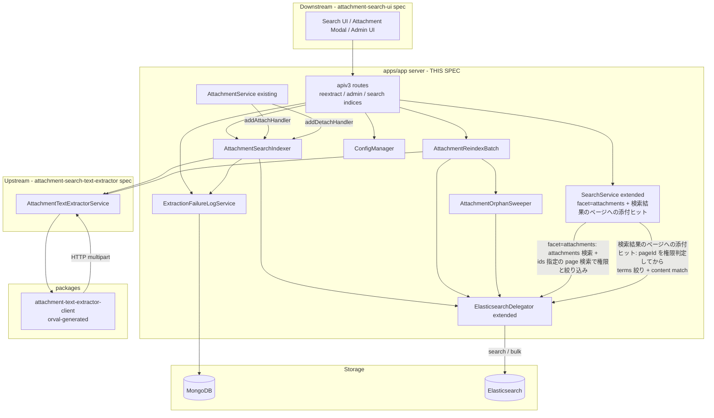
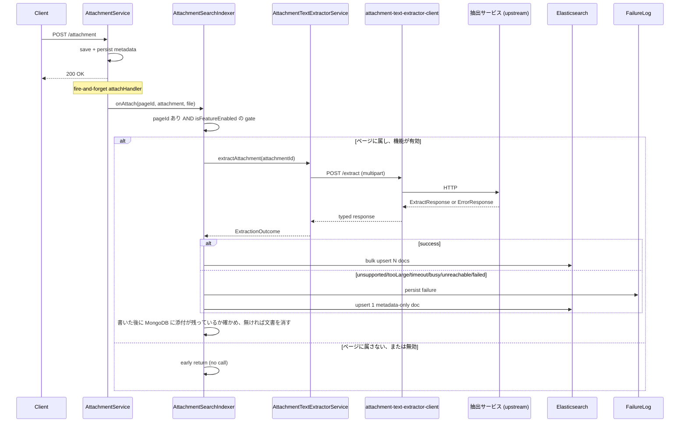
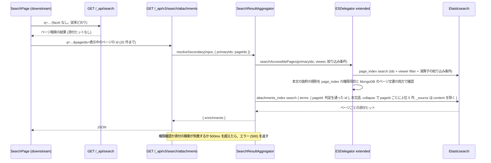
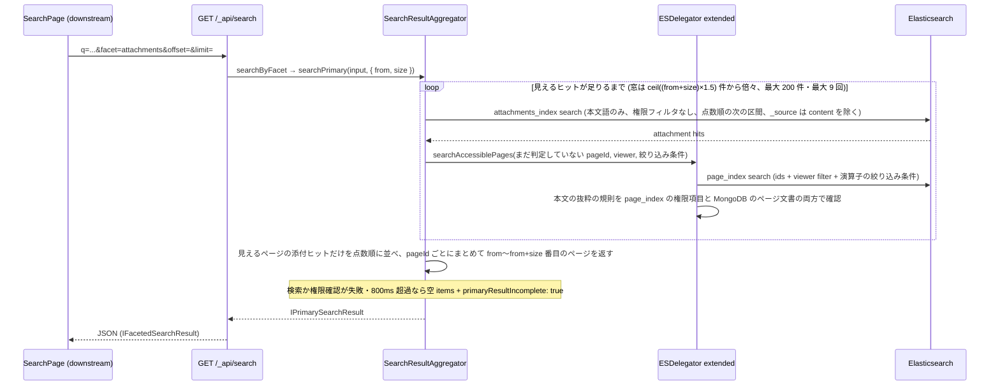
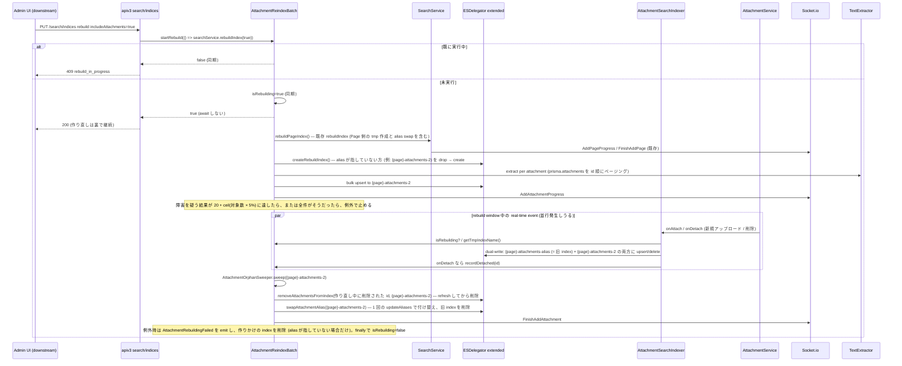
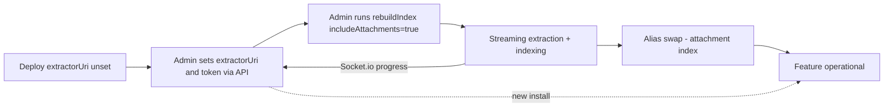

# Technical Design

## Overview

本 spec は GROWI 添付ファイル全文検索機能のうち **apps/app サーバ側の統合層** を定義する。上流 `attachment-search-text-extractor` spec が提供する抽出マイクロサービス (`apps/attachment-text-extractor`) を `packages/attachment-text-extractor-client` (orval 生成) 経由で呼び出し、添付ファイル専用 Elasticsearch インデックス (alias `{page}-attachments-alias`) への書き込みを行う。既存の `AttachmentService` / `ElasticsearchDelegator` / `SearchService` / `ConfigManager` の拡張点を用い、独立サブシステムを作らずに feature module として統合する。

**Purpose**: apps/app 内で「抽出結果を ES へ upsert / 削除を追従 / 一括再インデックスと個別再抽出を提供 / 検索時に親ページの権限を確かめて添付ヒットを親ページ単位に集約」する責務を完結させる。

**Users**: GROWI 利用者 (検索応答の受け取り)、GROWI 管理者 (admin API 経由の有効化・運用)、GROWI 配布/運用者 (Config 経由の接続先管理)。UI コンポーネント自体は下流 `attachment-search-ui` spec が描画する。

**Impact**: `apps/app/src/features/search-attachments/server/` の新設、新規パッケージ `packages/attachment-text-extractor-client` の追加、`ElasticsearchDelegator` / `SearchService` / `AttachmentService` / `ConfigManager` への extension (最小差分)、既存キーワード検索 API (`GET /_api/search`) への optional クエリ追加、応答型 `IPageWithSearchMeta` への optional フィールド追加、`extractionfailurelogs` の Prisma モデルと index 作成 migration の追加、監査ログの action 2 つの追加、ページ検索の本文の抜粋の表示規則の共通化 (`can-show-snippet.ts`。機能の有効・無効にかかわらず全員に効く)。

### Goals

- 上流抽出サービス API 契約を `packages/attachment-text-extractor-client` 経由で型安全に消費
- 添付の attach / detach / reextract / bulk を単一のインデクサで処理
- 親ページ権限変更は添付 ES 文書を更新せず、検索時に page_index から query-time lookup して反映 (Option D)
- 添付ヒットを親ページ単位に集約して返す。閲覧者に見えない添付が、応答の中身にも並びにも影響しないようにする
- 機能無効時に既存検索 API の挙動を機能導入前と完全一致させる
- 抽出サービス到達不可時も apps/app 本体は継続動作

### Non-Goals

- 抽出サービス本体・Dockerfile・運用者向け手順書 `docker/README.md` (上流 `attachment-search-text-extractor` spec)
- 検索結果 UI / 添付一覧モーダル UI / 管理画面 UI (下流 `attachment-search-ui` spec)
- 既存 Page 検索のクエリ・ランキング・権限モデル本体の改変
- 添付ファイル保管方式の変更
- 永続ジョブキュー化 (fire-and-forget を継続)
- チェックポイント再開型の bulk 再インデックス

## Boundary Commitments

### This Spec Owns

- `packages/attachment-text-extractor-client` の orval 生成パイプラインと `openapi.json` drift 検知の CI 入口
- 抽出クライアントラッパ (`AttachmentTextExtractorService`) による失敗正規化と到達不可フォールバック
- 添付専用 ES インデックス (alias `{page}-attachments-alias` と、その裏の実 index `{page}-attachments-1` / `{page}-attachments-2`) の mapping (ES 8/9) とライフサイクル (create / alias swap / bulk)。**添付 ES 文書に権限フィールドは保持しない** (`grant` / `granted_users` / `granted_groups` / `creator` を含まない)
- `AttachmentSearchIndexer` による attach / detach / reextract の窓口と、`AttachmentReindexBatch` による一括再インデックス
- **ページ検索と添付検索を混ぜない検索の設計**: ページと添付の点数を足し合わせた順位は作らない。`GET /_api/search` は、`facet=attachments` が付かない限り従来のページ検索だけを行う。ページ検索の結果のページに付ける添付ヒットは、クライアントがページ ID を渡す別の要求 (`GET /_api/v3/search/attachments`) で返す。`facet=attachments` は、添付ヒットを点数順に並べる別の検索である。どちらも、親 Page を「pageId 指定 + viewer filter + 検索演算子の絞り込み条件」付きの page_index 検索と MongoDB で判定し、通ったページの添付ヒットだけを返す (`AttachmentSearchResultAggregator` が全体を統合)
- `AttachmentReindexBatch` による、HTTP 応答を待たせない tmp index streaming 再インデックスと Socket.io 進捗・完了・失敗イベント発行 (UI 描画は対象外)、および `AttachmentOrphanSweeper` の統合呼び出し (rebuildIndex 時に親 Page が不在の添付 doc を cleanup)
- `ExtractionFailureLogService` による MongoDB 永続化と集計 API (Prisma モデル `extractionfailurelogs`。TTL index は migrate-mongo の migration で作成)
- `SearchService` extended による facet 別の検索 / pageId 集約 / query-time permission lookup / 検索演算子の振り分け (本文語は添付本文へ、絞り込み条件は親ページへ)
- ページ検索と添付検索が共有する、本文の抜粋の表示規則 (`server/service/search/can-show-snippet.ts`)
- `IPageSearchMeta` への optional `attachmentHits[]` 追加と、facet 付き検索の応答型 `IFacetedSearchResult` (サーバ応答契約)
- apiv3 エンドポイント群 (reextract / admin config / admin failures / search indices 拡張 / 検索結果のページへの添付ヒット) と、既存キーワード検索 API (`GET /_api/search`) への optional な `facet` の追加
- Config キー群 (`app:attachmentFullTextSearch:extractorUri` / `:extractorToken` / `:timeoutMs` / `:maxFileSizeBytes` の 4 キー) の定義と永続化。`extractorToken` は他の設定の秘密と同じく平文で保存し、API からは書き込みだけができる (値は返さない)。有効・無効は算出値で、`enabled` の Config キーは無い。`maxConcurrency` は抽出サービス側の env var 専用で、Config キーは無い
- 監査ログの action `ADMIN_ATTACHMENT_SEARCH_SETTINGS_UPDATE` (設定の更新) と `ATTACHMENT_REEXTRACT` (個別再抽出)
- Crowi 初期化での `initAttachmentFullTextSearch(crowi)` 配線
- `SearchConfigurationProps.searchConfig` SSR プロパティへの `isAttachmentFullTextSearchEnabled` フィールド追加と関連型 (`apps/app/src/pages/basic-layout-page/types.ts`) の拡張、および `getServerSideSearchConfigurationProps` のサーバ生成ロジック拡張 (非 admin 一般ユーザが SSR 時点で機能有効フラグを参照できる公式経路)

### Out of Boundary

- 抽出サービス本体 (HTTP ルータを含む)、Dockerfile、docker-compose、運用者向け手順書 `docker/README.md` (ネットワーク分離などの運用条件を含む) (**`attachment-search-text-extractor` spec**)
- 検索結果 UI コンポーネント (`AttachmentHitCard` / `AttachmentSubEntry` / 検索対象の切り替え)、添付モーダルの「再抽出」ボタン、管理画面 (`AttachmentSearchSettings` / `AttachmentExtractionFailures` / `RebuildWithAttachmentsCheckbox`)、ユーザ向けガイダンス文言 (**`attachment-search-ui` spec**)
- 添付ファイル保管方式 (`FileUploader` 抽象は据え置き)
- 既存 Page 検索 (Page/Comment) のクエリ・ランキング・権限モデル本体の改変
- `apps/pdf-converter` の責務・実装
- **添付 ES 文書への権限フィールド (grant / granted_users / granted_groups / creator) の保存**: 本 spec は権限を snapshot せず query-time に page_index を参照する方式を採るため、権限スナップショットは持たない
- **pageEvent 購読による添付 ES 権限同期リスナ**: Option D 採用により不要 (`AttachmentGrantSync` は本 spec に存在しない)。親 Page 権限変更は page_index の既存同期経路でのみ反映され、添付側への propagation は発生しない

### Allowed Dependencies

- **上流**: `attachment-search-text-extractor` spec が提供する OpenAPI spec (`POST /extract`、`ExtractResponse` / `ErrorResponse`)、Docker image、運用者向け手順書 `docker/README.md`
- 既存 `AttachmentService.addAttachHandler` / `addDetachHandler` (ハンドラ登録のみ)
- 既存 `ElasticsearchDelegator` (composition で添付向けメソッド合成、既存 Page 系メソッドは不変)。`searchAccessiblePages` からは既存の `createSearchQuery()` / `appendCriteriaForQueryString()` / `appendCriteriaForGroupFilter()` / `filterPagesByViewer()` を呼び出しのみで使う
- 既存 `SearchService` の `parseSearchQuery()` / `resolve()` / `resolveFilterData()` (呼び出しのみ。演算子の解析ロジックは複製しない)
- 既存 `prisma.attachments` (読み取りのみ。Attachment の作成・削除は `AttachmentService` が行う)
- 既存 `GET /_api/search` ハンドラ (`routes/search.ts`、optional なクエリの追加のみ。`facet` 省略時の処理は変えない)
- 既存 migrate-mongo の migration 置き場 (`src/migrations/`) と `non-transferable-collections.ts` (追加のみ)
- 既存 `FileUploader` (バイト取得のみ)
- 既存 `ConfigManager` / `config-definition.ts` (キー追加のみ)
- 既存 Socket.io progress channel (添付向けイベント名を追加)
- 既存 `IPageWithSearchMeta` (optional フィールド追加のみ)
- `pdf-converter-client` パターン (orval 設定の参考)

### Revalidation Triggers

- **上流 API 契約の変更** (`attachment-search-text-extractor` spec): `POST /extract` の request/response schema、エラーコード enum、HTTP ステータス対応の変更 → `packages/attachment-text-extractor-client` 再生成、`AttachmentTextExtractorService` の正規化ロジック再確認、drift 検知 CI の再評価
- **ES 添付 mapping のフィールド追加/削除**: 既存添付インデックスの再構築必要性判定、ES 8/9 mapping 変種の同期。特に権限フィールドを **再導入する変更は Option D の設計前提を覆す** ため、本 spec の本質的再検討が必要
- **`IPageWithSearchMeta.meta.attachmentHits[]` / `IAttachmentHit` の形状変更**: 下流 `attachment-search-ui` spec に破壊的変更を強いるため、spec 再調整が必須
- **apiv3 エンドポイント契約** (reextract / admin config / admin failures / search indices 拡張) の request/response 変更: 下流 spec の SWR hook 再調整が必須
- **`filterPagesByViewer` の権限モデル本体の変更**: 本 spec は既存 Page 検索と同一の viewer フィルタを page_index に適用することで添付権限を解決しているため、page 側の権限モデル変更は添付検索の権限判定にも波及する
- **page_index の viewer フィルタクエリ構造の変更**: `searchAccessiblePages` は既存 Page 検索の filter 生成 (`createSearchQuery` / `appendCriteriaForQueryString` / `appendCriteriaForGroupFilter` / `filterPagesByViewer`) を流用するため、その内部構造変更は lookup クエリにも影響する
- **本文の抜粋の表示規則 (`canShowSnippetForGrant`) の変更**: ページ検索の抜粋と添付ヒットの両方が同じ関数で決まる。規則を変えると両方が同時に変わる
- **Config キー名の変更**: 既存環境の設定マイグレーション必要
- **`extractorUri` クリアによる soft-disable 挙動**: `extractorUri` を admin UI で空文字 / null にすると `isAttachmentFullTextSearchEnabled` (算出値) が `false` に遷移する。空白だけの値も未設定として扱い、`extractorToken` を消しても同じく `false` になる。この「URI による soft-disable」挙動の意味論変更 (例: 空文字扱いの揺れ、trim の有無) は下流 `attachment-search-ui` spec の機能ゲート挙動に影響するため、変更時は下流 spec に通知が必要
- **Socket.io 進捗イベントの名前と中身** (`AddAttachmentProgress` / `FinishAddAttachment` は `{ totalCount, count }`、`AttachmentRebuildingFailed` は `{ error: string }`) の変更: 下流 UI spec の購読変更。`error` はいま英語の文で、理由コードに変えるかどうかは下流の UI 設計を見直すときに決める
- **`PUT /search/indices` の応答タイミング**: `includeAttachments=true` の作り直しは即応答し、完了・失敗は Socket.io でのみ通知する。同期応答に戻す変更、または 409 `rebuild_in_progress` の扱いの変更は、下流 UI spec の管理画面の進行表示を再確認する必要がある
- **`QueryTerms` へのキー追加・検索演算子の意味変更**: `splitQueryTerms()` は本文語 4 キー以外をすべて親ページの絞り込み条件として扱う。本文語のキーが増える (例: 新しいフレーズ記法) 場合は `AttachmentKeywordTerms` の更新が必要
- **`AttachHandler` / `DetachHandler` の型 (`AttachmentWithComputed`) や、添付の作成・削除経路の変更**: 添付の作成・削除が `AttachmentService` 以外の経路で起きるようになると、通知関数による同期では漏れが出る
- **`SearchConfigurationProps.searchConfig` の shape 変更** (フィールド追加/削除/rename): 下流 `attachment-search-ui` spec は SSR hydration 経路 (`basic-layout-page/hydrate.ts` での atom 書き込み、下流が追加する Jotai atom / SWR fallback の初期値配線) を再確認する必要がある

## Architecture

### Existing Architecture Analysis

- apps/app は Next.js Pages Router + Express モノリス。`server/service/*` が既存責務の中心
- ES 連携は `ElasticsearchDelegator` に集約され、ES 8/9 の互換レイヤが version-specific mapping で提供されている
- `SearchService` は `SearchService.create(crowi)` で非同期に生成される。検索演算子 (`prefix:` / `tag:` / `author:` / `editor:` / `group:` と各否定形) は `parseSearchQuery()` で `QueryTerms` に分解され、`group:` / `-group:` は `resolveFilterData()` でグループ ID に解決されてから `appendCriteriaForQueryString()` / `appendCriteriaForGroupFilter()` で ES クエリに積まれる
- Attachment は Prisma 拡張 (`prisma.attachments`) で読み書きされる。`AttachHandler` は `AttachmentWithComputed` を受け取る。`AttachmentService.removeAllAttachments()` (ページ削除に伴う一括削除) は detach handler を呼ばない
- Page 以外の ES index の前例として監査ログ用 index (`features/auditlog-es-sync`) がある。こちらは MongoDB の change stream で同期し、作り直しは専用 API で非同期に実行する。添付が同期方式を揃えない理由は research.md に記録
- `AttachmentService` はハンドラ登録型拡張点を提供し、OpenAI Vector Store 連携が既に同パターンで同居 (fire-and-forget、例外握りつぶし)
- `registerUpdateEvent()` は `pageEvent` の `updateMany` / `syncDescendantsUpdate` を購読し Page index を同期
- Config は `ConfigManager` + MongoDB `Config` model で永続化、`config-definition.ts` に型定義を並べる
- `rebuildIndex()` は tmp index → alias swap パターン、Socket.io (`AddPageProgress` / `FinishAddPage` / `RebuildingFailed`) で進捗通知

### Architecture Pattern & Boundary Map

採用パターン: **既存システム拡張 + feature module 新設 (composition-based)**。独立 delegator やジョブキュー基盤を作らず、既存パターンに相乗りする。



**Architecture Integration**:
- **選定パターン**: 既存拡張優先 (独立 delegator / ジョブキュー不採用)
- **ドメイン/境界**: 「抽出クライアント」「indexer」「reindex batch」「orphan sweeper」「検索集約 (query-time permission lookup を含む)」を feature module 内で分離し、それぞれ単一責任を維持。添付側の権限同期 (AttachmentGrantSync) は **Option D 採用により設計上不要**
- **依存方向**: apiv3 → service/indexer → (TextExtractor | ESDelegator) → (attachment-text-extractor-client → 上流 | ES / Mongo)。逆流なし
- **既存パターン維持**: AttachmentService ハンドラ仕様、ESDelegator のライフサイクル、Socket.io progress、apiv3 ルーティング、Config 定義、**`basic-layout-page/get-server-side-props/search-configurations.ts` の `searchConfig` SSR props パターン**
- **Steering 準拠**: feature-based 配置、名前付き export、pino ログ、immutable 更新、pure 関数抽出 (検索クエリの builder)

**機能有効フラグの参照経路 (primary vs secondary)**:
- **Primary**: 非 admin を含む全ユーザ向けには、既存 `searchConfig` SSR props パターンを拡張した `SearchConfigurationProps.searchConfig.isAttachmentFullTextSearchEnabled` を唯一の公式参照経路とする。basic-layout-page 経由のため全ページで SSR 時点に届く
- **Secondary (間接シグナル)**: 検索応答 `IPageWithSearchMeta.meta.attachmentHits` の optional な存在自体は「機能が有効化されかつ検索パイプラインが通った」ことの**間接シグナル**として利用可能だが、これは Primary にはしない。理由: (a) 機能有効でも、ページ検索の応答には `attachmentHits` が付かない (別の要求で取る)、(b) 添付ヒットの取得は失敗しうる、(c) 初回レンダ時は検索前で応答が無い。したがって UI の feature gate は必ず SSR `searchConfig.isAttachmentFullTextSearchEnabled` を参照する
- **Admin 向け**: admin 画面では引き続き `GET /_api/v3/admin/attachment-search/config` を真実の源とする (SSR prop は描画ゲート用で、書き込み系は admin API 経由)

### Technology Stack

| Layer | Choice / Version | Role in Feature | Notes |
|-------|------------------|-----------------|-------|
| Server runtime | Node 24 / Express / pino | indexer / reindex batch / 検索の集約 / apiv3 | 既存スタック踏襲 |
| HTTP client | axios (orval 生成) | 抽出サービス呼び出し | server 専用依存 |
| Client package | `packages/attachment-text-extractor-client` (orval 生成) | 上流 OpenAPI → TS クライアント | `pdf-converter-client` 同パターン |
| Data — search | Elasticsearch 8/9 (既存) | 添付専用 index (alias `{page}-attachments-alias`) | 既存 Page index とは別 index |
| Data — log | MongoDB + Prisma (既存) | `extractionfailurelogs` collection (Prisma モデル) | TTL index 90 日は migrate-mongo の migration で作成 |
| Messaging | Socket.io (既存) | 一括再インデックス進捗 | 添付向けイベント名を追加 |

## File Structure Plan

### Directory Structure

```
apps/app/src/features/search-attachments/
├── server/
│   ├── index.ts                                   # initAttachmentFullTextSearch(crowi)
│   ├── services/
│   │   ├── is-attachment-full-text-search-enabled.ts # 算出値 (有効・無効) の唯一の出どころ
│   │   ├── attachment-text-extractor.ts           # attachment-text-extractor-client wrapper
│   │   ├── extract-request-body.ts                # 抽出サービスへ送る multipart の組み立て
│   │   ├── read-file-chunks.ts                    # 保存してあるファイルの、時間制限つきの読み込み
│   │   ├── concurrency-limit.ts                   # 同時実行数の上限 (超えた呼び出しは順番待ち)
│   │   ├── validate-extractor-uri.ts              # extractorUri の検証とメタデータ宛先の判定
│   │   ├── attachment-search-indexer.ts           # attach/detach/reextract 単一窓口
│   │   ├── indexable-attachments.ts               # 索引の対象 (ページに属する添付) の条件
│   │   ├── attachment-search-delegator-extension.ts  # 添付 index の名前・ライフサイクル・書き込み・削除
│   │   ├── attachment-reindex-batch.ts            # bulk reindex + Socket.io progress + orphan sweeper invocation
│   │   ├── rebuild-failure-budget.ts              # 作り直しを止める失敗数の判定
│   │   ├── attachment-orphan-sweeper.ts           # rebuildIndex 内から呼ぶ orphan cleanup (real-time cascade は不要)
│   │   ├── attachment-search-result-aggregator.ts # facet=attachments の検索と、検索結果のページへの添付ヒット
│   │   ├── create-attachment-search-result-aggregator.ts # aggregator と ES client・SearchService の配線
│   │   ├── collect-visible-attachment-hits.ts     # facet=attachments のページング (見えるヒットだけで結果を決める)
│   │   ├── search-accessible-pages.ts             # 添付ヒットの親ページの判定 (page_index + MongoDB)
│   │   ├── find-snippet-visible-page-ids.ts       # MongoDB のページ文書での、本文の抜粋の判定
│   │   ├── resolve-attachment-search-viewer.ts    # 閲覧者と所属グループの解決 (ページ検索と同じ)
│   │   ├── reextract-gate.ts                      # 同じ添付の再抽出を 1 回にまとめる + 制限時間
│   │   └── extraction-failure-log-service.ts      # prisma.extractionfailurelogs への記録と取得
│   ├── mappings/
│   │   ├── attachments-mappings-es8.ts
│   │   └── attachments-mappings-es9.ts
│   ├── queries/
│   │   ├── build-attachment-search-query.ts       # buildAttachmentSearchQuery: 添付 index 全体を本文語で検索 (facet=attachments)
│   │   ├── build-attachments-by-page-ids-query.ts # buildAttachmentsByPageIdsQuery: pageId を絞り、ページごとに上位 5 件 (検索結果のページへの添付ヒット)
│   │   ├── attachment-keyword-query.ts            # 本文語の句・強調表示・_source の指定 (上の 2 つが共有)
│   │   ├── split-query-terms.ts                   # QueryTerms → { AttachmentKeywordTerms, PageFilterTerms } (pure function)
│   │   └── build-snippet-segments.ts              # ES highlighter の <em> タグ入り文字列を ISnippetSegment[] にパース (XSS 防御 DTO 変換、pure function)
│   ├── routes/apiv1/
│   │   └── facet-search-contract.ts               # GET /_api/search の facet / limit / offset の読み取りと応答の組み立て
│   ├── routes/apiv3/
│   │   ├── attachment-reextract.ts                # POST /attachments/:id/reextract
│   │   ├── search-attachments.ts                  # GET /search/attachments (検索結果のページへの添付ヒット)
│   │   └── attachment-search-admin.ts             # GET /failures, GET|PUT /config
│   └── middlewares/
│       └── require-search-attachments-enabled.ts
└── interfaces/
    └── attachment-search.ts                       # IAttachmentHit, IAttachmentEsDoc, ExtractionOutcome DTOs

apps/app/src/server/service/search/
└── can-show-snippet.ts                            # 本文の抜粋の表示規則 (ページ検索と添付検索が共有)

packages/attachment-text-extractor-client/
├── orval.config.js
├── openapi.json                                   # 上流 spec が export、commit 必須 (PR レビューで schema 変更を可視化)
├── package.json
└── src/
    ├── index.ts                                   # re-export generated、commit する (pdf-converter-client 同パターン)
    └── generated/                                 # orval 出力、commit する (build 時に再生成されるが diff check で drift を検知)
```

#### OpenAPI / orval drift 検知パイプライン

- **openapi.json**: 上流 `apps/attachment-text-extractor/scripts/export-openapi.ts` (`pnpm run export-openapi`) が、route 定義から生成した OpenAPI を `packages/attachment-text-extractor-client/openapi.json` に書き出す。**commit 必須**
- **orval 生成物 (`src/`)**: 本 spec の responsibility として commit する。開発者が `openapi.json` 更新時に orval を実行して commit、または CI が regenerate → diff check
- **上流のテスト (上流 spec)**: `apps/attachment-text-extractor/test/openapi/export-openapi.integ.ts` が、サービスが生成する OpenAPI と commit 済み `openapi.json` を `scripts/check-openapi-drift.ts` で比較し、差があれば失敗する (`ci-attachment-text-extractor.yml` が実行)
- **apps/app の CI (本 spec)**: `ci-app.yml` の "Check attachment-text-extractor-client orval drift" ステップが orval (`pnpm -F @growi/attachment-text-extractor-client gen`) を実行し、`git diff --exit-code` で `src/` と `openapi.json` の差分を検知する
- **turbo 依存での build 時再生成は不使用**: クライアントの build は commit 済み `openapi.json` から orval を実行するだけで、サービス側の export を turbo の `dependsOn` には繋がない (`pdf-converter-client` の `dependsOn: ["@growi/pdf-converter#gen:swagger-spec"]` のようなパターンは使わない)。`openapi.json` はサービス変更時に手で再生成して commit し、上記のテストと CI の diff check で古さを検知する

### Modified Files

- [apps/app/src/server/crowi/index.ts](apps/app/src/server/crowi/index.ts) — `initAttachmentFullTextSearch(this)` を searchService / attachmentService 初期化後に追加
- [apps/app/src/server/routes/search.ts](apps/app/src/server/routes/search.ts) — 既存のキーワード検索 API (`GET /_api/search`、apiv1) に optional な `facet` クエリを追加。`facet` 省略時と `facet=pages` は従来の `searchKeyword()` → `formatSearchResult()` をそのまま通す。`facet=attachments` で機能有効時は `searchService.searchByFacet()` を呼び、結果を既存の `IFormattedSearchResult` の形 (各 item の `meta` に optional の `attachmentHits`、応答の meta に `facet` / `primaryResultIncomplete`) に詰めて返す (`IFacetedSearchResult`)
- [apps/app/src/server/service/search.ts](apps/app/src/server/service/search.ts) — `facet=attachments` の検索と、検索結果のページへの添付ヒットの取得を `AttachmentSearchResultAggregator` として追加し、入口として `searchByFacet()` と `resolveAttachmentSecondary()` を置く (クエリ解析・delegator 解決・`resolveFilterData()` を 1 回だけ行って `AttachmentSearchInput` を組み立てる)。`canShowSnippet()` は `can-show-snippet.ts` の規則を呼ぶだけにする (ページ検索の抜粋と添付ヒットで同じ規則)。`registerUpdateEvent()` への権限変更リスナ追加は **不要** (Option D は query-time 方式のため)
- `apps/app/src/server/service/search-delegator/elasticsearch-client-delegator/es8-client-delegator.ts` / `es9-client-delegator.ts` — 添付 index の操作に要る ES client の呼び出しを追加。`elasticsearch.ts` 本体 (Page 系のメソッド) は変えず、添付の拡張は同じ ES client を受け取って使う
- [apps/app/src/server/service/config-manager/config-definition.ts](apps/app/src/server/service/config-manager/config-definition.ts) — `app:attachmentFullTextSearch:*` 4 キー追加 (`extractorUri` / **`extractorToken` (`isSecret: true`。API からは write-only)** / `timeoutMs` / `maxFileSizeBytes`)。各キーの env var 名: `GROWI_ATTACHMENT_EXTRACTOR_URI` / `GROWI_ATTACHMENT_EXTRACTOR_SERVICE_TOKEN` / `GROWI_ATTACHMENT_EXTRACTOR_TIMEOUT_MS` / `GROWI_ATTACHMENT_EXTRACTOR_MAX_FILE_SIZE_BYTES`。`enabled` / `maxConcurrency` の Config キーは無い (前者は算出値、後者は抽出サービス側の env var 専用)。加えて `ENV_ONLY_GROUPS` に `env:useOnlyEnvVars:app:attachmentFullTextSearch` エントリを追加し、control env var `ATTACHMENT_EXTRACTOR_USES_ONLY_ENV_VARS_FOR_SOME_OPTIONS=true` で 4 キー全てを env-only 強制できるようにする (マルチテナント向け詳細は下記「ENV_ONLY_GROUPS エントリ」参照)
- [apps/app/src/interfaces/search.ts](apps/app/src/interfaces/search.ts) — `IPageSearchMeta.attachmentHits?: IAttachmentHit[]` (optional) と、facet 付き検索の応答型 `IFacetedSearchResult` / `SearchFacet` を追加
- `apps/app/src/server/service/search/can-show-snippet.ts` (新規) — 本文の抜粋の表示規則 (`canShowSnippetForGrant` / `canShowSnippetOfPage`)
- [apps/app/src/interfaces/activity.ts](apps/app/src/interfaces/activity.ts) — `ACTION_ADMIN_ATTACHMENT_SEARCH_SETTINGS_UPDATE` (Large のグループ) と `ACTION_ATTACHMENT_REEXTRACT` (Medium のグループ) を追加
- `apps/app/src/features/rate-limiter/config/index.ts` — 再抽出の回数制限 (添付ごとに 1 分あたり 5 回) を追加
- [apps/app/src/server/routes/apiv3/search.js](apps/app/src/server/routes/apiv3/search.js) — `PUT /search/indices` に `includeAttachments` フラグを受理。true のときは `AttachmentReindexBatch.startRebuild()` を呼んで即応答し、実行中なら 409 `rebuild_in_progress`
- [apps/app/src/interfaces/websocket.ts](apps/app/src/interfaces/websocket.ts) — `AddAttachmentProgress` / `FinishAddAttachment` / `AttachmentRebuildingFailed` を追加
- [apps/app/prisma/schema.prisma](apps/app/prisma/schema.prisma) — `extractionfailurelogs` model を追加
- `apps/app/src/migrations/20261117120000-add-indexes-to-extractionfailurelogs.js` (新規) — `occurredAt_1` (90 日の TTL) と `retentionGroupHash_1` の index を作成 (既存 migration と同じく ESM の named export `up` / `down`)
- [apps/app/src/server/service/import/non-transferable-collections.ts](apps/app/src/server/service/import/non-transferable-collections.ts) — `extractionfailurelogs` を G2G 転送の対象外に追加
- [apps/app/src/pages/basic-layout-page/get-server-side-props/search-configurations.ts](apps/app/src/pages/basic-layout-page/get-server-side-props/search-configurations.ts) — `getServerSideSearchConfigurationProps` を拡張し、算出値 `isAttachmentFullTextSearchEnabled(searchService.isConfigured)` を `searchConfig.isAttachmentFullTextSearchEnabled` として SSR props に含める (既存フィールドは非破壊)
- [apps/app/src/pages/basic-layout-page/types.ts](apps/app/src/pages/basic-layout-page/types.ts) — `SearchConfigurationProps.searchConfig` 型に `isAttachmentFullTextSearchEnabled?: boolean` フィールドを追加 (既存 `isSearchServiceConfigured` / `isSearchServiceReachable` / `isSearchScopeChildrenAsDefault` は据え置き)

> UI コンポーネント・管理画面 tsx / hook 系の改変は下流 `attachment-search-ui` spec に委譲。本 spec では SSR props の**サーバ側生成と型定義の追加**のみを担当し、その hydration 経路と Jotai atom / SWR fallback 配線などのクライアント側消費は下流 spec が扱う。

## System Flows

### 1. 添付アップロード → 抽出 → インデックス



Key decisions:
- `serviceUnreachable` / `timeout` / `serviceBusy` を明示的に分類し UI 側メッセージ分岐を可能にする
- 機能無効時は indexer が早期 return、抽出サービスへの呼び出しは一切行わない (R5 AC 5.4 互換性)。ページに属さない添付 (プロフィール画像、ブランドロゴ) も同じく何もしない (Req 2.6)
- 失敗は、metadata-only の文書を書く前に FailureLog へ記録する。ES への書き込みが失敗しても、抽出の結果は記録に残る
- 抽出サービスを同時に呼ぶのはプロセス全体で 3 件まで。超えた分は順番を待つ (AttachmentTextExtractorService)

### 2. 検索実行 (ページ検索と添付検索を混ぜない)

**モデル**: ページと添付の点数を足し合わせた順位は作らない。ページの索引と添付の索引では点数の基準がそろわず、足し合わせた点数に意味を持たせにくいためである (research.md 12)。要求は次の 3 つで、添付ヒットは「閲覧者に本文の抜粋を見せてよいページ」のものだけを返す。閲覧者に見えない添付は、応答の中身にも並びにも影響させない (research.md 10.1)。

| 要求 | 並べるもの | 添付ヒット | 使いどころ |
|---|---|---|---|
| `GET /_api/search` (`facet` なし、または `facet=pages`) | ページ (従来のページ検索そのもの) | 付けない | 検索画面の既定。機能の有効・無効にかかわらず、処理・応答・速さは機能導入前と同じ |
| `GET /_api/v3/search/attachments?q=&pageIds=` | なし (渡されたページ ID ごとに返す) | 渡されたページのうち、閲覧者が本文の抜粋を見てよいページの添付ヒット (1 ページあたり上位 5 件) | 検索画面が、ページ検索の結果を表示した後に、表示中のページの添付ヒットを取る |
| `GET /_api/search?facet=attachments` | 添付ヒットを点数順に並べ、親ページごとにまとめたもの | 各項目に付く | 添付だけを対象にした検索。本文が一致しないページの添付は、この検索で探す |

#### 2.1 検索結果のページへの添付ヒット (`GET /_api/v3/search/attachments`)



**Key decisions**:
- ページ検索の応答には添付ヒットを付けない。ページ検索の並べ替え (`sort` / `order`)・件数 (`total`)・ページ送りは、機能が有効でも機能導入前と同じに動く (Req 9.1 / 9.5)。添付ヒットの取得はページ検索の結果の表示を待たせない
- `pageIds` はクライアントが送る値なので、毎回 `searchAccessiblePages` (viewer filter と `canShowSnippetForGrant`、MongoDB での確認) を必ず通し、消失・権限のないページ、検索演算子が除くページを外す
- 添付を検索するのは、判定を通ったページの添付だけである。見えない添付は、応答の中身にも、検索の回数にも影響しない (research.md 10.1)
- 添付の検索は `collapse` で pageId ごとにまとめ、`inner_hits` で 1 ページあたり上位 5 件を返す。1 つの長いファイル (1 添付 = N 文書) が枠を使い切って、ほかのページの添付が出なくなるのを防ぐ (research.md 10.2)
- `pageIds` は重複を除いて 20 件まで。検索画面は 1 回に 50 件 (`customize:showPageLimitationL` の既定) を読むので、受け取ったページの id を 20 件ずつに分けて送る。時間の上限 (500ms) と速さの目標は、この 1 回の要求ごとに当てる。`terms` は常に 20 件以下なので、`max_terms_count` / `max_clause_count` に触れない
- どの添付検索も `_source` から `content` を除く。ヒットは強調表示の断片だけで見せるので、抽出した全文を応答に載せない
- 失敗と時間切れ (500ms) は、空の `enrichments` で隠さずエラーで返す。画面が「取得中」「取得できなかった」「ヒットが無い」を区別して出せるようにするため (Req 9.6)
- 2 ページ目以降も、ページ検索の結果を受け取るたびに同じ要求で取る。1 ページ目だけを特別に扱う経路は無い

#### 2.2 添付だけを対象にした検索 (`GET /_api/search?facet=attachments`)



**Key decisions**:
- ページングは `offset` / `limit` (`from` / `size`) だけで行う。カーソル (`nextCursor`、`search_after`) は無い。`limit` は 1〜200 (既定 50)、`offset` は 0 以上の整数で、それ以外は 400
- 権限判定は、1 回の往復で窓の中の unique pageId (最大 200 件) を `searchAccessiblePages` に渡す。結果は「見えるヒットだけを並べた列」の上で決めるので、窓が 200 件に達するまでは、見えないヒットがあっても無くても同じ結果になる。200 件より下位にある見えるヒットには届かない
- `meta.total` は常に null、`primaryResultIncomplete` は検索か権限確認が失敗 (800ms 超過を含む) したときだけ true。権限で落ちた件数に応じて変わる値は返さない。「続きを読み込む」ための次ページの有無の伝え方は、下流の UI 設計を見直すときに決める (Open Questions)
- 各項目は `{ data: { _id: pageId }, meta: { attachmentHits } }` で、ページの path などは含まない。添付ヒット側の `pageId` と同じ値である (Open Questions)
- `sort` / `order` / `type` は適用しない (点数順だけ)

#### 2.3 API 呼び出しパターン (アプリ実装)

- **検索画面**: ページ検索 (`facet` なし) の結果を表示し、表示中のページの id を `GET /_api/v3/search/attachments` に渡して添付ヒットを取り、届いたらページに付け足して表示する。添付だけを対象にする検索に切り替えたときは `facet=attachments` を送る
- **API を直接使う利用者 (MCP など)**: 同じく 2 回に分けて呼ぶ。ページ検索と添付ヒットを 1 回の要求でまとめて返す形は持たない (research.md 12)

**rebuild window 中のページング整合性は非保証** (`Migration Strategy § rebuild window 中のユーザー検索・ページングの整合性` 参照)。alias swap をまたぐ連続リクエストで重複/欠落/順序不整合が発生しうるが、管理者操作であり UI 側の進行通知で UX を degrade する方針。

#### 2.4 検索演算子の扱い

検索演算子 (`prefix:` / `tag:` / `author:` / `editor:` / `group:` と各否定形) は **親ページに対する条件**であり、添付本文に当てる語ではない。`SearchService` の入口 (`searchByFacet()` / `resolveAttachmentSecondary()`) がクエリを 1 回だけ解析し (`parseSearchQuery()` → `resolve()` → `resolveFilterData()`)、`splitQueryTerms()` で次の 2 つに分けて aggregator に渡す (詳細は Components の AttachmentSearchResultAggregator)。

| 分けた結果 | 中身 | 当てる先 |
|---|---|---|
| 本文語 (`AttachmentKeywordTerms`) | `match` / `not_match` / `phrase` / `not_phrase` | attachments_index の `content` / `originalName` |
| 絞り込み条件 (`PageFilterTerms` + `resolvedFilterData`) | 上記以外の全キー | page_index (`searchAccessiblePages`) |

これにより、検索結果のページへの添付ヒットでも `facet=attachments` でも、「添付ヒットの親ページ」は「同じクエリで通常のページ検索をしたときに返りうるページ」と一致する (Req 4.5)。権限判定と同じ page_index 検索の中で絞り込むため、追加の問い合わせは発生しない。

### 3. 親ページ権限変更 → 検索時に自動反映 (コード不要)

**Option D 採用により、添付 ES 文書への partial update は発生しない**。親 Page の権限変更は既存 page_index の同期経路で反映され、次回の検索で Flow 2 の判定 (`searchAccessiblePages` の page_index と MongoDB) が最新の権限を見るので、添付ヒットの可視性も自動的に更新される。sync drift による snippet 漏洩は構造的に発生しない (権限情報を添付側に snapshot していないため)。

### 4. 個別再抽出 (UI → API → Indexer)

`POST /_api/v3/attachments/:id/reextract` は、権限を確かめた後に `AttachmentSearchIndexer.reindex(attachmentId, { signal })` を呼び、終わるまで待って結果の種別 (`kind`) だけを返す。抽出は Flow 1 と同じ経路を使う。

**middleware の順**: `accessTokenParser([SCOPE.WRITE.FEATURES.ATTACHMENT])` → `loginRequiredStrictly` → `excludeReadOnlyUser` → `requireSearchAttachmentsEnabled` (無効なら 503 `feature_disabled`) → `addActivity` → id の検証 (ObjectId でなければ 400)。

**権限の判定 (handler の中で、要求のたびに現在の権限を見る)**: session や middleware で先に解決した値は使わない (権限を失った後に古い判定が残らないように)。
1. attachment から `pageId` を取得する
2. 親 Page が存在するか確かめる
3. `viewer` が admin か、現在の権限でそのページを閲覧できるか (`Page.isAccessiblePageByViewer`) を評価する
4. 添付が無い・ページに属さない・親ページが無い・閲覧できない、のどれでも、区別のつかない 404 `notfound_or_forbidden` を返す (Req 7.2)

**実行**:
- 同じ添付への同時の要求は 1 回の抽出にまとめ、全員に同じ結果を返す (`reextract-gate.ts`。鍵は DB に保存された id で、URL の id の大文字・小文字の違いに左右されない)。同時に抽出できる数は、抽出サービスを呼ぶ側の上限 (プロセス全体で 3 件) で決まり、route 独自の上限と、それを理由にした拒否 (`reextract_busy`) は無い
- 成功したら、新しい文書を書いてから、その添付の他の文書 (ページ数が減った分、metadata-only の文書) を消す。書き込みが失敗した場合は、消す処理に進まないので、登録済みの文書が残る (research.md 10.4)
- 抽出が失敗したら、登録済みの文書には触れず、FailureLog への記録だけを行う。metadata-only の文書は書かない (文書 ID が `${attachmentId}_0` で、1 文書だけの形式の本文の文書と同じになり、検索できていた本文を空で上書きしてしまうため)
- 1 回の実行の制限時間は `timeoutMs × 2 + 30 秒` で、抽出の順番を待つ時間も含む。超えたら 503 `reextract_timeout` を返し、`signal` で処理を止める: 順番待ちの抽出は読み込みを始めずに終わり、読み込み中のファイルの stream は閉じ、抽出サービスへの要求は取り消し、混雑時の再試行は行わない (research.md 10.6)

**応答**:

| 状況 | 応答 | 監査ログの記録 |
|---|---|---|
| 最後まで進んだ (抽出サービスがそのファイルの失敗を返した場合を含む) | 200 `{ outcome: { kind } }` | `ATTACHMENT_REEXTRACT` (対象の添付と親ページの snapshot 付き) |
| 最後まで進められなかった (実行の時点で添付が消えていた・ページに属さなくなっていた・機能が無効になっていた、ES への書き込みなどの想定外の例外) | 500 `reextract_failed` | `UNSETTLED` のまま |
| 制限時間を超えた | 503 `reextract_timeout` | `UNSETTLED` のまま |
| 権限が無い・添付や親ページが無い | 404 `notfound_or_forbidden` | `UNSETTLED` のまま |
| 上のどれでもない例外 | 500 `internal_server_error` | `UNSETTLED` のまま |

機能が無効のときの 503 `feature_disabled` と回数制限の 429 は `addActivity` より前で返るので、監査ログの記録は作られない。

### 5. 一括再インデックス (rebuildIndex with attachments)



Key decisions:
- **HTTP 応答は作り直しの完了を待たない** (Req 6.5)。添付の作り直しは添付ごとに抽出サービスを呼ぶため数分〜数時間かかりうる。API route は `startRebuild()` を呼んで即 200 を返し、完了・失敗は Socket.io (`FinishAddAttachment` / `AttachmentRebuildingFailed`) で通知する。監査ログの作り直し (`PUT /search/auditlog-indices`) と同じ非同期の流儀
- **二重起動の判定は同期で行う** (Req 6.6)。`startRebuild()` は await する前に実行中フラグを確認して立て、実行中なら何も始めずに `false` を返す。API route はそれを見て 409 を同じリクエストの中で返す
- **ページと添付は同じ要求で作り直す**。添付はページに属するため、`includeAttachments=true` のときは Page/Comment の作り直しに続けて添付を作り直す。直列実行 (Page 完了後に Attachment 開始)
- **alias swap は index ごとに行う**。Page 側は既存 `rebuildIndex()` の中で swap し、添付側は bulk と orphan sweep の完了後に `{page}-attachments-alias` を swap する。2 つの swap の間は「Page は新 index、添付は旧 index」の状態になるが、添付ヒットの権限は検索時に page_index から引くため (Flow 2)、漏洩は起きない
- includeAttachments=false の場合は従来どおり Page/Comment のみを fire-and-forget で作り直し、`{page}-attachments-alias` と添付の実 index には触れない
- 個別失敗はスキップして FailureLog に残し batch 継続。走査の対象は、ページに属する添付だけ (Req 2.6)
- **障害を疑う結果が続くときは作り直しを止める** (Req 6.2、`rebuild-failure-budget.ts`)。抽出サービスや保存先が落ちていると、全添付が失敗して metadata-only の文書だけの index ができ、それに alias を付け替えると、それまで検索できていた本文がすべて消える。そこで次の結果を「障害を疑う結果」として作り直し全体で数える: `serviceUnreachable`、`serviceBusy`、`failed` のうち保存してあるファイルを読めなかったもの (`file_read_failed`。読み込みのタイムアウトを含む)、その添付の処理が例外で終わったもの (ES への書き込みの失敗など)。数が `20 + ceil(対象の添付数 × 5%)` に達したら例外で止める。最後まで走った場合も、1 件以上を処理してそのすべてが障害を疑う結果だったら例外で終える (対象が少なくて上限に届かない場合のため)。`unsupported` / `tooLarge` / `timeout` / `encrypted` / `resourceLimit` / 抽出サービスが返した `extraction_failed` は、ファイルごとの結果として数えない。数の根拠と、保存先の「ファイルが無い」を区別しない理由は research.md 10.3
- **実 index は 2 つを交互に使う** (Req 6.4)。alias が指している方には作り直しの間まったく触れず、新しい方を埋め終えてから alias を付け替える。Page 側の `rebuildIndex()` は「tmp に複製 → alias を tmp へ → 本体を消して作り直す → alias を戻す」形なので、途中で止まると本体が作りかけのまま alias が戻り、旧 index を保てない。添付の作り直しは抽出を伴い長時間かかるため、この形は採らない (research.md 8.6)
- 例外で止まった場合は alias swap 未実行のまま旧 index を維持し、作りかけの index を削除する。削除は「alias が指していない index」に限る。プロセスが落ちて削除できなかった index は、次回の作り直しの先頭で drop される。実行中フラグは `startRebuild()` 内部の finally で必ず下ろす (呼び出し側に後始末を任せない)
- **rebuild window 中の dual-write**: `AttachmentSearchIndexer.onAttach/onDetach` が `AttachmentReindexBatch.isRebuilding()` を参照し、true の間は live alias (`{page}-attachments-alias`) と、作り直し先の index (`getTmpIndexName()` が返す名前) の**両方**に書き込む。これにより alias swap 後に新規アップロードや削除が失われない。ただし削除には、作り直しの走査がその添付を読んで抽出している間に起きた場合の穴がある。削除はその時点の両 index に効くが、走査はその後で抽出結果を作り直し先へ書くので、削除済みの添付が戻ってしまう。そこで `onDetach` は削除した添付の id を `AttachmentReindexBatch.recordDetached()` に渡し、batch は作り直し中に渡された id を覚えておく。走査と orphan sweep が終わったら、alias swap の直前にそれらを作り直し先から消す (`removeAttachmentsFromIndex`)。delete-by-query は refresh 前の文書を見ないので、添付の削除はどれも先に対象 index を refresh してから行い、消せなかった文書 (`failures`) があれば失敗として扱う。ふだんのアップロードと再抽出では、抽出中に削除された添付の文書が書き込みで戻らないよう、書いた後に MongoDB にまだ添付があるか確かめ、無ければ消す (research.md 8.6)。この時点で走査は終わっているので、以後の削除は二重削除だけで足りる。`getTmpIndexName()` は作り直し先の index を作り終えてから名前を返す。それより前の書き込みは live だけに入るが、走査はその後に MongoDB を読むので、その添付も新しい index に入る
- **dual-write の冪等性**: tmp index への書き込みは、bulk upsert が後から同 `_id` で上書きする可能性があるが、doc ID が `${attachmentId}_${pageNumber ?? 0}` で決定的なため順序に依存しない。bulk 側が後勝ちでも real-time 側が後勝ちでも最終状態は同一
- **dual-write 失敗時**: tmp 側 write の失敗は live 側の成功を阻害しない (pino 記録して continue)。alias swap 後は live が単一 source になり自動的に整合
- **orphan sweeper**: real-time cascade (pageEvent 購読による即時削除) は採用しない。`AttachmentService.removeAllAttachments()` (ページ削除に伴う一括削除) は detach handler を呼ばないため、ページ削除で残った添付 doc もここで回収する。`AttachmentOrphanSweeper` が MongoDB Page collection と照合して親 Page 不在の添付 doc を eventual に cleanup する。query-time permission 判定により、sweeper 実行までの間も snippet 漏洩は発生しない (`facet=attachments` primary の ids 検索で親 Page 不在 → 該当添付ヒットを drop、検索結果のページへの添付ヒットが検索するのは、判定を通ったページの添付だけなので、孤児添付は含まれない)
- **sweep タイミング**: sweep は tmp への bulk 完了後、alias swap**前**に実行する。rebuild window 中の real-time `onAttach` で追加された doc は `AttachmentService` 自身が Attachment を作成する前提なので、MongoDB の Page collection に親 Page が存在する限り orphan にはならない。rebuild window 中の親 Page 削除は real-time cascade しない設計のため、次回 rebuild で eventual cleanup される (query-time permission により漏洩は防止される)

## Requirements Traceability

| Requirement | Summary | Components | Interfaces | Flows |
|-------------|---------|------------|------------|-------|
| 1.1 | 抽出失敗時も添付保存継続 | AttachmentSearchIndexer (catch & fallback) | — | Flow 1 |
| 1.2 | 構造化ログ | AttachmentSearchIndexer + pino | — | — |
| 1.3 | 到達不可時も継続 | AttachmentTextExtractorService catch-all | — | Flow 1 |
| 1.4 | serviceUnreachable 正規化 | AttachmentTextExtractorService | `ExtractionOutcome` | — |
| 1.5〜1.8 | `X-Growi-App-Id` ヘッダーの付け方 | AttachmentTextExtractorService (`toGrowiAppIdHeaderValue`) | `postExtract` の `headers` | — |
| 2.1 | 自動インデックス化 | AttachmentSearchIndexer.onAttach | `AttachmentService.addAttachHandler` | Flow 1 |
| 2.2 | 1 添付 = N 文書 | ES attachments mapping + bulk upsert | Logical Data Model | Flow 1 |
| 2.3 | URI 未設定時の完全互換 | isFeatureEnabled gate (算出値) | `isAttachmentFullTextSearchEnabled()` (検索サービス設定済み AND `extractorUri` / `extractorToken` が空白以外で設定済み) | — |
| 2.4 | 失敗時メタデータのみ登録 (アップロードと一括再インデックス) | AttachmentSearchIndexer (upload) / AttachmentReindexBatch | — | Flow 1 / Flow 5 |
| 2.5 | 文書フィールド定義 (権限フィールドを**持たない**) | ES attachments mapping (grant/granted_users/granted_groups/creator なし) | Logical Data Model | — |
| 2.6 | ページに属さない添付は対象外 | AttachmentSearchIndexer (`pageId` の gate) + `indexable-attachments.ts` (一括再インデックスと `requiresReindex` の件数) + reextract route | — | Flow 1 / Flow 4 / Flow 5 |
| 3.1 | 添付削除連動 | AttachmentSearchIndexer.onDetach | `addDetachHandler` | — |
| 3.2 | 親ページ削除連動 (eventual cleanup) | AttachmentOrphanSweeper (rebuildIndex 時) + 検索時の権限判定 (親ページの無い添付ヒットはどの経路でも返らない) | searchAccessiblePages | Flow 5 / Flow 2 |
| 3.3 | 権限変更連動 (query-time) | 検索時の権限判定 (searchAccessiblePages) — **添付 ES 文書は更新しない** | searchAccessiblePages | Flow 2 / Flow 3 (コード不要) |
| 3.4 | 削除/orphan sweep 失敗ログ | pino + FailureLogService | — | — |
| 4.1 | viewer フィルタ (query-time) | AttachmentSearchResultAggregator + searchAccessiblePages (facet=attachments と検索結果のページへの添付ヒット。page_index と MongoDB の両方で確認) | — | Flow 2 |
| 4.2 | 権限変更後反映 (query-time) | query-time permission lookup (page_index 参照) | — | Flow 2 |
| 4.3 | Page と同一権限モデル | 既存 `filterPagesByViewer` を page_index への lookup にそのまま適用 + 本文の抜粋の規則 `canShowSnippetForGrant` を共有 | — | Flow 2 |
| 4.4 | 孤児添付除外 (query-time) | 親ページが page_index / MongoDB に無い添付ヒットは判定を通らない + orphan sweeper (eventual cleanup) | searchAccessiblePages | Flow 2 / Flow 5 |
| 4.5 | 検索演算子を添付ヒットに適用 | splitQueryTerms + searchAccessiblePages (既存の appendCriteriaForQueryString / appendCriteriaForGroupFilter / filterPagesByViewer を流用) | `AttachmentSearchInput`, `PageFilterTerms` | Flow 2 |
| 4.6 | 演算子トークンを本文語に使わない | splitQueryTerms + `buildAttachmentSearchQuery` / `buildAttachmentsByPageIdsQuery` が `AttachmentKeywordTerms` だけを受け取る | `AttachmentKeywordTerms` | Flow 2 |
| 4.7 | 本文の抜粋と添付ヒットに同じ表示規則 (全員に適用) | `can-show-snippet.ts` (`canShowSnippetForGrant`) を `SearchService.canShowSnippet` と添付検索の両方が使う | `canShowSnippetOfPage` | Flow 2 |
| 5.1 | URI とトークンの設定による有効化 (算出値) | ConfigManager + config-definition (4 キー) + `is-attachment-full-text-search-enabled.ts` + SearchConfigurationProps 拡張 (SSR、算出値を公開) | `searchConfig.isAttachmentFullTextSearchEnabled` (算出) | — |
| 5.2 | 設定値永続化 + admin API | apiv3 admin config | `GET/PUT /admin/attachment-search/config` (`extractorUri` / `extractorToken` (write-only) / `timeoutMs` / `maxFileSizeBytes`) | — |
| 5.3 | 再インデックス必要性フラグ | admin config response flag | — | — |
| 5.4 | URI 未設定時は検索に含めない | isFeatureEnabled gate (query side 算出値) + SearchConfigurationProps 拡張 (UI ゲート用 SSR 公開) | `searchConfig.isAttachmentFullTextSearchEnabled` | Flow 2 |
| 5.5 | URI 未設定時も添付保存継続 | AttachmentService 本体は無変更 | — | — |
| 5.6 | 設定の更新を監査ログに記録 | apiv3 admin config (`addActivity` + `ADMIN_ATTACHMENT_SEARCH_SETTINGS_UPDATE`) | — | — |
| 6.1 | 添付再インデックス実施 | AttachmentReindexBatch | — | Flow 5 |
| 6.2 | 個別失敗時スキップ + 障害を疑う結果が続くときは中止 | AttachmentReindexBatch + `rebuild-failure-budget.ts` | `AttachmentRebuildingFailed` `{ error }` | Flow 5 |
| 6.3 | 進捗 Socket.io | Socket.io `AddAttachmentProgress` / `FinishAddAttachment` | — | Flow 5 |
| 6.4 | 中断時 alias 不変 | AttachmentReindexBatch alias swap last | — | Flow 5 |
| 6.5 | 作り直しを待たずに応答 + 完了・失敗通知 | AttachmentReindexBatch.startRebuild + Socket.io `FinishAddAttachment` / `AttachmentRebuildingFailed` | `PUT /search/indices` | Flow 5 |
| 6.6 | 二重起動は 409 | AttachmentReindexBatch.startRebuild (同期で `false` を返す) | `PUT /search/indices` 409 `rebuild_in_progress` | Flow 5 |
| 7.1 | 再抽出エンドポイント (成功は書いてから古い文書を消す、失敗は文書を残す) | AttachmentSearchIndexer.reindex + `removeStaleAttachmentDocs` | `POST /attachments/:id/reextract` | Flow 4 |
| 7.2 | 権限ガード | reextract handler (admin OR ページを閲覧できる利用者。要求のたびに判定) | 404 `notfound_or_forbidden` | Flow 4 |
| 7.3 | 無効時 503 | require-search-attachments-enabled middleware | — | — |
| 7.4 | Outcome レスポンス | apiv3 response shape | `{ outcome: { kind } }` (抽出テキストは含めない) | — |
| 7.5 | 最後まで進められなかったら 500 | reextract handler (`reindex` の `ok: false`) | 500 `reextract_failed` | Flow 4 |
| 7.6 | 制限時間・まとめ・処理の停止 | `reextract-gate.ts` + `signal` を受ける AttachmentTextExtractorService / `read-file-chunks.ts` | 503 `reextract_timeout` | Flow 4 |
| 7.7 | 再抽出を監査ログに記録 | reextract route (`addActivity` + `ATTACHMENT_REEXTRACT`) | — | Flow 4 |
| 8.1 | 失敗ログ pino | AttachmentSearchIndexer + FailureLogService | — | — |
| 8.2 | 監視メトリクス | **未実装** (tasks.md 3.4)。件数と所要時間を数値で取り出す口は無い | — | — |
| 8.3 | Mongo 永続化 + TTL | `extractionfailurelogs` Prisma モデル + index を作る migration (`occurredAt_1` に 90 日の TTL) | — | — |
| 8.4 | 失敗取得 API | apiv3 admin failures | `GET /admin/attachment-search/failures` | — |
| 9.1 | 無効時完全互換 | isFeatureEnabled gate 全経路 (無効時は `facet` を読まない) | — | — |
| 9.2 | Page index 非劣化 | 添付は別 index、Page mapping 不変 | — | — |
| 9.3 | API 後方互換 | `IPageWithSearchMeta.meta.attachmentHits` optional | — | — |
| 9.4 | optional フィールド | `interfaces/search.ts` 差分 (`IPageSearchMeta.attachmentHits`) | — | — |
| 9.5 | 有効時もページ検索は不変、添付ヒットは別の要求 | `GET /_api/search` は `facet=attachments` のときだけ aggregator を呼ぶ。検索結果のページへの添付ヒットは `GET /_api/v3/search/attachments` | AttachmentSearchResultAggregator.resolveSecondary | Flow 2 |
| 9.6 | 添付ヒットの取得の失敗はエラーで返す | `resolveSecondary` は失敗と 500ms 超過で例外を投げ、ルートは 500 を返す | AttachmentSearchResultAggregator.resolveSecondary | Flow 2.1 |

## Components and Interfaces

### Summary

| Component | Domain/Layer | Intent | Req Coverage | Key Dependencies (P0/P1) | Contracts |
|-----------|--------------|--------|--------------|--------------------------|-----------|
| AttachmentTextExtractorClient (packages) | Package (TS) | 抽出 API の型安全クライアント (orval 生成) | 2.1, 6.1, 7.1, 1.3 | orval (P0), upstream 抽出サービス (P0) | Service |
| AttachmentTextExtractorService | Server | クライアント wrapper + 失敗正規化 + 到達不可 fallback + 同時実行数の上限 | 1.1, 1.2, 1.3, 1.4, 1.5, 1.6, 1.7, 1.8, 2.1, 7.6 | AttachmentTextExtractorClient (P0), FileUploader (P0) | Service |
| AttachmentSearchIndexer | Server | attach/detach/reextract の単一窓口、rebuild window 中は live + tmp への dual-write | 2.1–2.6, 3.1, 3.4, 7.1 | TextExtractor (P0), ESDelegator extension (P0), AttachmentReindexBatch (P0, lifecycle 参照), FailureLogService (P1) | Service, Event |
| AttachmentOrphanSweeper | Server | rebuildIndex 内で親 Page 不在の添付 doc を eventual cleanup | 3.2, 4.4 | Page model (P0), ESDelegator extension (P0) | Batch |
| AttachmentReindexBatch | Server | ページと添付の一括再インデックスを裏で実行 (`startRebuild`) + progress + orphan sweeper 統合 + 実行中状態 (`isRebuilding/getTmpIndexName`) 公開 | 6.1, 6.2, 6.3, 6.4, 6.5, 6.6 | TextExtractor (P0), ESDelegator extension (P0), AttachmentOrphanSweeper (P0), Socket.io (P1) | Batch |
| ElasticsearchDelegator extension | Server | 添付 index の名前・mapping・ライフサイクル・bulk 書き込み・削除 (権限フィールドなし) | 2.2, 2.5, 3.1, 6.1, 7.1, 9.2 | ES client (P0) | Service |
| searchAccessiblePages | Server | 添付ヒットの親ページの判定 (page_index の viewer filter・演算子 + 本文の抜粋の規則 + MongoDB) | 4.1, 4.3, 4.4, 4.5, 4.7 | 既存 ESDelegator の query builder (P0), Page model (P0) | Service |
| ExtractionFailureLogService | Server | 失敗の Mongo 永続化 + 集計 | 3.4, 8.1, 8.3, 8.4 | Prisma モデル `extractionfailurelogs` (P0) | Service |
| AttachmentSearchResultAggregator | Server | facet=attachments の検索と、検索結果のページへの添付ヒット。添付ヒットは見てよいページのものだけ、検索演算子の振り分け | 3.3, 4.1, 4.2, 4.3, 4.4, 4.5, 4.6, 4.7, 9.1, 9.3, 9.5, 9.6 | searchAccessiblePages (P0), query builder 2 つ (P0), 既存 Page 検索 (P0) | Service |
| apiv3: attachment-reextract | Server | `POST /attachments/:id/reextract` | 7.1–7.7 | AttachmentSearchIndexer (P0), reextract-gate (P0) | API |
| apiv3: search-attachments | Server | `GET /search/attachments` (検索結果のページへの添付ヒット) | 4.1, 9.1, 9.3, 9.5, 9.6 | AttachmentSearchResultAggregator (P0) | API |
| apiv3: attachment-search-admin | Server | failures / config 取得更新 | 5.1, 5.2, 5.3, 5.6, 8.4 | ConfigManager (P0), FailureLogService (P0) | API |
| apiv3: search indices extended | Server | `includeAttachments` フラグ受理、作り直しを裏で起動して即応答 | 6.1, 6.5, 6.6 | AttachmentReindexBatch (P0) | API |
| Response type (`IPageSearchMeta` / `IFacetedSearchResult`) | Interface | optional `meta.attachmentHits[]` 追加、facet 付き検索の応答 | 9.3, 9.4 | 既存 interfaces/search.ts (P0) | Contract |
| SearchConfigurationProps 拡張 | SSR props / Interface | 非 admin 一般ユーザ向けに機能有効フラグを SSR 経路で公開 | 5.1, 5.4 | ConfigManager (P0), 既存 basic-layout-page SSR (P0) | Contract, SSR |

### AttachmentTextExtractorService

| Field | Detail |
|-------|--------|
| Intent | AttachmentTextExtractorClient のラッパ。バイト取得、タイムアウト、エラー正規化、到達不可時 fallback、同時実行数の上限 |
| Requirements | 1.1, 1.2, 1.3, 1.4, 2.1 |

**Responsibilities & Constraints**
- FileUploader からバイトを取得し `attachment-text-extractor-client` に multipart 送信
- **同時実行数の上限**: 抽出サービスを呼ぶのは、プロセス全体で同時に 3 件まで (抽出サービスの `MAX_CONCURRENCY` の既定と同じ)。このサービスのインスタンスはプロセスに 1 つで、アップロード・個別再抽出・一括再インデックスが同じ上限を共有する。上限を超えた呼び出しは到着順に待つ。枠は、ファイルの読み込みから最後の応答 (混雑時の再試行を含む) まで持ち続ける。枠を待つ間はファイルを読まないので、メモリに載るファイルは同時に 3 件までになる (research.md 10.5)
- **ファイルの読み込みの時間制限**: 保存先からの読み込み (開くところから読み終えるまで) は `timeoutMs` で打ち切る。保存先が応答しないまま枠をふさぎ続けるのを防ぐ。打ち切った場合と、読み込みが失敗した場合は `failed` (`reasonCode: 'file_read_failed'`) を返す。抽出サービス自体は無事なので `serviceUnreachable` にはしない (research.md 10.6)
- **待つ人がいなくなったら止める**: `extractAttachment` は `signal` を受け取る。中断されたら、枠を待っていた呼び出しはファイルを読まずに `timeout` を返し、読み込み中の stream は閉じ、抽出サービスへの要求は取り消し、混雑時の再試行は行わない。個別再抽出の制限時間切れで使う (Flow 4)
- **大きさの上限**: 保存してある `fileSize` が `app:attachmentFullTextSearch:maxFileSizeBytes` (既定 50MiB) を超える添付は、ファイルを読まず、抽出サービスにも送らずに `tooLarge` を返す。抽出サービスの `MAX_FILE_SIZE_MB` (超えると 413 `file_too_large` → `tooLarge`) と、アップロードの上限 `app:maxFileSize` も効くので、実際に抽出される大きさは 3 つのうち最も小さい値になる。この設定は抽出サービスの上限以下にする (`apps/attachment-text-extractor/docker/README.md`)
- **送る内容** (`extract-request-body.ts` が組み立てる。理由は research.md 9 節):
  - ファイルは、本物のファイルの部品 (`File`) として送る。`Buffer` をそのまま渡すと、Node の `FormData` が文字列の項目に変えてしまい、抽出サービスは 422 を返す
  - 部品のファイル名は `file.<拡張子>` にする。拡張子は、元のファイル名の最後の `.` より後ろが英数字 1〜16 字のときだけ使い (小文字にする)、それ以外は `file` にする。元のファイル名 (利用者が付けた、長さも文字も自由な名前) は、抽出サービスに送らない
  - 部品の `Content-Type` には、保存してある MIME type を入れない (抽出サービスは読まない)
  - フォームの `mimeType` は、使える拡張子が無く、保存してある MIME type (`fileFormat`) が空でないときだけ送る。抽出サービスは、知っている `mimeType` を拡張子より優先するので、ブラウザが申告した MIME type が拡張子と食い違うファイル (Windows の Excel で開ける CSV は `application/vnd.ms-excel` で保存される) を、誤った形式で読ませないためである
- **503 `service_busy` retry (burst 耐性)**: 上流が 503 `service_busy` を返した場合、exponential backoff + jitter で**最大 1 回だけ retry** (default 500ms + jitter(0-500ms) 待機)。2 回目も 503 なら `serviceBusy` として正規化し ExtractionFailureLog に記録。待ち時間の定数 (`RETRY_BASE_DELAY_MS` / `RETRY_JITTER_MAX_MS`) は export する (テスト容易性)。複雑な queue / BullMQ は初期実装では導入しない (k8s HPA が pod 増設で対応する前提)
- **Bearer auth**: 呼び出しごとに `configManager.getConfig('app:attachmentFullTextSearch:extractorToken')` を取得し 前後の空白を除いて `Authorization: Bearer <token>` ヘッダに付与 (secret のファイルから読んだ値の末尾の改行を落とす)。token 未設定時は `isFeatureEnabled()` 段階で早期 return するので通常は到達しないが、保険として未設定検出時は `serviceUnreachable` 正規化
- **`X-Growi-App-Id` ヘッダー**: 呼び出しごとに `configManager.getConfig('app:growiAppIdForCloud')` を、URI やトークンと同じく読み直す。この値は型の宣言 (`number | undefined`) と違い、環境変数の文字列がそのまま入るので、`String(value)` で文字列にしてから扱う。純関数 `toGrowiAppIdHeaderValue` (`growi-app-id-header.ts`) が、値が無い、または文字列が表示できる ASCII 文字 (0x21〜0x7E) だけでできていないときは `undefined` を返し、そうでなければ文字列をそのまま (前後の空白も取り除かずに) 返す。`undefined` のときはヘッダーを付けず、抽出は続ける (Node は改行などを含むヘッダーの値で要求を作らずに例外を投げ、抽出が失敗してしまうため、それを避ける検査である)。`^[A-Za-z0-9]…` の形の検査は抽出サービスだけが行い、apps/app では繰り返さない (形の決まりを 1 か所にするため)。ヘッダーは、生成クライアントの `postExtract` の axios の引数 `headers` に、`Authorization` と並べて入れる。この値は GROWI.cloud の app の ID であり、秘密ではない (抽出サービスのログの `app=` に出る)
- **extractorUri DNS rebinding 対策 (メタデータの宛先のみ)**: 送信前に URI の host を名前解決し、結果がクラウドのメタデータの宛先 (リンクローカル `169.254.0.0/16` / `fd00:ec2::254` / `100.100.100.200` / `192.0.0.192`) なら request を送らず `serviceUnreachable` 正規化。IPv6 の literal は `URL#hostname` が `[` `]` 付きで返すので、外してから解決する。名前解決そのものが失敗した場合も `serviceUnreachable`。k8s 内部 DNS / loopback / RFC1918 への解決は許可
- **リダイレクトには従わない** (`maxRedirects: 0`)。リダイレクト先が内部のアドレスを指しうるため
- **Bearer auth 失敗**: 上流 401 `unauthorized` は `extraction_failed` ではなく**`serviceUnreachable` に正規化** (機能を soft-disable 相当に degrade、admin が token 不整合に気付くよう pino ERROR ログ + ExtractionFailureLog 記録)。token 回転中の一時的な不一致も自動的に failing open せず、新 token が伝搬するまで抽出は停止。**pino ログ出力時は `Authorization` ヘッダ値をログオブジェクトに含めない** (request オブジェクトや headers をそのまま渡さない。token が共有リソースである extractor へのアクセス権そのものであるため、ログ経由の漏洩を防ぐ)
- ネットワーク層エラーと抽出サービスエラーコードを `ExtractionOutcome` に統一正規化。抽出サービスのエラーコードとの対応: `unsupported_format` → `unsupported`、`file_too_large` → `tooLarge`、`extraction_timeout` → `timeout`、`service_busy` → `serviceBusy`、`file_encrypted` → `encrypted`、`resource_limit_exceeded` → `resourceLimit`、`extraction_failed` → `failed`、`unauthorized` → `serviceUnreachable`。`extraction_failed` は抽出サービス側で 422 (壊れたファイル) と 500 (想定外の異常) の 2 つのステータスを持つが、分岐はコードで行う
- 到達不可時に catch-all し `serviceUnreachable` を返す (throw しない)
- **タイムアウトの順序**: `app:attachmentFullTextSearch:timeoutMs` は、抽出サービスが 1 件に使いうる最長の時間より長くする。抽出サービスは、ファイルの受け取りに最大 `UPLOAD_TIMEOUT_S` (既定 15 秒)、変換に最大 `TIMEOUT_S` (既定 55 秒)、止めた後の後始末に最大約 4 秒を使うので、合計は最悪で約 74 秒になる。そのためこちらの既定は 90000ms にしている (こちらが先に諦めると、抽出サービス側の変換が無駄に続き、同時に処理できる枠を 1 つふさぎ続ける)。抽出サービスは「状態を持たない同期の呼び出し」とし、非同期の受け付け方式 (依頼 ID と結果の保存場所が要る) は採らない。呼び出し元は画面を待たせない裏の索引作成処理なので、待ち時間を長くしても利用者には影響しない

**Contracts**: **Service [x]**

```typescript
export type ExtractionOutcome =
  | { kind: 'success'; pages: ExtractedPage[]; mimeType: string }
  | { kind: 'unsupported'; mimeType: string }
  | { kind: 'tooLarge'; fileSize: number }
  | { kind: 'timeout' }
  | { kind: 'serviceBusy' }
  | { kind: 'serviceUnreachable' }
  | { kind: 'encrypted' }                                   // 抽出サービスの file_encrypted (暗号化・パスワード付き)
  | { kind: 'resourceLimit'; message: string }              // 抽出サービスの resource_limit_exceeded (展開量・セル数・メモリ・結果の大きさなどの上限超過)
  | { kind: 'failed'; reasonCode: string; message: string };
// failed の reasonCode: 'extraction_failed' (抽出サービスの応答) / 'file_read_failed' (保存してあるファイルを読めない)
// / 'attachment_not_found' (MongoDB に添付が無い)

export interface ExtractedPage {
  readonly pageNumber: number | null;
  readonly label: string | null;
  readonly content: string;
}

export interface AttachmentTextExtractorService {
  extractAttachment(attachmentId: string, options?: { signal?: AbortSignal }): Promise<ExtractionOutcome>;
}
```

- Postconditions: どの失敗でも throw せず `ExtractionOutcome` を返す (ネットワーク障害は `serviceUnreachable`、添付が無ければ `failed` / `attachment_not_found`、ファイルを読めなければ `failed` / `file_read_failed`)
- Invariants: 1 呼び出しで送る multipart request は 1 回 (混雑時の再試行があれば 2 回)。ファイルは全体をメモリに読んでから送る (ストリーミング不採用)。抽出サービスの応答は 64MiB まで受け取り、超えたら `resourceLimit` にする。1 回の呼び出しは、応答を受け取り終えるまでの全体を `timeoutMs` で打ち切り、`serviceUnreachable` にする (research.md 10.13)

### AttachmentSearchIndexer

| Field | Detail |
|-------|--------|
| Intent | attach/detach/reextract の窓口 (一括再インデックスの走査は AttachmentReindexBatch が自分で書き込む) |
| Requirements | 2.1, 2.2, 2.3, 2.4, 2.5, 2.6, 3.1, 3.4, 7.1 |

**Responsibilities & Constraints**
- `isFeatureEnabled()` チェック → ON 時のみ抽出呼び出し、OFF 時は早期 return。判定は `isAttachmentFullTextSearchEnabled()` (検索サービスが設定済み AND `extractorUri` と `extractorToken` が空白以外で設定済み) で、呼ばれるたびに設定を読む (独立した `enabled` Config キーは持たない。token 未設定時も機能無効として扱い、Bearer auth を構造的に強制)
- ページに属さない添付 (`pageId` が無い) は、アップロードでも再抽出でも対象にしない (Req 2.6)
- 成功時: ES `{page}-attachments-alias` (live alias) に bulk upsert (1 添付 = N 文書)。**権限フィールドは一切書き込まない** (Option D)
- アップロードでの失敗時 (unsupported / tooLarge / timeout / busy / unreachable / encrypted / resourceLimit / failed): FailureLog に記録してから、metadata-only 1 文書を書く (Req 2.4)
- 再抽出 (`reindex`) での成功時: 新しい文書を書いてから、その添付の他の文書を消す (`removeStaleAttachmentDocs`)。失敗時: 登録済みの文書に触れず、FailureLog への記録だけを行う (Flow 4)
- 書いた後に、MongoDB にまだ添付があるかを確かめ、無ければその添付の文書を消す (抽出中に削除された添付の文書が残らないように。書き込みが失敗した場合も確かめる)
- `onDetach(attachmentId)` で `attachmentId` キーの全文書削除。機能が無効でも削除する (再び有効にしたときに文書が戻らないように)。
- **rebuild window 中の dual-write**: `reindexBatch.isRebuilding()` が true の間、`onAttach`/`onDetach` は live alias と作り直し先の index (`reindexBatch.getTmpIndexName()` が返す名前) の**両方**に書き込む。live 側が真の source、tmp 側は alias swap 後の continuity 担保のための補助書き込み。tmp 側 write 失敗は live 側の成功を阻害せず pino 記録のみ
- **親 Page 削除の real-time cascade は行わない** (`onPageDeleted` は本 contract に含めない)。親 Page 不在添付は query-time permission 判定でヒットから除外され、eventual cleanup は `AttachmentOrphanSweeper` が rebuildIndex 時に担う

**Contracts**: **Service [x]** / **Event [x]**

```typescript
export interface AttachmentSearchIndexer {
  onAttach(pageId: string | null, attachment: AttachmentWithComputed, file: Express.Multer.File): Promise<void>;
  onDetach(attachmentId: string): Promise<void>;
  // ok: false = the run could not be carried out (attachment gone, on no page, feature disabled,
  // or an unexpected error); an extraction failure reported for the file is ok: true.
  reindex(attachmentId: string, options?: { signal?: AbortSignal }): Promise<{ ok: boolean; outcome: ExtractionOutcome }>;
  // Note: onPageDeleted is NOT part of this contract under Option D.
  // Parent-page deletion is handled by:
  //   (1) query-time permission judgement (hits for missing pages are filtered out immediately), and
  //   (2) AttachmentOrphanSweeper (eventual cleanup during rebuildIndex).
}
```

- Subscribed: `AttachmentService` attach / detach
- Dependencies: `AttachmentReindexBatch` (rebuild lifecycle 問い合わせ用。`isRebuilding()` / `getTmpIndexName()` / `recordDetached()`)
- Ordering: fire-and-forget (既存 OpenAI vector store 連携と同パターン)
- Idempotency: `${attachmentId}_${pageNumber ?? 0}` を doc ID として upsert 冪等。dual-write で live と tmp 双方に同 ID で書き込まれても、最終的な bulk upsert が後勝ち/先勝ちいずれでも同一結果に収束

**Implementation Notes**: Crowi 初期化で、検索サービスが設定済みなら (抽出サービスの設定が無くても) `attachmentService.addAttachHandler(indexer.onAttach)` / `addDetachHandler(indexer.onDetach)` を登録する。有効かどうかは呼ばれるたびに確かめるので、管理画面で有効にしたときに再起動が要らない。fire-and-forget 特性下でも FailureLog と pino を確実に呼ぶ設計。dual-write 判定は毎 event 時に `reindexBatch.isRebuilding()` を同期参照 (in-memory boolean、ロック不要)。

### AttachmentOrphanSweeper

| Field | Detail |
|-------|--------|
| Intent | 親 Page が不在の添付 ES 文書を eventual に cleanup する (real-time cascade の代替) |
| Requirements | 3.2, 4.4 |

**Responsibilities & Constraints**
- `AttachmentReindexBatch` から呼び出される。独立トリガは持たない (定期 cron や pageEvent 購読は行わない)
- 作り直し先の index を埋めた後に、その index にある pageId を composite aggregation で 1,000 件ずつ最後まで取り出し、取り出すたびに Page collection と照合して、無い pageId の文書を作り直し先から削除する。添付を持つページの数に上限は無い (research.md 10.10)。一覧と削除は `AttachmentIndexOperations` の `listPageIds` / `removePagesFromIndex` で行う
- 失敗しても rebuildIndex 本体の成功を阻害しない (pino ログに記録し continue)
- query-time permission lookup により「sweep までの間の snippet 漏洩」は発生しないため、定期実行は不要 (R4.4 は query-time で、R3.2 は eventual cleanup で満たす二段構え)

**Contracts**: **Batch [x]**

```typescript
export interface AttachmentOrphanSweeper {
  // removed / failed count parent page ids, not documents
  sweep(targetIndex: string): Promise<{ removed: number; failed: number }>;
}
```

### AttachmentReindexBatch

| Field | Detail |
|-------|--------|
| Intent | ページと添付の一括再インデックスを裏で実行 (HTTP 応答を待たせない) + Socket.io progress + 実行中状態の公開 |
| Requirements | 6.1, 6.2, 6.3, 6.4, 6.5, 6.6 |

**Contracts**: **Batch [x]**

```typescript
export interface AttachmentReindexBatch {
  // Starts the page rebuild followed by the attachment rebuild and returns
  // without awaiting them. Returns false, starting nothing, when a rebuild is
  // already running, so the caller can answer 409 in the same request.
  startRebuild(rebuildPageIndex: () => Promise<void>): boolean;

  // dual-write 判定用 (AttachmentSearchIndexer.onAttach/onDetach から同期参照)
  isRebuilding(): boolean;                      // in-memory boolean 参照 (同期、ロック不要)
  getTmpIndexName(): string | null;             // 作り直し先の index を作り終えてから swap まではその名前、それ以外 null
  recordDetached(attachmentId: string): void;   // 作り直し中に削除された添付を覚える (作り直し中でなければ何もしない)
}
```

- Trigger: `PUT /_api/v3/search/indices { operation: 'rebuild', includeAttachments: true }` の API route が `startRebuild(() => searchService.rebuildIndex(true))` を呼ぶ (Page 側の進捗イベントも出す)。Page 側の作り直しは引数で受け取り、batch 自身は `SearchService` を参照しない
- 処理順 (裏で実行): `rebuildPageIndex()` → `createRebuildIndex()` (alias が指していない方の実 index を drop → create) → MongoDB 上の、ページに属する attachment の id を `prisma.attachments.findMany` の id 順ページング (`take` + `id > 直前の id`) で走査し、1 件ずつ行を読み、バイトを FileUploader から取得して抽出 → bulk upsert (失敗は metadata-only の 1 文書) → `AttachmentOrphanSweeper.sweep(作り直し先)` → 作り直し中に削除された添付を作り直し先から消す → `swapAttachmentAlias(作り直し先)` → `FinishAddAttachment`
- index 命名: page index 名 (Elasticsearch URI のパス、既定 `crowi`。以下 `{page}`) から導く。alias は `{page}-attachments-alias`、実 index は `{page}-attachments-1` / `{page}-attachments-2` の 2 つで、作り直しのたびに alias が指す方が入れ替わる。1 つの Elasticsearch を複数の GROWI (GROWI.cloud のテナントなど) で共有しても名前がぶつからない。名前を作るのは `attachmentIndexNames()` だけで、indexer / batch / 検索 / 管理画面の件数はすべて `AttachmentIndexOperations.aliasName` を通して同じ名前を使う。timestamp/version 付きの命名は使わない (累積なし)。監査ログの index (`auditlogs`) は今も固定名だが、本 spec の範囲外
- Progress (管理者向けの Socket.io): `AddAttachmentProgress` `{ totalCount, count }` (`totalCount` は開始時の、ページに属する添付の数)、`FinishAddAttachment` `{ totalCount, count }` (どちらも処理した数)、`AttachmentRebuildingFailed` `{ error: string }`。Page 側は既存の `AddPageProgress` / `FinishAddPage` / `RebuildingFailed` をそのまま使う
- 失敗時: 個別失敗は FailureLog に残しスキップ、batch は継続。障害を疑う結果が `20 + ceil(対象数 × 5%)` に達するか、処理した全件がそうだった場合は、例外にして作り直し全体を止める (Flow 5、`rebuild-failure-budget.ts`)。作り直し全体が例外で止まった場合 (Page 側の作り直しの失敗を含む) は `AttachmentRebuildingFailed` を emit し、alias swap 未実行のまま旧 index を維持して、作りかけの index を削除する (alias が指していないことを確かめてから)。プロセス停止で残った index は次回実行の先頭で drop されるため**累積しない**
- `AttachmentRebuildingFailed` の `error` は、止めた原因の例外の `message` である。障害を疑う結果で止めた場合は、管理者が読める英語の決まった文 (「抽出サービス・ファイルの保存先・Elasticsearch が落ちている可能性があり、既存の添付 index を残した」という内容) になる。それ以外の例外では、その例外の文がそのまま入る。理由コードは持たない
- **実行中フラグの管理**: `startRebuild()` が同期でフラグを立て、裏の処理の finally で必ず下ろす。フラグの上げ下ろしを batch の内部に閉じ込めることで、呼び出し側の後始末漏れによる `isRebuilding=true` の残留 (残るとすべての attach/detach が無駄に tmp へ書き続ける) を構造的に防ぐ。プロセス再起動で in-memory state は `false` に初期化される (作り直しは中断扱い、次回手動で再実行)
- 並行実行: 実行中に `startRebuild()` が呼ばれたら何も始めずに `false` を返し、API route は 409 `rebuild_in_progress` を返す。この経路では実行中フラグに触れない (走っている作り直しのフラグを下ろさない)

### ElasticsearchDelegator extension

| Field | Detail |
|-------|--------|
| Intent | 添付 index の名前・作成・付け替え・書き込み・削除を受け持つ (添付 index は権限フィールドを扱わない)。既存 delegator の ES client を使い、Page 側の操作には触れない |
| Requirements | 2.2, 2.5, 3.1, 6.1, 7.1, 9.2 |

**Contracts**: **Service [x]** / **Batch [x]**

```typescript
// The only source of the names. pageIndexName comes from the Elasticsearch URI path.
export const attachmentIndexNames = (pageIndexName: string): AttachmentIndexNames => ({
  alias: `${pageIndexName}-attachments-alias`,
  indices: [`${pageIndexName}-attachments-1`, `${pageIndexName}-attachments-2`],
});

export interface AttachmentIndexOperations {
  readonly aliasName: string;                                                                         // 読み込みと live 書き込みが通る alias
  ensureAttachmentIndex(): Promise<void>;                                                             // alias が無ければ {page}-attachments-1 を mapping 付きで作り alias を張る
  createRebuildIndex(): Promise<string>;                                                              // alias が指していない方の実 index を drop → create し、その名前を返す
  swapAttachmentAlias(index: string): Promise<void>;                                                  // 1 回の updateAliases で alias を index へ付け替え、前の実 index を削除
  dropRebuildIndex(index: string): Promise<void>;                                                     // alias が指していなければ index を削除 (失敗時の後始末)
  removeAttachmentsFromIndex(attachmentIds: string[], index: string): Promise<void>;                 // refresh してから指定添付の文書を delete-by-query で消す (swap 直前)
  listPageIds(index: string, after: string | undefined): Promise<{ pageIds: string[]; after: string | undefined }>; // index に文書がある pageId を id の順に 1,000 件ずつ返す (orphan sweep 用。after が undefined なら終わり)
  removePagesFromIndex(pageIds: string[], index: string): Promise<void>;                             // 指定ページの文書を delete-by-query で消す (orphan sweep 用)
  syncAttachmentIndexed(attachmentId: string, pageId: string, docs: IAttachmentEsDoc[], targetIndex: string): Promise<void>; // alias 宛てだけ require_alias: true。bulk の項目エラーは例外
  removeStaleAttachmentDocs(attachmentId: string, currentDocs: IAttachmentEsDoc[], index: string): Promise<void>; // その添付の文書のうち currentDocs 以外を消す (再抽出の成功後)
  syncAttachmentRemoved(attachmentId: string, targetIndexes: string[]): Promise<void>;                // index ごとの失敗はログに残して続ける
  // Note: grant propagation API (syncPageAttachmentsGrantUpdated) is intentionally absent.
  // Under Option D, permission is resolved at query time by looking up page_index.
}
```

**dual-write の利用方法**:
- 通常時 (rebuild 非実行): live alias (`{page}-attachments-alias`) にだけ書く
- rebuild window 中: `AttachmentSearchIndexer` が `reindexBatch.getTmpIndexName()` から作り直し先 (例: `'{page}-attachments-2'`) を得て、live alias と作り直し先に 1 回ずつ書く (live を先に書き、作り直し先の失敗は live の成功を妨げない)。書き込み先は抽出の後で決める (抽出中に作り直しが始まることがあるため)

- ES 8/9 mapping 変種を version-aware に選択 (**権限フィールドは mapping に含めない**)
- 削除 (`removeAttachmentsFromIndex` / `removePagesFromIndex` / `removeStaleAttachmentDocs` / `syncAttachmentRemoved`) は、どれも対象の index を refresh してから delete-by-query を行い、消せなかった文書が返ってきたら失敗として扱う。alias がまだ無い場合 (機能を 1 度も有効にしていない) は何もせずに終わる (`ignore_unavailable`)
- 検索クエリの組み立ては、この拡張ではなく `queries/` の pure function が受け持つ (次の節)

### 添付検索のクエリ builder と searchAccessiblePages

| Field | Detail |
|-------|--------|
| Intent | 添付 index に送る検索 body の組み立てと、添付ヒットの親ページの判定 |
| Requirements | 4.1, 4.3, 4.4, 4.5, 4.6, 4.7 |

```typescript
// Free-text part of QueryTerms: the only terms matched against attachment content.
export type AttachmentKeywordTerms = Pick<QueryTerms, 'match' | 'not_match' | 'phrase' | 'not_phrase'>;

// Operator part of QueryTerms: applied to the parent page, never to attachment content.
// group/not_group are resolved to ids by SearchService.resolveFilterData() beforehand.
export type PageFilterTerms = Omit<QueryTerms, keyof AttachmentKeywordTerms>;

// queries/build-attachment-search-query.ts — whole index, score order (facet=attachments)
export function buildAttachmentSearchQuery(
  keywords: AttachmentKeywordTerms,
  options?: { highlight?: boolean; size?: number; from?: number },
): Record<string, unknown>;

// queries/build-attachments-by-page-ids-query.ts — restricted to page ids (GET /_api/v3/search/attachments)
export const DEFAULT_PAGE_SIZE = 20;          // max page ids per request; more throws RangeError
export const ATTACHMENT_HITS_PER_PAGE = 5;    // inner_hits size per page
export function buildAttachmentsByPageIdsQuery(
  keywords: AttachmentKeywordTerms,
  pageIds: string[],
): Record<string, unknown>;

// services/search-accessible-pages.ts
export type AttachmentSearchViewer = {
  readonly user: IUserHasId | null;             // null = guest
  readonly userGroups: ObjectIdLike[] | null;   // internal + external groups; null for a guest
};
export type AccessiblePage = { readonly pageId: string; readonly path: string | null; readonly updatedAt: string | null };
export type PageSearchFilter = { readonly terms: PageFilterTerms; readonly resolvedFilterData: ResolvedFilterData };
export type SearchAccessiblePagesFn = (
  pageIds: readonly string[],
  viewer: AttachmentSearchViewer,
  filter: PageSearchFilter,
) => Promise<AccessiblePage[]>;                  // rejects on any failure (callers drop the hits)
```

- `buildAttachmentSearchQuery` / `buildAttachmentsByPageIdsQuery` が受け取るのは `AttachmentKeywordTerms` だけなので、`author:jim` のような演算子トークンが添付本文の検索語に混ざることは型の上で起きない (Req 4.6)。本文語は `content` / `content.ja` / `content.en` / `fileName` / `originalName` に当てる (フレーズは `content` / `fileName` / `originalName`)
- どちらも権限フィルタを含まず、`_source` から `content` を除き、件数を数えない (`track_total_hits: false`。権限判定の前の件数を外に出さない)
- `buildAttachmentsByPageIdsQuery` は `terms: { pageId }` で絞り、`collapse` で pageId ごとにまとめ、`inner_hits` (名前 `pageHits`) で 1 ページあたり上位 5 件を強調表示つきで返す。呼び出し側は、判定を通った pageId だけを渡す
- `searchAccessiblePages` は「添付ヒットの親ページのうち、ページ検索が同じクエリ・同じ閲覧者に本文の抜粋を見せるもの」を返す。手順:
  1. 既存 Page 検索と同じ部品を同じ順で使って page_index のクエリを作る: `createSearchQuery()` → `appendCriteriaForQueryString()` (本文語は空にして絞り込み条件だけを積む) → `appendCriteriaForGroupFilter()` → `filterPagesByViewer()` → `ids: pageIds` の filter を追加。`_source` は `path` / `grant` / `granted_users` / `granted_groups` / `updated_at` に限定し、Page body を帯同しない
  2. 応答がタイムアウトしているか、失敗した shard があれば例外にする (不完全な応答を判定に使わない)
  3. 返ってきた各ページの page_index 上の権限項目に `canShowSnippetForGrant` を当てる
  4. 残ったページを MongoDB から読み (`find-snippet-visible-page-ids.ts`)、`SearchService.canShowSnippet` でもう一度確かめる。page_index の権限が古い場合に備えるためで、両方を通ったページだけを返す (Req 4.1)
- 権限判定と絞り込みを既存ロジックのまま適用するため、添付側に権限判定や演算子解釈の独自実装を持たない (Req 4.3 / 4.5)
- 1 回に渡す `pageIds` は、検索結果のページへの添付ヒットで最大 20 件、`facet=attachments` で最大 200 件 (窓の上限) なので、`ids` filter の要素数が ES の上限に触れることはない

### ExtractionFailureLogService

| Field | Detail |
|-------|--------|
| Intent | 抽出失敗の Mongo 永続化と admin 向け集計 |
| Requirements | 3.4, 8.1, 8.3, 8.4 |

**Contracts**: **Service [x]**

```typescript
export interface ExtractionFailureLogService {
  record(entry: ExtractionFailureEntry): Promise<void>;
  listRecent(options: { limit: number; since?: Date }): Promise<ExtractionFailureEntry[]>;
  totalRecent(since?: Date): Promise<number>;
}
```

- `record` は pino の ERROR ログと `prisma.extractionfailurelogs` の両方に残す。同じ添付・同じ理由コード (`retentionGroupHash` = `attachmentId:reasonCode`) の記録が直近 1 時間にあれば、行を足さずに `occurredAt` だけを更新する
- どのメソッドも throw しない (MongoDB の失敗はログに残し、`listRecent` は空配列、`totalRecent` は 0 を返す)

### AttachmentSearchResultAggregator (SearchService extension)

| Field | Detail |
|-------|--------|
| Intent | `facet=attachments` の検索と、検索結果のページへの添付ヒットの取得を担う。ページと添付の点数を混ぜず、添付ヒットは見てよいページのものだけを返す。検索演算子は本文語と絞り込み条件に振り分けて適用する |
| Requirements | 3.3, 4.1, 4.2, 4.3, 4.4, 4.5, 4.6, 4.7, 9.1, 9.3, 9.5, 9.6 |

**Contracts**: **Service [x]**

```typescript
// Built once by SearchService.createAttachmentSearchInput() from the raw query string:
// parseSearchQuery() → resolve() → resolveFilterData(). The aggregator never re-parses.
export type AttachmentSearchInput = {
  readonly queryString: string;                    // normalized query string
  readonly terms: QueryTerms;
  readonly resolvedFilterData: ResolvedFilterData; // group:/not_group: resolved to ids
  readonly viewer: AttachmentSearchViewer;         // { user, userGroups }; user null = guest
};

export class AttachmentSearchResultAggregator {
  // facet=attachments: attachment hits in score order, grouped by parent page
  searchPrimary(
    input: AttachmentSearchInput,
    options: { from: number; size: number },
  ): Promise<IPrimarySearchResult>;

  // attachment hits of the pages the client got from the page search
  // throws on a failure or past the time limit; RangeError past 20 distinct ids
  resolveSecondary(
    input: AttachmentSearchInput,
    options: { primaryIds: string[] },
  ): Promise<IResolvedSecondaryResult>;
}

export interface IPrimarySearchResult {
  items: IPageWithSearchMeta[];                     // { data: { _id: pageId }, meta: { attachmentHits } }
  meta: {
    primaryResultIncomplete: boolean;               // 添付の検索か権限確認が失敗したときだけ true
  };
}

export interface IResolvedSecondaryResult {
  enrichments: Record<string, { attachmentHits?: IAttachmentHit[] }>; // キーは pageId。ヒットの無いページのキーは無い
}
```

`SearchService` 側の入口:

```typescript
// entry of GET /_api/search?facet=attachments
searchByFacet(
  keyword: string,
  viewer: AttachmentSearchViewer,
  options: { from?: number; size?: number },
): Promise<IPrimarySearchResult>;

// entry of GET /_api/v3/search/attachments
resolveAttachmentSecondary(
  keyword: string,
  viewer: AttachmentSearchViewer,
  options: { primaryIds: string[] },
): Promise<IResolvedSecondaryResult>;
```

**要求ごとの挙動**:

| 要求 | 動作 |
|---|---|
| `GET /_api/search` (`facet` なし / `facet=pages`) | 既存 Page 検索経路のみ。aggregator を呼ばず、attachments_index を触らない |
| `GET /_api/v3/search/attachments` (`resolveSecondary`) | クライアントが送った pageId (最大 20 件) を `searchAccessiblePages` で判定し、通ったページの添付を本文語で検索する (1 ページあたり上位 5 件) |
| `GET /_api/search?facet=attachments` (`searchPrimary`) | attachments_index を本文語だけで点数順に検索 → 窓の中の unique pageIds を `searchAccessiblePages` に渡し、通ったページのヒットだけを並べて pageId ごとにまとめる (`collect-visible-attachment-hits.ts`) |

**検索演算子の振り分け** (Req 4.5 / 4.6):
- `QueryTerms` を `AttachmentKeywordTerms` (`match` / `not_match` / `phrase` / `not_phrase`) と `PageFilterTerms` (それ以外の全キー) に分ける pure function `splitQueryTerms()` を置く。`PageFilterTerms` を「`AttachmentKeywordTerms` 以外すべて」と定義するため、今後 `QueryTerms` に演算子が増えても自動的に親ページ側に入る (本文語に紛れ込まない)
- 添付本文には `AttachmentKeywordTerms` だけを当てる。親ページには `PageFilterTerms` + `resolvedFilterData` を viewer filter と一緒に当てる (`searchAccessiblePages`)
- 本文語に否定でない語 (`match` / `phrase`) が 1 つも無いとき (例: `author:jim` だけのクエリ、`-foo` のような否定語だけのクエリ) は、添付 index には問い合わせない。`facet=attachments` は空 items を返し、検索結果のページへの添付ヒットは空の `enrichments` を返す
- `nq` パラメータが付いている要求は、`nq` の中身を見ずに、`facet` の指定にかかわらずページ検索として扱い aggregator を呼ばない (名前付きクエリは別の delegator で動き、添付 index は DEFAULT の全文検索 delegator にだけ存在するため)

**添付ヒットの数と問い合わせの数の上限**:
- 1 ページあたりの添付ヒットは、検索結果のページへの添付ヒットでは最大 5 件 (`ATTACHMENT_HITS_PER_PAGE`)。`facet=attachments` では、窓の中でそのページに当たったヒットの数になる
- 検索結果のページへの添付ヒットは、page_index の検索 1 回 + MongoDB の読み込み 1 回 + 添付の検索 1 回。pageId は最大 20 件
- `facet=attachments` は、窓を広げるたびに添付の検索 1 回と、まだ判定していない pageId についての `searchAccessiblePages` 1 回。窓は最大 200 件・最大 9 回

**時間の上限と失敗のとき**:
- `facet=attachments`: 添付の検索か権限確認が失敗するか 800ms を超えたら、空 items + `primaryResultIncomplete: true` を返す
- 検索結果のページへの添付ヒット: 権限確認か添付の検索が失敗するか 500ms を超えたら、例外を投げる (ルートは 500 を返す)。空の `enrichments` で失敗を隠さない (Flow 2.1)
- 2 つの閾値は aggregator のコンストラクタ引数で、設定キーは無い

**その他**:
- 既存 Page 検索経路を完全維持 (`facet` なし / `facet=pages` は既存クエリを呼び、attachments_index を触らない)
- `facet=attachments` では `sort` / `order` / `type` を適用しない (点数順だけ)

### apiv3 エンドポイント群

| Method | Endpoint | Request | Response | Errors |
|--------|----------|---------|----------|--------|
| GET | /_api/search (既存 apiv1 の拡張) | `?q=&facet=pages\|attachments&offset=&limit=` (`facet` 省略時は `pages` = 従来どおり。`facet=attachments` を処理するのは機能が有効で `nq` が無いときだけ) | `facet` 省略時・`facet=pages`・機能無効・`nq` 付きは既存の `IFormattedSearchResult`。`facet=attachments` は `IFacetedSearchResult` (下記) | 既存どおり。`facet` が決まった値でなければ `{ ok: false, code: 400 }` (apiv1 の慣習どおり HTTP 200。機能が有効なときだけ検査する)。`facet=attachments` を処理するときは、`limit` が 1〜200 の整数 (既定 50)、`offset` が 0 以上の整数でなければ同じく 400。`limit + offset` が 10,000 を超えると、facet の検査より前に、既存のページ検索と同じ `{ ok: false, error: '(limit + offset) must be less than or equal to 10000' }` を返す (`code` は付かず、HTTP 200) |
| GET | /_api/v3/search/attachments | `?q=&pageIds=id1,id2,...` (`pageIds` はコンマ区切りか繰り返し。重複を除いて 1〜20 件の ObjectId) | `IResolvedSecondaryResult` (`{ enrichments }`) | 400 `invalid_query` / `invalid_page_ids`, 403 (未ログインでゲストの閲覧が許可されていない), 500 (権限確認か添付の検索の失敗、500ms 超過を含む), 503 `feature_disabled` |
| POST | /_api/v3/attachments/:id/reextract | — | `{ outcome: { kind } }` (`ReextractResponse`。抽出テキストは返さない) | 400 (id が ObjectId でない), 404 `notfound_or_forbidden` (添付なし・ページに属さない・親ページなし・admin でもページを閲覧できる利用者でもない、を区別しない同一応答), 429 (回数制限: 添付ごとに 1 分あたり 5 回。rate-limiter が `res.sendStatus(429)` で返すので、本文は `Too Many Requests` の文字だけで、エラーコードは無い), 500 `reextract_failed` (最後まで進められなかった) / `internal_server_error`, 503 `feature_disabled` / `reextract_timeout` (`timeoutMs × 2 + 30 秒` を超えた。抽出の順番待ちを含む) |
| GET | /_api/v3/admin/attachment-search/failures | `?limit=N&since=iso` (`limit` は 1〜200、既定 50) | `{ items: ExtractionFailureEntry[], total: number }` (新しい順。`total` は `since` 以降の全件数) | 400 validation, 403 forbidden |
| GET | /_api/v3/admin/attachment-search/config | — | `{ config: AttachmentSearchConfig }` | 403 forbidden |
| PUT | /_api/v3/admin/attachment-search/config | `AttachmentSearchConfigUpdate` | `{}` (更新後の値は GET で読む) | 400 validation / `invalid_extractor_uri`, 403 forbidden |
| PUT | /_api/v3/search/indices | `{ operation: 'rebuild', includeAttachments?: boolean }` | 既存 response (作り直しの完了を待たずに 200) | 既存 + 409 `rebuild_in_progress` + 503 `feature_disabled` |

`IFacetedSearchResult` (`apps/app/src/interfaces/search.ts`):

```typescript
export type SearchFacet = 'pages' | 'attachments';

export type IFacetedSearchResultMeta = {
  facet: 'attachments';
  total: null;                         // 閲覧者に見えないヒットを数えないため、常に null
  hitsCount: number;                   // data の件数
  primaryResultIncomplete: boolean;    // 添付の検索か権限確認が失敗したときだけ true。成功したときも false で必ず入る
};

// { data: IPageWithSearchMeta[]; meta: IFacetedSearchResultMeta }
export type IFacetedSearchResult = IDataWithRequiredMeta<IPageWithSearchMeta[], IFacetedSearchResultMeta>;
```

次ページを示すカーソル (`nextCursor`) は無い。`facet=attachments` で「続きを読み込む」ための伝え方 (たとえば `hitsCount` が `limit` に満たないことを終わりの合図にするか、専用の項目を足すか) は、下流の UI 設計を見直すときに決める (Open Questions)。

**`GET /_api/search` の互換性** (Req 9.1 / 9.3):
- `facet` を付けない既存の利用者 (UI 以外の API 利用者、MCP など) には、機能の有効・無効にかかわらず従来と同じ処理・同じ応答を返す。検索画面も、既定のページ検索では `facet` を付けない
- 機能無効時に `facet=attachments` が来た場合は `pages` として処理する (503 にはしない。検索そのものは成立するため)
- **機能が無効のとき**: `facet` を読まない。値が不正でも検査せず、従来のページ検索をそのまま行う (Req 9.1。機能導入前は未知のクエリとして無視されていたのと同じ動き)
- 応答の外形 (`ApiResponse.success` + `IFormattedSearchResult`) は変えず、追加分はすべて optional

**`GET /_api/v3/search/attachments` の制約**:
- `pageIds` は **必須**、重複を除いた要素数の上限は 20 (`DEFAULT_PAGE_SIZE`。設定では変えられない)。超過・空・ObjectId でない値は 400 `invalid_page_ids`。エラーの文は決まった文で、入力を写さない
- 認証は `GET /_api/search` と同じ順 (`accessTokenParser([READ.FEATURES.PAGE], { acceptLegacy: true })` → ゲストの閲覧を許す設定のときだけゲストを通す `loginRequired`) で、その後に `requireSearchAttachmentsEnabled`。viewer は session から取得する (クライアントから受け取らない)。`pageIds` はクライアントが送る値なので、**毎回** `searchAccessiblePages` (ids + viewer filter + `canShowSnippetForGrant` + MongoDB での確認) で、ページが現在も存在し viewer が見てよいことを検証し、消失・権限のないページは enrichment 対象から除外する
- 添付検索が無効の場合は 503 feature_disabled (機能が無効なら UI はこの要求を送らないが、保険)

`AttachmentSearchConfig` / `AttachmentSearchConfigUpdate` DTO shape (ともに `enabled` / `maxConcurrency` は含まない):

```typescript
// GET /config の応答は { config: AttachmentSearchConfig }
interface AttachmentSearchConfig {
  extractorUri: string | null;         // 未設定は null
  // extractorToken は返さない (write-only)。hasExtractorToken で設定済みかだけ示す
  hasExtractorToken: boolean;          // computed (extractorToken が空白以外で設定済みか)
  timeoutMs: number;                   // default 90000
  maxFileSizeBytes: number;            // default 52428800 (50MiB)
  // server が算出して返す参照情報 (computed、Config collection には persist しない)
  isAttachmentFullTextSearchEnabled: boolean;  // computed (検索サービス設定済み AND extractorUri 設定済み AND extractorToken 設定済み)
  requiresReindex: boolean;            // computed via count comparison (後述)
}

// PUT /config の本文。送らなかった項目は変えない。応答は {}
interface AttachmentSearchConfigUpdate {
  extractorUri?: string | null;        // null / 空文字で削除 (soft-disable)。サーバ側で allowlist 検証
  extractorToken?: string | null;      // write-only。前後の空白を除いて保存。null / 空文字 / 空白だけで削除。最大 1024 文字
  timeoutMs?: number;                  // 1000〜600000 の整数
  maxFileSizeBytes?: number;           // 1〜524288000 (500MiB) の整数
}
```

`PUT /config` は保存の後、機能が有効になっていれば添付 index を作り (`ensureAttachmentIndex`。失敗しても保存は成功として返し、ログに残す)、`requiresReindex` のキャッシュを捨てる。

#### `extractorUri` allowlist 検証 (SSRF 防御、最小限)

admin PUT 時に server 側で `extractorUri` の以下の**最小攻撃ベクタのみ**を拒否する (違反時は 400 `invalid_extractor_uri`)。**正当な k8s / docker-compose デプロイを friction なく動かす** ことを優先し、defense in depth は Bearer auth + NetworkPolicy 側に寄せる設計判断:

- **スキーム**: `http` / `https` のみ許可 (`file://`, `ftp://`, `data:` 等は reject) — ローカルファイル読出し / プロトコル濫用を阻止
- **クラウドのメタデータの宛先を拒否** (違反の理由は `metadata_ip`):
  - リンクローカル `169.254.0.0/16` 全体 (AWS / Azure / GCP / OpenStack のメタデータはここにある)
  - `fd00:ec2::254` (AWS IPv6 IMDS)
  - `100.100.100.200` (Alibaba Cloud)
  - `192.0.0.192` (Oracle Cloud)
  - host 名 `metadata.google.internal`
  - 判定は URL として解釈した後のアドレスで行うので、IPv4 射影 IPv6、10 進・16 進表記の IPv4、省略しない IPv6 など、同じ宛先の別の書き方も同じく拒否される
- **許可するもの** (k8s 内部デプロイで頻出するため):
  - `.cluster.local` / `.svc` 等の k8s 内部 DNS suffix
  - loopback (`127.0.0.0/8`, `::1`, `localhost`) — docker-compose の同 host 内通信
  - RFC1918 (`10.0.0.0/8`, `172.16.0.0/12`, `192.168.0.0/16`) — k8s pod / service IP
  - 一般公開ホスト

**DNS rebinding 対策 (metadata endpoint に限定)**:
- URI validation は URL を解釈するだけで、host 名の名前解決は行わない (メタデータの宛先に解決される host 名は、ここでは見つからない)
- `AttachmentTextExtractorService` 呼び出し時に名前解決結果を再検証し、**メタデータの宛先に解決された場合のみ** request 送出前に reject (`serviceUnreachable` 正規化)
- 一般 private IP の解決は許可 (上記「許可するもの」と整合)

**private IP を既定で拒否しない理由**:
- 正当な k8s / docker-compose の構成では、抽出サービスの宛先は内部 DNS か private IP になる。既定で拒否して環境変数で許可する形にすると、ほぼ全員がその環境変数を設定することになる
- 「admin が乗っ取られたときに、任意の URL (attacker.com) へ添付が送られる」リスクは、allowlist ではなく **admin アカウント保護の責務**として切り分ける (admin を乗っ取られた時点で、別の経路で多くの被害が可能なため、allowlist で部分的に守る価値が低い)
- クラウドの IAM メタデータへの SSRF だけは **admin 権限で通常は取れない情報への昇格**になるので、メタデータの宛先に限って拒否する

#### `extractorToken` (Bearer auth 対応)

- 上流 `attachment-text-extractor` サービスは Bearer 認証を必須にしている。トークンは Config キー `app:attachmentFullTextSearch:extractorToken` に持つ
- **保存**: 他の設定の秘密 (メールや外部サービスの認証情報) と同じく、Config collection に平文で保存する (暗号化はしない)。定義には `isSecret: true` を付けており、環境変数の一覧表示で値が隠される (research.md 10.8)
- **API からは write-only**: `PUT /config` で設定・削除だけができる。API 応答では **値を一切返さない**。存在判定のみ `hasExtractorToken: boolean` として露出。監査ログの記録にも SSR props にも含めない
- 保存時と利用時に前後の空白を除く。空白だけの値は未設定として扱う
- `AttachmentTextExtractorService` は呼び出しごとに `configManager.getConfig('app:attachmentFullTextSearch:extractorToken')` で取得し、`Authorization: Bearer <token>` ヘッダに付与
- 未設定のまま extractorUri が設定されている状態では `isAttachmentFullTextSearchEnabled = false` (算出式の AND 条件)。admin UI は未設定時に警告表示 (UI spec 側で実装)

#### ENV_ONLY_GROUPS エントリ（マルチテナント対応）

GROWI.cloud のようなマルチテナント環境では、プラットフォーム運用者が全 4 Config キーを環境変数で固定し、テナント管理者による admin UI からの上書きを防ぐ必要がある。既存の `ENV_ONLY_GROUPS` 機構（`env:useOnlyEnvVars:*` control key によるグループ単位の env-only 強制）を用いて対応する。

**`config-definition.ts` への追加内容**:

```typescript
// CONFIG_DEFINITIONS に追加
'env:useOnlyEnvVars:app:attachmentFullTextSearch': defineConfig<boolean>({
  envVarName: 'ATTACHMENT_EXTRACTOR_USES_ONLY_ENV_VARS_FOR_SOME_OPTIONS',
  defaultValue: false,
}),

// ENV_ONLY_GROUPS 配列に追加
{
  controlKey: 'env:useOnlyEnvVars:app:attachmentFullTextSearch',
  targetKeys: [
    'app:attachmentFullTextSearch:extractorUri',
    'app:attachmentFullTextSearch:extractorToken',
    'app:attachmentFullTextSearch:timeoutMs',
    'app:attachmentFullTextSearch:maxFileSizeBytes',
  ],
},
```

**各 Config キーの env var 名まとめ**:

| Config キー | env var 名 | 備考 |
|---|---|---|
| `app:attachmentFullTextSearch:extractorUri` | `GROWI_ATTACHMENT_EXTRACTOR_URI` | |
| `app:attachmentFullTextSearch:extractorToken` | `GROWI_ATTACHMENT_EXTRACTOR_SERVICE_TOKEN` | `isSecret: true` (環境変数の一覧表示で値を隠す) |
| `app:attachmentFullTextSearch:timeoutMs` | `GROWI_ATTACHMENT_EXTRACTOR_TIMEOUT_MS` | |
| `app:attachmentFullTextSearch:maxFileSizeBytes` | `GROWI_ATTACHMENT_EXTRACTOR_MAX_FILE_SIZE_BYTES` | |

**挙動**:
- `ATTACHMENT_EXTRACTOR_USES_ONLY_ENV_VARS_FOR_SOME_OPTIONS=true` を設定すると、上記 4 キーは DB 値を無視して環境変数の値のみを使用する
- GROWI.cloud プラットフォーム側でこの env var を設定することで、テナント管理者が admin UI から設定を上書きできなくなる（トークン文字列のテナント間衝突リスクを構造的に排除）
- デフォルト (`false`) では通常の DB 優先動作（self-hosted 環境と完全互換）

**admin UI への影響（下流 `attachment-search-ui` spec に委譲）**:
- `env:useOnlyEnvVars:app:attachmentFullTextSearch` が `true` の場合、admin UI の設定フォームは読み取り専用表示にし、env var で管理されている旨を示すメッセージを表示する（既存の他 ENV_ONLY 設定項目と同等のパターン）

#### `requiresReindex` の算出ルール (computed、state persist なし)

`requiresReindex` は **Config collection に persist しない**。admin config GET のたびに server が以下の式で算出して返す:

```typescript
// 擬似コード (attachment-search-admin.ts の computeRequiresReindex)
async function computeRequiresReindex(): Promise<boolean> {
  // 0. 30 秒以内に算出した値があればそれを返す

  // 1. 機能無効なら常に false (rebuild 不要)
  if (!isAttachmentFullTextSearchEnabled) return false;

  // 2. MongoDB 上の、ページに属する添付の数 (索引の対象。indexable-attachments.ts)
  const mongoCount = await prisma.attachments.count({ where: indexableAttachments });
  if (mongoCount === 0) return false;

  // 3. 添付 index 上のユニーク添付数 (1 添付 = N docs のため cardinality agg が必須)
  const esUniqueCount = await esClient.search({
    index: attachmentIndexOperations.aliasName,
    body: { size: 0, aggs: { unique_attachments: { cardinality: { field: 'attachmentId' } } } },
  }).then(r => r.aggregations.unique_attachments.value);
  // alias がまだ無い (index_not_found_exception) → true
  // それ以外の ES の失敗 → false を返し、キャッシュしない

  // 4. MongoDB の対象の添付 > ES にユニークに入っている添付 → rebuild で取り込む余地あり
  return mongoCount > esUniqueCount;
}
```

**前提**:
- アップロードと一括再インデックスは、supported format / unsupported format / 抽出失敗の全ケースで添付の ES 文書 (content は空 or 抽出テキスト) を作る (Req 2.4 / 2.5)。個別再抽出の失敗は文書を消さない。したがって、ページに属する添付の数をそのまま比べてよい
- ページに属さない添付は索引の対象外なので (Req 2.6)、MongoDB 側の数からも除く
- 全形式で `originalName` はファイル名検索対象としてインデックス化される (mapping が `text + keyword`)

**性能と TTL キャッシュ**:
- `prisma.attachments.count()`: 数 ms
- ES `cardinality` aggregation: `attachmentId` が keyword field のため高速、典型 <50ms
- admin config GET を連打されないよう、admin route のモジュール内に **30 秒 TTL の in-memory キャッシュ** を置く (admin 画面の SWR default revalidate と相性が良く、rebuild 完了直後の反映も 30 秒以内に期待できる)
- PUT config 成功時はキャッシュを即 invalidate して次回 GET で再計算

**エッジケースの挙動**:

| 状況 | mongoCount | esUniqueCount | requiresReindex | 備考 |
|---|---|---|---|---|
| 機能未有効 (`extractorUri` か `extractorToken` が未設定) | — | — | false | 早期 return |
| 機能は有効だが alias がまだ無い (添付あり) | N | — | true | 作り直しを促す |
| 添付 0 件 | 0 | 0 | false | mongoCount === 0 で早期 return |
| 機能有効化直後 (既存添付あり、未 rebuild) | N | 0 | true | ✅ 初回 bulk 取り込みを促す |
| bulk rebuild 完了直後 | N | N | false | ✅ |
| real-time アップロード成功 | N+1 | N+1 | false | attach handler が metadata-only doc も含めて必ず upsert するため count 一致 |
| real-time で extract 呼び出し失敗 (R2.4 fallback で metadata-only doc 作成) | N+1 | N+1 | false | count 一致、再抽出は個別「再抽出」ボタン (Req 7) で対応 |
| ページに属さない添付のアップロード (プロフィール画像など) | N | N | false | どちらの数にも入らない |
| real-time で ES 書き込み自体が失敗 | N+1 | N | true (transient) | FailureLog 記録、次回 bulk rebuild で解消、一時 false positive は許容 |
| URI クリア後 (soft-disable 中) | — | — | false | 早期 return。既存 ES docs は残存するが UI ガイダンスは不要 |
| rebuild window 中 (alias swap 前) に新規アップロード | N+1 | N+1 | false | dual-write により live + tmp 両方に書かれるため swap 後も count 一致 (Flow 5 `rebuild window 中の dual-write` 参照) |

権限と middleware の順:
- `reextract`: `accessTokenParser([SCOPE.WRITE.FEATURES.ATTACHMENT])` → `loginRequiredStrictly` → `excludeReadOnlyUser` → `requireSearchAttachmentsEnabled` → `addActivity` → id の検証。その後 handler の中で admin OR ページを閲覧できる利用者かを判定 (Flow 4)
- admin 系 (`/admin/attachment-search/*`): `accessTokenParser([SCOPE.READ または WRITE.ADMIN.FULL_TEXT_SEARCH])` → `loginRequiredStrictly` → `adminRequired`。機能の有効・無効の gate は付けない (機能を有効にするための API なので)。`PUT /config` は `adminRequired` の後に `addActivity` を通し、成功したら監査ログの記録を `ADMIN_ATTACHMENT_SEARCH_SETTINGS_UPDATE` に確定する (記録に持たせるのは action だけで、設定値もトークンも含めない)。拒否・失敗は `UNSETTLED` のまま
- 監査ログの action のグループ: `ADMIN_ATTACHMENT_SEARCH_SETTINGS_UPDATE` は Large (管理者の操作)、`ATTACHMENT_REEXTRACT` は Medium (一般の利用者の操作。添付の追加・削除と同じ並び)。表示名は 5 言語すべてに用意してある (research.md 10.9)

### Response Type Extension

```typescript
// apps/app/src/interfaces/search.ts
export type IPageSearchMeta = {
  bookmarkCount?: number;
  elasticSearchResult?: { snippet?: string | null; highlightedPath?: string | null };
  attachmentHits?: IAttachmentHit[];  // NEW optional
};
// 検索結果の 1 項目は { data: IPageHasId; meta?: IPageSearchMeta }。添付ヒットは item.meta.attachmentHits
export type IPageWithSearchMeta = IDataWithMeta<IPageHasId, IPageSearchMeta>;

// apps/app/src/features/search-attachments/interfaces/attachment-search.ts
export interface IAttachmentHit {
  readonly attachmentId: string;
  readonly pageId: string;                // 親ページの id
  readonly fileName: string;              // 保存先でのファイル名
  readonly originalName: string;          // 利用者が付けたファイル名 (画面に出すのはこちら)
  readonly fileFormat: string;            // MIME type
  readonly fileSize: number;
  readonly snippets: ISnippetSegment[];   // 本文の強調表示の断片 1 つを segment に分けたもの。本文に一致が無ければ空配列
  readonly pageNumber: number | null;
  readonly label: string | null;          // PDF / PPTX は番号の文字列、XLSX はシート名
}

// XSS 防御契約: サーバ側で pre-tokenize した segment 配列を返す。
// UI は text セグメントと highlighted セグメントを React テキストノードとして描画し、
// 文字列結合や dangerouslySetInnerHTML は使わない (DTO 層で構造的に防止)。
export interface ISnippetSegment {
  readonly text: string;           // 平文。attacker 入力が混入していても React が自動 escape
  readonly highlighted: boolean;   // true なら UI 側で <mark> などでハイライト表示
}
```

- `IAttachmentHit` に点数 (`score`) の項目は無い。`meta.attachmentHits[]` は、いまの実装ではそのページの中で点数の高い順に並ぶ (検索結果のページへの添付ヒットは 1 ページあたり最大 5 件)
- `snippets` は 1 つのヒットにつき、`content` (無ければ `content.ja`、`content.en`) の強調表示の断片の先頭 1 つを segment に分けた配列である。断片が複数あっても 2 つ目以降は返さない。ファイル名だけに一致したヒットでは空配列になる
- `IAttachmentEsDoc` の `content` (抽出した全文) は応答に載らない

> `IAttachmentHit` の shape は下流 `attachment-search-ui` spec が消費するため、変更は Revalidation Trigger となる。

**Snippet XSS 防御の設計判断**:
- 添付元文書には任意のユーザー入力が含まれる (悪意ある PDF/DOCX に `<script>` タグ等が埋め込まれる可能性)。ES highlighter の出力を生文字列で渡すと UI 側の誤った render (例: `dangerouslySetInnerHTML` 利用) が XSS 脆弱性を生む
- 対策として **DTO レベルで構造化 segment 配列に固定**。string 型を避けることで UI 側の render 選択肢から `dangerouslySetInnerHTML` を実質的に排除する (配列から HTML 文字列を組み立てる余計な手間を増やす → 自然に安全な実装に倒れる)
- ES highlighter は `<em>` タグを含む文字列を返すため、Aggregator 内でパース → `ISnippetSegment[]` に変換する処理を挟む。`<em>...</em>` 以外のタグは一律平文扱い (attacker が PDF 内に仕込んだ `<script>` 等は text セグメント内の文字列として扱われ、UI の React text node で自動 escape される)
- パース処理は `build-snippet-segments.ts` の pure function として切り出し、ES response からの変換と UI 向け segment 配列生成を分離テスト可能にする

### SearchConfigurationProps 拡張 (SSR)

| Field | Detail |
|-------|--------|
| Intent | 既存 `searchConfig` SSR props パターンに相乗りし、非 admin 一般ユーザを含む全ページで機能有効フラグを SSR 時点で受け取れるようにする |
| Requirements | 5.1, 5.4 |

**Responsibilities & Constraints**
- `getServerSideSearchConfigurationProps` 内で算出値を求め、既存 `searchConfig` オブジェクトに `isAttachmentFullTextSearchEnabled` として include する。算出は、サーバ側のほかの箇所 (indexer、middleware、検索の route、admin API) と同じ関数を使う:
  ```typescript
  // features/search-attachments/server/services/is-attachment-full-text-search-enabled.ts
  const isSet = (value: string | null | undefined): boolean => value != null && value.trim() !== '';

  export const isAttachmentFullTextSearchEnabled = (isSearchServiceConfigured: boolean): boolean =>
    isSearchServiceConfigured &&
    isSet(configManager.getConfig('app:attachmentFullTextSearch:extractorUri')) &&
    isSet(configManager.getConfig('app:attachmentFullTextSearch:extractorToken'));
  ```
- 既存フィールド (`isSearchServiceConfigured` / `isSearchServiceReachable` / `isSearchScopeChildrenAsDefault`) は据え置き、型も非破壊で拡張のみ
- admin 権限に依存しない (basic-layout-page 経由のため非 admin ユーザにも届く)
- 独立した `enabled` Config キーは持たない。緊急停止手段は admin UI で `extractorUri` をクリアすることで達成される (token クリアでも同結果)
- SSR props には token 値そのものを**含めない** (boolean 計算の入力にしか使わない)。存在判定 `hasExtractorToken` も SSR props には露出せず、admin API 応答 (`AttachmentSearchConfig.hasExtractorToken`) 限定で開示

**Contracts**: **Contract [x]** / **SSR [x]**

```typescript
// apps/app/src/pages/basic-layout-page/types.ts (extension — non-breaking)
export interface SearchConfigurationProps {
  searchConfig: {
    isSearchServiceConfigured: boolean;
    isSearchServiceReachable: boolean;
    isSearchScopeChildrenAsDefault: boolean;
    isAttachmentFullTextSearchEnabled?: boolean; // NEW (optional、未提供時は false として扱う)
  };
}
```

- **optional である理由**: 既存の error/maintenance ページや storybook fixtures 等で `searchConfig` オブジェクトを**独自に構築する経路**が存在する。それらが型エラーを起こさずに silent な `undefined` 混入を生むリスクを避けるため、`?` を付けた上で hydrate 層で `?? false` に正規化する。hydrate 側で正規化することで、下流 UI は常に `boolean` として扱える (partial-object hydration の silent 破綻を防ぐ)
- **hydrate 側の正規化**: `apps/app/src/pages/basic-layout-page/hydrate.ts` で `isAttachmentFullTextSearchEnabledAtom` に書き込む際に `searchConfig?.isAttachmentFullTextSearchEnabled ?? false` とする。この正規化は下流 `attachment-search-ui` spec の hydrate 経路で担保 (本 spec は型だけ optional にする)
- **値の源**: `searchService.isConfigured` と、admin config と同じ `extractorUri` / `extractorToken` からの**算出値** (Requirement 5.1)。真偽を別のキーとして複製しない
- **下流 UI への契約**: 本 spec では SSR props の**生成と型定義**までを所有する。クライアント側での Jotai atom 化 / SWR fallback 配線 / UI 分岐は下流 `attachment-search-ui` spec が担う (既存 `basic-layout-page/hydrate.ts` の hydration 経路を踏襲)
- **Non-goals**: 下流が追加する Jotai atom 名、atom 書き込みタイミング、コンポーネント側の feature gate 実装

## Data Models

### Logical Data Model — ES の添付 index

```
Document ID: `${attachmentId}_${pageNumber ?? 0}`
Primary fields:
  attachmentId: keyword            # Attachment の id (24 桁の 16 進文字列)
  pageId: keyword                  # 親ページの id (permission は query-time に page_index から lookup)
  pageNumber: integer (nullable)   # 1始まり、位置概念なしは null
  label: keyword (nullable)        # 抽出サービスの label。PDF / PPTX は番号の文字列 (例 "12")、XLSX はシート名。「p.」「スライド」などの文言は含まない (UI が付ける)
  fileName: keyword
  originalName: text + keyword     # 検索対象
  fileFormat: keyword              # MIME type
  fileSize: long
  content: text (analyzer: kuromoji + ngram、Page index と同構成)
  attachmentType: keyword
  created_at: date
  updated_at: date
# NOTE (Option D): 権限フィールド (grant / granted_users / granted_groups / creator) は
# 意図的にこの index には保持しない。検索時に page_index を viewer filter 付きで lookup し、
# アクセス可能な pageId のみ app 側で filter する方式を採る。これにより sync drift 起因の
# snippet 漏洩は構造的に発生しない。
```

ライフサイクル:
- alias `{page}-attachments-alias` + 実 index `{page}-attachments-1` / `{page}-attachments-2` のどちらか一方。読み書きはすべて alias を通す
- **作成のタイミング**: 機能が有効なときだけ `ensureAttachmentIndex()` を呼ぶ。呼ぶのは起動時 (`initAttachmentFullTextSearch`) と、管理画面の設定保存 (`PUT /admin/attachment-search/config`) の後で機能が有効になっているとき。これで実行中に機能を有効にしても再起動は要らず、機能を使わない環境には index を作らない。alias が無ければ `{page}-attachments-1` を mapping 付きで作って alias を張り、あれば何もしない。失敗しても起動や設定保存は止めずログに残す。起動時には余った実 index を消さない (別のインスタンスで作り直し中かもしれないため)
- **alias を通す書き込みには `require_alias: true` を付ける**。alias がまだ無いとき (作成に失敗した、作成前に書き込みが来た) に、Elasticsearch が alias と同じ名前の実 index を既定の mapping で自動作成してしまうと、以後その名前で alias を張れなくなるため。この書き込みは失敗として返り、`syncAttachmentIndexed` は bulk の項目エラーを例外にするので、呼び出し側 (indexer) は他の ES 失敗と同じくログに残して処理を続ける。作り直し先の実 index への書き込みには付けない
- 作り直し時は alias が指していない方の実 index を drop → create して埋め、1 回の `updateAliases` で付け替えてから旧 index を削除する。実 index は 2 つから増えない
- 添付の切り離し (`onDetach`) は、機能が無効でも文書を消す (alias が無ければ何もしない)。無効の間に消された添付の文書が、再び有効にしたときに検索に出ないようにするため
- 文書の削除は、どれも対象 index を refresh してから delete-by-query で行う。アップロードと再抽出は、書いた後に MongoDB の添付の有無を確かめ、抽出中に削除されていたら文書を消す。作り直し中に削除された添付は、alias swap の直前に作り直し先から消す (Flow 5)
- ES 8/9 それぞれの mapping は `mappings/attachments-mappings-esN.ts` で differ

### Logical Data Model — MongoDB `extractionfailurelogs` (Prisma モデル)

Mongoose schema は持たず、`apps/app/prisma/schema.prisma` の model として定義する (監査ログ同期の `auditlog_es_sync_status` / `changestream_resume_tokens` と同じ Prisma-only の扱い)。

```prisma
model extractionfailurelogs {
  id                 String   @id @default(auto()) @map("_id") @db.ObjectId
  v                  Int      @default(0) @map("__v")
  attachmentId       String   @db.ObjectId
  pageId             String?  @db.ObjectId
  fileName           String
  fileFormat         String
  fileSize           Int
  reasonCode         String   // 'unsupportedFormat' | 'fileTooLarge' | 'extractionTimeout' | 'serviceBusy' | 'serviceUnreachable' | 'fileEncrypted' | 'resourceLimitExceeded' | 'extractionFailed'
  message            String?
  occurredAt         DateTime @db.Date
  retentionGroupHash String   // 重複抑制の鍵 (`attachmentId:reasonCode`)

  @@index([retentionGroupHash], map: "retentionGroupHash_1")
  @@index([occurredAt], map: "occurredAt_1")
}
```

Index は migration `20261117120000-add-indexes-to-extractionfailurelogs.js` が作る (Prisma-only のコレクションは `prisma db push` を deploy で使わないため。TTL は Prisma の schema では書けない)。schema の `@@index` は、migration が作る index と同じ名前を書いてあるだけである:
- `occurredAt_1`: 90 日の TTL (`expireAfterSeconds: 7776000`)。一覧の新しい順の並べ替えと `since` の絞り込みにも使う
- `retentionGroupHash_1`: 重複抑制の検索に使う

失敗の理由コードとの対応: `failed` の結果 (`extraction_failed` / `file_read_failed` / `attachment_not_found`) は、どれも `extractionFailed` として記録し、違いは `message` に残る。

運用上の扱い: `extractionfailurelogs` は抽出サービスとの間で起きた失敗の運用記録であり、移行先の環境では意味を持たないため、G2G 転送の対象外コレクション (`non-transferable-collections.ts`) に加える。

### Data Contracts

**Search API response (extended)**: `IPageSearchMeta.attachmentHits` / `IAttachmentHit` / `ISnippetSegment` / `IFacetedSearchResult` / `IResolvedSecondaryResult`。形は上の「Response Type Extension」「apiv3 エンドポイント群」「AttachmentSearchResultAggregator」に書いたとおりで、ここには重ねて書かない。

**Upstream API consumption (type-only import from `packages/attachment-text-extractor-client`)**: `ExtractResponse` / `ErrorResponse` / `PageInfo` は orval 生成型をそのまま消費。enum 同期は CI `check-openapi-drift` で担保。

## Error Handling

### Error Strategy

- **User Errors (4xx)**: 再抽出 API の拒否 (権限不足・存在しない添付・ページに属さない添付・親ページなしは区別のつかない 404 `notfound_or_forbidden`)、回数制限 (429)、admin config バリデーション (400)、`GET /_api/v3/search/attachments` の `pageIds` の不正 (400 `invalid_page_ids`)
- **機能が無効 (503 `feature_disabled`)**: reextract / 検索結果のページへの添付ヒット (`GET /_api/v3/search/attachments`) / `includeAttachments=true` の作り直し。`GET /_api/search` は 503 にせず、ページ検索として処理する
- **再抽出が終わらない・進められない**: 制限時間を超えたら 503 `reextract_timeout` (処理を止める)、最後まで進められなかったら 500 `reextract_failed`。どちらも監査ログの記録は `UNSETTLED` のまま (Flow 4)
- **System Errors (5xx)**: 抽出サービス到達不可 / ES エラーは apps/app 側で握りつぶし、「検索対象外」として保存を継続 (Req 1)
- **Extraction-specific errors**: 上流が返す `unsupported_format` / `file_too_large` / `extraction_timeout` / `service_busy` / `file_encrypted` / `resource_limit_exceeded` / `extraction_failed` を `AttachmentTextExtractorService` で `ExtractionOutcome` に統一正規化。`encrypted` と `resourceLimit` も他の失敗と同じく、ExtractionFailureLog に記録し、アップロードと一括再インデックスではメタデータだけの文書を登録する (Req 2.4 / 8.3)。上流は成功時に `pages[]` を最低 1 要素返す (中身が空の場合あり) ので、画像だけの PDF なども成功として 1 文書が登録される
- **到達不可**: ネットワーク層 throw を catch して `serviceUnreachable` に畳み込む
- **保存してあるファイルを読めない**: 読み込みの失敗と `timeoutMs` の超過は `failed` (`file_read_failed`) にする。保存先の「ファイルが無い」と「保存先の設定が違う・落ちている」は区別しない (research.md 10.3)
- **Permission 判定失敗**: `searchAccessiblePages` が失敗した場合、添付ヒットを 1 件も返さない (漏洩防止優先)。`facet=attachments` は空 items + `primaryResultIncomplete: true`、検索結果のページへの添付ヒットは 500 で返す
- **Permission 判定は「返ってきたものだけ許可」(fail-close 徹底)**: `searchAccessiblePages` の応答に含まれた pageId だけを許可し、含まれない pageId (存在しない・権限が無い・絞り込み条件を満たさない) は理由を区別せず一律除外する。shard の一部失敗 (`_shards.failed > 0`) を含む応答は判定に使わず、全件除外する。**「応答に無い pageId を許可する」fail-open ブランチは絶対に実装しない**
- **Orphan sweeper 失敗**: `AttachmentOrphanSweeper` の失敗は `rebuildIndex` 全体の成功を阻害しない。pino に構造化ログを記録し、alias swap は続行 (query-time permission 判定によりユーザ可視性は守られるため、cleanup 遅延は許容)
- **rebuild window 中の dual-write 失敗**: tmp index 側の write 失敗は live 側の成功を阻害しない (pino 記録のみ、real-time event は成功扱い)。tmp 側だけに書き漏れが発生した場合、alias swap 後に当該添付が検索で出ないが、次回の rebuild で救済。ユーザーが遭遇する期間は短く、可視性に致命的な影響はないと判断
- **作り直し全体の失敗**: `startRebuild()` の裏の処理が例外で止まった場合 (Page 側の作り直しの失敗、障害を疑う結果が上限に達した場合、全件が障害を疑う結果だった場合、swap 直前の削除の失敗を含む) は `AttachmentRebuildingFailed` を emit し、alias swap は行わず、作りかけの index を削除する。実行中フラグは `startRebuild()` 内部の finally で必ず下ろす。プロセス再起動時も in-memory boolean のため `false` から始まる

### Monitoring

- 失敗は pino の ERROR ログに `{ attachmentId, pageId, fileName, fileFormat, fileSize, reasonCode, message, occurredAt }` を記録し、`ExtractionFailureLog` にも persist する (Req 8.1 / 8.3)
- 成功は INFO ログに `{ attachmentId, pageId, docCount }` を記録する
- 所要時間はログにも残しておらず、件数と所要時間を監視システムが収集できる形での公開 (Req 8.2) は未実装である (tasks.md 3.4)

## Testing Strategy

### Unit Tests

- `AttachmentTextExtractorService` の失敗正規化: `service_busy` / `timeout` / `unreachable` / upstream 5xx がそれぞれ `ExtractionOutcome` の正しい variant にマップされること。**上流 401 `unauthorized` は `serviceUnreachable` に正規化される**こと
- `AttachmentTextExtractorService` Bearer auth: 呼び出しごとに最新の `extractorToken` を取得し `Authorization: Bearer <token>` ヘッダが付与されること。token 未設定時は `serviceUnreachable` を返すこと
- `AttachmentTextExtractorService` の `X-Growi-App-Id`: 設定 `app:growiAppIdForCloud` に値があるとヘッダーが付くこと (数値に見える文字列も、前後の空白を取り除かずに送られること)。値が無い・空・空白や改行や非 ASCII の文字を含むときは、ヘッダーが付かずに抽出が続くこと。送るたびに設定を読み直すこと。判定の純関数 `toGrowiAppIdHeaderValue` は、送る処理とは別にテストする
- `AttachmentTextExtractorService` DNS rebinding 対策: `extractorUri` の host が metadata IP literal (`169.254.169.254` 等) に解決される場合のみ、request を送信せず `serviceUnreachable` になること。k8s 内部 DNS / loopback / RFC1918 に解決される場合は許可されること
- extractorUri allowlist (admin PUT): `file://` / `ftp://` / `data:` / `http://169.254.169.254/` / `http://fd00:ec2::254/` / `http://100.100.100.200/` / `http://192.0.0.192/` が 400 `invalid_extractor_uri` で reject されること。`http://127.0.0.1/` / `http://attachment-text-extractor.default.svc.cluster.local/` / `http://10.0.0.1/` は受理されること
- admin GET `/attachment-search/config` が `extractorToken` の値を返さず、`hasExtractorToken: boolean` だけ返すこと
- admin PUT `/attachment-search/config` が `extractorToken: "secret"` を受理して保存し、以降の GET が `hasExtractorToken: true` を返して値を返さないこと (route を通して確かめる)。`extractorToken: null` で削除できること。成功時に監査ログの記録が `ADMIN_ATTACHMENT_SEARCH_SETTINGS_UPDATE` になり、記録にトークンが含まれないこと
- `AttachmentSearchIndexer.onAttach` の有効化ゲート: 無効時に抽出呼び出しが一切発生しないこと (検索サービス・`extractorUri`・`extractorToken` の 3 条件の AND。空白だけの値も未設定として扱う)。ページに属さない添付では抽出呼び出しが発生しないこと
- `build-attachment-search-query` の純粋性: 権限フィルタを含まず content マッチのみが組み立つこと
- `build-attachments-by-page-ids-query`: `terms: { pageId: [...] }` + content match と、pageId での `collapse` + `inner_hits` (上位 5 件) が正しく組み立つこと。`pageIds.length > 20` のとき throw すること。どちらの builder も `_source` から `content` を除くこと
- `splitQueryTerms`: `author:jim -tag:draft 議事録 "週次 報告"` を分けると、本文語側は `match: ['議事録']` / `phrase: ['"週次 報告"']` だけになり、`author` / `not_tag` は絞り込み条件側にだけ入ること。`QueryTerms` の全キーがどちらか一方にだけ入ること
- `searchAccessiblePages`: 生成される page_index クエリに `ids` filter・viewer filter・演算子の絞り込み条件が含まれ、本文語の match 句は含まれないこと。`_source` が `path` / `grant` / `granted_users` / `granted_groups` / `updated_at` に限定されること (Page body 非帯同の保証)。page_index では通っても MongoDB の文書で通らないページは返らないこと
- `GET /_api/search`: `facet` なし・`facet=pages` では、機能が有効でも aggregator を呼ばず attachments_index を触らないこと。`facet=all` と `resolve` は受け付けない (機能が有効なら `facet=all` は 400)
- `AttachmentSearchResultAggregator.searchPrimary` (`facet=attachments`):
  - 権限・絞り込みで落ちるヒットがあっても無くても、見えるヒットの並びと `meta` (`total: null`、`primaryResultIncomplete: false`) が同じであること。`primaryResultIncomplete: true` になるのは検索か権限確認が失敗したときだけであること
  - 添付 index に送る本文クエリに演算子トークン (`author:jim` 等) が含まれないこと。本文語が空のクエリでは添付 index に問い合わせないこと
  - named query (`nq:`) で DEFAULT 以外の delegator に解決されたクエリは facet 指定にかかわらず pages 経路になること
  - 800ms を超えるか失敗したら、空 items + `primaryResultIncomplete: true` を返すこと
- `AttachmentSearchResultAggregator.resolveSecondary`:
  - `primaryIds` が重複を除いて 20 件を超えると `RangeError` を投げる (ルートはその前に 400 で断る)
  - `primaryIds` を `searchAccessiblePages` で判定し、通った id だけが `terms: { pageId }` に入ること。見えないページの添付が何件あっても、応答が変わらないこと。1 ページあたりのヒットが 5 件までであること
  - 権限確認か添付の検索が失敗するか 500ms を超えたら、空の結果ではなく例外になること (ルートは 500)
- `AttachmentSearchIndexer` dual-write 分岐:
  - `reindexBatch.isRebuilding()` が false のとき書き込み先が live alias だけであること。抽出中に作り直しが始まったら作り直し先にも書くこと
  - `onDetach` が削除した添付の id を `recordDetached()` に渡すこと
  - `reindexBatch.isRebuilding()` が true のとき live alias と作り直し先の両方が渡ること
  - tmp 側 write 失敗時も live 側は成功扱いで return、pino に warn log が出ること
- `AttachmentReindexBatch.startRebuild`:
  - 呼び出しが裏の処理の完了を待たずに返り、返った直後から `isRebuilding() === true` であること。走査中は `getTmpIndexName()` が作り直し先を返すこと
  - 処理順が Page の作り直し → 作り直し先の作成 → 書き込み → orphan sweep → alias swap であり、完了後は `isRebuilding() === false` / `getTmpIndexName() === null` に戻り、`FinishAddAttachment` が emit されること
  - 途中で失敗した場合も実行中フラグが下り、`AttachmentRebuildingFailed` が emit され、alias swap が行われず、作りかけの index が削除されること
  - 実行中に再度呼ぶと `false` を返すこと
- ElasticsearchDelegator extension の index ライフサイクル (ES の index/alias API をメモリ上の偽物に置き換えて状態で確かめる):
  - page index 名から alias と 2 つの実 index の名前が導かれること
  - alias が無いときだけ `{page}-attachments-1` を mapping 付きで作り alias を張ること
  - alias を通す書き込みにだけ `require_alias: true` が付き、bulk の項目エラーで例外になること
- `initAttachmentFullTextSearch` / 管理画面の設定保存: 機能が有効なときだけ index を作ること
  - 作り直し先が alias の指していない方になり、残骸があれば作り直されること
  - swap が 1 回の `updateAliases` で行われ、旧 index が消えること
  - alias が指している index は後始末で消さないこと
- `build-snippet-segments` (ES highlighter parse):
  - `<em>...</em>` で囲まれた部分が `{text, highlighted: true}`、それ以外が `{text, highlighted: false}` になること
  - `<script>alert(1)</script>` / `` を含む input が全て `{text, highlighted: false}` の単一 segment になり、tag はエスケープされずそのまま text に保持される (UI 層の React text node で escape される前提)
  - 不正な `<em>` 入れ子 (`<em><em>foo</em></em>`) で crash しないこと
- Extractor Service 503 retry:
  - 1 回目 503 → 2 回目 200 で success を返す
  - 1 回目 503 → 2 回目も 503 で `serviceBusy` を返し、FailureLog 記録が 1 件
  - exponential backoff + jitter の base delay が設定値通りであること
- 抽出の同時実行と読み込み:
  - 同時に走る抽出が 3 件を超えず、超えた呼び出しが到着順に実行されること (`concurrency-limit`)
  - ファイルの読み込みが `timeoutMs` を超えたら stream を閉じて `failed` (`file_read_failed`) になること。`signal` の中断でも止まること (`read-file-chunks`)
  - `maxFileSizeBytes` を超える添付は読まずに `tooLarge` になること
  - 上限を超える大きさの応答が `resourceLimit` になり、少しずつ届き続ける応答が `timeoutMs` で打ち切られて `serviceUnreachable` になり、接続が閉じること (本物の生成クライアントを代わりのサーバに向ける。`attachment-text-extractor.response-limits.spec.ts`)
- 作り直しの失敗の上限 (`rebuild-failure-budget`):
  - 障害を疑う結果が `20 + ceil(対象数 × 5%)` に達した時点で止まること。ファイルごとの結果 (`unsupported` など) は数えないこと
  - 全件が障害を疑う結果なら、上限に届かなくても最後に失敗になること。1 件も処理していなければ失敗にならないこと
- 再抽出のまとめと制限時間 (`reextract-gate`): 同じ鍵の同時の呼び出しが 1 回の実行を共有すること。制限時間で呼び出し元に例外が返り、`signal` が中断されること
- Permission 判定の fail-close:
  - `searchAccessiblePages` の応答に含まれない pageId の添付ヒットが結果に残らないこと
  - `_shards.failed > 0` の応答では添付ヒットが全件除外されること
  - `searchAccessiblePages` が throw した場合に添付ヒットが全件除外されること
- reextract current grant 再チェック:
  - 一度は 200 を返した利用者でも、親ページの権限をその人が閲覧できないものに変えた後の呼び出しは 404 `notfound_or_forbidden` になること
  - 現在の権限で閲覧できる利用者と admin には 200 + 結果の種別 (`kind`) だけを返すこと

### Integration Tests

- 添付アップロード → attach handler → 添付 index に bulk upsert された文書数が抽出 pages 数と一致。**ES 文書に grant 系フィールドが含まれないこと**
- 添付削除 → detach handler → 該当添付 ID の文書が全削除される
- 親ページ権限変更 → **添付 ES 文書は更新されない**が、次回検索で viewer が閲覧不可になったページの添付ヒットが結果から除外される (検索結果のページへの添付ヒットと facet=`attachments` の 2 経路を、ページ検索そのものを正解として比べる)
- 親ページ削除 → **real-time cascade は発生しない**が、次回検索で当該添付ヒットが権限判定により除外される。rebuildIndex 実行後に orphan sweeper によりドキュメントが実削除される
- `GET /search/attachments?q=...&pageIds=...` → 指定した pageId のうち、閲覧者が見てよいページの添付ヒットだけが返る。重複を除いて 20 件を超える・空・ObjectId でない `pageIds` は 400。消失/権限失効ページは判定で除外
- 検索演算子の適用: 2 人のユーザがそれぞれ作成したページに同じ語を含む添付を置き、`author:<一方> <語>` を facet=`attachments` と `GET /search/attachments` で検索すると、一方のページの添付だけが返ること。`-tag:` / `prefix:` / `group:` でも同様に親ページの条件で絞られること
- `PUT /search/indices { includeAttachments: true }` → 作り直しの完了前に 200 が返る → 裏で Page の作り直し → alias が指していない方の実 index 生成 → orphan sweeper 実行 → `{page}-attachments-alias` swap → `FinishAddAttachment` を受信
- 作り直しの実行中に 2 回目の `PUT /search/indices { includeAttachments: true }` → 409 `rebuild_in_progress`
- **rebuild window 中の dual-write**: rebuild 実行中に別テスト runner から `AttachmentService.attach()` / `detach()` を発火させ、live alias と作り直し先の両方に doc が存在することを assert。alias swap 後も live alias から当該添付が検索 hit することを E2E 検証
- **rebuild window 中の dual-write 失敗耐性**: 作り直し先の index に書き込み禁止 (`index.blocks.write`) を設定して書き込みがエラーになる状況を作り (消すだけでは、書き込みが同じ名前の index を自動で作り直すのでエラーにならない)、live 側の書き込みが成功し続け、real-time event の成功戻り値が返ることを assert
- **作り直し失敗時の後始末**: Page 側の `rebuildIndex()` が例外を throw したとき、`AttachmentRebuildingFailed` を受信し、`isRebuilding=false` に戻り、`{page}-attachments-alias` は旧 index を指したままであること
- `POST /attachments/:id/reextract` → 成功で ES 文書が置き換わり、古い文書 (ページ数が減った分、metadata-only の文書) が消える / 抽出の失敗では登録済みの文書が残り FailureLog だけが増える / 権限なしで 404 `notfound_or_forbidden` / 機能無効で 503 / 最後まで進められないと 500 `reextract_failed` で監査ログは `UNSETTLED` / 200 のとき監査ログが `ATTACHMENT_REEXTRACT`
- 機能無効化 → 添付 handler が一切抽出呼び出しを行わない
- `GET /admin/attachment-search/failures` → 記録済みエントリが返る
- `extractionfailurelogs` の migration → `occurredAt_1` (`expireAfterSeconds` が 90 日) と `retentionGroupHash_1` が作られ、2 回実行しても変わらず、`down` で消える (期限切れの文書が実際に消えることまでは確かめない)
- 一括再インデックスで抽出サービスが落ちている → 作り直しが途中で止まり、alias が旧 index を指したままで、`AttachmentRebuildingFailed` を受信する

### Performance / Load

- 機能有効時の `GET /_api/search` (`facet` なし) の p95 が、機能無効時と同等であること (添付 index を使わないので同じ処理になる)
- `GET /_api/v3/search/attachments` (20 ページ分) の p95 が 500ms 以内 (ページ検索の結果の表示を待たせないので、初期描画には影響しない)
- 一括再インデックス 10k 添付の総処理時間と Socket.io progress の更新頻度
- 閾値超過時に、`facet=attachments` が `primaryResultIncomplete: true` を返し、`GET /_api/v3/search/attachments` がエラーを返すこと

> UI の E2E テスト (検索結果レンダリング、admin 画面、添付モーダル) は下流 `attachment-search-ui` spec の責務。

## Security Considerations

- **権限継承 (Option D の核心メリット)**: **添付 ES 文書に権限情報を一切保持しない**。検索時に page_index を viewer filter 付きで lookup して親 Page のアクセス可否を判定し、アクセス不可なページの添付ヒットを app 側で必ず除外する。**権限は単一の真実の源 (page_index) のみから参照されるため、sync drift による snippet 漏洩は構造的に発生しない**。既存 `filterPagesByViewer` と同じ権限モデルを ES 側 (page_index lookup) で適用するため Page 検索との整合も担保される
- **query-time permission filter の信頼性**: permission lookup が失敗した場合は添付ヒットを全て除外する fail-close 設計 (Error Handling 参照)。閾値超過時 safety net も添付ヒット除外側に倒れるため、レイテンシ悪化が漏洩を生むことはない
- **admin API アクセス制御**: `/_api/v3/admin/attachment-search/*` は `accessTokenParser` + `loginRequiredStrictly` + `adminRequired`。reextract は `accessTokenParser` + `loginRequiredStrictly` + `excludeReadOnlyUser` で、admin またはページを閲覧できる人だけが実行でき (`Page.isAccessiblePageByViewer`)、拒否は区別のつかない 404 に揃える。応答は `kind` だけで抽出テキストを返さない。同じ添付の同時実行 (ID の綴りの大文字小文字を区別せず、DB に保存された ID を鍵にする) はまとめ、1 件ごとに総時間の上限があり (超えたら処理を止める)、回数制限は添付ごとに 1 分あたり 5 回。抽出の同時実行数はプロセス全体で 3 件までで、アップロードや一括再インデックスと共有する。設定の更新と再抽出は監査ログに残す
- **添付検索のルートの認証**: `GET /_api/search` と `GET /_api/v3/search/attachments` は同じ認証の順 (`accessTokenParser([READ.FEATURES.PAGE], { acceptLegacy: true })` → ゲストの読み取りを許す設定のときだけゲストを通す `loginRequired`) にし、viewer は常にサーバー側で `req.user` から決める。権限判定そのものはゲストの読み取り設定を見ないので、この認証の順に依存する
- **残存リスク (受け入れ済み、2026-11-03)**: 添付の索引に権限情報を持たせない方式 (Option D) のため、`facet=attachments` の応答時間から、閲覧者に見えない添付の中身に特定の語があるか (語が見えない添付にだけある場合は ES と権限確認の往復が増える。実測の中央値は約 9ms 対 約 32〜38ms) を、多数の検索を送って推測できる。件数 (`total`) と `primaryResultIncomplete` は権限判定の後の情報だけで決めて隠してあり、全体の回数制限 (1 分あたり 500 回) が歩止めになる。対策案 (毎回同じ回数を回す: ES 負荷が約 9 倍、最低応答時間を設ける、`facet=attachments` 専用の回数制限) は採らなかった。検索結果のページへの添付ヒット (`GET /_api/v3/search/attachments`) は、権限確認を通ったページの添付しか検索しないので、見えない添付は応答の中身にも、検索の回数にも影響しない (research.md 10.1)
- **extractorUri allowlist (SSRF 防御、最小限)**: admin PUT での URI 受理時に (1) スキーム検証 (`http`/`https` のみ) と (2) クラウドのメタデータの宛先の拒否 (リンクローカル `169.254.0.0/16` / `fd00:ec2::254` / `100.100.100.200` / `192.0.0.192` / host 名 `metadata.google.internal`。別の書き方の同じアドレスを含む) のみを適用。k8s 内部 DNS / loopback / RFC1918 は許可する (正当な k8s / docker-compose デプロイで頻用)。DNS rebinding 対策として実呼び出し時に名前解決結果を再検証し、メタデータの宛先に解決された場合のみ reject。抽出サービスへの要求はリダイレクトに従わない。admin 乗っ取り時の任意 URL (attacker.com) への添付流出リスクは admin アカウント保護の責務として切り分け、allowlist ではなく Bearer auth + NetworkPolicy で多層防御する設計
- **Bearer auth (extractorToken)**: 上流抽出サービスへの全リクエストに `Authorization: Bearer` を付与。token は他の設定の秘密と同じく Config collection に平文で保存され、admin GET API では `hasExtractorToken: boolean` のみ返却 (値は露出しない)。監査ログの記録とログ出力にも値を含めない。SSR props にも token 値は含めない。401 応答は `serviceUnreachable` に正規化して機能を自動 soft-disable、admin が token 不整合に気付くよう pino ERROR + FailureLog に記録
- **fire-and-forget 下の可視性**: ハンドラが例外を握りつぶす特性を前提とし、FailureLog 永続化と pino ログを確実に呼ぶ二重経路で失敗を補足
- **OpenAPI drift 検知**: `packages/attachment-text-extractor-client/openapi.json` を committed artifact とし、CI で上流 `apps/attachment-text-extractor` が route 定義から生成する OpenAPI と差分検知
- **secret 管理**: 機能固有の secret は `extractorToken` だけである。API からは書き込みだけができ、値は返さない (write-only)。DB には平文で保存されるので、DB を読める人には見える。それ以外の機能固有 secret は持たない (外部 API キーは上流 spec 側で不使用と定義)

## Performance & Scalability

### apps/app 側

- 抽出呼び出しは fire-and-forget のためアップロード API レイテンシに影響しない
- ES 書き込みは bulk (既存 Page 同パターン)

### ES index サイズ

- 1 添付あたり平均 3〜10 文書、Page index の約 50% 増を想定。機能無効化で常時制御可

### ページ検索を変えない検索の形 (Req 9 AC 9.2 非劣化)

- **ページ検索は機能導入前と同じ**: `facet` なしの `GET /_api/search` は、機能が有効でも添付 index を使わない。速さも ES 負荷も既存 Page 検索と同じである (Req 9.5)
- **添付ヒットは後から取る**: 検索結果のページへの添付ヒットは別の要求 (`GET /_api/v3/search/attachments`) で取るので、ページ検索の結果の表示を待たせない。目標は 20 ページ分で p95 500ms 以内
- **添付の検索は見えるページに絞る**: 検索結果のページへの添付ヒットは `terms: { pageId }` に最大 20 件、1 ページあたり上位 5 件。`max_terms_count` / `max_clause_count` に触れる余地が無い
- **権限判定は 1 回でまとめて行う**: `searchAccessiblePages` は 1 回の page_index 検索と 1 回の MongoDB 読み込みで、渡された pageId をすべて判定する (N+1 にしない)。`_source` は権限項目と `path` / `updated_at` だけで、Page body を帯同しない
- **応答を軽くする**: 添付の検索は `_source` から `content` を除き、`track_total_hits: false` で件数を数えない
- **`facet=attachments` では page_index の本文クエリを行わない** (権限と絞り込みの判定のための ids 指定検索のみ)
- **時間の上限**:
  - `facet=attachments`: 800ms を超えたら `primaryResultIncomplete: true` + 空 items を返す
  - `GET /_api/v3/search/attachments`: 500ms を超えたらエラーを返す。画面はページ検索の結果を表示したまま、添付ヒットを取れなかったことを示す

### 抽出の同時実行

- 抽出サービスを同時に呼ぶのはプロセス全体で 3 件まで。ファイルは全体をメモリに読んでから送るので、メモリに載るファイルは同時に 3 件、1 件は最大 `maxFileSizeBytes` (既定 50MiB、設定の上限 500MiB) になる
- 一括再インデックスの走査は 1 件ずつ順に処理する (同時に 1 件)。走査中のアップロードと個別再抽出は、残りの枠を使う
- アプリを複数のインスタンスで動かす場合、上限はインスタンスごとに 3 件である。抽出サービス側の `MAX_CONCURRENCY` を超えた分は 503 `service_busy` になり、1 回だけ再試行する

### fire-and-forget の影響

- AttachmentService は従来どおりハンドラ例外を握りつぶすため、FailureLog と pino の 2 つで可視化を担保する

## Migration Strategy



- Phase 1: コード deploy (`extractorUri` 未設定 default)。deploy 時の `pnpm run migrate` (サーバ起動前に走る migrate-mongo) で `extractionfailurelogs` の index を作成。算出値 `isAttachmentFullTextSearchEnabled` が `false` のため既存挙動と完全互換
- Phase 2: admin API で `extractorUri` と `extractorToken` を設定 (= 機能有効化)。このとき添付 index (alias と最初の実 index) が作られ、以降の新規アップロードは自動インデックス
- Phase 3: 既存添付を取り込む admin は rebuildIndex を実行
- ロールバック (soft-disable): admin UI で `extractorUri` を空文字 / null にクリア → 算出値 `isAttachmentFullTextSearchEnabled` が `false` に遷移し検索経路は旧挙動。添付 index は残置されるが検索には使われない (その間に削除された添付の文書は消される)

### rebuildIndex 中断時の方針

- 実行中に apps/app が再起動・ネットワーク断などで中断した場合、alias swap は未実行のまま旧 index が残る (Req 9 AC 9.1 互換性担保)
- 中断により作りかけの実 index が残置される場合も、**次回 rebuildIndex 実行の先頭で、alias が指していない方を drop → create** して最初からやり直す。実 index は `{page}-attachments-1` / `{page}-attachments-2` の 2 つから増えない
- 個別失敗は `ExtractionFailureLog` 記録のうえスキップ、batch は継続。障害を疑う結果が上限に達した場合は、中断と同じく alias を動かさずに終える (Flow 5)
- チェックポイント再開型は初期実装では採用しない (100k 件超テナント向け enhancement)

#### rebuild window 中のユーザー検索・ページングの整合性 (非保証)

**方針**: rebuild 実行中 (alias swap 前後をまたぐ時間帯) に進行中のユーザー検索セッション・ページングの結果整合性は**保証しない**。これは管理者による意図的な運用操作であり、既存 Page 側 rebuildIndex と同じ前提を継承する。

- ページングは `offset` / `limit` で行うので、alias swap をまたぐと、旧 index での位置がそのまま新 index に当てられ、次ページで重複/欠落/順序不整合が起こり得る
- Elasticsearch Point-In-Time (PIT) による一貫性固定は**採用しない**。共有 ES (GROWI.cloud multi-tenant) で長寿命 PIT を持つと segment merge 阻害 → heap 圧迫の副作用があり、rebuild が稀な管理者操作であることに見合わない
- UI 側で rebuild 進行の通知 (既存 Socket.io `AddPageProgress` / `AddAttachmentProgress` と同経路) を表示し、進行中は "結果が不安定になる可能性" を案内することで UX を degrade させる (詳細は `attachment-search-ui` spec に委ねる)
- 単発の検索要求の中でも、ページ検索と添付の検索は別々の ES 要求なので、その間に alias が付け替わることはある。添付ヒットは親ページの権限を確かめたものだけを返すので、漏洩にはつながらない

## Open Questions / Risks

1. **「続きを読み込む」ためのページングの伝え方**: 応答に次ページを示す項目 (`nextCursor` など) は無く、`facet=attachments` は `total` も返さない。UI が次ページの有無をどう知るか (`hitsCount` が `limit` に満たないことを終わりの合図にするか、専用の項目を足すか) を、下流の UI 設計を見直すときに決める
2. **`facet=attachments` の各項目のページ情報**: いまは `data` に `_id` しか入らない。UI がページの path などを出すには、サーバが埋めるか UI が別に取るかを決める必要がある (`searchAccessiblePages` は `path` と `updatedAt` を返しているが、応答には使っていない)
3. **添付だけが一致するページ**: 本文が一致しないページは、既定のページ検索の結果に出ないので、その添付ヒットも出ない。`facet=attachments` へ切り替える導線を `attachment-search-ui` spec 側で具体化する
4. **`AttachmentRebuildingFailed.error` を理由コードにするか**: いまは英語の文。UI で翻訳して出すなら理由コードが要る。下流の UI 設計を見直すときに決める
5. **時間の上限 (`facet=attachments` 800ms / `GET /_api/v3/search/attachments` 500ms) の妥当な値**: 実際の使い方での分布を見て決める。kuromoji + ngram analyzer を添付 index に当てたときの p95 も同じ機会に測る
6. **`packages/attachment-text-extractor-client` の公開境界**: server 専用依存として apps/app から import し、UI 側に混入させないレイヤリング制約を lint ルール化するか検討
7. **`requiresReindex` cardinality agg の共有 ES コスト**: 30 秒のキャッシュはインスタンスごとに独立しているので、複数インスタンスでは admin GET のたびに各インスタンスが集計を投げうる。`precision_threshold` の指定、共有のキャッシュ、MongoDB 上の件数の記録への置き換えのどれかを、リリース後に検討する
8. **複数インスタンスでの作り直し**: 実行中の判定と、作り直し中の削除の記録はインスタンスごとのメモリにある (research.md 8.6 の「残っている制約」)
9. **残っている作業**: tasks.md の未完了のタスク (3.4 監視メトリクス、10.8 検索の速さ)
