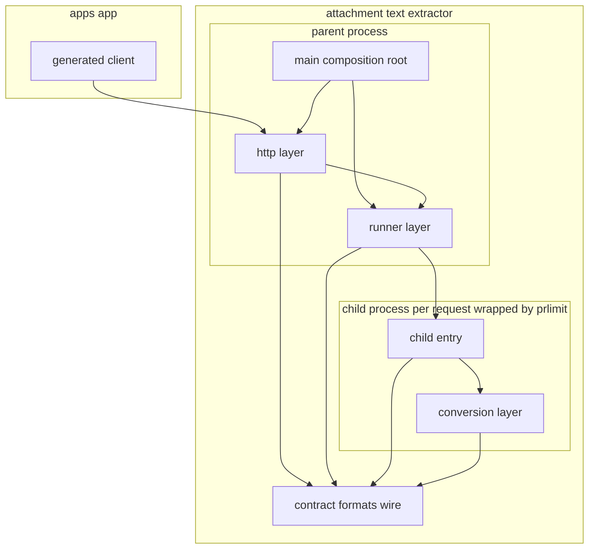
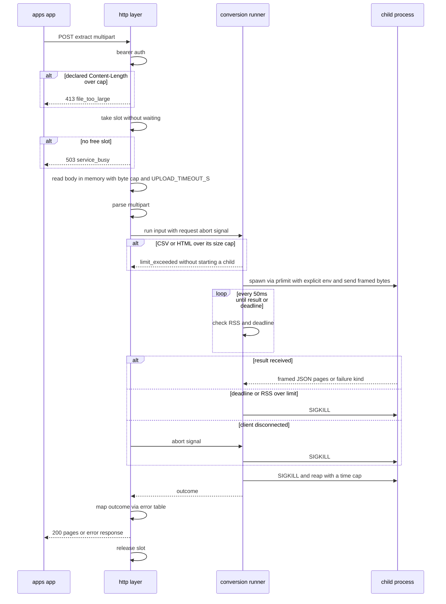

# Technical Design: attachment-search-text-extractor-node-rewrite

## Write / Don't-Write Test

**この文書の役割**: 本 spec の設計上の判断を残す場所であり、実装の記録ではない。抽出サービスを Node 版に書き換える人と、書き換えの後にこの機能を次に変える人が、コードとテストファイルだけでは分からない「なぜこの形なのか」を確かめるために読む。

**判定基準**: 各項目について「コードとテストファイルを読めば、読み手が組み立て直せる内容か」を自問する。組み立て直せるなら、この文書には書かない。

| 書く | 書かない |
|---|---|
| 調べて初めて分かった事実 (Hono の `c.req.raw.signal` が切断で発火する、Node は `RLIMIT_AS` 300MB では起動できない、`prlimit --cpu=soft:hard` で soft と hard を分けられる、など) | 関数のシグネチャの細部、どのファイルに何行あるか |
| 境界をどこに置いたかと、その理由。特に**検討して採らなかった案とその理由** | 素直な実装の説明 |
| まだ決まっていないことと、その決め方 (候補・確かめ方・合否の基準) | どのテストが何を確かめているかの一覧 (テストファイルを読むほうが確実) |
| 自動テストで**捕まえられない**残存ギャップと、人が確かめる手順と合否の基準値 | 差分の有無や実装した時期などの経緯 |

**迷ったら書かない。** コードを読めば分かることをここに置くと、コードが変わったときに黙って古くなり、この文書全体の信頼を落とす。

この spec は amend spec なので、取り込み (Req 12) のときにこの文書の中身は対象 spec `attachment-search-text-extractor` の design.md に移り、この文書は消える。移すときも同じ基準で選ぶ。

## Overview

本 spec は、添付ファイルからテキストを取り出す抽出サービスを、Python 3.12 + FastAPI から Node.js + Hono + `@firecrawl/anydoc` に書き換える。apps/app から見た役割 (`POST /extract` でバイト列を受け取り、ページ・スライド・シート単位の `pages[]` を返す) は変えない。

**Purpose**: monorepo のほかの部分と同じ言語と道具で、抽出サービスを保守できるようにする。性能や抽出の質を上げることは目的にしないが、検索の品質は Python 版より下げない (ベンチマークで確かめる)。

**Users**: 書き換えをする開発者、書き換えの後にこのサービスを保守する開発者。サービスの利用者 (apps/app) と運用者 (GROWI.cloud の SRE、OSS の配布者) からは、既定では何も変わって見えない。

**Impact**: monorepo から Python の道具 (uv / pytest / ruff) と Python 用の CI が消える。配置の決め方によっては、抽出サービスが pnpm workspace と turbo の対象になる。

### Goals

- 対象 spec の AC 1.1〜4.2 を、Node 版で満たす (1.1、Req 3)
- 検索の品質のベンチマークで、すべての形式とすべての指標が Python 版のベースラインを下回らない (2.7〜2.15)
- 凝集度の高い層に分ける。1 ファイル 1 責務で、層の依存は一方向にする (Req 5)
- 進め方の順序 (ベンチマーク → テスト → テストのレビュー → 実装 → 実装のレビュー) を守る (Req 6)
- 守ると複雑になる契約は、手続きを踏んで崩し、記録する (1.9〜1.13、7.6)

### Non-Goals

- 機能の追加 (新しい形式、新しい設定項目、新しいエンドポイント)
- Python 版と Node 版の並行運用 (比較のために一時的に両方を動かすことは除く)
- Bun / Deno / Rust での実装
- 抽出サービスを apps/app のプロセスの中で動かすこと
- 性能や抽出の質を上げるための変更

## Amend target

対象の spec は **`attachment-search-text-extractor`**。詳しい一覧は [brief.md](./brief.md) の「Amend target」にあり、ここでは設計に効く点だけをまとめる。

**変わる契約**: 実行基盤の言語とフレームワーク (Python 3.12 + FastAPI + Uvicorn → Node.js + Hono)、anydoc の入手先 (PyPI → npm、版は 0.2.4 のまま)、PDF とテキスト系の部品、配置とツールチェーン、Dockerfile、CI、配備物の中身、OpenAPI の書き出し手順、子プロセスの作り方と上限の掛け方、設計の根拠。

**既定では変えない契約 (複雑になるなら崩してよい)**: HTTP の API (`POST /extract`、`GET /healthz`、`GET /readyz`、`GET /openapi.json`)、`ErrorCode` の 8 つの値と、対象 spec の design.md §Error Handling の表、`pages[]` の規則、対象 spec の AC 1.1〜4.2 (番号もそのまま)、§Configuration の環境変数の名前と既定値、`openapi.json` の型・名前・操作と生成クライアントの型・関数・引数。崩すときの手続きは 1.9〜1.12 と 7.6、記録の場所は research.md の「7. 崩した契約」(崩したときに作る)。

**崩せない不変条件 (1.13)**: 認証、サービスのトークンを子プロセスに渡さないこと、子プロセスでの隔離、ファイルの中身や入力を返さないエラー応答とログ、メモリの予算 2Gi、対応形式、位置情報つきの抽出。

**決まった例外 (ユーザー判断、2026-11-04)**:
- OpenAPI の説明文だけは、Python に固有の言葉 (forkserver、fork、None など) を取り除いて直す。生成クライアントのコメントの差分は認める (7.1、7.2)
- `MAX_CHILD_RSS_MB` と `MAX_XLSX_CELLS` は、Node 版で成り立たなければ下げてよい (11.11)
- 対象 spec の AC 1.7 (外部バイナリを要求しない) について、util-linux の標準コマンド `prlimit` は追加の外部バイナリに当たらない (4.8)

**条件つきの Amend target**: 契約を崩した結果、`attachment-search-indexing` などの下流 spec の記述を変える必要が出たら、その spec も Amend target に加える (1.11)。

## Boundary Commitments

### This Spec Owns

- 抽出サービスのディレクトリの中のすべて (配置は「ユーザーの判断を待つ項目」の D4 で決める): Node 版のソースとテスト、Dockerfile、`deploy/k8s/` の例、サービスの CLAUDE.md、ベンチマーク
- Python 版の撤去 (Req 10)
- `.github/workflows/attachment-text-extractor.yml` の置き換えと、`infra/docker/compose.yaml` のエントリの追従
- OpenAPI の文書の作り方と書き出し、`packages/attachment-text-extractor-client/openapi.json` の説明文の修正と、それに伴う生成クライアントのコメントの再生成
- 配置の決定に伴う `pnpm-workspace.yaml` / `turbo.json` / `vitest.workspace.mts` / `pnpm-lock.yaml` の変更 (workspace に入れると決めた場合だけ)
- 既定の方針を崩した場合に限り、その結果として要る下流の変更 (1.11)

### Out of Boundary

- apps/app のコード、`attachment-search-indexing` / `attachment-search-ui` の spec (既定では変えない。崩した場合だけ 1.11 の範囲で扱う)
- `packages/attachment-text-extractor-client` の orval の設定 (`orval.config.js`) と、生成物を使う側
- 本番の k8s への適用と運用 (本 spec は例を提供する)
- steering と root の `AGENTS.md` の書き換え (brief.md の Follow-ups。取り込みのときにユーザーが範囲を決める)

### Allowed Dependencies

- 実行環境: Node.js 24 (ルートの `engines.node` と、`apps/pdf-converter` の `node:24-slim` に合わせる)
- 本番の依存: `hono`、`@hono/node-server`、`@firecrawl/anydoc` (=0.2.4)、PDF の部品 1 つ (T1 で選ぶ)、テキスト系の部品 (HTML の解析、文字コードの判定とデコード、ZIP の読み書き、安全な XML の解析。T6 で選ぶ)、OpenAPI の作り方によってはその部品 (T5)。いずれも MIT / Apache-2.0 / BSD / ISC のもの (4.4)。選ぶときに npm の `license` と、同梱されたネイティブ部品のライセンスを確かめる
- OS のコマンド: util-linux の `prlimit` だけ (4.8)
- テスト専用 (本番の image に入れない): vitest、`vitest-mock-extended`、テスト用のファイルを作る部品 (D5 で決める)
- 使わないもの: Python と Python の実行環境 (4.6)、Bun / Deno (4.7)、LGPL / GPL / AGPL の部品、anydoc の `hosted` の OCR (4.5)、外向き通信、共有メモリ `/dev/shm` (8.6)

### Revalidation Triggers

次の変更は、下流 (`attachment-search-indexing` と apps/app) の見直しを要する。対象 spec の Revalidation Triggers をそのまま引き継ぎ、この書き換えで新しく生じうるものを足す。

- **対象 spec から引き継ぐもの**: `ErrorCode` の追加・変更、同じコードが複数の HTTP ステータスを持つこと、`pages[]` の規則、health / readiness の応答の形、`label` の中身、タイムアウトの順序、サイズと時間の上限の既定値。この書き換えは既定ではどれも変えない
- **既定値を下げたとき (11.11)**: `MAX_CHILD_RSS_MB` を下げると、いまは通る大きなファイルが `resource_limit_exceeded` になる。`MAX_XLSX_CELLS` を下げると、検索の対象になる XLSX の範囲が狭くなる。どちらも apps/app 側の `maxFileSizeBytes` とは独立なので apps/app のコードは変わらないが、運用者に知らせる必要がある
- **タイムアウトの合計 (3.13)**: 子プロセスの停止と回収にかかる時間が Python 版と変わる。最悪の合計が apps/app の既定 `timeoutMs` 90,000ms を超えたら、apps/app 側の既定を見直す
- **契約を崩したとき (1.12)**: 崩した項目をここに書き足す。いまは何も崩していない
- **OpenAPI の説明文の修正**: 生成クライアントのコメントだけが変わる。型が変わらないので apps/app の見直しは要らない

## Architecture

### Existing Architecture Analysis

Python 版は「受け口 (HTTP) / 実行管理 (親プロセス) / 変換 (子プロセス)」の 3 層で、依存は `schemas` / `config` → `conversion` → `runner` → `routers` → `main` の一方向だった (対象 spec の design.md §Architecture)。この 3 層の分け方は、言語に関係のない理由 (変換の異常を 1 件に閉じ込める、親は変換の部品を読み込まない、変換を子プロセス無しで単体テストする) で決めたものなので、Node 版でもそのまま引き継ぐ。

言語によって変わるのは、層の中の部品と、層の間の継ぎ目の作り方である。

| 継ぎ目 | Python 版 | Node 版で変わる点 |
|---|---|---|
| 本文の受け取り | FastAPI の `UploadFile` を避け、ASGI の `receive()` を自分で読む | Hono では標準の `Request.body` を少しずつ読めばよい (research.md 6.1 で実測) |
| 切断の検知 | `receive()` で `http.disconnect` を待つタスク | `c.req.raw.signal` の `abort` (research.md 6.1 で実測) |
| 子プロセスの作り方 | forkserver (変換の部品を読み込んだ親から複製する) | Node には読み込み済みのプロセスを複製する仕組みが無い。子は毎回起動して部品を読み込む (起動は約 27ms、research.md 6.2。T2 で確定) |
| 子への上限 | 子の中で `setrlimit` | `prlimit` で包んで起動する (T2) |
| トークンを子に渡さない | 起動前に `os.environ` から消す | 子の `env` を明示して渡す (親の `process.env` は書き換えない) |

### Architecture Pattern & Boundary Map



矢印は「import する」向きである。`Runner --> ChildEntry` だけは import ではなく「子プロセスとして起動する」(ファイルのパスを渡すだけで、親は子のコードを import しない)。

### 層の分け方の判断 (Req 5)

ファイルの一覧は File Structure Plan にある。ここでは、どこに境界を置いたかと、その理由を書く。

**判断 1: 親と子で読み込むコードを、ディレクトリの単位で分ける。**
親 (HTTP を受けるプロセス) は、変換の部品 (anydoc のネイティブ部品、PDF の部品) を一度も読み込まない。読み込むだけでもメモリを使い、ネイティブ部品の不具合が親に及ぶ余地を残すからである。そのため、子だけが読み込む `conversion/` と `child/` を、親が読み込む `runner/` と `http/` から import の向きで切り離す。`runner/` は子を起動するときに `child/` の入口のファイルのパスを渡すだけで、import しない。これは lint の規則 (biome の import の制限、または依存の向きを確かめるテスト) で機械的に守る (5.3)。

**判断 2: 親と子の両方が使う純粋な部品は、どちらの層にも属さない小さな共有層に置く。**
CSV / HTML の大きさの事前判定 (3.6) は、子を作る前に親が行うが、同じ判定を変換の層でも使う。これを `conversion/` に置くと親が `conversion/` を import することになり、判断 1 が崩れる。そこで、形式の判定の表と大きさの事前判定を `formats/` に、親子の受け渡しの形 (長さを先に付けた JSON) を `wire/` に、型と `ErrorCode` を `contract/` に分ける。この 3 つは外部の部品を何も import しない純関数と型だけの層で、親と子の両方から使える。

**判断 3: 変換の層は「入力のバイト列 → 結果か失敗の種類」の純関数にする。**
`conversion/` は HTTP も子プロセスも知らない。入口は 1 つの関数 (`convert`) で、例外を外に投げず、結果か失敗の種類 (`FailureKind`) を返す。これで、子プロセス無しで単体テストを書ける (5.2)。形式ごとの処理は、責務ごとに小さなディレクトリに分ける: OOXML の ZIP と XML の処理 (PPTX と XLSX が共有する ZIP の事前検査、XML の安全な解析、セル数の数え方) は `conversion/ooxml/`、テキスト系 (文字コード、HTML、XML、ipynb) は `conversion/text/`、改行と日本語の正規化は `conversion/normalize.ts`。

**判断 4: 失敗の種類から `ErrorCode` と HTTP ステータスへの表は、HTTP の層の 1 ファイルだけに置く。**
表は `Record<FailureKind, { code: ErrorCode; status: number }>` の形にする。TypeScript は `Record` のキーの漏れを型の検査で見つけるので、失敗の種類を足したときに表の追加を忘れられない (5.5)。変換と実行管理の層は `ErrorCode` も HTTP ステータスも知らず、`FailureKind` だけを返す。

**判断 5: `main.ts` だけが組み立てを行う。**
設定を読み、`ConversionRunner` を作り、Hono のアプリに渡し、`@hono/node-server` で待ち受ける。ほかのモジュールは設定を自分で読まない (引数で受け取る)。テストは `createApp(deps)` に偽の実行管理や本物の実行管理を渡せる。

**判断 6: barrel (`index.ts`) は、層の外から呼ばれるものだけを export する。**
たとえば `conversion/index.ts` は `convert` だけを export し、PPTX の分割や文字コードの判定は export しない。それらの単体テストは、テストと同じディレクトリから直接 import する (テストは同じ場所に置く。testing.md)。`runner/index.ts` は `ConversionRunner` と、その作り方だけを export する (5.4)。

**判断 7: Linux に固有の処理 (`/proc` の読み書き、`prlimit`) は `runner/linux/` の中だけにまとめる。**
RSS の読み取り、`oom_score_adj` の設定、`prlimit` の引数の組み立てと存在の確認を 1 か所に置き、Linux 以外では何もしない (開発用) 形で包む。Python 版の `platform_guards.py` と同じ考え方である。

**採らなかった案**:
- **常駐する子プロセスの組 (pool) を作り、使い回す**: 1 件の異常や悪意あるファイルの影響が次の要求に残る。対象 spec でも不採用にした (対象 spec の research.md §3.8)。子の起動は約 27ms で、大きな変換は数秒かかるので、使い回しの利点は小さい
- **worker_threads (同じプロセスの中のスレッド) で変換する**: ネイティブ部品の abort や segfault でプロセスごと落ちる。メモリの上限もスレッドごとには掛けられない
- **層をまとめて `src/` を平らにする**: ファイル数は減るが、判断 1 の「親が変換の部品を読み込まない」を import の向きで守れなくなる

## Technology Stack

| 層 | 選んだもの / 候補 | 役割 | 確かさ |
|---|---|---|---|
| 実行環境 | Node.js 24 | 実行 | 決定 (4.1、`engines.node`) |
| HTTP | `hono` 4.x + `@hono/node-server` 2.x | 受け口 | 決定 (4.1)。版は実装のときに固定する。本文と切断の扱いは research.md 6.1 で実測 |
| Office 系 | `@firecrawl/anydoc` 0.2.4 | 変換 | 決定 (4.2) |
| PDF | 未決 (`@hyzyla/pdfium`、pdfjs-dist、pdfium-native など) | 変換 | T1 で決める |
| テキスト系の部品 | 未決 | HTML の解析、文字コードの判定、ZIP、XML | T6 で決める |
| 子プロセス | `child_process.spawn` + `prlimit` (候補) | 隔離と上限 | T2 で決める |
| OpenAPI | 未決 | 契約の文書 | T5 で決める |
| テスト | vitest、`vitest-mock-extended` | テスト | 決定 (testing.md) |
| lint / 整形 | biome (ルートの `biome.json`) | 品質 | 決定 |
| image | `node:24-slim` を元にした multi-stage | 配備 | 決定 (8.1)。大きさは未計測 |

## File Structure Plan

以下、`<root>` は抽出サービスのディレクトリを指す (D4 の決定で `services/attachment-text-extractor/` か `apps/attachment-text-extractor/` になる)。

### Directory Structure

```
<root>/
├── package.json                  # name @growi/attachment-text-extractor, private, scripts (dev/build/lint/test/export-openapi/benchmark)
├── tsconfig.json
├── vitest.config.ts
├── Dockerfile                    # multi-stage on node:24-slim; final stage runs `prlimit --version` (8.7)
├── CLAUDE.md                     # service-local instructions, rewritten for Node
├── deploy/k8s/                   # deployment / service / hpa / networkpolicy examples (8.5)
├── scripts/
│   └── export-openapi.ts         # writes the OpenAPI document for packages/attachment-text-extractor-client (7.1)
├── benchmark/                    # search-quality benchmark (2.7–2.15); see "Benchmark"
│   ├── corpus/                   # documents (or their generators, per D5)
│   ├── answers.json              # expected phrases and positions per document
│   └── run-benchmark.ts          # calls POST /extract on a base URL, scores, prints a report
└── src/
    ├── main.ts                   # composition root: config -> runner -> app -> serve
    ├── contract/                 # leaf: types only, no imports from other layers
    │   ├── index.ts
    │   ├── extract-response.ts   # PageInfo, ExtractResponse
    │   ├── error-code.ts         # ErrorCode union (8 values)
    │   └── failure-kind.ts       # FailureKind union (conversion and runner outcomes)
    ├── config/
    │   ├── index.ts
    │   └── load-settings.ts      # env -> Settings, fail fast on missing token (1.4, 1.5)
    ├── formats/                  # leaf: pure, shared by parent and child (judgement 2)
    │   ├── index.ts
    │   ├── format-table.ts       # MIME / extension -> route and anydoc format name
    │   └── input-size.ts         # CSV / HTML size pre-check (3.6)
    ├── wire/                     # leaf: pure framing shared by parent and child
    │   ├── index.ts
    │   └── length-prefixed-json.ts
    ├── conversion/               # child only: pure conversion (judgement 3)
    │   ├── index.ts              # exports convert() only
    │   ├── convert.ts            # resolve -> route -> normalize -> drop empty -> result size
    │   ├── normalize.ts          # newlines (all routes), Japanese break joining (PDF only)
    │   ├── office.ts             # anydoc call with explicit format; ConvertErrorCode -> FailureKind
    │   ├── pdf.ts                # per-page text via the T1 library
    │   ├── ooxml/
    │   │   ├── index.ts
    │   │   ├── archive-guard.ts  # entry count / declared size checks (3.7)
    │   │   ├── safe-xml.ts       # XML parse without DTD / entity expansion
    │   │   ├── pptx-split.ts
    │   │   ├── xlsx-cell-count.ts
    │   │   └── xlsx-split.ts
    │   └── text/
    │       ├── index.ts
    │       ├── charset.ts
    │       ├── html.ts
    │       ├── xml-text.ts
    │       ├── ipynb.ts
    │       └── plain-text.ts
    ├── child/                    # child only: process entry (judgement 1)
    │   ├── child-entry.ts        # read framed input, set oom_score_adj, watch parent, convert, write framed result
    │   └── parent-watch.ts       # exit when the parent's pipe closes (3.11)
    ├── runner/                   # parent only: start, watch and stop one child per request
    │   ├── index.ts              # exports ConversionRunner and createConversionRunner
    │   ├── conversion-runner.ts  # run(input, signal): Promise<RunOutcome>
    │   ├── child-exit.ts         # exit code / signal -> FailureKind (crashed, timeout, ...)
    │   ├── child-env.ts          # explicit env for the child, without the service token (3.8)
    │   ├── readiness.ts          # prlimit present + probe child (8.8)
    │   └── linux/
    │       ├── index.ts
    │       ├── prlimit-args.ts   # RLIMIT_AS / CPU soft:hard / core 0 -> argv
    │       ├── proc-rss.ts       # /proc/<pid>/status VmRSS
    │       └── platform.ts       # no-op wrappers on non-Linux
    └── http/                     # parent only: Hono app
        ├── index.ts              # exports createApp only
        ├── create-app.ts         # routes and middleware wiring
        ├── bearer-auth.ts        # constant-time token check, bypass list (1.6)
        ├── concurrency-slots.ts  # non-blocking slots (3.2)
        ├── receive-upload.ts     # Content-Length early check, capped in-memory read, upload timeout (3.1, 3.3)
        ├── parse-multipart.ts    # file + mimeType from the received bytes (T4)
        ├── extract-route.ts      # slot -> receive -> runner.run(signal) -> response
        ├── error-table.ts        # Record<FailureKind, {code, status}> (5.5)
        ├── health-routes.ts      # /healthz, /readyz
        ├── openapi-route.ts      # /openapi.json (T5)
        └── request-log.ts        # one line per request, no file name / content / auth header (1.7)
```

テストは各ソースファイルの隣に `*.spec.ts` (単体) と `*.integ.ts` (子プロセスや本物の HTTP を使うもの) として置く。HTTP を外から確かめる黒箱のテストは `<root>/test/http/` にまとめる (6.3 で Python 版にも向けて動かすため。「テストの戦略」を参照)。

### Modified Files

- `.github/workflows/attachment-text-extractor.yml` — Node 版の lint・型の検査・テスト・image の確認・OpenAPI の drift 検知に置き換える (Req 9)
- `infra/docker/compose.yaml` — Node 版の image と、D1 の決定に合わせた環境変数 (8.4)
- `packages/attachment-text-extractor-client/openapi.json` と `src/generated/index.ts` — 説明文の修正と再生成 (7.1、7.2)
- D4 で workspace に入れると決めた場合: `pnpm-workspace.yaml` (`services/*` を足す場合)、`vitest.workspace.mts` (`services/*` を拾う場合)、`pnpm-lock.yaml`
- Python 版の撤去 (Req 10): `pyproject.toml`、`uv.lock`、`.python-version`、`src/app/**`、`tests/**/*.py`、`scripts/*.py` など

## System Flows

### 抽出の流れ



**主な決定**:
- 枠を取る順序、本文をメモリだけで受け取ること、結果を受け取った後も必ず子を止めて回収することは、対象 spec と同じ (3.1〜3.5)
- 切断は `c.req.raw.signal` を `runner.run()` にそのまま渡す。実行管理は `AbortSignal` だけを知り、HTTP を知らない (判断 1)
- 子の `env` は、`PATH` など起動に要るものだけを並べた明示的なオブジェクトにする。親の `process.env` からトークンを消す方法は採らない。環境変数の書き換えは、あとから読む処理があると黙って壊れるからである (3.8)

### 子プロセスの中の流れ

対象 spec の design.md §「子プロセスの中の流れ」と同じ (形式の判定 → 大きさの判定 → 経路ごとの変換 → 正規化 → 空の要素を除く → 結果を 1 回送る)。Node 版で違うのは次の点だけである。

- 起動直後に `/proc/self/oom_score_adj` に 1000 を書く (値を上げる方向なので権限は要らない)。仮想メモリ・CPU 時間・コアダンプの上限は `prlimit` が起動の前に掛けてある
- 親が先に終わったら子も終わる仕組みは、親だけが書き込み側を持つパイプを子が見張る形を第一候補にする (T2 で確かめる)
- 変換の部品の例外はすべて捕まえて `FailureKind` に変える。anydoc は `ConvertErrorCode` を持つ `Error` を投げる (research.md 1.1)。ネイティブ部品の abort や segfault は捕まえられず、親が終了の理由から `crashed` と分類する

## 実施の流れ (Req 6)


| 段階 | 中身 | 終わりの条件 |
|---|---|---|
| 0. ベンチマーク | コーパスと正解を作り (2.7、2.8)、いまの Python 版に `run-benchmark.ts` を向けてベースラインを測る (2.11)。1 と同時に進めてよいが、3 より前に終える (6.8) | ベースラインが research.md にある。絶対値の基準を置くかをユーザーが決めた (2.13) |
| 試作 | T1〜T6 の試作と計測。結果を research.md に記録する (11.1) | 結果と選んだ案が research.md にある。D1〜D5 のユーザーの判断が出ている |
| 1. テスト | Python のテストを vitest に書き換え、Python のテストファイルごとの対応表を作る (6.2)。HTTP の黒箱のテストを Python 版に向けて動かし、すべて通ることを確かめる (6.3)。Node 版に向けて失敗すること (RED) を記録する (6.4) | 対応表、Python 版で通った記録、RED の出力がある |
| 2. テストのレビュー | 書いた人とは別の担当が `essential-test-design` と `essential-test-patterns` を使ってレビューする (6.5) | 直すべき指摘が残っていない (6.7) |
| 3. 実装 | 層ごとに実装する。作業の単位は File Structure Plan のディレクトリに合わせる | すべてのテストが通る。ベンチマークで退行がない、または退行についてユーザーの判断が出ている (2.12、2.14) |
| 4. 実装のレビュー | 新しく立てた別の担当が、Opus で、欠陥を探す立場でレビューする (6.6) | 直すべき指摘が残っていない (6.7) |
| 撤去 | Python 版を消し、CI を Node 版だけにする (Req 10) | 10.4 の前提を満たしている |
| 取り込み | 対象 spec に取り込み、この spec を消す (Req 12) | 12.1〜12.6 |

### Python 版の残し方と、撤去の条件

- 段階 0 から撤去まで、Python 版はいまの場所にそのまま残し、いまの Python 用の CI もそのまま動かす。比較 (2.1、2.2)、ベースライン (2.11)、黒箱のテストの確認 (6.3) に使うためである。Python 版のコードは直さない (直すと比べる相手が変わる)
- Node 版は、Python 版と別のディレクトリで作る。D4 で `apps/attachment-text-extractor/` に移すと決めた場合は、その場所で作ればよく、撤去のときに `services/attachment-text-extractor/` を消すだけで済む。`services/` のままにすると決めた場合は、作業の間だけ Node 版を別の名前のディレクトリで作り、撤去のときに入れ替える
- Node 版の CI は、作業の間は Python 用の CI とは別のジョブとして足し、撤去のときに 1 つの workflow にまとめる (9.1)
- 撤去してよい条件 (10.4): ベースラインを測り終えた、比較 (2.1、2.2) を記録した、黒箱のテストが Python 版で通った (6.3)、ベンチマークの退行についてユーザーの判断が出た (2.14、11.12)、段階 4 のレビューを通った

## ユーザーの判断を待つ項目

次の項目は、design の承認の前にユーザーに決めてもらう (11.9)。推奨は、シンプルさ (保守性) を基準にこの設計の作者が選んだものである。

| # | 項目 | 選択肢 | 推奨と理由 |
|---|---|---|---|
| D1 | `WORKERS` の意味 | (a) 廃止する (読まない。compose と k8s の例から消す)<br>(b) Node の cluster でプロセスを N 個にする<br>(c) 受け付けるが 1 以外は起動を失敗させる | **(a)**。既定は 1 で、2 以上は接続の偏りで空きがあっても 503 が返る弱点があった (対象 spec の design.md §Open Questions)。HPA で Pod を増やすのが本来のスケールのしかたで、Node では 1 プロセスで受け口が止まらない (変換は子プロセス)。(a) は設定の契約を崩すので、1.10 の手続きで research.md に記録する |
| D2 | `/readyz` の `dependencies` に出す名前 | (a) いまの名前のまま (`pypdfium2` など。中身と合わない)<br>(b) 役割の名前にする (`anydoc`、`pdf`、`converter`、`prlimit`)<br>(c) `dependencies` をやめて `status` だけにする | **(b)**。OpenAPI ではこの応答の形を決めていない (スキーマが `{}`) ので生成クライアントは変わらない。部品の名前ではなく役割の名前にすると、PDF の部品を替えても名前が変わらない。`prlimit` を足すのは 8.8 で準備完了の条件になるため |
| D3 | `/docs` と `/redoc` | (a) 出さない<br>(b) Swagger UI の部品を足して出す (認証あり) | **(a)**。apps/app は使っておらず、テストもない。部品が 1 つ増える。`/openapi.json` は残るので、見たい人はそれを手元の道具で開ける。(a) は観察できる振る舞いを変えるので、1.10 の手続きで記録する |
| D4 | 配置 | 下の表 | **(C) `apps/attachment-text-extractor/` に移して workspace に入れる** |
| D5 | テスト用のファイルの作り方 | 下の表 | **(b) と (c) の組み合わせ** |

### D4: 配置の比較

対象 spec が workspace の外に置いた理由は Python に固有のものだった (research.md 3 節)。Node 版では、すでに `apps/pdf-converter` という前例がある: workspace の中の Node のマイクロサービスで、専用の CI と、`pnpm deploy --prod` で本番の依存だけを取り出す Dockerfile を持ち、生成クライアント `packages/pdf-converter-client` も orval で作っている (research.md 6.3)。

| | (A) `services/` のまま workspace の外 | (B) `services/` のまま workspace に入れる | (C) `apps/` に移して workspace に入れる |
|---|---|---|---|
| lockfile | サービス専用の lockfile を別に持つ。pnpm と npm のどちらを使うかも決める必要がある | ルートの `pnpm-lock.yaml` にまとまる | 同左 |
| `pnpm install` | ルートの install では入らない。開発者は別に install する | 全開発者の install で anydoc のネイティブ部品も入る (大きさは未計測) | 同左 |
| turbo | 対象外 | `turbo run lint/test --filter` の対象になる。ルートの `turbo.json` の既定の task がそのまま効く | 同左。`apps/pdf-converter` と同じ扱い |
| vitest | 自分の設定だけで動く | `vitest.workspace.mts` に `services/*` を足す | `apps/*/vitest.config.ts` で自動で拾われる |
| biome | ルートの `biome.json` が `**` を対象にしているので、どれでも対象になる | 同左 | 同左 |
| CI | 専用の workflow で install から行う | 専用の workflow。`pnpm install --frozen-lockfile` と `turbo --filter` を使える | 同左。`ci-pdf-converter.yml` の形を流用できる |
| Docker | ディレクトリだけを context にでき、単純 | ルートを context にして `pnpm deploy` で取り出す | 同左。`apps/pdf-converter/docker/Dockerfile` の形を流用できる |
| 撤去と並行開発 | Python 版と同じ場所なので、作業の間は別のディレクトリが要る | 同左 | Python 版と場所が別なので、撤去は `services/` を消すだけ |
| 文書への影響 | steering の `structure.md` の「`services/` は Node 以外」と合わない | 同左 | `services/` がなくなり、`structure.md` の記述を消せる (Follow-ups) |
| パスが変わる箇所 | なし | なし | compose の `context`、CI の `paths`、サービスの CLAUDE.md、下流 spec の記述 (契約には関係しない) |

推奨は **(C)**。前例 (`apps/pdf-converter`) と同じ形にすると、CI・Dockerfile・vitest・turbo の扱いを新しく考えずに済み、monorepo の中で「Node のマイクロサービスは `apps/` に置く」という 1 つの決まりに揃う。Python 版と場所が分かれるので、作業の間の並行開発と撤去も単純になる。欠点は、全開発者の `pnpm install` に anydoc のネイティブ部品が入ることで、その大きさは試作で測って示す。

### D5: テスト用のファイルの作り方

Python 版は、テストの実行中に Python のライブラリでファイルを作っている。撤去すると、この作り方は使えなくなる (research.md 6.4)。

| 選択肢 | 中身 | 利点 | 欠点 |
|---|---|---|---|
| (a) Node の部品で作り直す | XLSX / PPTX / 暗号化した Office / XLS などを Node の部品で作る | 対象 spec と同じく「生成したファイルだけを使う」方針を保てる | 暗号化した Office や XLS を作る Node の部品は調べておらず、ない場合がある。テスト専用の依存が増える |
| (b) Python 版の作り方で一度だけ作り、リポジトリに入れる | 撤去の前に Python の生成器で作ったファイルを、出所 (どの関数で作ったか) と SHA-256 の一覧と一緒に commit する | 同じファイルで Python 版と Node 版を比べられる (ベースラインと同じ入力になる)。部品が増えない | リポジトリが大きくなる。作り直すには Python が要る (撤去の後は作り直さない前提) |
| (c) ZIP と XML を自分で組み立てる小さな生成器 | セル数の上限やタイムアウト用の大きな XLSX、ZIP 爆弾などを、ZIP と XML の文字列から Node で組み立てる | 大きなファイル (数十 MB) をリポジトリに入れずに済む | 作れる形式が OOXML と単純なものに限られる |

推奨は **(b) と (c) の組み合わせ**。小さなファイルは (b) で commit し、数十 MB になる大きなファイル (`*_path` の名前の fixture) は (c) で作る。どのファイルをどちらにするかと、commit する合計の大きさは、テストの書き換えの段階で一覧にして示す。(b) は対象 spec の「実在の文書はリポジトリに入れない」に反しない (生成したファイルであって実在の文書ではない) が、「テストの中で生成する」という対象 spec の Allowed Dependencies の記述は変わるので、取り込みのときに直す。

## 試作と計測で決める項目

次の項目は、この設計では決めない。タスクの試作で候補を比べ、結果を research.md に記録して決める (11.1)。合否の基準を満たす候補が 2 つ以上あれば、シンプルなほう (部品が少ない、コードが短い) を選ぶ。

| # | 項目 | 候補 | 確かめ方 | 合否の基準 |
|---|---|---|---|---|
| T1 | PDF の部品 (11.3) | `@hyzyla/pdfium` (PDFium の WASM)、pdfjs-dist、pdfium-native (ネイティブ) など | ベンチマークの PDF (日本語の横書き・縦書き・語の途中の改行) で 2.9 の指標を測る。パスワード付きと所有者パスワードだけの PDF、壊れた PDF、画像だけの PDF、ページ数の上限を、対象 spec の AC 1.4 / 1.10 / 1.11 / 1.12 と 3.7 のテストで確かめる。子の最大 RSS と、必要な仮想メモリを測る | 指標が Python 版 (pypdfium2) のベースラインを下回らない (2.12)。AC をすべて満たす。RSS が `MAX_CHILD_RSS_MB` の 0.95 倍に収まる。許容的なライセンス |
| T2 | 子プロセスの作り方 (11.4) | (a) `spawn('prlimit', [...limits, '--', node, child-entry])`<br>(b) `fork` して、起動の後に親から `prlimit --pid` で上限を掛ける<br>(c) その他 | 上限 (仮想メモリ、CPU 時間 soft / hard、コアダンプ) が子に掛かること、親が SIGKILL されたときに子が残らないこと、起動の時間、変換の部品をすべて読み込んだ子の起動の時間を測る | 上限が変換の開始より前に掛かっている ((b) は起動と上限の間に隙がある)。親が消えたら子が 1 秒以内に終わる。起動の時間が数十 ms の範囲 (research.md 6.2 で (a) は約 27ms) |
| T3 | `RLIMIT_AS` の値 (11.5) | 固定の値 (たとえば 4GB)、または「必要な仮想メモリの実測の最大 + 余裕」 | 形式ごとに、普通のファイルと大きなファイルで子が必要とする仮想メモリを測る (何もしない状態で 1,200MB、anydoc の XLSX で 2,000MB、PDFium WASM で 3,000MB 以上という調べを取り直す) | ベンチマークとテストのすべての正常な変換が、この上限で失敗しない。RSS の監視 (3.4) が主な守りとして働くことをテストで確かめる。上限は「暴走した子が仮想メモリを使い果たすのを止める最後の歯止め」と位置づける |
| T4 | 本文の受け取り方と multipart の分解 (11.6) | (a) 上限つきでメモリに読み込んだ後、標準の `Response.formData()` で分解する<br>(b) busboy などの部品で少しずつ分解する<br>(c) 自分で境界 (boundary) を探して分解する | 対象 spec の AC 2.1 / 2.3 と、3.1〜3.5 のテスト (宣言なしで上限を超える本文、遅い本文、途中での切断、`file` が無い・2 つある、部品のヘッダーが大きすぎる) を通す。50MB を 3 件同時に送ったときの親の最大 RSS を測る | テストをすべて通す。親の最大 RSS が Python 版の実測 (263MiB) を大きく超えない。本文の受け取りと切断の検知は research.md 6.1 で実測済み |
| T5 | OpenAPI の作り方 (11.7) | (a) commit 済みの `openapi.json` を正とし、サービスはそれをそのまま返す。応答がスキーマに合うことをテストで確かめる<br>(b) `@hono/zod-openapi` などで、コードの型から文書を作り、FastAPI が付けた名前に合わせる | 7.1 の比較 (説明文以外が JSON として同じ)、7.2 の比較 (orval で作り直して型・関数・引数に差分がない)、7.3 の drift 検知を CI で動かす。名前を合わせるのに要るコードの量を数える | 7.1〜7.3 を満たす。(b) で名前を合わせるための後処理が大きくなるなら、(a) を選ぶか、7.6 の手続きで名前の契約を崩すかを比べる |
| T6 | テキスト系の部品 (2.2、2.4) | HTML の解析 (htmlparser2、parse5 など)、文字コードの判定とデコード (iconv-lite と、候補を絞った判定の組み合わせなど)、ZIP の読み書き (yauzl / yazl、fflate など)、DTD とエンティティを展開しない XML の解析 | ベンチマークのテキスト系の文書と、2.4 の文字コードのファイルで 2.9 の指標を測る。ZIP 爆弾と XXE (外部のエンティティを読みに行く攻撃) のテストを通す | 指標がベースラインを下回らない。XXE と膨張を起こさない。許容的なライセンス (LGPL のもの、たとえば文字コードの判定でよく使われる部品の一部は除く。ライセンスは選ぶときに確かめる) |

## Components and Interfaces

型の細部は実装で決める。ここでは、層をまたぐ継ぎ目の形だけを決める。

### 共有層 (`contract/`、`formats/`、`wire/`)

```typescript
// contract/failure-kind.ts
export type FailureKind =
  | 'unsupported' | 'encrypted' | 'malformed' | 'limit_exceeded'
  | 'memory_exceeded' | 'result_too_large' | 'timeout' | 'crashed' | 'internal';

// contract/extract-response.ts
export interface PageInfo {
  readonly pageNumber: number | null;
  readonly label: string | null;
  readonly content: string;
}

export type ConversionOutcome =
  | { readonly kind: 'ok'; readonly mimeType: string; readonly pages: readonly PageInfo[] }
  | { readonly kind: 'failed'; readonly failure: FailureKind; readonly detail: string };

// formats/format-table.ts
export type Route = 'pdf' | 'pptx' | 'xlsx' | 'office' | 'text';
export interface ResolvedFormat {
  readonly route: Route;
  readonly mimeType: string;
  readonly anydocFormat: string | null;
}
export function resolveFormat(fileName: string, mimeHint: string | null): ResolvedFormat | null;
```

- `FailureKind` の値は、対象 spec の design.md §Error Handling の「失敗の種類」の列と同じ
- 形式の対応表は、対象 spec の design.md §FormatResolver の表と同じ中身にする (既知の制約も含めて同じにする。2.6)
- `detail` はログ用の短い説明で、ファイルの中身や例外の全文を入れない (1.8)

### 変換の層 (`conversion/`)

```typescript
export interface ConversionLimits {
  readonly maxXlsxCells: number;
  readonly maxPdfPages: number;
  readonly maxArchiveEntries: number;
  readonly maxArchiveUncompressedBytes: number;
  readonly maxResultBytes: number;
  readonly maxCsvBytes: number;
  readonly maxHtmlBytes: number;
}

export function convert(
  bytes: Uint8Array,
  fileName: string,
  mimeHint: string | null,
  limits: ConversionLimits,
): Promise<ConversionOutcome>;
```

- 例外を外に投げない。想定外の例外は `internal` にする
- 正規化の範囲 (改行の統一はすべての経路、日本語の間の詰めは PDF だけ) と、空の要素を除いて最低 1 要素を返す規則は、対象 spec と同じ (2.5)
- anydoc の文書化されていない挙動 (PPTX の分割、XLSX の目印、XLS を形式名 `xlsx` で渡すこと、例外の分類) は、版を固定した契約テストに集める (4.2)

### 実行管理の層 (`runner/`)

```typescript
export interface RunInput {
  readonly bytes: Uint8Array;
  readonly fileName: string;
  readonly mimeHint: string | null;
}

export type RunOutcome = ConversionOutcome & { readonly childPeakRssMb: number | null };

export interface ConversionRunner {
  run(input: RunInput, signal: AbortSignal): Promise<RunOutcome>;
  readiness(): Promise<Readiness>;
}
```

- 呼ぶ前の条件: 呼び出し側が枠を取り、ファイルの大きさを確かめている
- 戻った時点の状態: 子は終了・回収済み。`signal` が中止されたときも、子を止めて回収してから戻る (3.5)
- 1 回の `run()` で作る子は 1 つ。CSV / HTML の大きさの事前判定に当たったら子を作らない (3.6)
- 子の終了のしかたから失敗の種類への対応 (`child-exit.ts`): 結果を受け取った → 結果のとおり、期限切れで止めた → `timeout`、RSS の上限で止めた → `memory_exceeded`、CPU 時間の上限 (SIGXCPU) → `timeout`、結果を送る前に終わった (abort、segfault、OS による強制終了) → `crashed`、結果が大きすぎる → `result_too_large`

### HTTP の層 (`http/`)

- `createApp(deps: { settings: Settings; runner: ConversionRunner })` で Hono のアプリを作る。設定を自分で読まない (判断 5)
- 認証は、`/healthz`、`/readyz`、`/openapi.json` 以外のすべてのパス (存在しないパスを含む) で先に行う (1.6)。比較は長さに左右されない比べ方 (`crypto.timingSafeEqual`) にする
- `/readyz` は `runner.readiness()` を呼ぶ。`prlimit` を起動できないとき、または確認用の子が起動できないときは 503 `not_ready` を返し、`/healthz` は 200 のままにする (8.8)。応答の `dependencies` の名前は D2 で決める
- 1 件ごとのログは対象 spec と同じ形の 1 行 (`extract format=… size=… duration_ms=… result=… child_peak_rss_mb=…`) にする (1.7)

## Data Models

### Data Contracts & Integration

`ExtractResponse` / `PageInfo` / `ErrorResponse` / `ErrorCode` の中身は、対象 spec の design.md §Data Models と同じで、変えない。

**親子の受け渡し**: 親から子へは、標準入力に「4 バイトの長さ + JSON の見出し (ファイル名、形式の手がかり、上限の値)」と「4 バイトの長さ + ファイルの本体」を 1 回ずつ送る。子から親へは、標準出力に「4 バイトの長さ + JSON の結果」を 1 回だけ送る。親は JSON として解釈するだけで、子が送ったデータをコードとして扱わない (3.9)。結果の長さが `MAX_RESULT_BYTES` (と見出しの分の余裕) を超えたら、読み捨てて `result_too_large` にする。

## Configuration

環境変数の名前・既定値・意味は、対象 spec の design.md §Configuration の表と同じにする (1.4)。違いは次のものだけである。

- `WORKERS`: D1 の決定に従う
- `MAX_CHILD_RSS_MB`、`MAX_XLSX_CELLS`: Node 版の計測 (11.2) で成り立たなければ下げてよい (11.11)。上げない
- `RAYON_NUM_THREADS=1` (anydoc の中のスレッドの数を 1 にする): anydoc の Rust の核は同じなので、Dockerfile と子の `env` で引き続き設定する (Python 版の調べでは、設定しないと仮想メモリのピークが 1.2GB に達した)
- `TMPDIR`: Python 版は forkserver のソケットのために要った。Node 版で要るかどうかは T2 で確かめる。要らなければ設定しない

`RLIMIT_AS` の値は環境変数にせず、T3 で決めた値をコードの定数にする (新しい設定項目を足さない)。

**メモリの予算**: Python 版の目安は「ワーカー数 × 120MB + ワーカー数 × `MAX_CONCURRENCY` × (`MAX_CHILD_RSS_MB` + 100MB + アップロード 2 × `MAX_FILE_SIZE_MB` + 結果 16MiB × 3)」で、既定で約 1.8GB (k8s の例の limits は 2Gi)。Node 版では、親の待機時の RSS (devcontainer で何もしない Node が 45MB、research.md 1.5) と、子の最大 RSS (11.2) を測り直して、同じ形の式で計算し直す。計算した結果が 2Gi を超えるなら、既定値を下げる (11.11)。2Gi を上げることはしない (1.13)。

## Error Handling

### Error Strategy

対象 spec と同じく、変換の失敗はすべて「その 1 件のエラー応答」に閉じ込める。親は変換の部品を読み込まないので、変換の異常で落ちない (判断 1)。

### Error Categories and Responses

失敗の条件と `ErrorCode` と HTTP ステータスの対応は、対象 spec の design.md §Error Handling の表と同じにする (1.3)。その表は `http/error-table.ts` の 1 か所だけに置く (5.5)。Node 版で検出のしかたが変わる行は次のとおり。

| 対象 spec の表の行 | Node 版での検出のしかた |
|---|---|
| anydoc の `EncryptedError` など | anydoc の `Error` の `ConvertErrorCode` の値で分ける (値と種類の対応は契約テストで固定する) |
| pypdfium2 の `PdfiumError` (err_code 4 / 5 と 0〜3) | T1 で選んだ PDF の部品のエラーの区別で分ける |
| 子の中の想定外の例外 (`PanicException` を含む) | 子の中で捕まえた例外は `internal`。Rust の panic で abort した場合は捕まえられず、親が `crashed` に分類する |
| 呼び出し側の切断 | `c.req.raw.signal` の `abort` (research.md 6.1) |

`prlimit` を起動できない場合は、`/readyz` を not-ready にする (8.8)。`/extract` に来た要求は子を起動できずに `crashed` (500) になる。

### Monitoring

1 件ごとのログの形は対象 spec と同じ。ファイル名・中身・Authorization ヘッダは出さない (1.7)。

## ベンチマーク (2.7〜2.15)

**置き場所**: `<root>/benchmark/`。Node (TypeScript) で書く。Python 版の撤去の後も残り、PDF の部品や anydoc の版を替えるときに検索の品質を確かめ直すのに使える。

**コーパス**: 形式ごと (PDF / DOCX / XLSX / PPTX / XLS / CSV / HTML / TXT。可能なら旧形式の DOC / PPT と OpenDocument も) に、日本語を含む文書を置く。2.4 のファイル (日本語の PDF の横書き・縦書き・語の途中の改行、各文字コードのテキスト、`<meta charset>` と script / style を含む HTML) を含める。作り方は D5 に従う。

**日本語の PDF の用意 (未検証)**: Python 版のテストの PDF は手で組み立てた小さなもので、日本語の文字を含まない。日本語の PDF は、HTML から Chromium で PDF にする方法 (monorepo の `apps/pdf-converter` が同じ方法を使う) で、Noto CJK などの再配布できるフォントを埋め込んで作ることを第一候補にする。縦書きは CSS の `writing-mode` で作る。この方法で作った PDF が、実際の利用者の PDF (Word や PowerPoint から書き出したもの) と同じ癖を持つかは分からないので、ライセンスの問題がない公開の日本語の PDF を 1 つ以上加えることも検討する。

**正解 (`answers.json`)**: 文書ごとに、検索で必ず見つかるべき語句・フレーズの一覧と、それぞれが現れるべき位置 (PDF のページ番号、PPTX のスライド番号、XLSX のシートの番号と名前)、期待する `pages[]` の要素の数を書く。

**指標 (2.9)**: 形式ごとに、(a) 正解の語句が抽出したテキストに現れる割合、(b) 位置の正しさ (要素の数、`pageNumber` と `label`、正解の語句が正しい位置の要素に現れるか)、(c) 日本語の文字化け (置き換え文字 `U+FFFD` や、正解に無い文字の混入) と語の分断 (正解の語句の文字の間に空白や改行が入ったもの) の数。

**Elasticsearch での計測 (2.10)**: devcontainer には Elasticsearch のサービスがある。kuromoji の解析器が使えるかは確かめていない。使える場合は、抽出したテキストを一時的な index に入れ、正解の語句で検索して見つかる割合を測る。使えない場合は (a)〜(c) だけで判定し、その旨を research.md に書く。

**動かし方**: `run-benchmark.ts` は、抽出サービスの URL とトークンを受け取って `POST /extract` を呼ぶ。同じ道具を Python 版と Node 版の両方に向けられるので、比べる条件が揃う。結果は形式ごと・指標ごとの表として出力し、research.md に写す。

## Testing Strategy

- **変換の層の単体テスト** (`conversion/**/*.spec.ts`): 子プロセス無しで `convert` と各部品を確かめる。Python 版の `tests/conversion/` に対応する。anydoc の契約テストはここに置く
- **共有層の単体テスト**: `formats/`、`wire/`、`config/`、`http/error-table.ts` (すべての `FailureKind` が表にあることは型で守り、テストでは値を確かめる)
- **実行管理の結合テスト** (`runner/**/*.integ.ts`、Linux): 本物の子プロセスで、時間切れ、RSS の超過、異常終了 (abort / segfault を起こす子)、親の消失、結果の上限、`prlimit` の上限が掛かっていることを確かめる。時間の期限は小数の引数で渡して短くする (対象 spec と同じ)
- **HTTP の黒箱のテスト** (`<root>/test/http/`): 抽出サービスの URL を受け取り、外から HTTP だけで確かめる。既定では Node 版をテストの中で起動するが、URL を環境変数で渡すと外のサービスに向けられる。6.3 では、これを Python 版に向けて動かす。内部の偽物 (遅い子など) を必要とするテストはここに入れず、HTTP の層のテストとして別に置く
- **配備物のテスト**: Dockerfile、compose、k8s の例を読んで中身を確かめる (Python 版の `test_deploy_config.py` などに対応)
- **既定の上限での余裕**: 対象 spec と同じく、基準のファイル (7 万セル 1 シートの XLSX、画像 12 枚の 48MB の DOCX) の子の最大 RSS が上限の 0.95 倍までに収まることを確かめる。基準値は 11.2 で取り直す
- **テストの書き方**: `essential-test-design` (観察できる結果を確かめ、仕組みを確かめない) と `essential-test-patterns` (vitest、`mock<T>()` を使い、型の主張 `as` を避ける) に従う
- **自動では確かめられず、人が確かめること**: (1) image がビルドでき、大きさが 400MB 以下 (8.1)。(2) read-only rootfs・uid 10001・`--network none` で起動して `/readyz` が ready を返し、PDF と DOCX の `POST /extract` が 200 を返す (8.2)。(3) GitHub 上で workflow を trigger の条件に合うブランチで動かし、`gh api repos/<org>/<repo>/actions/runs/<id>/jobs` でジョブの数が 0 より多く、すべてのステップが成功している (9.3)

## Security Considerations

- 対象 spec の §Security Considerations をすべて引き継ぐ (1.13 で崩せないもの)
- トークンは子の `env` に入れない。子の `env` は明示したものだけにする (3.8)
- XML の書き換えは、DTD とエンティティを展開しない解析で行う。XML のテキスト化は解析せずにタグを取り除く (対象 spec と同じ方針。部品は T6)
- `prlimit` は `PATH` から探さず、絶対パス (`/usr/bin/prlimit`) で起動する。探し方によって別のコマンドを起動する余地をなくすため。パスは Dockerfile の検査 (8.7) で確かめる
- 子のコアダンプは `prlimit --core=0` で禁止する (3.12)

## Performance & Scalability

- 子の起動の上乗せは、devcontainer で約 27ms (anydoc を読み込む子を `prlimit` で包んで起動。research.md 6.2)。Python 版の約 29ms とほぼ同じ。PDF の部品を読み込むと増える見込みで、T1 / T2 で測る
- 待機時の親の RSS は未計測 (Node 単体で 45MB)。メモリの予算は「Configuration」のとおり計算し直す
- スケールは、対象 spec と同じく k8s の HPA で Pod の数を増やす

## Requirements Traceability

| 要件 | 対応する設計 |
|---|---|
| 1.1, 1.2, 1.3, 1.4, 1.5, 1.6, 1.7, 1.8 | Amend target、HTTP の層、Error Handling (表は `http/error-table.ts`)、Configuration、`config/load-settings.ts` |
| 1.9, 1.10, 1.11, 1.12, 1.13 | Amend target、Revalidation Triggers、D1 / D3 の推奨 (崩す場合の記録)、research.md の「7. 崩した契約」 |
| 2.1, 2.2, 2.3, 2.4, 2.5, 2.6 | 実施の流れ (比較)、変換の層、T1 / T6、ベンチマーク |
| 2.7, 2.8, 2.9, 2.10, 2.11, 2.12, 2.13, 2.14, 2.15 | ベンチマーク、実施の流れ (段階 0) |
| 3.1, 3.2, 3.3, 3.4, 3.5, 3.6, 3.7, 3.8, 3.9, 3.10, 3.11, 3.12, 3.13, 3.14 | 抽出の流れ、実行管理の層、Data Models (親子の受け渡し)、T2 / T3 / T4、Configuration (メモリの予算)、Security Considerations |
| 4.1, 4.2, 4.3, 4.4, 4.5, 4.6, 4.7, 4.8 | Technology Stack、Allowed Dependencies |
| 5.1, 5.2, 5.3, 5.4, 5.5, 5.6 | 層の分け方の判断 1〜7、File Structure Plan |
| 6.1, 6.2, 6.3, 6.4, 6.5, 6.6, 6.7, 6.8 | 実施の流れ、Testing Strategy (HTTP の黒箱のテスト) |
| 7.1, 7.2, 7.3, 7.4, 7.5, 7.6 | T5、`scripts/export-openapi.ts`、`http/openapi-route.ts`、Modified Files |
| 8.1, 8.2, 8.3, 8.4, 8.5, 8.6, 8.7, 8.8 | Technology Stack、File Structure Plan (Dockerfile、deploy)、HTTP の層 (`/readyz`)、Security Considerations |
| 9.1, 9.2, 9.3, 9.4, 9.5 | Modified Files、実施の流れ (CI の扱い)、D4 |
| 10.1, 10.2, 10.3, 10.4 | Python 版の残し方と撤去の条件 |
| 11.1, 11.2, 11.3, 11.4, 11.5, 11.6, 11.7, 11.8, 11.9, 11.10, 11.11, 11.12 | 試作と計測で決める項目 (T1〜T6)、ユーザーの判断を待つ項目 (D1〜D5)、Configuration |
| 12.1, 12.2, 12.3, 12.4, 12.5, 12.6 | Write / Don't-Write Test の注記、brief.md の Port-back の前提 |

## Open Questions / Risks

- **anydoc のネイティブ部品の配布**: linux x64 / arm64 の両方の部品が npm から取れることは、x64 でしか確かめていない。arm64 の image は試作で確かめる
- **日本語の PDF の品質**: PDF の部品が替わる (pypdfium2 → T1 の部品)。WASM の PDFium は同じ PDFium でも版や設定が違いうる。ベンチマークで退行したらユーザーに諮る (2.14)
- **子の起動の時間**: PDF の部品 (特に WASM) の読み込みで起動が遅くなると、小さなファイルの応答が遅くなる。T1 / T2 で測る。大きく遅い場合でも、常駐する子の組 (pool) は隔離の理由で採らない
- **OS のメモリ不足**: 対象 spec と同じく、k8s (cgroup v2) の既定では、コンテナがメモリの上限に達するとコンテナごと止まる。親の RSS の監視で上限の手前で止めることが実効的な守りで、Node 版でも変わらない
- **ルートの `pnpm install` への影響 (D4 で workspace に入れる場合)**: 全開発者の install に anydoc と PDF の部品が入る。大きさを試作で測って示す
- **devcontainer と image の違い**: この設計の実測値 (research.md 6 節) はすべて devcontainer のもので、image の中では測っていない
