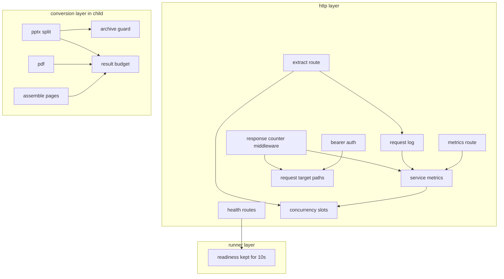
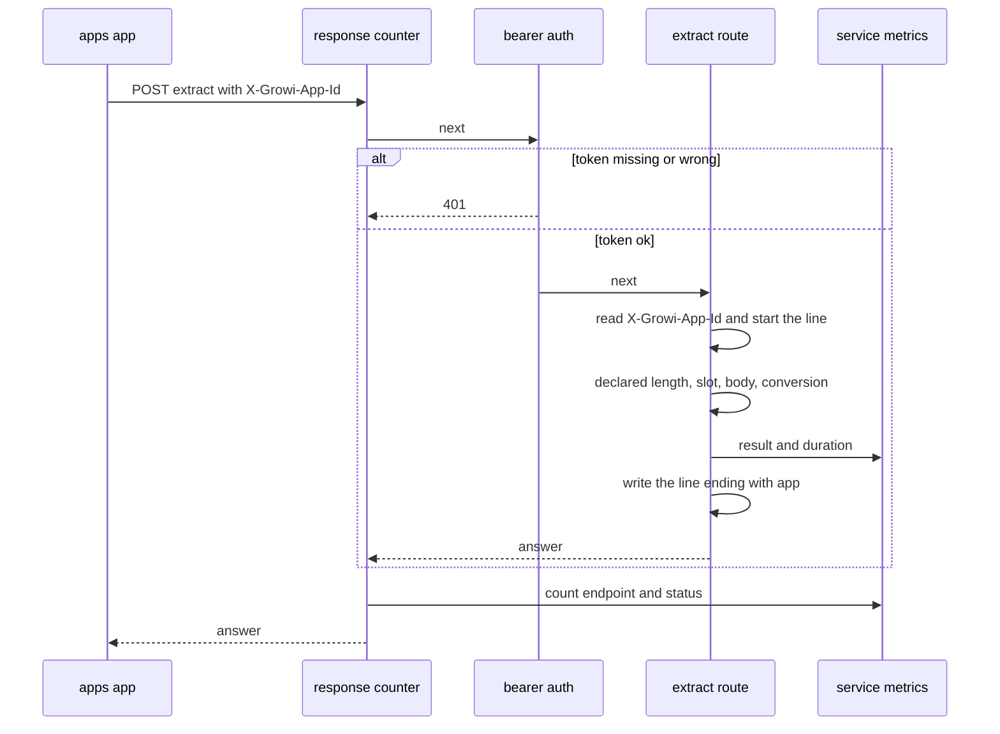
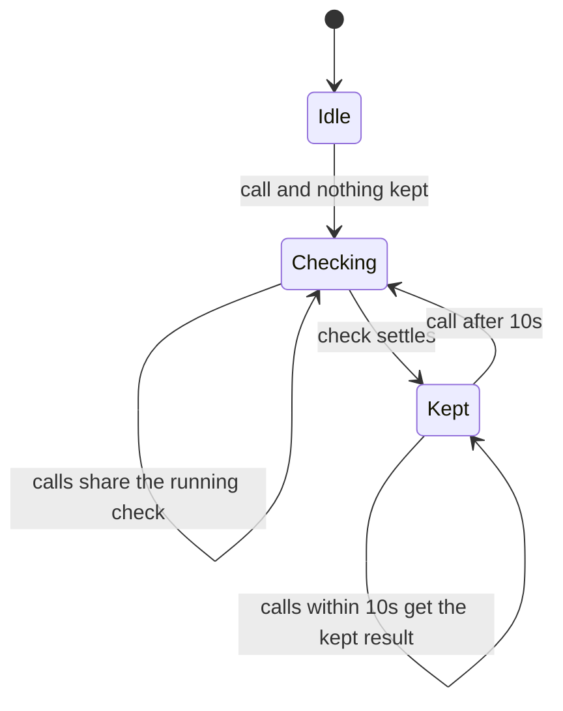

# Technical Design: attachment-search-text-extractor-ops-1-1

## Amend target

この spec は amend spec である (`.claude/rules/spec-lifecycle.md`)。対象と、変わる契約は次のとおり。表の詳しい版は [brief.md](./brief.md) の「Amend target」にある。

| 対象の spec | 変わる契約 |
|---|---|
| `attachment-search-text-extractor` | `POST /extract` の要求 (任意のヘッダー `X-Growi-App-Id`)、ログの契約 (`/extract` の行の最後の `app=`、`/metrics` での応答の数え方、「401 の要求は 1 行も残らない」などの記述)、エンドポイントとトークンの要らないパスの一覧 (`/metrics`)、`/readyz` が結果を覚えないこと、ZIP の fallback と結果の大きさの上限の掛け方、子の環境についての事実の記述 |
| `attachment-search-indexing` | 抽出サービスを呼ぶ側 (`AttachmentTextExtractorService`) が `X-Growi-App-Id` を付けること。ほかの契約は変わらない |

**触れる Revalidation Triggers** (`attachment-search-text-extractor` の design.md):

- 「API と応答の形」の **生成クライアントの名前**: 関数名と型名は変わらない。OpenAPI の文書は任意のヘッダーと `info.version` 1.1.0 の分だけ変わり、生成クライアントは先頭のコメントの版の行だけが変わる (research.md §2.2)。
- 「API と応答の形」の **`code` を持たない応答**: `/metrics` は Prometheus のテキスト形式で答える。
- 「API と応答の形」の **health / readiness の応答**: 形は変わらず、結果が最大 10 秒古くなりうる。
- 「運用者から見える振る舞い」の **ログ**: 行の最後に `app=` が付く。応答の数は `/metrics` で数える。
- 新しく足す trigger: `/metrics` のメトリクスの名前とラベル、ログの `app=` の位置と値の意味。

`attachment-search-indexing` の design.md では「上流 API 契約の変更」に当たる。要求に任意のヘッダーが加わるだけで、応答とエラーの扱いは変わらない。

## Overview

**Purpose**: GROWI.cloud の運用者が、共有している抽出サービスの負荷を、呼び出し元の app ごとにログで、全体を `/metrics` で見られるようにする。あわせて、レビューで先送りにした抽出サービスの 5 つの項目 (`/readyz` の CPU、ZIP の上限の回避、ページごとの結果の大きさ、子の環境の文書、古いコメント) を片づけ、版 1.1.0 として公開する。

**Users**: GROWI.cloud の SRE (ログと監視と自動スケール)、OSS の運用者 (`/metrics` は使わなくてもよい)、抽出サービスの開発者。

**Impact**: 本番の依存に `prom-client` が 1 つ加わる (12 個になる)。apps/app は、`GROWI_APP_ID_FOR_GROWI_CLOUD` が設定された app でだけ、要求のヘッダーが 1 つ増える。

### Goals

- `/extract` のログの行から、要求を送った app が分かる (Req 1、2)
- 処理中の件数と上限、エンドポイントとステータスごとの応答の数、結果ごとの件数と所要時間、HTTP を受けるプロセスの CPU・メモリ・イベントループの遅れを、`/metrics` で集められる (Req 3)
- トークンなしで `/readyz` を呼び続けても、確認用の子は 10 秒に 1 回までしか起動しない (Req 4)
- PPTX / XLSX で、ZIP の形を崩しても上限を通り抜けられない (Req 5)
- PDF / PPTX は、結果の大きさの上限を超えた時点で読むのをやめる (Req 6)
- 子が親の環境変数を読めることが、確かめた範囲で文書に書かれている (Req 7)
- コメントが要件の番号を引かない (Req 8)
- 版 1.1.0 として公開する (Req 9)

### Non-Goals

- app の ID を使った判断 (認可、上限、配分)。値は自己申告で、ログに出すだけ
- app の ID をメトリクスのラベルにすること
- apps/app 側の抽出の件数の公開 (`attachment-search-indexing` の task 3.4)
- 子が親の環境変数やほかの要求のデータを読めることへの対策 (roadmap の (h))
- 変換の子プロセスの CPU とメモリを `/metrics` に出すこと (子のピークの RSS はログの行に出ている。コンテナ全体の値はオーケストレーターの指標で見る)
- コメントが引く `research.md` の節の番号の書き直し

## Boundary Commitments

### This Spec Owns

- 抽出サービスの HTTP の層: `X-Growi-App-Id` の読み取りと検査、ログの行の `app=`、`GET /metrics` と応答の数え方、トークンの要らないパスの一覧
- 抽出サービスの実行管理の層: `/readyz` の結果を覚える期間
- 抽出サービスの変換の層: ZIP の検査を通せない形の扱い、結果の大きさの数え方とその確かめる時点
- 運用者向けの文書 `docker/README.md` と `AGENTS.md` の該当箇所、コメントの片づけ
- apps/app の送る側 (`attachment-text-extractor.ts`) のヘッダーの付け方
- 版 1.1.0 の changeset と公開の確認の手順

### Out of Boundary

- apps/app が抽出の結果をどう扱うか (変わらない)
- `/metrics` を集める側 (Prometheus の設定、ダッシュボード、自動スケールの設定)。運用者が別に書く
- 子の隔離の強化 (roadmap の (h))
- 生成クライアントの作り (orval の設定は変えない)

### Allowed Dependencies

- 既存の本番の依存 11 個に、`prom-client` を 1 つ加える。HTTP の層 (`src/http/`) だけが import してよい (zod と `hono-openapi` と同じ扱い。`test/layers/layer-rules.ts` の `PACKAGE_RULES` に足す)。変換の子は読み込まない
- `prom-client` とその依存のライセンスは、入れるときに確かめる (許容的なライセンスであること。research.md §1)
- 新しい環境変数は足さない。`/readyz` の結果を覚える期間とヒストグラムの区切りはコードの定数にする

### Revalidation Triggers

この spec の変更のうち、次のものは取り込みの後、対象 spec の Revalidation Triggers に加える。

- **`/metrics` のメトリクスの名前、ラベル、ヒストグラムの区切り**: 運用者のダッシュボードと自動スケールの設定が名前で読む。変えるときは運用の手引きと一緒に変える
- **ログの `app=` の位置と値の意味** (`-` はヘッダーなし、`(invalid)` は形が合わない): ログを読む道具が頼る
- **`X-Growi-App-Id` の形 (`^[A-Za-z0-9][A-Za-z0-9._-]{0,63}$`)**: GROWI.cloud の app の ID の付け方が変わり、この形に合わなくなると、ログが `(invalid)` だけになる
- **`/readyz` の結果を覚える期間 (10 秒)**: 運用者の確認の間隔 (20 秒) より長くすると、kubelet の確認が古い結果を受け取るようになる

## Architecture

### Existing Architecture Analysis

- 要求は `bearerAuth` (create-app.ts の `app.use('*', …)`) → `/extract` の route の中で `log.start()` → 宣言された `Content-Length` の確かめ → 枠を取る (`slots.tryAcquire()`) → 本文の受け取り → 子での変換、の順に進む。ログの行を書く場所は route の中の 6 か所と、runner が例外を投げたときの ERROR の行である
- 枠 (`concurrency-slots.ts`) は `tryAcquire()` だけを外に出し、使用中の数と上限は閉じた変数である。枠は route の登録の中で作られている
- 応答を数える仕組みは無い。404 は Hono の既定。Node の HTTP の層が自分で返す答え (400、408、417、431) は Hono を通らない
- `/readyz` は `runner.readiness()` を呼ぶ。runner は `sharedWhileRunning` で同時の呼び出しに 1 回の確認を共有し、終わったら何も覚えない
- PPTX / XLSX の経路は `inspectArchive` が `null` を返すとファイル全体を anydoc に渡す。`null` には 4 つの場合がある (ZIP でない / 一覧を読み切れない / 必要な部品が無い / 2 つ以上ある)。手元の実験で、後の 3 つのうち 2 つでは上限を通らずに変換が成功した (research.md §3)
- 結果の大きさの上限は `assemblePages` が全ページの後に確かめ、親は子からの受け取りの上限 (`2 × MAX_RESULT_BYTES + 約 1MiB`) で抑えている

### Architecture Pattern & Boundary Map

層の分け方 (HTTP / 実行管理 / 子 / 変換 / 共有) は変えない。新しい部品はすべて HTTP の層に置く。



### Technology Stack

| 層 | 選んだもの | 役割 | 根拠 |
|---|---|---|---|
| 指標 | `prom-client` (15.x の予定。入れるときの最新の安定版に固定) | Prometheus のテキスト形式、プロセスの既定の指標 | research.md §1 |
| ほか | 変更なし | — | — |

## File Structure Plan

### New Files

```
apps/attachment-text-extractor/src/http/
├── app-label.ts            # X-Growi-App-Id → the value written after "app=" ("-" / value / "(invalid)")
├── request-target.ts       # the documented route paths, the open paths, and the endpoint label of a raw request target
├── service-metrics.ts      # the prom-client registry of one app: slot gauges, response counter, result counter and histogram, default process metrics
└── metrics-route.ts        # GET /metrics, and the middleware that counts every response Hono produces
apps/attachment-text-extractor/src/conversion/
└── result-budget.ts        # the one counting rule for MAX_RESULT_BYTES, used by pdf, pptx and assemblePages
.changeset/<name>.md        # '@growi/attachment-text-extractor': minor
```

テストはそれぞれの隣に置く (`*.spec.ts`、`*.integ.ts`)。

### Modified Files

- `src/http/create-app.ts` — 枠と指標をここで作り、応答を数える middleware を `bearerAuth` より前に置き、`/metrics` を登録する
- `src/http/bearer-auth.ts` — トークンの要らないパスを `request-target.ts` から読む (`/metrics` を加える)
- `src/http/concurrency-slots.ts` — 使用中の数と上限を読めるようにする
- `src/http/extract-route.ts` — 枠を引数で受け取る。route の最初に `X-Growi-App-Id` を読み、`log.start()` に渡す。OpenAPI の `describeRoute` に任意のヘッダーを足す
- `src/http/request-log.ts` — 行の最後に `app=` を付ける。行を書くたびに、ログの重要度の設定に関係なく、結果と所要時間を指標に渡す
- `src/http/openapi-route.ts` — `info.version` を `1.1.0` にする
- `src/http/health-routes.ts`、`src/runner/readiness.ts`、`src/runner/conversion-runner.ts` — 確認の結果を 10 秒覚える
- `src/conversion/ooxml/archive-guard.ts`、`src/conversion/ooxml/zip-directory.ts` — `null` を「ZIP ではない」だけの意味にし、ほかの 3 つの場合は `malformed` にする
- `src/conversion/pdf.ts`、`src/conversion/ooxml/pptx-split.ts`、`src/conversion/assemble-pages.ts` — `result-budget.ts` を使う
- `test/layers/layer-rules.ts` — `prom-client` を HTTP の層だけに許す
- `test/deploy/production-dependencies.spec.ts` — 本番の依存の一覧に `prom-client` を加える (11 → 12)
- `package.json`、`pnpm-lock.yaml` — `prom-client` を加える
- ログの行の形を `$` で固定しているテスト (`src/http/request-log.integ.ts`、`src/http/diagnostic-log.integ.ts`、`src/http/extract-limits.integ.ts`) と、見本の行を持つテスト (`scripts/image-check/memory/report.spec.ts`)
- `docker/README.md`、`AGENTS.md` — 公開タグ、ログ、`/metrics`、`/readyz`、子の環境
- `packages/attachment-text-extractor-client/openapi.json`、`src/generated/index.ts` — 書き出し直しと作り直し
- `apps/app/src/features/search-attachments/server/services/attachment-text-extractor.ts` とそのテスト — ヘッダーを付ける
- `.github/workflows/ci-attachment-text-extractor.yml` と、要件番号を引くコメントのあるファイル (68 ファイル、108 か所) — コメントだけ

## System Flows

### `POST /extract` と、ログと指標



**主な決定**:

- `X-Growi-App-Id` は、route の最初 (宣言された長さの確かめと枠より前) に読む。ヘッダーは本文より先に届いているので、本文を読む前に断った行 (`file_too_large`、`service_busy` など) にも値を出せる。認証より後なので、401 の要求のヘッダーは読まない (401 は行を出さない)
- ヘッダーは Node が受け取った形 (`c.env.incoming.headers`) から読む。同じ名前のヘッダーが 2 つ以上あると、Node はそれらを `, ` でつないだ 1 つの値にするので、形に合わず `(invalid)` になる
- 値の形が合わなくても、要求の扱いは何も変えない。ヘッダーを読む処理は例外を投げない
- 応答を数える middleware は `bearerAuth` より前に置くので、401 と 404 と、route が返したすべての答えを数える。数えるのは、Hono が答えを作り終えた時点のステータスである。読み手のいない答え (切断の後の 422 など) も数える
- 結果ごとの件数と所要時間は、ログの行を書くのと同じ場所 (行を書く関数) で数える。行を書く場所と結果の値が 1 か所にまとまっているためで、ログの重要度の設定 (`LOG_LEVEL`) で行を出さない場合も数える

### `/readyz`



- 覚える期間は、確認を **終えた** 時点から数える。確認は最大 10 秒 (確認用の子の期限) かかるので、始めた時点から数えると、遅い確認の結果はすぐ古くなってしまう
- 準備完了と準備未完了のどちらも覚える。未完了を覚えないと、固まった部品のある Pod で、トークンなしの呼び出しが 10 秒ごとの確認を連続で起こせる
- 期間の 10 秒の根拠は research.md §4

## Components and Interfaces

### HTTP 層

#### AppLabel (`http/app-label.ts`)

| 項目 | 内容 |
|---|---|
| ヘッダーの名前 | `X-Growi-App-Id` (Node では小文字の `x-growi-app-id` で読む) |
| 形 | `^[A-Za-z0-9][A-Za-z0-9._-]{0,63}$` (英数字で始まり、英数字と `.`・`_`・`-` だけの 1〜64 文字) |
| ログに出す値 | 形に合う → その値。ヘッダーが無い → `-`。それ以外 (空、長すぎる、使えない文字、2 つ以上) → `(invalid)` |

- `-` と `(invalid)` はどちらも形に合わない文字列なので、本物の値と取り違えない
- 形の正規表現は 1 か所に置き、検査と OpenAPI の文書の `pattern` の両方がそれを使う
- 受け取った値が形に合わないときは、値そのものをログに写さない (ログの行を壊す文字や、長い値を通さないため)

#### RequestLog (`http/request-log.ts`)

- 行の形: `extract format=… size=… duration_ms=… result=… child_peak_rss_mb=… app=…`。`app=` は最後に付ける。メモリの計測の道具 (`scripts/image-check/memory/report.ts`) の正規表現は `child_peak_rss_mb=(\S+)` の後ろを見ないので、そのままで読める
- `start(appLabel)` で行を始め、行を書くときに、結果と所要時間 (行の `duration_ms` と同じ値を秒にしたもの) を指標に渡す
- runner が例外を投げたときの ERROR の行 (`extract runner raised …`) は変えない

#### ConcurrencySlots (`http/concurrency-slots.ts`)

```typescript
interface ConcurrencySlots {
  tryAcquire(): (() => void) | null;
  inUse(): number;          // slots taken by POST /extract right now
  readonly capacity: number; // MAX_CONCURRENCY as configured (may be 0 or negative)
}
```

- 枠は `createApp` で 1 つ作り、`/extract` の route と指標の両方に渡す
- 確認用の子 (`/readyz`) は枠の外で動くので、`inUse()` に入らない

#### RequestTarget (`http/request-target.ts`)

- 文書に載っている経路のパス (`/extract`、`/healthz`、`/readyz`、`/openapi.json`、`/metrics`) と、そのうちトークンの要らないもの (`/healthz`、`/readyz`、`/openapi.json`、`/metrics`) を 1 か所に置く
- `endpointOf(target)`: 送られた要求の文字列そのもの (`?` より前) が経路のパスと完全に一致すればそのパス、そうでなければ `other`。`bearerAuth` の「トークンを外すか」の判定と同じ一致のさせ方にする (`/./healthz` や `/%68ealthz` は `other` で、401 になる)

#### ServiceMetrics (`http/service-metrics.ts`) と MetricsRoute (`http/metrics-route.ts`)

アプリごとに `prom-client` の registry を 1 つ作る (既定の global registry は使わない。テストは 1 つのプロセスで多くのアプリを作るため)。

| 名前 | 種類 | ラベル | 中身 |
|---|---|---|---|
| `attachment_extractor_slots_in_use` | gauge | なし | `POST /extract` が取っている枠の数 (読まれた時点の値) |
| `attachment_extractor_slots_max` | gauge | なし | `MAX_CONCURRENCY` の設定値 |
| `attachment_extractor_http_responses_total` | counter | `endpoint`、`status` | Hono が作った答えの数 |
| `attachment_extractor_extract_results_total` | counter | `result` | `/extract` の結果ごとの件数 |
| `attachment_extractor_extract_duration_seconds` | histogram | `result` | `/extract` の所要時間 (ログの `duration_ms` と同じ区間)。区切りは 0.05、0.1、0.25、0.5、1、2.5、5、10、20、40、60、80 秒 |
| `prom-client` の既定の指標 | — | — | `process_cpu_seconds_total`、`process_resident_memory_bytes`、`nodejs_eventloop_lag_seconds` など (HTTP を受けるプロセスだけ) |

- `endpoint` の値は 6 つ (`/extract`、`/healthz`、`/readyz`、`/openapi.json`、`/metrics`、`other`)。`status` は Hono が作りうる 3 桁のステータスで、数は限られる。`result` の値は、成功の `ok`、変換の後の失敗の種類 (`ERROR_TABLE` のキー)、変換の前に断る理由 (`REFUSAL_TABLE` のキー) で、これらの表から作る。どのラベルにも、要求が送った自由な文字列を入れない
- `result` の値は、起動の時点ですべて 0 で作っておく (まだ起きていない結果も、監視の側で増え方を計算できるように)
- 自動スケールの指標には、Pod ごとの `attachment_extractor_slots_in_use / attachment_extractor_slots_max` を使える
- 既定の指標は HTTP を受けるプロセス (親) の値で、変換の子の CPU とメモリは含まない。子を含むコンテナ全体の値は、オーケストレーターのコンテナの指標で見る
- `GET /metrics` は `registry.metrics()` の文字列を、`registry.contentType` の `Content-Type` で 200 で返す。`describeRoute` を付けないので、OpenAPI の文書に載らない (`/openapi.json` と同じ扱い。生成クライアントに関数が増えない)
- `/metrics` の呼び出しはログの行を出さず、子を起動しない

**数える答えと数えない答え** (Req 3.3、3.4):

| 答え | 数えるか |
|---|---|
| 経路の答え (200、`ErrorResponse` の 4xx / 5xx)、本文を読む前の早めの答え (413、503 など) | 数える |
| `bearerAuth` の 401 (存在しないパスへの要求を含む) | 数える (`endpoint` は `other` か、送られたパス) |
| Hono の既定の 404 (存在しないパス、`GET /extract` などの違うメソッド) | 数える |
| route の中の想定外の例外で Hono が返す 500 | 数える |
| 呼び出し側が切断した後に作った答え (読み手はいない) | 数える (作った時点のステータス) |
| Node の HTTP の層が自分で返す答え: 壊れた HTTP の要求や `Host` の無い要求の 400、ヘッダーが大きすぎる 431、`Expect` が `100-continue` 以外の 417、ヘッダーや要求の期限切れの 408 | 数えない (Hono に届かない) |
| 答える前に閉じた接続、`100 Continue` の途中の応答 | 数えない |

### Runner 層

#### Readiness (`runner/readiness.ts`)

- `sharedWhileRunning` を、「実行中は共有し、終わった結果を一定時間覚える」形に変える。覚える期間 (10,000ms) と時計 (`performance.now`) は引数で受け取り、テストは時計を差し替える
- 確認が例外で終わった場合も、その結果を同じ期間覚える (`health-routes.ts` は例外を準備未完了として扱う)
- 準備の行 (理由が変わったときだけの WARNING、戻ったときの INFO) の出し方は変えない

### Conversion 層

#### ArchiveGuard (`conversion/ooxml/archive-guard.ts`、`zip-directory.ts`)

| ファイルの形 | いま | この spec のあと |
|---|---|---|
| ZIP の終わりの記録が見つからない (CFB の暗号化 OOXML、旧形式の PPT / XLS、途中で切れた ZIP、ZIP でないもの) | ファイル全体を anydoc へ | 変わらない (`null` を返す) |
| 終わりの記録は見つかるが、ZIP の読み手 (yauzl) が開けない | ファイル全体を anydoc へ | `malformed` |
| 一覧の途中で読めないエントリがある (名前を読めない、扱えない版の印 (`versionNeeded` > 6.3)、読み手の誤り) | ファイル全体を anydoc へ (上限を通らない) | `malformed` |
| エントリ数が上限を超える、申告の展開後の大きさが上限を超える | `limit_exceeded` | 変わらない |
| 必要な部品が無い | ファイル全体を anydoc へ | `malformed` |
| 必要な部品が 2 つ以上ある | ファイル全体を anydoc へ (セル数の上限を通らない) | `malformed` |

- `inspectArchive` の `null` は「ZIP ではない」だけを意味するようにする。型は `OoxmlArchive | null` のままで、3 つの場合が `null` から外れ、`zip-directory.ts` の一覧の結果の「読めない」は例外 (`malformed`) に変わる。分岐が 1 つ減る
- `malformed` は `extraction_failed` (422)。既存の対応なので、`ErrorCode`、HTTP ステータス、OpenAPI の文書は変わらない
- 必要な部品が無い ZIP は、いまも anydoc が `malformed` を返すか、何も取り出さない (research.md §3)。呼び出し側から見て、ほぼ同じ結果になる
- `office` の経路 (DOCX など) は `inspectArchive` を使わない。この spec では変えない (anydoc の組み込みの上限と RSS の上限で守る。research.md §3)

#### ResultBudget (`conversion/result-budget.ts`)

- 数え方を 1 つにする: 要素の `content` を、改行を LF に揃えてから UTF-8 のバイト数で数える。`label` と `pageNumber` は数えない。合計が `MAX_RESULT_BYTES` を超えたら `ConversionError('result_too_large')` を投げる
- PDF (`pdf.ts`) は、1 ページ読むたびに足す。いまの `Array.from` を、ページごとに足しながら進む繰り返しにする
- PPTX (`pptx-split.ts`) は、スライドを 1 枚 anydoc に通すたびに足す
- `assemblePages` は同じ数え方で最後に確かめる (最終の判断はここ)。途中の確かめと数え方が同じなので、途中で止めた入力は、最後まで読んでも必ず止まる。逆に、最後の確かめで通る入力を途中で止めることもない
- XLSX は anydoc を 1 回だけ呼ぶので、途中で確かめる場所が無い。DOCX などの 1 要素の経路も同じ。どちらも最後の確かめだけ

### apps/app (`attachment-text-extractor.ts`)

- `extractAttachment` の設定の読み込み (Step 1) で、`configManager.getConfig('app:growiAppIdForCloud')` を、URI やトークンと同じく呼ぶたびに読む
- 値は、型の宣言 (`number | undefined`) と違い、環境変数の文字列がそのまま入る (research.md §2.3)。そのため `String(value)` で文字列にしてから扱う
- 付けるのは、文字列が空でなく、表示できる ASCII 文字 (0x21〜0x7E) だけでできているときだけにする。Node は改行などを含むヘッダーの値で要求を作らずに例外を投げるので、それを避けるための検査である。形 (`^[A-Za-z0-9]…`) の検査は抽出サービスだけが行い、apps/app では繰り返さない (形の決まりを 1 か所にするため)。形に合わない値は抽出サービスのログで `(invalid)` と分かる
- 付け方は、生成クライアントの `postExtract` の axios の引数 `headers` に、`Authorization` と並べて入れる
- この判定は純関数にして、送る処理とは別にテストする

## Data Models

変わらない。`ExtractResponse`、`PageInfo`、`ErrorCode`、`ErrorResponse` はそのまま。OpenAPI の文書には、`POST /extract` の `parameters` に次の 1 つが加わる。

```json
{ "in": "header", "name": "X-Growi-App-Id", "required": false,
  "schema": { "type": "string", "pattern": "^[A-Za-z0-9][A-Za-z0-9._-]{0,63}$" } }
```

## Error Handling

- 新しい `ErrorCode` も、新しいステータスとの対応も無い
- `X-Growi-App-Id` の値が原因で要求が失敗することはない (抽出サービス側も apps/app 側も)
- ZIP の検査を通せない形は、既存の `malformed` (422 `extraction_failed`)
- ページの途中で止めた結果の大きさの超過は、既存の `result_too_large` (422 `resource_limit_exceeded`)

## Security Considerations

- **`X-Growi-App-Id` は信頼しない**: 認証されていない自己申告の値で、ほかの app の ID を名乗ることもできる。ログの内訳を見るためだけに使い、認可、上限、処理の分岐に使わない。形の検査は、ログの行を壊させないためのもので、値が本物であることは確かめない
- **`/metrics` はトークンなしで答える**: 中身は件数、時間、プロセスの値と Node の版で、ファイルの名前と中身、app の ID、トークンは含まない。守りは `/readyz` と同じく内向きの通信の制限 (監視システムと GROWI の app からだけ) である。読むたびの処理は軽く (子を起動しない)、呼び続けられても `/readyz` のように CPU を大きく使わない
- **子と親の環境変数**: 子は親と同じ uid (10001) で動く。手元の実験では、`prlimit` を通して同じ形で起動した子が、親の `/proc/<pid>/environ` から仮のトークンを読めた。親のメモリ (`/proc/<pid>/mem`) は、その環境 (Yama の `ptrace_scope` が 1) では開けなかった。GROWI.cloud のノードと、本物の image の中では試していない (research.md §5)。親は処理中のアップロードをメモリに持つので、ほかの顧客のファイルが読めるかどうかはノードの ptrace の設定によりうる。対策は roadmap の (h) で決める
- **トークンの要らないパスの判定**: `/metrics` を加えても、判定は送られた要求の文字列そのものとの完全一致のままにする

## Testing Strategy

`essential-test-design` と `essential-test-patterns` に従い、外から見える結果を確かめる。

- **app の ID**: ヘッダーなし、形に合う値、空、65 文字、形に合わない文字 (空白、`/`、`=`、非 ASCII など。改行は Node の HTTP の層が先に断るので試さない)、同じヘッダー 2 つ、のそれぞれで、ログの行の最後が決まった値になること。値を変えても、ステータスと本文が変わらないこと。本文を読む前に断る 5 つの理由の行にも `app=` が付くこと
- **ログの行の形**: `$` で行末を固定している 3 つのテストを `app=` まで含む形にする。メモリの計測の道具が `app=` の付いた行を読めることを、見本の行で確かめる
- **`/metrics`**: トークンなしで 200 と Prometheus のテキスト形式。`/./metrics` などはトークンなしで 401 (`open-path-targets.integ.ts` に足す)。401・404・`/extract` の成功と失敗の後に、カウンタが期待どおり増えること。変換中に `slots_in_use` が増え、終わると戻ること (偽の runner で止めておく)。`LOG_LEVEL=ERROR` でも結果のカウンタが増えること。app の ID がどのラベルにも出ないこと
- **`/readyz`**: 時計を差し替えて、10 秒以内は確認用の子を起動せず同じ結果を返すこと、10 秒を過ぎると確かめ直すこと、準備未完了も覚えること、実行中の共有が保たれること
- **ZIP**: `archive-guard.spec.ts` の「通す」テストのうち、ZIP である形 (必要な部品が無い、2 つある、空の ZIP、扱えない版の印、UTF-8 の印と合わない名前) を「`malformed` で断る」に変える。ZIP でない形 (空、テキスト、途中で切れた ZIP、中央の一覧が無い、暗号化された OOXML) は通すままにする。上限を超える XLSX (セル数) と、上限を超えるエントリ数の ZIP に、変な形のエントリを 1 つ足したものが、変換されずに断られることを確かめる (research.md §3 の実験の形)
- **結果の大きさ**: 1 ページで上限を超える PDF と、1 枚で超える PPTX で、`result_too_large` になること。上限を超えた後を読まないことは、呼んだ回数を数える偽の部品ではなく、結果の違いで確かめる: 上限を超えるスライドの後に、anydoc が `malformed` を返すスライドを置いた PPTX が、`malformed` ではなく `result_too_large` になること。CRLF を含むスライドで、LF に揃えた後の大きさが上限ちょうどなら通ること。同じ入力で、途中の確かめと最後の確かめが同じ結論になること
- **apps/app**: 設定に値があるとヘッダーが付くこと、無い・空・改行を含むときは付かずに抽出が続くこと
- **層の向き**: `prom-client` を HTTP の層の外で import すると落ちること (`layer-dependencies.spec.ts` の既存の形)
- **OpenAPI**: 書き出し直した `openapi.json` と commit 済みのものが一致すること (既存のテスト)。生成クライアントを作り直しても関数と型が変わらないこと (apps/app の CI の既存の検査)

## Requirements Traceability

| 要件 | 対応する設計 |
|---|---|
| 1.1〜1.6 | AppLabel、RequestLog、`POST /extract` の流れ |
| 1.7 | Data Models (OpenAPI の `parameters`) |
| 2.1〜2.4 | apps/app (`attachment-text-extractor.ts`) |
| 3.1〜3.7、3.9 | ServiceMetrics、MetricsRoute、ConcurrencySlots |
| 3.8 | RequestTarget、Security Considerations |
| 4.1〜4.4 | Readiness、`/readyz` の流れ |
| 5.1〜5.4 | ArchiveGuard |
| 6.1〜6.3 | ResultBudget |
| 7.1〜7.3 | Security Considerations、取り込みの計画 (`docker/README.md`) |
| 8.1〜8.3 | 取り込みの計画 (コメント)、research.md §6 |
| 9.1〜9.4 | 公開の計画 |
| 10.1〜10.5 | 取り込みの計画 |

## 公開の計画 (Req 9)

- changeset は 1 つ: `'@growi/attachment-text-extractor': minor`。この package の changeset は初めてで、`private: true` の app が changesets で版を上げる前例は `apps/growi-vault-manager` (CHANGELOG.md がある) である。`.changeset/config.json` の `ignore` にこの package は無い
- 生成クライアントの package (`@growi/attachment-text-extractor-client`) は changeset を書かない。`private: true` で npm に出さず、apps/app は `workspace:` で使う。`openapi.json` と生成コードが変わっても、版を上げて伝える相手がいない (research.md §8)
- `docker/README.md` の公開タグの一覧は changesets が直さないので、同じ PR で直す: `1.1.0`、`1.1`、`1`、`latest` の行の Dockerfile の link を `attachment-text-extractor/v1.1.0` のタグにし、`1.0.0`、`1.0` の行を残す
- image が公開されるのは、changesets が作る「Release Subpackages」の PR を master にマージし、`release-attachment-text-extractor.yml` が動いたときである。その前に、人が次を確かめる: `ci-attachment-text-extractor.yml` を手で起動した実行 (`workflow_dispatch`。linux/amd64 と linux/arm64 の両方で、メモリの計測を含む) のジョブの数が 0 より多く、すべて成功していること (`gh api repos/<org>/<repo>/actions/runs/<id>/jobs`)、メモリの計測の結果がログの `app=` の付いた行を読めていること (計測の失敗の条件「子の最大 RSS がログに無い」に当たらないこと)、PR の版と CHANGELOG の中身

## 取り込みの計画 (Req 10)

取り込みでは、対象 spec の本文を、この spec の変更が最初からあったように書き直す。直す場所は次のとおり (行番号は 2026-11-19 の master のもの)。

**`attachment-search-text-extractor`**

- requirements.md: Scope (32 行、`GET /metrics` を足す)、Boundary Context の In scope、AC 7.1 (文書に載せるものに任意のヘッダーを足す。番号は変えない)、末尾に Req 8 (この spec の Req 1)、Req 9 (Req 3)、Req 2 の末尾に AC 2.10〜2.13 (Req 5)・AC 2.14〜2.16 (Req 6)、Req 3 の末尾に AC 3.5〜3.8 (Req 4)・AC 3.9〜3.11 (Req 7) を足す (番号の対応は brief.md の「Port-back の前提」)
- brief.md: Scope の Hono アプリの一覧 (49 行)
- design.md: Boundary Commitments の HTTP の契約 (50 行)、Allowed Dependencies (66〜73 行。12 個、`prom-client`)、Revalidation Triggers (89 行の health / readiness、91 行の生成クライアント、この spec の Revalidation Triggers の 4 つを足す)、運用者から見える振る舞いの `/docs` (104 行) とログ (107 行)、Technology Stack、抽出の流れの主な決定 (239 行の認証の要らないパス)、HealthRoutes (301〜302 行)、Limits (308 行。確認用の子は `slots_in_use` に入らない)、ConversionRunner の子の `env` (337 行)、Convert (366 行)、PptxSlideSplitter と XlsxSheetSplitter の前提 (402、411 行)、PdfConverter、ArchiveGuard (444 行)、Error Handling の表 (541 行の 3 つのパス、549 行の `malformed` の行)、Monitoring (565、569、571 行と、`/metrics` の節)、Testing Strategy (577 行の「トークンが子に渡らないこと」)、運用者向けの文書の一覧 (609、613、615 行)、Security Considerations (644 行の認証、645 行のトークンの受け渡し)、Performance & Scalability (655 行の CPU は目安)、Requirements Traceability、Open Questions / Risks (698 行の readiness の CPU)
- research.md: §1.4 (本番の依存とライセンスに `prom-client` とその依存)、§5.7 (833 行。401 の要求は行を残さないが `/metrics` で数える)、§5.9 (884 行の「`readiness()` は結果を覚えない」)、§8 の前書き (コメントが `Req N.M` を引かなくなった) と §8.2 の削除。この spec の research.md の §1〜§8 を、新しい節として移す
- `apps/attachment-text-extractor/AGENTS.md` と `docker/README.md` は、Req 7 と Req 9 のタスクで同じ PR の中で直す (取り込みの対象ではなく、実装の一部)

**`attachment-search-indexing`**

- requirements.md: Req 1 の末尾に AC 1.5〜1.8 (この spec の Req 2)
- design.md: AttachmentTextExtractorService の Bearer auth の項 (645 行の並び) にヘッダーの項を足す、Testing Strategy (1388 行の並び)
- research.md: 設定の値が文字列で入ることと、ヘッダーに入れる前の検査の理由 (この spec の research.md §2.3、§2.4)

**`attachment-search` の roadmap.md**: (f) の抽出サービス側の 5 項目を消す。(h) の「呼び出し元の app を抽出サービスのログに出す」の項を消す。(h) の「同時に処理中の、ほかの顧客のファイルを守る」の最後の項目を「子が親の環境変数を読めることは `docker/README.md` に書いた (手元の実験で確かめた。GROWI.cloud のノードでは未確認)。対策は未決」に書き換える。(h) の「顧客どうしで枠を取り合わないようにする」の自動スケールの指標の項目を、`/metrics` の `attachment_extractor_slots_in_use` を使える形に書き換える。spec の一覧からこの spec の行を消す。
