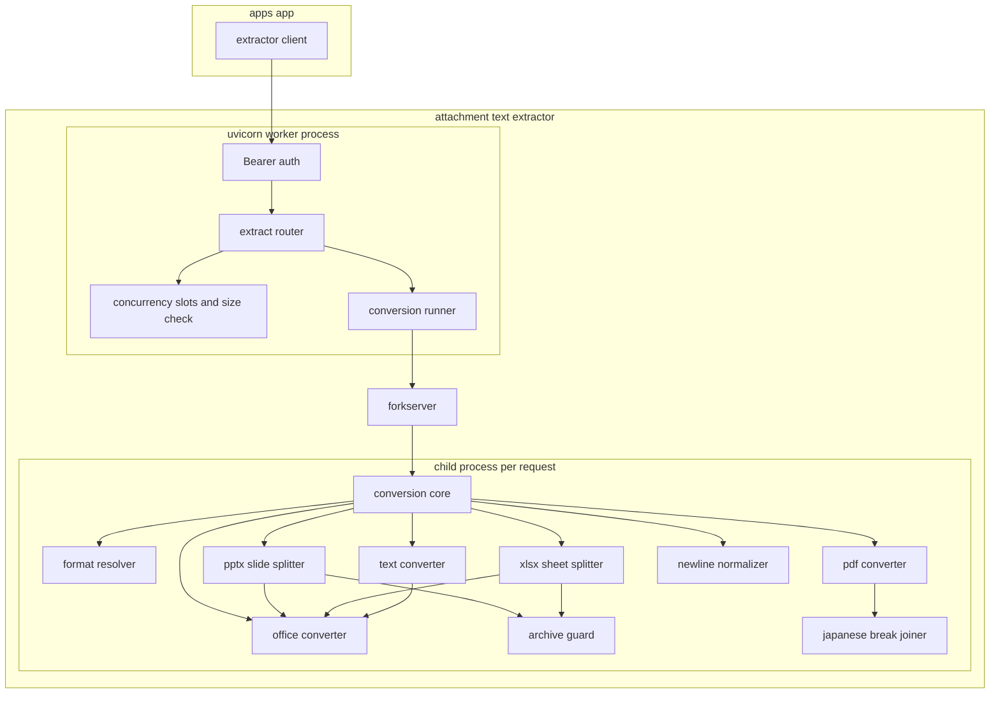
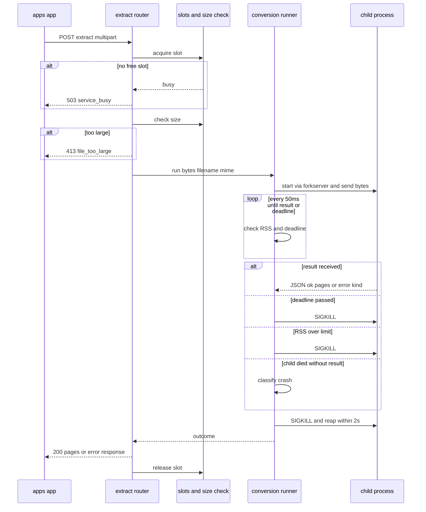
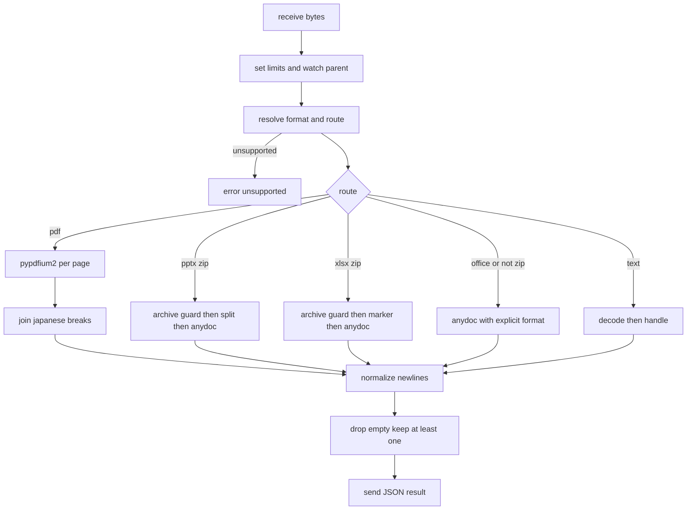

# Technical Design: attachment-search-text-extractor

## Overview

本 spec は、GROWI の添付ファイル全文検索のために、添付ファイルのバイト列からテキストを取り出す独立マイクロサービス `services/attachment-text-extractor/` を定義する。apps/app は HTTP (multipart) で `POST /extract` を呼び、ページ・スライド・シート単位に分かれた Markdown テキスト (`pages[]`) を受け取る。

**Purpose**: 形式ごとに適したライブラリで文字を取り出し、日本語の検索に向く形に正規化して返す。悪意あるファイルや重いファイルが来ても、サービス全体と他テナントの抽出を止めない。

**Users**: 直接の利用者は apps/app (下流 spec `attachment-search-indexing`)。運用者は GROWI.cloud の SRE (k8s の共有 Deployment) と OSS の配布者 (docker-compose)。

**Impact**: 既存の受け口 (FastAPI アプリ、設定、Bearer 認証、API の型、ルーター、OpenAPI の書き出し、Dockerfile、compose) は残す。変換の中身 (markitdown に頼る仮の実装) を消し、形式別の変換・日本語の正規化・子プロセスでの実行を新しく作る。API の型には新しいエラーコードを 2 つ足す。

### Goals

- 対応形式のファイルを、決められた単位 (PDF はページ、PPTX はスライド、XLSX はシート、その他は 1 要素) の `pages[]` で返す (1.1–1.5, 1.8, 1.12)
- 改行コードを揃え、PDF の抽出で日本語の語の途中に入った空白・改行を取り除いて返す (1.9)
- 時間切れ・メモリの使いすぎ・細工されたファイル・異常終了を、その 1 件のエラーとして閉じ込め、変換そのものを確実に止める (2.1–2.7)
- 外部バイナリと外向き通信なしで、read-only rootfs・非 root の共有 Deployment として動く (1.7, 2.4, 3.1–3.4, 4.1–4.2)

### Non-Goals

- apps/app 側の統合 (TS クライアントの利用、ES への取り込み、失敗ログ、UI) は下流 spec の責務
- 画像の OCR、LLM による補助、音声・動画の文字起こし
- Outlook MSG、ZIP の中身の再帰展開
- 表の構造を保った高精度な PDF 抽出 (Docling 等)
- クライアントが接続を切ったときの即時中止 (時間切れの上限で止まるため必須にしない。§Open Questions)

## Boundary Commitments

### This Spec Owns

- `services/attachment-text-extractor/` 配下のすべて: FastAPI アプリ、形式別の変換、日本語の正規化、子プロセスでの実行、設定、テスト、Dockerfile、k8s manifest の例
- HTTP の契約: `POST /extract` (multipart) / `GET /healthz` / `GET /readyz` / `GET /openapi.json` と、Pydantic の型 (`PageInfo` / `ExtractResponse` / `ErrorCode` / `ErrorResponse`)
- `pages[]` の意味の取り決め (単位、`pageNumber` / `label` の付け方、空の要素の扱い、最低 1 要素を返す規則)
- エラーの分類と HTTP ステータスの対応 (§Error Handling)
- OpenAPI の書き出し (`scripts/export_openapi.py` → `packages/attachment-text-extractor-client/openapi.json`)
- docker-compose のエントリ (`infra/docker/compose.yaml`) と、このサービス専用の CI workflow (`.github/workflows/attachment-text-extractor.yml`)

### Out of Boundary

- `packages/attachment-text-extractor-client` の orval 設定と生成物の利用 (下流 spec。書き出す `openapi.json` までが本 spec)
- apps/app 側のエラーの扱い (`ExtractionOutcome` などへの対応づけ) と、失敗時にファイル名だけの文書を登録すること (indexing spec の Req 2.4)
- Elasticsearch・MongoDB への接続 (本サービスは状態を持たない)
- 本番 k8s の実際の manifest の適用と運用 (本 spec は推奨設定を含む例を提供する)

### Allowed Dependencies

- PyPI の `firecrawl-anydoc` (版を固定)、`pypdfium2`、`charset-normalizer`、`defusedxml`、`fastapi`、`uvicorn[standard]`、`python-multipart`、`pydantic`、`pydantic-settings`。いずれも MIT / Apache-2.0 / BSD / PSF の許容的なライセンス
- Python 3.12 の標準ライブラリ (`multiprocessing` の forkserver、`zipfile`、`html.parser`、`resource` など)
- ベースイメージ `python:3.12-slim-bookworm` と、版を固定した uv のイメージ
- テスト専用 (本番の image には入れない): `openpyxl` (MIT)、`python-pptx` (MIT)、`python-docx` (MIT)、`pypdf` (BSD-3)、`msoffcrypto-tool` (MIT)。テスト用のファイル (複数シート・非表示シートの XLSX、PPTX、暗号化した Office ファイルやパスワード付き PDF、展開すると巨大になるファイル) はテストの中で生成し、実在の文書はリポジトリに入れない
- 使わないもの: markitdown、pdfminer.six、lxml、LGPL / GPL / AGPL のライブラリ、外部バイナリ、外向き通信 (python-pptx は本番では使わない)

### Revalidation Triggers

次の変更は、下流 (indexing spec と apps/app) の見直しを要する。

- **`ErrorCode` の追加・変更**: 本 design で `file_encrypted` と `resource_limit_exceeded` を追加する。apps/app は知らないコードを受け取ると `null` を返し、「抽出サービスに到達できない」と同じ扱いになる (ファイル名だけの文書は登録されるが、理由の表示が誤る)。下流で次の箇所を直す必要がある: 生成されるクライアントの `ErrorCode`、`attachment-text-extractor.ts` の `mapAxiosErrorToOutcome`、`ExtractionOutcome`、`outcomeKindToReasonCode`、`ExtractionFailureReasonCode`、reindex batch の分岐
- **`extraction_failed` の HTTP ステータス**: 壊れたファイルは 422、想定外の異常は 500 になり、同じコードが 2 つのステータスを持つ。apps/app はステータスではなくコードで分岐しているので影響はないが、ステータスで判断する処理を足すときは注意する
- **`pages[]` の規則**: 「最低 1 要素を返す」「中身が空の要素は除く (全部空なら空の 1 要素)」「`pageNumber` に飛びがありうる (XLSX の空シート)」は、下流の検索文書の作り方の前提になる
- **health / readiness の応答**: `pdf_strategy` を外す。apps/app は health / readiness を呼んでいないことを確認済み
- **`label` の中身**: PDF と PPTX の `label` は番号だけの文字列 (例: `"12"`) にし、「スライド」「p.」などの文言は付けない。GROWI は 5 言語に対応しており、文言は UI 側で各言語に合わせて付けるべきだから。attachment-search-ui spec は `label` を「Slide N / Sheet name / Page N」の表示文字列として想定しているので、形式と `pageNumber` から文言を組み立てる形に直す必要がある
- **タイムアウトの順序**: apps/app の `timeoutMs` は、抽出サービスの `TIMEOUT_S` より 5 秒以上長くする (apps/app が先に諦めると、抽出サービス側の変換が無駄に続く)。抽出サービスの既定を 55 秒にし、apps/app の既定 60000ms と合わせる
- **サイズ・時間の上限の既定値**: apps/app 側の `maxFileSizeBytes` / `timeoutMs` と食い違うと、apps/app が待つ前にこちらが打ち切る (またはその逆) ことが起きる

## Architecture

### Existing Architecture Analysis

既存実装は「HTTP の受け口」と「変換の中身」が分かれている。受け口はほぼ完成しており、そのまま使う。

- 残すもの: `main.py` (アプリの組み立て)、`config.py` (環境変数)、`schemas.py`、`middleware/bearer_auth.py`、`security.py` (defusedxml による XXE 対策)、`routers/extract.py` と `routers/health.py` (中身は一部変更)、`scripts/export_openapi.py`、Dockerfile、compose
- 直すべき問題: 変換を `async def` の中で同期的に呼んでいるため、`asyncio.wait_for` によるタイムアウトが変換の終わるまで発火しない。スレッドに逃がしても止められない
- 消すもの: markitdown に頼る仮の変換 (`simple_extractor.py`)、markitdown の PDF 対応を調べる起動処理と health の `pdf_strategy`、`security.py` の lxml の確認 (lxml は依存から外れる)

### Architecture Pattern & Boundary Map

採用する形: **受け口 (HTTP) / 実行管理 (親プロセス) / 変換 (子プロセス) の 3 層**。受け口は今の FastAPI をそのまま使い、変換はリクエストごとの子プロセスで行う。親は子の時間とメモリを見張り、必要なら止める。



**Key decisions**:
- 変換に関わるもの (anydoc、pypdfium2、ZIP の書き換え、文字コード判定、正規化) は子プロセスの中だけで動く。
- 正規化は 2 段に分ける。改行コードの統一 (CRLF / CR → LF) はすべての経路にかける。日本語の間の空白・改行の詰めは PDF の経路だけにかける。調査で語の途中の切れが見つかったのは PDF の抽出だけで、TXT や DOCX の改行は書き手が入れたものだから (1.9 は「抽出処理によって入った」ものだけを対象にしている)親 (uvicorn のワーカー) は変換ライブラリを呼ばない
- 子と親の境界は「バイト列と形式を渡し、`pages[]` かエラーの種類を受け取る」だけにする。親は子の結果を JSON として受け取り、pickle は使わない (子が悪意あるファイルに乗っ取られても、親でコードが動かないようにするため)
- 依存の向き: `schemas` / `config` → `conversion` (純粋な変換と正規化。HTTP もプロセスも知らない) → `runner` (子プロセスの管理) → `routers` → `main`。左の層は右の層を import しない
- 同時実行の枠は uvicorn のワーカーごとに持つ。既定はワーカー 1 つとし、`MAX_CONCURRENCY` がそのまま全体の上限になる。変換は子で行われるので、ワーカーが 1 つでも応答は止まらない

### Technology Stack

| Layer | Choice / Version | Role in Feature | Notes |
|---|---|---|---|
| Runtime | Python 3.12 / uvicorn (`--workers ${WORKERS:-1}`) | HTTP の受け口 | 既定のワーカー数を 2 から 1 に変える |
| HTTP | FastAPI / python-multipart / pydantic v2 / pydantic-settings | API と設定 | 既存のまま |
| Office 変換 | `firecrawl-anydoc` (版を固定、現時点 0.2.4) | DOCX / XLSX / PPTX / RTF / EPUB / CSV / 旧形式 / OpenDocument | 新規。Rust 製、変換中は GIL (同時に 1 スレッドしか Python を動かせない仕組み) を手放す |
| PDF 変換 | `pypdfium2` | PDF のページごとの文字取り出し | 新規。中身は Chrome の PDF エンジン PDFium |
| 文字コード | `charset-normalizer` | テキスト系・CSV の文字コード判定 | 新規 |
| XML の安全 | `defusedxml` | PPTX / XLSX の XML 書き換え、標準ライブラリの XML 解析の防御 | 既存 |
| 子プロセス | 標準ライブラリ `multiprocessing` (forkserver)、`resource` | 1 リクエスト 1 子プロセス、時間とメモリの監視 | 新規 |
| Container | `python:3.12-slim-bookworm` + uv (版を固定) の multi-stage | 配布 | uv のイメージの `latest` 指定をやめる |
| 外す依存 | markitdown、pdfminer.six | — | 削除。lxml / pandas / numpy / onnxruntime も一緒に外れる |

選定の理由と不採用の案は research.md の §1〜§3 を参照。

## File Structure Plan

### Directory Structure

```
services/attachment-text-extractor/
├── pyproject.toml                         # [Modified] 依存を入れ替え (markitdown/pdfminer → anydoc/pypdfium2/charset-normalizer)
├── uv.lock                                # [Modified]
├── Dockerfile                             # [Modified] uv の版固定、WORKERS 既定 1、RAYON_NUM_THREADS=1、TMPDIR
├── deploy/
│   └── k8s/                               # [New] 推奨設定つきの manifest の例 (3.2, 3.3)
│       ├── deployment.yaml                #   securityContext、tmpfs /tmp、resources、probes
│       ├── service.yaml
│       ├── hpa.yaml
│       └── networkpolicy.yaml             #   外向き通信の遮断
├── src/app/
│   ├── main.py                            # [Modified] markitdown の起動処理を削除、forkserver の起動を lifespan に追加
│   ├── config.py                          # [Modified] 設定項目の追加・既定値の変更 (§Configuration)
│   ├── schemas.py                         # [Modified] ErrorCode に file_encrypted / resource_limit_exceeded を追加
│   ├── security.py                        # [Modified] lxml の確認を削除 (defuse_stdlib は残す)
│   ├── limits.py                          # [Modified] 同時実行の枠とサイズ検査だけに縮める (with_timeout を削除)
│   ├── middleware/bearer_auth.py          # 変更なし
│   ├── routers/
│   │   ├── extract.py                     # [Modified] ConversionRunner を呼び、結果をエラー表に従って応答に変える
│   │   └── health.py                      # [Modified] pdf_strategy を削除、readyz で forkserver と依存の読み込みを確認
│   ├── runner/                            # [New] 親プロセス側: 子プロセスの起動・監視・停止
│   │   ├── __init__.py                    #   ConversionRunner を公開
│   │   ├── conversion_runner.py           #   1 リクエスト 1 子プロセスの実行、時間切れ・RSS 超過・異常終了の判定
│   │   ├── child_entry.py                 #   子プロセスの入口: 上限の設定、親の監視、変換の呼び出し、結果の送信
│   │   ├── wire.py                        #   親子間の受け渡し (長さつきのバイト列、結果の JSON の型)
│   │   └── platform_guards.py             #   Linux だけの設定 (oom_score_adj、RLIMIT_AS) を他の OS では何もしない形で包む
│   └── conversion/                        # [New] 子プロセスの中で動く純粋な変換 (HTTP もプロセスも知らない)
│       ├── __init__.py                    #   convert(data, filename, mime_hint) を公開
│       ├── core.py                        #   形式の判定 → 変換 → 正規化 → 空要素の規則、例外の分類
│       ├── formats.py                     #   MIME / 拡張子 → 形式と経路の対応表 (旧 extractors/__init__.py を置き換え)
│       ├── errors.py                      #   変換の失敗の種類 (ConversionFailure) と分類
│       ├── normalize.py                   #   改行の統一 (全経路) と、日本語の間の空白・改行の詰め (PDF の経路のみ) の純粋関数
│       ├── charset.py                     #   文字コードの判定とデコード (純粋関数)
│       ├── archive_guard.py               #   ZIP の事前検査 (エントリ数・展開後サイズ・必要な部品)
│       ├── office.py                      #   anydoc の呼び出し (形式の明示、例外の分類)
│       ├── pptx_split.py                  #   PPTX をスライドごとのパッケージに分けて anydoc に渡す
│       ├── xlsx_split.py                  #   シート名を目印に置き換えて 1 回変換し、目印で切る
│       ├── pdf.py                         #   pypdfium2 でページごとに取り出す
│       └── text.py                        #   HTML / XML / ipynb / TXT 系 / CSV・TSV の処理
├── tests/                                 # 下の Testing Strategy に対応
│   ├── conversion/                        # [New] 純粋な変換の単体テストと、anydoc の版に固定した契約テスト
│   ├── runner/                            # [New] 子プロセスの時間切れ・RSS 超過・異常終了・ワーカー消失のテスト
│   └── (既存のテスト)                      # [Modified/Deleted] 下記
└── scripts/export_openapi.py              # 変更なし

infra/docker/compose.yaml                  # [Modified] WORKERS / MAX_CONCURRENCY / メモリ上限の推奨値
.github/workflows/attachment-text-extractor.yml   # [New] Python 用 CI
packages/attachment-text-extractor-client/openapi.json  # [Modified] ErrorCode の追加と health の変更を書き出し直す
```

### Deleted Files

- `src/app/services/extractors/simple_extractor.py`、`src/app/services/extractors/__init__.py`、`src/app/services/extraction_service.py` (`conversion/` に置き換え)
- `tests/test_extract_simple.py` (markitdown 前提)
- `main.py` の `_probe_pdf_strategy()`、`routers/health.py` の `pdf_strategy`、`security.py` の lxml の確認 (関数・項目単位の削除)

### Modified Tests

- `tests/test_limits.py`: `with_timeout` のテストを削除 (時間切れは runner のテストに移る)
- `tests/test_extraction_service.py`: `tests/conversion/` の形式判定のテストに置き換え
- `tests/test_health.py` / `tests/test_main.py`: `pdf_strategy` と `_probe_pdf_strategy` の期待を削除
- `tests/test_schemas.py`: 新しいエラーコードを追加
- `tests/test_extract_router.py` / `tests/test_e2e_extract.py`: runner を通した応答とエラー表に合わせる

## System Flows

### 抽出の流れ



**Key decisions**:
- 枠はファイルを読む前に取り、すぐ取れなければ待たずに 503 を返す (2.3、既存のまま)
- 親は結果を受け取った場合も含めて、必ず最後に子へ SIGKILL を送り、2 秒を上限に後始末する。子の終了処理が止まっても枠が戻らないことを防ぐ (2.5)
- 結果を待つ間、親はイベントループを止めない (Pipe の読み取りをイベントループに登録して待つ)

### 子プロセスの中の流れ



**Key decisions**:
- PPTX と XLSX は「ZIP であり、必要な部品がある」ときだけ書き換えの経路に入れる。暗号化された OOXML や旧形式 (中身は CFB 形式で ZIP ではない) は、形式を明示して anydoc にそのまま渡し、型の付いた例外を受け取る
- 子は `BaseException` まで捕まえて、エラーの種類として親に送る (Rust の panic は `PanicException` という `BaseException` 系の例外で上がるため)

## Requirements Traceability

| Requirement | Summary | Components | Interfaces | Flows |
|---|---|---|---|---|
| 1.1 | `pages[]` で返す | ExtractRouter, ConversionCore | `ExtractResponse`, `PageInfo` | 抽出の流れ |
| 1.2 | PPTX をスライド単位で | PptxSlideSplitter, OfficeConverter | `convert_pptx` | 子の中の流れ |
| 1.3 | XLSX をシート単位で | XlsxSheetSplitter, OfficeConverter | `convert_xlsx` | 子の中の流れ |
| 1.4 | PDF をページ単位で | PdfConverter | `convert_pdf` | 子の中の流れ |
| 1.5 | 単純形式を 1 要素で | OfficeConverter, TextConverter | `convert_office`, `convert_text` | 子の中の流れ |
| 1.6 | 対象外の形式を拒否 | FormatResolver | `resolve_format` → `unsupported` | 子の中の流れ |
| 1.7 | 外部バイナリ・外向き通信なし | OfficeConverter (`ocr` 引数を使わない)、依存の構成 | — | — |
| 1.8 | 旧形式 Office / OpenDocument を 1 要素で | FormatResolver, OfficeConverter | `convert_office` | 子の中の流れ |
| 1.9 | 改行の統一 (全経路) と、抽出で入った日本語の間の空白・改行の除去 (PDF) | TextNormalizer, PdfConverter | `normalize_newlines`, `join_broken_japanese` | 子の中の流れ |
| 1.10 | 暗号化ファイルを拒否 | OfficeConverter, PdfConverter, ConversionCore | `file_encrypted` | エラー表 |
| 1.11 | 壊れたファイル | ConversionCore | `extraction_failed` (422) | エラー表 |
| 1.12 | オーナーパスワードだけの PDF は抽出 | PdfConverter | `convert_pdf` | 子の中の流れ |
| 2.1 | サイズ上限 | Limits | `enforce_size` → `file_too_large` | 抽出の流れ |
| 2.2 | 時間切れのエラー | ConversionRunner | `timeout` → `extraction_timeout` | 抽出の流れ |
| 2.3 | 同時実行の上限 | Limits | `acquire_slot` → `service_busy` | 抽出の流れ |
| 2.4 | 外向き通信が遮断されても動く | 依存の構成、k8s NetworkPolicy の例 | — | — |
| 2.5 | 時間切れで処理そのものを止め、枠とメモリを解放 | ConversionRunner, ChildEntry | SIGKILL と後始末 | 抽出の流れ |
| 2.6 | 細工ファイルの上限 | ArchiveGuard, OfficeConverter, PdfConverter, ConversionRunner (RSS) | `resource_limit_exceeded` | エラー表 |
| 2.7 | 1 件の異常終了を他に波及させない | ConversionRunner, ChildEntry | `crashed` / `internal` → `extraction_failed` (500) | 抽出の流れ |
| 3.1 | compose に同梱 | compose.yaml | — | — |
| 3.2 | 共有 Deployment + HPA | deploy/k8s | — | — |
| 3.3 | ハードニングの推奨設定 | Dockerfile, deploy/k8s, compose.yaml | — | — |
| 3.4 | 状態を持たない | 全体 (永続化なし) | — | — |
| 4.1 | ES の ingest ノードで抽出しない | 独立サービスとしての配置 | — | — |
| 4.2 | 集中しても他テナントを止めない | Limits (枠)、ConversionRunner (時間・メモリの上限) | — | 抽出の流れ |

## Components and Interfaces

### Summary

| Component | Layer | Intent | Req Coverage | Key Dependencies | Contracts |
|---|---|---|---|---|---|
| ExtractRouter | HTTP | multipart を受け、枠・サイズ・runner を順に通し、結果を応答に変える | 1.1, 2.1–2.3, 4.2 | Limits (P0), ConversionRunner (P0) | API |
| HealthRouter | HTTP | 生存と準備完了を返す | 3.2 | ConversionRunner (P1) | API |
| Limits | HTTP | ワーカーごとの同時実行の枠とサイズ検査 | 2.1, 2.3, 4.2 | Settings (P0) | Service |
| Settings | Config | 環境変数の読み込みと検証 | 2.1–2.6 | pydantic-settings (P0) | State |
| ConversionRunner | Runner | 1 リクエスト 1 子プロセスの起動・監視・停止・結果の分類 | 2.2, 2.5, 2.6, 2.7 | multiprocessing forkserver (P0), ChildEntry (P0) | Service |
| ChildEntry | Runner (子) | 子の中で上限を設定し、親を見張り、変換を呼んで結果を送る | 2.5–2.7 | ConversionCore (P0) | Service |
| ConversionCore | Conversion | 形式判定 → 経路ごとの変換 → 正規化 → 空要素の規則 → 例外の分類 | 1.1–1.12 | 各 Converter (P0), TextNormalizer (P0) | Service |
| FormatResolver | Conversion | MIME / 拡張子から形式と経路を決める | 1.5, 1.6, 1.8 | — | Service |
| OfficeConverter | Conversion | anydoc を形式を明示して呼び、例外を分類する | 1.5, 1.7, 1.8, 1.10, 1.11, 2.6 | anydoc (P0) | Service |
| PptxSlideSplitter | Conversion | スライドごとのパッケージを作って anydoc に渡す | 1.2, 2.6 | ArchiveGuard (P0), OfficeConverter (P0), defusedxml (P0) | Service |
| XlsxSheetSplitter | Conversion | シート名を目印に置き換えて 1 回変換し、目印で切る | 1.3, 2.6 | ArchiveGuard (P0), OfficeConverter (P0), defusedxml (P0) | Service |
| PdfConverter | Conversion | pypdfium2 でページごとに取り出す | 1.4, 1.10, 1.12, 2.6 | pypdfium2 (P0) | Service |
| TextConverter | Conversion | テキスト系・HTML・XML・ipynb・CSV / TSV を扱う | 1.5 | CharsetDecoder (P0), OfficeConverter (CSV, P1) | Service |
| ArchiveGuard | Conversion | ZIP の事前検査 | 2.6 | zipfile (P0) | Service |
| TextNormalizer | Conversion | 改行の統一と、PDF の抽出で入った日本語の間の空白・改行の詰め | 1.9 | — | Service |
| CharsetDecoder | Conversion | 文字コードの判定とデコード | 1.5 | charset-normalizer (P0) | Service |

型の共通部分 (`ConversionFailure` など) は §Data Models にまとめる。

### HTTP 層

#### ExtractRouter

| Field | Detail |
|---|---|
| Intent | `POST /extract` を受け、枠 → サイズ → 子での変換の順に通し、結果を `ExtractResponse` かエラー応答に変える |
| Requirements | 1.1, 2.1, 2.2, 2.3, 4.2 |

**Responsibilities & Constraints**
- 枠を取る → ファイルを読む → サイズを検査する → `ConversionRunner.run()` を await する → 結果を応答に変える。変換ライブラリは呼ばない
- エラーの種類から `ErrorCode` と HTTP ステータスへの変換は §Error Handling の表に従う
- Bearer 認証は既存のミドルウェアが先に行う

**Contracts**: API [x]

| Method | Endpoint | Request | Response | Errors |
|---|---|---|---|---|
| POST | /extract | multipart: `file` (必須)、`mimeType` (任意の形式の手がかり) | `ExtractResponse` | 400, 401, 408, 413, 422, 500, 503 (§Error Handling) |

#### HealthRouter

| Field | Detail |
|---|---|
| Intent | k8s の probe 用に生存と準備完了を返す |
| Requirements | 3.2 |

- `GET /healthz`: プロセスが応答できれば `{"status": "ok"}`
- `GET /readyz`: forkserver が動いており、変換の依存 (anydoc / pypdfium2 / charset-normalizer) を読み込めることを確かめて `{"status": "ready" | "not_ready", "dependencies": {...}}` を返す。`pdf_strategy` は返さない
- apps/app はこの 2 つを呼んでいない (確認済み)

#### Limits (変更)

- 残す: `acquire_slot()` (待たずに取れなければ `ServiceBusyError`)、`enforce_size(data)` (実際のバイト数で検査)
- 消す: `with_timeout()`。時間切れは ConversionRunner が子を止めることで扱う
- 枠の数はワーカーごと。全体の同時実行数は「ワーカー数 × `MAX_CONCURRENCY`」になる。既定はワーカー 1 つ

### Runner 層

#### ConversionRunner

| Field | Detail |
|---|---|
| Intent | 1 リクエストにつき 1 つの子プロセスで変換し、時間・メモリ・異常終了を見張って、必ず結果か失敗の種類を返す |
| Requirements | 2.2, 2.5, 2.6, 2.7 |

**Responsibilities & Constraints**
- 起動時 (FastAPI の lifespan) に forkserver を立ち上げ、変換の依存を forkserver の中で先に読み込んでおく (子を作るたびに読み込み直さないため)
- 子へは「上限の値」と「依頼元だけが書き込み側を持つ監視用パイプ」を渡し、ファイル本体は別の Pipe に「長さ 4 バイト + 本体」の形でイベントループを止めずに書き込む
- 待っている間、50ms ごとに子の RSS (`/proc/<pid>/status` の VmRSS) と期限を確かめる。期限切れか RSS の上限超えで SIGKILL を送る
- 結果を受け取ったかどうかにかかわらず、最後に SIGKILL を送り、2 秒を上限に子を回収する
- 子からの結果は JSON で受け取り、大きさが `MAX_RESULT_BYTES` を超えたら読み捨てて失敗にする

**Dependencies**
- Outbound: multiprocessing の forkserver (P0)、ChildEntry (P0)
- External: Linux の `/proc` (RSS の取得)。Linux 以外では RSS の監視を行わない (開発用)

**Contracts**: Service [x]

```python
from dataclasses import dataclass
from typing import Literal

@dataclass(frozen=True)
class ConversionRequest:
    data: bytes
    filename: str
    mime_hint: str | None

@dataclass(frozen=True)
class ConversionSuccess:
    pages: list[PageInfo]
    mime_type: str

FailureKind = Literal[
    "unsupported",        # 1.6
    "encrypted",          # 1.10
    "malformed",          # 1.11
    "limit_exceeded",     # 2.6 (anydoc や archive guard、PDF のページ数などの上限)
    "memory_exceeded",    # 2.6 (RSS の上限で親が止めた)
    "result_too_large",   # 2.6 (結果が MAX_RESULT_BYTES を超えた)
    "timeout",            # 2.2, 2.5
    "crashed",            # 2.7 (結果を送る前に子がシグナル等で終わった)
    "internal",           # 2.7 (子の中の想定外の例外。PanicException を含む)
]

@dataclass(frozen=True)
class ConversionFailure:
    kind: FailureKind
    detail: str           # ログと応答の message 用。ファイルの中身は含めない

ConversionOutcome = ConversionSuccess | ConversionFailure

class ConversionRunner:
    async def start(self) -> None: ...          # lifespan で呼ぶ。forkserver を起動する
    async def run(self, request: ConversionRequest) -> ConversionOutcome: ...
    def is_ready(self) -> bool: ...
```

- Preconditions: 呼び出し側が枠を確保し、サイズ検査を済ませている
- Postconditions: 戻った時点で子プロセスは終了・回収済み。枠の解放は呼び出し側の `async with` で行われる
- Invariants: 1 回の `run()` で作る子は 1 つ。親は変換ライブラリを呼ばない

#### ChildEntry

| Field | Detail |
|---|---|
| Intent | 子プロセスの中で、上限を設定し、親を見張り、変換を呼んで結果を 1 回だけ送る |
| Requirements | 2.5, 2.6, 2.7 |

**Responsibilities & Constraints**
- 起動直後に設定するもの (Linux のみ、他の OS では何もしない):
  - `RLIMIT_AS` (仮想メモリの上限) を「RSS の上限 + 512MB」にする。最後の歯止め
  - `RLIMIT_CPU` (CPU 時間の上限) を「`TIMEOUT_S` + 5 秒」にする。親の SIGKILL が届かない場合の歯止めで、超えると子は SIGXCPU で終わる
  - `oom_score_adj` を 1000 にする。コンテナのメモリが足りなくなったとき、OS が uvicorn ではなく子を先に止めるようにする
- 監視用パイプを見張るスレッドを 1 つ立て、パイプが閉じた (依頼元のワーカーが落ちた) ら `os._exit` で終わる。CPython の非公開属性には頼らない
- `ConversionCore.convert()` を呼び、`BaseException` まで捕まえて失敗の種類に変える (`SystemExit` / `KeyboardInterrupt` は投げ直す)
- 結果は JSON にして 1 回だけ送る。成功: `{"ok": true, "pages": [...], "mimeType": "..."}`、失敗: `{"ok": false, "kind": "...", "detail": "..."}`

### Conversion 層 (子プロセスの中だけで動く)

#### ConversionCore

| Field | Detail |
|---|---|
| Intent | 形式を決め、経路ごとの変換を呼び、正規化と空要素の規則をかけ、例外を失敗の種類に分類する |
| Requirements | 1.1–1.12 |

**Contracts**: Service [x]

```python
def convert(data: bytes, filename: str, mime_hint: str | None, limits: ConversionLimits) -> ConversionSuccess:
    """Raises ConversionError (carrying a FailureKind) on any failure."""
```

- 改行コードの統一 (`normalize_newlines`) は全経路の結果の各要素にかける。日本語の間の詰め (`join_broken_japanese`) は PdfConverter の中でだけかける
- 正規化の後に中身が空の要素は除く。全部が空なら `PageInfo(pageNumber=None, label=None, content="")` の 1 要素を返す。下流は要素ごとに検索文書を作り、ファイル名だけの文書は失敗時にしか作らないため、空の配列を返すと添付がファイル名でも見つからなくなる
- 結果の合計の大きさが `MAX_RESULT_BYTES` を超えたら `result_too_large` にする

#### FormatResolver

- 形式の決め方: `mime_hint` が対応表にあればそれを使い、なければ拡張子から決める。どちらも対応表になければ `unsupported` (1.6)
- 対応表 (経路と anydoc に渡す形式名):

| 形式 | MIME (代表) / 拡張子 | 経路 | anydoc の形式名 |
|---|---|---|---|
| PDF | `application/pdf` / .pdf | pdf | — |
| PPTX | presentationml / .pptx | pptx | `pptx` |
| XLSX | spreadsheetml / .xlsx | xlsx | `xlsx` |
| DOCX | wordprocessingml / .docx | office | `docx` |
| RTF / EPUB | `application/rtf` / .rtf、`application/epub+zip` / .epub | office | `rtf` / `epub` |
| 旧形式 DOC / PPT | `application/msword` / .doc、`application/vnd.ms-powerpoint` / .ppt | office | `doc` / `ppt` |
| 旧形式 XLS | `application/vnd.ms-excel` / .xls | office | `xlsx` (anydoc は XLS をこの名前で扱う) |
| OpenDocument | odt / ods / odp | office | `odt` / `ods` / `odp` |
| CSV / TSV | `text/csv` / .csv、`text/tab-separated-values` / .tsv | text → office | `csv` |
| HTML | `text/html` / .html .htm | text | — |
| XML | `text/xml` `application/xml` / .xml | text | — |
| ipynb | `application/x-ipynb+json` / .ipynb | text | — |
| TXT / MD / LOG / JSON / YAML | `text/plain` `application/json` `text/yaml` など / .txt .md .log .json .yaml .yml | text | — |

- Outlook MSG (`application/vnd.ms-outlook` / .msg) は対応表から外す (1.6 で `unsupported`)
- 旧形式 DOC / PPT / XLS と OpenDocument は、anydoc がシート見出しなどを出しても分割せず 1 要素で返す (1.8)

#### OfficeConverter

- `anydoc.to_markdown_bytes(data, format)` を、形式を必ず明示して呼ぶ。`ocr` 引数は渡さない (既定の `reject` のまま。`hosted` は文書を外部に送るため 1.7 に反する)
- 例外の分類: `EncryptedError` → `encrypted`、`ResourceLimitError` → `limit_exceeded`、`MalformedError` / `MissingPartError` → `malformed`、`UnsupportedError` → `unsupported`、`PanicException` とその他 → `internal`
- 版を固定する。版を上げるときは契約テスト (§Testing) を通す

```python
def convert_office(data: bytes, fmt: AnydocFormat) -> str: ...
```

#### PptxSlideSplitter

- 前提: ArchiveGuard を通り、ZIP で `ppt/presentation.xml` があること。満たさなければ OfficeConverter に `pptx` としてそのまま渡す (暗号化されていれば `encrypted` になる)
- `presentation.xml` と関係ファイル (`.rels`) を defusedxml で解析し、スライドの並び順を得る。正規表現では書き換えない
- スライドごとに、スライド一覧をその 1 枚だけにした `presentation.xml` と、そのスライドが参照する XML 部品だけを入れたパッケージを作り、anydoc に渡す。画像などの XML 以外の部品は入れない
- `pageNumber` はスライドの順番 (1 始まり)、`label` はその番号の文字列 (例: `"3"`)。文言は UI 側で付ける
- anydoc の出力から、PowerPoint が自動で付ける代替テキスト (「AI 生成コンテンツは誤りを含む可能性があります」などの決まった文) と、改行の印として出る行末の `\` を取り除く

```python
def convert_pptx(data: bytes, limits: ConversionLimits) -> list[PageInfo]: ...
```

#### XlsxSheetSplitter

- 前提: ArchiveGuard を通り、ZIP で `xl/workbook.xml` があること。満たさなければ OfficeConverter に `xlsx` としてそのまま渡し、1 要素で返す
- `xl/workbook.xml` を defusedxml で解析し、各シートの名前を `ZZ<リクエストごとの乱数><連番>ZZ` に置き換え、非表示のシートを表示状態に戻したブックを作って、anydoc を 1 回だけ呼ぶ
- 出力を `## 目印` の行で切り、目印から元のシート名に戻す (元の名前は XML の文字参照を戻してから使う)
- `pageNumber` は workbook.xml でのシートの順番 (1 始まり。非表示・空・グラフのシートも数える)、`label` は元のシート名。空のシートは返さないので番号が飛ぶことがある。非表示のシートは含める
- シートが 1 枚だけのブックでは、anydoc は見出しを出さない。このときは出力全体を 1 要素とし、`pageNumber=1`、`label` を workbook.xml のシート名にする
- 空のシートとグラフだけのシートは目印が出力に現れないが、そもそも返さないシートなので問題にしない
- 次のどれかに当たるときだけ、ブック全体を 1 要素 (`pageNumber` / `label` は null) で返し、警告をログに残す: 置き換えていない目印が出てくる、目印の順番が workbook.xml の順番と食い違う、最初の目印より前に空でないテキストがある (シートが 2 枚以上のとき)

```python
def convert_xlsx(data: bytes, limits: ConversionLimits) -> list[PageInfo]: ...
```

#### PdfConverter

- pypdfium2 でページごとに文字を取り出す。`pageNumber` はページ番号 (1 始まり)、`label` はその番号の文字列 (例: `"12"`)。文言は UI 側で付ける
- 取り出したテキストの改行を LF に揃えてから、`join_broken_japanese` で日本語の文字に挟まれた 1 文字分の半角空白・改行を詰める (1.9)
- 開くときにパスワードを求められる PDF (`PdfiumError` の err_code 4 / 5) は `encrypted` (1.10)。オーナーパスワードだけの PDF は普通に開けるので抽出する (1.12)
- 開けない PDF (err_code 0 / 1 / 2 / 3) は `malformed` (1.11)。PDFium が修復して読める場合はそのまま抽出する
- ページ数が `MAX_PDF_PAGES` を超えたら `limit_exceeded` (2.6)
- 画像だけの PDF は例外にならず、全ページの文字数 (`count_chars()`) が 0 になる。ConversionCore の空要素の規則で 1 要素になる
- 改行は `\r\n` で出るので、詰めの前に LF に揃える

```python
def convert_pdf(data: bytes, limits: ConversionLimits) -> list[PageInfo]: ...
```

#### TextConverter

- 文字コードは CharsetDecoder でデコードする
- HTML: 標準の `html.parser` を使い、`script` / `style` / `template` / `noscript` / `svg` の中身を捨て、ブロック要素で改行を入れてテキストにする。文字コードは先頭の `<meta charset>` を優先する
- XML: DOCTYPE を取り除いてから、タグを取り除いたテキストを返す。XML として解析しないので、エンティティの展開による膨張攻撃を受けない
- ipynb: JSON として読み、セルの `source` と、テキストの出力 (`stream`、`text/plain`) を取り出す。画像の base64 は捨て、出力 1 つあたりの文字数に上限を設ける。JSON として読めなければテキストとして返す
- TXT / MD / LOG / JSON / YAML: デコードしたテキストをそのまま返す (JSON / YAML は解析しない。深い入れ子や YAML のエイリアスの展開による膨張を避けるため)
- CSV / TSV: デコードして UTF-8 にしてから OfficeConverter に `csv` として渡す (区切り文字は anydoc が判定する)

```python
def convert_text(data: bytes, kind: TextKind, limits: ConversionLimits) -> str: ...
```

#### ArchiveGuard

- `zipfile.is_zipfile` と、経路に必要な部品 (`ppt/presentation.xml` / `xl/workbook.xml`) の有無を確かめる
- `infolist()` でエントリ数と、申告された展開後サイズの合計を検査し、`MAX_ARCHIVE_ENTRIES` / `MAX_ARCHIVE_UNCOMPRESSED_MB` を超えたら `limit_exceeded`。CPython は申告されたサイズを超えて展開しない (超えると CRC エラー) ことを確認しているので、申告値の検査で足りる
- 部品を読むときも 1 部品あたりの上限を設ける

```python
def inspect_archive(data: bytes, required_part: str, limits: ConversionLimits) -> zipfile.ZipFile | None:
    """Returns None when the bytes are not a ZIP with the required part (caller falls back to anydoc as-is)."""
```

#### TextNormalizer

```python
def normalize_newlines(text: str) -> str:
    """CRLF/CR → LF. Applied on every path."""

def join_broken_japanese(text: str) -> str:
    """Remove a single ASCII space or a single newline between two Japanese
    characters (hiragana, katakana, kanji, 々, ー). PDF path only."""
```

- どちらも純粋関数。入出力は文字列だけ
- `join_broken_japanese` の対象は、日本語の文字に挟まれた 1 文字分の半角空白と、1 つだけの改行。全角空白 (書き手が入れたもの) と、2 つ以上続く改行 (段落の区切り) は残す
- TXT / DOCX / PPTX などの経路には `join_broken_japanese` をかけない。これらの改行や空白は書き手が入れたものだから

#### CharsetDecoder

```python
def decode(data: bytes, declared: str | None = None) -> str:
    """BOM → declared (HTML meta) → strict UTF-8 → charset-normalizer restricted to
    cp932/euc_jp/iso2022_jp/cp1252 → cp932 → latin-1."""
```

- 候補を絞らずに charset-normalizer を使うと、短い Shift_JIS を big5 と誤判定するため、候補を絞る
- BOM のない UTF-16 は判定できない (既知の制約)

## Data Models

### Domain Model

変換の内部で使う型。`ConversionSuccess` / `ConversionFailure` / `FailureKind` は §ConversionRunner に定義した。

```python
from dataclasses import dataclass
from typing import Literal

AnydocFormat = Literal["doc", "docx", "odt", "ppt", "pptx", "rtf", "epub", "xlsx", "ods", "odp", "csv"]

TextKind = Literal["plain", "html", "xml", "ipynb", "csv"]   # plain = TXT / MD / LOG / JSON / YAML、csv = CSV / TSV

Route = Literal["pdf", "pptx", "xlsx", "office", "text"]

@dataclass(frozen=True)
class ResolvedFormat:
    mime_type: str
    route: Route
    anydoc_format: AnydocFormat | None   # office / pptx / xlsx の経路で使う
    text_kind: TextKind | None           # text の経路で使う

@dataclass(frozen=True)
class ConversionLimits:              # Settings から作り、親から子へ渡す
    max_child_rss_mb: int
    max_result_bytes: int
    max_pdf_pages: int
    max_archive_entries: int
    max_archive_uncompressed_mb: int
    ipynb_output_max_chars: int      # ipynb の出力 1 つあたりの文字数の上限 (既定 10000)

class ConversionError(Exception):    # 変換層の中だけで使い、ConversionCore が FailureKind に変える
    kind: FailureKind
    detail: str
```

### Data Contracts & Integration

**`ExtractResponse` (変更なし)**

| Field | Type | 説明 |
|---|---|---|
| `pages` | `list[PageInfo]` | 最低 1 要素。単位は形式による (§FormatResolver) |
| `mimeType` | `str` | 判定に使った MIME |
| `extractedCharacters` | `int` | 全要素の `content` の文字数の合計 |

**`PageInfo` (変更なし、取り決めを明記)**

| Field | Type | PDF | PPTX | XLSX | その他 |
|---|---|---|---|---|---|
| `pageNumber` | `int \| None` | ページ番号 (1 始まり、空のページは除くので飛びうる) | スライドの順番 | workbook.xml での順番 (飛びうる。1 シートなら 1) | null |
| `label` | `str \| None` | 番号の文字列 (`"12"`) | 番号の文字列 (`"3"`) | 元のシート名 | null |
| `content` | `str` | 改行を揃え、日本語の間を詰めたテキスト | 改行を揃えたテキスト | 同左 | 同左 |

`label` には言語に依存する文言を入れない。「スライド」「p.」などの文言は UI 側で付ける。

**`ErrorCode` (2 つ追加)**: `unauthorized` / `unsupported_format` / `file_too_large` / `extraction_timeout` / `service_busy` / `extraction_failed` に、`file_encrypted` (1.10) と `resource_limit_exceeded` (2.6) を足す。

**親子間の受け渡し (サービス内部の取り決め)**
- 親 → 子: 上限の値 (`ConversionLimits`)、ファイル名、形式の手がかり、監視用パイプ。ファイル本体は別の Pipe に「長さ 4 バイト (big endian) + 本体」
- 子 → 親: JSON 1 つ (`{"ok": true, "pages": [...], "mimeType": "..."}` または `{"ok": false, "kind": "...", "detail": "..."}`)

## Configuration

| 環境変数 | 既定値 | 意味 | 変更点 |
|---|---|---|---|
| `ATTACHMENT_EXTRACTOR_SERVICE_TOKEN` | (必須) | Bearer トークン | 既存 |
| `WORKERS` | 1 | uvicorn のワーカー数 | 既定を 2 から 1 に |
| `MAX_CONCURRENCY` | 2 | ワーカーごとの同時変換の数。ワーカー 1 つなら全体の上限 | 既定を 4 から 2 に。説明の「`max(2, workers×2)` に設定」を「全体の上限はワーカー数 × この値」に直す |
| `MAX_FILE_SIZE_MB` | 50 | 受け付けるファイルの大きさの上限 | 既存 |
| `TIMEOUT_S` | 55 | 1 件の変換の時間の上限。apps/app の `timeoutMs` (既定 60000) より 5 秒以上短くする | 既定を 60 から 55 に (実際に止まるようになる) |
| `MAX_CHILD_RSS_MB` | 768 | 1 件の変換に許す RSS の上限。6MB・2 万行 × 5 シートの XLSX (約 620MB) が通る値 | 新規 |
| `MAX_RESULT_BYTES` | 16777216 (16MiB) | 1 件の結果 (全要素の合計) の上限 | 新規。使われていなかった `MAX_EXTRACTED_BYTES` (500MiB) を置き換える |
| `MAX_PDF_PAGES` | 5000 | PDF のページ数の上限 | 新規 |
| `MAX_ARCHIVE_ENTRIES` | 10000 | PPTX / XLSX の ZIP のエントリ数の上限 | 新規 |
| `MAX_ARCHIVE_UNCOMPRESSED_MB` | 512 | ZIP の申告された展開後サイズの合計の上限 (anydoc の組み込み上限と同じ値) | 新規 |
| `LOG_LEVEL` | INFO | ログの細かさ | 既存 |

Dockerfile で固定する環境変数:
- `RAYON_NUM_THREADS=1`: anydoc 内部のスレッドプールを 1 本にする。設定しないとコア数ぶんのスレッドが立ち、仮想メモリのピークが 1.2GB に達した
- `TMPDIR=/tmp`: forkserver は `$TMPDIR` の下に UNIX ソケットを作る。パスは 108 バイト未満でなければならない

**サイズの上限を形式別に分けない理由**: 入力の大きさとメモリの関係は形式と中身でばらつく (6MB の XLSX で約 620MB)。ファイルの大きさで形式ごとに上限を決めるより、子が実際に使ったメモリ (RSS) で止めるほうが確実なので、`MAX_CHILD_RSS_MB` で守る。

**メモリ上限の目安**: コンテナのメモリ上限 ≒ ワーカー数 × 120MB + ワーカー数 × `MAX_CONCURRENCY` × (`MAX_CHILD_RSS_MB` + 100MB + アップロード 50MB + 結果 16MiB × 3)。既定 (ワーカー 1・枠 2・RSS 768MB) で約 2.1GB。k8s の例では requests 512Mi / limits 2.5Gi とする。

## Error Handling

### Error Strategy

変換の失敗はすべて「その 1 件のエラー応答」に閉じ込める。親 (uvicorn のワーカー) は変換ライブラリを呼ばないので、変換の異常で落ちない。

### Error Categories and Responses

| 検出のしかた | 失敗の種類 | ErrorCode | HTTP |
|---|---|---|---|
| Bearer トークンがない・違う | — | `unauthorized` | 401 |
| 枠が空いていない | — | `service_busy` | 503 |
| ファイルの大きさが `MAX_FILE_SIZE_MB` を超える | — | `file_too_large` | 413 |
| 対応表にない形式、anydoc の `UnsupportedError` | `unsupported` | `unsupported_format` | 400 |
| anydoc の `EncryptedError`、pypdfium2 の `PdfiumError` (err_code 4 / 5) | `encrypted` | `file_encrypted` (新規) | 422 |
| anydoc の `MalformedError` / `MissingPartError`、pypdfium2 の `PdfiumError` (err_code 0 / 1 / 2 / 3) | `malformed` | `extraction_failed` | 422 |
| anydoc の `ResourceLimitError`、ArchiveGuard の上限、`MAX_PDF_PAGES` の超過 | `limit_exceeded` | `resource_limit_exceeded` (新規) | 422 |
| 親の RSS 監視で止めた | `memory_exceeded` | `resource_limit_exceeded` | 422 |
| 結果が `MAX_RESULT_BYTES` を超えた | `result_too_large` | `resource_limit_exceeded` | 422 |
| 期限を過ぎて親が止めた、子が `RLIMIT_CPU` を超えて SIGXCPU で終わった | `timeout` | `extraction_timeout` | 408 |
| 結果を送る前に子が終わった (abort、segfault、OS のメモリ不足による強制終了を含む) | `crashed` | `extraction_failed` | 500 |
| 子の中の想定外の例外 (`PanicException` を含む) | `internal` | `extraction_failed` | 500 |

- 応答の `message` には失敗の種類と短い説明を入れ、ファイルの中身は含めない
- OS (cgroup) のメモリ不足で子が止められた場合は `crashed` と区別できない (§Open Questions)

### Monitoring

- 1 件ごとに、形式・大きさ・所要時間・結果 (成功 / 失敗の種類)・子の最大 RSS をログに出す。ファイル名はログに出してよいが、中身と Authorization ヘッダは出さない
- 構造化ログの整備は本 spec の範囲外とし、既存の最小限のログのミドルウェアを使う

## Testing Strategy

### Unit Tests (`tests/conversion/`)

- **正規化 (1.9)**: `normalize_newlines` で `\r\n` と `\r` が `\n` になる。`join_broken_japanese` で `"情報シス\nテム"` → `"情報システム"`、`"計画管 理"` → `"計画管理"`。全角空白、段落の区切り (`\n\n`)、英単語の間の空白は残す
- **書き手が入れた改行が残る (1.9)**: TXT の `"障害対応メモ\n本番環境で発生"` と、DOCX の段落の区切りが、変換後もそのまま残る (PDF 以外の経路では詰めない)
- **文字コード判定**: UTF-8 (BOM あり / なし)、Shift_JIS、EUC-JP、ISO-2022-JP、cp1252 の日本語・英語の試料が正しくデコードされる。短い Shift_JIS が big5 と誤判定されない
- **HTML / XML / ipynb**: script / style の中身が出ない。XML の DOCTYPE とエンティティが展開されない (billion laughs の試料で膨らまない)。ipynb で画像の base64 が出ず、セルの source とテキストの出力が出る
- **形式判定 (1.6, 1.8)**: MSG が `unsupported` になる。旧形式・OpenDocument が office の経路になり、XLS が `xlsx` の形式名で渡される
- **空要素の規則 (1.1)**: 全要素が空なら空の 1 要素、空の要素は除かれる
- **ArchiveGuard (2.6)**: エントリ数・申告された展開後サイズの上限で `limit_exceeded`。ZIP でない入力は `None` を返す
- **例外の分類**: anydoc の各例外と pypdfium2 の err_code が、表どおりの失敗の種類になる

### Contract Tests (anydoc の版に固定、`tests/conversion/`)

- **PPTX の分割 (1.2)**: 実ファイルで、スライドごとに分けて変換した結果をつなぐと、丸ごと anydoc に渡した結果と一致する。スライド数どおりの要素が返る
- **XLSX の目印 (1.3)**: 次の各場合で、シート名と順番が正しく対応する。1 シートだけ (`pageNumber=1`、`label` はシート名)、空のシートを含む複数シート、データのシート 1 枚とグラフシート、2 枚のうち 1 枚が非表示、名前に `<` や `#` を含むシート。置き換えていない目印や順番の食い違いがあるときは 1 要素になる
- **XLS の形式名**: XLS を `xlsx` の形式名で渡して変換できる
- **暗号化 (1.10, 1.12)**: テストの中で生成した、暗号化された DOCX / XLSX / PPTX とユーザーパスワード付き PDF が `encrypted` になる。オーナーパスワードだけの PDF は抽出できる
- **細工ファイル (2.6)**: 展開すると巨大になる DOCX、XML を 10 万段入れ子にした DOCX が `limit_exceeded` になる

### Runner Tests (`tests/runner/`、Linux で実行)

- **時間切れ (2.2, 2.5)**: 大きな XLSX を短い期限で変換すると `timeout` が返り、子が回収済みで、枠が戻り、親の RSS が元に戻る。直後の変換が成功する
- **メモリの上限 (2.6)**: `MAX_CHILD_RSS_MB` を小さくして大きな XLSX を変換すると `memory_exceeded` になる
- **異常終了の隔離 (2.7)**: 子の中で `os.abort()` と segfault を起こすと `crashed` になり、同時に動いていた別の変換は成功する。`PanicException` 相当は `internal` になる
- **ワーカーの消失**: 依頼元のワーカープロセスを強制終了すると、子が一定時間 (例: 2 秒) 以内に終わり、残らない
- **結果の上限**: 大きな結果が `result_too_large` になる
- **既定の上限で誤って止めない**: 既定の上限 (RSS 768MB、`RLIMIT_AS` = RSS の上限 + 512MB、`RLIMIT_CPU`) の下で、全形式の代表的なファイル (6MB・2 万行 × 5 シートの XLSX を含む) が成功する

### Integration / E2E Tests (HTTP)

- 形式ごとに `POST /extract` で期待どおりの単位と `label` が返る (PDF / PPTX / XLSX / DOCX / HTML / CSV / TSV / ipynb / 日本語の Shift_JIS テキスト)
- エラー表の各行で、期待どおりの `ErrorCode` と HTTP ステータスが返る
- 枠を使い切ると 503 が即座に返る (2.3)
- 外向き通信を遮断した環境 (CI のネットワークなしのコンテナ) で変換が成功する (1.7, 2.4)

### Deployment Checks (CI)

- `uv sync --locked` → `ruff check` → `ruff format --check` → `pytest` → `docker build` → イメージの大きさが 400MB 以下 → read-only rootfs・uid 10001・tmpfs `/tmp` でコンテナを起動して `/readyz` が ready を返す → OpenAPI を書き出して `packages/attachment-text-extractor-client/openapi.json` と差分がない
- workflow の `if: |` の中にはコメントを書かない (リポジトリの規約)

## Security Considerations

- **信頼できない入力**: すべての変換は子プロセスで行い、親は結果を JSON として受け取るだけにする。子の中で変換ライブラリに不具合があっても、親でコードが動くことはない
- **細工ファイル**: anydoc の組み込み上限 (展開量・入れ子の深さ・ノード数)、ArchiveGuard、`MAX_PDF_PAGES`、RSS の上限、時間の上限で多重に守る
- **XXE と実体参照の膨張**: XML の書き換えは defusedxml で行い、XML のテキスト化は解析せずにタグを取り除く。起動時に `defusedxml.defuse_stdlib()` をかける (既存)
- **外向き通信**: anydoc の `ocr='hosted'` を使わない (文書全体を外部に送るため)。k8s では NetworkPolicy で遮断する
- **コンテナ**: 非 root (uid 10001)、read-only rootfs、capabilities をすべて外す、`allowPrivilegeEscalation: false`、seccomp `RuntimeDefault`、`/tmp` はサイズ上限つきの tmpfs。共有メモリ (`/dev/shm`) は使わない
- **認証**: Bearer トークンを `hmac.compare_digest` で比べる (既存)。ログにトークンを出さない

## Performance & Scalability

- 子プロセスを作る上乗せは 1 回あたり中央値 12ms (forkserver)。大きな変換は数秒かかるので、ほぼ無視できる
- Office 系は anydoc で、実ファイル 29 件で markitdown の 20〜40 倍速い。PDF の 116 ページで pypdfium2 は 0.19 秒・34MB
- 待機時のメモリは、変換の依存を読み込んだ forkserver を含めて 1 ワーカーあたり約 120MB を見込む (anydoc + pdfium の読み込みで約 35MB)
- スケールは k8s の HPA で Pod 数を増やす。1 Pod の中の同時実行数は `MAX_CONCURRENCY` で固定する

## Migration Strategy

- 本サービスはまだ公開していないので、データの移行はない
- 削除するもの: markitdown に頼る変換と関連する起動処理・health の項目・テスト (§File Structure Plan)
- 下流で行うこと (indexing spec の作業): OpenAPI を書き出し直した後、orval でクライアントを再生成し、新しいエラーコードを apps/app の分類に足す (§Revalidation Triggers)

## Open Questions / Risks

- **接続が切れたときの中止**: 既存のミドルウェア (`BaseHTTPMiddleware` を使った認証とログ) を挟むと、クライアントの切断を検知できず、子は時間の上限まで動き続ける。時間の上限で止まるので要件は満たす。即時に止めたくなったら、ミドルウェアを純粋な ASGI ミドルウェアに書き換える
- **OS のメモリ不足と異常終了の区別**: cgroup のメモリ上限で子が止められると、`crashed` と区別できない。`oom_score_adj` で子が先に止められるようにし、親の RSS 監視で上限の手前で止めることで起こりにくくする
- **ワーカーが複数のときの偏り**: ワーカーを 2 つ以上にすると、OS が接続を振り分けるため、片方が 503 を返しているのにもう片方に空きがあることがありうる。既定をワーカー 1 つにする理由の 1 つ
- **anydoc の文書化されていない挙動**: PPTX の分割 (参照を外したスライドを含むパッケージの受け付け) と XLSX の目印方式は、anydoc の現在の挙動に頼る。版を固定し、契約テストで検知する。通らなくなったときの予備は python-pptx (PPTX) と、XLSX を 1 要素で返すこと
- **anydoc の rayon スレッド内での panic**: Rust のスレッドプールの中で panic すると abort になり、`crashed` に分類される。`RAYON_NUM_THREADS=1` でも起こりうる
- **将来の一本化**: anydoc がページ・スライドの区切りを返すようになれば (上流の未マージのブランチ `feat/pdf-pages`)、pypdfium2 と PPTX の分割をなくせる。取り込まれた時点で見直す
