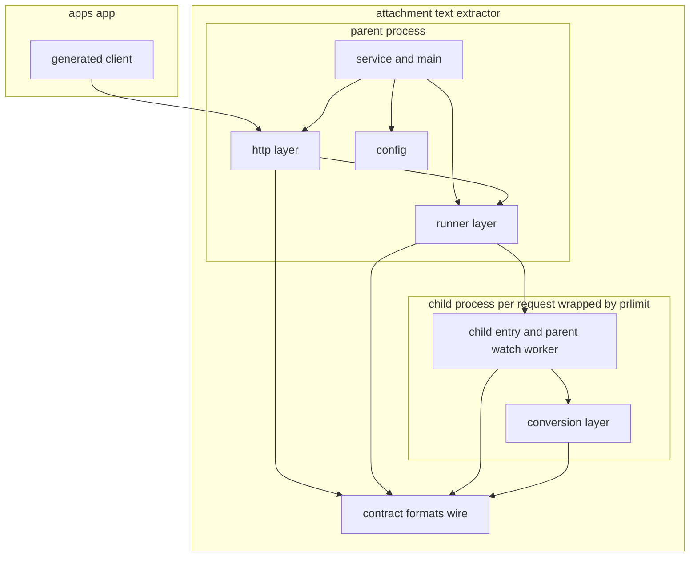
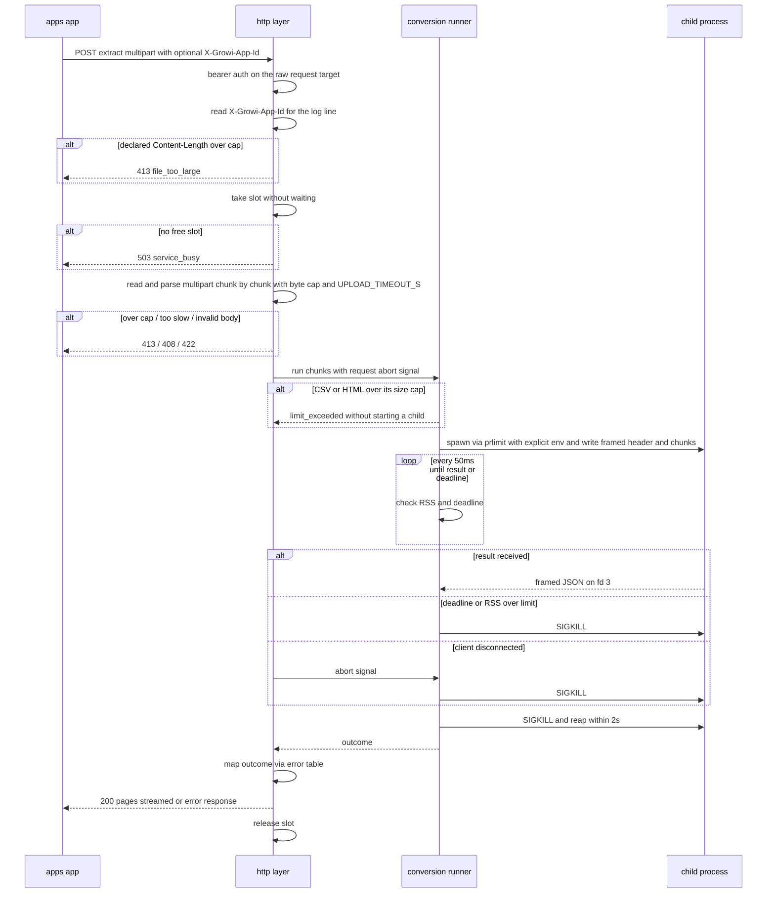
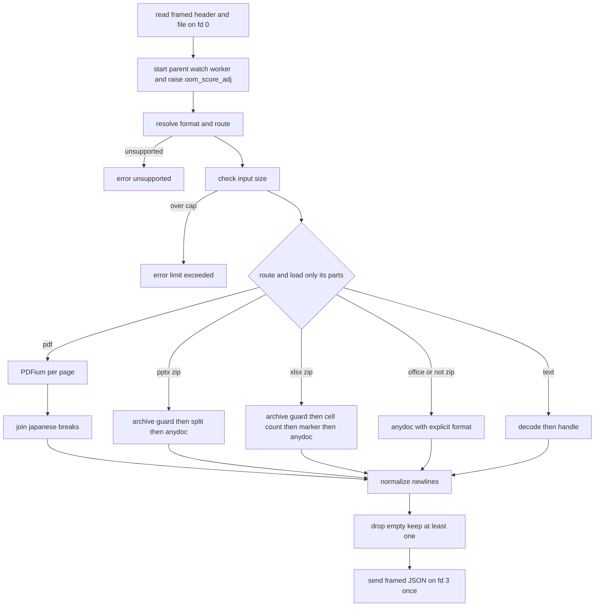

# Technical Design: attachment-search-text-extractor

## Write / Don't-Write Test

**この文書の役割**: 本 spec の設計上の判断を残す場所であり、実装の記録ではない。この機能を次に変える人が、コードとテストファイルだけでは分からない「なぜ今の形なのか」を確かめるために読む。

**判定基準**: 各項目について「コードとテストファイルを読めば、読み手が組み立て直せる内容か」を自問する。組み立て直せるなら、この文書には書かない。

| 書く | 書かない |
|---|---|
| 調べて初めて分かった事実 (anydoc が XLSX を 1 セルあたり約 2.5KB で持つ、Node の子は `RLIMIT_AS` 300MB では起動できない、apport のような渡し先がある環境ではコアダンプの上限 0 が無視され 1 なら作られない、`@hono/node-server` の `c.req.raw.body` は断片ごとに写す、など、コードをさっと読んでも分からない部品と実行環境の挙動) | 関数のシグネチャ、ファイルの一覧、どのファイルに何があるか |
| 変わった設計を選んだ理由。特に**検討して却下した案とその理由** (常駐する子の組、worker_threads での変換、`@hono/zod-openapi`、busboy、pdfium-native など) | 素直な実装の説明 |
| 自動テストで**捕まえられない**残存ギャップ (k8s の cgroup v2 でのメモリ不足時の止まり方、docker と GitHub 上でしか確かめられない配布物の確認など) | どのテストが何を確かめているかの一覧 (テストファイルを読むほうが確実) |
| コードから組み立て直せない手動確認の手順と、合否の基準値 (RSS の余裕、image の大きさの上限など) | 差分の有無や実装した時期などの経緯 |

**迷ったら書かない。** コードを読めば分かることをここに置くと、コードが変わったときに黙って古くなり、この文書全体の信頼を落とす。計測の数字と、判断の比べ方の詳細は research.md に置き、ここからは節の番号で指す。

## Overview

本 spec は、GROWI の添付ファイル全文検索のために、添付ファイルのバイト列からテキストを取り出す独立マイクロサービス `apps/attachment-text-extractor/` (`@growi/attachment-text-extractor`) を定義する。apps/app は HTTP (multipart) で `POST /extract` を呼び、ページ・スライド・シート単位に分かれた Markdown テキスト (`pages[]`) を受け取る。

**Purpose**: 形式ごとに適した部品で文字を取り出し、日本語の検索に向く形に正規化して返す。悪意あるファイルや重いファイルが来ても、サービス全体と他テナントの抽出を止めない。monorepo のほかの部分と同じ TypeScript と道具で保守できるようにする。

**Users**: 直接の利用者は apps/app (下流 spec `attachment-search-indexing`)。運用者は GROWI.cloud の SRE (k8s の共有 Deployment) と OSS の配布者 (Docker image)。

**Impact**: サービスは Node.js 24 + Hono で書き、`apps/pdf-converter` と同じく pnpm workspace の一員である。そのため開発者全員の `pnpm install` に anydoc のネイティブ部品 (linux x64 で約 8MB) と PDFium の WASM (約 7MB) が入る。API の型 (`ErrorCode`) と、経路の定義から作る OpenAPI の文書は、下流の生成クライアントと apps/app の分類に直結する (§Revalidation Triggers)。

### Goals

- 対応形式のファイルを、決められた単位 (PDF はページ、PPTX はスライド、XLSX はシート、その他は 1 要素) の `pages[]` で返す (1.1–1.5, 1.8, 1.12)
- 改行コードを揃え、PDF の抽出で日本語の語の途中に入った空白・改行を取り除いて返す (1.9)
- 時間切れ・メモリの使いすぎ・細工されたファイル・異常終了を、その 1 件のエラーとして閉じ込め、変換そのものを確実に止める。CSV / HTML は変換の前に大きさで断り、呼び出し側が切断したら変換を止める。PPTX / XLSX は ZIP の形を崩しても上限を通り抜けられない。PDF / PPTX は結果の大きさの上限を超えた時点で読むのをやめる (2.1–2.16)
- 外部バイナリ (`prlimit` を除く) と外向き通信なしで、read-only rootfs・非 root の共有 Deployment として動く。トークンなしで `/readyz` を呼び続けられても、確認用の子は 10 秒に 1 回までしか起動しない (1.7, 2.4, 3.1–3.11, 4.1–4.2, 5.8)
- `/extract` のログの行から呼び出し元の app を見分けられ、処理中の件数と上限、エンドポイントとステータスごとの応答の数、結果ごとの件数と所要時間、HTTP を受けるプロセスの CPU・メモリ・イベントループの遅れを `/metrics` で集められる (8.1–8.7, 9.1–9.9)
- Node.js + Hono + anydoc で、責務ごとに分かれた一方向の層として書く (5.1–5.8, 6.1–6.6)
- OpenAPI の文書を経路の定義から作り、commit 済みの文書との食い違いを CI で見つける (7.1–7.6)

### Non-Goals

- apps/app 側の統合 (生成クライアントの利用、ES への取り込み、失敗ログ、UI) は下流 spec の責務
- 画像の OCR、LLM による補助、音声・動画の文字起こし
- Outlook MSG、ZIP の中身の再帰展開、拡張子の表に無いテキストのファイル (`.conf` など。umbrella の roadmap に将来の作業として載せた)
- 表の構造を保った高精度な PDF 抽出 (Docling 等)
- 性能の最適化 (1 文書あたり 75〜130ms で、要求ごとに子を起動する作りの費用を受け入れている。§Performance & Scalability)
- `X-Growi-App-Id` の値を使った判断 (認可、上限、配分) と、その値をメトリクスのラベルにすること (値は自己申告で、種類が際限なく増えうる)
- 変換の子の CPU とメモリを `/metrics` に出すこと (子の最大 RSS はログの行にある。子を含むコンテナ全体の値はオーケストレーターの指標で見る)
- 変換の子が親の環境変数やほかの要求のデータを読めることへの対策 (umbrella の roadmap の (h))

## Boundary Commitments

### This Spec Owns

- `apps/attachment-text-extractor/` 配下のすべて: Hono アプリ、形式別の変換、日本語の正規化、子プロセスでの実行、設定、テスト、検索の品質のベンチマーク (`benchmark/`)、Dockerfile、運用者向けの文書 `docker/README.md`、サービスの説明書 (`AGENTS.md`。`CLAUDE.md` は `@AGENTS.md` の 1 行)
- HTTP の契約: `POST /extract` (multipart と任意のヘッダー `X-Growi-App-Id`) / `GET /healthz` / `GET /readyz` / `GET /openapi.json` / `GET /metrics` (Prometheus のテキスト形式。OpenAPI の文書には載せない) と、型 (`PageInfo` / `ExtractResponse` / `ErrorCode` / `ErrorResponse`)
- 運用者が読むログの行の形と、`/metrics` のメトリクスの名前・ラベル・ヒストグラムの区切り (§Monitoring)
- `pages[]` の意味の取り決め (単位、`pageNumber` / `label` の付け方、空の要素の扱い、最低 1 要素を返す規則)
- エラーの分類と HTTP ステータスの対応 (§Error Handling)
- OpenAPI の文書: 経路の定義から作り、`scripts/export-openapi.ts` で `packages/attachment-text-extractor-client/openapi.json` に書き出す。文書が変わったときは、生成クライアントの作り直しと apps/app の呼び出し側 (`apps/app/src/features/search-attachments/server/services/attachment-text-extractor.ts` とそのテスト) の名前と型の書き方の修正も、同じ変更で行う (7.4)
- このサービス専用の CI workflow (`.github/workflows/ci-attachment-text-extractor.yml`)

### Out of Boundary

- `packages/attachment-text-extractor-client` の orval の設定 (`orval.config.js`) と、生成クライアントを使う側の振る舞い (どのファイル名・MIME で送るかなど。indexing spec の design.md)
- apps/app 側のエラーの扱い (`ExtractionOutcome` などへの対応づけ) と、失敗時にファイル名だけの文書を登録すること (indexing spec の Req 2.4)
- Elasticsearch・MongoDB への接続 (本サービスは状態を持たない)
- `/metrics` を集める側 (Prometheus の設定、ダッシュボード、自動スケールの設定)。運用者が書く
- apps/app が `X-Growi-App-Id` に入れる値と、送るかどうかの判定 (indexing spec)
- k8s の manifest の例と、本番の環境への適用。動かすときに守る条件は `docker/README.md` に文章で書く。`apps/` のほかの app も Dockerfile だけを持ち、実際の配備は別の場所で管理されているので、例を置くと実物と合わせ続ける手間だけが残り、合わなくなっても気づく仕組みが無いため (research.md §5.8)

### Allowed Dependencies

- 実行環境: Node.js 24 (ルートの `engines.node`)。image は `node:24.x-bookworm-slim` に版まで固定する
- 本番の依存 12 個 (いずれも許容的なライセンス。調べた結果は research.md §1.4):
  - `hono`、`@hono/node-server`: 受け口
  - `@firecrawl/anydoc` (=0.2.4): Office 系の変換。ビルド済みのネイティブ部品
  - `@embedpdf/pdfium` (=2.15.1): PDF。PDFium の WASM
  - `htmlparser2` (=12.0.0)、`entities`: HTML のタグの切り出しと文字参照
  - `@xmldom/xmldom` (0.9.12 以上): DTD とエンティティを展開しない XML の解析
  - `yauzl`、`yazl`: ZIP の読み書き
  - `hono-openapi`、`zod`: 経路の定義から OpenAPI の文書を作る
  - `@prometheus-io/client` (0.16.x。`^0.16.1`): `/metrics` の Prometheus のテキスト形式と、プロセスの既定の指標。Prometheus の公式の JavaScript のクライアントで、`prom-client` の後継。0.x なので、版を上げるときに使う API (`Registry`・`Gauge`・`Counter`・`Histogram`・`collectDefaultMetrics`・`Registry.merge`) を確かめる
- OS のコマンド: util-linux の `/usr/bin/prlimit` だけ (5.8)
- テスト専用 (本番の image に入れない): vitest、`vitest-mock-extended`、`ajv`、`yaml`、テスト用のファイルを作る部品 (`officecrypto-tool`・`cfb`・`iconv-lite`)、ベンチマークの日本語の PDF を作る Chromium (`playwright-core`) と、再配布できるフォント (BIZ UDゴシック、SIL OFL 1.1)。テスト用のファイルはテストの中で Node で生成し、実在の文書はリポジトリに入れない
- 例外: 旧形式の DOC と PPT は生成できないため、Apache POI のテスト用ファイル (Apache-2.0) から小さなものを選んで `test/fixtures/legacy/` に置き、出典とライセンスを記録する
- 使わないもの: Node.js 以外の言語の実行環境 (5.6)、Bun / Deno (5.7)、LGPL / GPL / AGPL の部品、install のときにファイルを取りに行く部品 (`pdfium-native` など。`pnpm-workspace.yaml` の `allowBuilds` を広げない)、anydoc の `hosted` の OCR (5.5)、外向き通信、共有メモリ `/dev/shm`

### Revalidation Triggers

次の変更は、下流 (indexing spec と apps/app) の見直しか、運用者への周知を要する。

**API と応答の形**

- **`ErrorCode` の追加・変更**: `ErrorCode` には `file_encrypted` と `resource_limit_exceeded` がある。apps/app は知らないコードを受け取ると `null` を返し、「抽出サービスに到達できない」と同じ扱いになる (ファイル名だけの文書は登録されるが、理由の表示が誤る)。下流で次の箇所を直す必要がある: 生成クライアントの `ErrorCode`、`attachment-text-extractor.ts` の `mapAxiosErrorToOutcome`、`ExtractionOutcome`、`outcomeKindToReasonCode`、`ExtractionFailureReasonCode`、reindex batch の分岐
- **同じコードが複数の HTTP ステータスを持つこと**: `extraction_failed` は、壊れたファイル・不正な本文・切断では 422、想定外の異常では 500 になる。`extraction_timeout` は、本文の受信の期限切れと変換の期限切れの両方で 408 になる。apps/app はステータスではなくコードで分岐しているので今は影響しないが、ステータスで判断する処理を足すときは注意する
- **`code` を持たない応答**: Node の HTTP の層が返す 400 (壊れた HTTP の要求、`Content-Length` が本文より短く `Connection: close` の要求)・408 (何も送らない接続を 60 秒で閉じる)・417 (`Expect` が `100-continue` 以外)・431 (16KiB を超えるヘッダー) と、Hono の既定の 404 (本文は JSON でなく文字列) は、`ErrorResponse` の形を持たない。apps/app の `mapAxiosErrorToOutcome` は `code` の無い応答をすべて `serviceUnreachable` にする。apps/app (axios) はどの形も送らない。`GET /metrics` の 200 も JSON ではなく Prometheus のテキスト形式である (apps/app は `/metrics` を呼ばない)
- **`pages[]` の規則**: 「最低 1 要素を返す」「中身が空の要素は除く (全部空なら空の 1 要素)」「`pageNumber` に飛びがありうる (XLSX の空シート)」は、下流の検索文書の作り方の前提になる
- **health / readiness の応答**: `/readyz` の 200 は `{"status":"ready","dependencies":{...}}` で、`dependencies` のキーは `@firecrawl/anydoc`・`@embedpdf/pdfium`・`prlimit`・`converter` である (部品の実名。読み込めているものが運用者に分かるようにするため)。503 の本文は `{"status":"not_ready"}` だけで、`dependencies` を出さない。OpenAPI の文書は 200 と 503 の両方に型を付けるが、`dependencies` は「名前から `ok` への対応」としてだけ型を付けるので、キーの名前を変えても生成クライアントは変わらない。形を変えるときは文書を書き出し直す。apps/app は health / readiness を呼んでいない。k8s と Docker の確認はステータスだけを見る。`/readyz` の結果は確認を終えた時点から 10 秒間使い回すので、最大 10 秒古いことがある (§HealthRoutes)。運用者の確認の間隔と期限 (`docker/README.md` の 20 秒と 15 秒) は、この期間を前提にしている
- **`label` の中身**: PDF と PPTX の `label` は番号だけの文字列 (例: `"12"`) にし、「スライド」「p.」などの文言は付けない。GROWI は 5 言語に対応しており、文言は UI 側で各言語に合わせて付けるべきだから。attachment-search-ui spec は `label` を「Slide N / Sheet name / Page N」の表示文字列として想定しているので、形式と `pageNumber` から文言を組み立てる形に直す必要がある
- **生成クライアントの名前 (7.1, 7.2, 7.4)**: 文書を経路の定義から作るので、操作とスキーマの名前は文書を作る道具 (`hono-openapi` + zod) の既定で決まる。いまの名前は `postExtract`・`getHealthz`・`getReadyz`、本文の型 `PostExtractBody` (`file: Blob` 必須、`mimeType?: string`)、応答の型 `PostExtractResult`・`GetHealthz200`・`GetHealthzResult`・`GetReadyz200`・`GetReadyz200Dependencies`・`GetReadyz503`・`GetReadyzResult`、名前の付いたスキーマ `ErrorCode`・`ErrorResponse`・`ExtractResponse`・`PageInfo`・`PageInfoPageNumber`・`PageInfoLabel` である。経路の定義やスキーマ、文書を作る部品の版を変えると名前が変わりうるので、変えたときは生成クライアントを作り直し、apps/app の呼び出し側を直し、名前の対応を research.md に記録する (7.5。いまの対応は research.md §5.6)。`POST /extract` の任意のヘッダー `X-Growi-App-Id` は文書には載るが、orval は既定ではヘッダーの parameter から関数の引数も型も作らないので、生成クライアントには現れない (7.2 の「文書のとおりに持つ」はヘッダーには当たらない)。apps/app は axios の `headers` で渡す。ヘッダーの引数を作らせる orval の設定は、7.6 のとおり足さない (research.md §5.6)。文書の `info.version` を上げると、生成クライアントの先頭のコメントの版の行が変わる

**時間とサイズ**

- **タイムアウトの順序**: apps/app の `timeoutMs` は、抽出サービス側の最悪の合計より長くする。最悪の合計は、本文の受信 `UPLOAD_TIMEOUT_S` 15 秒 + 変換 `TIMEOUT_S` 55 秒 + 子の停止と回収 (実測 6〜12ms) で約 70 秒、回収の待ちの上限 2 秒を足しても 72 秒 (research.md §4.10)。apps/app の既定は 90000ms。apps/app が先に諦めると、抽出サービス側の変換が無駄に続く。抽出サービス側の既定を変えるときは、apps/app 側の既定と、運用者の停止の猶予 (85 秒以上) も見直す
- **サイズ・時間の上限の既定値**: apps/app 側の `maxFileSizeBytes` / `timeoutMs` と食い違うと、apps/app が待つ前にこちらが打ち切る (またはその逆) ことが起きる。既定値は下げていない (`MAX_CHILD_RSS_MB` 320、`MAX_XLSX_CELLS` 70,000 のまま)
- **子の最大 RSS の基準 (Req 2 の上限の余裕を見る基準のファイル。research.md §4.8)**: 既定値は、子の部品の読み込みを経路ごとに分け (PDF の子は PDFium だけ)、子の node に `--max-semi-space-size=4` と `--wasm-max-mem-pages=8192` を付け、子の `env` に `MALLOC_ARENA_MAX=2` を入れた形で、基準のファイルが 0.95 倍 (304MB) に収まることに依っている。image の中の実測で、7 万セル 1 シートの XLSX が 291MB、画像 12 枚の 48MB の DOCX が 262〜266MB (research.md §4.8、§4.13)。部品の読み込み方、子の node の引数、anydoc・PDFium・テキスト系の部品の版、Node の元の image を変えたら、CI のメモリの計測を人が起動して測り直す。XLSX が 304MB を超えたら `MAX_XLSX_CELLS` を 65,000 に下げ (research.md §4.8 で決めた下げ幅)、DOCX が超えたらユーザーに諮る
- **検索の対象の範囲**: 次の入力は RSS の上限で `resource_limit_exceeded` になる。1 つの要素が約 48MiB の画像を持つ XLSX (セルが少なくても)、結果が約 1,310 万字を超える ASCII の DOCX、1 ページに約 212 万字を超える PDF (304MB の線では約 198 万字。1 ページ 200 万字の PDF は image の中で 305〜306MB で、線をわずかに超えるが成功する。上限は下げず記録にとどめるとユーザーが決めた)、約 25〜30MiB 以上の XML の部品を 1 つ持つ PPTX、約 2,600 枚以上のスライドを持つ PPTX、`title` に `<&amp;` が続く 20MiB の HTML (research.md §4.11)。apps/app のコードは変わらないが、運用者に知らせる
- **メモリの予算 (2Gi)**: 2Gi を守る根拠は、最も重い負荷の実測である (image の中で 918〜1,095MiB。research.md §4.9)。最悪の値を足し合わせた見積もりは 2Gi とほぼ同じか少し超えるが、ユーザーが実測を根拠にすることを承認した。親の作り (応答を少しずつ書き、子の結果を 1 つの入れ物で受け取る)、`MAX_CONCURRENCY`、`MAX_CHILD_RSS_MB`、`MAX_RESULT_BYTES` を変えたら、最も重い負荷を測り直す

**運用者から見える振る舞い**

- **同時実行の上限は `MAX_CONCURRENCY` だけ**: 1 つのコンテナは 1 つの Node のプロセスで、ワーカーの数の設定 (`WORKERS`) は無い。設定されていても読まない。スケールはレプリカを増やして行う
- **`/docs` と `/redoc` は出さない**: API の説明画面は持たず、API の文書は `/openapi.json` だけで出す (トークンなしで `/docs` は 401、トークンありで 404)。トークンの要らないパスは `/healthz`・`/readyz`・`/openapi.json`・`/metrics` の 4 つだけである
- **本文の形の扱い**: boundary に CR を含む要求は 422。要求の `Content-Type` の `charset` は使わず、部品の名前とファイル名は UTF-8 として正しければ UTF-8、そうでなければ latin-1 で読む。`Content-Length` が実際の本文より短い要求は、Node の HTTP の解析器が余りを次の要求として読み、`code` の無い 400 を返す (§Error Handling)
- **HTTP の層の既定の振る舞い**: `POST` 以外の `/extract` と、末尾に `/` を付けた `/extract/` は 404。`Expect: 100-continue` 以外の `Expect` は 417。`Host` の無い HTTP/1.1 の要求は 400。`Authorization` の値の末尾の空白は Node が削る (トークンそのものの一致は要る)。`.` の区切りを含むパスは Node が解いてから経路を探す (認証を外すかどうかは、送られたパスの文字列そのもので判定する)。`HEAD /healthz` は 200。200 の応答は `Content-Length` を付けず chunked で返す (応答を少しずつ書くため。axios が解く)。同じ接続に続けて書いた 2 つ目の要求は、1 つ目の変換中に枠を取りに行く。どれも Node と Hono の既定の振る舞いで、合わせるためだけのコードは持たない (research.md §5.5)
- **ログ**: 出すのは、`/extract` の 1 件ごとの行 (最後に呼び出し元の `app=`)、runner が想定外の例外を投げたときの ERROR の行、起動と停止の行、親が書く診断の行、子の警告である。`/extract` 以外の要求ごとの行と、アクセスログは出さない。そのため、401 の要求、存在しないパスへの要求、probe と `/metrics` の呼び出しは、ログに 1 行も残らない。応答の数は、401 と 404 を含めて `/metrics` のカウンタで数える (§Monitoring)
- **ログを読む道具とダッシュボードが頼るもの**: 次のものを変えるときは、運用の手引き (GROWI の外で管理している文書) と一緒に変える
  - `/metrics` のメトリクスの名前、ラベル、ヒストグラムの区切り (§Monitoring)。運用者のダッシュボードと自動スケールの設定が名前で読む
  - ログの `app=` の位置 (`/extract` の行の最後) と値の意味 (`-` はヘッダーなし、`(invalid)` は形が合わない)。行を正規表現で読む道具が頼る。サービスの中ではメモリの計測の道具 (`scripts/image-check/memory/report.ts`) が `child_peak_rss_mb=` の値を読む
  - `X-Growi-App-Id` の形 (`^[A-Za-z0-9][A-Za-z0-9._-]{0,63}$`)。GROWI.cloud の app の ID の付け方が変わってこの形に合わなくなると、ログが `(invalid)` だけになる
  - `/readyz` の結果を覚える期間 (10 秒)。運用者の確認の間隔 (20 秒) より長くすると、kubelet の確認が古い結果を受け取るようになる
- **設定の読み方**: 環境変数は大文字の名前だけで読み、`.env` のファイルは読まない。整数は 10 進の数字だけを受け付け、`1_000` や `1.0` では起動しない。運用者が `RAYON_NUM_THREADS` を設定しても、子は常に 1 で動く (§Configuration)

## Architecture

### Architecture Pattern & Boundary Map

採用する形: **受け口 (HTTP) / 実行管理 (親プロセス) / 変換 (子プロセス) の 3 層と、どちらの側にも属さない小さな共有層**。受け口は Hono、変換はリクエストごとの子プロセスで行う。親は子の時間とメモリを見張り、必要なら止める。選定の理由と不採用の案は research.md の §1〜§3。



矢印は「import する」向きである。`Runner --> ChildEntry` だけは import ではなく「子プロセスとして起動する」(ファイルのパスを渡すだけで、親は子のコードを import しない)。

### 層の分け方の判断 (6.1–6.6)

**判断 1: 親と子で読み込むコードを、ディレクトリの単位で分ける。**
親 (HTTP を受けるプロセス) は、変換の部品 (anydoc のネイティブ部品、PDFium の WASM) を一度も読み込まない。読み込むだけでもメモリを使い、ネイティブ部品の不具合が親に及ぶ余地を残すからである。子だけが読み込む `conversion/` と `child/` を、親が読み込む `runner/` と `http/` から import の向きで切り離す。この向きは `test/layers/` のテストが、本番のファイルの import を拾って規則の表と突き合わせて守る (型だけの import も同じに扱う。`createRequire(import.meta.url)("…")` を 1 つの式で呼ぶ形は見つけられない)。zod と `hono-openapi` と `@prometheus-io/client` を import してよいのは `http/` だけで、変換の層と子がこれらを読まずに動くこともテストで確かめる。

**判断 2: 親と子の両方が使う純粋な部品は、どちらの層にも属さない小さな共有層に置く。**
CSV / HTML の大きさの事前判定 (2.8) は、子を作る前に親が行うが、同じ判定を変換の層でも使う。これを `conversion/` に置くと親が `conversion/` を import することになり、判断 1 が崩れる。そこで、形式の判定の表と大きさの事前判定を `formats/` に、親子の受け渡しの形 (長さを先に付けた JSON、子への見出し、子の警告の符号) を `wire/` に、型と `ErrorCode` と変換の上限の型 (`ConversionLimits`) を `contract/` に分ける。`formats/` と `wire/` は `contract/` だけを import し、ほかの層を import しない。`ConversionLimits` が `contract/` にあるのは、親が子への見出しに入れ、子が変換に渡すので、両方が読める場所が要るためである。

**判断 3: 変換の層は「入力のバイト列 → 結果か失敗の種類」の純関数にする。**
`conversion/` は HTTP も子プロセスも知らず、ログも出さない。入口は `convert` の 1 つで、例外を外に投げず、結果か失敗の種類 (`FailureKind`) を返す。これで、子プロセス無しで単体テストを書ける (6.2)。形式ごとの処理は、OOXML の ZIP と XML の処理 (`conversion/ooxml/`)、テキスト系 (`conversion/text/`)、PDFium の呼び出し (`conversion/pdfium/`)、改行と日本語の正規化 (`conversion/normalize.ts`) に分ける。

**判断 4: 失敗の種類から `ErrorCode` と HTTP ステータスへの表は、HTTP の層だけに置く。**
変換の後の失敗は `Record<FailureKind, …>` の表 (`http/error-table.ts`)、変換の前に断る理由 (`file_too_large`・`service_busy`・`upload_timeout`・`invalid_upload`・`client_disconnected`) は `REFUSAL_TABLE` に置く。TypeScript は `Record` のキーの漏れを型の検査で見つけるので、失敗の種類を足したときに表の追加を忘れられない (6.5)。OpenAPI の文書のエラーのステータスも、この 2 つの表から作る。変換と実行管理の層は `ErrorCode` も HTTP ステータスも知らない。

**判断 5: 組み立ては `src/service.ts` と `src/main.ts` だけが行う。**
`service.ts` は設定 → 実行管理 → アプリ → 待ち受けを組み立て、ポート 0 でテストできる。`main.ts` はプロセスに固有のこと (`process.env` を読む唯一の場所、ポート 8000、シグナル、終了コード) だけを持つ。ほかのモジュールは設定を自分で読まず、引数で受け取る。`import.meta.main` で 1 つにまとめる書き方は、Node 24 では実験的な機能なので使わない。

**判断 6: barrel (`index.ts`) は、層の外から呼ばれるディレクトリにだけ置く。**
barrel があるのは `contract/`・`conversion/`・`runner/`・`http/` で、層の外が使うものだけを export する (`conversion/index.ts` は `convert` だけ)。層の中の小さなまとまりには、同じ層の兄弟だけが使う sub-barrel (`runner/linux/`、`conversion/pdfium/`) を置く。`conversion/ooxml/` と `conversion/text/` には置かない。変換の層は経路ごとに部品を動的に読み込み (判断 3 の補足。§子プロセスの中の流れ)、barrel を通すと XLSX の子が PPTX の部品まで、TXT の子が HTML の部品と anydoc まで読み込むためである。`formats/`・`wire/`・`config/`・`child/` は小さく、使う側が個々のファイルを直接 import する。

**判断 7: Linux に固有の親の処理 (`/proc` の読み取り、`prlimit` の引数の組み立てと存在の確認) は `runner/linux/` にまとめる。**
Linux 以外では何もしない (開発用) 形で包む。子の `oom_score_adj` だけは `child/oom-score.ts` にあり、子が自分で書く。親から設定すると、子の起動と設定の間に隙ができ、`choom` のような外部コマンドは 5.8 に反するためである。

**採らなかった案**:
- **常駐する子プロセスの組 (pool) を作り、使い回す**: 1 件の異常や悪意あるファイルの影響が次の要求に残る。大きな変換の後に子がメモリを返さない。子の起動は 1 件あたり約 84ms で、許容した
- **worker_threads (同じプロセスの中のスレッド) で変換する**: ネイティブ部品の abort や segfault でプロセスごと落ちる。メモリの上限もスレッドごとには掛けられない
- **層をまとめて `src/` を平らにする**: ファイル数は減るが、判断 1 の「親が変換の部品を読み込まない」を import の向きで守れなくなる

### Technology Stack

| 層 | 選んだもの | 役割 | 根拠 |
|---|---|---|---|
| 実行環境 | Node.js 24 | 実行 | 5.1、`engines.node` |
| HTTP | `hono` 4.x + `@hono/node-server` 2.x | 受け口 | 5.1。本文と切断の扱いは research.md §4.4 |
| Office 系 | `@firecrawl/anydoc` 0.2.4 | 変換 | 5.2。research.md §2.2 |
| PDF | `@embedpdf/pdfium` 2.15.1 (PDFium の WASM) | ページごとの文字 | research.md §2.5、§4.2 |
| テキスト系 | `htmlparser2` の `Tokenizer`、自前の文字コードの判定と Node 標準の `TextDecoder`、`@xmldom/xmldom`、`yauzl` / `yazl` | HTML、文字コード、XML、ZIP | research.md §4.6 |
| 子プロセス | `child_process.spawn('/usr/bin/prlimit', …)` | 隔離と上限 | research.md §4.3 |
| OpenAPI | `hono-openapi` 1.x + `zod` 4.x | 経路の定義から契約の文書を作る | 7.1、7.6。research.md §4.5 |
| 指標 | `@prometheus-io/client` 0.16.x | `/metrics` の Prometheus のテキスト形式、プロセスの既定の指標 | 9.1、9.6。research.md §9.1 |
| テスト | vitest、`vitest-mock-extended`、`ajv` | テスト | `.claude/rules/testing.md` |
| lint / 整形 | biome (ルートの `biome.json`)、`tsgo` | 品質 | — |
| image | `node:24.x-bookworm-slim` を元にした multi-stage | 配備 | §配布物と CI |

## System Flows

### 抽出の流れ



**主な決定**:
- 認証は本文と枠より先に行う。認証を外すかどうかは、URL として整える前の、送られた要求の文字列そのもの (`?` より前) が `/healthz`・`/readyz`・`/openapi.json`・`/metrics` と完全に一致するかで決める。整えた後のパスで判定すると、`/./healthz` や `/%68ealthz` がトークンなしで通る形が見つかったため
- 応答を数える middleware は認証より前に置き、Hono が答えを作り終えた時点のステータスを数える。そのため 401 と 404 と、route が返したすべての答え (読み手のいない切断の後の答えを含む) が数に入る (§Monitoring)
- `X-Growi-App-Id` は、認証の後、route の最初 (宣言された長さの確かめと枠より前) に読む。ヘッダーは本文より先に届いているので、本文を読む前に断った行 (`file_too_large`、`service_busy` など) にも値を出せる。401 の要求は行を出さないので、認証より前には読まない。値を読む処理は例外を投げず、値の有無と形で要求の扱いは何も変わらない (8.5)
- 枠はファイルを読む前に取り、すぐ取れなければ待たずに 503 を返す (2.3)
- 本文は Node の要求のストリーム (`c.env.incoming`) を直接読み、届いた断片をその場で自前の multipart の解析器に渡す。本文全体の上限は届いたバイト数で数え、期限は受け取り全体に 1 つだけ掛ける。ファイルはメモリにだけ置き (一時ファイルを作らない)、断片のまま子へ渡して連結しない。`c.req.raw.body` は断片ごとに写しを作るので使わない。Hono の `parseBody()` (標準の `formData()`) は本文を読み切ってから分解し、項目の数とヘッダーの長さに上限が無く、50MiB × 3 件で親が 758MiB になったので使わない (research.md §4.4)
- 切断は、本文の途中なら要求のストリームが終わらないまま閉じたことで、本文を受け取った後なら `c.req.raw.signal` の `abort` で分かる。`AbortSignal` だけを実行管理に渡し、実行管理は HTTP を知らない (判断 1)
- 親は結果を受け取った場合も含めて、必ず最後に子へ SIGKILL を送り、2 秒を上限に回収する。子の終了処理が止まっても枠が戻らないことを防ぐ (2.5)
- 応答の JSON は 1 つの文字列に組まず、ページごと・本文の一定の字数ごとに少しずつ書く (送るバイト列は 1 つの文字列に組んだ場合と同じ)。最も重い結果 (約 33MB) を 3 件同時に返すときの親のメモリを抑えるため (research.md §4.9)
- 枠は応答を送り終える前に返す。読まない相手がいると、親が同時に持つ結果が枠の数を超えうる (トークンが要る形)

### 子プロセスの中の流れ



**主な決定**:
- 部品は経路ごとに動的に読み込む。PDF の子は PDFium と共通の正規化だけを、DOCX・CSV などは anydoc を、TXT・HTML・XML・ipynb は anydoc も PDFium も読み込まない。XLSX / PPTX は自分の経路の `ooxml/` の部品と anydoc だけを読み込む。全部を読み込むと、基準のファイルの子の最大 RSS が 0.95 倍の線を超えたため (research.md §4.8)
- PPTX と XLSX は、ZIP なら ArchiveGuard で検査してから書き換えの経路に入れ、検査を通せない ZIP (一覧を読めない、必要な部品が無いか 2 つ以上ある) は `malformed` で断る。ファイル全体を形式を明示して anydoc に渡すのは、ZIP でないもの (暗号化された OOXML や旧形式。中身は CFB 形式) だけで、型の付いたエラーを受け取る。検査を通せない ZIP まで anydoc に渡すと、ZIP の上限とセル数の上限を通らずに変換できたため (§ArchiveGuard)
- 子は、受け取った入力を写さずに変換へ渡す。変換の例外はすべて捕まえて `FailureKind` に変える。ネイティブ部品の abort や segfault は捕まえられず、親が終わり方から `crashed` と分類する

## Components and Interfaces

型の細部はコードにある。ここでは、層をまたぐ継ぎ目の形と、コードからは分からない判断だけを書く。

### HTTP 層 (`http/`)

#### ExtractRoute

`POST /extract` を受け、枠 → 本文の受信 (大きさと期限の上限つき) → 子での変換の順に通し、結果を `ExtractResponse` かエラー応答に変える (1.1, 2.1, 2.2, 2.3, 2.9, 4.2)。

- 不正な本文 (`file` が無い、テキストの欄で届いた、multipart でない、ファイルが 2 つ以上、部品のヘッダーが 1 行 4,224 バイトか 8 行を超える、など) は固定のメッセージで 422 `extraction_failed` にし、受け取った入力は返さない
- multipart の解析器は、本文の形の判定と `file` / `mimeType` の取り出しを、同じ 1 つの文法で行う。判定の決まりが 2 か所に分かれると、片方が通した本文をもう片方が別の形で読むか、黙って短く切ることが起きるためである。文法と部品のヘッダーの引数の読み方は、広く使われてきた multipart の実装の振る舞いに合わせ、その振る舞いを写した固定データ (`multipart-oracle.json`・`header-param-oracle.json`) でテストする。この固定データは作り直せない (research.md §4.4)
- 本文を読むと決めた時点 (認証と枠の後) で、HTTP/1.1 の `Expect: 100-continue` には `100 Continue` を返す
- runner が想定外の例外を投げたら、例外のクラスの名前だけを ERROR の行に出して 500 にする (例外の文やパスは出さない)

| Method | Endpoint | Request | Response | Errors |
|---|---|---|---|---|
| POST | /extract | multipart: `file` (必須)、`mimeType` (任意の形式の手がかり)。任意のヘッダー `X-Growi-App-Id` | `ExtractResponse` | 400, 401, 408, 413, 422, 500, 503 (§Error Handling) |

#### AppLabel

`X-Growi-App-Id` からログの行の `app=` の値を決める (8.1–8.4)。

- 形は `^[A-Za-z0-9][A-Za-z0-9._-]{0,63}$` (英数字で始まり、英数字と `.`・`_`・`-` だけの 1〜64 文字)。ログの行は空白で区切った `key=value` の並びなので、空白・`=`・改行などを通さない。形の正規表現は 1 か所に置き、検査と OpenAPI の文書の `pattern` の両方がそれを使う
- 形に合えばその値、ヘッダーが無ければ `-`、それ以外 (空、長すぎる、使えない文字、同じヘッダーが 2 つ以上) は `(invalid)`。`-` と `(invalid)` はどちらも形に合わない文字列なので、本物の値と取り違えない。形に合わない値は、ログの行を壊させないため写さない
- ヘッダーは Node が受け取った形 (`c.env.incoming.headers`) から読む。同じ名前の未知のヘッダーが 2 つ以上あると、Node はそれらを `, ` でつないだ 1 つの値にするので、形に合わず `(invalid)` になる。どちらかを選ぶ規則は足さない
- 形の検査は値が本物であることを確かめない (§Security Considerations)。理由の詳細は research.md §9.2

#### HealthRoutes

k8s の probe 用に生存と準備完了を返す (3.2)。

- `GET /healthz`: プロセスが応答できれば `{"status": "ok"}`
- `GET /readyz`: `/usr/bin/prlimit` が動き、確認用の子が決まった上限 (運用者の変換の上限ではない固定の値) の下で小さな PDF・PPTX・HTML を変換できたときだけ 200 を返し、それ以外は 503 `{"status":"not_ready"}`。3 つの入力で、変換の層が import する外部の部品 7 つ (PDFium、anydoc、yauzl、yazl、xmldom、htmlparser2、entities) をすべて通る。確認用の子は運用者の上限 (`MAX_PDF_PAGES=0` など) では動かさない。有効な設定で全部の Pod が準備未完了にならないようにするため
- 確認の結果は、確認を終えた時点から 10 秒間覚え、その間の呼び出しに返す。確認の実行中に届いた呼び出しは、その 1 回の確認を共有する (3.5–3.8)。確認 1 回は約 0.24〜0.4 秒の CPU を使い、`/readyz` はトークンが要らないので、呼ぶたびに確認すると、呼び続けられたときに最大で約 1 コアを使う。覚えることで、トークンなしの呼び出しが起こせる確認は 10 秒 (と確認そのものの時間) に 1 回までになる
  - 準備完了と準備未完了のどちらも覚える。例外で終わった確認も同じ期間覚える (準備未完了として答える)。未完了を覚えないと、固まった部品のある Pod で、トークンなしの呼び出しが 10 秒の期限の確認を続けて起こせるため
  - 期間は確認を **終えた** 時点から数える。確認は最大 10 秒 (確認用の子の期限) かかるので、始めた時点から数えると、遅い確認の結果は覚えた時点ですでに古い
  - 10 秒は運用者の確認の間隔 (20 秒) より短いので、kubelet は普段は新しい確認の結果を受け取る。固まった部品に気づくまでの時間は「3 回の失敗 × 20 秒」に最大 10 秒足した約 70 秒以内、部品が直ってから戻るまでは最大で「10 秒 + 次の確認の間隔」になる。期間は環境変数にせずコードの定数にする (確認の間隔より短いことをコードの側で守るため。research.md §9.4)
  - そのうえで、`/readyz` に届く要求は内向きの通信の制限 (GROWI のアプリと監視システムからだけ) で絞る
- `prlimit` が使えなくても起動は失敗させず、`/healthz` は 200 のままにする (k8s が再起動を繰り返さないようにするため)
- apps/app はこの 2 つを呼んでいない

#### Limits

- 枠は 1 つのプロセスに `MAX_CONCURRENCY` 個。空きが無ければ待たずに `service_busy` にする。確認用の子は枠の外で動くので、`/metrics` の `attachment_extractor_slots_in_use` にも入らない
- 枠はアプリごとに 1 つ作り、`/extract` と指標の両方が同じものを読む

#### MetricsRoute と ServiceMetrics

`GET /metrics` で、稼働状況を Prometheus のテキスト形式で返す (9.1–9.9)。

- 応答は `registry.contentType` (`text/plain; version=0.0.4; charset=utf-8`) の 200。`describeRoute` を付けないので、OpenAPI の文書にも生成クライアントにも載らない
- サービスの 5 つの指標 (§Monitoring) はアプリごとの registry に置き、`@prometheus-io/client` の既定の指標 (`collectDefaultMetrics`) はモジュールで 1 回だけ作る registry に置く。`/metrics` は `Registry.merge` で 2 つを合わせたものを返す。既定の指標は止められないタイマーと観測を起動し、アプリではなくプロセスの値だからである (テストは 1 つのプロセスで多くのアプリを作る)。本番はアプリが 1 つなので、出力は 1 つの registry の場合と並び順のほかは変わらない (research.md §9.8)
- 既定の global registry は使わない
- エンドポイントのラベルは、経路のパスの一覧とトークンの要らないパスの一覧を置いた 1 か所から、認証と同じ一致のさせ方 (送られた要求の文字列そのもの) で決める。認証の判定と数え方が食い違わないようにするため
- `/metrics` の呼び出しはログの行を出さず、子を起動しない。読むたびの処理は軽いので、呼び続けられても `/readyz` のように CPU を大きく使わない

| Method | Endpoint | Request | Response | Errors |
|---|---|---|---|---|
| GET | /metrics | なし (トークン不要) | Prometheus のテキスト形式 | なし |

#### OpenApiRoute

- `GET /openapi.json` は、`hono-openapi` の `describeRoute` で経路の横に書いた zod のスキーマから `generateSpecs` で作った文書を返す。文書はアプリごとに 1 回だけ作って覚える
- `describeRoute` は本文を先に読まない (`@hono/zod-openapi` は先に読むので、自前の本文の受け取りと衝突する)。要求を検査する部品 (`validator`) は使わない
- 名前を合わせる指定と、作った文書の後処理は書かない (7.6)。名前を付けるのは、応答ごとに展開されると困るスキーマ (`ErrorCode`・`ErrorResponse`・`PageInfo`・`ExtractResponse`) の `.meta({ id })` だけ
- `/healthz` と `/readyz` は `describeResponse` で書くので、値や文書に無いステータスの間違いが型のエラーになる。`/extract` は応答を少しずつ書くので型では確かめられず、`ajv` で実際の応答を文書と照合するテストを置く

### Runner 層 (`runner/`)

#### ConversionRunner

1 リクエストにつき 1 つの子プロセスで変換し、時間・メモリ・異常終了を見張って、必ず結果か失敗の種類を返す (2.2, 2.5, 2.6, 2.7, 2.8)。

```typescript
interface RunInput {
  readonly chunks: readonly Uint8Array[]; // as received, never concatenated
  readonly size: number; // bytes counted by the parent, not the declared length
  readonly fileName: string;
  readonly mimeHint: string | null;
}
interface ConversionRunner {
  run(input: RunInput, signal: AbortSignal): Promise<RunOutcome>; // RunOutcome adds childPeakRssMb
  readiness(): Promise<{ readonly ready: boolean }>;
}
```

- 起動の形: `/usr/bin/prlimit --as=<MAX_CHILD_RSS_MB + 2,304MiB> --cpu=<TIMEOUT_S + 5>:<TIMEOUT_S + 10> --core=1 -- <node> --wasm-max-mem-pages=8192 --max-semi-space-size=4 <dist/child/child-entry.js>`。`prlimit` は `PATH` から探さず絶対パスで起動する。`prlimit` は上限を掛けてから node を exec する (同じ PID) ので、上限は変換の前に必ず掛かり、孫はできない。仮想メモリと CPU 時間の値は、親自身の hard の上限で切り詰めてから渡す
- 子の `env` は `RAYON_NUM_THREADS=1` と `MALLOC_ARENA_MAX=2` の 2 つだけを明示し、トークンを子に渡さない。親の `process.env` からトークンを消す方法は採らない (書き換えた環境変数を後から読む処理があると黙って壊れるため)。子の node の引数は `NODE_OPTIONS` ではなく実行ファイルの後ろに置く
- ただし子は親と同じ uid で動くので、悪意あるファイルに乗っ取られた子は、親の `/proc/<pid>/environ` からトークンを含む環境変数を読める。明示した `env` は子にトークンを渡さないためのもので、子からトークンを隠す守りではない。手元の開発用コンテナ (Linux 6.8、Yama の `ptrace_scope` が 1) で、同じ形で起動した子が親の環境変数を読め、親のメモリ (`/proc/<pid>/mem`) は開けなかった。image の中と GROWI.cloud のノードでは試していない。親のメモリ (処理中のほかの要求のファイルを持つ) が読めるかは、ノードの ptrace の設定によりうる (research.md §9.5)。対策は決めていない (umbrella の roadmap の (h))
- fd: 0 は親から子への入力 (見出しとファイル)、3 は結果だけの管、4 は親の見張り用の管。標準出力と標準エラーは結果に使わない。WASM やネイティブの部品が標準出力に何かを書くと、長さが崩れて誤って分類されるためである。標準エラーは 256 バイトまでだけ保持して、決まった警告の符号を読む (§Monitoring)
- 子への見出しは `{ fileName, mimeHint, limits, maxInputBytes }` の JSON で、上限は 8MiB。見出しが大きすぎる (送り手の値が長すぎる) ときは、子を起動せずに `limit_exceeded` にする
- 待っている間、50ms ごとに子の RSS (`/proc/<pid>/status` の VmRSS) と期限を確かめる。期限切れか RSS の上限超えで SIGKILL を送る。期限は子の起動の時点から数える
- 子からの結果は、先頭の長さが分かった時点でその長さの入れ物を 1 つ確保して受け取る。長さの上限は `2 × MAX_RESULT_BYTES + 約 1MiB` で、超えたら読み捨てて `result_too_large` にする。`JSON.parse` の前に、正しい結果には出てこないオブジェクトと配列 (決まったキー以外、要素が `{` でない配列、入れ子の深さが 3 を超える形、重複したキー) をすべて拒む。悪意ある子が平らな巨大な配列を送ると、`JSON.parse` だけで親が 1GB を超えたためである。ページに省略できる項目や入れ子の項目を足すときは、この検査も一緒に変える
- 結果を受け取ったかどうかにかかわらず、最後に SIGKILL を送り、2 秒を上限に子を回収する
- 子の終わり方から失敗の種類へ: 結果を最後まで受け取った → 結果のとおり、親が決めて止めた → その種類 (`timeout`・`memory_exceeded`・`result_too_large`、中止の合図なら `crashed` で detail は `conversion was cancelled`)、結果なしで終わった → SIGXCPU なら `timeout`、それ以外は `crashed`。子が送ってきた種類が決まった一覧に無い、または親だけが決める種類 (`crashed`) なら、結果を拒む
- 起動が失敗したとき (`EMFILE`・`ENOENT`・`EACCES` など) は、見張りを作らずに `crashed` (detail `conversion process could not be started`、`childPeakRssMb` は `null`) で返す。Node は起動に失敗すると `child.stdio` を作らないことがあり、それを前提にすると親ごと落ちたためである
- 呼ぶ前の条件: 呼び出し側が枠を確保し、ファイルの大きさを確かめている
- 戻った時点の状態: 子プロセスは終了・回収済み。`signal` が中止されたときも、子を止めて回収してから戻る
- 常に成り立つこと: 1 回の `run()` で作る子は高々 1 つ。CSV / HTML の大きさの事前判定に当たったら子を作らない。親は変換の部品を読み込まない

### Child 層 (`child/`)

子プロセスの中で、親を見張り、変換を呼んで結果を 1 回だけ送る (2.5, 2.6, 2.7)。

- 入力は fd 0 を同期の読み取り (`readSync`) で読む。`process.stdin` に触ると fd 0 が非同期の読み方に変わるため
- 起動直後に `/proc/self/oom_score_adj` に 1000 を書く (値を上げる方向なので権限は要らない)。cgroup v1 や Docker 単体では、コンテナのメモリが足りなくなったとき、OS が HTTP のプロセスより先に子を止めるようになる。ただし k8s (cgroup v2) の既定では `memory.oom.group` が有効で、コンテナが上限に達すると OS はコンテナ内のプロセスをまとめて止めるので、この設定は効かない。メモリの主な守りは、親の RSS 監視で上限の手前で止めることである。書けなかったときは警告を出して変換を続ける
- 親が先に終わったら子も終わる (2.7 の隔離の一部): 子の中に見張り専用の worker thread を 1 つ立て、その worker 自身のイベントループで fd 4 をソケットとして読み、読み終わり (親が消えて書き込み側が閉じた) で自分に SIGKILL を送る。子のメインのスレッドが同期の処理 (PDFium の WASM、長い文字列の処理) で止まっていても働く (親を SIGKILL して 3〜7ms で子が終わる)。worker の中で止まる読み方 (`fs.readSync`) を使うと、子の `process.exit()` が worker を待って返らなくなるので使わない (research.md §4.3)。worker には `execArgv: []` を渡す (親の node の引数を受け継ぐと起動に失敗する場合がある)。worker の分だけ子の RSS が約 12MB 増える
- 子の警告 (`oom_score_adj` を上げられない、入力が不正、結果を送れない、想定外の失敗) は、標準エラーに決まった 4 つの符号のどれかを 1 行で書くだけにする。例外の文や入力は書かない

### Conversion 層 (`conversion/`。子プロセスの中だけで動く)

#### Convert (入口)

形式を決め、経路ごとの変換を呼び、正規化と空要素の規則をかけ、例外を失敗の種類に分類する (1.1–1.12)。

- 改行コードの統一 (`normalize_newlines`) は全経路の結果の各要素にかける。日本語の間の詰めは PDF の経路の中でだけかける
- 正規化の後に中身が空の要素は除く。全部が空なら `{pageNumber: null, label: null, content: ""}` の 1 要素を返す。下流は要素ごとに検索文書を作り、ファイル名だけの文書は失敗時にしか作らないため、空の配列を返すと添付がファイル名でも見つからなくなる
- 全要素の `content` を、改行を LF に揃えてから UTF-8 で数えた合計が `MAX_RESULT_BYTES` を超えたら `result_too_large` にする (最終の判断)。`label` と `pageNumber` は数えない (XLSX のシート名が巨大でも通る)。結果全体は親の受け取りの上限 (`2 × MAX_RESULT_BYTES + 約 1MiB`) が抑える
- PDF と PPTX は、ページ (スライド) を 1 つ読むたびに同じ数え方で合計を確かめ、超えた時点で残りを読まずに止める (2.14)。上限を大きく超える結果を最後まで読むと、時間とメモリを無駄に使うため。数え方は 1 か所に置き、途中の確かめと最後の確かめが同じものを使う。そのため、途中で止めた入力は最後まで読んでも必ず止まり、最後の確かめで通る入力を途中で止めることもない。PPTX の `content` は掃除の後も CR を含みうるので、揃える前のバイト数で数えると、最後の確かめで通る結果を途中で止めてしまう (research.md §9.7)
- XLSX と 1 要素の経路 (DOCX など) は anydoc を 1 回だけ呼ぶので、途中で確かめる場所が無く、最後の確かめだけになる
- 片割れのサロゲートを含む結果は、子の側で拒む

#### FormatResolver (`formats/format-table.ts`)

- 形式の決め方: `mimeHint` が対応表にあればそれを使い、なければ拡張子から決める。どちらも対応表になければ `unsupported` (1.6)
- 対応表 (経路と anydoc に渡す形式名):

| 形式 | MIME (代表) / 拡張子 | 経路 | anydoc の形式名 |
|---|---|---|---|
| PDF | `application/pdf` / .pdf | pdf | — |
| PPTX | presentationml / .pptx | pptx | `pptx` |
| XLSX | spreadsheetml / .xlsx | xlsx | `xlsx` |
| DOCX | wordprocessingml / .docx | office | `docx` |
| RTF / EPUB | `application/rtf` / .rtf、`application/epub+zip` / .epub | office | `rtf` / `epub` |
| 旧形式 DOC / PPT | `application/msword` / .doc、`application/vnd.ms-powerpoint` / .ppt | office | `doc` / `ppt` |
| 旧形式 XLS | `application/vnd.ms-excel` / .xls | office | `xlsx` (anydoc は XLS をこの名前で扱う) |
| OpenDocument | odt / ods / odp | office | `odt` / `ods` / `odp` |
| CSV / TSV | `text/csv` / .csv、`text/tab-separated-values` / .tsv | text → office | `csv` |
| HTML | `text/html` / .html .htm | text | — |
| XML | `text/xml` `application/xml` / .xml | text | — |
| ipynb | `application/x-ipynb+json` / .ipynb | text | — |
| TXT / MD / LOG / JSON / YAML | `text/plain` `application/json` `text/yaml` など / .txt .md .log .json .yaml .yml | text | — |

- Outlook MSG (`application/vnd.ms-outlook` / .msg) は対応表から外す (1.6 で `unsupported`)
- 旧形式 DOC / PPT / XLS と OpenDocument は、anydoc がシート見出しなどを出しても分割せず 1 要素で返す (1.8)
- 形式の手がかりは MIME が拡張子より優先なので、`.csv` に `application/vnd.ms-excel` が付くと XLS の経路に入り `malformed` になる (Windows のブラウザは CSV にこの MIME をよく付ける。既知の制約)。同じ理由で、中身が XLSX のファイルを `.xls` か `application/vnd.ms-excel` で送ると、セル数の事前の検査の無い office の経路に入る (守りは RSS の上限)

#### OfficeConverter

- anydoc の `toMarkdownBytes(bytes, format)` を、形式を必ず明示して呼ぶ。OCR の引数は渡さない (既定の `reject` のまま。`hosted` は文書を外部に送るため 1.7 に反する)
- anydoc は `ConvertErrorCode` を持つ `Error` を投げる。暗号化 → `encrypted`、上限 → `limit_exceeded`、壊れた / 部品が無い → `malformed`、未対応 → `unsupported`、そのほか → `internal`。値と種類の対応は、版を固定した契約テストで固定する
- 版を固定する。版を上げるときは契約テスト (§Testing Strategy) を通す (5.2)

#### PptxSlideSplitter

- 前提: ZIP であり、ArchiveGuard を通り、`ppt/presentation.xml` がちょうど 1 つあること。ZIP でなければ OfficeConverter に `pptx` としてそのまま渡す (暗号化されていれば `encrypted` になる)。ZIP なのに検査を通せないものは、ArchiveGuard が `malformed` にする
- `presentation.xml` と関係ファイル (`.rels`) を SafeXml で解析し、スライドの並び順を得る。正規表現では書き換えない
- スライドごとに、スライド一覧をその 1 枚だけにした `presentation.xml` と、そのスライドが参照する XML 部品だけを入れた無圧縮のパッケージを作り、anydoc に渡す。画像などの XML 以外の部品は入れない
- `pageNumber` はスライドの順番 (1 始まり)、`label` はその番号の文字列 (例: `"3"`)。文言は UI 側で付ける
- スライドを 1 枚 anydoc に通すたびに結果の大きさの合計を確かめ、`MAX_RESULT_BYTES` を超えたら残りのスライドを変換しない (2.14。§Convert)
- anydoc の出力から、PowerPoint が自動で付ける代替テキスト (「AI 生成コンテンツは誤りを含む可能性があります」などの決まった文) と、改行の印として出る行末の `\` を取り除く
- スライドが多いと、スライド 1 枚あたり RSS が約 65〜80KB ずつ増え、約 2,600 枚から子の上限に当たる見込み (§Revalidation Triggers の「検索の対象の範囲」)

#### XlsxSheetSplitter

- 前提: ZIP であり、ArchiveGuard を通り、`xl/workbook.xml` がちょうど 1 つあること。ZIP でなければ OfficeConverter に `xlsx` としてそのまま渡し、1 要素で返す。ZIP なのに検査を通せないものは、ArchiveGuard が `malformed` にする (`xl/workbook.xml` が 2 つある ZIP を anydoc に渡すと、セル数の上限を通らずに変換できた)
- **セル数の事前検査 (2.6)**: anydoc は XLSX を表全体の形でメモリに持つため、1 セルあたり約 2.5KB を使い、7 万セル 1 シートで子の最大 RSS が約 290MB になる。anydoc に渡す前に、`.rels` 以外のすべての部品を 64KiB ずつ読んで `<c` タグ (セル) の数を数え (anydoc は `workbook.xml.rels` のリンク先でシートを探すので、パスや拡張子で絞ると、サブディレクトリ・`..`・大文字の拡張子・パッケージ直下に置いたシートで検査をすり抜けられる)、合計が `MAX_XLSX_CELLS` (既定 7 万) を超えたら `limit_exceeded` にする。XML を解析せず DOM も作らないので、メモリはほとんど使わない。この上限を超える大きな XLSX は検索の対象にならない (下流でファイル名だけの文書になる)。この検査は早めに断るためのもので、すり抜ける形 (`*.rels` という名前のシート、`<c` の後の U+00A0、`.xls` として送る) があり、守りの境界は RSS の上限である
- `xl/workbook.xml` を SafeXml で解析し、各シートの名前を `ZZ<リクエストごとの乱数><連番>ZZ` に置き換え、非表示のシートを表示状態に戻したブックを作って、anydoc を 1 回だけ呼ぶ
- 出力を `## 目印` の行で切り、目印から元のシート名に戻す (元の名前は XML の文字参照を戻してから使う)
- `pageNumber` は workbook.xml でのシートの順番 (1 始まり。非表示・空・グラフのシートも数える)、`label` は元のシート名。空のシートは返さないので番号が飛ぶことがある。非表示のシートは含める
- シートが 1 枚だけのブックでは、anydoc は見出しを出さない。このときは出力全体を 1 要素とし、`pageNumber=1`、`label` を workbook.xml のシート名にする
- 次のどれかに当たるときだけ、ブック全体を 1 要素 (`pageNumber` / `label` は null) で返す: 置き換えていない目印が出てくる、目印の順番が workbook.xml の順番と食い違う、最初の目印より前に空でないテキストがある (シートが 2 枚以上のとき)。変換の層はログを出さないので、警告の行は無い
- 書き換えた ZIP は、yauzl の読みを yazl の書きに直接つないで流しながら作る (workbook.xml だけを差し替え、ほかの部品は元の圧縮の方式のまま写す)。ピボットキャッシュのように、セル数の検査が数えない大きな部品があるため (丸ごと読むと 150MiB の pivot cache で 400MB を超えた)

#### PdfConverter (`conversion/pdf.ts`、`conversion/pdfium/`)

- `@embedpdf/pdfium` の PDFium の C の関数 (`FPDF_LoadMemDocument`、`FPDFText_*` など) をそのまま呼び、ページごとに文字を取り出す。WASM の本体は package の中のファイルを読んで `wasmBinary` として必ず渡す (渡さない読み方に外へ取りに行く経路が無いことは確かめていないため)
- `pageNumber` はページ番号 (1 始まり)、`label` はその番号の文字列 (例: `"12"`)
- 取り出したテキストの改行を LF に揃えてから、日本語の文字に挟まれた 1 文字分の半角空白・改行を詰める (1.9)
- 開くときの `FPDF_GetLastError` が 4 (パスワード) か 5 (セキュリティ) なら `encrypted` (1.10)。オーナーパスワードだけの PDF は普通に開けるので抽出する (1.12)。それ以外で開けない PDF は `malformed` (1.11)。PDFium が修復して読める場合はそのまま抽出する。ページの無い PDF は `malformed` (WASM の PDFium は 0 ページとして開く)
- ページ数が `MAX_PDF_PAGES` を超えたら `limit_exceeded` (2.6)
- ページを 1 つ読むたびに結果の大きさの合計を確かめ、`MAX_RESULT_BYTES` を超えたら残りのページを読まない (2.14。§Convert)。1 ページの文字数そのものには上限を設けない
- WASM の中の `malloc` が 0 を返したとき (例外にならない) と、PDFium の中の `abort` (`RuntimeError`) は `internal`
- 文字列は、PDFium が返した長さで WASM のメモリを切り、UTF-16LE として復号する (NUL で読むのをやめる関数は使わない)
- 画像だけの PDF は例外にならず、全ページの文字数が 0 になる。Convert の空要素の規則で 1 要素になる
- PDFium は最初の変換のときに読み込み、1 件 1 プロセスの前提でモジュールの変数に持つ

#### TextConverter (`conversion/text/`)

- **文字コード**: 部品を使わない。試す順は BOM (1 つだけ取り除く) → 宣言 (HTML の `<meta charset>`、XML 宣言) → 厳密な UTF-8 → 自前の判定 (候補は Shift_JIS 系・EUC-JP・ISO-2022-JP・windows-1252。先頭 64KiB を見る) → cp932 → 最後は windows-1252 として読む。デコードは Node 標準の `TextDecoder` (full ICU)。Shift_JIS は、単独の 0x80・0xA0・0xFD〜0xFF も読む自前の関数で読む。宣言が `shift_jis` 系で、狭い Shift_JIS が拒むバイトがあれば、宣言を使わずに判定へ進む (EUC-JP の中身に `shift_jis` を宣言した HTML を正しく読むため)。BOM のない UTF-16 は判定できない (既知の制約)
- **HTML**: `htmlparser2` の `Tokenizer` でタグを切り出すだけにし、`Parser` は使わない (開いた要素の一覧を持つので、閉じない要素の多い HTML で 2 乗の時間になる)。`script` / `style` / `template` / `noscript` / `svg` の中身を捨て、ブロック要素で改行を入れる自前の層を上に置く。`recognizeSelfClosing` を有効にし (無いと `<script src="a.js"/>` の後ろの本文が消える)、`htmlparser2` の内部の値を 2 か所書き換えている。版は固定し、書き換えが効いていることを見張るテストを置く
- **XML**: DOCTYPE を取り除いてから、タグを取り除いたテキストを返す。XML として解析しないので、エンティティの展開による膨張攻撃を受けない
- **ipynb**: JSON として読み、セルの `source` と、テキストの出力 (`stream`、`text/plain`) を取り出す。画像の base64 は捨て、出力 1 つあたりの文字数に上限を設ける。文字列の外の `NaN`・`Infinity`・`-Infinity` は `null` に置き換えて読む。入れ子が 9,997 段より深い、または JSON として読めなければテキストとして返す
- **TXT / MD / LOG / JSON / YAML**: デコードしたテキストをそのまま返す (JSON / YAML は解析しない。深い入れ子や YAML のエイリアスの展開による膨張を避けるため)
- **CSV / TSV**: デコードして UTF-8 にしてから OfficeConverter に `csv` として渡す (区切り文字は anydoc が判定する)
- 正規表現の置き換えは、入力の大きさに比例する形 (`replaceBatched`) で行う。空文字に一致する正規表現を渡すと例外を投げる

#### ArchiveGuard と SafeXml (`conversion/ooxml/`)

- **ZIP かどうかの判定 (2.10)**: ZIP の終わりの記録 (`PK\x05\x06`) をファイル全体から探し、検証に通る記録が見つからないときだけ「ZIP でない」としてファイル全体を anydoc に渡す。探し方は次のとおり
  - ファイルの最後の 22 バイトがコメントの無い終わりの記録なら、それを使う
  - そうでなければ、いちばん後ろの完全な記録を探す (ファイルの最後の 21 バイトで途中で切れた印は読み飛ばす)。それが最後の 64KiB (コメントの最大の長さ) の中にあれば、確かめずに使う
  - それより前の候補は、暗号化された OOXML や旧形式の中に偶然 `PK\x05\x06` があるだけのこともあるので、後ろから順に検証し、通らない候補は読み飛ばして手前を探す。1 つ目の条件は、記録の「中央の一覧の大きさ」の値から計算した位置 (記録の位置から大きさを引いた位置) に中央の一覧の印 `PK\x01\x02` があるか、記録のすぐ前に zip64 の locator の印があること。後ろにどこも指さない記録を置いても、手前の本物が見つかる
  - 1 つ目の条件に通る候補が無くても、いちばん後ろの候補より前のどこかに `PK\x01\x02` があれば、その候補を終わりの記録として扱う (2 つ目の条件。結果は yauzl が開けず `malformed` になる)。anydoc は大きさの値を使わずに中央の一覧を見つけるので、大きさの値だけで確かめると、前にバイトを足して大きさの値をずらした ZIP を検査なしで anydoc に渡してしまうため
  - 最後の 64KiB だけを探す (CPython の `zipfile` と yauzl の範囲) と、ZIP の後ろに 64KiB より長いバイトを足すだけで「ZIP でない」になり、anydoc はそれより前の記録も開くので、エントリ数とセル数の上限を回避できた。ファイル全体を探す手間はファイルを 1 度読む程度で、最悪の形 (4 バイトおきに印) でも 50MB で約 0.9 秒、100MB で約 1.9 秒だった (research.md §9.3)
  - CFB の印 (`D0 CF 11 E0`) を見て旧形式や暗号化ファイルを通す検査は入れない。そのため、名前か MIME が `.xlsx` / `.pptx` の旧形式や暗号化ファイルで、ZIP の終わりの記録を持つもの (最後の 64KiB の中の偶然の印や、埋め込まれた ZIP の記録) は `malformed` になる。「ZIP でない」の判定の意味を 1 つ (検証に通る終わりの記録が無い) に保つことを、この狭い場合を読めることより優先した (§Open Questions / Risks)
- 終わりの記録が言う位置に中央の一覧が無い ZIP (大きさやオフセットの値が合わない) は、直さずに yauzl に判断させる (yauzl は大きさの値を見ないので、正常なファイルは断らない。開けなければ `malformed`)。これを「ZIP でない」とすると、大きさの値を 3 減らすだけでセル数の上限を通り抜けられた。CPython の `zipfile` が受け付けて yauzl が拒む形のうち、前後の余計なバイト、記録の中の数・円盤の番号・コメントの長さの食い違い、強い暗号化の印は、yauzl に渡す前に整える
- **ZIP なのに検査を通せない形は断る (2.11, 2.12)**: 終わりの記録が見つかったのに yauzl が開けない、一覧の途中で読めないエントリがある (名前を読めない、扱えない版の印 (`versionNeeded` > 6.3)、読み手の誤り)、必要な部品 (`ppt/presentation.xml` / `xl/workbook.xml`) が無いか 2 つ以上ある、のどれも `malformed` (422 `extraction_failed`)。これらをファイル全体のまま anydoc に渡すと、一覧を読めない形では 3 つの上限すべてを、部品が 2 つの形ではセル数の上限を通らずに変換できた (research.md §9.3)。必要な部品が無い ZIP と yauzl が開けない ZIP は、anydoc に渡しても `malformed` か 0 字だったので、断っても失うものはほとんど無い
- `office` の経路 (DOCX、ODT など) は ArchiveGuard を通らない。エントリ数の上限は anydoc に任せ、守りの境界は RSS の上限である
- yauzl で一覧し、エントリ数と、申告された展開後サイズの合計を検査し、`MAX_ARCHIVE_ENTRIES` / `MAX_ARCHIVE_UNCOMPRESSED_MB` を超えたら `limit_exceeded`。部品を読むときは、申告の大きさを超えるバイトが来たらその場で `malformed`、終わりに CRC-32 を確かめる (yauzl は確かめないため)。1 部品あたりの上限も設ける
- ZIP の暗号化の印 (bit 0) は `encrypted`、強い暗号化の印 (bit 6) だけなら `malformed`
- 圧縮の方式が deflate と無圧縮以外 (bzip2・LZMA など) の部品は `malformed` (anydoc もこれらを読めない)
- ZIP の書き手が名前を付けられない要素 (ディレクトリ、`../`、絶対パス、空の名前など) は、書き直す package から外す
- SafeXml は `@xmldom/xmldom` の上に置き、xmldom の警告を含むすべての誤りを例外にする。DOCTYPE の `<!ENTITY` を拒み (使われていなくても)、外部の資源を読みに行かない。xmldom が通してしまう壊れた XML (裸の `&`、本文の `]]>`、XML で使えない字、名前空間の予約の誤り) は自前の検査で拒む。書き戻すときは DOCTYPE を消して XML 宣言を UTF-8 にする。CDATA・コメント・処理命令を除く前処理と名前空間の数え方は、入力に比例する時間の走査にする

#### TextNormalizer (`conversion/normalize.ts`)

- 改行の統一 (CRLF / CR → LF) は全経路にかける。日本語の間の詰めは PDF の経路だけにかける。どちらも入出力が文字列だけの純関数
- 詰める対象は、日本語の文字 (ひらがな・カタカナ・漢字・々・ー) に挟まれた 1 文字分の半角空白と、1 つだけの改行。全角空白 (書き手が入れたもの) と、2 つ以上続く改行 (段落の区切り) は残す
- TXT / DOCX / PPTX などの経路には日本語の詰めをかけない。これらの改行や空白は書き手が入れたものだから。調査で語の途中の切れが見つかったのは PDF の抽出だけである (research.md §2.7)

## Data Models

### Data Contracts & Integration

**`ExtractResponse`**

| 項目 | 型 | 説明 |
|---|---|---|
| `pages` | `PageInfo[]` | 最低 1 要素。単位は形式による (§FormatResolver) |
| `mimeType` | `string` | 判定に使った MIME |
| `extractedCharacters` | `integer` | 全要素の `content` の文字数の合計 |

**`PageInfo`**

| 項目 | 型 | PDF | PPTX | XLSX | その他 |
|---|---|---|---|---|---|
| `pageNumber` | `integer \| null` | ページ番号 (1 始まり、空のページは除くので飛びうる) | スライドの順番 | workbook.xml での順番 (飛びうる。1 シートなら 1) | null |
| `label` | `string \| null` | 番号の文字列 (`"12"`) | 番号の文字列 (`"3"`) | 元のシート名 | null |
| `content` | `string` | 改行を揃え、日本語の間を詰めたテキスト | 改行を揃えたテキスト | 同左 | 同左 |

`label` には言語に依存する文言を入れない。「スライド」「p.」などの文言は UI 側で付ける。

**`ErrorCode`**: `unauthorized` / `unsupported_format` / `file_too_large` / `extraction_timeout` / `service_busy` / `extraction_failed` / `file_encrypted` (1.10) / `resource_limit_exceeded` (2.6)

**`ErrorResponse`**: `{ code: ErrorCode, message: string }`。`message` は失敗の種類ごとの決まった文で、ファイルの中身、入力、例外の文を含めない

**OpenAPI の文書の形**: zod の変換が、応答のオブジェクトに `additionalProperties: false`、整数に最小と最大、null を許す項目に `type: [..., "null"]` を付ける。`file` は `format: binary` で、生成クライアントでは `Blob` になる。`mimeType` は null 可ではなく省略できる文字列。`POST /extract` の `parameters` には、任意のヘッダー `{ "in": "header", "name": "X-Growi-App-Id", "required": false, "schema": { "type": "string", "pattern": "^[A-Za-z0-9][A-Za-z0-9._-]{0,63}$" } }` が 1 つある (8.7)。これらは文書の契約の一部で、別の文書に合わせて変えない

**親子間の受け渡し**: 親から子へは fd 0 に「4 バイトの長さ + JSON の見出し」と「4 バイトの長さ + ファイルの本体」を 1 回ずつ送る。ファイルは受け取った断片のまま順に書く。子から親へは fd 3 に「4 バイトの長さ + JSON の結果」を 1 回だけ送る。結果の正しい形は 3 つ (成功 `ok`・`pages`・`mimeType`、ページ `pageNumber`・`label`・`content`、失敗 `ok`・`kind`・`detail`) だけで、親は JSON として解釈するだけにし、子が送ったデータをコードとして扱わない (子が悪意あるファイルに乗っ取られても、親でコードが動かないようにするため)

## Configuration

| 環境変数 | 既定値 | 意味 |
|---|---|---|
| `ATTACHMENT_EXTRACTOR_SERVICE_TOKEN` | (必須) | Bearer トークン。未設定か空白だけなら起動しない (変数名だけを出して終了コード 1) |
| `MAX_CONCURRENCY` | 3 | 同時変換の数。1 つのプロセスの上限で、コンテナ全体の上限でもある |
| `MAX_FILE_SIZE_MB` | 50 | 受け付けるファイルの大きさの上限 |
| `UPLOAD_TIMEOUT_S` | 15 | 本文を受け取り終えるまでの時間の上限。超えたら 408 (`extraction_timeout`)。50MiB なら毎秒約 3.4MB 以上の転送が要る。変換の `TIMEOUT_S` とは別に数える |
| `TIMEOUT_S` | 55 | 1 件の変換の時間の上限。ファイルの受け取り (15 秒) と後始末を足した最悪の合計 (約 70 秒、回収の待ちの上限を足して 72 秒) が、apps/app の `timeoutMs` (既定 90000) に収まるようにする |
| `MAX_CHILD_RSS_MB` | 320 | 1 件の変換に許す RSS の上限。主なメモリの守り |
| `MAX_XLSX_CELLS` | 70000 | XLSX の全シートのセル数の合計の上限。早めに断るための検査で、守りの境界は `MAX_CHILD_RSS_MB` である。7 万セル 1 シートは子の最大 RSS が約 290MB で、320MB に収まる |
| `MAX_RESULT_BYTES` | 16777216 (16MiB) | 全要素の `content` (改行を LF に揃えた後) の UTF-8 の合計の上限。`label` は数えない。PDF と PPTX はページごとに途中でも確かめる (§Convert)。子から親への結果の全体は、別に `2 × MAX_RESULT_BYTES + 約 1MiB` (既定で約 33MiB) で抑える |
| `MAX_CSV_BYTES` | 8388608 (8MiB) | CSV / TSV のファイルサイズの上限。子を作る前に判定する。バイト数だけを見る早めの拒否で、通ることの保証ではない |
| `MAX_HTML_BYTES` | 20971520 (20MiB) | HTML のファイルサイズの上限。子を作る前に判定する |
| `MAX_PDF_PAGES` | 5000 | PDF のページ数の上限 |
| `MAX_ARCHIVE_ENTRIES` | 10000 | PPTX / XLSX の ZIP のエントリ数の上限 |
| `MAX_ARCHIVE_UNCOMPRESSED_MB` | 512 | ZIP の申告された展開後サイズの合計の上限 (anydoc の組み込み上限と同じ値) |
| `LOG_LEVEL` | INFO | ログの細かさ。`CRITICAL`・`FATAL`・`ERROR`・`WARN`・`WARNING`・`INFO`・`DEBUG`・`NOTSET` のどれか (大文字・小文字を区別しない)。起動と停止の行はこの値に関係なく出る |

- 環境変数は大文字の名前だけで、`main.ts` が渡した値からだけ読む。作業ディレクトリの `.env` は読まない。整数は 10 進の数字だけを受け付ける
- 秒の値は、タイマーが扱える最大 (約 24.8 日) に丸める。丸めないと、大きすぎる値が 1 ミリ秒の期限になり、すべての要求が 408 になった。`TIMEOUT_S` が 0 や負でも起動の検査は通る (意味の無い設定値)
- 負の `MAX_CONCURRENCY` でも起動し、すべての要求が 503 になる
- 待ち受けは `0.0.0.0:8000` に固定し (IPv4 だけ)、設定の項目にしない。HTTP の `requestTimeout` は `max(300 秒, 60 + UPLOAD_TIMEOUT_S + 30 秒)` で、長い `UPLOAD_TIMEOUT_S` でも Node が先に 408 を返さないようにする

**コードに固定した子の設定** (環境変数にしない。運用者が変える値ではないため):

- 子の `env`: `RAYON_NUM_THREADS=1` (anydoc の中のスレッドを 1 本にする。設定しないとコア数ぶんのスレッドが立ち、仮想メモリと CPU の使い方が増える) と `MALLOC_ARENA_MAX=2` (glibc の malloc がスレッドごとに作る 64MiB の予約を抑える。必要な仮想メモリが 300〜800MiB 減り、実行ごとの揺れも消えた。出力・RSS・時間は変わらない)
- 子の node の引数: `--wasm-max-mem-pages=8192` (PDFium の WASM のメモリの予約を 512MiB に抑える) と `--max-semi-space-size=4` (若い世代のヒープを抑える。20MiB の HTML と 3,000 スライドの PPTX で子の最大 RSS が約 90MB 下がった。時間はほぼ変わらない)
- `RLIMIT_AS` = `MAX_CHILD_RSS_MB` + 2,304MiB (既定で 2,624MiB)。Node と WASM は実メモリではなく仮想メモリの予約を大きく取る (何もしない node で約 1,200MiB 要る) ので、RSS の上限に近い値にはできない。正常な変換で必要量が最も大きいのは約 1,984MiB で、640MiB の余地がある。主な守りは RSS の監視で、`RLIMIT_AS` は「予約するが触らない」確保を止める最後の歯止めである。k8s のメモリの上限は実メモリで数えるので、この値には影響されない (research.md §4.7)
- `RLIMIT_CPU` = soft `TIMEOUT_S` + 5 秒、hard soft + 5 秒。親の SIGKILL が届かない場合の歯止めで、超えると子は SIGXCPU で終わり `timeout` に分類される。soft と hard を分けるのは、同じ値だと SIGXCPU より先に SIGKILL が届き `crashed` に分類されるため
- `RLIMIT_CORE` = 1。コアダンプの既定の渡し先がプログラム (`core_pattern` の先頭が `|`。apport など) の環境では、上限 0 は無視され、利用者のファイルの中身を含むコアがホスト側に渡る。上限 1 はカーネルが「コアを作らない」特別な値として扱う (Linux の `fs/coredump.c`。man には無くソースのコメントだけの挙動。ユーザー承認済み)。ファイルに書く設定では、1 バイトでは ELF のコアを書かない

**メモリの守り方**: 主な守りは、子が実際に使ったメモリ (RSS) を `MAX_CHILD_RSS_MB` で止めること。入力の大きさとメモリの関係は形式と中身でばらつくため。そのうえで、メモリの使い方が極端に重い形式だけ、変換の前に早く断る。CSV / TSV は `MAX_CSV_BYTES`、HTML は `MAX_HTML_BYTES` を超えたら、子プロセスを作らずに `limit_exceeded` を返す (親と変換の層で同じ判定を使う)。ただしこれはバイト数だけを見る早めの拒否で、通ることの保証ではない: anydoc のメモリはバイト数でなくセルの数で決まり、1 文字のセルだけの CSV は 2MiB でも上限を超えて RSS 監視で止まる。HTML も、形によっては小さくても数百 MB を使うことがあるので、RSS 監視は残す。XLSX だけは、anydoc がセル数に比例してメモリを使い、小さなファイルでも上限を大きく超えるので、変換の前に `MAX_XLSX_CELLS` でセル数を検査して、上限に当たる前に分かりやすいエラーにする。旧形式の XLS と ODS はセル数を数えずに anydoc に渡し、大きなものは RSS の上限で止まる。RSS の監視は 50ms ごとなので、止めた時点の RSS は上限を最大 148MB ほど超えうる。

**コンテナのメモリ上限 2Gi (requests 512Mi)**: 根拠は最も重い負荷の実測である。最も重い負荷 (約 33MB の結果を返す変換 3 件と、上限まで伸びて止められる変換 3 件を交互に流す) で、image の中のコンテナ全体 (cgroup v2 の `memory.peak`) は 918〜1,095MiB、待機時は 34〜35MiB だった (research.md §4.9、§4.13)。最悪の値を足し合わせる見積もりは次のとおりで、用心深い値である:

```
親の待機時 69 + MAX_CONCURRENCY × (MAX_CHILD_RSS_MB + 監視の遅れ 148 + 親の 1 件あたり 157) = 69 + 3 × (320 + 148 + 157) = 1,944MiB
```

- 69MiB は image の外で測った待機時の値で、image の中の 34〜35MiB より大きいが、用心のためにそのまま使う
- 書き込める `/tmp` は要らない (サービスが書くファイルは子の `/proc/self/oom_score_adj` だけ)。メモリの上の tmpfs を付けるなら、その大きさを式に足す (64MiB を付けるなら 2,008MiB)
- 本物の変換の値を項に入れると約 2,025〜2,070MiB で 2Gi とほぼ同じか少し超えるが、同時には起きない最大値を足しているためで、ユーザーが実測を根拠にすることを承認した (research.md §4.9)
- 運用者が `MAX_CONCURRENCY` か `MAX_CHILD_RSS_MB` を上げたら、式の増える分だけ上限を上げる。`MAX_FILE_SIZE_MB` を上げたら測り直す (50MB で測った値である)

## Error Handling

### Error Strategy

変換の失敗はすべて「その 1 件のエラー応答」に閉じ込める。親は変換の部品を読み込まないので、変換の異常で落ちない。

### Error Categories and Responses

| 検出のしかた | 失敗の種類 | ErrorCode | HTTP |
|---|---|---|---|
| Bearer トークンがない・違う (長さに左右されない比べ方。存在しないパスを含め、認証の要らない 4 つのパス `/healthz`・`/readyz`・`/openapi.json`・`/metrics` 以外すべて) | — | `unauthorized` | 401 |
| 枠が空いていない | `service_busy` (変換の前) | `service_busy` | 503 |
| ファイルの大きさが `MAX_FILE_SIZE_MB` を超える (宣言された `Content-Length` か、受け取ったバイト数で判定) | `file_too_large` (変換の前) | `file_too_large` | 413 |
| 本文を `UPLOAD_TIMEOUT_S` 以内に受け取り終えられない | `upload_timeout` (変換の前) | `extraction_timeout` | 408 |
| 本文の形が不正 (`file` が無い・テキストの欄で届いた・multipart でない・ファイルが 2 つ以上・部品のヘッダーが大きすぎる・boundary に CR を含む・`filename*=` と `filename*0=` を混ぜた) | `invalid_upload` (変換の前) | `extraction_failed` | 422 |
| 変換中・受信中に呼び出し側が接続を切った | `client_disconnected` (変換の前、または中止) | `extraction_failed` | 422 (読み手はいない) |
| 対応表にない形式、anydoc の「未対応」 | `unsupported` | `unsupported_format` | 400 |
| anydoc の「暗号化」、PDFium の `FPDF_GetLastError` 4 / 5、ZIP の暗号化の印 | `encrypted` | `file_encrypted` | 422 |
| anydoc の「壊れた」「部品が無い」、PDFium で開けない (4 / 5 以外)・ページが無い、ZIP の破損や未対応の圧縮の方式、XML の誤り、ZIP なのに ArchiveGuard の検査を通せない PPTX / XLSX (yauzl が開けない、一覧を読めない、必要な部品が無いか 2 つ以上ある) | `malformed` | `extraction_failed` | 422 |
| anydoc の「上限」、ArchiveGuard の上限、`MAX_PDF_PAGES` の超過、`MAX_XLSX_CELLS` の超過、`MAX_CSV_BYTES` / `MAX_HTML_BYTES` の超過 (子を起動する前に親が判定)、子への見出しが大きすぎる | `limit_exceeded` | `resource_limit_exceeded` | 422 |
| 親の RSS 監視で止めた | `memory_exceeded` | `resource_limit_exceeded` | 422 |
| 結果が `MAX_RESULT_BYTES` (PDF と PPTX はページの途中の確かめを含む) か、受け取りの上限を超えた | `result_too_large` | `resource_limit_exceeded` | 422 |
| 期限を過ぎて親が止めた、子が CPU 時間の上限を超えて SIGXCPU で終わった | `timeout` | `extraction_timeout` | 408 |
| 結果を送る前に子が終わった (abort、segfault、OS のメモリ不足による強制終了を含む)、子を起動できなかった、子の結果が決まった形でなかった | `crashed` | `extraction_failed` | 500 |
| 子の中の想定外の例外 (WASM の `malloc` の失敗、PDFium の `abort`、`RLIMIT_AS` に当たった `RangeError` を含む) | `internal` | `extraction_failed` | 500 |

- 応答の `message` には失敗の種類ごとの決まった文を入れ、ファイルの中身、入力、例外の文は含めない
- OS (cgroup) のメモリ不足で子が止められた場合と、`RLIMIT_AS` で V8 が自分を止めた場合は、`crashed` と区別できない
- `code` を持たない応答は、Node の HTTP の層と Hono の既定が返すものだけである (§Revalidation Triggers)。`Content-Length` が本文より短い要求は、`Connection: close` を付けたときは本文の不正 (422) と判定した応答が捨てられ、Node の 400 だけが届く。付けないときも Node の 400 になる

### Monitoring

ログは標準エラーに、`<UTC の ISO 8601 の時刻> <重要度> <本文>` の 1 行ずつで出す。`LOG_LEVEL` で絞る。

- `/extract` の 1 件ごと (認証を通った要求): `extract format=… size=… duration_ms=… result=… child_peak_rss_mb=… app=…` を INFO で 1 行。`format` は拡張子 (英数字 10 字まで)、`result` は成功か失敗の種類 (変換に入る前の `service_busy` / `file_too_large` / `upload_timeout` / `invalid_upload` / `client_disconnected` を含む)、子を起動しなかったときの `child_peak_rss_mb` は `unknown`。経路の中の想定外の例外で Hono が 500 を返した要求も、`result=internal` の行を 1 行出す (1 件につき行はちょうど 1 行)。`app` は行の最後に置き、`X-Growi-App-Id` の値 (形に合うとき)、`-` (ヘッダーなし)、`(invalid)` (形に合わない) のどれか (§AppLabel)。最後に置くので、`child_peak_rss_mb=(\S+)` までを読む道具は、その後ろに項目があっても読める。ファイル名・中身・形式の手がかり・Authorization ヘッダは出さない
- runner が想定外の例外を投げたとき: `extract runner raised format=… size=… error=<例外のクラスの名前>` を ERROR で 1 行
- 親が書く診断の行 (WARNING / ERROR): 子を起動できない (`launcher=` と errno の名前)、子が結果なしで終わった (終了コード)、シグナルで止まった (シグナルの名前)、結果が決まった形でない、SIGKILL の後も終わらない。親が自分で子を止めた場合 (期限、メモリ、結果の大きさ、切断) は、`extract` の行の `result=` が言うので足さない。値は決まった一覧から選んだものだけで、例外の文は出さない
- 子の警告: 子が標準エラーに書いた決まった 4 つの符号を、親が持つ固定の文に置き換えて WARNING で出す。それ以外の出力 (Node の警告、`prlimit` 自身のエラーなど) は「見覚えのない出力」の 1 行にまとめる。子が書いたバイトはログに写さない。想定外の失敗の例外の名前も出さない (部品が自由に決める文字列で、決まった一覧と照らせないため)
- 準備の行: 確認が失敗したとき、理由の文字列 (`probe=<pdf|pptx|html> cause=…`) が前と変わったときだけ WARNING を 1 行、準備未完了から戻ったときに INFO を 1 行。理由に毎回変わる値を入れず、確認は 10 秒に 1 回までしか起きないので、`/readyz` を呼び続けてもログは溢れない
- 起動と停止: `listening on …`、`SIGTERM received, …` を `LOG_LEVEL` に関係なく出す。起動に失敗したときは、設定の誤りを言う 1 行を時刻と重要度なしで出す
- `/extract` 以外の要求ごとの行と、アクセスログは出さない。そのため 401 の要求、存在しないパスへの要求、`/healthz`・`/readyz`・`/openapi.json`・`/metrics` の呼び出しは 1 行も残らない (ユーザーの判断。research.md §5.7)。それらの数は `/metrics` の `attachment_extractor_http_responses_total` で分かる
- JSON の構造化ログは本 spec の範囲外とする

#### `/metrics` の指標

`GET /metrics` (§MetricsRoute と ServiceMetrics) が返す指標。名前・ラベル・区切りは運用者のダッシュボードと自動スケールの設定が頼るので、変えるときは運用の手引きと一緒に変える (§Revalidation Triggers)。

| 名前 | 種類 | ラベル | 中身 |
|---|---|---|---|
| `attachment_extractor_slots_in_use` | gauge | なし | `POST /extract` が取っている枠の数 (読まれた時点の値) |
| `attachment_extractor_slots_max` | gauge | なし | `MAX_CONCURRENCY` の設定値 (0 や負の値もそのまま) |
| `attachment_extractor_http_responses_total` | counter | `endpoint`、`status` | Hono が作った答えの数 |
| `attachment_extractor_extract_results_total` | counter | `result` | `/extract` の結果ごとの件数 |
| `attachment_extractor_extract_duration_seconds` | histogram | `result` | `/extract` の所要時間 (ログの `duration_ms` と同じ区間)。区切りは 0.05、0.1、0.25、0.5、1、2.5、5、10、20、40、60、80 秒 |
| `@prometheus-io/client` の既定の指標 | — | — | `process_cpu_seconds_total`、`process_resident_memory_bytes`、`nodejs_eventloop_lag_seconds` など |

- `endpoint` の値は 6 つ (`/extract`、`/healthz`、`/readyz`、`/openapi.json`、`/metrics`、`other`)。認証と同じく送られた要求の文字列そのもので決めるので、`/./metrics` は `other` になる。`status` は 3 桁のステータス。`result` の値は、成功の `ok`、変換の後の失敗の種類 (`ERROR_TABLE` のキー)、変換の前に断る理由 (`REFUSAL_TABLE` のキー) で、ログの `result=` と同じ。どのラベルにも、要求が送った自由な文字列 (`X-Growi-App-Id` の値を含む) を入れない (9.7)。自己申告の値をラベルにすると、ラベルの値の種類が際限なく増え、監視システムの記憶と計算の量が増えるため
- `result` の値は、起動の時点ですべて 0 で作っておく。まだ起きていない結果も、監視の側で増え方を計算できるようにするため
- 結果ごとの件数と所要時間は、ログの行を書く関数で数える。行を書く場所と結果の値が 1 か所にまとまっているためで、`LOG_LEVEL` で行を出さない場合も数える。認証を通った `POST /extract` は 1 件につき行をちょうど 1 行書くので、結果の件数の合計は、`endpoint="/extract"` の応答の数から 401 と 404 を除いた数と同じになる。これは宛先を `/extract` (問い合わせ部分を除く) とそのまま書いた要求について成り立つ。`/./extract` のように別の書き方をした宛先は経路に届くが、応答は `endpoint="other"` で数える
- 既定の指標は HTTP を受けるプロセス (親) の値で、変換の子の CPU とメモリは含まない。子を含むコンテナ全体の値は、オーケストレーターのコンテナの指標で見る
- 自動スケールの指標には、Pod ごとの `attachment_extractor_slots_in_use / attachment_extractor_slots_max` を使える。枠がすべて埋まったコンテナは 503 を返すだけで CPU を使わないので、CPU より直接に埋まり具合が分かる

`attachment_extractor_http_responses_total` が数える答えと数えない答え (9.3、9.4):

| 答え | 数えるか |
|---|---|
| 経路の答え (200、`ErrorResponse` の 4xx / 5xx)、本文を読む前の早めの答え (413、503 など) | 数える |
| 認証の 401 (存在しないパスへの要求を含む) | 数える (`endpoint` は `other` か、送られたパス) |
| Hono の既定の 404 (存在しないパス、`GET /extract` などの違うメソッド) | 数える |
| route の中の想定外の例外で Hono が返す 500 | 数える |
| 呼び出し側が切断した後に作った答え (読み手はいない) | 数える (作った時点のステータス) |
| Node の HTTP の層が自分で返す答え: 壊れた HTTP の要求や `Host` の無い要求の 400、ヘッダーが大きすぎる 431、`Expect` が `100-continue` 以外の 417、ヘッダーや要求の期限切れの 408 | 数えない (Hono に届かない) |
| 答える前に閉じた接続、`100 Continue` の途中の応答 | 数えない |

応答を Hono の middleware で数え、Node の `server.on('request')` では数えないのは、HTTP の層の中で完結してテストでき、停止のための要求の追跡に指標の責務を混ぜないためである。Node の層で数えても、Node が自分で返す答えは `'request'` の前に返されるので数えられない (research.md §9.8)。

## Testing Strategy

- **変換の層**: 純関数として子プロセス無しで単体テストする (6.2)。anydoc の文書化されていない挙動 (PPTX の分割、XLSX の目印、XLS の形式名、`ConvertErrorCode` の対応) は、版を固定した契約テストに集める。**anydoc の版を上げるときは、このテストが通ることを条件にする** (5.2)。`htmlparser2` の内部の値の書き換えは、書き換えを外すと落ちる見張りのテストで守る
- **実行管理と子の結合テスト** (`*.integ.ts`、Linux でだけ動く): 本物の子プロセスで、時間切れ、RSS の超過、異常終了 (abort / segfault を起こす子)、親の消失、結果の上限、`prlimit` の上限が掛かっていること、子自身の環境にトークンが無いこと (子の `/proc/<pid>/environ`)、子が残らないことを確かめる。子自身の環境の検査は、子が親の環境を読めないことを確かめるものではない (読めることは §ConversionRunner)。子は `dist/` の JavaScript として起動するので、テストの前に build する (`test/global-setup.ts`。同じ package で vitest を 2 つ同時に動かすと、互いの `dist/` を壊す)。時間の期限は小数の引数で渡して短くする
- **HTTP の黒箱のテスト** (`test/http/`): 外から HTTP だけで確かめる。既定ではテストの中でサービスを起動し、URL を環境変数で渡すと外のサービスに向けられる
- **層の向きのテスト** (`test/layers/`): §層の分け方の判断 1・2・5 の規則を、本番のファイルの import と突き合わせる
- **配備物のテスト** (`test/deploy/`): Dockerfile を読んで中身を確かめる。本番の依存の一覧も固定する。運用者向けの文書 (`docker/README.md`) は文章なので、自動のテストの対象にしない
- **OpenAPI**: 書き出しの手順をプロセスとして動かし、出力を commit 済みの `openapi.json` と完全に比べる (7.3)。`/extract` の実際の応答を `ajv` で文書と照合する
- **既定の上限での余裕 (基準値)**: 7 万セル 1 シートの XLSX と、画像 12 枚の 48MB の DOCX の子の最大 RSS (子が自分で読んだ `VmHWM`) が、上限の 0.95 倍 (304MB) 未満であることを確かめる。手元の値は XLSX 289〜294MB、DOCX 262〜297MB で、余裕は 10〜30MB しか無い。CI の機械や負荷で揺れたら、まずこの許容を見る (50ms ごとの見回りの値は、終わる直前の山を取り逃がして DOCX で最大約 50MB 少なく出る)
- **image の中のメモリの計測 (CI)**: workflow を人が起動したとき (`workflow_dispatch`) だけ動く。最も重い負荷を各 3 回流し、コンテナ全体の値が 2,048MiB を超えたとき、または計測が正しく行えなかったとき (回数の不足、基準のファイルが無い、子の最大 RSS がログに無い、意図しない応答) だけ失敗にする。基準のファイルの子の最大 RSS が 304MB を超えたら警告にする (失敗にしない。本当の上限 320MB はサービス自身が守る)。動かすのは、anydoc・PDFium・Node の元の image を上げたときと、メモリに関わるコードを変えたときである (workflow の `paths` は `pnpm-lock.yaml` を含むので、push のたびに測ると関係の無い依存の更新でも動く)
- **検索の品質のベンチマーク** (`benchmark/`): 日本語を含む 23 文書と正解の語句 118 個で、語句の再現率、位置の正しさ、文字化けと分断、Elasticsearch (kuromoji) での検索の当たり方を測る。PDF の部品や anydoc の版を替えたら流し、`benchmark/baseline/python-baseline.json` と比べて下回らないことを確かめる (research.md §4.1)。このファイルは、移行の前の実装で測った基準値である
- **負荷に弱いテスト**: 子の RSS の余裕、イベントループの止まり、「1 秒以内」を見るテストなどは、2 vCPU の機械や並行して動くテストで落ちうる。落ちたら許容を広げるのではなく、時間に頼る部分を外すか、制限時間を明示する (一覧は research.md §4.14)
- **テストの書き方**: `essential-test-design` (観察できる結果を確かめ、仕組みを確かめない) と `essential-test-patterns` (vitest、`mock<T>()` を使い、型の主張 `as` を避ける) に従う
- **自動では確かめられず、人が確かめること**: (1) 変換のライブラリ (anydoc、PDFium) や Node の元の image を上げたとき、メモリに関わるコードを変えたとき、`/extract` のログの行の形を変えたときに、メモリの計測を人が起動して流すこと (`workflow_dispatch`。linux/amd64 と linux/arm64 の両方で走る)。計測の道具は `app=` の付いた `extract` の行から子の最大 RSS を読むので、読めていること (失敗の条件「子の最大 RSS がログに無い」に当たらないこと) も見る。(2) 実際のオーケストレーターの下での動作 (確認の probe、ローリングアップデート、停止の合図の後の待ち時間)。(3) GitHub 上で workflow を変えたときは、trigger の条件に合うブランチで動かし、`gh api repos/<org>/<repo>/actions/runs/<id>/jobs` でジョブの数が 0 より多く、すべてのステップが成功していることを確かめる (0 ジョブの実行は成功とみなさない)

## 配布物と CI

### Dockerfile (`apps/attachment-text-extractor/docker/Dockerfile`)

- build の context はリポジトリのルート (pnpm workspace が要るため)。`Dockerfile.dockerignore` で、ほかの app と `node_modules`・`dist` を除く (最後に合った行が勝つので、`apps/**` と `!apps/attachment-text-extractor` を先に置く)
- build の段: `corepack` で pnpm を入れ、`pnpm install --frozen-lockfile --ignore-scripts`、package の `build`、`pnpm deploy out --prod --legacy` で本番の依存だけを取り出す (`apps/pdf-converter` と同じ形)
- 実行の段: `node:24.x-bookworm-slim` (版まで固定し、CI の Node と一緒に上げる)、`RUN /usr/bin/prlimit --version` (無いか動かなければビルドが失敗する。5.8 の前提を守る)、uid / gid 10001、`CMD ["node", "dist/main.js"]` (exec の形。Node が PID 1 で SIGTERM を自分で扱う)
- image に入れないもの: `src`・テスト・ベンチマーク・scripts・開発用の依存・第三者のライセンスの文 (ほかの app の image と同じ扱い。依存が許容的なライセンスであることは調べてある。research.md §1.4)
- init のプロセスは要らない。子は親の直接の子で、親がいなくなると自分で終わる
- 展開した大きさで 400MB 以下 (CI が検査する)

### 運用者向けの文書 (`apps/attachment-text-extractor/docker/README.md`)

AC 3.3 の推奨設定を含め、サービスを動かすときに守る条件を、それぞれ理由を付けて書く。k8s の manifest の例は持たない。書く条件は次のとおり。

- メモリの limits 2Gi と requests 512Mi、その計算と、`MAX_CONCURRENCY` などを変えたときの計算のし直し
- uid / gid 10001、read-only の root ファイルシステム、capabilities の削除、権限を上げないこと (k8s では `RuntimeDefault` の seccomp と、サービスアカウントのトークンを付けないこと)
- 書き込める `/tmp` は要らないこと。付けるならメモリの式に足すこと。永続の領域と `/dev/shm` は要らないこと
- init のプロセスは要らないこと
- 外向き通信の遮断と、内向きの通信を GROWI のアプリと監視システム (`/metrics` を集めるなら) からだけにすること。トークンの要らないパスは `/healthz`・`/readyz`・`/openapi.json`・`/metrics` の 4 つで、守りはこの通信の制限だけであること
- 変換の子が親と同じ uid で動き、トークンを含む親の環境変数を `/proc` から読めること。確かめた環境と確かめていない環境、親のメモリが読めるかはノードの ptrace の設定によること、対策が未決であること (3.9–3.11)
- `/healthz` (生存と起動の確認) と `/readyz` (準備完了の確認。確認の期限 15 秒以上、間隔 20 秒) の使い分けと間隔・期限。`/readyz` は確認の結果を 10 秒覚えるので、確認の間隔を 10 秒以下にしないこと
- 停止の合図の後に待つ時間 85 秒以上 (受信 15 秒 + 変換 55 秒 + 余裕)。サービスは処理中の要求を上限なしで待ち、2 回目の合図ですぐ終わる
- レプリカを増やすスケール (2 つ以上)。CPU と自動スケールの値は出発点で、測った値ではないこと
- 必要な環境変数と、GROWI の側の大きさの上限との関係
- ログの形と `app=` の値の意味 (自己申告の値で、判断に使わないこと)
- `/metrics` の指標の名前と意味、トークンなしで開いていること、既定の指標は親のプロセスの値で子を含まないこと、自動スケールに `slots_in_use / slots_max` を使えること、数えない答え
- 公開タグの一覧 (changesets は直さないので、版を上げる PR で一緒に直す)
- 最初の CI の実行で確かめたことと、まだ確かめていないこと
- コマンド形式の healthcheck (Docker の `HEALTHCHECK` など) は、slim の image に curl も wget も無いので `node -e` で `http://127.0.0.1:8000/readyz` を見る。サービスは IPv4 だけで待ち受けるので `localhost` にしない。中の期限 14 秒、確認の `timeout` 15 秒 (確認用の子の期限 10 秒より長くする)

### CI (`.github/workflows/ci-attachment-text-extractor.yml`)

- trigger は push (この app、生成クライアントの `openapi.json`、workflow 自身、ルートの `biome.json`・`tsconfig.base.json`・`turbo.json`、`pnpm-lock.yaml` の変更) と `workflow_dispatch`。`apps/attachment-text-extractor/turbo.json` の `test` の `inputs` にも、生成クライアントの `openapi.json` を入れる (生成クライアントだけを変えた変更でも検査が動くように)
- ジョブ 1 (lint とテスト): `turbo run lint test --filter @growi/attachment-text-extractor` (biome、`tsgo`、vitest。OpenAPI の drift の検査を含む)
- ジョブ 2 (image の確認。`scripts/image-check/check-image.sh` を段階ごとに呼ぶ。公開する 2 つの環境 linux/amd64 と linux/arm64 のそれぞれで、エミュレーションなしの runner で動かす): build、保存された大きさと展開した大きさがどちらも 400MB 以下、image の中身 (本番に不要なものが無い、uid 10001)、`--read-only --user 10001 --network none --cap-drop ALL --security-opt no-new-privileges` (tmpfs なし) での起動、`/readyz` が 200、PDF と DOCX の `POST /extract` が 200、動いているコンテナの中で本番と同じ条件で `prlimit` を実行して上限を確かめること、コンテナの `/openapi.json` が書き出しの手順の文書と同じこと、失敗したときのログ、後片づけ。メモリの計測のステップは `workflow_dispatch` のときだけ動く
- 2 つのジョブは互いを待たない。ほかの workflow はこの package のテストを流さない。apps/app の CI は、生成クライアントを orval で作り直して commit 済みのものと同じことを確かめる
- `if:` の中にコメントを書かない (`.claude/rules/github-actions-workflows.md`)

### image の公開 (`.github/workflows/release-attachment-text-extractor.yml`)

- 公開先は Docker Hub の `growilabs/attachment-text-extractor`。環境は linux/amd64 と linux/arm64。タグは `latest`、`{major}`、`{major}.{minor}`、`{major}.{minor}.{patch}`
- 仕組みは `apps/growi-vault-manager` と `apps/pdf-converter` の公開と同じにする。master への push で `apps/attachment-text-extractor/package.json` が変わったときに動き、その版数が安定版で、git のタグ `attachment-text-extractor/v<版数>` がまだ無いときだけ公開する。公開に成功した後でタグを打つので、タグがあることは「その版が Docker Hub にある」ことを表す
- 版数は changesets で上げる。開発の PR に `@growi/attachment-text-extractor` の changeset を書き、生成される「Release Subpackages」の PR をマージすると公開される。`docker/README.md` の公開タグの一覧は changesets が直さないので、changeset を書く PR で一緒に直す
- 公開する image が満たすべきことは、公開の workflow では確かめない。CI のジョブ 2 が push のたびに確かめている

### OpenAPI の書き出し

- `scripts/export-openapi.ts` が、アプリが `/openapi.json` で返すのと同じ文書を書き出す。`packages/attachment-text-extractor-client/openapi.json` はその出力を biome で整えたもので、orval で `src/generated/` を作り直す
- `scripts/check-openapi-drift.ts` は、2 つの文書を JSON として比べ、違う場所を JSON Pointer で出す (CI の image の確認が使う)

## Security Considerations

- **信頼できない入力**: すべての変換は子プロセスで行い、親は結果を決まった形の JSON として受け取るだけにする (§ConversionRunner)。子の中で変換の部品に不具合があっても、親でコードが動くことはない。PDFium は WASM の中で動くので、PDFium の中のメモリの破壊は WASM のメモリの外に届かない
- **細工ファイル**: anydoc の組み込み上限 (展開量・入れ子の深さ・ノード数)、ArchiveGuard、`MAX_PDF_PAGES`、RSS の上限、時間の上限で多重に守る。信頼できない文字列に当てる処理は、入力に比例する時間になるように書き、悪意のある形を N・2N・4N の大きさで測って確かめた (research.md §4.6)。ZIP の書き直しは要素の数の 2 乗の時間になるので、要素の数の上限で先に断る
- **XXE と実体参照の膨張**: XML の書き換えは SafeXml で行い (エンティティの宣言は使われていなくても拒み、外部の資源を読まない)、XML のテキスト化は解析せずにタグを取り除く
- **外向き通信**: anydoc の `hosted` の OCR を使わない (文書全体を外部に送るため)。PDFium の WASM は必ず渡す。k8s では NetworkPolicy で遮断する
- **コンテナ**: 非 root (uid 10001)、read-only rootfs、capabilities をすべて外す、権限を上げない、seccomp `RuntimeDefault`。共有メモリ (`/dev/shm`) は使わない
- **認証**: Bearer トークンを、送られた値と正しい値をそれぞれ SHA-256 にしてから `crypto.timingSafeEqual` で比べる (長さが違っても例外にならず、長さも漏れない)。認証を外すのは、送られた要求の文字列そのもの (`?` より前) が `/healthz`・`/readyz`・`/openapi.json`・`/metrics` のどれかと完全に一致するときだけである。認証は本文と枠より先 (トークンなしの大きな `Content-Length` は 413 ではなく 401)。ログにトークンを出さない
- **トークンの受け渡し**: 子の `env` は明示した 2 つだけにし、トークンを子に渡さない。子へのコマンドラインにもトークンとファイル名は無い。ただし子は親と同じ uid (10001) で動くので、乗っ取られた子は親の `/proc/<pid>/environ` からトークンを読める (手元の開発用コンテナで確かめた。image の中と GROWI.cloud のノードでは試していない)。親のメモリ (処理中のほかの顧客のアップロードを持つ) が読めるかはノードの ptrace の設定によりうる。対策は umbrella の roadmap の (h) で決める (§ConversionRunner)
- **`X-Growi-App-Id` は信頼しない**: 認証されていない自己申告の値で、ほかの app の ID を名乗ることもできる。ログの内訳を見るためだけに使い、認可、上限、処理の分岐に使わない。形の検査は、ログの行を壊させないためのもので、値が本物であることは確かめない
- **`/metrics` はトークンなしで答える**: 中身は件数、時間、プロセスの値と Node の版で、ファイルの名前と中身、app の ID、トークンは含まない。守りは `/readyz` と同じく内向きの通信の制限 (GROWI のアプリと監視システムからだけ) である。読むたびの処理は軽く、子を起動しない
- **コアダンプ**: `prlimit --core=1` で作らせない (§Configuration)
- **`prlimit` の起動**: `PATH` から探さず、絶対パス (`/usr/bin/prlimit`) で起動する。探し方によって別のコマンドを起動する余地をなくすため
- **停止**: 停止の合図の後は応答を返し終えていない要求を待つ。待つ時間に上限は無く、応答を読まない相手がいると、トークンなしでも停止が猶予時間まで延びうる。オーケストレーターの猶予時間の後の SIGKILL で終わる (受け入れた。research.md §5.9)

## Performance & Scalability

- 子プロセスを作る上乗せは、小さな TXT 1 件の起動から回収までで中央値 84ms。1 文書あたりの処理は 75〜130ms (テキスト・Office が 75〜98ms、PDF が 115〜128ms)。Node には読み込み済みのプロセスを複製する仕組みが無く、要求ごとに子が部品を読み込むためである。隔離を優先して、常駐する子の組は採らない。まとめて index を作り直すときの処理量に効く
- 待機時の親は image の中で 34〜35MiB。親は anydoc と PDFium を読まない。1,000 件の変換の後も RSS とヒープは一定 (漏れなし)
- 50MiB × 3 件の受信での親の最大 RSS は 244〜258MiB (断片を連結しないため)
- スケールはレプリカを増やす。1 つのコンテナの中の同時実行数は `MAX_CONCURRENCY` で固定する。枠がすべて埋まったコンテナは 503 を返すだけで CPU を使わないので、CPU は負荷の目安にしかならない。埋まり具合は `/metrics` の `attachment_extractor_slots_in_use / attachment_extractor_slots_max` で直接分かり、自動スケールの指標に使える (§Monitoring)
- PPTX / XLSX は、ZIP の終わりの記録を探すためにファイル全体を最大 1 度読む。印の候補が非常に多い最悪の形でも 50MB で約 0.9 秒 (§ArchiveGuard)

## Requirements Traceability

| 要件 | 対応する設計 |
|---|---|
| 1.1, 1.2, 1.3, 1.4, 1.5, 1.8 | Convert、FormatResolver、PptxSlideSplitter、XlsxSheetSplitter、PdfConverter、Data Models |
| 1.6 | FormatResolver、Error Handling |
| 1.7 | Allowed Dependencies、Security Considerations (外向き通信)、配布物と CI (`prlimit`) |
| 1.9 | TextNormalizer、PdfConverter |
| 1.10, 1.11, 1.12 | PdfConverter、OfficeConverter、ArchiveGuard、Error Handling |
| 2.1, 2.2, 2.3 | ExtractRoute、Limits、Configuration、Error Handling |
| 2.4 | Security Considerations、配布物と CI |
| 2.5, 2.7, 2.9 | ConversionRunner、Child 層、抽出の流れ |
| 2.6 | ArchiveGuard、XlsxSheetSplitter、PdfConverter、Configuration |
| 2.8 | ConversionRunner、Configuration (メモリの守り方) |
| 2.10, 2.11, 2.12, 2.13 | ArchiveGuard、子プロセスの中の流れ、PptxSlideSplitter、XlsxSheetSplitter、Error Handling |
| 2.14, 2.15, 2.16 | Convert、PdfConverter、PptxSlideSplitter、Configuration (`MAX_RESULT_BYTES`) |
| 3.1 | 配布物と CI (Dockerfile、運用者向けの文書) |
| 3.2, 3.4 | Performance & Scalability、運用者向けの文書 |
| 3.3 | 運用者向けの文書、Security Considerations |
| 3.5, 3.6, 3.7, 3.8 | HealthRoutes、Revalidation Triggers (health / readiness の応答) |
| 3.9, 3.10, 3.11 | ConversionRunner、Security Considerations (トークンの受け渡し)、運用者向けの文書 |
| 4.1 | Boundary Commitments (独立したサービス) |
| 4.2 | Limits、Configuration (`MAX_CONCURRENCY`) |
| 5.1, 5.3, 5.6, 5.7 | Technology Stack、Allowed Dependencies |
| 5.2 | OfficeConverter、Testing Strategy (契約テスト) |
| 5.4 | Allowed Dependencies |
| 5.5 | OfficeConverter、Security Considerations |
| 5.8 | ConversionRunner、配布物と CI (Dockerfile の検査、CI の `prlimit`)、HealthRoutes |
| 6.1, 6.2, 6.3, 6.4, 6.6 | 層の分け方の判断 1〜7、Testing Strategy (層の向きのテスト) |
| 6.5 | 層の分け方の判断 4、Error Handling |
| 7.1, 7.6 | OpenApiRoute、Data Models (OpenAPI の文書の形) |
| 7.2, 7.4, 7.5 | Boundary Commitments、Revalidation Triggers (生成クライアントの名前) |
| 7.3 | 配布物と CI (OpenAPI の書き出し)、Testing Strategy |
| 8.1, 8.2, 8.3, 8.4, 8.5, 8.6 | AppLabel、抽出の流れ、Monitoring、Security Considerations |
| 8.7 | Data Models (OpenAPI の文書の形) |
| 9.1, 9.2, 9.3, 9.4, 9.5, 9.6, 9.7, 9.9 | MetricsRoute と ServiceMetrics、Limits、Monitoring (`/metrics` の指標) |
| 9.8 | 抽出の流れ (認証)、Security Considerations |

## Open Questions / Risks

- **接続が切れたときの中止の限界**: 1 つの接続に続けて書いた 2 つ目の要求は、1 つ目の変換中に枠を取りに行く (枠が足りなければ 503)。apps/app はこの送り方をしない
- **OS のメモリ不足**: cgroup のメモリ上限で子が止められると `crashed` と区別できない。k8s (cgroup v2) の既定では `memory.oom.group` によりコンテナごと止まるので、親の RSS 監視で上限の手前で止めることが唯一の実効的な守りになる
- **anydoc の文書化されていない挙動**: PPTX の分割 (参照を外したスライドを含むパッケージの受け付け) と XLSX の目印方式は、anydoc の現在の挙動に頼る。版を固定し、契約テストで検知する。通らなくなったときの予備の方法は、まだ選んでいない (XLSX は 1 要素で返すことはできる)
- **anydoc の中の panic とメモリの確保の失敗**: Rust のスレッドの中の panic や、64MiB 級の XML の部品で anydoc の中のメモリの確保が失敗すると、子が abort し `crashed` (500) になる
- **anydoc のネイティブのバイナリの上流**: 版 0.2.4 の主作者の更新は止まり気味である。上流の版を上げたときは、組み込まれた Rust の部品に許容的でないライセンスが入っていないことを確かめ直す (research.md §1.4)
- **将来の一本化**: anydoc がページ・スライドの区切りを返すようになれば (上流の未マージのブランチ `feat/pdf-pages`)、PDFium と PPTX の分割をなくせる。取り込まれた時点で見直す
- **PDFium の版**: `@embedpdf/pdfium` の中の PDFium の版は package に書かれていない。版を上げたときに出力が変わったかは、ベンチマークで確かめる
- **乗っ取られた子の孫**: 実行管理は子の pid だけを止め、プロセスグループや `RLIMIT_NPROC` で孫を止める処理は無い (試していない)
- **応答の後に閉じる接続への早めのエラー応答**: HTTP/1.0 と `Connection: close` の要求に本文を読み終える前のエラー応答 (413 など) を確実に届けるため、`shouldKeepAlive === false` のソケットの `destroySoon` を「読み残しを読み捨ててから元の `destroySoon` を呼ぶ」に差し替えている (`src/http/early-answer.ts`)。この流れは Node の文書が約束する挙動ではなく、将来の Node で変わると黙って既定 (413 が届かないことがある) に戻る。`src/http/early-answer.integ.ts` の 30 回の繰り返しが見張る (research.md §4.4)
- **readiness の CPU**: トークンなしの `/readyz` の呼び出しが起こせる確認は、10 秒 (と確認そのものの時間) に 1 回までで、CPU は最大で 1 コアの約 4% である。そのうえで内向きの通信の制限で守る
- **名前の違う旧形式や暗号化ファイル**: 名前か MIME が `.xlsx` / `.pptx` の旧形式 (PPT / XLS) や暗号化された OOXML で、ZIP の終わりの記録を持つもの (最後の 64KiB の中の偶然の印、埋め込まれた ZIP の記録) は `malformed` になる (§ArchiveGuard)。`.xls` / `.ppt` として送られたものは `office` の経路を通るので当たらない。ログに `result=malformed` のこうした例が見つかったら見直す
- **yauzl が開けない zip64 の形**: yauzl が開けない ZIP は `malformed` になる。試したのは一覧の位置がずれた形だけで、zip64 の形のうち yauzl が開けないものがあれば、anydoc なら読める形も断ることになる
- **`@prometheus-io/client` は 0.x**: 最初の公開から日が浅く、API が変わりうる。版は 0.16.x に固定し、上げるときに使う API を確かめる
- **子が親の環境変数を読めること**: §ConversionRunner のとおり、対策は決めていない (umbrella の roadmap の (h))
- **CPU の上限の下の速さ**: CPU の limits 2 の下で 3 件が同時に動いたときの変換の速さは測っていない
