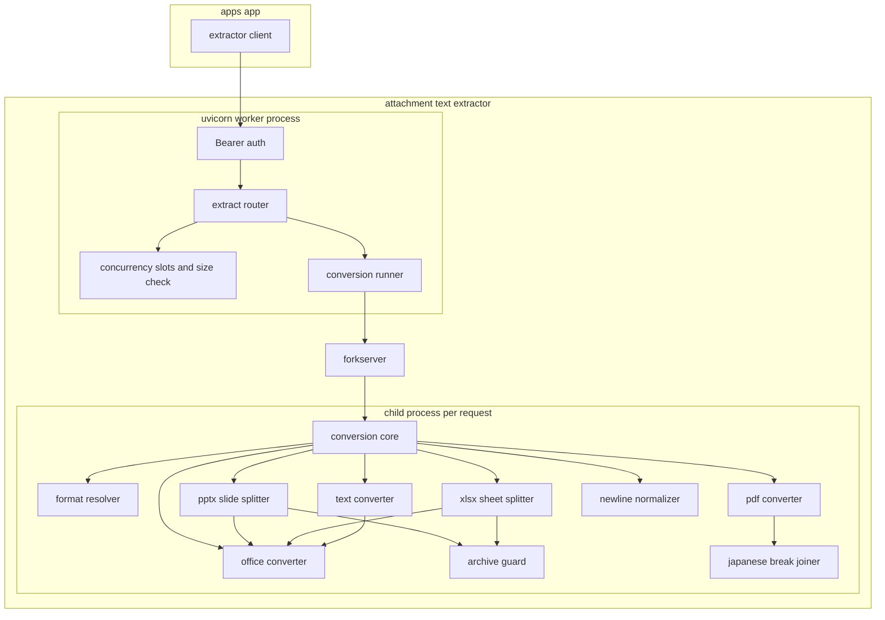
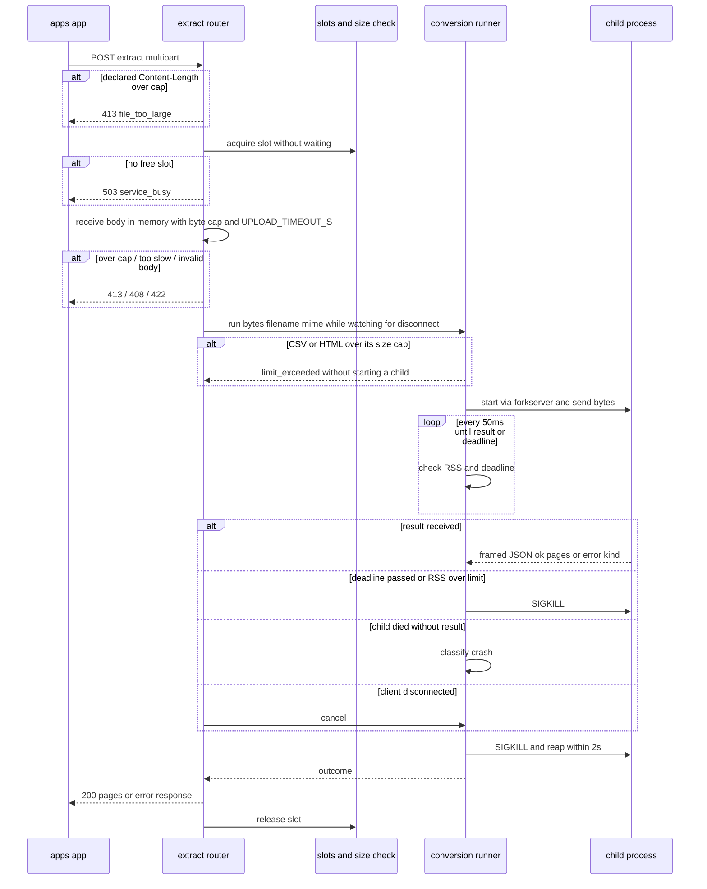
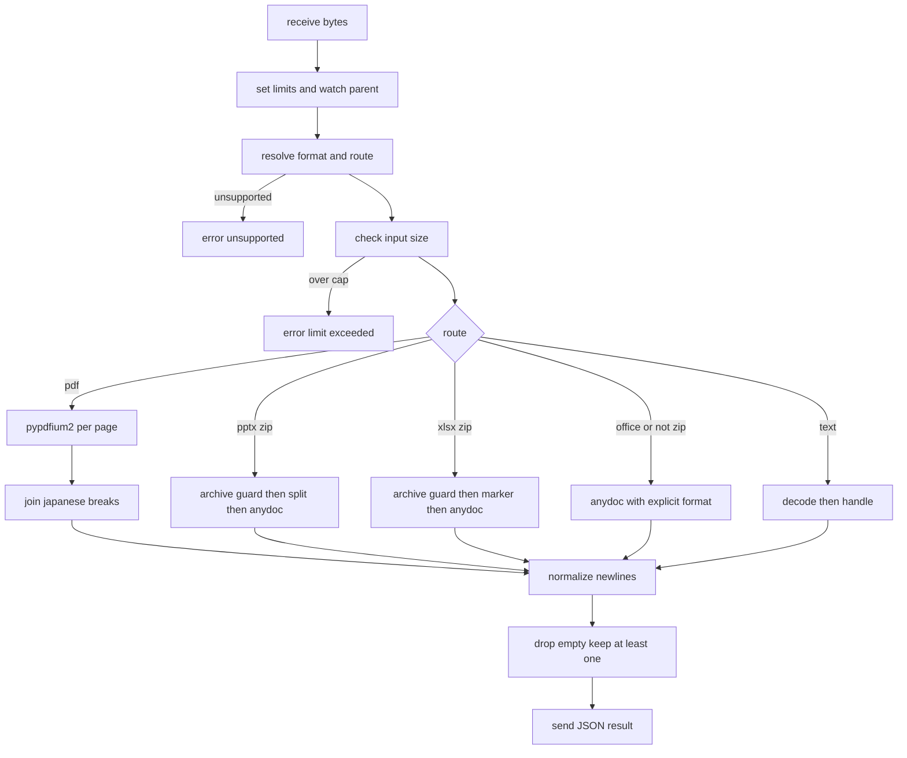

# Technical Design: attachment-search-text-extractor

## Write / Don't-Write Test

**この文書の役割**: 本 spec の設計上の判断を残す場所であり、実装の記録ではない。この機能を次に変える人が、コードとテストファイルだけでは分からない「なぜ今の形なのか」を確かめるために読む。

**判定基準**: 各項目について「コードとテストファイルを読めば、読み手が組み立て直せる内容か」を自問する。組み立て直せるなら、この文書には書かない。

| 書く | 書かない |
|---|---|
| 調べて初めて分かった事実 (anydoc が XLSX を 1 セルあたり約 2.5KB で持つ、Python 3.12 の forkserver は `__main__` を先読みできない、FastAPI の `UploadFile` は枠を取る前に本文を受け取って `TMPDIR` に書き出す、など、コードをさっと読んでも分からない外部ライブラリの挙動) | 関数のシグネチャ、ファイル構成、どのファイルに何があるか |
| 変わった設計を選んだ理由。特に**検討して却下した案とその理由** (スレッド実行・常駐プール・fork 方式・`ProcessPoolExecutor`、シート名の見出しの突き合わせ、非同期の受け付け方式など) | 素直な実装の説明 |
| 自動テストで**捕まえられない**残存ギャップ (k8s の cgroup v2 でのメモリ不足時の止まり方、docker と GitHub 上でしか確かめられない配布物の確認など) | どのテストが何を確かめているかの一覧 (テストファイルを読むほうが確実) |
| コードから組み立て直せない手動確認の手順と、合否の基準値 (RSS の余裕、image の大きさの上限など) | 差分の有無や実装した時期などの経緯 |

**迷ったら書かない。** コードを読めば分かることをここに置くと、コードが変わったときに黙って古くなり、この文書全体の信頼を落とす。

## Overview

本 spec は、GROWI の添付ファイル全文検索のために、添付ファイルのバイト列からテキストを取り出す独立マイクロサービス `services/attachment-text-extractor/` を定義する。apps/app は HTTP (multipart) で `POST /extract` を呼び、ページ・スライド・シート単位に分かれた Markdown テキスト (`pages[]`) を受け取る。

**Purpose**: 形式ごとに適したライブラリで文字を取り出し、日本語の検索に向く形に正規化して返す。悪意あるファイルや重いファイルが来ても、サービス全体と他テナントの抽出を止めない。

**Users**: 直接の利用者は apps/app (下流 spec `attachment-search-indexing`)。運用者は GROWI.cloud の SRE (k8s の共有 Deployment) と OSS の配布者 (docker-compose)。

**Impact**: `services/attachment-text-extractor/` は GROWI の monorepo で初めての Python サービスで、pnpm workspace と turbo の外に置く。API の型 (`ErrorCode`) は下流の生成クライアントと apps/app の分類に直結する (§Revalidation Triggers)。

### Goals

- 対応形式のファイルを、決められた単位 (PDF はページ、PPTX はスライド、XLSX はシート、その他は 1 要素) の `pages[]` で返す (1.1–1.5, 1.8, 1.12)
- 改行コードを揃え、PDF の抽出で日本語の語の途中に入った空白・改行を取り除いて返す (1.9)
- 時間切れ・メモリの使いすぎ・細工されたファイル・異常終了を、その 1 件のエラーとして閉じ込め、変換そのものを確実に止める。CSV / HTML は変換の前に大きさで断り、呼び出し側が切断したら変換を止める (2.1–2.9)
- 外部バイナリと外向き通信なしで、read-only rootfs・非 root の共有 Deployment として動く (1.7, 2.4, 3.1–3.4, 4.1–4.2)

### Non-Goals

- apps/app 側の統合 (TS クライアントの利用、ES への取り込み、失敗ログ、UI) は下流 spec の責務
- 画像の OCR、LLM による補助、音声・動画の文字起こし
- Outlook MSG、ZIP の中身の再帰展開
- 表の構造を保った高精度な PDF 抽出 (Docling 等)

## Boundary Commitments

### This Spec Owns

- `services/attachment-text-extractor/` 配下のすべて: FastAPI アプリ、形式別の変換、日本語の正規化、子プロセスでの実行、設定、テスト、Dockerfile、k8s manifest の例
- HTTP の契約: `POST /extract` (multipart) / `GET /healthz` / `GET /readyz` / `GET /openapi.json` と、Pydantic の型 (`PageInfo` / `ExtractResponse` / `ErrorCode` / `ErrorResponse`)
- `pages[]` の意味の取り決め (単位、`pageNumber` / `label` の付け方、空の要素の扱い、最低 1 要素を返す規則)
- エラーの分類と HTTP ステータスの対応 (§Error Handling)
- OpenAPI の書き出し (`scripts/export_openapi.py` → `packages/attachment-text-extractor-client/openapi.json`)
- docker-compose のエントリ (`infra/docker/compose.yaml`) と、このサービス専用の CI workflow (`.github/workflows/attachment-text-extractor.yml`)

### Out of Boundary

- `packages/attachment-text-extractor-client` の orval 設定と生成物の利用 (下流 spec。書き出す `openapi.json` までが本 spec)
- apps/app 側のエラーの扱い (`ExtractionOutcome` などへの対応づけ) と、失敗時にファイル名だけの文書を登録すること (indexing spec の Req 2.4)
- Elasticsearch・MongoDB への接続 (本サービスは状態を持たない)
- 本番 k8s の実際の manifest の適用と運用 (本 spec は推奨設定を含む例を提供する)

### Allowed Dependencies

- PyPI の `firecrawl-anydoc` (版を固定)、`pypdfium2`、`charset-normalizer`、`defusedxml`、`fastapi`、`uvicorn[standard]`、`python-multipart`、`pydantic`、`pydantic-settings`。いずれも MIT / Apache-2.0 / BSD / PSF の許容的なライセンス
- Python 3.12 の標準ライブラリ (`multiprocessing` の forkserver、`zipfile`、`html.parser`、`resource` など)
- ベースイメージ `python:3.12-slim-bookworm` と、版を固定した uv のイメージ
- テスト専用 (本番の image には入れない): `openpyxl` (MIT)、`python-pptx` (MIT)、`python-docx` (MIT)、`pypdf` (BSD-3)、`msoffcrypto-tool` (MIT)、`xlwt` (BSD)、`PyYAML` (MIT)。テスト用のファイル (複数シート・非表示シートの XLSX、PPTX、暗号化した Office ファイルやパスワード付き PDF、展開すると巨大になるファイル、OpenDocument・RTF・EPUB・XLS) はテストの中で生成し、実在の文書はリポジトリに入れない
- 例外: 旧形式の DOC と PPT は Python だけでは生成できないため、Apache POI のテスト用ファイル (Apache-2.0) から小さなものを選んでテスト用にリポジトリに置き、出典とライセンスを記録する
- 使わないもの: markitdown、pdfminer.six、lxml、LGPL / GPL / AGPL のライブラリ、外部バイナリ、外向き通信 (python-pptx は本番では使わない)

### Revalidation Triggers

次の変更は、下流 (indexing spec と apps/app) の見直しを要する。

- **`ErrorCode` の追加・変更**: `ErrorCode` には `file_encrypted` と `resource_limit_exceeded` がある。apps/app は知らないコードを受け取ると `null` を返し、「抽出サービスに到達できない」と同じ扱いになる (ファイル名だけの文書は登録されるが、理由の表示が誤る)。下流で次の箇所を直す必要がある: 生成されるクライアントの `ErrorCode`、`attachment-text-extractor.ts` の `mapAxiosErrorToOutcome`、`ExtractionOutcome`、`outcomeKindToReasonCode`、`ExtractionFailureReasonCode`、reindex batch の分岐
- **同じコードが複数の HTTP ステータスを持つこと**: `extraction_failed` は、壊れたファイル・不正な本文・切断では 422、想定外の異常では 500 になる。`extraction_timeout` は、本文の受信の期限切れと変換の期限切れの両方で 408 になる。apps/app はステータスではなくコードで分岐しているので今は影響しないが、ステータスで判断する処理を足すときは注意する
- **`pages[]` の規則**: 「最低 1 要素を返す」「中身が空の要素は除く (全部空なら空の 1 要素)」「`pageNumber` に飛びがありうる (XLSX の空シート)」は、下流の検索文書の作り方の前提になる
- **health / readiness の応答**: 形を変えるときは OpenAPI を書き出し直す。apps/app は health / readiness を呼んでいない
- **`label` の中身**: PDF と PPTX の `label` は番号だけの文字列 (例: `"12"`) にし、「スライド」「p.」などの文言は付けない。GROWI は 5 言語に対応しており、文言は UI 側で各言語に合わせて付けるべきだから。attachment-search-ui spec は `label` を「Slide N / Sheet name / Page N」の表示文字列として想定しているので、形式と `pageNumber` から文言を組み立てる形に直す必要がある
- **タイムアウトの順序**: apps/app の `timeoutMs` は、抽出サービス側の最悪の合計 (本文の受信 `UPLOAD_TIMEOUT_S` 15 秒 + 変換 `TIMEOUT_S` 55 秒 + 子の停止と回収 約 4 秒 ≒ 74 秒) より長くする。apps/app が先に諦めると、抽出サービス側の変換が無駄に続く。apps/app の既定は 90000ms にした (2026-11-02 ユーザー判断)。抽出サービス側の既定を変えるときは、apps/app 側の既定も見直す
- **サイズ・時間の上限の既定値**: apps/app 側の `maxFileSizeBytes` / `timeoutMs` と食い違うと、apps/app が待つ前にこちらが打ち切る (またはその逆) ことが起きる

## Architecture

### Architecture Pattern & Boundary Map

採用する形: **受け口 (HTTP) / 実行管理 (親プロセス) / 変換 (子プロセス) の 3 層**。受け口は FastAPI、変換はリクエストごとの子プロセスで行う。選定の理由と不採用の案は research.md の §1〜§3 を参照。親は子の時間とメモリを見張り、必要なら止める。

**主な決定**:
- 変換に関わるもの (anydoc、pypdfium2、ZIP の書き換え、文字コード判定、正規化) は子プロセスの中だけで動く。
- 正規化は 2 段に分ける。改行コードの統一 (CRLF / CR → LF) はすべての経路にかける。日本語の間の空白・改行の詰めは PDF の経路だけにかける。調査で語の途中の切れが見つかったのは PDF の抽出だけで、TXT や DOCX の改行は書き手が入れたものだから (1.9 は「抽出処理によって入った」ものだけを対象にしている)。
- 親 (uvicorn のワーカー) は変換ライブラリを呼ばない
- 子と親の境界は「バイト列と形式を渡し、`pages[]` かエラーの種類を受け取る」だけにする。親は子の結果を JSON として受け取り、pickle は使わない (子が悪意あるファイルに乗っ取られても、親でコードが動かないようにするため)
- 依存の向き: `schemas` / `config` → `conversion` (純粋な変換と正規化。HTTP もプロセスも知らない) → `runner` (子プロセスの管理) → `routers` → `main`。左の層は右の層を import しない
- 同時実行の枠は uvicorn のワーカーごとに持つ。既定はワーカー 1 つとし、`MAX_CONCURRENCY` がそのまま全体の上限になる。変換は子で行われるので、ワーカーが 1 つでも応答は止まらない

## File Structure Plan

コードは `src/app/` の下で 3 つの層に分け、依存は `schemas` / `config` → `conversion` → `runner` → `routers` → `main` の一方向だけにする (左の層は右の層を import しない)。

- `conversion/`: 子プロセスの中でだけ動く純粋な変換。HTTP もプロセスも知らないので、単体テストを子プロセス無しで書ける。PPTX と XLSX の XML 処理は 1 つのモジュールで共有する
- `runner/`: 親プロセス側で、子の起動・監視・停止を受け持つ。Linux だけの設定 (`RLIMIT_*`、`oom_score_adj`) は、他の OS では何もしない形で 1 か所に包む
- `routers/`: 本文の受け取り (枠を取った後、メモリだけで受け取る)、切断の見張り、失敗の種類からエラー応答への表を、それぞれ別のモジュールにする。表は `FailureKind` の全値をキーに持たせて、漏れを型で防ぐ
- 配布物: `deploy/k8s/` は推奨設定を入れた例であり、本番に適用するものではない。docker-compose (`infra/docker/compose.yaml`)、CI (`.github/workflows/attachment-text-extractor.yml`)、書き出した `packages/attachment-text-extractor-client/openapi.json` も本 spec の持ち物
- テストは `tests/conversion/` (変換層)、`tests/runner/` (子プロセス。Linux で動かす)、`tests/` 直下 (HTTP と配布物) の 3 つに分ける

## System Flows

### 抽出の流れ

**主な決定**:
- 枠はファイルを読む前に取り、すぐ取れなければ待たずに 503 を返す (2.3)
- 本文はハンドラーが自分で、枠を取った後にメモリだけで受け取る。FastAPI の `UploadFile` 引数を使うと、枠より先に本文をすべて受信し、1MB を超える部分を `TMPDIR` (小さな tmpfs) に書き出すため (2.1, 2.3)
- 切断は ASGI の `receive()` で `http.disconnect` を待って検知し、変換を取り消して子を kill・回収してから枠を返す (2.9)。`Request.is_disconnected()` は `BaseHTTPMiddleware` を 2 層通すと切断を報告しない
- 親は結果を受け取った場合も含めて、必ず最後に子へ SIGKILL を送り、2 秒を上限に後始末する。子の終了処理が止まっても枠が戻らないことを防ぐ (2.5)
- 結果を待つ間、親はイベントループを止めない (Pipe の読み取りをイベントループに登録して待つ)

### 子プロセスの中の流れ

**主な決定**:
- PPTX と XLSX は「ZIP であり、必要な部品がある」ときだけ書き換えの経路に入れる。暗号化された OOXML や旧形式 (中身は CFB 形式で ZIP ではない) は、形式を明示して anydoc にそのまま渡し、型の付いた例外を受け取る
- 子は `BaseException` まで捕まえて、エラーの種類として親に送る (Rust の panic は `PanicException` という `BaseException` 系の例外で上がるため)

## Components and Interfaces

### HTTP 層

#### ExtractRouter

`POST /extract` を受け、枠 → 本文の受信 (大きさと期限の上限つき) → サイズ → 子での変換の順に通し、結果を `ExtractResponse` かエラー応答に変える (1.1, 2.1, 2.2, 2.3, 2.9, 4.2)。

**責務と制約**
- 認証 → `Content-Length` の早期検査 (上限を超える宣言なら本文を読まずに 413) → 枠を取る (空きがなければ本文を受け取らずに 503) → 本文をメモリに受け取る (届いたバイト数を数えて上限を超えたら 413、`UPLOAD_TIMEOUT_S` を過ぎたら 408) → `enforce_size` → `ConversionRunner.run()` を await する → 結果を応答に変える。変換ライブラリは呼ばない
- FastAPI は引数 (`UploadFile`) を解決する時点で本文をすべて受信し、1MB を超える部分を `TMPDIR` のファイルに書き出す。これでは枠より先に受信が起き、大きさの上限も効かず、小さな tmpfs を満たしてしまうので、ハンドラーが自分で本文を読む。ファイルはメモリにだけ置く (一時ファイルを作らない)。不正な本文 (`file` が無い、multipart でない、ファイルが 2 つ、など) は固定のメッセージで 422 `extraction_failed` にし、受け取った入力は返さない
- 変換を待つ間は呼び出し側の切断を見張り、切断したら変換を取り消す (2.9)
- エラーの種類から `ErrorCode` と HTTP ステータスへの変換は §Error Handling の表に従う
- Bearer 認証はミドルウェアが先に行う

| Method | Endpoint | Request | Response | Errors |
|---|---|---|---|---|
| POST | /extract | multipart: `file` (必須)、`mimeType` (任意の形式の手がかり) | `ExtractResponse` | 400, 401, 408, 413, 422, 500, 503 (§Error Handling) |

#### HealthRouter

k8s の probe 用に生存と準備完了を返す (3.2)。

- `GET /healthz`: プロセスが応答できれば `{"status": "ok"}`
- `GET /readyz`: forkserver が動き、変換の依存を読み込めているときだけ 200 `{"status": "ready", "dependencies": {...}}` を返し、それ以外は 503 `not_ready`。`dependencies` には `anydoc` / `pypdfium2` / `charset-normalizer` と、内部モジュールをまとめた `converter` だけを出す (認証なしで呼べるため)。準備できていない間は `verify()` で確かめ直す。forkserver が起動できなくてもアプリの起動は失敗させず、`/healthz` は 200 のままにする (k8s が再起動を繰り返さないようにするため)
- apps/app はこの 2 つを呼んでいない (確認済み)

#### Limits

- 枠の数はワーカーごと。全体の同時実行数は「ワーカー数 × `MAX_CONCURRENCY`」になる。既定はワーカー 1 つ。空きが無ければ待たずに `service_busy` にする

### Runner 層

#### ConversionRunner

1 リクエストにつき 1 つの子プロセスで変換し、時間・メモリ・異常終了を見張って、必ず結果か失敗の種類を返す (2.2, 2.5, 2.6, 2.7, 2.8)。

**責務と制約**
- 起動時 (FastAPI の lifespan) に forkserver を立ち上げ、変換の依存を forkserver の中で先に読み込んでおく (子を作るたびに読み込み直さないため)
- `run()` は子を作る前に、CSV / TSV と HTML の大きさを判定する (2.8)。変換中に取り消されたら、子を kill・回収してから戻る (2.9)
- 子へは「上限の値」と「依頼元だけが書き込み側を持つ監視用パイプ」を渡し、ファイル本体は別の Pipe に「長さ 4 バイト + 本体」の形でイベントループを止めずに書き込む
- 待っている間、50ms ごとに子の RSS (`/proc/<pid>/status` の VmRSS) と期限を確かめる。期限切れか RSS の上限超えで SIGKILL を送る
- 結果を受け取ったかどうかにかかわらず、最後に SIGKILL を送り、2 秒を上限に子を回収する
- 子からの結果は JSON で受け取り、大きさが `MAX_RESULT_BYTES` を超えたら読み捨てて失敗にする
- Linux の `/proc` で RSS を取る。Linux 以外では RSS の監視を行わない (開発用)
- 呼ぶ前の条件: 呼び出し側が枠を確保し、サイズ検査を済ませている
- 戻った時点の状態: 子プロセスは終了・回収済み。枠の解放は呼び出し側の `async with` で行われる
- 常に成り立つこと: 1 回の `run()` で作る子は 1 つ。親は変換ライブラリを呼ばない

#### ChildEntry

子プロセスの中で、上限を設定し、親を見張り、変換を呼んで結果を 1 回だけ送る (2.5, 2.6, 2.7)。

**責務と制約**
- 起動直後に設定するもの (Linux のみ、他の OS では何もしない):
  - `RLIMIT_AS` (仮想メモリの上限) を「RSS の上限 + 512MB」にする。最後の歯止め
  - `RLIMIT_CPU` (CPU 時間の上限) を「`TIMEOUT_S` + 5 秒」にする。親の SIGKILL が届かない場合の歯止めで、超えると子は SIGXCPU で終わる
  - `oom_score_adj` を 1000 にする。cgroup v1 や docker-compose では、コンテナのメモリが足りなくなったとき、OS が uvicorn より先に子を止めるようになる。ただし k8s (cgroup v2) の既定では `memory.oom.group` が有効で、コンテナが上限に達すると OS はコンテナ内のプロセスをまとめて止めるので、この設定は効かない (uvicorn ごと止まる)。メモリの主な守りは、親の RSS 監視で上限の手前で止めることである
  - `RLIMIT_CORE` を 0 にする。SIGXCPU・abort・segfault の既定の動作はコアダンプで、コアの渡し先がホスト側の処理 (`core_pattern` の先頭が `|`) だと、コンテナの rootfs を読み取り専用にしても防げず、利用者のファイルの中身がホストのディスクに残るため
- 監視用パイプを見張るスレッドを 1 つ立て、パイプが閉じた (依頼元のワーカーが落ちた) ら `os._exit` で終わる。CPython の非公開属性には頼らない
- `ConversionCore.convert()` を呼び、`BaseException` まで捕まえて失敗の種類に変える (`SystemExit` / `KeyboardInterrupt` は投げ直す)

### Conversion 層 (子プロセスの中だけで動く)

#### ConversionCore

形式を決め、経路ごとの変換を呼び、正規化と空要素の規則をかけ、例外を失敗の種類に分類する (1.1–1.12)。

- 改行コードの統一 (`normalize_newlines`) は全経路の結果の各要素にかける。日本語の間の詰め (`join_broken_japanese`) は PdfConverter の中でだけかける
- 正規化の後に中身が空の要素は除く。全部が空なら `PageInfo(pageNumber=None, label=None, content="")` の 1 要素を返す。下流は要素ごとに検索文書を作り、ファイル名だけの文書は失敗時にしか作らないため、空の配列を返すと添付がファイル名でも見つからなくなる
- 結果の合計の大きさが `MAX_RESULT_BYTES` を超えたら `result_too_large` にする

#### FormatResolver

- 形式の決め方: `mime_hint` が対応表にあればそれを使い、なければ拡張子から決める。どちらも対応表になければ `unsupported` (1.6)
- 対応表 (経路と anydoc に渡す形式名):

| 形式 | MIME (代表) / 拡張子 | 経路 | anydoc の形式名 |
|---|---|---|---|
| PDF | `application/pdf` / .pdf | pdf | — |
| PPTX | presentationml / .pptx | pptx | `pptx` |
| XLSX | spreadsheetml / .xlsx | xlsx | `xlsx` |
| DOCX | wordprocessingml / .docx | office | `docx` |
| RTF / EPUB | `application/rtf` / .rtf、`application/epub+zip` / .epub | office | `rtf` / `epub` |
| 旧形式 DOC / PPT | `application/msword` / .doc、`application/vnd.ms-powerpoint` / .ppt | office | `doc` / `ppt` |
| 旧形式 XLS | `application/vnd.ms-excel` / .xls | office | `xlsx` (anydoc は XLS をこの名前で扱う) |
| OpenDocument | odt / ods / odp | office | `odt` / `ods` / `odp` |
| CSV / TSV | `text/csv` / .csv、`text/tab-separated-values` / .tsv | text → office | `csv` |
| HTML | `text/html` / .html .htm | text | — |
| XML | `text/xml` `application/xml` / .xml | text | — |
| ipynb | `application/x-ipynb+json` / .ipynb | text | — |
| TXT / MD / LOG / JSON / YAML | `text/plain` `application/json` `text/yaml` など / .txt .md .log .json .yaml .yml | text | — |

- Outlook MSG (`application/vnd.ms-outlook` / .msg) は対応表から外す (1.6 で `unsupported`)
- 旧形式 DOC / PPT / XLS と OpenDocument は、anydoc がシート見出しなどを出しても分割せず 1 要素で返す (1.8)
- 形式の手がかりは MIME が拡張子より優先なので、`.csv` に `application/vnd.ms-excel` が付くと XLS の経路に入り `malformed` になる (Windows のブラウザは CSV にこの MIME をよく付ける。既知の制約)

#### OfficeConverter

- `anydoc.to_markdown_bytes(data, format)` を、形式を必ず明示して呼ぶ。`ocr` 引数は渡さない (既定の `reject` のまま。`hosted` は文書を外部に送るため 1.7 に反する)
- 例外の分類: `EncryptedError` → `encrypted`、`ResourceLimitError` → `limit_exceeded`、`MalformedError` / `MissingPartError` → `malformed`、`UnsupportedError` → `unsupported`、`PanicException` とその他 → `internal`
- 版を固定する。版を上げるときは契約テスト (§Testing) を通す

#### PptxSlideSplitter

- 前提: ArchiveGuard を通り、ZIP で `ppt/presentation.xml` があること。満たさなければ OfficeConverter に `pptx` としてそのまま渡す (暗号化されていれば `encrypted` になる)
- `presentation.xml` と関係ファイル (`.rels`) を defusedxml で解析し、スライドの並び順を得る。正規表現では書き換えない
- スライドごとに、スライド一覧をその 1 枚だけにした `presentation.xml` と、そのスライドが参照する XML 部品だけを入れたパッケージを作り、anydoc に渡す。画像などの XML 以外の部品は入れない
- `pageNumber` はスライドの順番 (1 始まり)、`label` はその番号の文字列 (例: `"3"`)。文言は UI 側で付ける
- anydoc の出力から、PowerPoint が自動で付ける代替テキスト (「AI 生成コンテンツは誤りを含む可能性があります」などの決まった文) と、改行の印として出る行末の `\` を取り除く

#### XlsxSheetSplitter

- 前提: ArchiveGuard を通り、ZIP で `xl/workbook.xml` があること。満たさなければ OfficeConverter に `xlsx` としてそのまま渡し、1 要素で返す
- **セル数の事前検査 (2.6)**: anydoc は XLSX を表全体の形でメモリに持つため、1 セルあたり約 2.5KB を使い、待機中の子 (約 80MB) に加えて 1 シート 10 万行 × 1 列で 328〜357MB、7 万行 × 1 列で約 285MB になる。anydoc に渡す前に、`.rels` 以外のすべての部品を先頭から少しずつ読んで `<c` タグ (セル) の数を数え (anydoc は `workbook.xml.rels` のリンク先でシートを探すので、パスや拡張子で絞ると、サブディレクトリ・`..`・大文字の拡張子・パッケージ直下に置いたシートで検査をすり抜けられる)、合計が `MAX_XLSX_CELLS` (既定 7 万) を超えたら `limit_exceeded` にする。数えるときは XML を解析せず、読み込みの大きさも 1 回あたり一定にするので、メモリはほとんど使わない。この上限を超える大きな XLSX は検索の対象にならない (下流でファイル名だけの文書になる)
- `xl/workbook.xml` を defusedxml で解析し、各シートの名前を `ZZ<リクエストごとの乱数><連番>ZZ` に置き換え、非表示のシートを表示状態に戻したブックを作って、anydoc を 1 回だけ呼ぶ
- 出力を `## 目印` の行で切り、目印から元のシート名に戻す (元の名前は XML の文字参照を戻してから使う)
- `pageNumber` は workbook.xml でのシートの順番 (1 始まり。非表示・空・グラフのシートも数える)、`label` は元のシート名。空のシートは返さないので番号が飛ぶことがある。非表示のシートは含める
- シートが 1 枚だけのブックでは、anydoc は見出しを出さない。このときは出力全体を 1 要素とし、`pageNumber=1`、`label` を workbook.xml のシート名にする
- 空のシートとグラフだけのシートは目印が出力に現れないが、そもそも返さないシートなので問題にしない
- 次のどれかに当たるときだけ、ブック全体を 1 要素 (`pageNumber` / `label` は null) で返し、警告をログに残す: 置き換えていない目印が出てくる、目印の順番が workbook.xml の順番と食い違う、最初の目印より前に空でないテキストがある (シートが 2 枚以上のとき)
- 書き換えた ZIP を作るときは、XML として解析する部品 (workbook.xml など) 以外を丸ごと読まず、少しずつコピーする。ピボットキャッシュのように、セル数の検査が数えない大きな部品があるため (丸ごと読むと、15MB の XLSX で 403MB になり RSS の上限を超えた)

#### PdfConverter

- pypdfium2 でページごとに文字を取り出す。`pageNumber` はページ番号 (1 始まり)、`label` はその番号の文字列 (例: `"12"`)。文言は UI 側で付ける
- 取り出したテキストの改行を LF に揃えてから、`join_broken_japanese` で日本語の文字に挟まれた 1 文字分の半角空白・改行を詰める (1.9)
- 開くときにパスワードを求められる PDF (`PdfiumError` の err_code 4 / 5) は `encrypted` (1.10)。オーナーパスワードだけの PDF は普通に開けるので抽出する (1.12)
- 開けない PDF (err_code 0 / 1 / 2 / 3) は `malformed` (1.11)。PDFium が修復して読める場合はそのまま抽出する
- ページ数が `MAX_PDF_PAGES` を超えたら `limit_exceeded` (2.6)
- 画像だけの PDF は例外にならず、全ページの文字数 (`count_chars()`) が 0 になる。ConversionCore の空要素の規則で 1 要素になる

#### TextConverter

- 文字コードは CharsetDecoder でデコードする
- HTML: 標準の `html.parser` を使い、`script` / `style` / `template` / `noscript` / `svg` の中身を捨て、ブロック要素で改行を入れてテキストにする。文字コードは先頭の `<meta charset>` を優先する
- XML: DOCTYPE を取り除いてから、タグを取り除いたテキストを返す。XML として解析しないので、エンティティの展開による膨張攻撃を受けない
- ipynb: JSON として読み、セルの `source` と、テキストの出力 (`stream`、`text/plain`) を取り出す。画像の base64 は捨て、出力 1 つあたりの文字数に上限を設ける。JSON として読めなければテキストとして返す
- TXT / MD / LOG / JSON / YAML: デコードしたテキストをそのまま返す (JSON / YAML は解析しない。深い入れ子や YAML のエイリアスの展開による膨張を避けるため)
- CSV / TSV: デコードして UTF-8 にしてから OfficeConverter に `csv` として渡す (区切り文字は anydoc が判定する)

#### ArchiveGuard

- `zipfile.is_zipfile` と、経路に必要な部品 (`ppt/presentation.xml` / `xl/workbook.xml`) の有無を確かめる
- `infolist()` でエントリ数と、申告された展開後サイズの合計を検査し、`MAX_ARCHIVE_ENTRIES` / `MAX_ARCHIVE_UNCOMPRESSED_MB` を超えたら `limit_exceeded`。CPython は申告されたサイズを超えて展開しない (超えると CRC エラー) ことを確認しているので、申告値の検査で足りる
- 部品を読むときも 1 部品あたりの上限を設ける

#### TextNormalizer

- 改行の統一 (`normalize_newlines`、CRLF / CR → LF) は全経路にかける。日本語の間の詰め (`join_broken_japanese`) は PDF の経路だけにかける。どちらも入出力が文字列だけの純粋関数
- `join_broken_japanese` の対象は、日本語の文字 (ひらがな・カタカナ・漢字・々・ー) に挟まれた 1 文字分の半角空白と、1 つだけの改行。全角空白 (書き手が入れたもの) と、2 つ以上続く改行 (段落の区切り) は残す
- TXT / DOCX / PPTX などの経路には `join_broken_japanese` をかけない。これらの改行や空白は書き手が入れたものだから

#### CharsetDecoder

- 試す順: BOM → 宣言 (HTML の meta) → 厳密な UTF-8 → 候補を `cp932` / `euc_jp` / `iso2022_jp` / `cp1252` に絞った charset-normalizer → cp932 → latin-1
- 候補を絞らずに charset-normalizer を使うと、短い Shift_JIS を big5 と誤判定するため、候補を絞る
- BOM のない UTF-16 は判定できない (既知の制約)

## Data Models

### Data Contracts & Integration

**`ExtractResponse`**

| 項目 | 型 | 説明 |
|---|---|---|
| `pages` | `list[PageInfo]` | 最低 1 要素。単位は形式による (§FormatResolver) |
| `mimeType` | `str` | 判定に使った MIME |
| `extractedCharacters` | `int` | 全要素の `content` の文字数の合計 |

**`PageInfo`**

| 項目 | 型 | PDF | PPTX | XLSX | その他 |
|---|---|---|---|---|---|
| `pageNumber` | `int \| None` | ページ番号 (1 始まり、空のページは除くので飛びうる) | スライドの順番 | workbook.xml での順番 (飛びうる。1 シートなら 1) | null |
| `label` | `str \| None` | 番号の文字列 (`"12"`) | 番号の文字列 (`"3"`) | 元のシート名 | null |
| `content` | `str` | 改行を揃え、日本語の間を詰めたテキスト | 改行を揃えたテキスト | 同左 | 同左 |

`label` には言語に依存する文言を入れない。「スライド」「p.」などの文言は UI 側で付ける。

**`ErrorCode`**: `unauthorized` / `unsupported_format` / `file_too_large` / `extraction_timeout` / `service_busy` / `extraction_failed` / `file_encrypted` (1.10) / `resource_limit_exceeded` (2.6)

**親子間の受け渡し**: 親から子へはファイル本体を、子から親へは結果を、それぞれ「長さ 4 バイト + 本体」の形で Pipe に 1 回だけ送る。結果は JSON で、pickle は使わない (子が悪意あるファイルに乗っ取られても、親でコードが動かないようにするため)

## Configuration

| 環境変数 | 既定値 | 意味 |
|---|---|---|
| `ATTACHMENT_EXTRACTOR_SERVICE_TOKEN` | (必須) | Bearer トークン |
| `WORKERS` | 1 | uvicorn のワーカー数 |
| `MAX_CONCURRENCY` | 3 | ワーカーごとの同時変換の数。全体の上限はワーカー数 × この値 (ワーカー 1 つならこの値がそのまま全体の上限) |
| `MAX_FILE_SIZE_MB` | 50 | 受け付けるファイルの大きさの上限 |
| `UPLOAD_TIMEOUT_S` | 15 | 本文を受け取り終えるまでの時間の上限。超えたら 408 (`extraction_timeout`)。50MiB なら毎秒約 3.4MB 以上の転送が要る。変換の `TIMEOUT_S` とは別に数える |
| `TIMEOUT_S` | 55 | 1 件の変換の時間の上限。ファイルの受け取り (`UPLOAD_TIMEOUT_S` 15 秒) と後始末 (最大約 4 秒) を足した最悪の合計 (約 74 秒) が、apps/app の `timeoutMs` (既定 90000) に収まるようにする |
| `MAX_CHILD_RSS_MB` | 320 | 1 件の変換に許す RSS の上限。XLSX 以外の最悪値 (画像の多い 40MB の DOCX / PPTX で 188MB、50MB なら約 225MB の見込み) に余裕を持たせた値 |
| `MAX_XLSX_CELLS` | 70000 | XLSX の全シートのセル数の合計の上限。anydoc で 1 シート 7 万セルは約 285MB で、`MAX_CHILD_RSS_MB` に収まる (10 万セルは 328〜357MB で収まらない) |
| `MAX_RESULT_BYTES` | 16777216 (16MiB) | 1 件の結果 (全要素の合計) の上限 |
| `MAX_CSV_BYTES` | 8388608 (8MiB) | CSV / TSV のファイルサイズの上限。子を作る前に判定する。バイト数だけを見る早めの拒否で、通ることの保証ではない |
| `MAX_HTML_BYTES` | 20971520 (20MiB) | HTML のファイルサイズの上限。子を作る前に判定する |
| `MAX_PDF_PAGES` | 5000 | PDF のページ数の上限 |
| `MAX_ARCHIVE_ENTRIES` | 10000 | PPTX / XLSX の ZIP のエントリ数の上限 |
| `MAX_ARCHIVE_UNCOMPRESSED_MB` | 512 | ZIP の申告された展開後サイズの合計の上限 (anydoc の組み込み上限と同じ値) |
| `LOG_LEVEL` | INFO | ログの細かさ。起動時に検査し、`app` ロガーに標準エラーへの出力先を 1 つだけ付ける (uvicorn は `app.*` のロガーに出力先を付けないため) |

Dockerfile で固定する環境変数:
- `RAYON_NUM_THREADS=1`: anydoc 内部のスレッドプールを 1 本にする。設定しないとコア数ぶんのスレッドが立ち、仮想メモリのピークが 1.2GB に達した
- `TMPDIR=/tmp`: forkserver は `$TMPDIR` の下に UNIX ソケットを作る。パスは 108 バイト未満でなければならない

**メモリの守り方**: 主な守りは、子が実際に使ったメモリ (RSS) を `MAX_CHILD_RSS_MB` で止めること。入力の大きさとメモリの関係は形式と中身でばらつくため。そのうえで、メモリの使い方が極端に重い形式だけ、変換の前に早く断る。CSV / TSV は `MAX_CSV_BYTES` (8MiB)、HTML は `MAX_HTML_BYTES` (20MiB) を超えたら、子プロセスを作らずに `limit_exceeded` を返す (`check_input_size`。親の `ConversionRunner.run()` と変換層の両方で同じ判定を使う)。ただしこれはバイト数だけを見る早めの拒否で、通ることの保証ではない: anydoc のメモリはバイト数でなくセルの数で決まり (約 100 万セルで 320MB を超える)、1 文字のセルだけの CSV は 2MiB でも上限を超えて RSS 監視で止まる。HTML も、属性が異常に多いタグなどの 4MB で数百 MB を使うことがあり、サイズ上限では防げないので RSS 監視は残す。ただし XLSX だけは、anydoc がセル数に比例してメモリを使い (1 セルあたり約 2.5KB)、小さなファイルでも上限を大きく超えるので、変換の前に `MAX_XLSX_CELLS` でセル数を検査して、上限に当たる前に分かりやすいエラーにする。旧形式の XLS と ODS はセル数を数えずに anydoc に渡し、大きなものは RSS の上限で止まる。

**メモリ上限の目安**: コンテナのメモリ上限 ≒ ワーカー数 × 120MB + ワーカー数 × `MAX_CONCURRENCY` × (`MAX_CHILD_RSS_MB` + 100MB + アップロード 2 × `MAX_FILE_SIZE_MB` + 結果 16MiB × 3)。アップロードは一時ファイルを作らずメモリにだけ置き、解析中だけ約 2 倍の大きさになる。既定 (ワーカー 1・枠 3・RSS 320MB) で 120 + 3 × (320 + 100 + 100 + 48) ≒ 約 1.8GB (3 件 × 50MB を同時に送ったときのワーカーの最大 RSS の実測は 263MiB)。k8s の例では requests 512Mi / limits 2Gi とする。

## Error Handling

### Error Strategy

変換の失敗はすべて「その 1 件のエラー応答」に閉じ込める。親 (uvicorn のワーカー) は変換ライブラリを呼ばないので、変換の異常で落ちない。

### Error Categories and Responses

| 検出のしかた | 失敗の種類 | ErrorCode | HTTP |
|---|---|---|---|
| Bearer トークンがない・違う | — | `unauthorized` | 401 |
| 枠が空いていない | — | `service_busy` | 503 |
| ファイルの大きさが `MAX_FILE_SIZE_MB` を超える (宣言された `Content-Length` か、受け取ったバイト数で判定) | — | `file_too_large` | 413 |
| 本文を `UPLOAD_TIMEOUT_S` 以内に受け取り終えられない | — | `extraction_timeout` | 408 |
| 本文の形が不正 (`file` が無い・テキストの欄で届いた・multipart でない・ファイルが 2 つ以上・部品ヘッダーが約 4KiB 超) | — | `extraction_failed` | 422 |
| 変換中・受信中に呼び出し側が接続を切った | — | `extraction_failed` | 422 (読み手はいない。ログは `client_disconnected`) |
| 対応表にない形式、anydoc の `UnsupportedError` | `unsupported` | `unsupported_format` | 400 |
| anydoc の `EncryptedError`、pypdfium2 の `PdfiumError` (err_code 4 / 5) | `encrypted` | `file_encrypted` | 422 |
| anydoc の `MalformedError` / `MissingPartError`、pypdfium2 の `PdfiumError` (err_code 0 / 1 / 2 / 3) | `malformed` | `extraction_failed` | 422 |
| anydoc の `ResourceLimitError`、ArchiveGuard の上限、`MAX_PDF_PAGES` の超過、`MAX_XLSX_CELLS` の超過、`MAX_CSV_BYTES` / `MAX_HTML_BYTES` の超過 (子を起動する前に親が判定) | `limit_exceeded` | `resource_limit_exceeded` | 422 |
| 親の RSS 監視で止めた | `memory_exceeded` | `resource_limit_exceeded` | 422 |
| 結果が `MAX_RESULT_BYTES` を超えた | `result_too_large` | `resource_limit_exceeded` | 422 |
| 期限を過ぎて親が止めた、子が `RLIMIT_CPU` を超えて SIGXCPU で終わった | `timeout` | `extraction_timeout` | 408 |
| 結果を送る前に子が終わった (abort、segfault、OS のメモリ不足による強制終了を含む) | `crashed` | `extraction_failed` | 500 |
| 子の中の想定外の例外 (`PanicException` を含む) | `internal` | `extraction_failed` | 500 |

- 応答の `message` には失敗の種類と短い説明を入れ、ファイルの中身は含めない
- OS (cgroup) のメモリ不足で子が止められた場合は `crashed` と区別できない (§Open Questions / Risks)

### Monitoring

- 1 件ごとに、形式・大きさ・所要時間・結果 (成功 / 失敗の種類。変換に入る前の `service_busy` / `file_too_large` / `upload_timeout` / `invalid_upload` / `client_disconnected` を含む)・子の最大 RSS をログに出す。ファイル名・中身・Authorization ヘッダは出さない
- 1 件ごとのログは `extract format=… size=… duration_ms=… result=… child_peak_rss_mb=…` の 1 行。JSON の構造化ログは本 spec の範囲外とする

## Testing Strategy

- 変換層は純粋関数として子プロセス無しで単体テストする。anydoc の文書化されていない挙動 (PPTX の分割、XLSX の目印、XLS の形式名、例外の型) は、版を固定した契約テストに集める。**anydoc の版を上げるときは、このテストが通ることを条件にする**
- 子プロセスのテスト (Linux) は、時間切れ・RSS 超過・異常終了 (abort / segfault)・ワーカーの消失・結果の上限を、本物の forkserver で起こす。時間の期限は `TIMEOUT_S` (整数) とは別の小数の引数で渡す
- HTTP の結合テストは本物の lifespan と runner を通す。本文の受信の確かめは、本物の uvicorn を別プロセスで起動し、`TMPDIR` を小さな tmpfs (`/dev/shm`) に向けて行う。forkserver はプロセスに 1 つなので、複数のアプリを同時に動かさない
- **既定の上限での余裕 (基準値)**: 7 万セル 1 シートの XLSX が子の最大 RSS 285MB (上限 320MB の 89%)、画像 12 枚の 48MB の DOCX が 281MB (88%)。テストは上限の 0.95 倍までを許す。環境差でテストが不安定になったら、まずこの許容を見る。時間切れのテストは、約 0.47 秒かかる 5 シート × 1 万 4 千行の XLSX を期限 0.2 秒で止める (余裕は約 2.3 倍)
- **自動では確かめられず、人が確かめること (8.1 / 8.3 / 9.2)**: (1) image がビルドでき、大きさが 400MB 以下。(2) read-only rootfs・uid 10001・`--network none` で起動して `/readyz` が ready を返す。(3) PDF と DOCX の `POST /extract` が 200 を返す。(4) GitHub 上で workflow を、trigger の `paths` に合うブランチで実行し、`gh api repos/<org>/<repo>/actions/runs/<id>/jobs` でジョブ数が 0 より多く、全ステップが成功していること (0 ジョブの実行は成功とみなさない)。コマンドは `services/attachment-text-extractor/CLAUDE.md` の「Container Deployment」にある

## Security Considerations

- **信頼できない入力**: すべての変換は子プロセスで行い、親は結果を JSON として受け取るだけにする。子の中で変換ライブラリに不具合があっても、親でコードが動くことはない
- **細工ファイル**: anydoc の組み込み上限 (展開量・入れ子の深さ・ノード数)、ArchiveGuard、`MAX_PDF_PAGES`、RSS の上限、時間の上限で多重に守る
- **XXE と実体参照の膨張**: XML の書き換えは defusedxml で行い、XML のテキスト化は解析せずにタグを取り除く。起動時に `defusedxml.defuse_stdlib()` をかける
- **外向き通信**: anydoc の `ocr='hosted'` を使わない (文書全体を外部に送るため)。k8s では NetworkPolicy で遮断する
- **コンテナ**: 非 root (uid 10001)、read-only rootfs、capabilities をすべて外す、`allowPrivilegeEscalation: false`、seccomp `RuntimeDefault`、`/tmp` はサイズ上限つきの tmpfs。共有メモリ (`/dev/shm`) は使わない
- **認証**: Bearer トークンを `hmac.compare_digest` で比べる。ログにトークンを出さない
- **トークンの受け渡し**: サービスのトークンは、lifespan で forkserver を起動する前に `os.environ` から消す (消さないと forkserver とすべての子に引き継がれる)。起動後に `Settings()` を読み直してはいけない

## Performance & Scalability

- 子プロセスを作る上乗せは 1 回あたり約 29ms。Python 3.12 では forkserver に `__main__` を先読みさせられず、子を作るたびに uvicorn の起動スクリプトを読み直すため (何も読まないスクリプトなら約 7ms)。大きな変換は数秒かかるので、そのままにしている
- 待機時のメモリは、変換の依存を読み込んだ forkserver を含めて 1 ワーカーあたり約 120MB を見込む (anydoc + pdfium の読み込みで約 35MB)
- スケールは k8s の HPA で Pod 数を増やす。1 Pod の中の同時実行数は `MAX_CONCURRENCY` で固定する

## Open Questions / Risks

- **接続が切れたときの中止の限界**: 変換中に呼び出し側が切断すると、ASGI の `receive()` で `http.disconnect` を待つタスクが検知し、変換を取り消して子を kill・回収し、枠を返す (`routers/client_disconnect.py`。`Request.is_disconnected()` は `BaseHTTPMiddleware` を 2 層通すと切断を報告しない)。1 つの接続に 2 件続けて送ってから切断すると、uvicorn は最新の 1 件にだけ切断の印を付けるので、先の 1 件は最後まで動く (切断を検知できない従来の動きと同じ)。
- **OS のメモリ不足**: cgroup のメモリ上限で子が止められると `crashed` と区別できない。k8s (cgroup v2) の既定では `memory.oom.group` によりコンテナごと止まるので、親の RSS 監視で上限の手前で止めることが唯一の実効的な守りになる。3 件同時の CSV / HTML で、プロセス全体の合計は最大約 1.35GB (2Gi の上限に対して、普通の負荷では余裕がある)
- **ワーカーが複数のときの偏り**: ワーカーを 2 つ以上にすると、OS が接続を振り分けるため、片方が 503 を返しているのにもう片方に空きがあることがありうる。既定をワーカー 1 つにする理由の 1 つ
- **anydoc の文書化されていない挙動**: PPTX の分割 (参照を外したスライドを含むパッケージの受け付け) と XLSX の目印方式は、anydoc の現在の挙動に頼る。版を固定し、契約テストで検知する。通らなくなったときの予備は python-pptx (PPTX) と、XLSX を 1 要素で返すこと
- **anydoc の rayon スレッド内での panic**: Rust のスレッドプールの中で panic すると abort になり、`crashed` に分類される。`RAYON_NUM_THREADS=1` でも起こりうる
- **将来の一本化**: anydoc がページ・スライドの区切りを返すようになれば (上流の未マージのブランチ `feat/pdf-pages`)、pypdfium2 と PPTX の分割をなくせる。取り込まれた時点で見直す
- **固まった forkserver**: forkserver が生きたまま固まる (SIGSTOP など) と、`/readyz` は前回の「準備完了」を返し続け、`/extract` は子の起動の期限 (10 秒) の後に 500 `crashed` になる。その後 forkserver を立て直すので、次の `/readyz` で回復する。直すなら `/readyz` で毎回 `verify()` を呼ぶ (約 5ms。ただし認証なしの `/readyz` が毎回子を 1 つ作る) か、結果を短い時間だけ持つ。今は直していない
- **CPU 時間の hard 上限が低い環境**: soft と hard が同じ値になり、SIGXCPU より先に SIGKILL が届いて、時間切れが `crashed` に分類される (珍しい配備だけ)
