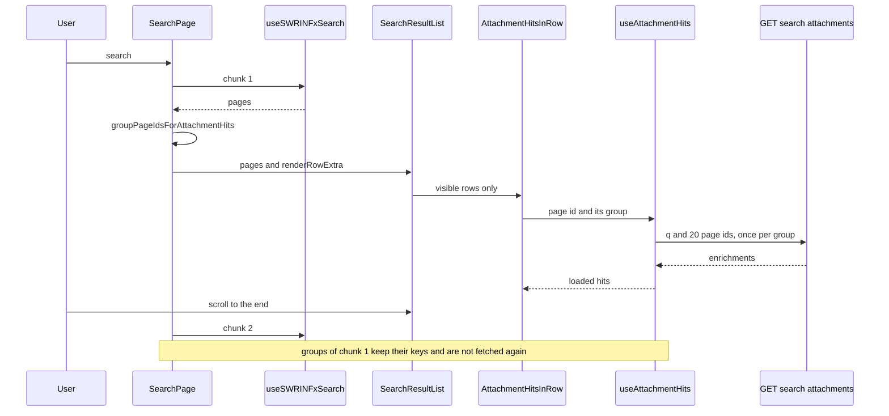
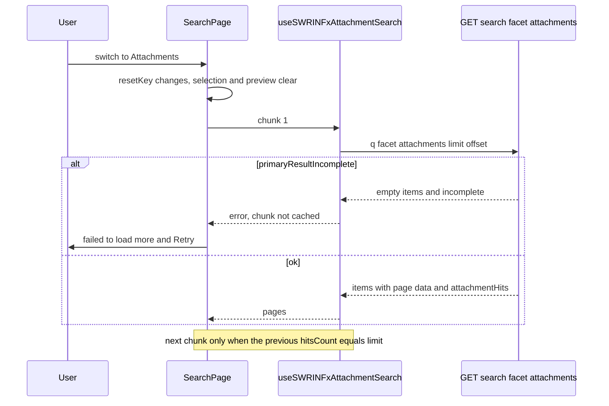
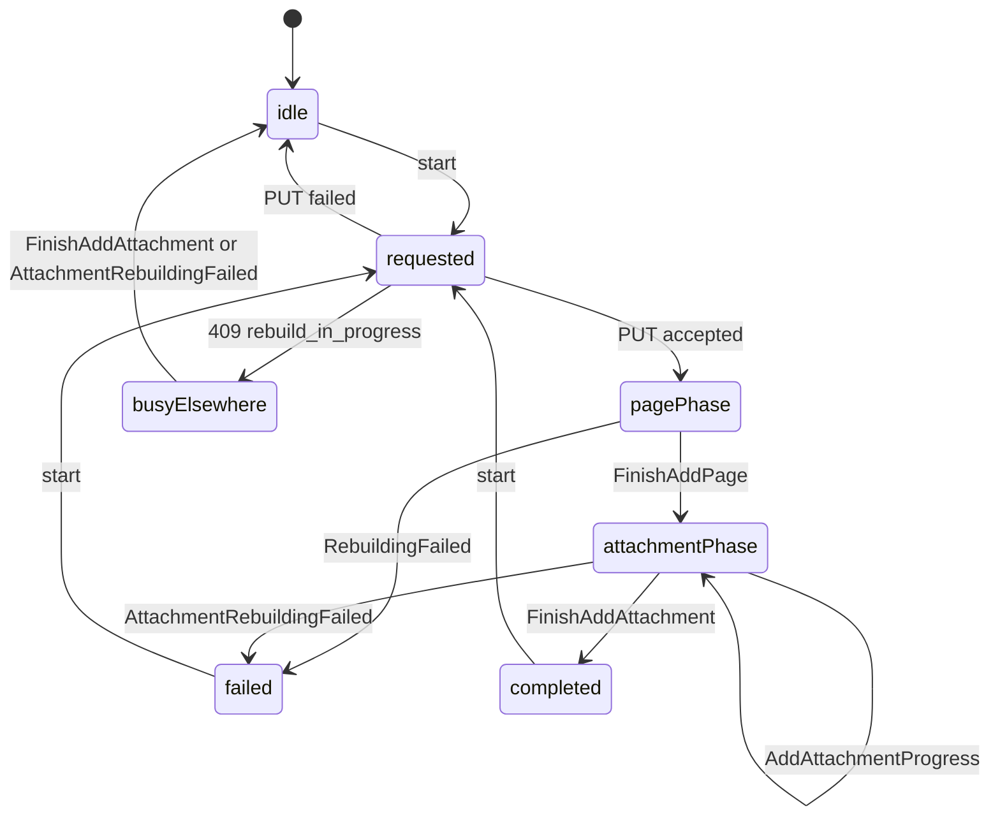

# Technical Design

## Overview

本 spec は、添付ファイル全文検索のクライアント側の画面を担う。上流 `attachment-search-indexing` が提供する検索 API・管理用 API・Socket.io のイベント・SSR prop を使い、検索結果画面、添付ファイル一覧モーダル、管理画面の 3 か所を拡張する。

**Purpose**: 添付ファイルの本文に一致したことを、利用者が検索結果画面で分かるようにし、管理者が設定・作り直し・失敗の確認を画面から行えるようにする。

**Users**: GROWI の利用者 (検索結果画面で添付の一致を見つけ、添付を開く)、GROWI の管理者 (抽出サービスの設定、添付を含む作り直し、抽出の失敗の確認)。

**Impact**: 既存の検索結果画面に「ページ」と「添付ファイル」の検索対象の切り替えを加え、ページ検索の結果のページに添付の一致を後から付け足す。既存部品 (`PageListItemL`・`SearchResultContent`・`@growi/ui` の `Attachment`) には外から中身を渡す差し込み口 (slot) の prop を 1 つずつ足すだけにし、添付の処理は feature module `features/search-attachments/client/` に置く。機能が無効のときは、既存の画面は導入前と同じに表示される。

### Goals

- ページ検索の結果を待たせずに表示し、表示中のページの添付ヒットを 20 ページずつ後から取得して付け足す。取得中・取得失敗・ヒットなしを区別して扱う
- 「添付ファイル」を対象にした検索で、本文が一致しないページの添付も探せるようにする
- 添付ファイル一覧モーダルから 1 件ずつ再抽出でき、結果と失敗の理由が分かる
- 管理画面で、抽出サービスの設定 (自前の運用では編集、環境変数で固定された環境では読み取り専用)、添付を含む作り直しと進み具合、抽出の失敗の一覧を扱える
- 機能が無効のとき、追加した表示と要求が 1 つも出ない

### Non-Goals

- サーバ側の API・ES 連携・Config の永続化 (上流 `attachment-search-indexing`)。ただし、本 spec が必要とする 2 つの追加 (下の「上流に追加する契約」) は上流の作業として依頼する
- 抽出サービス本体 (`attachment-search-text-extractor`)
- 添付ビューア本体の変更、PDF のインラインプレビュー、抽出した全文のプレビュー
- 形式別の詳細な絞り込み、選択した添付だけの再インデックス
- ページと添付の点数を混ぜた順位
- 本文で使われていない添付 (添付一覧の「In Use」が付かない添付) の区別 (上流 research.md 13)
- 管理画面で `requiresReindex` を常に表示する通知 (要件に無い)

## Boundary Commitments

### This Spec Owns

- `apps/app/src/features/search-attachments/client/` 配下の画面部品・SWR の hook・Jotai の atom・純粋関数
- 既存の検索結果画面 (`SearchPage` / `SearchPageBase` / `SearchResultList` / `SearchResultContent`) と行の部品 (`PageListItemL`) への差し込み口の追加と、検索対象の切り替えの配線
- `@growi/ui` の `Attachment` への追加の操作ボタンの差し込み口の追加と、添付ファイル一覧 (`PageAttachmentList`) での再抽出ボタンの配置
- 管理画面 (`ElasticsearchManagementPage` / `ElasticsearchManagement`) への設定の区画・作り直しの選択と進み具合・抽出の失敗の区画の追加
- 機能が有効かどうかを表す atom `isAttachmentFullTextSearchEnabledAtom` と、その値の注入 (基本レイアウト)
- 追加する画面の文言の i18n キー (5 言語すべて。翻訳もこの spec の中で行う)

### Out of Boundary

- サーバ側の API の実装と応答の形 (上流)。本 spec は上流の契約を使うだけで、サーバのコードを変えない。上流に必要な変更は上流の作業として依頼する
- Config のキーの定義、環境変数による固定の仕組み (上流)
- Socket.io のイベントの送信 (上流)。本 spec は受信だけを行う
- ページだけの作り直し (`includeAttachments` なし) の動き。既存の `useIndexManagement` の動きを変えない
- 添付ビューア本体。添付を開く操作は既存の `/attachment/<attachmentId>` を新しいタブで開くだけ

### Allowed Dependencies

- 上流 `attachment-search-indexing` が提供する次の契約:
  - `GET /_api/search` (apiv1): `facet` なしは従来のページ検索。`facet=attachments` は添付だけを対象にした検索 (`IFacetedSearchResult`、`meta.total` は null、`meta.hitsCount`、`meta.primaryResultIncomplete`)。`limit` は 1〜200。各項目の `data` はページ検索と同じページ文書 (`lastUpdateUser` は秘匿化済み。`tags` は入らない)。`meta` は `attachmentHits` と、ページ自身 (パス・本文・コメント) も検索語に一致したときだけ、ページ検索と同じ `elasticSearchResult` (抜粋の検索が失敗・500ms 超過なら入らない)。`meta.bookmarkCount` は入らない。MongoDB に無いページの項目は落とし、`meta.hitsCount` は落とす前の項目数 (上流 Req 9.7)
  - `GET /_api/v3/search/attachments?q=&pageIds=`: 重複を除いて 1〜20 件のページ ID。応答 `{ enrichments: Record<pageId, { attachmentHits?: IAttachmentHit[] }> }`。失敗と 500ms 超過は 500、機能が無効なら 503 `feature_disabled`
  - `POST /_api/v3/attachments/:id/reextract`: 応答 `{ outcome: { kind } }`。エラーは 404 `notfound_or_forbidden`、429 (コードなし)、500 `reextract_failed` / `internal_server_error`、503 `feature_disabled` / `reextract_timeout`
  - `GET|PUT /_api/v3/admin/attachment-search/config` (GET の `config.useOnlyEnvVars` は 4 つの設定が環境変数で固定されているか。上流 Req 5.7)、`GET /_api/v3/admin/attachment-search/failures`、`PUT /_api/v3/search/indices` の `includeAttachments` (409 `rebuild_in_progress`)
  - Socket.io の `AddAttachmentProgress` / `FinishAddAttachment` (`{ totalCount, count }`)、`AttachmentRebuildingFailed` (`{ error: string }`)。既存の `AddPageProgress` / `FinishAddPage` / `RebuildingFailed`
  - SSR prop `searchConfig.isAttachmentFullTextSearchEnabled?: boolean`
  - 型: `IAttachmentHit` / `ISnippetSegment` / `ReextractResponse` / `AttachmentSearchConfig` / `AttachmentSearchConfigUpdate` / `ExtractionFailureEntry` (`features/search-attachments/interfaces/attachment-search.ts`)、`IFacetedSearchResult` (`interfaces/search.ts`)
- 既存の apps/app の部品と仕組み: `useSWRINFxSearch` と `stores/search.tsx` の関数、`InfiniteScroll`、`apiGet` (apiv1) / `apiv3Get` / `apiv3Put` / `apiv3Post`、`toastSuccess` / `toastError` / `toastWarning`、`useAdminSocket`、`useIndexManagement`、`IndexManagementSection` の `extraContent`
- Jotai、SWR、next-i18next、Bootstrap 5、Material Symbols
- 依存の向き: `features/search-attachments/client` を import してよいのは、差し込み口の中身を組み立てる画面 `SearchPage`・`PageAttachment`・`ElasticsearchManagement`・`ElasticsearchManagementPage` だけである。差し込み口を持つ部品 `SearchPageBase`・`SearchResultList`・`SearchResultContent`・`PageListItemL`・`PageAttachmentList`・`@growi/ui` の `Attachment` は import しない (添付の検索を知らない)。`features/search-attachments/client` はサーバ専用のモジュール (`features/search-attachments/server`、`packages/attachment-text-extractor-client`) を import しない

### Revalidation Triggers

上流で次の変更が起きたら、本 spec の該当部品と hook を確かめ直す。

- `IAttachmentHit` / `ISnippetSegment` の項目の変更。`meta.attachmentHits[]` の並び (いまはページの中で点数の高い順) の意味の変更。本 spec は並べ替えずにサーバの順を使う
- `GET /_api/v3/search/attachments` の上限 (20 件)、応答の形、エラーの返し方 (失敗を空の結果で隠す形に戻るなど)
- `GET /_api/search?facet=attachments` の項目の形 (ページ文書・抜粋・入らない項目)、`hitsCount` の数え方、`limit` の上限、権限確認の窓 (上位 200 件) の考え方
- 検索語の受け取り方。いまは apiv1 の `/_api/search` が `q` を 1 回 decode し、apiv3 の `/search/attachments` は decode しない
- 管理用 API の項目 (`useOnlyEnvVars` を含む)、`ReextractResponse` の `kind` の種類、抽出失敗の理由コードの種類
- Socket.io のイベント名・中身、ページと添付の作り直しの順 (いまはページの後に添付)
- SSR prop `searchConfig.isAttachmentFullTextSearchEnabled` の有無と算出式

## Architecture

### Existing Architecture Analysis

- **検索結果画面**: `SearchPage` が `useSWRINFxSearch` (`useSWRInfinite`) で `customize:showPageLimitationL` 件 (既定 50) ずつ読み、`mergeInfiniteSearchResult` で 1 つの一覧にして `SearchPageBase` に渡す。続きを読むのは、前のまとまりの `meta.hitsCount` が 1 回に読む件数以上のとき。失敗したまとまりは `setSize(size)` で読み直す。改名・削除は `mutateSearchInfiniteChunks` で取得済みのまとまりを書き換える
- **一覧の描画**: `SearchResultList` は `@tanstack/react-virtual` で、見えている行と前後 5 行だけを描画する。行は `PageListItemL` で、行全体がクリックできる。行の高さは描画後に測り直す
- **右側のプレビュー**: `SearchPageBase` が選択中の `IPageWithSearchMeta` を持ち、`SearchResultContent` に渡す。プレビューは `data` の `path`・`revision`・`wip` などを使う
- **検索語**: 画面に入力した `?q=` (演算子を含む) に、`includeTrashPages` / `includeUserPages` に応じた `-prefix:/trash` / `-prefix:/user` を足したもの (`createSearchQuery` の結果。以下「送る検索語」) をサーバに送る
- **添付ファイル一覧**: `PageAttachment` が `PageAttachmentList` に一覧を渡し、各行は `@growi/ui` の `Attachment`。行の操作はダウンロードと削除で固定されていて、操作を足す口が無い
- **管理画面**: `ElasticsearchManagementPage` が `ElasticsearchManagement` (ページの索引の管理) と監査ログの索引の管理を並べる。作り直しは `useIndexManagement` が担い、`FinishAddPage` を受けた時点で完了とする。`IndexManagementSection` は作り直しの操作の下に `extraContent` を出せる
- **機能が有効かどうか**: SSR prop `searchConfig.isAttachmentFullTextSearchEnabled` は基本レイアウトのページ (検索ページと通常のページを含む) と管理画面の検索ページに届くが、クライアントには atom も読む箇所もまだ無い

### Architecture Pattern & Boundary Map

```mermaid
graph TB
    subgraph Upstream
        SearchApi[GET search apiv1]
        HitsApi[GET search attachments apiv3]
        ReextractApi[POST reextract]
        ConfigApi[admin config]
        FailuresApi[admin failures]
        RebuildApi[PUT search indices]
        Socket[admin socket events]
    end

    subgraph ExistingScreens
        SearchPage
        SearchPageBase
        SearchResultList
        PageListItemL
        SearchResultContent
        PageAttachmentList
        UiAttachment[ui Attachment]
        EsManagementPage[ElasticsearchManagementPage]
        EsManagement[ElasticsearchManagement]
    end

    subgraph FeatureClient[search-attachments client]
        TargetSwitch[SearchTargetSwitch]
        RowHits[AttachmentHitsInRow]
        PreviewHits[AttachmentHitsInPreview]
        HitsHook[useAttachmentHits]
        AttSearchHook[useSWRINFxAttachmentSearch]
        Reextract[ReextractButton]
        Settings[AttachmentSearchSettings]
        Failures[AttachmentExtractionFailures]
        RebuildOption[AttachmentRebuildOption]
        RebuildHook[useAttachmentRebuild]
    end

    SearchPage --> TargetSwitch
    SearchPage --> AttSearchHook
    SearchPage --> SearchPageBase
    SearchPageBase --> SearchResultList
    SearchResultList --> PageListItemL
    SearchPageBase --> SearchResultContent
    SearchPage -. row slot .-> RowHits
    SearchPage -. preview slot .-> PreviewHits
    RowHits --> HitsHook
    PreviewHits --> HitsHook
    HitsHook --> HitsApi
    AttSearchHook --> SearchApi
    SearchPage --> SearchApi

    PageAttachmentList --> UiAttachment
    PageAttachmentList -. action slot .-> Reextract
    Reextract --> ReextractApi

    EsManagementPage --> Settings
    EsManagementPage --> Failures
    EsManagement -. extraContent .-> RebuildOption
    EsManagement --> RebuildHook
    Settings --> ConfigApi
    Failures --> FailuresApi
    RebuildHook --> RebuildApi
    RebuildHook --> Socket
```



**Architecture Integration**:
- **選んだ形**: 既存部品には差し込み口だけを足し、中身は feature module が持つ。差し込み口に何を渡すかは、ページ単位の画面 (`SearchPage` など) が決める。こうすると既存部品は添付の検索を知らずに済み、機能が無効のときは差し込み口に何も渡さないだけで導入前と同じになる
- **ページ検索の添付ヒット**: 添付ヒットはページ検索のまとまり (`useSWRInfinite` のデータ) に書き込まず、20 ページの組ごとの SWR の値として別に持ち、描画のときにページ ID で引く。改名・削除の書き換え (`mutateSearchInfiniteChunks`) や読み直しと干渉させないためである
- **「添付ファイル」を対象にした検索**: ページ検索と同じ一覧部品・同じプレビューを使う。項目の `data` がページ検索と同じ形なので、行もプレビューもそのまま描ける。ページ自身も一致した行には、ページ検索と同じ本文の抜粋が出る。添付ヒットは項目の `meta.attachmentHits` に入っているので、別に取得しない
- **管理画面の作り直し**: 添付を含む作り直しの状態は `useAttachmentRebuild` が持つ。既存の `useIndexManagement` は変えない (ページの段階の進み具合と完了はこれまでどおり表示する)
- **steering との整合**: feature module に置く、名前付き export、Jotai は画面の状態・SWR はサーバの状態、純粋関数を部品から切り出す、テストは隣に置く

### Technology Stack

| Layer | Choice / Version | Role in Feature | Notes |
|-------|------------------|-----------------|-------|
| Frontend | React 18 / Next.js 16 Pages Router | 画面 | 既存のまま |
| サーバの状態 | SWR 2 (`useSWR` / `useSWRInfinite`) | 添付ヒット、添付だけの検索、管理用 API | 新しい依存なし |
| 画面の状態 | Jotai | 機能が有効かどうか、選んだ添付ヒット | 新しい依存なし |
| Styling | Bootstrap 5 / SCSS modules / Material Symbols | 見た目 | 新しい依存なし |
| i18n | next-i18next | 文言 | `translation` と `admin` の 2 つの namespace、5 言語 |
| Realtime | Socket.io client (`useAdminSocket`) | 作り直しの進み具合 | 既存の接続を使う |

## File Structure Plan

### Directory Structure

```
apps/app/src/features/search-attachments/client/
├── index.ts                                   # Public surface: only what screens outside the feature import
├── states/
│   ├── focused-attachment-hit.ts              # Jotai atom: the hit picked in a row ({ pageId, attachmentId } | null)
│   └── focused-attachment-hit.spec.ts
├── hooks/
│   ├── use-attachment-hits.ts                 # Attachment hits of one result row (fetch by group of 20, or inline)
│   ├── use-attachment-hits.spec.tsx
│   ├── use-swrinf-attachment-search.ts        # Infinite loading of facet=attachments
│   ├── use-swrinf-attachment-search.spec.tsx
│   ├── use-attachment-reextract.ts            # POST reextract, normalized into ReextractResult
│   ├── use-attachment-reextract.spec.tsx
│   ├── use-swrx-attachment-search-config.ts   # GET / PUT admin config
│   ├── use-swrx-attachment-search-config.spec.tsx
│   ├── use-swrx-attachment-extraction-failures.ts  # GET admin failures
│   ├── use-attachment-rebuild.ts              # PUT with includeAttachments + socket events -> rebuild state
│   └── use-attachment-rebuild.spec.tsx
├── utils/
│   ├── group-page-ids-for-attachment-hits.ts  # Pure: chunks -> pageId -> its group of <= 20 ids
│   ├── merge-infinite-attachment-search-result.ts  # Pure: facet=attachments chunks -> pages / isEmpty / isReachingEnd
│   ├── attachment-search-infinite-key.ts      # Pure: SWR infinite key for facet=attachments
│   ├── format-attachment-hit-location.ts      # Pure: MIME + label -> location text (p.N, slide N, sheet name)
│   ├── file-format-icon.ts                    # Pure: MIME -> Material Symbols icon name
│   ├── attachment-rebuild-state.ts            # Pure reducer of the attachment rebuild state
│   ├── attachment-search-config-form.ts       # Pure: validation, update body, guidance decision
│   └── *.spec.ts                              # One spec per util
└── components/
    ├── SearchPage/
    │   ├── SearchTargetSwitch.tsx             # "Pages / Attachments" switch
    │   ├── AttachmentHitsInRow.tsx            # Hits inside a result row (slot content)
    │   ├── AttachmentHitsInPreview.tsx        # Hits in the right-pane preview (slot content)
    │   ├── AttachmentHitItem.tsx              # One hit: icon, name, location, size, snippet, open link
    │   ├── SnippetSegments.tsx                # ISnippetSegment[] -> text nodes and <mark>
    │   └── *.spec.tsx
    ├── PageAttachment/
    │   ├── ReextractButton.tsx
    │   └── ReextractButton.spec.tsx
    └── Admin/
        ├── AttachmentSearchSettings.tsx       # Settings form (editable / env-locked read-only)
        ├── AttachmentExtractionFailures.tsx   # Failures table
        ├── AttachmentRebuildOption.tsx        # "Include attachments" checkbox + attachment phase progress
        └── *.spec.tsx
```

`index.ts` が外に出すのは、ページ単位の画面が使う部品と hook だけである (`SearchTargetSwitch`、`AttachmentHitsInRow`、`AttachmentHitsInPreview`、`useSWRINFxAttachmentSearch`、`groupPageIdsForAttachmentHits`、`mergeInfiniteAttachmentSearchResult`、`ReextractButton`、`AttachmentSearchSettings`、`AttachmentExtractionFailures`、`AttachmentRebuildOption`、`useAttachmentRebuild`、型 `SearchTarget` / `AttachmentHitsSource`)。

### Modified Files

- `apps/app/src/states/server-configurations/server-configurations.ts` — `isAttachmentFullTextSearchEnabledAtom` (既定 false) を足す
- `apps/app/src/pages/basic-layout-page/hydrate.ts` — `searchConfig?.isAttachmentFullTextSearchEnabled ?? false` を atom に入れる (検索ページと通常のページはこの hydrate を通る)
- `apps/app/src/stores/search.tsx` — `createSearchQuery` を export する (ページ検索・添付ヒット・添付だけの検索が同じ「送る検索語」を使うため)。`mutateSearchInfiniteChunks` に書き換える対象のキーの先頭 (`keyHead`) を引数で渡せるようにする (既定は `'/search/infinite'`)
- `apps/app/src/features/search/client/util/apply-search-item-mutation.ts` — `{ data: IPageWithSearchMeta[] }` を持つまとまりなら型によらず使えるようにする (`IFacetedSearchResult` も書き換えられるように)
- `apps/app/src/features/search/client/components/SearchPage/SearchPage.tsx` — 検索対象の state、2 つの無限読み込みの hook の切り替え、20 ページの組の計算、差し込み口に渡す中身の組み立て、`SearchTargetSwitch` の配置、`resetKey` に検索対象を含める、「添付ファイル」のときは並べ替えを出さない
- `apps/app/src/features/search/client/components/SearchPage/SearchPageBase.tsx` — `infiniteScroll.swrInfiniteResponse` の型を `IFormattedSearchResult` 固定から外す (添付だけの検索の `IFacetedSearchResult` も渡すため。`InfiniteScroll` はすでに型引数を取る)。optional な `renderRowExtra?: (page: IPageWithSearchMeta) => ReactNode` と `renderPreviewExtra?: (page: IPageWithSearchMeta) => ReactNode` を受け取り、一覧とプレビューに渡す
- `apps/app/src/features/search/client/components/SearchPage/SearchResultList.tsx` — `renderRowExtra` を受け取り、各行の `PageListItemL` の `extraContent` に渡す
- `apps/app/src/client/components/PageList/PageListItemL.tsx` — optional な `extraContent?: ReactNode` を、本文の抜粋の下に出す
- `apps/app/src/features/search/client/components/SearchPage/SearchResultContent.tsx` — optional な `headerContent?: ReactNode` を、ページのパスの表示 (`PagePathNav`) と本文の間に出す
- `packages/ui/src/components/Attachment.tsx` — optional な `additionalActions?: ReactNode` を、ダウンロードと削除の前に出す (`@growi/ui` は公開パッケージではないので changeset は要らない)
- `apps/app/src/client/components/PageAttachment/PageAttachmentList.tsx`、`apps/app/src/client/components/PageAccessoriesModal/PageAttachment.tsx` — 機能が有効で、ログイン済みかつ読み取り専用でない利用者のとき、各行に `ReextractButton` を渡す
- `apps/app/src/client/components/Admin/ElasticsearchManagement/ElasticsearchManagement.tsx` — 設定の取得 API で機能が有効なら `extraContent` に `AttachmentRebuildOption` を出し、作り直しの操作を「添付も対象にする」の選択で切り替える
- `apps/app/src/client/components/Admin/ElasticsearchManagementPage.tsx` — ページの索引の管理の後に「添付ファイル全文検索」の見出しと `AttachmentSearchSettings` / `AttachmentExtractionFailures` を出す
- `apps/app/public/static/locales/{en_US,ja_JP,fr_FR,ko_KR,zh_CN}/translation.json` — 検索結果画面と再抽出の文言 (`search_result.attachment_hits.*`、`attachment_reextract.*`)
- `apps/app/public/static/locales/{en_US,ja_JP,fr_FR,ko_KR,zh_CN}/admin.json` — 管理画面の文言 (`attachment_full_text_search.*`)

## System Flows

### 1. ページ検索の結果に添付ヒットを付け足す



**Key decisions**:
- **20 ページの組の作り方**: 読み込んだまとまりごとに、先頭から 20 件ずつ区切る (50 件なら 20・20・10)。前のまとまりと重複するページは、`mergeInfiniteSearchResult` と同じく最初に出たほうだけに属させる。続きを読み込んでも前のまとまりの組は変わらないので、取得済みの組を取り直さない
- **要求を出す組**: 一覧は見えている行と前後 5 行だけを描画するので、要求が出るのは、描画された行が属する組と、右側のプレビューで選ばれているページの組だけである。同じ組を見る行が何行あっても、SWR が同じキーの要求を 1 回にまとめる
- **SWR のキー**: `['/search/attachments', 送る検索語, 組のページ ID の列]`。検索語・並べ替え・絞り込みを変えるとページの一覧が変わり、キーも変わる。前の検索の応答が遅れて届いても前のキーに入るだけで、新しい表示には使われない
- **SWR の設定**: `revalidateOnFocus: false`、`revalidateOnReconnect: false`、`revalidateIfStale: false` (行がスクロールで描画し直されても取り直さない)、`shouldRetryOnError: false` (失敗の自動の再試行はせず、利用者の再試行の操作で取り直す)
- **改名・削除**: 改名ではページ ID が変わらないので組も変わらず、添付ヒットは残る。削除した行は一覧から消え、そのまとまりの中で削除した行より後ろの組は区切りがずれてキーが変わり、取り直しになる。削除はまれな操作で、取り直しは組あたり 1 回の要求なので、この費用を受け入れる
- **検索語の渡し方**: `GET /_api/v3/search/attachments` は `q` を decode しないので、「送る検索語」をそのまま渡す (HTTP クライアントが 1 回だけ encode する)。ページ検索の `encodeURIComponent` を写さない

### 2. 「添付ファイル」を対象にした検索



**Key decisions**:
- **続きの読み込みの判定 (上流 research.md 14.1)**: 前のまとまりの `meta.hitsCount` が `limit` に満たなければ終わりとする。上流の権限確認の窓は、どの `offset` でも添付ヒットの上位 200 件までで頭打ちになり、各要求が同じ範囲を見る (`collect-visible-attachment-hits.ts`)。そのため、短い応答の後に続きが出ることは無い。200 件より下位の添付ヒットには届かないが、これは上流の契約どおりである
- **失敗の扱い**: `meta.primaryResultIncomplete` が true の応答は、fetcher が例外にする。データとして返すと SWR がそのまとまりを保存してしまい、`setSize(size)` による読み直しで取り直されないためである。apiv1 の `{ ok: false }` (HTTP 200) は `apiGet` が例外にするので、同じ経路になる
- **1 回に読む件数**: `min(customize:showPageLimitationL, 200)`。上流が `limit` 201 以上を 400 で断るためである
- **検索語の渡し方**: apiv1 の `/_api/search` は `q` を 1 回 decode するので、ページ検索と同じく `encodeURIComponent(送る検索語)` を渡す
- **件数と並べ替え**: 応答に件数 (`total`) が無いので、件数は表示しない。結果が空のときだけ「0 件」の表示を出す。上流は `sort` / `order` を適用しないので、「添付ファイル」のときは並べ替えの操作を出さない
- **SWR のキー**: `['/search/attachments/infinite', 送る検索語, offset, { limit }]`。ページ検索のキー (`'/search/infinite'`) と分ける。改名・削除の書き換えは `mutateSearchInfiniteChunks` に `keyHead: '/search/attachments/infinite'` を渡して行う

### 3. 添付を含む作り直し



**Key decisions**:
- 「添付も対象にする」に印があるときは、`useAttachmentRebuild` が `PUT /_api/v3/search/indices` に `{ operation: 'rebuild', includeAttachments: true }` を送る。印が無いときは、既存の `useIndexManagement` の `rebuildIndices` をそのまま使う
- ページの段階の進み具合と完了は、既存の `useIndexManagement` がこれまでどおり表示する。添付の段階の進み具合は `AttachmentRebuildOption` が表示する
- 作り直しの操作は、既存の条件 (`isRebuildEnabled`) を満たし、かつ添付の作り直しが進行中 (`requested` / `pagePhase` / `attachmentPhase` / `busyElsewhere`) でないときだけ押せる。既存の hook は `FinishAddPage` で完了とするので、添付の段階が続く間に押せてしまうのを、この条件で防ぐ
- ページの段階が失敗すると、上流は `RebuildingFailed` に続けて、同じ文の `AttachmentRebuildingFailed` を送る。`RebuildingFailed` は既存の hook が通知するので、`useAttachmentRebuild` は `pagePhase` から `failed` に移るときに通知せず、その後に届く `AttachmentRebuildingFailed` も通知しない
- 409 `rebuild_in_progress` は、エラーではなく「作り直しが進行中です」を `toastWarning` で出し、`busyElsewhere` にする。進行中の作り直しの終わりのイベントは管理者用の socket で届くので、それを受けたら押せる状態に戻す
- 作り直しの失敗の理由: `AttachmentRebuildingFailed.error` は英語の文のまま、翻訳した前置き (「添付ファイルの作り直しに失敗しました」) の後に出す。理由コードへの変更は上流に求めない。管理者向けの表示で、文のままでも原因を追える
- 画面を読み込み直すと、進行中かどうかは分からない (上流に問い合わせる API が無い)。押したときの 409 で分かるので、追加の API は求めない

## Requirements Traceability

| Requirement | Summary | Components | Interfaces | Flows |
|-------------|---------|------------|------------|-------|
| 1.1 | ページ単位で 1 行ずつ表示 | SearchResultList (既存) | `IPageWithSearchMeta[]` | 1, 2 |
| 1.2 | 行の中に添付の一致を出す | AttachmentHitsInRow, AttachmentHitItem | `AttachmentHitsState` | 1 |
| 1.3 | 添付の一致を押すとページを選び、プレビューに反映 | AttachmentHitsInRow, focused-attachment-hit, AttachmentHitsInPreview | `FocusedAttachmentHit` | 1 |
| 1.4 | 2 件以上は 1 件を開き、残りを畳む | AttachmentHitsInRow | — | — |
| 1.5 | 「添付ファイル」で添付だけ一致したページも出す | SearchPage, useSWRINFxAttachmentSearch, AttachmentHitsInRow | `AttachmentHitsSource` (inline) | 2 |
| 1.6 | ページの一覧を先に出し、添付ヒットを後から付け足す | SearchPage, groupPageIdsForAttachmentHits, useAttachmentHits | `AttachmentHitsSource` (fetch) | 1 |
| 1.7 | 続きのページも同じ方法で付け足す | groupPageIdsForAttachmentHits, useAttachmentHits | — | 1 |
| 1.8 | 取得の失敗を「ヒットなし」と区別して示す | useAttachmentHits, AttachmentHitsInRow, AttachmentHitsInPreview | `AttachmentHitsState` (failed) | 1 |
| 2.1 | 選んだページの添付ヒットをプレビューに出す | AttachmentHitsInPreview, SearchResultContent の `headerContent` | `AttachmentHitsState` | 1 |
| 2.2 | 名前・形式・大きさ・位置・抜粋・開く手段 | AttachmentHitItem, formatAttachmentHitLocation, fileFormatIcon, SnippetSegments | `AttachmentHitItemProps` | — |
| 2.3 | 既存の添付ビューアで開く | AttachmentHitItem | `/attachment/<attachmentId>` | — |
| 2.4 | 最上位を最初に示し、残りにも到達できる | AttachmentHitsInPreview | — | — |
| 2.5 | ヒットが無ければ出さない | AttachmentHitsInPreview | — | — |
| 3.1 | 検索対象の切り替えを出す | SearchTargetSwitch | `SearchTarget` | 2 |
| 3.2 | 既定は「ページ」 | SearchPage (state の初期値) | `SearchTarget` | — |
| 3.3 | 「ページ」は従来の検索に添付ヒットを補足 | SearchPage, useSWRINFxSearch (既存), useAttachmentHits | — | 1 |
| 3.4 | 「添付ファイル」は添付ヒットを親ページ情報と位置付きで出す | useSWRINFxAttachmentSearch, AttachmentHitsInRow | `IFacetedSearchResult` | 2 |
| 3.5 | 機能が無効なら切り替えも取得もしない | SearchPage, isAttachmentFullTextSearchEnabledAtom | — | — |
| 4.1 | 機能が有効なら再抽出ボタンを出す | ReextractButton, PageAttachmentList, ui Attachment の `additionalActions` | — | — |
| 4.2 | 結果を toast で知らせる | ReextractButton, useAttachmentReextract | `ReextractResult` | — |
| 4.3 | 失敗の種類か理由を示す | ReextractButton | `ReextractResult` | — |
| 4.4 | 機能が無効ならボタンを出さない | PageAttachmentList, isAttachmentFullTextSearchEnabledAtom | — | — |
| 5.1 | 4 つの設定を閲覧・編集・保存 | AttachmentSearchSettings, useSWRxAttachmentSearchConfig | `AttachmentSearchConfig` | — |
| 5.2 | URI を空から設定したら作り直しの案内 | AttachmentSearchSettings, shouldShowReindexGuidance | — | — |
| 5.3 | 形式の誤りを欄に示し保存を止める | AttachmentSearchSettings, validateConfigForm | `ConfigFormErrors` | — |
| 5.4 | 管理者以外を遮断 | 既存の管理画面の権限制御、上流の `adminRequired` | — | — |
| 5.5 | トークンの値を出さない、空なら変えない、削除は別操作 | AttachmentSearchSettings, buildConfigUpdate | `AttachmentSearchConfigUpdate` | — |
| 5.6 | 環境変数で固定なら読み取り専用 | AttachmentSearchSettings | `useOnlyEnvVars` | — |
| 6.1 | 「添付も対象にする」を既定 ON で出す | AttachmentRebuildOption, ElasticsearchManagement | — | 3 |
| 6.2 | 処理済み件数と総件数を出す | 既存の進み具合 (ページ), AttachmentRebuildOption (添付) | `AttachmentRebuildState` | 3 |
| 6.3 | 機能が無効なら選択を出さない | ElasticsearchManagement, useSWRxAttachmentSearchConfig | `isAttachmentFullTextSearchEnabled` | — |
| 6.4 | 失敗を表示し、押せる状態に戻す | useAttachmentRebuild, attachmentRebuildReducer | `AttachmentRebuildState` | 3 |
| 6.5 | 409 なら進行中と表示し、始めない | useAttachmentRebuild | — | 3 |
| 7.1 | 失敗の件数と最近の数件を一覧で出す | AttachmentExtractionFailures, useSWRxAttachmentExtractionFailures | `ExtractionFailureEntry` | — |
| 7.2 | 機能が無効なら出さない | ElasticsearchManagementPage, AttachmentExtractionFailures, useSWRxAttachmentSearchConfig | `isAttachmentFullTextSearchEnabled` | — |
| 7.3 | 取得の失敗を示し、他を妨げない | AttachmentExtractionFailures | — | — |

## Components and Interfaces

### Summary

| Component | Domain/Layer | Intent | Req Coverage | Key Dependencies (P0/P1) | Contracts |
|-----------|--------------|--------|--------------|--------------------------|-----------|
| isAttachmentFullTextSearchEnabledAtom | State | 機能が有効かどうか (管理画面の外) | 3.5, 4.1, 4.4 | SSR prop (P0) | State |
| useAttachmentHits | Hook | 1 行分の添付ヒットの状態 | 1.2, 1.6, 1.7, 1.8, 2.1 | GET search attachments (P0) | Service, State |
| groupPageIdsForAttachmentHits | Util | 20 ページの組 | 1.6, 1.7 | — | Service |
| useSWRINFxAttachmentSearch | Hook | 添付だけの検索の無限読み込み | 1.5, 3.4 | GET search facet=attachments (P0) | Service |
| mergeInfiniteAttachmentSearchResult | Util | 添付だけの検索のまとまりを 1 つに | 1.5, 3.4 | — | Service |
| SearchTargetSwitch | UI | 検索対象の切り替え | 3.1, 3.2 | — | — |
| AttachmentHitsInRow | UI | 行の中の添付の一致 | 1.2, 1.3, 1.4, 1.5, 1.8 | useAttachmentHits (P0) | — |
| AttachmentHitsInPreview | UI | プレビューの添付の一致 | 1.3, 2.1, 2.4, 2.5, 1.8 | useAttachmentHits (P0) | — |
| AttachmentHitItem / SnippetSegments | UI | 添付ヒット 1 件 | 2.2, 2.3 | — | — |
| ReextractButton / useAttachmentReextract | UI / Hook | 再抽出と結果の通知 | 4.1, 4.2, 4.3 | POST reextract (P0) | Service |
| AttachmentSearchSettings / useSWRxAttachmentSearchConfig | UI / Hook | 設定の欄 | 5.1, 5.2, 5.3, 5.5, 5.6 | admin config (P0) | Service |
| AttachmentExtractionFailures | UI | 抽出の失敗の表 | 7.1, 7.2, 7.3 | admin failures (P0) | — |
| AttachmentRebuildOption / useAttachmentRebuild | UI / Hook | 添付を含む作り直し | 6.1, 6.2, 6.4, 6.5 | PUT search indices (P0), admin socket (P0) | Service, Event, State |

### State

#### isAttachmentFullTextSearchEnabledAtom

| Field | Detail |
|-------|--------|
| Intent | 機能が有効かどうかを、検索結果画面と添付ファイル一覧の判定に使う |
| Requirements | 3.5, 4.1, 4.4 |

**Responsibilities & Constraints**
- `atom<boolean>(false)`。既存の `isSearchServiceConfiguredAtom` と同じファイルに置く
- `basic-layout-page/hydrate.ts` で、`searchConfig?.isAttachmentFullTextSearchEnabled ?? false` を入れる (SSR prop は optional なので、無い経路では false にする)
- 値はページを読み込んだ時点のもの。管理画面で設定を保存しても、ほかのタブの利用者には次にページを読み込むまで反映しない (要件はその場の反映を求めていない)

**Contracts**: State [x]

##### State Management
- 管理画面 (設定・作り直しの選択・失敗の区画) はこの atom を読まない。保存した直後の状態をその場で反映するため、設定の取得 API の `config.isAttachmentFullTextSearchEnabled` を使う (下の AttachmentSearchSettings)

### 検索結果画面

#### 共通の型

```typescript
// features/search-attachments/client (exported via index.ts)

export type SearchTarget = 'pages' | 'attachments';

// Where the attachment hits of a result row come from
export type AttachmentHitsSource =
  // facet=attachments: hits are already in the item's meta.attachmentHits
  | { readonly kind: 'inline' }
  // page search: hits are fetched per group of <= 20 page ids
  | {
      readonly kind: 'fetch';
      readonly query: string; // the query string sent to the page search (createSearchQuery)
      readonly groupOf: ReadonlyMap<string, readonly string[]>; // pageId -> its group
    };

export type AttachmentHitsState =
  | { readonly status: 'loading' }
  | { readonly status: 'loaded'; readonly hits: readonly IAttachmentHit[] }
  | { readonly status: 'failed'; readonly retry: () => void }
  // 503 feature_disabled, or the page belongs to no group
  | { readonly status: 'unavailable' };

// The hit picked in a row; the preview uses it only while its page is selected
export type FocusedAttachmentHit = {
  readonly pageId: string;
  readonly attachmentId: string;
};
```

`FocusedAttachmentHit` は `states/focused-attachment-hit.ts` の `focusedAttachmentHitAtom` (`atom<FocusedAttachmentHit | null>(null)`) が持つ。選ばれているページと `pageId` が違うときは無視するので、ページの選択が変わっても消し忘れが表示に出ない。

#### groupPageIdsForAttachmentHits

```typescript
export const ATTACHMENT_HITS_GROUP_SIZE = 20;

export function groupPageIdsForAttachmentHits(
  chunks: readonly (readonly IPageWithSearchMeta[])[],
  groupSize?: number, // default ATTACHMENT_HITS_GROUP_SIZE
): ReadonlyMap<string, readonly string[]>;
```
- Preconditions: `chunks` は `useSWRInfinite` のまとまりの順
- Postconditions: 各ページ ID は 1 つの組だけに属する。組はまとまりの中で先頭から `groupSize` 件ずつ。前のまとまりに出たページ ID は後のまとまりで数えない
- Invariants: あるまとまりの組は、後ろにまとまりが増えても変わらない

#### useAttachmentHits

| Field | Detail |
|-------|--------|
| Intent | 1 行分の添付ヒットの状態を返す |
| Requirements | 1.2, 1.6, 1.7, 1.8, 2.1 |

```typescript
export function useAttachmentHits(
  source: AttachmentHitsSource,
  page: IPageWithSearchMeta,
): AttachmentHitsState;
```
- `inline` のとき: 要求を出さず、`page.meta?.attachmentHits ?? []` を `loaded` で返す
- `fetch` のとき: `groupOf` からページの組を引き、無ければ `unavailable`。あれば `useSWR(['/search/attachments', query, group], fetcher, options)` で取り、`enrichments[pageId]?.attachmentHits ?? []` を `loaded` で返す。取得中は `loading`。エラーのコードが `feature_disabled` なら `unavailable`、それ以外のエラーは `failed` (`retry` はその組のキーの `mutate()`)
- fetcher は `apiv3Get('/search/attachments', { q: query, pageIds: group.join(',') })`
- SWR の設定は Flow 1 のとおり

**Dependencies**
- Outbound: `GET /_api/v3/search/attachments` — 添付ヒット (P0)

**Contracts**: Service [x] / State [x]

#### useSWRINFxAttachmentSearch

| Field | Detail |
|-------|--------|
| Intent | 「添付ファイル」を対象にした検索を無限読み込みする |
| Requirements | 1.5, 3.4 |

```typescript
export function useSWRINFxAttachmentSearch(
  query: string | null, // the query string sent to the page search; null = do not search
  limit: number,         // already capped to 200 by the caller
): SWRInfiniteResponse<IFacetedSearchResult, Error>;

// Pure, in utils/attachment-search-infinite-key.ts
export function getAttachmentSearchInfiniteKey(
  pageIndex: number,
  previous: IFacetedSearchResult | null,
  query: string | null,
  limit: number,
): readonly ['/search/attachments/infinite', string, number, { readonly limit: number }] | null;

// Pure, in utils/merge-infinite-attachment-search-result.ts
export type MergedAttachmentSearchResult = {
  readonly pages: IPageWithSearchMeta[];
  readonly isEmpty: boolean;       // the first chunk has arrived and every chunk is empty
  readonly isReachingEnd: boolean; // the last chunk's hitsCount < limit
};
export function mergeInfiniteAttachmentSearchResult(
  chunks: readonly IFacetedSearchResult[] | undefined,
  limit: number,
): MergedAttachmentSearchResult;
```
- キーは `query` が空なら null。前のまとまりの `meta.hitsCount < limit` なら null
- fetcher は `apiGet('/search', { q: encodeURIComponent(query), facet: 'attachments', limit, offset })`。`meta.primaryResultIncomplete` が true なら例外 (`AttachmentSearchIncompleteError`)
- SWR の設定は `useSWRINFxSearch` と同じ (`revalidateFirstPage: false`、`revalidateOnFocus: false`)
- 統合は `mergeInfiniteSearchResult` を使わない。`total` が null で、そのまま使うと終わりと判定されてしまうためである。重複するページは最初に出たほうだけを残す

**Dependencies**
- Outbound: `GET /_api/search?facet=attachments` (P0)

**Contracts**: Service [x]

#### SearchPage の変更

**Responsibilities & Constraints**
- `const [target, setTarget] = useState<SearchTarget>('pages')`。機能が無効なら常に `'pages'` として扱い、切り替えを出さない
- ページ検索の `useSWRINFxSearch` と `useSWRINFxAttachmentSearch` の両方を呼び、使わないほうにはキーが null になる引数 (検索語 null) を渡す
- 表示する一覧・続きがあるか・失敗の有無・再試行・改名と削除の書き換えを、`target` で選んだほうから作る。`resetKey` に `target` を含める (切り替えると選択とプレビューが消える)
- 見出しは、ページ検索では従来どおり件数を出す。「添付ファイル」では件数を出さず、結果が空のときだけ「0 件」を出す (`SearchResultListHead` の `total` を `number | null` にする)
- `target === 'attachments'` のとき `SearchControl` の並べ替えを出さない
- 機能が有効なときだけ `renderRowExtra` / `renderPreviewExtra` を渡す。中身は `AttachmentHitsInRow` / `AttachmentHitsInPreview` に、`target` に応じた `AttachmentHitsSource` を渡したもの。`fetch` の `groupOf` は、ページ検索のまとまりから `groupPageIdsForAttachmentHits` で作り、まとまりが変わったときだけ作り直す
- 「送る検索語」は `createSearchQuery(keyword, filters, includeTrashPages, includeUserPages)` で作り、ページ検索の hook の中と同じ値にする

#### SearchTargetSwitch

| Field | Detail |
|-------|--------|
| Intent | 「ページ」と「添付ファイル」の切り替え |
| Requirements | 3.1, 3.2 |

```typescript
type SearchTargetSwitchProps = {
  readonly value: SearchTarget;
  readonly onChange: (next: SearchTarget) => void;
};
```

**Implementation Notes**
- 2 つの選択肢のうち 1 つを選ぶ部品 (ラジオボタンの役割)。キーボードで選べる
- 置き場所と形は「見た目の決定」の節で決める

#### AttachmentHitsInRow / AttachmentHitsInPreview / AttachmentHitItem

```typescript
type AttachmentHitsSlotProps = {
  readonly page: IPageWithSearchMeta;
  readonly source: AttachmentHitsSource;
};

type AttachmentHitItemProps = {
  readonly hit: IAttachmentHit;
  readonly showFileSize: boolean; // true in the preview (2.2)
  readonly onSelect?: () => void; // row only: focus this hit (1.3)
};
```

**Responsibilities & Constraints**
- 両方とも `useAttachmentHits(source, page)` の状態で表示を分ける

  | 状態 | 行 (AttachmentHitsInRow) | プレビュー (AttachmentHitsInPreview) |
  |---|---|---|
  | `loading` | 何も出さない (多くの行は添付ヒットが無く、読み込み中の表示がちらつくため) | 小さな読み込み中の表示 |
  | `loaded` で 0 件 | 何も出さない | 何も出さない (2.5) |
  | `loaded` で 1 件以上 | サーバの順で先頭 1 件を開き、残りは「ほかに N 件」で開閉する (1.4)。「添付ファイル」のときも同じ (1.5) | 先頭 1 件を最初に示し、残りの件にも到達できるようにする (2.4)。行で選んだ添付ヒット (`focusedAttachmentHitAtom`) があれば、それを最初に示す (1.3) |
  | `failed` | 「添付ファイルの一致を確認できませんでした」と再試行の操作を 1 行で出す (1.8) | 同じ文と再試行の操作 |
  | `unavailable` | 何も出さない | 何も出さない |

- 行の中の添付ヒットを押すと、`focusedAttachmentHitAtom` にその添付ヒットを入れる。押した操作は行全体のクリックにも伝わるので、行のページが選ばれる (既存の動き)。再試行の操作は行のクリックに伝えない
- `AttachmentHitItem` は、ファイル形式のアイコン (`fileFormatIcon(fileFormat)`)、`originalName`、位置 (`formatAttachmentHitLocation(fileFormat, label)`)、プレビューでは大きさ、一致した部分の抜粋 (`SnippetSegments`)、添付を開く操作を出す
- 添付を開く操作は `/attachment/<attachmentId>` を新しいタブで開く (2.3)。行の中では、開く操作は行のクリックに伝えない
- `SnippetSegments` は `ISnippetSegment[]` を React のテキストとして描き、`highlighted` の区間を `<mark>` で囲む。`dangerouslySetInnerHTML` は使わない
- `formatAttachmentHitLocation`: PDF は「p.{n}」、PPTX は「スライド {n}」(i18n)、XLSX はシート名をそのまま、それ以外と `label` が null のときは何も出さない
- `fileFormatIcon`: PDF・表計算・スライド・文書・テキスト・その他の 6 種類のアイコン名を返す。分からない MIME は「その他」
- 見た目 (形・置き場所・開閉の操作の形) は「見た目の決定」の節で決める

### 添付ファイル一覧

#### ReextractButton / useAttachmentReextract

| Field | Detail |
|-------|--------|
| Intent | 添付 1 件を再抽出し、結果を toast で知らせる |
| Requirements | 4.1, 4.2, 4.3 |

```typescript
export type ReextractResult =
  | { readonly ok: true; readonly kind: ExtractionOutcomeKind } // 200: the extraction ran (may have failed for this file)
  | { readonly ok: false; readonly code: ReextractErrorCode };

export type ReextractErrorCode =
  | 'notfound_or_forbidden'
  | 'reextract_timeout'
  | 'reextract_failed'
  | 'feature_disabled'
  | 'too_many_requests' // 429 has no code in its body
  | 'unknown';

export function useAttachmentReextract(): {
  readonly trigger: (attachmentId: string) => Promise<ReextractResult>;
  readonly isMutating: boolean;
};

type ReextractButtonProps = { readonly attachmentId: string };
```

**Responsibilities & Constraints**
- 押すと処理中の表示にして押せなくし、終わったら戻す
- `ok: true` で `kind === 'success'` なら `toastSuccess`。ほかの `kind` (`unsupported` / `tooLarge` / `timeout` / `serviceBusy` / `serviceUnreachable` / `encrypted` / `resourceLimit` / `failed`) は、種類ごとの文を `toastError` で出す (4.3)
- `ok: false` は、コードごとの文を `toastError` で出す
- 再抽出は添付の一覧を変えないので、一覧の取り直しはしない
- 表示の条件 (4.1 / 4.4): `PageAttachment` が、機能が有効 (`isAttachmentFullTextSearchEnabledAtom`) かつログイン済みで読み取り専用でない利用者のときだけ、`PageAttachmentList` を通して `Attachment` の `additionalActions` に渡す。上流の API がゲストと読み取り専用の利用者を断るためである

**Contracts**: Service [x]

### 管理画面

#### AttachmentSearchSettings / useSWRxAttachmentSearchConfig

| Field | Detail |
|-------|--------|
| Intent | 抽出サービスの設定の閲覧・編集・保存 |
| Requirements | 5.1, 5.2, 5.3, 5.5, 5.6 |

```typescript
export function useSWRxAttachmentSearchConfig(): {
  readonly data: AttachmentSearchConfig | undefined; // includes useOnlyEnvVars
  readonly error: unknown;
  readonly update: (body: AttachmentSearchConfigUpdate) => Promise<void>; // PUT, then mutate
};

// Pure, in utils/attachment-search-config-form.ts
export type ConfigFormValues = {
  readonly extractorUri: string;
  readonly extractorTokenInput: string; // '' = keep the stored token
  readonly timeoutMs: string;           // raw input
  readonly maxFileSizeBytes: string;    // raw input
};
export type ConfigFormErrors = Partial<Record<keyof ConfigFormValues, ConfigFormErrorCode>>;
export type ConfigFormErrorCode = 'invalid_uri' | 'out_of_range' | 'not_integer';

export function validateConfigForm(values: ConfigFormValues): ConfigFormErrors;
export function buildConfigUpdate(values: ConfigFormValues): AttachmentSearchConfigUpdate;
export function shouldShowReindexGuidance(
  before: AttachmentSearchConfig,
  savedUri: string,
): boolean;
```

**Responsibilities & Constraints**
- `useOnlyEnvVars` が true のとき (5.6): 4 つの設定を読み取り専用で表示し、「環境変数で管理されています」と示す。保存とトークンの削除の操作は出さない
- 編集できるとき (5.1):
  - URI、トークン、時間切れまでの時間 (ミリ秒)、大きさの上限 (バイト。MiB に直した値を添えて表示) を編集する
  - トークンは値を表示しない入力欄にする。`hasExtractorToken` が true なら「設定済み (値は表示されません)」と示す (5.5)
  - `buildConfigUpdate` は、トークンの入力欄が空なら `extractorToken` を本文に入れない (保存済みのトークンを変えない)。URI は空なら `null` を送る (機能を止める)
  - トークンの削除は入力欄とは別の操作にし、確認の後に `{ extractorToken: null }` を送る (5.5)
  - `validateConfigForm` (5.3): URI は空か、`http:` / `https:` の URL として読めること。時間切れは 1000〜600000 の整数、大きさの上限は 1〜524288000 の整数。誤りがあれば欄に出し、保存を押せなくする。サーバの 400 `invalid_extractor_uri` は URI の欄の誤りとして出す
  - 保存に成功したら `mutate` で設定を取り直す。`shouldShowReindexGuidance` が true (保存前の `extractorUri` が null か空で、保存した URI が空でない) なら、「既存の添付を検索対象にするには、一括の作り直しが必要です」と、作り直しの操作への移動を出す (5.2)
- 機能が有効かどうかの表示と、同じ画面の作り直しの選択・失敗の区画の表示の判定は、`data.isAttachmentFullTextSearchEnabled` を使う。3 つとも同じ SWR のキーを読むので、保存の後の `mutate` で、画面を読み込み直さずにそろって切り替わる (初めて URI とトークンを保存した直後に、案内に従って添付を含む作り直しができる)
- 取得に失敗したら区画の中にエラーを出し、ほかの区画の表示を妨げない
- 管理者以外の遮断 (5.4) は既存の管理画面の仕組みと上流の `adminRequired` が行い、この部品は何もしない

**Contracts**: Service [x]

#### AttachmentExtractionFailures

| Field | Detail |
|-------|--------|
| Intent | 抽出の失敗の件数と最近の数件を表で出す |
| Requirements | 7.1, 7.2, 7.3 |

```typescript
export function useSWRxAttachmentExtractionFailures(limit: number): SWRResponse<{
  readonly items: readonly ExtractionFailureEntry[];
  readonly total: number;
}, Error>;
```

**Responsibilities & Constraints**
- 件数 (`total`) と、新しい順の 20 件を表で出す。列は発生時刻、ファイル名 (添付 ID を添える)、形式、大きさ、理由 (理由コードを翻訳した文。`message` があれば添える)。`pageId` があれば、ページへのリンクを付ける
- 表示の条件 (7.2): 設定の区画と同じく、設定の取得 API の `isAttachmentFullTextSearchEnabled` が true のときだけ出す
- 取得に失敗したら区画の中にエラーを出す (7.3)
- SWR の設定は `revalidateOnFocus: false`。取り直しの操作を区画に置く

#### AttachmentRebuildOption / useAttachmentRebuild

| Field | Detail |
|-------|--------|
| Intent | 作り直しに添付を含めるかの選択と、添付の段階の進み具合 |
| Requirements | 6.1, 6.2, 6.4, 6.5 |

```typescript
// Pure, in utils/attachment-rebuild-state.ts
export type AttachmentRebuildState =
  | { readonly phase: 'idle' }
  | { readonly phase: 'requested' }
  | { readonly phase: 'pagePhase' }
  | { readonly phase: 'attachmentPhase'; readonly count: number; readonly totalCount: number }
  | { readonly phase: 'completed'; readonly count: number; readonly totalCount: number }
  | { readonly phase: 'failed'; readonly notify: boolean } // notify=false when the page phase failed
  | { readonly phase: 'busyElsewhere' };

export type AttachmentRebuildEvent =
  | { readonly type: 'start' }
  | { readonly type: 'accepted' }
  | { readonly type: 'conflict' }
  | { readonly type: 'requestFailed' }
  | { readonly type: 'pageFailed' }
  | { readonly type: 'pageFinished' }
  | { readonly type: 'attachmentProgress'; readonly count: number; readonly totalCount: number }
  | { readonly type: 'attachmentFinished'; readonly count: number; readonly totalCount: number }
  | { readonly type: 'attachmentFailed' };

export function attachmentRebuildReducer(
  state: AttachmentRebuildState,
  event: AttachmentRebuildEvent,
): AttachmentRebuildState;

export function useAttachmentRebuild(): {
  readonly state: AttachmentRebuildState;
  readonly isRunning: boolean; // requested | pagePhase | attachmentPhase | busyElsewhere
  readonly start: (requestedMessage: string) => Promise<void>;
};

type AttachmentRebuildOptionProps = {
  readonly includeAttachments: boolean;
  readonly onChange: (next: boolean) => void;
  readonly disabled: boolean;
  readonly state: AttachmentRebuildState;
};
```

**Responsibilities & Constraints**
- 状態の移り方は Flow 3 のとおり。`pageFailed` と、`pagePhase` の後の `attachmentFailed` では通知しない。`attachmentPhase` での `attachmentFailed` で `toastError` を出す
- `ElasticsearchManagement` は、設定の取得 API (`useSWRxAttachmentSearchConfig`) の `isAttachmentFullTextSearchEnabled` が true のときだけ `extraContent` に `AttachmentRebuildOption` を出し、`includeAttachments` の初期値を true にする (6.1 / 6.3)。作り直しの操作は、`includeAttachments` なら `useAttachmentRebuild().start`、そうでなければ既存の `rebuildIndices` を呼ぶ。押せる条件は `isRebuildEnabled && !isRunning`
- `AttachmentRebuildOption` は、`attachmentPhase` と `completed` で添付の段階の処理済み件数と総件数を出す (6.2)。`failed` では失敗の表示、`busyElsewhere` では「作り直しが進行中です」を出す (6.4 / 6.5)

**Dependencies**
- Outbound: `PUT /_api/v3/search/indices` (P0)
- Inbound: 管理者用の socket の `RebuildingFailed` / `FinishAddPage` / `AddAttachmentProgress` / `FinishAddAttachment` / `AttachmentRebuildingFailed` (P0)

**Contracts**: Service [x] / Event [x] / State [x]

##### Event Contract
- Subscribed events: 上の 5 つ。`useAdminSocket` の socket で受け、hook が外れるときに外す
- Ordering / delivery guarantees: 上流はページの段階の後に添付の段階を行う。ページの段階が失敗すると、`RebuildingFailed` の後に `AttachmentRebuildingFailed` が届く

## 見た目の決定

見た目の形と置き場所は、Claude Design で案を作って選び、決まったものをこの節に書き足す。決める対象は次のとおりで、どの案でも上の部品の境目・状態・取得の方法は変わらない。

- 行の中の添付の一致の形 (1 件を開き、残りを畳む操作の形)
- 右側のプレビューでの添付の一致の形と置き場所 (`headerContent` の中での並べ方。読み込み中・失敗の表示を含む)
- 検索対象の切り替えの形と置き場所 (検索条件の欄の近く)
- 添付ファイル一覧の再抽出ボタンの形 (`additionalActions` の中)
- 管理画面の設定の区画 (編集できるとき・環境変数で固定されているとき)、添付を含む作り直しの選択と進み具合、抽出の失敗の表

## Error Handling

### Error Strategy

| 失敗 | 画面の動き |
|---|---|
| 添付ヒットの取得の失敗 (500、通信の失敗) | その組の行とプレビューに「確認できませんでした」と再試行の操作。ページの一覧はそのまま (1.8) |
| 添付ヒットの取得で 503 `feature_disabled` | 添付の表示を出さない。失敗として見せない |
| 添付だけの検索の失敗 (`primaryResultIncomplete`、apiv1 の `{ ok: false }`、通信の失敗) | 既存の「続きを読み込めませんでした」と再試行の操作 |
| 再抽出の 200 でファイルの抽出が失敗 | `kind` ごとの文を toast |
| 再抽出の 404 / 429 / 500 / 503 | コードごとの文を toast |
| 設定の形式の誤り、400 `invalid_extractor_uri` | 欄に誤りを出し、保存させない |
| 管理用 API の取得の失敗 | 区画の中にエラー。ほかの区画は表示する |
| 作り直しの 409 | 「作り直しが進行中です」(警告の toast)。押せない状態にする |
| 作り直しの失敗の通知 | 失敗を表示し、押せる状態に戻す。ページの段階の失敗は既存の通知だけにする |

### Monitoring

- 画面側で新しい記録は持たない。サーバの失敗は上流がログに残す

## Testing Strategy

テストを書くときは、`essential-test-design` と `essential-test-patterns` に従い、外から見える振る舞いを確かめる。

### Unit Tests

- `groupPageIdsForAttachmentHits`: 50 件のまとまりが 20・20・10 になる。2 つ目のまとまりを足しても 1 つ目の組が同じ。前のまとまりと重複するページは前の組だけに属する
- `getAttachmentSearchInfiniteKey` / `mergeInfiniteAttachmentSearchResult`: `hitsCount < limit` で次のキーが null、`isReachingEnd` が true。`total` が null でも、最初のまとまりで終わりと判定しない。重複するページを 1 つにする
- `attachmentRebuildReducer`: Flow 3 の各移り方。ページの段階の失敗の後の `attachmentFailed` で通知しない。409 の後、終わりのイベントで `idle` に戻る
- `validateConfigForm` / `buildConfigUpdate` / `shouldShowReindexGuidance`: 範囲の境目、トークンの入力欄が空なら `extractorToken` を含めない、URI の空は null、案内は空から設定したときだけ
- `formatAttachmentHitLocation` / `fileFormatIcon`: 形式ごとの出力、`label` が null のとき

### Hook / Component Tests

- `useAttachmentHits`: 同じ組の 2 行で要求が 1 回。500 で `failed`、`retry` で取り直す。503 で `unavailable`。検索語を変えると前の応答を使わない。`inline` は要求を出さない
- `useSWRINFxAttachmentSearch`: `primaryResultIncomplete` のまとまりがエラーになり、読み直しで取り直される。`q` が 1 回だけ encode されて届く
- `AttachmentHitsInRow` / `AttachmentHitsInPreview`: 状態ごとの表示 (上の表)。添付ヒットを押すとプレビューでその添付ヒットが最初に示される。抜粋の `<script>` が要素にならない
- `SearchPage`: 機能が無効なら切り替えが出ず、`/search/attachments` を呼ばない。「添付ファイル」に切り替えると `facet=attachments` で検索し、件数を出さず、並べ替えを出さない。ページ検索で一覧が添付ヒットの取得を待たずに出る
- `ReextractButton`: 機能が無効・ゲスト・読み取り専用で出ない。`kind` とコードごとの toast。処理中は押せない
- `AttachmentSearchSettings`: 環境変数で固定なら読み取り専用で保存が無い。誤りで保存が押せない。トークンが空なら送らない。案内の表示
- `ElasticsearchManagement`: 添付を含む作り直しで、`FinishAddPage` の後も押せず、`FinishAddAttachment` で押せる。409 で進行中の表示。ページの段階の失敗で toast が 1 回

### E2E

- ページ検索で添付ヒットが行とプレビューに出て、添付を開ける
- 「添付ファイル」に切り替えると、本文が一致しないページが添付の一致付きで出る
- 管理画面で添付を含む作り直しが最後まで進み、完了が表示される

## Security Considerations

- 抜粋は `ISnippetSegment[]` をテキストとして描く。添付の本文に HTML が含まれていても要素にならない
- トークンの値は画面に出さず、SSR prop にも atom にも入れない
- 添付ヒットの権限は上流がページ ID ごとに毎回確かめる。画面が送るページ ID は信用されない前提で、画面側では権限の判定をしない

## Performance & Scalability

- ページ検索の表示は添付ヒットの取得を待たない。添付ヒットは 20 ページ分で p95 36.5〜42.3ms (上流 research.md 8.7)
- 要求の数: 描画された行の組の数だけ。読み込みのまとまり 1 つ (50 件) を最後までスクロールしても 3 回。回数の上限 (ログイン利用者は 1 分 500 回) に、スクロールで届くことは無い
- 行が描画し直されても、SWR の値を使い回して取り直さない (`revalidateIfStale: false`)
- 「添付ファイル」のときは、ページ自身が一致しなかった行 (抜粋が無い行) のために、既存の `useSWRxPageInfoForList` が本文の冒頭を取る。ページ自身も一致した行は抜粋がサーバから届くので要求しない。読み込んだページが増えるたびにその一覧で要求が出るので、件数が多いときの重さを実装時に確かめる

## Open Questions / Risks

1. **「添付ファイル」の行のブックマーク数**: 項目に `meta.bookmarkCount` が入らない。`PageListItemL` は `meta.bookmarkCount` を初期値にし、`useSWRxPageInfoForList` の結果で上書きするが、その一覧に入るのは抜粋の無い行だけである。そのため、ページ自身も一致した (抜粋のある) 行は、ブックマーク数が 0 のまま直らない。ページ検索では ES の `_source.bookmark_count` から入る。上流の抜粋の検索で、一致したページの `bookmark_count` も返して入れるか、画面が「添付ファイル」のときだけ全行を `useSWRxPageInfoForList` に渡すかを決める
2. **`PageListItemL` の高さ**: 行の中に添付の一致を足すと、行の高さが取得の後に変わる。一覧は描画後に高さを測り直すので並びは崩れないが、スクロール中に行が伸びる見え方を見た目の案で確かめる
3. **環境変数の固定と保存の API**: 上流の `PUT /config` は、固定されているときも保存を受け付ける (値は使われない)。画面は保存の操作を出さないので利用者は迷わないが、API を直接使う場合の扱いは上流で決める
