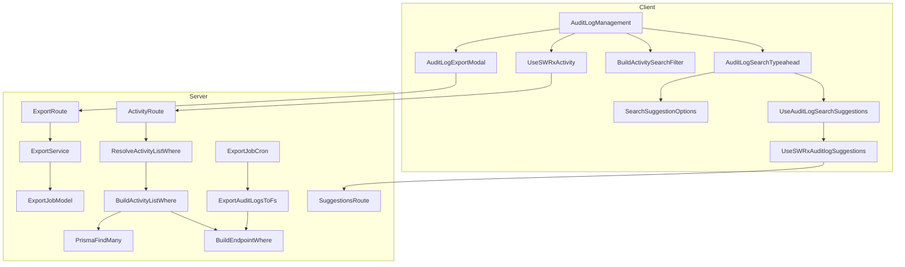
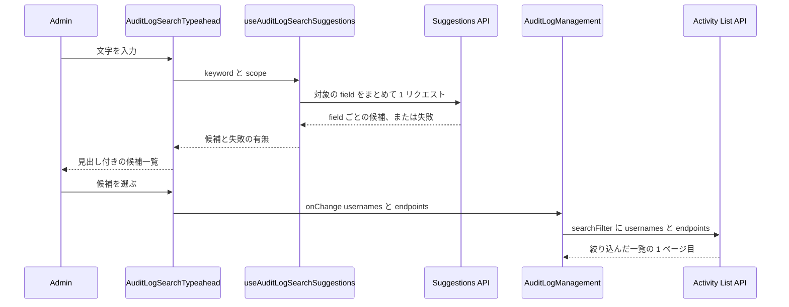

# Design Document

## Overview

**Purpose**: 監査ログ画面（`/admin/audit-log`）で、管理者が特定の URL（activity に記録された endpoint）に対する操作だけを一覧に絞り込めるようにする。

**Users**: 監査ログで操作の痕跡を調べる管理者。ユーザーと URL を 1 つの検索欄で検索し、候補から選んだ値で一覧を絞り込む。

**Impact**: 監査ログ画面のフィルター行のユーザー名の入力欄を、ユーザーと URL を扱う 1 つの検索欄に置き換える。一覧の絞り込み条件（`ISearchFilter`）とエクスポートの条件に endpoint を足し、一覧で選んだ URL をエクスポートのモーダルに引き継ぐ。候補 API と全文検索ページのユーザー名の入力欄は変えない。

### Goals
- 候補から選んだ URL で、一覧をパス部分の完全一致で絞り込める（要件 1, 2）
- ユーザーと URL を 1 つの検索欄で扱い、「絞り込みを選択」で検索対象を切り替えられる（要件 3）
- 候補の取得に失敗したときと、一致する候補がないときに、それぞれの表示を出し分ける（要件 4）
- 一覧を URL で絞り込んだ状態でエクスポートすると、一覧と同じ URL の条件で出力する（要件 7）

### Non-Goals
- IP アドレスの検索（後続のタスク）
- エクスポートのモーダルで URL を検索して足すこと、モーダルのユーザー名・期間・アクションの欄の変更
- URL を貼り付けたときの正規化、自由入力による絞り込み
- 候補 API とサーバー側の候補の検索の変更（validator の `q` の上限値を共有の定数に置き換えることだけは行う。上限値と契約は変えない）
- 一覧のクエリの性能改善（インデックスを効かせる書き換え）

## Boundary Commitments

### This Spec Owns
- 監査ログ画面の検索欄（ユーザーと URL の候補の表示、検索対象の切り替え、選択済みの値の管理、候補の取得失敗と一致なしの表示）
- 一覧の絞り込み条件の endpoint（`ISearchFilter.endpoints`）と、その一致の仕方（パス部分の完全一致、`buildEndpointWhere`）
- 監査ログ画面のリセット・ページ番号との連携
- エクスポートの endpoint の条件: モーダルでの引き継いだ URL の表示と解除、エクスポート API の `filters.endpoints` の検証、ジョブへの保存、重複判定のキー、ジョブの絞り込み
- 本機能で追加する文言（`admin` 名前空間）の 5 ロケール分
- `useSWRxAuditlogSuggestions`（`stores/activity.ts`）に field の配列を受け取る形を足すこと
- `.kiro/specs/activity-log-snapshot/design.md` の Allowed Dependencies にある `findSnapshotUsernamesByUsernameRegex` の説明の修正。依存先の説明を今のコードに合わせるだけで、`activity-log-snapshot` の契約は変えない（amend spec にしない理由は `research.md` の Decision を参照）

### Out of Boundary
- 候補 API（`GET /_api/v3/activity/suggestions`）の契約とサーバー側の検索（`search-auditlog-suggestions.ts`）
- 共有の `UsernameTypeahead` と、それを使う全文検索ページ・エクスポートのモーダルのユーザー名の欄
- 監査ログのエクスポートのうち endpoint の条件以外（ユーザー名・期間・アクションの扱い、ジョブの実行・圧縮・アップロード、`features/audit-log-bulk-export`）
- activity の記録内容（`activity-log` / `activity-log-snapshot` が所有）
- IP アドレスの検索

### Allowed Dependencies
- 候補 API の `field=username` / `field=endpoint`（1 回のリクエストで複数の field を指定でき、`limit` は field ごとに効く）。画面からは `useSWRxAuditlogSuggestions` を通してのみ呼ぶ
- 候補 API の field ごとの検索が、全文検索サーバーとデータベースのどちらでも失敗したときに、例外ではなく空の候補を返すこと（`search-auditlog-suggestions.ts`）。「すべて」を 1 回のリクエストにまとめる設計は、これに依存する
- データベースでの URL 候補の検索が使う `endpoint_1` インデックス（migration `20261111120000-add-endpoint-index-to-activities`）
- `react-bootstrap-typeahead`（既存の依存、6.3 系）
- `@growi/core` の `escapeStringForMongoRegex`
- 既存の一覧の取得の仕組み（`buildActivitySearchFilter` → `POST /activity/list` / `GET /activity` → `resolveActivityListWhere` → `buildActivityListWhere` → Prisma `findMany`）
- 既存のエクスポートの仕組み（`AuditLogExportModal` → `POST /audit-log-bulk-export` → `AuditLogBulkExportService.createOrResetExportJob` → `AuditLogBulkExportJob` → `exportAuditLogsToFsAsync` → `exportActivityCursor`）
- 依存の方向: 型（`interfaces/activity.ts`）→ サーバーの `where` の組み立て（`server/service/activity/build-endpoint-where.ts`）→ 一覧のルート・エクスポートのジョブ、型 → 画面の純粋関数 → フック → コンポーネント。サーバーと画面は型と定数だけを共有する

### Revalidation Triggers
- 候補 API のレスポンスの形（`username` / `endpoint` のキー）や、失敗時の振る舞い（500 か空の候補か）が変わったとき。特に、field ごとの検索が失敗時に空の候補を返さず例外を投げるようになると、「すべて」では片方の種類の失敗で両方の候補が出なくなる
- `endpoint_1` インデックスを作る migration が変わったとき
- `ISearchFilter` の項目名が変わったとき（一覧の GET 経路を使う外部の呼び出し元にも影響する）
- Prisma のバージョンアップで、MongoDB での `startsWith` の変換（エスケープの有無）が変わったとき
- IP の検索を足すとき（`AUDITLOG_SEARCH_SCOPES` に行を足す）
- エクスポートの重複判定のキー（`canonicalizeFilters`）やジョブの `filters` のスキーマが変わったとき。endpoint を含まない条件のハッシュが今と同じであることに依存している（要件の Adjacent expectations）

## Architecture

### Existing Architecture Analysis
- 一覧の絞り込みは、画面の純粋関数 `buildActivitySearchFilter` が `ISearchFilter` を組み立て、サーバーの純粋関数 `resolveActivityListWhere` → `buildActivityListWhere` が Prisma の `where` に変換する。GET と POST の 2 経路が同じ関数を共有する。
- Prisma の MongoDB コネクタは `where` を `$expr` の集約に変換するため、一覧のクエリは今も全件走査で実行されている。`startsWith` は `$regexMatch` になり、値をエスケープしない（調査の詳細は `research.md`）。
- ユーザー名の入力欄 `UsernameTypeahead` は、候補の取得元を注入する共有コンポーネントで、全文検索ページとエクスポートのモーダルも使う。

### Architecture Pattern & Boundary Map



- **Selected pattern**: 既存の「純粋関数＋薄いアダプタ」を延ばす。検索欄の判断（候補の組み立て、見出し、表示の可否）は純粋関数に置き、コンポーネントとフックは薄くする。
- **新しい構成要素**: `AuditLogSearchTypeahead`（検索欄）、`useAuditLogSearchSuggestions`（検索対象に応じた候補の取得）、`search-suggestion-options`（候補一覧の組み立て）、`search-scopes`（検索対象の種類の表）、`buildEndpointWhere`（一覧とエクスポートのジョブが共有する endpoint の条件）。
- **残す既存のパターン**: 候補の取得は `useSWRxAuditlogSuggestions` 経由、一覧は `useSWRxActivity` 経由。`where` の組み立ては純粋関数。エクスポートの条件は既存のリクエスト → ジョブ → `where` の流れに endpoint を足すだけにする。

### Technology Stack

| Layer | Choice / Version | Role in Feature | Notes |
|---|---|---|---|
| Frontend | React 18、`react-bootstrap-typeahead` 6.3、SWR | 検索欄、候補の取得 | 新しい依存はない |
| Backend | Express（apiv3）、Prisma 6.19 | 一覧の絞り込み条件の変換 | `startsWith` の値は呼び出し側でエスケープする |
| Data | MongoDB `activities` | 一覧の検索対象 | スキーマ・インデックスの変更はない |

## File Structure Plan

### Directory Structure
```
apps/app/src/client/components/Admin/AuditLog/AuditLogSearchTypeahead/
├── index.ts                                   # barrel: AuditLogSearchTypeahead と型だけを公開
├── AuditLogSearchTypeahead.tsx                # 検索欄（入力、「絞り込みを選択」、候補一覧、トークン）
├── AuditLogSearchTypeahead.spec.tsx           # コンポーネントテスト
├── search-scopes.ts                           # 検索対象の種類の表（scope → 対象 field、文言キー）
├── search-suggestion-options.ts               # 純粋関数: 種類ごとの取得結果から候補一覧のグループを組み立てる
├── search-suggestion-options.spec.ts
├── use-auditlog-search-suggestions.ts         # フック: scope の対象の field をまとめて候補を取得する
├── use-auditlog-search-suggestions.spec.tsx
└── search-labels-locale-drift.spec.ts         # 追加した文言キーが 5 ロケールすべてにあることを確かめる
```

```
apps/app/src/server/service/activity/
├── build-endpoint-where.ts                    # 純粋関数: パス部分の完全一致の Prisma 条件（一覧とエクスポートのジョブが使う）
└── build-endpoint-where.spec.ts
```

### Modified Files
- `apps/app/src/interfaces/activity.ts` — `ISearchFilter` に `endpoints?: string[]` を足す。候補 API の `q` の上限 `AUDITLOG_SUGGESTION_QUERY_MAX_LENGTH`（100）を足す
- `apps/app/src/server/service/activity/index.ts` — `buildEndpointWhere` を barrel から公開する
- `apps/app/src/server/routes/apiv3/build-activity-list-where.ts` — `buildEndpointWhere` で endpoint の条件を足す。`usernames` / `endpoints` の型の判定を `Array.isArray` を含む形にする
- `apps/app/src/server/routes/apiv3/build-activity-list-where.spec.ts` — endpoint の条件が `AND` の要素として付くことと、型の判定の単体テストを足す
- `apps/app/src/server/routes/apiv3/fetch-activity-list.ts` — `resolveActivityListWhere` で `endpoints` を受け渡す
- `apps/app/src/server/routes/apiv3/fetch-activity-list.integ.ts`（新規） — 実際の MongoDB で、パス部分の完全一致と正規表現の記号のエスケープを確かめる
- `apps/app/src/server/routes/apiv3/activity.ts` — OpenAPI の `searchFilter` の説明に `endpoints` を足す。候補 API の validator の `q` の上限を、リテラルの 100 から `AUDITLOG_SUGGESTION_QUERY_MAX_LENGTH` に置き換える（値は変えない）
- `apps/app/src/stores/activity.ts` — `useSWRxAuditlogSuggestions` が field の配列も受け取れるようにする。単一の field での既存の呼び出し（エクスポートのモーダルが使う `use-auditlog-username-suggestions.ts`）は変えない
- `apps/app/src/client/components/Admin/AuditLog/build-search-filter.ts` / `.spec.ts` — `endpoints` を受け取る
- `apps/app/src/client/components/Admin/AuditLogManagement.tsx` — `AuditLogUsernameTypeahead` を `AuditLogSearchTypeahead` に置き換え、選択済みの endpoint を状態に持ち、リセットで検索欄を初期状態に戻す。エクスポートのモーダルに選択済みの endpoint を渡す
- `apps/app/src/client/components/Admin/AuditLog/AuditLogExportModal.tsx` — `initialSelectedEndpoints` を受け取り、引き継いだ URL を外せる一覧として表示し、エクスポートの条件に含める
- `apps/app/src/features/audit-log-bulk-export/interfaces/audit-log-bulk-export.ts` — `IAuditLogBulkExportRequestFilters` と `IAuditLogBulkExportFilters` に `endpoints?: string[]` を足す
- `apps/app/src/features/audit-log-bulk-export/server/routes/apiv3/audit-log-bulk-export.ts` — validator に `filters.endpoints`（文字列の配列）を足す
- `apps/app/src/features/audit-log-bulk-export/server/models/audit-log-bulk-export-job.ts` — `filters` のスキーマに `endpoints: [String]` を足す
- `apps/app/src/features/audit-log-bulk-export/server/service/audit-log-bulk-export.ts` — リクエストの `endpoints` をジョブの `filters` に写し、`canonicalizeFilters` に endpoint を足す
- `apps/app/src/features/audit-log-bulk-export/server/service/audit-log-bulk-export-job-cron/steps/exportAuditLogsToFsAsync.ts` — `filters.endpoints` があれば `buildEndpointWhere` の条件を `where.AND` に足す
- `apps/app/src/features/audit-log-bulk-export/server/service/audit-log-bulk-export.integ.ts` / `.../audit-log-bulk-export-job-cron-service.integ.ts` — endpoint の保存・重複判定・出力の integ テストを足す
- `apps/app/public/static/locales/{en_US,fr_FR,ja_JP,ko_KR,zh_CN}/admin.json` — `audit_log_management.search.*` と `audit_log_management.export_endpoints.*` の文言を足す
- `.kiro/specs/activity-log-snapshot/design.md` — Allowed Dependencies の `findSnapshotUsernamesByUsernameRegex(WithTotalCount)` の段落を、依存先として今成り立っている事実（呼び出し元が `search-auditlog-suggestions.ts` であること、マッチの仕方、最小文字数の判定が呼び出し側にあること）だけに縮める。変更の経緯（「撤去し」「新設された」など）は残さない。`spec.json` の `updated_at` を更新する

`AuditLogUsernameTypeahead` と `UsernameTypeahead` は変更しない（エクスポートのモーダルのユーザー名の欄と全文検索ページが使い続ける）。

## System Flows



- 「すべて」のときは username と endpoint を 1 回のリクエストで取得する。候補 API の field ごとの検索は失敗しても空の候補を返すので、リクエストが失敗するのは、通信の失敗・ログイン切れ・データベース自体の停止など、どの種類にも同じように起きる場合に限られる。そのため失敗は種類ごとに分けず、1 つの表示にする。
- 検索対象の切り替えは候補の取得だけに効き、選択済みの値と一覧の絞り込みは変えない。
- エクスポートのモーダルを開くと、`AuditLogManagement` が選択済みの endpoint を `initialSelectedEndpoints` として渡す。モーダルはそれを自分の状態に写して表示し、外した URL はモーダルの状態からだけ消える（一覧の絞り込みは変えない）。エクスポートの依頼は `filters.endpoints` を含めて送り、サーバーはそれをジョブの `filters` に保存して、ジョブの `where` で `buildEndpointWhere` を使う。

## Requirements Traceability

| Requirement | Summary | Components | Interfaces | Flows |
|---|---|---|---|---|
| 1.1 | 検索文字列に前方一致する URL 候補 | useAuditLogSearchSuggestions, search-suggestion-options | 候補 API `field=endpoint` | 入力 → 候補 |
| 1.2 | 選んだ URL をトークン表示し一覧を絞り込む | AuditLogSearchTypeahead, AuditLogManagement | `onChange` | 選択 → 一覧 |
| 1.3 | 複数選択、いずれかに一致 | AuditLogSearchTypeahead, BuildActivityListWhere | `ISearchFilter.endpoints` | — |
| 1.4 | 選択を外すと条件から外れる | AuditLogSearchTypeahead, AuditLogManagement | `onChange` | — |
| 1.5 | 候補から選んだ値だけが条件 | AuditLogSearchTypeahead, search-suggestion-options | 自由入力なし（`allowNew` を使わない）、古い候補を `filterBy` で除く | — |
| 1.6 | 検索文字列が 2 文字未満では取得も表示もしない | search-suggestion-options, useAuditLogSearchSuggestions | `toSuggestionQuery`（空を返す）、`AUDITLOG_SEARCH_MIN_QUERY_LENGTH` | — |
| 1.7 | 検索文字列の先頭 100 文字で検索する | search-suggestion-options, useAuditLogSearchSuggestions | `toSuggestionQuery`、`AUDITLOG_SUGGESTION_QUERY_MAX_LENGTH` | 入力 → 候補 |
| 2.1 | パス部分の完全一致 | BuildEndpointWhere | `buildEndpointWhere` | — |
| 2.2 | クエリ文字列を除いて判定 | BuildEndpointWhere | `buildEndpointWhere` | — |
| 2.3 | 前方一致だけの別 URL を含めない | BuildEndpointWhere | `buildEndpointWhere` | — |
| 2.4 | 大文字小文字を区別 | BuildEndpointWhere | `buildEndpointWhere` | — |
| 3.1 | 1 つの検索欄 | AuditLogSearchTypeahead | — | — |
| 3.2 | 「すべて／ユーザー／URL」、初期値「すべて」 | AuditLogSearchTypeahead, search-scopes | `AUDITLOG_SEARCH_SCOPES` | — |
| 3.3 | 「すべて」は見出し付きで混在表示 | search-suggestion-options | `buildSuggestionGroups` | 入力 → 候補 |
| 3.4 | 種類を絞ると、その種類だけ | useAuditLogSearchSuggestions, useSWRxAuditlogSuggestions, search-scopes | scope → fields | — |
| 3.5 | 種類ごとの件数の上限 | useAuditLogSearchSuggestions, useSWRxAuditlogSuggestions | field ごとに効く `limit = 5` | — |
| 3.6 | ユーザーを選ぶと既存と同じ絞り込み | AuditLogManagement | `ISearchFilter.usernames` | — |
| 3.7 | Active / Inactive の区別 | search-suggestion-options, AuditLogSearchTypeahead | `SuggestionOption.status` | — |
| 3.8 | 同種は OR、異種は AND | BuildActivityListWhere | `where` の AND | — |
| 3.9 | 切り替えても選択済みの値を保つ | AuditLogSearchTypeahead | scope と選択の状態を分ける | — |
| 3.10 | ボタンのラベル（「すべて」は「絞り込みを選択」、それ以外は対象の名前） | search-scopes, AuditLogSearchTypeahead | `AUDITLOG_SEARCH_SCOPES[].buttonLabelKey` | — |
| 4.1 | 取得失敗の表示 | useAuditLogSearchSuggestions, search-suggestion-options | `SearchSuggestionsResult.error` | 入力 → 候補 |
| 4.2 | 失敗しても選択と一覧を変えない | AuditLogSearchTypeahead | 失敗は候補一覧の中だけで扱う | — |
| 4.3 | API の結果が 0 件なら一致なしの表示 | search-suggestion-options, AuditLogSearchTypeahead | `SuggestionGroup` の `state: 'empty'` | 入力 → 候補 |
| 5.1 | 選択・解除で 1 ページ目 | AuditLogManagement | `setActivePageNumber(1)` | — |
| 5.2 | 期間・アクションと AND | BuildActivityListWhere | `where` の AND | — |
| 5.3 | リセットで選択を外し「すべて」に戻す | AuditLogManagement, AuditLogSearchTypeahead | `IClearable.clear` | — |
| 6.1 | 5 ロケールの文言 | admin.json, search-labels-locale-drift.spec | `audit_log_management.search.*`、`audit_log_management.export_endpoints.*` | — |
| 7.1 | 選択済みの URL をモーダルに表示し条件に含める | AuditLogManagement, AuditLogExportModal | `initialSelectedEndpoints`、`filters.endpoints` | エクスポート |
| 7.2 | モーダルで外しても一覧は変えない | AuditLogExportModal | モーダル内の状態だけを変える | — |
| 7.3 | ジョブは一覧と同じ一致の仕方で出力する | ExportRequestValidator, AuditLogBulkExportService, AuditLogBulkExportJob, ExportAuditLogsToFs, BuildEndpointWhere | `IAuditLogBulkExportFilters.endpoints`、`buildEndpointWhere` | エクスポート |
| 7.4 | URL だけが違う依頼は重複にしない | AuditLogBulkExportService | `canonicalizeFilters` に `endpoints` | — |

## Components and Interfaces

| Component | Domain/Layer | Intent | Req Coverage | Key Dependencies | Contracts |
|---|---|---|---|---|---|
| BuildEndpointWhere | Server / pure | パス部分の完全一致の Prisma 条件を作る | 2.1–2.4, 7.3 | Prisma（P0）、`escapeStringForMongoRegex`（P0） | Service |
| BuildActivityListWhere（拡張） | Server / pure | `ISearchFilter` を Prisma `where` に変換する。endpoint の条件を足す | 1.3, 3.8, 5.2 | BuildEndpointWhere（P0） | Service |
| ResolveActivityListWhere（拡張） | Server / pure | `endpoints` を受け渡す | 1.3 | BuildActivityListWhere（P0） | Service |
| ExportRequestValidator（拡張） | Server / route | `filters.endpoints` を文字列の配列として検証する | 7.3 | express-validator（P0） | API |
| AuditLogBulkExportService（拡張） | Server / service | `endpoints` をジョブの `filters` に写し、重複判定のキーに含める | 7.3, 7.4 | AuditLogBulkExportJob（P0） | Service |
| AuditLogBulkExportJob（拡張） | Server / model | `filters.endpoints` を保存する | 7.3 | Mongoose（P0） | State |
| ExportAuditLogsToFs（拡張） | Server / job | `filters.endpoints` で出力する記録を絞り込む | 7.3 | BuildEndpointWhere（P0）、`exportActivityCursor`（P0） | Batch |
| search-scopes | Client / data | 検索対象の種類の表 | 3.2, 3.4, 3.10 | — | State |
| search-suggestion-options | Client / pure | 送る q の決定、候補を出すかの判定と、候補一覧のグループの組み立て | 1.1, 1.5, 1.6, 1.7, 3.3, 3.7, 4.1, 4.3 | search-scopes（P0） | Service |
| useSWRxAuditlogSuggestions（拡張） | Client / store | field の配列を 1 回のリクエストで取得する | 3.4, 3.5 | 候補 API（P0） | Service |
| useAuditLogSearchSuggestions | Client / hook | scope の対象の field をまとめて候補を取得する | 1.1, 1.6, 1.7, 3.4, 3.5, 4.1 | `useSWRxAuditlogSuggestions`（P0） | Service |
| AuditLogSearchTypeahead | Client / UI | 検索欄 | 1.2, 1.4, 1.5, 3.1, 3.2, 3.9, 3.10, 4.2, 4.3, 5.3 | search-scopes・search-suggestion-options・useAuditLogSearchSuggestions（P0）、`react-bootstrap-typeahead`（P0） | State |
| AuditLogManagement（変更） | Client / UI | 選択済みの値を一覧の条件とエクスポートのモーダルに渡す | 1.2, 3.6, 5.1, 5.3, 7.1 | AuditLogSearchTypeahead（P0）、`buildActivitySearchFilter`（P0）、AuditLogExportModal（P0） | — |
| AuditLogExportModal（変更） | Client / UI | 引き継いだ URL を表示・解除し、エクスポートの条件に含める | 7.1, 7.2 | `useAuditLogExport`（P0） | State |

### Shared Types

```typescript
// interfaces/activity.ts（追加）
export type ISearchFilter = {
  usernames?: string[];
  endpoints?: string[]; // path part only; matched exactly, query string ignored
  dates?: { startDate: string | null; endDate: string | null };
  actions?: SupportedActionType[];
};

// Upper bound of the suggestion API's `q`. Shared by the route validator and
// the client so the client never sends a query the server would reject.
export const AUDITLOG_SUGGESTION_QUERY_MAX_LENGTH = 100;
```

### Server

#### BuildEndpointWhere

| Field | Detail |
|---|---|
| Intent | 選んだパスに対して、保存値のパス部分が完全に一致する行だけに一致する Prisma 条件を作る純粋関数。一覧とエクスポートのジョブが共有する |
| Requirements | 2.1, 2.2, 2.3, 2.4, 7.3 |

**Responsibilities & Constraints**
- 置き場所は `server/service/activity/build-endpoint-where.ts` で、`server/service/activity` の barrel から公開する。一覧のルート（`server/routes/apiv3`）とエクスポートのジョブ（`features/audit-log-bulk-export`）の両方が使うので、どちらにも属さない activity のサービスに置く。
- 条件は「値が選んだパスのいずれかと等しい」または「値が `<パス>?` で始まる」の OR。前方一致の値は `escapeStringForMongoRegex(パス) + '\\?'` とする。Prisma は `startsWith` の値をエスケープせずに `$regexMatch` に渡すため、呼び出し側でのエスケープが必須（`.claude/rules/mongodb-regex.md`）。
- 大文字小文字は区別する（`mode: 'insensitive'` を使わない）。
- 呼び出し側は、返った条件を `where.AND` の要素として足す。トップレベルの `OR` は使わない。今後、別の OR 条件（IP など）を足しても衝突しない。

**Contracts**: Service [x]

```typescript
// server/service/activity/build-endpoint-where.ts
export function buildEndpointWhere(
  paths: readonly string[],
): Prisma.activitiesWhereInput; // { OR: [{ endpoint: { in: paths } }, ...startsWith clauses] }
```
- Preconditions: `paths` は空でない。各要素は文字列。
- Postconditions: 返す条件は、保存値のパス部分が `paths` のいずれかと完全に一致する行だけに一致する。
- Risks: Prisma が将来 `startsWith` をエスケープするようになると二重エスケープで一致しなくなる。integ テストで検知する。

#### BuildActivityListWhere（拡張）

| Field | Detail |
|---|---|
| Intent | 一覧の絞り込み条件を Prisma `where` に変換する純粋関数に、endpoint の条件を足す |
| Requirements | 1.3, 3.8, 5.2 |

**Responsibilities & Constraints**
- `usernames` と `endpoints` は、`Array.isArray(x) && x.length > 0 && x.every((v) => typeof v === 'string')` を満たすときだけ条件を足す。既存の `usernames` の判定（`x.length > 0 && x.every(...)`）は、文字列が来ると `.every` がなく TypeError になるため、同じ形に直す。
- endpoint の条件は `buildEndpointWhere(endpoints)` を `where.AND` の要素として足す。他の条件（username・action・期間）とは AND で結合する。

**Contracts**: Service [x]

```typescript
export type ActivityListFilterInput = {
  usernames: string[] | undefined;
  endpoints: string[] | undefined; // added
  actions: string[] | undefined;
  startDate: Date | undefined;
  endDate: Date | undefined;
};
```

**Implementation Notes**
- Validation: 一覧の GET 経路は `searchFilter` を JSON 文字列として受け取り、POST 経路はオブジェクトとして受け取る。validator は足さず、中身の型は両経路が必ず通る `buildActivityListWhere` の判定 1 か所で守る（GET の `searchFilter` は validator の時点では JSON 文字列で、中身を検証できないため）。判定を満たさない値は、その条件を付けずに無視する。値は Prisma にリテラルとして渡り、正規表現の部分はエスケープするので、NoSQL / 正規表現の注入は起きない。

#### ResolveActivityListWhere（拡張）
- `parsedSearchFilter.endpoints` を `buildActivityListWhere` に受け渡すだけ。summary のみ。

#### エクスポートの endpoint の条件（ExportRequestValidator / AuditLogBulkExportService / AuditLogBulkExportJob / ExportAuditLogsToFs の拡張）

| Field | Detail |
|---|---|
| Intent | エクスポートの依頼に含まれた endpoint を検証してジョブに保存し、ジョブの出力を一覧と同じ一致の仕方で絞り込む |
| Requirements | 7.3, 7.4 |

**Contracts**: API [x] / Service [x] / Batch [x]

```typescript
// features/audit-log-bulk-export/interfaces/audit-log-bulk-export.ts
export interface IAuditLogBulkExportRequestFilters {
  usernames?: string[];
  endpoints?: string[]; // added: path parts selected on the list
  actions?: SupportedActionType[];
  dateFrom?: Date;
  dateTo?: Date;
}
export interface IAuditLogBulkExportFilters {
  users?: Array<Ref<IUser>>;
  endpoints?: string[]; // added
  actions?: SupportedActionType[];
  dateFrom?: Date;
  dateTo?: Date;
}
```

- **validator**（`POST /_api/v3/audit-log-bulk-export`）: `body('filters.endpoints').optional({ nullable: true }).isArray()` と `body('filters.endpoints.*').isString()` を足す。既存の `usernames` と同じ形。
- **ジョブのスキーマ**: `filters` は型付きのサブドキュメントで、スキーマにない項目は保存時に黙って捨てられる。`endpoints: [{ type: String }]` を足さないと、ジョブが endpoint の条件なしで全 URL を出力する。integ テストで、保存したジョブを読み直して `filters.endpoints` が残ることを確かめる。
- **`createOrResetExportJob`**: `requestFilters.endpoints` が空でなければ `filters.endpoints` に写す。
- **重複判定（`canonicalizeFilters`）**: `endpoints` が空でないときだけ、並べ替えた配列を正規化した条件に足す。空または省略なら項目を足さないので、URL を含まない条件のハッシュは今と同じになる（要件の Adjacent expectations）。URL だけが違う依頼はハッシュが変わり、重複にならない（7.4）。
- **`exportAuditLogsToFsAsync`**: `filters.endpoints` が空でなければ、`where.AND = [buildEndpointWhere(filters.endpoints)]` を足す。再開時の `{ ...where, id: { gt } }`（`exportActivityCursor` と、件数の確認）は `where` を展開するだけなので、`AND` はそのまま残る。`ActivityCursorWhere`（`Omit<Prisma.activitiesWhereInput, 'id'>`）は `AND` を受け付ける。

### Client

#### search-scopes

| Field | Detail |
|---|---|
| Intent | 検索対象の種類（scope）と、それぞれが候補を取る field・文言キーを 1 か所で宣言する |
| Requirements | 3.2, 3.4, 3.10 |

**Contracts**: State [x]

```typescript
export type AuditLogSearchField = 'username' | 'endpoint';
export type AuditLogSearchScope = 'all' | AuditLogSearchField;

export const AUDITLOG_SEARCH_SCOPES: readonly {
  readonly scope: AuditLogSearchScope;
  readonly fields: readonly AuditLogSearchField[];
  readonly labelKey: string; // option label: admin:audit_log_management.search.scope.*
  readonly buttonLabelKey: string; // dropdown button label while this scope is selected
}[];

export const DEFAULT_AUDITLOG_SEARCH_SCOPE: AuditLogSearchScope; // 'all'
```
- 表の順序が「絞り込みを選択」の選択肢の順序と、候補一覧のグループの順序になる（ユーザー → URL）。
- `buttonLabelKey` は、`all` の行が `search.scope_selector`（「絞り込みを選択」）、`username` / `endpoint` の行がその行の `labelKey` と同じキー（3.10）。コンポーネントは scope の名前で分岐せず、選択中の行の `buttonLabelKey` を表示する。

#### search-suggestion-options

| Field | Detail |
|---|---|
| Intent | 送る q の決定、候補を出すかどうかの判定、候補一覧に出すグループの組み立てを行う純粋関数 |
| Requirements | 1.1, 1.5, 1.6, 1.7, 3.3, 3.7, 4.1, 4.3 |

**Contracts**: Service [x]

```typescript
export const AUDITLOG_SEARCH_MIN_QUERY_LENGTH = 2;

// Drops everything from the first '?', trims, returns '' below
// AUDITLOG_SEARCH_MIN_QUERY_LENGTH, and otherwise cuts it to
// AUDITLOG_SUGGESTION_QUERY_MAX_LENGTH.
export function toSuggestionQuery(text: string): string;

export type SuggestionOption =
  | { kind: 'username'; value: string; status: 'active' | 'inactive' }
  | { kind: 'endpoint'; value: string };

export type SearchSuggestionsResult = {
  fields: readonly AuditLogSearchField[]; // the scope's fields, in AUDITLOG_SEARCH_SCOPES order
  options: readonly SuggestionOption[]; // everything the API returned, before filterBy
  error: boolean;
  isLoading: boolean;
};

export type SuggestionGroup =
  | { state: 'options'; field: AuditLogSearchField; options: readonly SuggestionOption[] }
  | { state: 'error' }
  | { state: 'empty' };

// The single staleness predicate: results fetched for an older keyword are stale.
// Both sides are compared after toSuggestionQuery, so text typed past the
// 100-character cut still counts as fresh for the same query.
export function isFreshForText(args: {
  currentText: string; // text currently in the input
  fetchedForKeyword: string; // keyword the results were fetched for
}): boolean;

// Used as the typeahead's filterBy: hides stale and already-selected options.
export function shouldShowSuggestionOption(args: {
  option: SuggestionOption;
  currentText: string;
  fetchedForKeyword: string;
  selected: readonly SuggestionOption[];
}): boolean;

// Used inside renderMenu: groups the options that passed filterBy, or returns
// the single error group / the single empty group.
export function buildSuggestionGroups(args: {
  visibleOptions: readonly SuggestionOption[]; // renderMenu's results (after filterBy)
  fetchedOptionCount: number; // SearchSuggestionsResult.options.length (before filterBy)
  fields: readonly AuditLogSearchField[]; // group order
  error: boolean;
  isLoading: boolean;
  currentText: string;
  fetchedForKeyword: string;
}): SuggestionGroup[];

export function isSameSuggestion(a: SuggestionOption, b: SuggestionOption): boolean;
```
- 古い応答の判定は `isFreshForText` の 1 つだけで、次の 2 か所がこれを使う。
  - **候補ごとの除外（`filterBy`）**: `shouldShowSuggestionOption` が、古い候補と選択済みの値（`kind` と `value` が一致するもの）を除く。既存の `UsernameTypeahead` の `shouldShowUsernameSuggestion` と同じ形。候補が全部除かれると `filterBy` を通した結果が 0 件になり、ライブラリが Tab で確定する候補（`initialItem`）も消える。
  - **失敗のグループの出し分け（`renderMenu`）**: 失敗は候補ではないので `filterBy` を通らない。`buildSuggestionGroups` が `isFreshForText` で判定し、古いときは失敗のグループを出さない。
- `toSuggestionQuery` は、送る q と古さの判定の両方の正規化に使う。入力から最初の `?` 以降を除き、前後の空白を除いて検索文字列を作る。検索文字列が 2 文字未満なら空を返し（1.6）、それ以外は先頭 100 文字に切る（1.7）。
  - 「すべて」でも q は 1 つで、ユーザーの候補と URL の候補はどちらも検索文字列の先頭 100 文字で検索される。`?` 以降は画面で除くので、候補 API が q の `?` 以降をどう扱うかには依存しない。
  - `?` を除いてから長さを判定するので、`/_api?x=1` のような入力は `/_api` で、`?abc` のような入力は空として扱われる（1.6）。
- `buildSuggestionGroups` の Postconditions（上から順に判定する）:
  - `error` が true で、`isFreshForText` が true のときは、`state: 'error'` のグループ 1 つだけを返す。古いときは失敗のグループを出さない。
  - `error` が false、`isLoading` が false、`isFreshForText` が true、`toSuggestionQuery(currentText)` が空でなく、`fetchedOptionCount` が 0 のときは、`state: 'empty'` のグループ 1 つだけを返す（4.3）。取得待ち・古い結果・2 文字未満（1.6）では返さない。候補 API が候補を返したが、すべて選択済みで `visibleOptions` が空になった場合も返さない。
  - それ以外は、`fields` の順序（= `AUDITLOG_SEARCH_SCOPES` の順序）でグループを返す。各グループの候補は `visibleOptions` のうちその種類のもの。表示する候補が 0 件の field はグループを返さない。

#### useAuditLogSearchSuggestions

| Field | Detail |
|---|---|
| Intent | scope と keyword から、scope の対象の field をまとめて候補 API を 1 回呼び、`SearchSuggestionsResult` を返す |
| Requirements | 1.1, 1.6, 1.7, 3.4, 3.5, 4.1 |

**Contracts**: Service [x]

```typescript
export const AUDITLOG_SEARCH_SUGGESTION_LIMIT = 5;

export function useAuditLogSearchSuggestions(
  keyword: string,
  scope: AuditLogSearchScope,
): SearchSuggestionsResult;
```
- scope の対象の field の配列（`AUDITLOG_SEARCH_SCOPES` の順）を `useSWRxAuditlogSuggestions(fields, q, AUDITLOG_SEARCH_SUGGESTION_LIMIT)` に渡す。`limit` は候補 API で field ごとに効くので、「すべて」でも種類ごとに 5 件が上限になり、一方の種類が他方を押し出さない（3.5）。
- `useSWRxAuditlogSuggestions` には `toSuggestionQuery(keyword)` を渡す。空になる入力（検索文字列が 2 文字未満）ではリクエストしない（`useSWRxAuditlogSuggestions` は空の q でキーを `null` にする）。結果は候補 0 件・失敗なし・読み込み中なしになり、`buildSuggestionGroups` も何も返さないので、候補も一致なしの表示も出ない（1.6）。
- 検索文字列が 100 文字を超える入力でも、先頭 100 文字に切った q でリクエストする（1.7）。q は候補 API の validator の上限を超えないので、入力の長さが理由で 400 になることはない。
- username の結果は `activeUsernames` / `inactiveUsernames` から `status` 付きのオプションに、endpoint の結果は `endpoint.endpoints` からオプションに変換する。
- SWR の `error` があれば `error: true` を返す。読み込み中の判定は既存の `toUsernameSuggestions` と同じく、エラー時は読み込み中にしない。

#### useSWRxAuditlogSuggestions（拡張）

| Field | Detail |
|---|---|
| Intent | 候補 API を呼ぶ既存の SWR フックに、field の配列を受け取る形を足す |
| Requirements | 3.4, 3.5 |

**Contracts**: Service [x]

```typescript
export const useSWRxAuditlogSuggestions = (
  field: AuditlogSuggestionField | readonly AuditlogSuggestionField[],
  q: string,
  limit?: number,
): SWRResponse<AuditlogSuggestionsResponse, Error>;
```
- 配列は `field` のクエリにそのまま載せる。axios の `qs.stringify` が `field[0]=…&field[1]=…` にし、サーバーの `qs.parse` が配列に戻す。候補 API の validator は配列を受け付ける。
- 単一の field の呼び出しは、引数もリクエストも今のまま。

#### AuditLogSearchTypeahead

| Field | Detail |
|---|---|
| Intent | ユーザーと URL を 1 つの入力欄で検索し、選択済みの値を種類ごとに親へ通知する |
| Requirements | 1.2, 1.4, 1.5, 3.1, 3.2, 3.9, 3.10, 4.2, 4.3, 5.3 |

**Contracts**: State [x]

```typescript
export type AuditLogSearchSelection = {
  usernames: string[];
  endpoints: string[];
};

export type AuditLogSearchTypeaheadProps = {
  onChange: (selection: AuditLogSearchSelection) => void;
};

// forwardRef<IClearable, AuditLogSearchTypeaheadProps>
```
- State model: `scope`（初期値 `'all'`）、`selected: SuggestionOption[]`、`searchKeyword`。scope と選択は独立した状態で、scope を変えても `selected` は変えない（3.9）。
- 入力欄は `AsyncTypeahead` を `multiple` で使い、`allowNew` は使わない（1.5）。
- 候補一覧の描き方: `react-bootstrap-typeahead` 6.3 は、Tab や →（カーソルが入力の末尾にあるとき）による入力補完のヒントの確定と、その確定に使う `initialItem` の消去を、メニューに描いた内容ではなく `filterBy` を通した後の結果に依存して行う。そのため、古い候補と選択済みの値は `filterBy`（`shouldShowSuggestionOption`）で除き、メニューに出ない候補がキーボード操作で確定されないようにする。`renderMenu` は、第 1 引数の結果（`filterBy` を通した後）、第 3 引数の `state.text`、`useAuditLogSearchSuggestions` の結果（`options.length`・`error`・`isLoading`）を `buildSuggestionGroups` に渡し、見出し付きのグループ・失敗のグループ・一致なしのグループを組み立てる。
- `error` のグループには取得できなかった旨の文言を（4.1）、`empty` のグループには一致する候補がない旨の文言を出す（4.3）。どちらも `MenuItem` ではない `Menu` の子として描き、選べる項目にしない。
- 候補の項目の描き方は Figma のデザイン（requirements.md の Introduction）に合わせる。ユーザーの候補には Active / Inactive のバッジを、URL の候補には先頭にリンクのアイコン（Material Symbols の `link`）を付ける。`renderToken` で種類が分かるトークンを描く。
- 読み込み中の表示: `useAuditLogSearchSuggestions` の結果の `isLoading` を、`AsyncTypeahead` の `isLoading` に渡す。
- 「絞り込みを選択」は入力欄の右に置くドロップダウンで、`AUDITLOG_SEARCH_SCOPES` から選択肢を作る。ボタンには選択中の行の `buttonLabelKey` の文言を出す（3.10）。
- `IClearable.clear()` は選択と入力を空にし、scope を `'all'` に戻す（5.3）。
- 候補の取得に失敗しても、`selected` と `onChange` は呼ばない（4.2）。

**Implementation Notes**
- Risks:
  - `AsyncTypeahead` は同じ keyword の再検索で `onSearch` を呼ばないため、既存と同じく `useCache={false}` にする。
  - `renderMenu` は、`filterBy` を通した結果が 0 件でも呼ばれる。空を返す（`Menu` を描かない）かどうかは、`filterBy` を通した結果ではなく `buildSuggestionGroups` の戻り値で決める。
    - 戻り値が空なら、空のフラグメントを返す。空の `Menu` を描くと、ライブラリが既定の英語の文言（入力が空なら "Type to search..."、読み込み中なら "Searching..."、それ以外は "No matches found."）を出し、6.1 に反するうえ、取得待ちや 2 文字未満（1.6）の場面が一致なしに見える。
    - 戻り値が失敗のグループか一致なしのグループの場合は空ではないので、`Menu` を描いてその表示を出す（4.1, 4.3）。一致なしは本機能の文言で出し、ライブラリの既定の文言には頼らない。
    - 読み込み中は、`AsyncTypeahead` が入力欄のスピナーを出し続ける。
    - `emptyLabel` / `promptText` / `searchText` に空文字を渡す方法は使わない。中身のない無効な項目が一覧に残るため。

#### AuditLogManagement（変更）
- `AuditLogUsernameTypeahead` を `AuditLogSearchTypeahead` に置き換える。`onChange` で `selectedUsernames` と `selectedEndpoints` を更新し、1 ページ目に戻す（5.1）。
- `buildActivitySearchFilter` に `endpoints` を渡す。リセットでは `selectedEndpoints` も空にし、検索欄の `clear()` を呼ぶ（5.3）。
- エクスポートのモーダルに、既存の `initialSelectedUsernames` に加えて `initialSelectedEndpoints={selectedEndpoints}` を渡す（7.1）。

#### AuditLogExportModal（変更）

| Field | Detail |
|---|---|
| Intent | 一覧から引き継いだ URL を表示し、外せるようにし、エクスポートの条件に含める |
| Requirements | 7.1, 7.2 |

- Props に `initialSelectedEndpoints?: string[]` を足す。`AuditLogExportModalSubstance` は、既存のユーザー名と同じく、開いたときの値を `useState` の初期値に写して `selectedEndpoints` として持つ。外す操作はこの状態だけを変え、親（一覧の絞り込み）には通知しない（7.2）。
- 表示: `selectedEndpoints` が 1 件以上あるときだけ「URL」の欄を出し、各 URL を外すボタン付きのバッジで並べる。URL を検索して足す入力欄は置かない（Boundary Context の Out of scope）。全部外すと欄ごと消える。見た目は Figma にないので、ユーザー名の欄のトークンに見た目をそろえる。
- `buildFilters` は、`selectedEndpoints` が 1 件以上なら `filters.endpoints` に入れる（7.1）。

## Data Models

### Data Contracts & Integration

**一覧 API（`POST /_api/v3/activity/list`、`GET /_api/v3/activity`）**

| 項目 | 型 | 説明 |
|---|---|---|
| `searchFilter.endpoints` | `string[]`（省略可） | 選んだ URL のパス部分。空または省略なら endpoint で絞り込まない |

- 一致の仕方: 保存値が要素のいずれかと等しい、または要素の後ろに `?` が続く値で始まる。大文字小文字を区別する。
- 既存の項目（`usernames` / `dates` / `actions`）の意味は変えない。項目を足すだけなので、既存の呼び出し元に影響しない。

**エクスポート API（`POST /_api/v3/audit-log-bulk-export`）**

| 項目 | 型 | 説明 |
|---|---|---|
| `filters.endpoints` | `string[]`（省略可） | 一覧で選んだ URL のパス部分。一致の仕方は一覧と同じ。空または省略なら endpoint で絞り込まない |

- ジョブの `filters.endpoints` に保存し、重複判定のハッシュに含める。省略時のハッシュは今と同じ。

**候補 API（既存の契約、変更しない）**: `GET /_api/v3/activity/suggestions?field=<username|endpoint>&q=<q>&limit=5`。`field` は配列で複数指定でき、`limit` は field ごとに効く。レスポンスは `{ username?: { activeUsernames, inactiveUsernames }, endpoint?: { endpoints } }`。

## Error Handling

- **候補の取得要求の失敗**: SWR の `error` を、候補一覧の中の「取得できませんでした」の表示 1 つにする。選択済みの値と一覧には影響させない（4.1, 4.2）。
- **候補 API が空の候補を返す場合**: 一致する候補がないことの表示を 1 つ出す（4.3）。全文検索サーバーが使えずデータベースでの検索も失敗したときも、候補 API は warn ログを出して空の候補を 200 で返す（候補 API の契約）ので、画面からは区別できず同じ表示になる。要件の Boundary Context に既知の制約として書いており、サーバーのログで追う。
- **エクスポート API への不正な `filters.endpoints`**: 配列でない、または文字列でない要素を含む場合は、validator が既存の項目と同じく 400 を返す。
- **一覧の取得失敗**: 既存のまま（`toastError('Failed to get Audit Log')`）。
- **不正な `usernames` / `endpoints`**: 配列でない、または文字列でない要素を含む場合は、その条件を付けずに無視する。例外は投げない。

## Testing Strategy

### Unit Tests
- `buildEndpointWhere`: 等しい値と `<パス>?` の前方一致の OR になること、正規表現の記号を含むパスがエスケープされること、大文字小文字を区別すること（2.1–2.4）
- `buildActivityListWhere`: `endpoints` があるときに `buildEndpointWhere` の条件が `AND` の要素として付くこと、`endpoints` が空・未指定・文字列でない要素を含むときは条件が付かないこと、username・action・期間と同時に指定したときに AND になること（1.3, 3.8, 5.2）
- `buildActivityListWhere` の型の判定: `usernames` / `endpoints` に配列でない値（`"abc"` など）が来ても例外を投げず、その条件を付けないこと（1.3）
- `toSuggestionQuery`: 検索文字列が 2 文字未満（空、空白だけ、1 文字、前後に空白のある 1 文字、`?` で始まる入力、`a?bc` のように `?` より前が 1 文字の入力）なら空を返すこと、2 文字ならそのまま返すこと、`?` 以降を除くこと（`/_api/v3/page?x=1` → `/_api/v3/page`）、`?` より前の空白も除くこと、検索文字列が 100 文字を超える入力は先頭 100 文字に切ること、`?` 以降を含めると 100 文字を超えるがパス部分は 100 文字以内の入力はパス部分全体を返すこと、先頭に空白がある入力は空白を除いてから切ること（1.6, 1.7）
- `isFreshForText`: 100 文字を超えて入力を続けても、先頭 100 文字が同じなら新しいと判定すること。`?` 以降だけを書き換えても新しいと判定すること（1.7）
- `shouldShowSuggestionOption`: 入力中の文字と取得に使った keyword が違うときは候補を出さないこと、選択済みの値（`kind` と `value` が一致）は出さないこと、種類が違えば同じ `value` でも出すこと（1.1, 1.5）
- `buildSuggestionGroups`: 「すべて」で username → endpoint の順のグループになること、表示する候補が 0 件の field はグループにならないこと、失敗したときは失敗のグループ 1 つだけになること、入力中の文字と取得に使った keyword が違うときは失敗のグループを出さないこと。候補 API が 0 件を返したときは一致なしのグループ 1 つだけになること、取得待ち・古い結果・2 文字未満・返った候補がすべて選択済みのときは一致なしのグループを出さないこと（3.3, 4.1, 4.3）
- `AUDITLOG_SEARCH_SCOPES`: `all` の行の `buttonLabelKey` が「絞り込みを選択」のキーで、ほかの行は自分の `labelKey` と同じであること（3.10）
- `buildActivitySearchFilter`: `endpoints` が `ISearchFilter` に入ること（1.3）
- `canonicalizeFilters`（エクスポートの重複判定）: `endpoints` が空・省略のときのハッシュが endpoint の項目を持たない今の条件のハッシュと同じであること、`endpoints` の並び順が違っても同じハッシュになること、`endpoints` だけが違えば別のハッシュになること（7.4）

### Integration Tests
- `fetch-activity-list.integ.ts`（実際の MongoDB）: `/_api/v3/page` を選ぶと `/_api/v3/page` と `/_api/v3/page?x=1` が返り、`/_api/v3/pages` と `/_API/v3/page` は返らないこと。`(` や `.` を含むパスも一致すること（Prisma の `startsWith` がエスケープしない振る舞いの固定）（2.1–2.4）
- `useAuditLogSearchSuggestions`: scope が「すべて」なら 1 回のリクエストで 2 field を、「URL」なら endpoint だけをリクエストすること。検索文字列が 2 文字未満の keyword では、scope にかかわらずリクエストしないこと。`?` を含む keyword では `?` 以降を除いた q でリクエストすること。検索文字列が 101 文字以上の keyword では、先頭 100 文字の q でリクエストすること。リクエストが失敗すると `error: true` を返すこと（1.6, 1.7, 3.4, 4.1）
- エクスポートのサービス（`audit-log-bulk-export.integ.ts`）: `filters.endpoints` を含む依頼で作ったジョブを読み直すと `filters.endpoints` が残っていること、`endpoints` だけが違う依頼は重複にならないこと、`endpoints` を含まない依頼の重複判定が今と同じであること。エクスポート API の validator が文字列の配列でない `filters.endpoints` を 400 にすること（7.3, 7.4）
- エクスポートのジョブ（`audit-log-bulk-export-job-cron-service.integ.ts`）: `filters.endpoints` に `/_api/v3/page` を持つジョブが、`/_api/v3/page` と `/_api/v3/page?x=1` の記録だけを出力し、`/_api/v3/pages` を出力しないこと。途中から再開しても endpoint の条件が効くこと（7.3）
- `useSWRxAuditlogSuggestions`: field の配列を渡すと、1 回のリクエストに全 field が載ること。単一の field の呼び出しのリクエストが変わらないこと（3.4）

### Component Tests
- `AuditLogSearchTypeahead`:
  - URL の候補を選ぶと、トークンが表示され、`onChange` に `endpoints` が渡ること。トークンを外すと `endpoints` から消えること（1.2, 1.4）
  - 候補を選ばずに Enter を押しても `onChange` が呼ばれないこと（1.5）
  - 「すべて」で見出し付きの候補一覧が出て、ユーザーの候補に Active / Inactive のバッジが、URL の候補にリンクのアイコンが出ること（3.3, 3.7）
  - 値を選んだまま scope を切り替えても、トークンが残ること（3.9）
  - ドロップダウンのボタンが、「すべて」では「絞り込みを選択」、「ユーザー」「URL」ではその名前になること（3.10）
  - 取得に失敗すると、失敗表示が 1 つ出て、選択済みのトークンが残ること（4.1, 4.2）
  - 候補 API が 0 件を返すと、一致なしの表示が 1 つ出て、ライブラリの既定の英語の文言は出ないこと。返った候補をすべて選択済みにした状態では、一致なしの表示が出ないこと（4.3, 6.1）
  - 入力を続けて、表示中の候補が古い keyword のものになったときは、その候補を出さないこと（1.1）
  - 候補を取得したあと入力を短くして候補が古くなった状態で、Tab・→・Enter を押しても、古い候補が選択されないこと（1.1, 1.5）
  - 入力を止めた直後（取得を待っている間）、空の入力欄にフォーカスしたとき、1 文字の入力のときに、候補一覧（`listbox`）も、一致なしの表示も、ライブラリの既定の英語の文言（"Type to search..." / "Searching..." / "No matches found."）も出ないこと（1.6, 6.1）
  - 101 文字の入力で、先頭 100 文字に対する候補が表示されること。クエリ文字列を含めて 100 文字を超える入力（一覧の URL 列からコピーした値）で、パス部分に対する候補が表示されること（1.7）
  - `clear()` でトークンが消え、scope が「すべて」に戻ること（5.3）
- `AuditLogExportModal`:
  - `initialSelectedEndpoints` を渡すと URL の欄に表示され、エクスポートの依頼の `filters.endpoints` に入ること（7.1）
  - URL を外すとその URL が依頼から消え、親に何も通知しないこと。`initialSelectedEndpoints` が空なら URL の欄が出ないこと（7.2）
- locale drift: `audit_log_management.search.*` と `audit_log_management.export_endpoints.*` の全キーが 5 ロケールの `admin.json` にあること（6.1）

## Security Considerations
- `endpoints` の値は正規表現として MongoDB に渡る部分を `escapeStringForMongoRegex` でエスケープする。`RegExp.escape` は使わない（`.claude/rules/mongodb-regex.md`）。
- 一覧 API と候補 API の認可（管理者のみ）は既存のまま。

## Performance & Scalability
- 一覧のクエリは、Prisma の変換により今も全件走査で実行されている。endpoint の条件を足しても走査の種類は変わらない。activities は既定で 30 日で消える（`ACTIVITY_EXPIRATION_SECONDS`）。インデックスを効かせる書き換えは本 spec の範囲外。
- 候補のリクエストは、「すべて」でも入力ごとに 1 本。入力欄の `delay`（400ms）と SWR のキャッシュで間引く。
