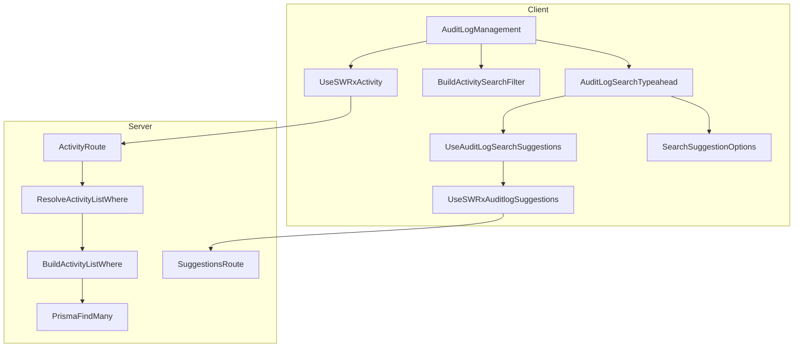
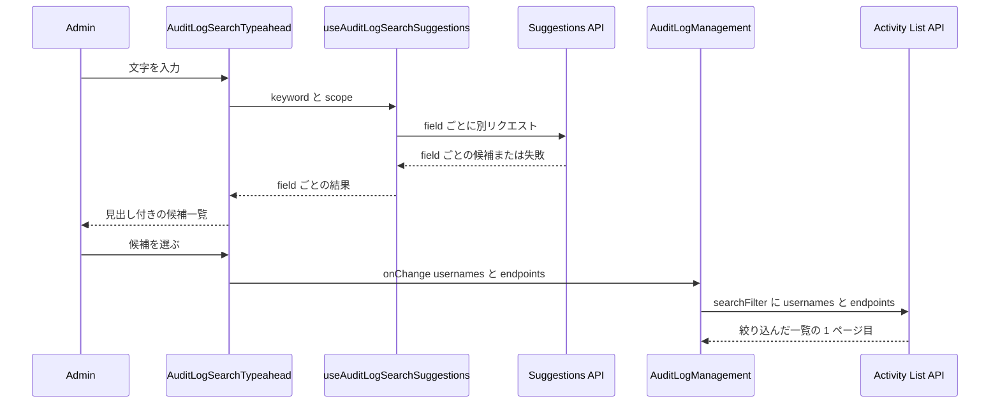

# Design Document

## Overview

**Purpose**: 監査ログ画面（`/admin/audit-log`）で、管理者が特定の URL（activity に記録された endpoint）に対する操作だけを一覧に絞り込めるようにする。

**Users**: 監査ログで操作の痕跡を調べる管理者。ユーザーと URL を 1 つの検索欄で検索し、候補から選んだ値で一覧を絞り込む。

**Impact**: 監査ログ画面のフィルター行のユーザー名の入力欄を、ユーザーと URL を扱う 1 つの検索欄に置き換える。一覧の絞り込み条件（`ISearchFilter`）に endpoint を足す。候補 API・エクスポート・全文検索ページのユーザー名の入力欄は変えない。

### Goals
- 候補から選んだ URL で、一覧をパス部分の完全一致で絞り込める（要件 1, 2）
- ユーザーと URL を 1 つの検索欄で扱い、「絞り込みを選択」で検索対象を切り替えられる（要件 3）
- 一部の種類の候補が取れないときに、取れた種類は表示し、取れなかったことを示す（要件 4）

### Non-Goals
- IP アドレスの検索（後続のタスク）
- エクスポートのモーダルの絞り込みの変更
- URL を貼り付けたときの正規化、自由入力による絞り込み
- 候補 API とサーバー側の候補の検索の変更（PR #12119 の範囲）
- 一覧のクエリの性能改善（インデックスを効かせる書き換え）

## Boundary Commitments

### This Spec Owns
- 監査ログ画面の検索欄（ユーザーと URL の候補の表示、検索対象の切り替え、選択済みの値の管理、候補の取得失敗の表示）
- 一覧の絞り込み条件の endpoint（`ISearchFilter.endpoints`）と、その一致の仕方（パス部分の完全一致）
- 監査ログ画面のリセット・ページ番号との連携
- 本機能で追加する文言（`admin` 名前空間）の 5 ロケール分
- `.kiro/specs/activity-log-snapshot/design.md` の `findSnapshotUsernamesByUsernameRegex` の段落の書き直し（Amend target）

### Out of Boundary
- 候補 API（`GET /_api/v3/activity/suggestions`）の契約とサーバー側の検索（PR #12119 が所有）
- 共有の `UsernameTypeahead` と、それを使う全文検索ページ・エクスポートのモーダル
- 監査ログのエクスポート（`features/audit-log-bulk-export`）
- activity の記録内容（`activity-log` / `activity-log-snapshot` が所有）。access_token の伏せ字処理は別チケット
- IP アドレスの検索

### Allowed Dependencies
- 候補 API の `field=username` / `field=endpoint`（PR #12119 のマージ後の契約）。画面からは既存の `useSWRxAuditlogSuggestions` を通してのみ呼ぶ
- `react-bootstrap-typeahead`（既存の依存、6.3 系）
- `@growi/core` の `escapeStringForMongoRegex`
- 既存の一覧の取得の仕組み（`buildActivitySearchFilter` → `POST /activity/list` / `GET /activity` → `resolveActivityListWhere` → `buildActivityListWhere` → Prisma `findMany`）
- 依存の方向: 型（`interfaces/activity.ts`）→ サーバーの `where` の組み立て → ルート、型 → 画面の純粋関数 → フック → コンポーネント。サーバーと画面は型だけを共有する

### Revalidation Triggers
- 候補 API のレスポンスの形（`username` / `endpoint` のキー）や、失敗時の振る舞い（500 か空の候補か）が変わったとき
- `ISearchFilter` の項目名が変わったとき（一覧の GET 経路を使う外部の呼び出し元にも影響する）
- Prisma のバージョンアップで、MongoDB での `startsWith` の変換（エスケープの有無）が変わったとき
- IP の検索を足すとき（`AUDITLOG_SEARCH_SCOPES` に行を足す）

## Architecture

### Existing Architecture Analysis
- 一覧の絞り込みは、画面の純粋関数 `buildActivitySearchFilter` が `ISearchFilter` を組み立て、サーバーの純粋関数 `resolveActivityListWhere` → `buildActivityListWhere` が Prisma の `where` に変換する。GET と POST の 2 経路が同じ関数を共有する。
- Prisma の MongoDB コネクタは `where` を `$expr` の集約に変換するため、一覧のクエリは今も全件走査で実行されている。`startsWith` は `$regexMatch` になり、値をエスケープしない（調査の詳細は `research.md`）。
- ユーザー名の入力欄 `UsernameTypeahead` は、候補の取得元を注入する共有コンポーネントで、全文検索ページとエクスポートのモーダルも使う。

### Architecture Pattern & Boundary Map



- **Selected pattern**: 既存の「純粋関数＋薄いアダプタ」を延ばす。検索欄の判断（候補の組み立て、見出し、表示の可否）は純粋関数に置き、コンポーネントとフックは薄くする。
- **新しい構成要素**: `AuditLogSearchTypeahead`（検索欄）、`useAuditLogSearchSuggestions`（種類ごとの候補の取得）、`search-suggestion-options`（候補一覧の組み立て）、`search-scopes`（検索対象の種類の表）。
- **残す既存のパターン**: 候補の取得は `useSWRxAuditlogSuggestions` 経由、一覧は `useSWRxActivity` 経由。`where` の組み立ては純粋関数。

### Technology Stack

| Layer | Choice / Version | Role in Feature | Notes |
|---|---|---|---|
| Frontend | React 18、`react-bootstrap-typeahead` 6.3、SWR | 検索欄、候補の取得 | 新しい依存はない |
| Backend | Express（apiv3）、Prisma 6.19 | 一覧の絞り込み条件の変換 | `startsWith` の値は呼び出し側でエスケープする |
| Data | MongoDB `activities` | 一覧の検索対象 | スキーマ・インデックスの変更はない |

## File Structure Plan

### Directory Structure
```
apps/app/src/client/components/Admin/AuditLog/AuditLogSearchTypeahead/
├── index.ts                                   # barrel: AuditLogSearchTypeahead と型だけを公開
├── AuditLogSearchTypeahead.tsx                # 検索欄（入力、「絞り込みを選択」、候補一覧、トークン）
├── AuditLogSearchTypeahead.spec.tsx           # コンポーネントテスト
├── search-scopes.ts                           # 検索対象の種類の表（scope → 対象 field、文言キー）
├── search-suggestion-options.ts               # 純粋関数: 種類ごとの取得結果から候補一覧のグループを組み立てる
├── search-suggestion-options.spec.ts
├── use-auditlog-search-suggestions.ts         # フック: scope に応じて field ごとに候補を取得する
├── use-auditlog-search-suggestions.spec.tsx
└── search-labels-locale-drift.spec.ts         # 追加した文言キーが 5 ロケールすべてにあることを確かめる
```

### Modified Files
- `apps/app/src/interfaces/activity.ts` — `ISearchFilter` に `endpoints?: string[]` を足す
- `apps/app/src/server/routes/apiv3/build-activity-list-where.ts` — endpoint の条件（パス部分の完全一致）を足す。`usernames` / `endpoints` の型の判定を `Array.isArray` を含む形にする
- `apps/app/src/server/routes/apiv3/build-activity-list-where.spec.ts` — endpoint の条件の単体テストを足す
- `apps/app/src/server/routes/apiv3/fetch-activity-list.ts` — `resolveActivityListWhere` で `endpoints` を受け渡す
- `apps/app/src/server/routes/apiv3/fetch-activity-list.integ.ts`（新規） — 実際の MongoDB で、パス部分の完全一致と正規表現の記号のエスケープを確かめる
- `apps/app/src/server/routes/apiv3/activity.ts` — OpenAPI の `searchFilter` の説明に `endpoints` を足す
- `apps/app/src/client/components/Admin/AuditLog/build-search-filter.ts` / `.spec.ts` — `endpoints` を受け取る
- `apps/app/src/client/components/Admin/AuditLogManagement.tsx` — `AuditLogUsernameTypeahead` を `AuditLogSearchTypeahead` に置き換え、選択済みの endpoint を状態に持ち、リセットで検索欄を初期状態に戻す
- `apps/app/public/static/locales/{en_US,fr_FR,ja_JP,ko_KR,zh_CN}/admin.json` — `audit_log_management.search.*` の文言を足す
- `.kiro/specs/activity-log-snapshot/design.md` — `findSnapshotUsernamesByUsernameRegex` の段落を、呼び出し元（`search-auditlog-suggestions.ts`）と最小文字数の判定の位置（呼び出し側）に合わせて書き直す。`spec.json` の `updated_at` を更新する

`AuditLogUsernameTypeahead` と `UsernameTypeahead` は変更しない（エクスポートのモーダルと全文検索ページが使い続ける）。

## System Flows



- 「すべて」のときは username と endpoint の 2 本のリクエストを並行して送る。一方が失敗しても、もう一方の結果は表示する。
- 検索対象の切り替えは候補の取得だけに効き、選択済みの値と一覧の絞り込みは変えない。

## Requirements Traceability

| Requirement | Summary | Components | Interfaces | Flows |
|---|---|---|---|---|
| 1.1 | 入力に前方一致する URL 候補 | useAuditLogSearchSuggestions, search-suggestion-options | 候補 API `field=endpoint` | 入力 → 候補 |
| 1.2 | 選んだ URL をトークン表示し一覧を絞り込む | AuditLogSearchTypeahead, AuditLogManagement | `onChange` | 選択 → 一覧 |
| 1.3 | 複数選択、いずれかに一致 | AuditLogSearchTypeahead, BuildActivityListWhere | `ISearchFilter.endpoints` | — |
| 1.4 | 選択を外すと条件から外れる | AuditLogSearchTypeahead, AuditLogManagement | `onChange` | — |
| 1.5 | 候補から選んだ値だけが条件 | AuditLogSearchTypeahead | 自由入力なし（`allowNew` を使わない） | — |
| 1.6 | 空のときは候補を出さない | useAuditLogSearchSuggestions | 空の keyword ではリクエストしない | — |
| 2.1 | パス部分の完全一致 | BuildActivityListWhere | `buildEndpointWhere` | — |
| 2.2 | クエリ文字列を除いて判定 | BuildActivityListWhere | `buildEndpointWhere` | — |
| 2.3 | 前方一致だけの別 URL を含めない | BuildActivityListWhere | `buildEndpointWhere` | — |
| 2.4 | 大文字小文字を区別 | BuildActivityListWhere | `buildEndpointWhere` | — |
| 3.1 | 1 つの検索欄 | AuditLogSearchTypeahead | — | — |
| 3.2 | 「すべて／ユーザー／URL」、初期値「すべて」 | AuditLogSearchTypeahead, search-scopes | `AUDITLOG_SEARCH_SCOPES` | — |
| 3.3 | 「すべて」は見出し付きで混在表示 | search-suggestion-options | `buildSuggestionGroups` | 入力 → 候補 |
| 3.4 | 種類を絞ると、その種類だけ | useAuditLogSearchSuggestions, search-scopes | scope → fields | — |
| 3.5 | 種類ごとの件数の上限 | useAuditLogSearchSuggestions | field ごとの `limit = 5` | — |
| 3.6 | ユーザーを選ぶと既存と同じ絞り込み | AuditLogManagement | `ISearchFilter.usernames` | — |
| 3.7 | Active / Inactive の区別 | search-suggestion-options, AuditLogSearchTypeahead | `SuggestionOption.status` | — |
| 3.8 | 同種は OR、異種は AND | BuildActivityListWhere | `where` の AND | — |
| 3.9 | 切り替えても選択済みの値を保つ | AuditLogSearchTypeahead | scope と選択の状態を分ける | — |
| 4.1 | 一部の種類の失敗表示 | useAuditLogSearchSuggestions, search-suggestion-options | `FieldSuggestionResult.error` | 入力 → 候補 |
| 4.2 | 単一種類の失敗表示 | search-suggestion-options | 同上 | — |
| 4.3 | 失敗しても選択と一覧を変えない | AuditLogSearchTypeahead | 失敗は候補一覧の中だけで扱う | — |
| 5.1 | 選択・解除で 1 ページ目 | AuditLogManagement | `setActivePageNumber(1)` | — |
| 5.2 | 期間・アクションと AND | BuildActivityListWhere | `where` の AND | — |
| 5.3 | リセットで選択を外し「すべて」に戻す | AuditLogManagement, AuditLogSearchTypeahead | `IClearable.clear` | — |
| 6.1 | 5 ロケールの文言 | admin.json, search-labels-locale-drift.spec | `audit_log_management.search.*` | — |

## Components and Interfaces

| Component | Domain/Layer | Intent | Req Coverage | Key Dependencies | Contracts |
|---|---|---|---|---|---|
| BuildActivityListWhere（拡張） | Server / pure | `ISearchFilter` を Prisma `where` に変換する。endpoint の条件を足す | 1.3, 2.1–2.4, 3.8, 5.2 | Prisma（P0）、`escapeStringForMongoRegex`（P0） | Service |
| ResolveActivityListWhere（拡張） | Server / pure | `endpoints` を受け渡す | 1.3 | BuildActivityListWhere（P0） | Service |
| search-scopes | Client / data | 検索対象の種類の表 | 3.2, 3.4 | — | State |
| search-suggestion-options | Client / pure | 種類ごとの結果から候補のグループを組み立てる | 1.1, 3.3, 3.7, 4.1, 4.2 | search-scopes（P0） | Service |
| useAuditLogSearchSuggestions | Client / hook | scope に応じて field ごとに候補を取得する | 1.1, 1.6, 3.4, 3.5, 4.1 | `useSWRxAuditlogSuggestions`（P0） | Service |
| AuditLogSearchTypeahead | Client / UI | 検索欄 | 1.2, 1.4, 1.5, 3.1, 3.2, 3.9, 4.3, 5.3 | 上記 3 つ（P0）、`react-bootstrap-typeahead`（P0） | State |
| AuditLogManagement（変更） | Client / UI | 選択済みの値を一覧の条件に渡す | 1.2, 3.6, 5.1, 5.3 | AuditLogSearchTypeahead（P0）、`buildActivitySearchFilter`（P0） | — |

### Shared Types

```typescript
// interfaces/activity.ts（追加）
export type ISearchFilter = {
  usernames?: string[];
  endpoints?: string[]; // path part only; matched exactly, query string ignored
  dates?: { startDate: string | null; endDate: string | null };
  actions?: SupportedActionType[];
};
```

### Server

#### BuildActivityListWhere（拡張）

| Field | Detail |
|---|---|
| Intent | 一覧の絞り込み条件を Prisma `where` に変換する純粋関数に、endpoint の条件を足す |
| Requirements | 1.3, 2.1, 2.2, 2.3, 2.4, 3.8, 5.2 |

**Responsibilities & Constraints**
- `usernames` と `endpoints` は、`Array.isArray(x) && x.length > 0 && x.every((v) => typeof v === 'string')` を満たすときだけ条件を足す。既存の `usernames` の判定（`x.length > 0 && x.every(...)`）は、文字列が来ると `.every` がなく TypeError になるため、同じ形に直す。
- endpoint の条件は「値が選んだパスのいずれかと等しい」または「値が `<パス>?` で始まる」の OR。前方一致の値は `escapeStringForMongoRegex(パス) + '\\?'` とする。Prisma は `startsWith` の値をエスケープせずに `$regexMatch` に渡すため、呼び出し側でのエスケープが必須（`.claude/rules/mongodb-regex.md`）。
- 大文字小文字は区別する（`mode: 'insensitive'` を使わない）。
- 他の条件（username・action・期間）とは AND で結合する。endpoint の OR は `where.AND` の要素（`AND: [{ OR: [...] }]`）として足し、トップレベルの `OR` は使わない。今後、別の OR 条件（IP など）を足しても衝突しない。

**Contracts**: Service [x]

```typescript
export type ActivityListFilterInput = {
  usernames: string[] | undefined;
  endpoints: string[] | undefined; // added
  actions: string[] | undefined;
  startDate: Date | undefined;
  endDate: Date | undefined;
};

// Pure: builds the endpoint clause, exported for unit tests.
export function buildEndpointWhere(
  paths: readonly string[],
): Prisma.activitiesWhereInput;
```
- Preconditions: `paths` は空でない。各要素は文字列。
- Postconditions: 返す条件は、保存値のパス部分が `paths` のいずれかと完全に一致する行だけに一致する。

**Implementation Notes**
- Validation: 一覧の GET 経路は `searchFilter` を JSON 文字列として受け取り、POST 経路はオブジェクトとして受け取る。validator は足さず、中身の型は両経路が必ず通る `buildActivityListWhere` の判定 1 か所で守る（GET の `searchFilter` は validator の時点では JSON 文字列で、中身を検証できないため）。判定を満たさない値は、その条件を付けずに無視する。値は Prisma にリテラルとして渡り、正規表現の部分はエスケープするので、NoSQL / 正規表現の注入は起きない。
- Risks: Prisma が将来 `startsWith` をエスケープするようになると二重エスケープで一致しなくなる。integ テストで検知する。

#### ResolveActivityListWhere（拡張）
- `parsedSearchFilter.endpoints` を `buildActivityListWhere` に受け渡すだけ。summary のみ。

### Client

#### search-scopes

| Field | Detail |
|---|---|
| Intent | 検索対象の種類（scope）と、それぞれが候補を取る field・文言キーを 1 か所で宣言する |
| Requirements | 3.2, 3.4 |

**Contracts**: State [x]

```typescript
export type AuditLogSearchField = 'username' | 'endpoint';
export type AuditLogSearchScope = 'all' | AuditLogSearchField;

export const AUDITLOG_SEARCH_SCOPES: readonly {
  readonly scope: AuditLogSearchScope;
  readonly fields: readonly AuditLogSearchField[];
  readonly labelKey: string; // admin:audit_log_management.search.scope.*
}[];

export const DEFAULT_AUDITLOG_SEARCH_SCOPE: AuditLogSearchScope; // 'all'
```
- 表の順序が「絞り込みを選択」の選択肢の順序と、候補一覧のグループの順序になる（ユーザー → URL）。

#### search-suggestion-options

| Field | Detail |
|---|---|
| Intent | field ごとの取得結果を、候補一覧に出すグループの配列に変換する純粋関数 |
| Requirements | 1.1, 3.3, 3.7, 4.1, 4.2 |

**Contracts**: Service [x]

```typescript
export type SuggestionOption =
  | { kind: 'username'; value: string; status: 'active' | 'inactive' }
  | { kind: 'endpoint'; value: string };

export type FieldSuggestionResult = {
  field: AuditLogSearchField;
  options: readonly SuggestionOption[];
  error: boolean;
  isLoading: boolean;
};

export type SuggestionGroup =
  | { field: AuditLogSearchField; state: 'options'; options: readonly SuggestionOption[] }
  | { field: AuditLogSearchField; state: 'error' };

export function buildSuggestionGroups(args: {
  results: readonly FieldSuggestionResult[];
  selected: readonly SuggestionOption[];
  currentText: string; // text currently in the input
  fetchedForKeyword: string; // keyword the results were fetched for
}): SuggestionGroup[];

export function isSameSuggestion(a: SuggestionOption, b: SuggestionOption): boolean;
```
- Postconditions:
  - `currentText` と `fetchedForKeyword` が違うとき（入力が取得に使った keyword より新しいとき）は、空の配列を返す。この判定は失敗のグループにもかかる。古い応答を隠す判定は、この関数だけが持つ。
  - `results` の順序（= `AUDITLOG_SEARCH_SCOPES` の順序）でグループを返す。
  - 選択済みの値（`kind` と `value` が一致するもの）は候補から除く。
  - `error` の field は `state: 'error'` のグループを返す。候補が 0 件の field はグループを返さない。

#### useAuditLogSearchSuggestions

| Field | Detail |
|---|---|
| Intent | scope と keyword から、対象の field ごとに候補 API を呼び、`FieldSuggestionResult` の配列を返す |
| Requirements | 1.1, 1.6, 3.4, 3.5, 4.1 |

**Contracts**: Service [x]

```typescript
export const AUDITLOG_SEARCH_SUGGESTION_LIMIT = 5;

export function useAuditLogSearchSuggestions(
  keyword: string,
  scope: AuditLogSearchScope,
): readonly FieldSuggestionResult[];
```
- `useSWRxAuditlogSuggestions('username', q, 5)` と `useSWRxAuditlogSuggestions('endpoint', q, 5)` を毎回同じ順序で呼ぶ（rules of hooks）。scope の対象でない field には空の keyword を渡し、リクエストしない（`useSWRxAuditlogSuggestions` は空の keyword でキーを `null` にする）。
- username の結果は `activeUsernames` / `inactiveUsernames` から `status` 付きのオプションに、endpoint の結果は `endpoint.endpoints` からオプションに変換する。
- SWR の `error` があれば `error: true` を返す。読み込み中の判定は既存の `toUsernameSuggestions` と同じく、エラー時は読み込み中にしない。

#### AuditLogSearchTypeahead

| Field | Detail |
|---|---|
| Intent | ユーザーと URL を 1 つの入力欄で検索し、選択済みの値を種類ごとに親へ通知する |
| Requirements | 1.2, 1.4, 1.5, 3.1, 3.2, 3.9, 4.3, 5.3 |

**Contracts**: State [x]

```typescript
export type AuditLogSearchSelection = {
  usernames: string[];
  endpoints: string[];
};

export type AuditLogSearchTypeaheadProps = {
  onChange: (selection: AuditLogSearchSelection) => void;
};

// forwardRef<IClearable, AuditLogSearchTypeaheadProps>
```
- State model: `scope`（初期値 `'all'`）、`selected: SuggestionOption[]`、`searchKeyword`。scope と選択は独立した状態で、scope を変えても `selected` は変えない（3.9）。
- 入力欄は `AsyncTypeahead` を `multiple` で使い、`allowNew` は使わない（1.5）。
- 候補一覧の描き方: `react-bootstrap-typeahead` 6.3 の `renderMenu` は、`filterBy` を通した後の結果と、入力中の文字（第 3 引数の `state.text`）を受け取る。そこで、`filterBy` はすべての候補を通すだけにし、`renderMenu` の中で `buildSuggestionGroups` に `state.text` と取得に使った keyword を渡してグループを組み立てる。古い応答を隠す判定と、選択済みの値を除く判定は、`buildSuggestionGroups` だけが持つ。
- `error` のグループには取得できなかった旨の文言を出す（4.1, 4.2）。候補が 1 件もなく失敗のグループだけがある場合も、その文言を出す。ユーザーの候補には Active / Inactive のバッジを付ける（デザインに合わせる）。`renderToken` で種類が分かるトークンを描く。
- 読み込み中の表示: `useAuditLogSearchSuggestions` の結果のうち、どれか 1 つでも `isLoading` なら、`AsyncTypeahead` の `isLoading` を true にする。
- 「絞り込みを選択」は入力欄の右に置くドロップダウンで、`AUDITLOG_SEARCH_SCOPES` から選択肢を作る。
- `IClearable.clear()` は選択と入力を空にし、scope を `'all'` に戻す（5.3）。
- 候補の取得に失敗しても、`selected` と `onChange` は呼ばない（4.3）。

**Implementation Notes**
- Integration: 候補 API の `endpoint` の field は PR #12119 で入る。マージ前は `AuditlogSuggestionField` に `endpoint` がないので、このコンポーネントとフックの実装は PR #12119 のマージ後に着手する。
- Risks:
  - `AsyncTypeahead` は同じ keyword の再検索で `onSearch` を呼ばないため、既存と同じく `useCache={false}` にする。
  - `renderMenu` は、`filterBy` を通した結果が 0 件でも呼ばれる。既存の `UsernameTypeahead` のように結果が空なら空を返すと、失敗のグループだけの表示（4.2）が消えるので、結果が空でも早期 return しない。

#### AuditLogManagement（変更）
- `AuditLogUsernameTypeahead` を `AuditLogSearchTypeahead` に置き換える。`onChange` で `selectedUsernames` と `selectedEndpoints` を更新し、1 ページ目に戻す（5.1）。
- `buildActivitySearchFilter` に `endpoints` を渡す。リセットでは `selectedEndpoints` も空にし、検索欄の `clear()` を呼ぶ（5.3）。
- エクスポートのモーダルへの `initialSelectedUsernames` の受け渡しは今のまま（endpoint は渡さない）。

## Data Models

### Data Contracts & Integration

**一覧 API（`POST /_api/v3/activity/list`、`GET /_api/v3/activity`）**

| 項目 | 型 | 説明 |
|---|---|---|
| `searchFilter.endpoints` | `string[]`（省略可） | 選んだ URL のパス部分。空または省略なら endpoint で絞り込まない |

- 一致の仕方: 保存値が要素のいずれかと等しい、または要素の後ろに `?` が続く値で始まる。大文字小文字を区別する。
- 既存の項目（`usernames` / `dates` / `actions`）の意味は変えない。項目を足すだけなので、既存の呼び出し元に影響しない。

**候補 API（PR #12119 の契約、変更しない）**: `GET /_api/v3/activity/suggestions?field=<username|endpoint>&q=<q>&limit=5`。レスポンスは `{ username?: { activeUsernames, inactiveUsernames }, endpoint?: { endpoints } }`。

## Error Handling

- **候補の取得要求の失敗**: field ごとの SWR の `error` を、候補一覧の中の「取得できませんでした」の表示にする。他の field の候補、選択済みの値、一覧には影響させない（4.1–4.3）。
- **候補 API が空の候補を返す場合**: 全文検索サーバーが使えずデータベースでの検索も失敗したとき、候補 API は warn ログを出して空の候補を 200 で返す（PR #12119 の契約）。画面からは区別できないため「該当なし」と同じ表示になる。要件の Boundary Context に既知の制約として書いており、サーバーのログで追う。
- **一覧の取得失敗**: 既存のまま（`toastError('Failed to get Audit Log')`）。
- **不正な `usernames` / `endpoints`**: 配列でない、または文字列でない要素を含む場合は、その条件を付けずに無視する。例外は投げない。

## Testing Strategy

### Unit Tests
- `buildActivityListWhere` / `buildEndpointWhere`: `endpoints` があるときに等しい値と `<パス>?` の前方一致の OR が `AND` の要素として付くこと、正規表現の記号を含むパスがエスケープされること、`endpoints` が空・未指定・文字列でない要素を含むときは条件が付かないこと、username・action・期間と同時に指定したときに AND になること（2.1–2.4, 3.8, 5.2）
- `buildActivityListWhere` の型の判定: `usernames` / `endpoints` に配列でない値（`"abc"` など）が来ても例外を投げず、その条件を付けないこと（1.3）
- `buildSuggestionGroups`: 「すべて」で username → endpoint の順のグループになること、選択済みの値が除かれること、失敗した field が `error` のグループになり他の field は残ること、0 件の field はグループにならないこと。入力中の文字と取得に使った keyword が違うときは、失敗のグループも含めて空になること（1.1, 3.3, 4.1, 4.2）
- `buildActivitySearchFilter`: `endpoints` が `ISearchFilter` に入ること（1.3）

### Integration Tests
- `fetch-activity-list.integ.ts`（実際の MongoDB）: `/_api/v3/page` を選ぶと `/_api/v3/page` と `/_api/v3/page?x=1` が返り、`/_api/v3/pages` と `/_API/v3/page` は返らないこと。`(` や `.` を含むパスも一致すること（Prisma の `startsWith` がエスケープしない振る舞いの固定）（2.1–2.4）
- `useAuditLogSearchSuggestions`: scope が「すべて」なら 2 field、「URL」なら endpoint だけをリクエストすること。空の keyword ではリクエストしないこと。一方の field のリクエストが失敗しても、もう一方の結果が返ること（1.6, 3.4, 4.1）

### Component Tests
- `AuditLogSearchTypeahead`:
  - URL の候補を選ぶと、トークンが表示され、`onChange` に `endpoints` が渡ること。トークンを外すと `endpoints` から消えること（1.2, 1.4）
  - 候補を選ばずに Enter を押しても `onChange` が呼ばれないこと（1.5）
  - 「すべて」で見出し付きの候補一覧が出て、ユーザーの候補に Active / Inactive のバッジが出ること（3.3, 3.7）
  - 値を選んだまま scope を切り替えても、トークンが残ること（3.9）
  - 一方の field の取得失敗で、その field の失敗表示と、もう一方の候補が出ること。選択済みのトークンが残ること（4.1, 4.3）
  - 検索対象を「URL」に絞った状態で取得に失敗し、候補が 1 件もないときにも、失敗表示が出ること（4.2）
  - 入力を続けて、表示中の候補が古い keyword のものになったときは、その候補を出さないこと（1.1）
  - `clear()` でトークンが消え、scope が「すべて」に戻ること（5.3）
- locale drift: `audit_log_management.search.*` の全キーが 5 ロケールの `admin.json` にあること（6.1）

## Security Considerations
- `endpoints` の値は正規表現として MongoDB に渡る部分を `escapeStringForMongoRegex` でエスケープする。`RegExp.escape` は使わない（`.claude/rules/mongodb-regex.md`）。
- 一覧 API と候補 API の認可（管理者のみ）は既存のまま。

## Performance & Scalability
- 一覧のクエリは、Prisma の変換により今も全件走査で実行されている。endpoint の条件を足しても走査の種類は変わらない。activities は既定で 30 日で消える（`ACTIVITY_EXPIRATION_SECONDS`）。インデックスを効かせる書き換えは本 spec の範囲外。
- 「すべて」のときの候補のリクエストは 2 本になる。入力欄の `delay`（400ms）と SWR のキャッシュで間引く。
