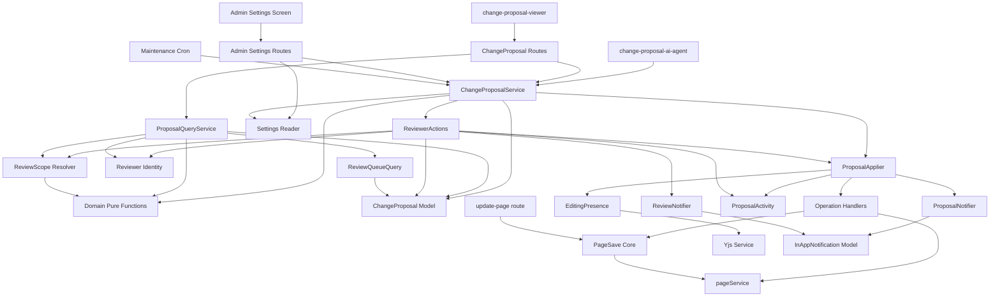
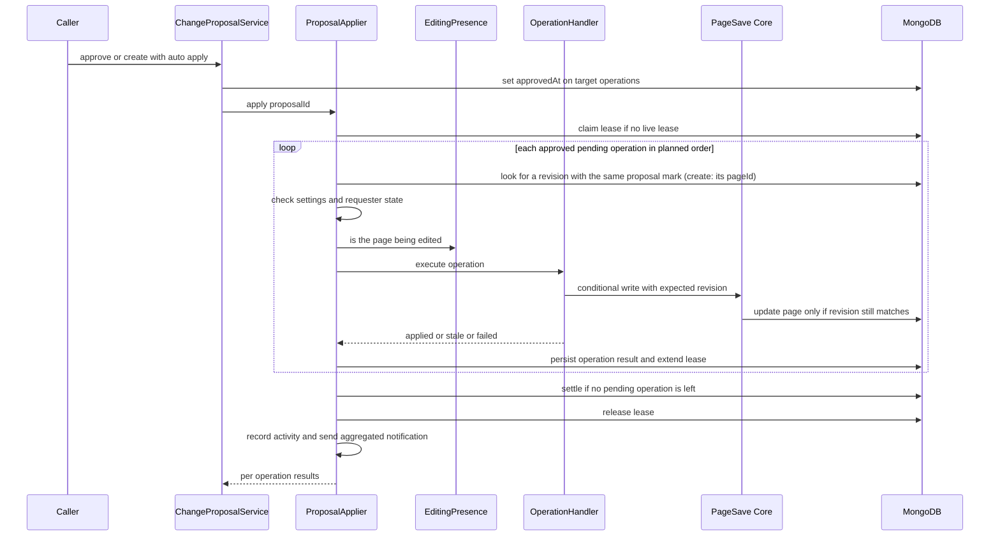
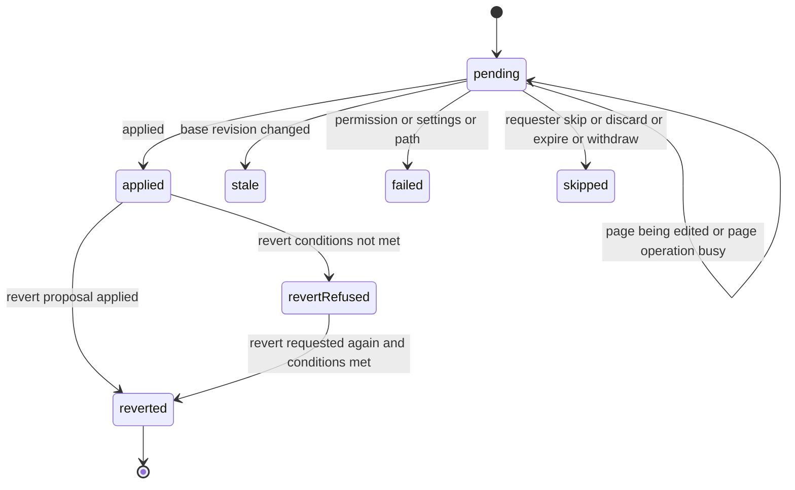
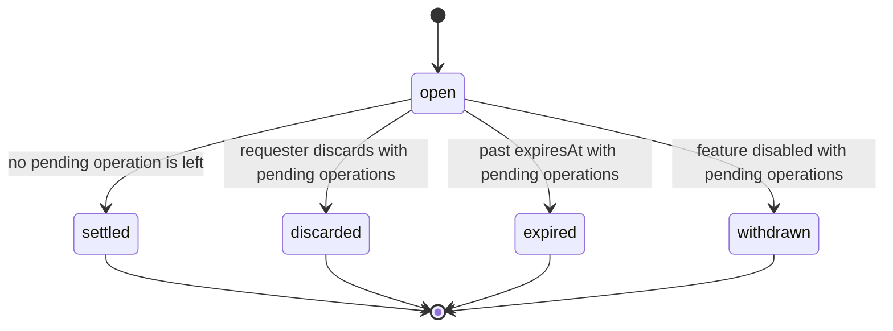
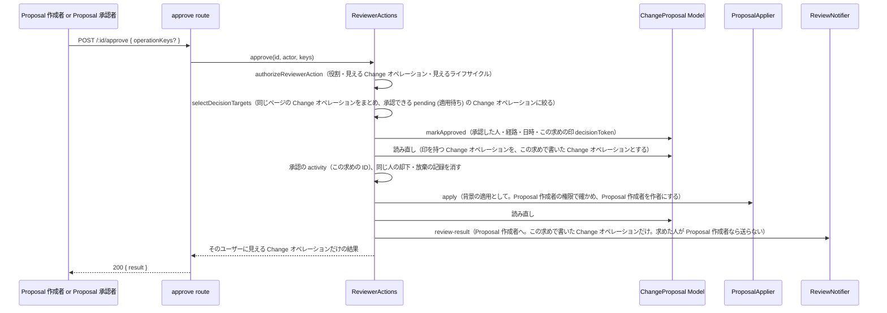

# Design Document: change-proposal-core

## この文書に書くこと・書かないこと

この文書は実装の記録ではなく、この機能を次に変えるときの出発点である。書くかどうかは「コードとテストのファイルを読めば分かるか」で決め、分かるものは書かない。迷ったら書かない。コードから分かることを書くと、コードが変わったときに黙って古くなり、文書全体が信用されなくなる。

| 書く | 書かない |
|---|---|
| 調べて初めて分かった事実（コードを少し読んだだけでは分からない動き、外部のライブラリの隠れた動き） | 関数の形、ファイルの配置、「どのファイルに何があるか」 |
| 変わった設計を選んだ理由。特に、試して退けた形とその理由 | 素直な実装の素直な説明 |
| 自動テストで確かめられないこと（残っている差） | どのテストが何を確かめているかの一覧 |
| コードから分からない手作業の確かめ方（環境の作り方、見るところ、合否を決める基準の値） | 差分があるか、いつ実装したかなど、その時点の経緯 |

requirements.md の受け入れ条件は、この基準で削らない。受け入れ条件は実装を測る約束で、番号は tasks.md・コード・テストから参照されている。

## Overview

**Purpose**: AI チャットなどの Proposal 作成元から作られた「複数のページへの Change オペレーションのまとまり」（Change Proposal）を保存し、LLM を使わずにサーバー側で適用し、取り消せるようにする。適用は人の保存と同じ上書き防止の確認を通り、確認と書き込みを 1 回の更新で行う。

**Users**: Proposal を作る側の機能を作る開発者（最初は `change-proposal-ai-agent`）と、適用後の画面を作る開発者（`change-proposal-viewer`）が、本 spec のサービスと API を使う。Proposal 作成者は承認と取り消しを、Proposal 作成者が指定した Proposal 承認者（ユーザー・グループの所属者）は自分が閲覧できるページの Change オペレーションの承認・却下・放棄を、他のユーザーは自分が閲覧できる範囲の取り消しを、管理者は書き込みの範囲と自動適用の方針を、それぞれ行う。

**Impact**: ページの更新の route（`update-page.ts`）から上書き防止の確認と書き込みを切り出し、人の保存と適用が同じ処理を通るようにする。書き込みは「最新のリビジョンが期待どおりなら書く」条件付きの更新になる。リビジョンに、作った Proposal の印（Proposal の ID と、Change オペレーションの `key`）を足す。ページには項目を足さない。承認は Proposal 作成者と Proposal 承認者の両方ができるが、適用のときの権限の確認と作者は、いつも Proposal 作成者である。

本書で使う言い方（Proposal 作成者・Proposal 承認者・Change オペレーション・元のリビジョン・Proposal 作成元・適用・取り消し・取り消し対象 Proposal・Proposal の目的・Change オペレーションの 7 つの状態・Proposal のライフサイクル・レビュー・承認・却下・放棄・承認権限チェック・オリジナルの Proposal・`follow-up` (後続) Proposal・`rework` (見直し) Proposal・適用率・共同編集中のページ・ページごとの通知設定）は、[requirements.md](./requirements.md) の「本要件で使う言い方」と同じである。調べた事実と判断の理由は [research.md](./research.md) にある。

### Goals
- Proposal を保存し、その状態を Change オペレーションごとに持つ（要件 1・2）
- 人の保存とぶつからず、共同編集中の入力を消さない適用（要件 3）
- 管理者の方針による自動適用と、Proposal 作成者と Proposal 承認者によるページ単位の承認（要件 4・16）
- 取り消し用の Proposal による取り消しと、戻してよい条件の判定（要件 5）
- リビジョンへの印、まとめたアプリ内通知、新しい activity（要件 6・7）
- 適用でページごとの通知を出すかを、管理者の通知設定とページごとの通知設定（Proposal ごとの値）で決め、出すときは人の操作と同じ通知を出す（要件 7.1・7.10–7.19・8.9）
- 管理者の設定と画面（要件 8）、Proposal を取得するユーザーごとに絞った API（要件 9）、人の保存を変えないこと（要件 10）
- 兄弟の spec の画面が使う共通の部品（表示名の表と、diff2html の設定と見た目）（要件 11）
- `pending` (適用待ち) の Change オペレーションが無くなった Proposal を自動で `settled` (完了) にし、Proposal 作成者にだけ Proposal のライフサイクルと適用率を返す（要件 2.9–2.11・12）
- `follow-up` (後続) Proposal と `rework` (見直し) Proposal をオリジナルの Proposal に結び付けて保存し、つながりを、Proposal を取得するユーザーごとに絞って返す（要件 13・14）
- Proposal に Proposal 承認者（ユーザー・グループ）を持たせ、Proposal 承認者が、自分の閲覧できるページの Change オペレーションを承認・却下・放棄できるようにする。`pending` (適用待ち) の Change オペレーションを Proposal 承認者にも返し、Proposal 承認者と Proposal 作成者に通知する。Proposal 承認者かどうかの判定と承認権限チェックは 1 組の純関数にまとめ、取得・一覧・6 つの操作・通知が同じものを使う（要件 15–22）
- Proposal を取得するユーザーが閲覧できないページの存在・件数を、Proposal 承認者への応答・通知・エラーからも分からないままにする（要件 16.6・16.7・19.6・20.3）

### Non-Goals
- AI に Proposal を作らせる道具、置き換えの指示からの本文の組み立て、内容が大きく消える Change オペレーションの拒否（`change-proposal-ai-agent`）
- 詳細ページ・一覧画面・各画面の印・取り消しボタン・まとめた通知の表示（`change-proposal-viewer`）
- REST での Proposal の作成（将来の `change-proposal-mcp` など、Proposal を作る側の spec が作る。research.md の判断を参照）
- 差分の塊ごとの承認、元のリビジョンが変わった案の自動の合わせ込み
- 複数台のサーバーの間で、ページが共同編集中かを確かめる仕組み（未決の論点）
- `follow-up` (後続) Proposal と `rework` (見直し) Proposal の中身を作ること（Proposal を作る側の spec が作る。AI チャットでは `change-proposal-ai-agent`）。core は、新しい Change オペレーションがオリジナルの Change オペレーションと同じページを対象にしているかを確かめない
- 承認・却下・放棄・Proposal 承認者の追加と削除の画面、レビュー待ちの一覧の画面、Proposal 承認者への通知と結果の通知の表示（`change-proposal-viewer`）。AI チャットで Proposal 承認者を選ぶ画面と指定の道具（`change-proposal-ai-agent`）
- ページのパスごとの既定の Proposal 承認者、Proposal 作成者自身の承認を禁止する管理者の設定、自動の割り当て、期限の前の催促、同じ Proposal の Change オペレーションの差し替えと再レビュー
- スキップする処理と適用の処理がぶつかる穴（Open Questions / Risks）を直すこと

## Boundary Commitments

### This Spec Owns
- Proposal のデータ（新しいコレクション `changeproposals`。`schema.prisma` の model と Prisma の拡張で読み書きし、索引は migration `20261110120000-add-change-proposal-indexes.js` が作る）と、その状態の移り変わり。全体の状態を Change オペレーションの状態から決める純関数
- ライフサイクル `settled` (完了) への自動の移り変わりと、Proposal 作成者にだけ返す Proposal のライフサイクルと適用率（`requesterState`）
- `follow-up` (後続) Proposal・`rework` (見直し) Proposal のつながり（`basedOn`）の保存・作成のときの検査・つながりの読み出しと、Proposal を取得するユーザーごとの絞り込み。どの Change オペレーションの状態ならつながりを作れるかの表（`BASED_ON_ELIGIBLE_STATUSES`）
- Proposal の作成・承認・スキップ・破棄・取り消し・期限切れ・取り下げを行うサービス
- 適用の実行（適用の順序、1 つの処理だけが適用する仕組み、二度書かない仕組み、Change オペレーションの種類ごとの書き込み）
- 上書き防止の確認と書き込みを 1 回の更新で行う、人の保存と共通の処理（`server/service/page-save/`）
- 戻してよいかの判定（Proposal を取得するユーザーごと、その時点のページの状態で）
- リビジョンの `proposalId` / `proposalOperationKey` の書き込み（ページには項目を足さない）
- まとめたアプリ内通知のデータ（受け取る人ごとの中身）と、新しい activity の action
- 適用でページごとの通知を出すかの判断（管理者の通知設定 `changeProposal:perPageNotificationsEnabled` と、Proposal ごとに持つページごとの通知設定 `perPageNotifications`）と、出すときの呼び出し。ページごとの通知設定を Proposal 作成者が変える API
- 人の保存と適用が共通に使う、ページごとの通知の処理（`server/service/page-save/page-notifications.ts`。グローバル通知の送信と、編集の `PAGE_UPDATE` の activity の記録）
- 管理者の設定キー、設定の API、設定画面
- Proposal の取得・一覧・承認・スキップ・破棄・取り消し・リビジョンの印の取得の REST API と、その応答の形
- 兄弟の spec の画面で共通に使う client の部品（`features/change-proposal/client/shared/`）: Change オペレーションの種類・Change オペレーションの状態・全体の状態・理由・戻せない理由・Proposal のライフサイクル・つながりの関係・Proposal 承認者の機能の言葉（Proposal 承認者・承認・却下・放棄・コメント・Proposal の目的・レビュー）の表示名の表と適用率の文言、`translation` の名前空間の `change_proposal.*` の翻訳キー（5 言語）、`i18next.config.ts` の `preservePatterns`、適用率の割合と残りの Change オペレーションを決める純関数、diff2html の設定と CSS、詳細ページの URL を作る `buildProposalHref`。ページ履歴の差分（`RevisionDiff`）もこれを使う
- Proposal 承認者の保存（`reviewers`）と、Proposal 承認者かどうか・Proposal を取得するユーザーの役割・承認権限チェック・見えるライフサイクルの判定
- 承認・却下・放棄・Proposal 承認者の追加と削除のサーバー側の処理と API、レビュー待ちの一覧（`GET /review-queue`）。承認の記録（Change オペレーションの項目）と、却下と放棄の記録（`reviews`）。却下と放棄は、Change オペレーションの状態・承認・Proposal のライフサイクル・適用率を変えない
- Proposal 承認者への通知（`review-request`）と、Proposal 作成者へのレビューの結果の通知（`review-result`）の snapshot の契約と作成。レビューと Proposal 承認者の追加・削除の activity の 5 つの action と、activity の snapshot の項目 `reviewChannel`
- `follow-up` (後続) Proposal・`rework` (見直し) Proposal による Proposal 承認者の引き継ぎと、Proposal 作成者以外の Proposal 承認者がいる Proposal の自動適用の抑止
- Proposal 承認者の機能を公開するかの切り替え（設定キー `app:changeProposalReviewersEnabled`）

### Out of Boundary
- Proposal 作成元ごとの違い（`ai-chat` (AI チャット)・`vault` (Vault)・`mcp` (MCP)）。適用・承認・取り消しの振る舞いは Proposal 作成元によって変えない
- 本文の中身の評価（短くなりすぎの判定など）。Proposal を作る側の spec の責任とする
- AI が書いた要約・会話の保存と表示（`change-proposal-ai-agent` が Proposal の ID を鍵にして持つ）
- まとめたアプリ内通知の画面での表示と文言（viewer の `commons`）、「本人に戻すよう頼む」通知（`change-proposal-viewer`）
- Proposal 承認者への通知と結果の通知の画面での表示と文言、承認の画面、レビュー待ちの一覧の画面（`change-proposal-viewer`）。core は snapshot の契約までを決める。Proposal を作る側で Proposal 承認者を指定する仕組み（`change-proposal-ai-agent`）
- それぞれの画面だけで使う文言（`change_proposal_viewer.*` と `change_proposal_chat.*`）。表示名の表にある言葉は、兄弟の spec が自分では持たない
- ページ履歴・Recent Changes・ページの見出しの印の画面（`change-proposal-viewer`）
- 閲覧できるかどうかの新しい判定の規則。既存の `Page.findByIdAndViewer` / `findByIdsAndViewer` だけを使う
- `isUpdatable` の判定の中身と、エディタが `revisionId` を送るかどうかの判定（変えない）

### Allowed Dependencies
- `apps/app/src/server/service/page/`（`pageService.updatePage` / `create` / `renamePage` / `deleteCompletely`）と `pageOperationService.canOperate`
- `apps/app/src/server/models/`（`Page`・`Revision`・`PageRedirect`・`Subscription`・`InAppNotification`・`User`）
- `crowi.globalNotificationService`（`page-save/page-notifications.ts` の `firePageGlobalNotification` から呼ぶ）と、`server/service/activity/` の `shouldGenerateUpdate`（`emitPageUpdateActivity` から呼ぶ）
- `apps/app/prisma/schema.prisma` と `apps/app/src/utils/prisma.ts`（`createPrisma()` に Proposal の拡張を登録する）
- `apps/app/src/server/service/yjs/` の `IYjsService`
- `apps/app/src/server/service/activity/`（`beginActivity` / `pendingActivityContext`）と `activityService.createActivity`
- `configManager`、`CronService`
- `@growi/core` の型と純関数（`isCreatablePage` など。リビジョンの印の型 `IRevisionProposalMark` もここに足す）
- グループの所属の読み出し（`UserGroupRelation` と `ExternalUserGroupRelation` の `findAllUserGroupIdsRelatedToUser`。ページの閲覧の判定が読むのと同じ関数）
- 依存の向き: `interfaces` → `server/domain`（純関数）→ `server/models` → `server/services` → `server/routes`・cron → `client`。`server/service/page-save/` は `features/change-proposal` に依存しない（人の保存の route も使うため）。`page-save` と `pageService` が受け取るリビジョンの印の型は `@growi/core` の `IRevisionProposalMark` で、`features/change-proposal` は自分の `ProposalMark` を純関数 `toRevisionProposalMark` で変えて渡す。`utils/prisma.ts` は `features/change-proposal/server/models/change-proposal.ts` を直接 import する（server の barrel を通すと、barrel → サービス → `utils/prisma.ts` → barrel と import が循環するため。`refreshed-model-catalog.ts` の前例と同じ）。`features/change-proposal` は `@mastra/*` / `ai` / `@ai-sdk/*` を import しない（`server-boot-imports.md`）。`client/shared/` は server のコードを import せず、`interfaces` の型だけを使う。ページ履歴の差分（`client/components/PageHistory/RevisionDiff.tsx`）は `client/shared/` の diff2html の部品を import する

### Revalidation Triggers
次の変更をしたときは、`change-proposal-ai-agent` と `change-proposal-viewer` の結合を確かめ直す。
- `ChangeProposalService` の公開の関数（作成・承認・取得）の入力と結果の形（作成の任意の `trigger` を含む）と、`ServiceError` の値
- server の barrel が export するもの（`createChangeProposalService` と型 `ChangeProposalService`。`createProposal`・`approve`・`getForViewer` などは、この関数が返すサービスの関数である。ほかに型 `ProposalQuery`、`readChangeProposalSettings`、router を作る関数）と、`interfaces` の barrel が export するもの（型、`MAX_TOTAL_BODY_BYTES`、`ApplyTrigger` / `ApplyResult` / `RevertResult`）
- REST API の応答の形（`ChangeProposalView` / `OperationView` / `ApplyResult` / `RevertResult`）、戻せない理由の値（`RevertRefusalReason`）、Change オペレーションの種類・状態・理由の値。ページがもう無い Change オペレーションに返すパス（`recordedPathOf`。`delete-completely` (完全な削除) は取り消し対象の `create` (新規作成) の Change オペレーションのパス、`edit` (編集) は適用した時点に記録したパス `appliedPagePath`）と、一覧の要約の `pages` にそのパスを入れる扱い（`pages[].path` は任意である。パスを記録する前に適用した `edit` の Change オペレーションは、ページの ID だけで入る）
- Proposal 作成者以外のユーザーに返す Change オペレーションの決まり（Proposal 作成者と、Proposal 作成者でも Proposal 承認者でもないユーザーは `selectVisibleOperations`、Proposal 承認者は `decideReviewScope`。対象のページがもう無い Change オペレーションを、取り消した人と取り消し対象 Proposal の作成者にも表示のために返し、取り消しの対象には入れない扱いを含む）と、Proposal 作成者以外に返す `lastAppliedAt` の決め方。viewer の詳細ページは、取り消しの Proposal と取り消し対象 Proposal のあいだのリンクを、取り消した人と取り消し対象 Proposal の作成者のどちらも開けることと、取り消したあとに取り直した詳細に、取り消した Change オペレーションが残ることを、この決まりに頼っている
- まとめたアプリ内通知の snapshot の形と、`targetModel` の名前、受け取る人の決め方
- リビジョンの `proposalId` / `proposalOperationKey` の意味（何を記録するか）
- `client/shared/` の表の名前・翻訳キーの名前・diff2html の部品の形
- Proposal の詳細ページの URL（`buildProposalHref` が作る `/me/change-proposals/{id}`）を変えるとき（`change-proposal-viewer` のページの route と合わせる）
- 承認の単位（同じページへの Change オペレーションをまとめて承認する扱い）と、共同編集中だったときに `pending` (適用待ち) に残す扱い
- 管理者の設定キーの名前と意味
- 共同編集中かどうかの確かめ方を、複数台のサーバーに対応させたとき
- Prisma の版を上げたとき（条件付きの更新を 1 回の処理として扱えることを、ChangeProposal Model の同時実行の結合テストで確かめ直す。research.md の「新しいコレクションは Prisma で読み書きし、索引は migration で作る」）
- Proposal のライフサイクルの値（`ProposalLifecycle`。`settled` (完了) を含む）と、`settled` にする条件（`pending` (適用待ち) の Change オペレーションが 1 つも無い）。`settled` の Proposal に、承認・スキップ・破棄が `not-open` を返し、取り消しと `follow-up` (後続) Proposal・`rework` (見直し) Proposal の作成は受け付けること
- Proposal 作成者にだけ返す `requesterState`（Proposal のライフサイクルと適用率）の形と、適用率の数え方（分子と分母に入る状態、取り消しの Proposal には返さないこと）
- `basedOn` の形、関係の値（`BasedOnRelation`）、関係ごとにオリジナルの Change オペレーションとして認める状態（`BASED_ON_ELIGIBLE_STATUSES`）、`createProposal` が返す `based-on-unavailable` / `based-on-operation-not-eligible`、`rework` (見直し) Proposal を自動適用しない扱い
- つながり（`OperationView.linkedProposals` と `ChangeProposalView.basedOn`）を Proposal 作成者以外に返す条件
- ページごとの通知: `createProposal` の任意の `perPageNotifications`、Proposal 作成者にだけ返す `requesterState.perPageNotifications` の形、ページごとの通知設定を変える API（`PUT /change-proposals/:id/per-page-notifications`）、出すかの決め方（管理者の通知設定とページごとの通知設定の両方が真のときだけ）、取り消しの Proposal が取り消し対象 Proposal のページごとの通知設定を引き継ぐこと
- Change オペレーションの数の上限と 1 日の件数の上限の初期値（50 と「上限なし」）を変えるとき（ai-agent の書き込みの道具が 1 回に受ける Change オペレーションの数 `MAX_OPERATIONS_PER_CALL` との大小が変わるため）
- `pending` (適用待ち) の Change オペレーションを、Proposal 作成者だけでなく Proposal 承認者にも返すこと（取得・レビュー待ちの一覧）。Proposal 承認者に返す Change オペレーションの決まり（承認権限チェック、見えるライフサイクル）と、Proposal 作成者以外に返す全体の状態を見えるライフサイクルから決めること
- `ChangeProposalView` の `viewerRole`・`purpose`・`reviewers`・`wholeRejections` と、`OperationView` の `order`・`baseIsLatest`・`approval`・`rejections`・`abstentions`、それぞれを返す相手
- 承認の応答（`{ result: ApplyResult }`）: `done` の `results` は、求めたキーのうち、そのユーザーに見える Change オペレーションのすべて（この回の適用の結果か、読み直した状態）。`in-progress` には、省略できる `results`（見える Change オペレーションの読み直した状態）がある。Proposal 作成者が提出後に閲覧できなくなったページの Change オペレーションは、承認できず `pending` (適用待ち) のまま残る
- 却下・放棄（`POST /:id/reviews`）、Proposal 承認者の追加と削除（`PATCH /:id/reviewers`）、レビュー待ちの一覧（`GET /review-queue`）の入力・応答・誤りの値。`ReviewerActionError` の値と、`createProposal` が返す `reviewers-disabled`・`reviewer-not-found`、`input-rejected` の `too-many-reviewers`・`purpose-too-long`・`invalid-reviewer`
- 通知の新しい種類（snapshot の `kind` が `review-request` と `review-result`）と、その形。この 2 つの通知の action は、きっかけになった activity の action（作成・Proposal 承認者の追加・承認・却下・放棄）なので、通知を読む側は、形を action ではなく snapshot の `kind` で選ぶ
- activity の新しい 5 つの action（`CHANGE_PROPOSAL_APPROVE`・`_REJECT`・`_ABSTAIN`・`_REVIEWER_ADD`・`_REVIEWER_REMOVE`）と、snapshot の型 `ChangeProposalReviewSnapshot`（項目 `reviewChannel`）と type guard `isChangeProposalReviewActivity`。監査ログの表示・検索の処理が読む。Proposal 作成者の承認でも、承認の activity は求めの ID に、適用の activity は新しい ID（`ip` と `endpoint` が空）に記録されること
- 公開の順序: viewer の承認の画面とレビュー待ちの一覧、ai-agent で Proposal 承認者を指定する仕組みが入ったあとで、設定キー `app:changeProposalReviewersEnabled` を有効にする（初期値は無効。無効の間は、Proposal 承認者の指定と追加を受け付けない）

## Architecture

### Existing Architecture Analysis
- ページの更新は route（`routes/apiv3/page/update-page.ts`）が、上書き防止の確認（`isUpdatable`）・書き込み（`pageService.updatePage`）・activity・通知・共同編集の文書の置き換えを順に呼ぶ。書き込みのときに最新のリビジョンを条件にしていない。
- 作成・更新の通知は route から、移動・完全な削除のアプリ内通知は `pageService` の中から出る。全文検索・GROWI Vault・画面の更新は `crowi.events.page` を受けて動く。
- 人の操作のページごとの通知の出どころは次のとおりである。グローバル通知（`globalNotificationService.fire`）は、どれも route が送る（編集 `PAGE_EDIT` は `update-page.ts`、新規作成 `PAGE_CREATE` は `create-page.ts`、移動 `PAGE_MOVE` は `apiv3/pages/index.js`、完全な削除 `PAGE_DELETE` は `routes/page.js`。完全な削除でも、ごみ箱へ移すときと同じ `PAGE_DELETE` を、削除する前のページで送る）。`fire` は中で、ページの閲覧範囲から送るかどうかを決める（`isSendNotification`。リンクを知る人だけ・特定のユーザーだけのページには送らず、本人だけ・グループのページは管理者の設定に従う）。購読している人へのアプリ内通知は、編集では route の `generateUpdateActivity` が `PAGE_UPDATE` の activity を `preNotify` つきで知らせることで作られ（同じ人の 5 分以内の更新では `shouldGenerateUpdate` が作らない）、移動・完全な削除では `pageService` の中で作られる。新規作成ではアプリ内通知は出ない。
- 共同編集の接続数は、プロセスごとのメモリにだけある。

### Architecture Pattern & Boundary Map



**Architecture Integration**:
- 採用する形: 確認と書き込みを共通の処理に切り出し、適用と人の保存が同じ処理を通る（research.md の案 C）。通知・activity・共同編集の文書の扱いは、呼び出し側が選ぶ。
- 機能の境界: 適用の流れの判断（順序、状態、戻せるか、見えるか）は純関数にし、DB と既存のサービスへの書き込みは、Change オペレーションの種類ごとの handler の中だけで行う。handler の一覧は種類をキーにした表で持ち、実行する側は種類で分岐しない。
- 変えずに従う既存の決まり: route の middleware の順（`activity-recording.md`）、見えないページへの一様な 404（`page-write-action-403-404.md`）、読み書きは Prisma の拡張、索引の作成は migration（`model.md`）、`isUpdatable` の中身。
- 新しい部品の理由: 適用は request が無い場面（期限切れの処理の再開、自動適用）でも動くため、route に依存しないサービスとして作る。
- Proposal 承認者の判定は純関数（Domain）にし、DB を読む部分（所属グループの読み出し、承認権限チェックで確かめるページの読み出しと閲覧の判定）を `services/` の薄い層に分ける。取得・一覧・6 つの操作・通知が同じ関数と同じ集合で判定するので、どこかの応答だけが別の答えを返すことがない（research.md の決定「Proposal 承認者の判定は 1 組の純関数にまとめる」）。

## File Structure Plan

部品の分け方（`features/change-proposal/` の中の `interfaces`・`server/domain`・`server/models`・`server/services`・`server/routes`・`client/admin`・`client/shared` と、人の保存と共通にする `server/service/page-save/`）と依存の向きは、Allowed Dependencies に書いた。ファイルの一覧は木を読めば分かるので書かない。

### Modified Files
既存のコードへの変更のうち、兄弟の spec が前提にしている決め事だけを書く。
- ページ（`pages`）には項目を足さない。新規作成で作ったページがどの Proposal によるものかは、そのページの最初のリビジョンの印で分かる（Physical Data Model）。
- リビジョン（`revisions`）に足す項目は `proposalId` と `proposalOperationKey`（Change オペレーションの `key`）の 2 つだけで、並び順の番号は書かない。`@growi/core` の `IRevision` にも同じ名前の任意の 2 項目を足し、その 2 つをまとめた型 `IRevisionProposalMark` を置く（changeset つき）。
- アプリ内通知の一覧の API（`server/service/in-app-notification.ts`）は、`targetModel` が `ChangeProposal` の通知の `target` を `_id` だけにして返す。一覧の取得は `target` を中身ごと読み込んで返すので、そのままだと受け取る人に Proposal のすべての Change オペレーションが渡り、受け取る人ごとに絞った snapshot の意味が無くなるためである。

## System Flows

### 適用の流れ



- 承認は先に記録する（`approvedAt`）。そのあとで適用の権利（lease）を取る。別の処理が適用中で lease を取れなかったときは、記録した承認を、適用中の処理が最後に読み直して続けて適用する。適用中の処理が止まった場合は、保守用の cron が lease の期限切れを見て再開する（要件 3.14・3.15）。
- 各 Change オペレーションの前に、同じ Proposal の印（`proposalId` と Change オペレーションの `key`）を持つリビジョンがすでにあるかを探す（新規作成では、見つかったリビジョンの `pageId` が作ったページである）。あれば書かずに `applied` (適用済み) として記録する。
- ページが共同編集中のとき、または重なる `PageOperation` が決まった時間を過ぎても残るときは、その Change オペレーションを `pending` (適用待ち) に戻し、`approvedAt` を消す（もう一度の承認が要る。要件 3.5・4.8）。
- すでに適用した Change オペレーションは、後の Change オペレーションが失敗しても戻さない（要件 3.13）。
- 各 Change オペレーションの前に、ページごとの通知を出すかを決める。管理者の通知設定と、その時点で保存されているページごとの通知設定を読み直し、両方が真のときだけ handler に「出す」を渡す（要件 7.1・7.10・7.13）。

### Change オペレーションの状態の移り変わり



- 状態の値は `pending` (適用待ち)・`applied` (適用済み)・`failed` (適用失敗)・`stale` (見送り)・`skipped` (スキップ)・`reverted` (取り消し済み)・`revert-refused` (取り消し不可)。
- `revert-refused` (取り消し不可) の Change オペレーションは、もう一度取り消しを求められたときに判定し直す。条件を満たせば `reverted` (取り消し済み) になる。
- `follow-up` (後続) Proposal や `rework` (見直し) Proposal を作っても適用しても、オリジナルの Change オペレーションの状態は変わらない。`reverted` にするのは取り消しの Proposal の適用だけである（要件 13.5・13.6）。

### Change Proposal のライフサイクルの移り変わり



- ライフサイクルの値は `open` (進行中)・`settled` (完了)・`discarded` (破棄)・`expired` (期限切れ)・`withdrawn` (取り下げ)。`open` 以外からは動かない。
- `settled` (完了) にする書き込みは、`pending` (適用待ち) の Change オペレーションの状態を変えた書き込みのすぐあとに、同じ処理が `settleIfNoPending`（`lifecycle: 'open'` で `pending` の Change オペレーションが 1 つも無いことを条件にした更新）で行う。呼ぶのは、適用の 1 回の実行の終わり（`ProposalApplier`）と、スキップする処理（`skip`）のあとである。条件付きの更新なので、何度呼んでも結果は同じである。最後の `pending` を同時に変えた 2 つの処理のうち、あとに書いたほうが必ず `settled` にする（research.md の「`settled` (完了) は、`pending` (適用待ち) の状態を変えた書き込みのすぐあとの条件付きの更新で決める」）。
- 2 つの書き込みの間で処理が止まると、`open` (進行中) のまま `pending` (適用待ち) の Change オペレーションが無い Proposal が残る。保守用の cron がこれを探して `settled` (完了) にする（`findIdsOpenWithoutPending`）。期限切れと取り下げは `pending` の Change オペレーションが 1 つ以上あることを条件にするので、こうした Proposal を `expired` (期限切れ) や `withdrawn` (取り下げ) にすることは無い（要件 2.11）。
- `settled` (完了) の Proposal は承認・スキップ・破棄の対象にならない（`lifecycle` が `open` であることを条件にしているため、`not-open` が返る）。`applied` (適用済み) の Change オペレーションの取り消しは、Proposal のライフサイクルを見ないので今までどおり動く（要件 2.10）。

### 後続と見直しの作成の流れ
1. Proposal を作る側が `createProposal` に `basedOn`（オリジナルの Proposal の ID・関係・オリジナルの Change オペレーションの `key` の一覧）を渡す。
2. サービスは、ほかの検査（Requirement 1）のあとでオリジナルの Proposal を読み（`findProposal`）、`validateBasedOn` で確かめる。オリジナルの Proposal が無い、Proposal 作成者が違う、オリジナルの Proposal が取り消しの Proposal である、のどれでも同じ `based-on-unavailable` を返す。指定したオリジナルの Change オペレーションが空、オリジナルの Proposal に無い `key`、関係に合わない状態の Change オペレーションがあれば `based-on-operation-not-eligible`（最初に合わなかった `key` つき）を返す（要件 13.2・13.3）。
3. 保存する。`key` の重なりは 1 つにまとめる。オリジナルの Proposal とオリジナルの Change オペレーションは書き換えない（要件 13.5）。
4. 自動適用の対象を決める。関係が `rework` なら `selectAutoApplyTargets` は空を返し、すべての Change オペレーションが `pending` (適用待ち) のまま承認を待つ（要件 13.4）。`follow-up` は通常と同じ（要件 13.7）。

### 取り消しの流れ
1. 取り消しを求めた人が閲覧できるページの Change オペレーション（Proposal 作成者には、ページがもう無い Change オペレーションも含む）から、指定された Change オペレーション（指定が無ければ、`applied` (適用済み) と `revert-refused` (取り消し不可) の Change オペレーションのすべて）を選ぶ（`selectVisibleOperations`）。取り消した人と取り消し対象 Proposal の作成者にも返す扱い（要件 9.15）は、表示のための決まりなので、ここでは使わない（`contextFor` に、この 2 人を決める値を空で渡す）。そのため、この扱いで表示されているだけの Change オペレーションは、取り消しの対象にならず、状態も変わらない。
2. 選んだ Change オペレーションごとに、その時点のページの状態で戻せるかを判定する（`judgeRevertability`）。戻せない Change オペレーションは、取り消し対象 Proposal の中で `revert-refused` (取り消し不可) にし、理由を記録する。
3. 戻せる Change オペレーションから、取り消しの Proposal の Change オペレーションを作る（`buildRevertOperations`）。Proposal 作成元は `revert` (取り消し)、Proposal 作成者は取り消しを求めた人で、各 Change オペレーションは戻す相手（取り消し対象 Proposal の ID と、取り消し対象の Change オペレーションの `key`）を持つ。編集は元の本文に戻す編集、新規作成はページを完全に削除する Change オペレーション（`delete-completely`。ごみ箱には残さない）、移動は元のパスへ戻す移動になる。取り消しの Proposal の Change オペレーションを戻すときは、編集と移動は同じ形になる。`delete-completely` は、消したページを戻せないので取り消せない（`judgeRevertability` が `target-unavailable` で断る。要件 5.12・5.15）。
4. 自動適用の方針と承認を通さず、すぐに適用する（要件 5.10）。取り消しの Proposal の Change オペレーションは、作る時点で `approvedAt` に作成の日時を入れて保存する（取り消しを求めた人が承認したものとして扱う）。これにより、`ProposalApplier`（`approvedAt` を持つ `pending` (適用待ち) の Change オペレーションだけを適用する）と保守用の cron の再開の候補が、通常の承認済みの Change オペレーションと同じようにこの Change オペレーションを拾う。適用が終わったあとに `settled` (完了) にするのは `settleIfNoPending` である。
5. `applied` (適用済み) になった取り消しの Change オペレーションに対応する取り消し対象の Change オペレーションを `reverted` (取り消し済み) にし、取り消しの Proposal の ID を記録する。取り消しの Change オペレーションが `stale` (見送り) か `failed` (適用失敗) になったときは、取り消し対象の Change オペレーションを `revert-refused` (取り消し不可) にし、次の表で理由を決める。ページが共同編集中だったときは、取り消しの Change オペレーションを `skipped` (スキップ) にし、取り消し対象の Change オペレーションは `applied` のまま残す（要件 5.11）。

| 取り消しの Change オペレーションの結果 | 取り消し対象の Change オペレーションに記録する理由（`RevertRefusalReason`） |
|---|---|
| `stale` (見送り)（`base-revision-changed`） | `edited-after-apply` |
| `failed` (適用失敗) で、理由がすでに `RevertRefusalReason` の値（`target-unavailable`・`has-children`・`not-deletable` など） | その値のまま |
| `failed` で、理由が `path-occupied` | `original-path-occupied` |
| 重なる `PageOperation` が決めた時間を過ぎても残った | `page-operation-in-progress` |
| `failed` で、それ以外の理由（`write-error`・`requester-not-allowed`・`grant-not-assignable`） | `apply-failed` |

- `revert-refused` (取り消し不可) の Change オペレーションは、もう一度取り消しを求めれば判定し直すので、表の後の 2 つは、時間をおいて求め直せば戻せることがある。

### 承認の流れ（Proposal 作成者と Proposal 承認者に共通）



- 承認の入口は 1 つで、Proposal 作成者の承認もここを通る。スキップ・破棄・ページごとの通知設定の変更は、Proposal 作成者だけの操作として別の入口（`requester-actions.ts`）に残す。
- 「この求めで書いた Change オペレーション」は、適用の前に読み直して決める。共同編集中だったために `pending` (適用待ち) に戻った Change オペレーションは印が消えるので、適用のあとでは決められない（**書き込んだ操作の判定**は ReviewerActions の節）。
- 適用は、背景の適用と同じ形（`trigger.kind: 'background'`）で呼ぶ。適用の activity は新しい ID で、操作者は Proposal 作成者、`ip` と `endpoint` は空になる。Proposal 承認者の `ip` と `endpoint` は、承認の activity だけが持つ（ProposalActivity の節）。
- 適用は lease を取った 1 つの処理だけが動くので、同時に承認が来ても書き込みは 1 回である（要件 16.5）。lease を取れなかったときの応答は `in-progress` で、見える Change オペレーションの読み直した状態を `results` に入れる。
- 却下と放棄は、Change オペレーションの状態を書かず、`reviews` に記録を足すだけである。承認との競合の条件も、`settleIfNoPending` の呼び出しも要らない。却下の記録があっても、承認は通常どおり働く（要件 17.9）。

## Components and Interfaces

| Component | Domain/Layer | Intent | Key Dependencies | Contracts |
|-----------|--------------|--------|------------------|-----------|
| Domain Pure Functions | domain | 状態・順序・承認・戻せるか・見えるか・適用率・つながり・ページごとの通知の判断 | なし | Service |
| ChangeProposal Model | data | 新しいコレクションの読み書き（Prisma の拡張）と、通知の `target` を読み込むための Mongoose のモデルの登録 | Prisma (P0)、Mongoose（空の schema の登録だけ）(P0) | Service, State |
| Settings | services | 設定キーの読み書き | configManager (P0) | Service |
| EditingPresence | services | ページが共同編集中かの確認 | IYjsService (P0) | Service |
| PageSave Core | server/service/page-save | 確認と条件付きの書き込み（人の保存と共通） | pageService (P0)、Page model (P0) | Service |
| Operation Handlers | services | Change オペレーションの種類ごとの書き込みと、ページごとの通知 | PageSave Core (P0)、pageService (P0)、page-notifications (P1) | Service |
| ProposalApplier | services | 適用の実行 | Handlers (P0)、Presence (P0)、Model (P0) | Service, State |
| ProposalNotifier | services | まとめたアプリ内通知 | InAppNotification (P0)、Subscription (P1) | Service, Event |
| ProposalActivity | services | activity の記録 | activity service (P0) | Service |
| ChangeProposalService | services | 作成・承認・スキップ・破棄・取り消し・期限切れ・取り下げ・ページごとの通知設定の変更 | Applier (P0)、Model (P0)、Settings (P0) | Service |
| ReviewerActions | services | 承認（Proposal 作成者と Proposal 承認者に共通）・却下・全体の却下・放棄・Proposal 承認者の追加と削除 | Model (P0)、ReviewScope Resolver (P0)、Applier (P0)、ReviewNotifier (P1)、ProposalActivity (P1) | Service |
| ReviewScope Resolver | services | Proposal を取得するユーザーの所属の読み出しと、役割ごとの見える Change オペレーション・承認権限チェック・見えるライフサイクルの決定 | group relations (P0)、Page model (P0) | Service |
| ReviewQueueQuery | services | レビュー待ちの一覧 | Model (P0)、ReviewScope Resolver (P0) | Service |
| ReviewNotifier | services | Proposal 承認者への通知と、Proposal 作成者へのレビューの結果の通知 | InAppNotification (P0) | Service, Event |
| ProposalQueryService | services | Proposal を取得するユーザーごとに絞った取得 | Model (P0)、Page model (P0) | Service |
| MaintenanceCron | services | 期限切れ・取り下げ・再開と、`settled` (完了) にする書き込みの前で止まった Proposal の完了 | CronService (P0) | Batch |
| ChangeProposal Routes | routes | 利用者の REST API | Service (P0)、Query (P0) | API |
| Admin Settings Routes | routes | 管理者の設定の API | Settings (P0)、Service (P1) | API |
| Admin Settings Screen | client | 管理者の設定画面 | Admin Routes (P0) | — |
| Client Shared | client | 兄弟の spec の画面と `RevisionDiff` が使う表示名の表と diff2html の部品 | interfaces (P0)、diff2html (P0) | — |

### Domain（純関数）

#### Domain Pure Functions

| Field | Detail |
|-------|--------|
| Intent | DB を読まない判断をすべて純関数にし、サービスはそれに入力を渡すだけにする |

**Responsibilities & Constraints**
- どの関数も DB・設定・時刻を直接読まない。必要な値は引数で受け取る。
- 各ファイルに同じ場所の `*.spec.ts` を置く。

**Contracts**: Service [x]

- `deriveProposalStatus` の決め方（上から順に当てはめる）:
  1. `lifecycle` が `open` で、`pending` (適用待ち) の Change オペレーションが 1 つ以上ある → `pending`
  2. `applied` (適用済み)・`reverted` (取り消し済み)・`revert-refused` (取り消し不可) の Change オペレーションが 1 つも無い → `lifecycle` が `discarded` / `expired` / `withdrawn` ならその値、`open` か `settled` なら `not-applied`
  3. それらの Change オペレーションがすべて `reverted` → `reverted`
  4. `reverted` が 1 つ以上ある → `partially-reverted`
  5. `failed` (適用失敗)・`stale` (見送り)・`skipped` (スキップ) の Change オペレーションが 1 つ以上ある → `partially-applied`
  6. それ以外 → `applied`
- Proposal 作成者以外への応答では、`deriveProposalStatus` に見える Change オペレーションだけを渡し、ライフサイクルには実際の `lifecycle` ではなく、見える Change オペレーションだけから決めた「見えるライフサイクル」（`deriveVisibleStage`）を渡す（見えない Change オペレーションの状態と、見えない `pending` (適用待ち) の有無が全体の状態に表れないようにする。要件 9.4・19.6）。Proposal 作成者でも Proposal 承認者でもないユーザーに見える Change オペレーションは `applied` (適用済み)・`reverted` (取り消し済み)・`revert-refused` (取り消し不可) だけなので、規則 1・2・5 には当てはまらず、全体の状態は `applied` / `reverted` / `partially-reverted` のどれかになる（`pending` と `partially-applied` にはならない。要件 9.2）。Proposal 承認者には、見える `pending` の Change オペレーションがあれば `pending` になる。
- `deriveVisibleStage` の規則: 見える Change オペレーションに `pending` (適用待ち) が 1 つ以上あれば `open`。無ければ、見える `skipped` (スキップ) の Change オペレーションの理由（`expired` / `discarded` / `withdrawn`）があればそのライフサイクル、それも無ければ `settled`。実際のライフサイクルは使わない。実際のライフサイクルを使うと、見える Change オペレーションが `failed` (適用失敗) 1 件で、見えない `pending` が 1 件ある Proposal を破棄したときに、そのユーザーの画面だけが `discarded` になり、見えない `pending` があったことが分かってしまう（Change オペレーションが 1 件だけの Proposal なら `not-applied` になる）。
- `selectVisibleOperations` の規則（要件で決めた、Proposal を取得するユーザーに返す Change オペレーションのうち、Proposal 作成者と、Proposal 作成者でも Proposal 承認者でもないユーザーの分を表す。1 件の取得・適用済みの一覧・リビジョンの印・つながりの判定・取り消しの対象の選び方が、すべてこの関数を通す。取り消しの対象の選び方だけは、取り消した人と取り消し対象 Proposal の作成者を決める値を空にした文脈で通す。Proposal 承認者の分は、この関数の結果に `decideReviewScope` が承認権限チェックを重ねて決める。ReviewScope Resolver の節）:
  - 対象のページ（編集・移動・完全な削除では `pageId`、新規作成では適用で作った `resultPageId`）が `viewablePageIds` に無い Change オペレーションは返さない。ただし、対象のページがもう存在しない Change オペレーション（`deletedPageIds`。完全に削除されたページ）は、Proposal 作成者に返し、取り消した人と取り消し対象 Proposal の作成者にも返す（要件 9.11・9.15）。取り消した人と取り消し対象 Proposal の作成者には、状態が `applied` / `reverted` / `revert-refused` の Change オペレーションだけを返す。ページが無いので閲覧できるかを判定できないが、ここで返す人は、どの人も、その Change オペレーションのページを見る権利があったことが確かである（research.md の決定「ページがもう無い Change オペレーションは、取り消し対象 Proposal の作成者と、取り消した人にも見せる」）。ほかのユーザーには存在も知らせない。`loadViewablePages` は、Proposal を取得するユーザーが読めなかったページだけについて、存在するかを 1 回の問い合わせで確かめる。
  - 取得するユーザーが取り消した人か取り消し対象 Proposal の作成者かは、文脈（`VisibilityContext`）の 2 つの値で決める。`isOriginalRequester` は、取得する Proposal が取り消しの Proposal で、取得するユーザーがその取り消し対象 Proposal（`revertOf`）の作成者であるときに真になる。`revertProposalIdsByViewer` は、取得するユーザーが作成者である取り消しの Proposal の ID の集合である。Change オペレーションの `revertedByProposalId` がこれに入れば、そのユーザーはその Change オペレーションを取り消した人である。Change オペレーションの側では `revertedByProposalId` を判断に使う（`VisibilityOperationFacts` に含める）。
  - Proposal 作成者以外には、状態が `applied` / `reverted` / `revert-refused` でない Change オペレーションを返さない。Proposal の `lifecycle` はこの判断に使わない（要件 9.2）。
  - Proposal 作成者以外には、`anyoneWithLinkPageIds` に入るページの Change オペレーションを返さない（要件 9.5）。
  - まだページが無い新規作成の Change オペレーション（`pending` (適用待ち)・`failed` (適用失敗)・`stale` (見送り)・`skipped` (スキップ)）は、Proposal 作成者にだけ返す。取り消した人と取り消し対象 Proposal の作成者にも返す扱いは、ページがもう無い Change オペレーションにだけ当てる。
- 取り消した人と取り消し対象 Proposal の作成者を決める 2 つの値は、`VisibilityContext` の必須の項目なので、`selectVisibleOperations` を呼ぶ処理は、どれも値を渡し忘れられない。値を読んで渡すのは、1 件の取得（つながりの判定を含む）・自分の一覧・適用済みの一覧である。1 件の取得は、ReviewScope Resolver に読ませて `decideReviewScope` に渡す。取り消しの対象を選ぶ `revert-action.ts` は、`contextFor` に空の値（`NO_REVERT_COUNTERPART`。`isOriginalRequester` は偽、`revertProposalIdsByViewer` は空の集合）を渡す。リビジョンの印（`revision-marks-query.ts`）も空の値を渡す。`deleteCompletely` はページのリビジョンも消す（`server/service/page/delete-completely-operation.ts`）ので、印がページのもう無い Change オペレーションを指すことは無く、取り消した人と取り消し対象 Proposal の作成者にも返す扱いが効く場面が無いためである。レビュー待ちの一覧・Proposal 承認者の操作の認可・Proposal 承認者への通知も、この 2 つの値を読まない（空の値で判定する）。これらが決めるのは `pending` (適用待ち) の Change オペレーションの扱いで、取り消した人と取り消し対象 Proposal の作成者にも返す扱いは関わらないためである。
- `recordedPathOf` の規則: ページがもう無い Change オペレーションのパスを、Change オペレーションの記録から決める。`create` (新規作成) は `path`、`move` (移動) は移動先の `toPath`、`edit` (編集) は適用したときに記録した `appliedPagePath`（要件 6.7）、`delete-completely` (完全な削除) は `collectCreatedPaths` で取り消し対象の `create` の Change オペレーションから引いたパスにする。記録に無いとき（`appliedPagePath` を記録する前に適用した `edit` など）は、パスを返さない。1 件の取得の Change オペレーションと、一覧の要約のページの一覧の両方が、この関数を使う（要件 9.17）。呼び出し側は、`selectVisibleOperations` を通った Change オペレーション（Proposal 作成者か、取り消した人か、取り消し対象 Proposal の作成者に返すもの）にだけ使うので、ページがもう無い Change オペレーションのパスが、ほかの人に渡ることは無い。
- `collectCreatedPaths` の規則: Proposal の Change オペレーションのうち `create` (新規作成) のものから、Change オペレーションの `key` からパスへの表を作る。取り消しの Proposal の `delete-completely` (完全な削除) の Change オペレーションのパスは、この表を取り消し対象 Proposal の Change オペレーションで作り、`revertTarget.operationKey` で引く。応答の Change オペレーションの `path`（要件 9.16）と、まとめた通知で取り消し対象 Proposal の作成者に入れる、完全に削除したページのパス（要件 7.8）は、どちらもこの関数を使う。
- `judgeRevertability` の規則（`Revertability` は Data Models を参照）。Change オペレーションの種類ごとに規則を持ち、種類で分岐する場所はこの関数の中の表だけにする:
  - 状態が `applied` か `revert-refused` でない → `not-revertible-state`
  - ページが無い → `target-unavailable`
  - 編集: `latestRevisionId` が適用で作ったリビジョンでない → `edited-after-apply`
  - 新規作成: 子のページがある → `has-children`。最新のリビジョンが適用で作ったリビジョンでない → `edited-after-apply`
  - 移動: ページのパスが移動先のままでない → `moved-after-apply`。移動元のパスが使われている → `original-path-occupied`
  - 完全な削除（取り消しで行った Change オペレーション。要件 5.15）: いつも `target-unavailable`（消したページは戻せない）
  - 新規作成の取り消し（完全な削除）の削除権限（要件 5.16）: 子のページ → 適用後の編集 の判定のあと、取り消しを求めた人がそのページを完全に削除してよくなければ `not-deletable`。判定は `createCanDeletePageCompletely`（`services/page-delete-permission.ts`）で、人の完全な削除の route（`routes/page.js`）と同じ `canDeleteCompletely`（管理者設定 `security:pageCompleteDeletionAuthority`。複数のグループに公開されたページで公開先のすべてのグループに属することを求める設定もこの中で見る。所属グループは `pageGrantService.getUserRelatedGroups` で 1 人につき 1 回読む）と、ユーザーのホームのページでの `canDeleteUserHomepageByConfig` と `isUsersHomepageOwnerAbsent` に加えて、route が見ていない `canDelete`（`security:pageDeletionAuthority`）も求める。作成者は `getCreatorIdForCanDelete` で求める。人の操作より弱くならないように、どちらの権限も満たすことを条件にする。`CurrentPageFacts.canDelete` は ProposalService が取り消しを求めた人（取得では Proposal を取得するユーザー）の権限で、新規作成で作ったページについてだけまとめて読む。handler も書き込みの直前に同じ関数で確かめるので、表示する「戻せるか」と実際の判定がずれない
  - それ以外 → 戻せる
- `selectAutoApplyTargets` は、`relation` が `rework` なら方針にかかわらず空を返す（`rework` (見直し) Proposal は、Proposal 作成者または Proposal 承認者が差分を確かめてから適用する。要件 13.4）。保存した Proposal の Proposal 承認者の指定に Proposal 作成者以外がいる（`hasForeignReviewer`）ときも、方針にかかわらず空を返す（要件 15.11・22.5）。それ以外の `follow-up` と `null` は方針で決める（要件 13.7）。入力の Proposal 承認者の指定ではなく、保存した文書の Proposal 承認者の指定（引き継いだものを含む）を渡す。
- `validateBasedOn` の規則（上から順に当てはめる）:
  1. `base` が無い、`base.requester` が `requesterId` でない、`base.entry` が `revert` → `based-on-unavailable`（3 つを区別しない。要件 13.2）
  2. `operationKeys` が空 → `based-on-operation-not-eligible`（`operationKey` 無し）
  3. `key` が `base.operations` に無い、または状態が `BASED_ON_ELIGIBLE_STATUSES[relation]` に入らない → `based-on-operation-not-eligible`（最初に当たった `key`。要件 13.3）
  4. それ以外 → 重なった `key` を 1 つにまとめた `basedOn` を返す
- `BASED_ON_ELIGIBLE_STATUSES`（`interfaces/change-proposal.ts` の表）: `follow-up` は `stale`・`failed`・`skipped`（理由を問わない）、`rework` は `applied`・`revert-refused`。`pending` はオリジナルの Proposal でまだ承認できるので `follow-up` (後続) Proposal の対象にしない。`reverted` はすでに戻した内容なので `rework` (見直し) Proposal の対象にしない。兄弟の spec の画面も、ボタンを出すかの判断にこの表を使う。
- `computeAchievement` の規則: `entry` が `revert` なら返さない（取り消しの Change オペレーションの `stale` (見送り)・`failed` (適用失敗) は、取り消し対象の Change オペレーションの `revert-refused` (取り消し不可) として表すため。要件 12.3）。それ以外は、`applied` を「状態が `applied`・`reverted`・`revert-refused`（`APPLIED_AT_LEAST_ONCE_STATUSES`）の Change オペレーションの数」、`attempted` を「全体の Change オペレーションの数から、状態が `skipped` で理由が `skipped-by-requester` の Change オペレーションの数を引いた数」にする（要件 12.2）。`attempted` が 0 のときも 0 のまま返し、割合にするのは画面の側（`toAchievementPercent`）である。
- `shouldSendPerPageNotifications` の規則: 管理者の通知設定とページごとの通知設定の両方が真のときだけ真を返す。取り消しの Proposal も同じ規則で決める（取り消しは書き込み機能の設定を確かめないが、管理者の通知設定とページごとの通知設定は確かめる）。2 つの値を組み合わせる場所をこの関数 1 つにし、handler と applier は結果の真偽だけを扱う（要件 7.1・7.10）。
- `buildProposalLinks` の規則: `returnedOperationKeys` に入る `key` にだけ、つながりを付ける（Proposal を取得するユーザーに返さないオリジナルの Change オペレーションには付けない）。`isVisibleToViewer` が偽のつながりは付けない（要件 14.3）。同じ Proposal が同じ Change オペレーションを 2 回指すことは無い（`validateBasedOn` が `key` をまとめるため）。

##### Reviewer Domain（承認者の判定）
- Proposal 承認者の判定（`reviewer-model.ts`）:
  - 有効な Proposal 承認者の指定は、`removedAt` を持たない要素である。以下の判定は、どれも有効な要素だけを見る。
  - `isReviewer`: 判定するユーザー自身か、そのユーザーの所属グループ（`ViewerIdentity` の `userGroupIds` / `externalUserGroupIds`）が有効な Proposal 承認者の指定に含まれれば真。有効な Proposal 承認者の指定が 0 件なら、Proposal 作成者だけを Proposal 承認者とみなす（要件 15.4・18.4）。有効な Proposal 承認者の指定が 1 件でもあれば、Proposal 作成者はその中にいない限り `isReviewer` では真にならない。Proposal 作成者の承認の権限は、呼び出す側が「Proposal 作成者 または `isReviewer`」で判定する（要件 16.3）。
  - `deriveViewerRole`: `requester` / `reviewer` / `other` を返す。Proposal 作成者が自分自身や自分のグループを Proposal 承認者に指定していても、`requester` を優先する。
  - `hasForeignReviewer`: Proposal 作成者以外のユーザーまたはグループが有効な Proposal 承認者の指定にあれば真（要件 15.11・22.5、機能の切り替えの判定）。
  - `dedupeReviewerInputs`: 作成と追加の入力の、同じ `(kind, id)` を 1 つにまとめる（要件 15.6）。
  - 所属は操作の時点のものを、呼ぶ側が `ViewerIdentity` として 1 回だけ読んで渡す（要件 19.9）。子グループへの展開はしない（所属の記録は親グループの分も作られるので、直接の所属を見るだけでページの閲覧範囲と同じ規則になる）。
- 承認権限チェックで確かめるページ（`review-scope.ts`）: 次の 2 つの関数と、ReviewScope Resolver の `decideReviewScope` が、承認権限チェックを実装する。
  - `reviewScopeOf` は、承認権限チェックで確かめるページとして、編集では対象のページ、新規作成では親の候補のパス、移動では移動元のページと移動先の親の候補のパスを返す。完全な削除は取り消しの Proposal だけが持ち、取り消しの Proposal は Proposal 承認者を持たない（要件 22.6）ので、Proposal 承認者の判定には使わない。
  - `resolveAncestors` は、候補のパスを上へたどり、**空でない**最初のページのパスを返す（適用が新規作成の親を決める `findNonEmptyClosestAncestor` と同じ規則）。ルートまで空か無いときは `null` を返し、その Change オペレーションは承認権限チェックを通らない（Proposal 承認者に見せない）。親が `null` のときに閲覧の確認を省くと、確認なしに Proposal 承認者に見えてしまう（要件 19.6）。
- `canApprove`（`review-decision.ts`）: 状態が `pending` (適用待ち) で、まだ承認されていない（`approvedAt` が無い）Change オペレーションだけを受け付ける。それ以外は書き込まず、今の状態を返す（要件 16.5・16.11）。承認されて適用を待つ間の Change オペレーションは `awaitingApply` として区別する。共同編集中だったために `pending` に戻った Change オペレーションは `approvedAt` が消えるので、もう一度承認できる（要件 16.10）。却下と放棄は Change オペレーションの状態を見ないので、この関数を使わない。
- `selectDecisionTargets`（DB を読まない）: 求められたキーを、次の順で絞る。(a) 見える Change オペレーションに入らないキーは、存在しないキーと同じに無視する（要件 16.6）。(b) 残ったキーに、同じページの Change オペレーションをまとめる処理（`expandApprovalTargets`）を、見える Change オペレーションの中だけで行う（見えないキーを送って、同じページの見える Change オペレーションを承認させることはできない。見えない移動の Change オペレーションもまとめない）。(c) 承認できる Change オペレーション（見える Change オペレーションのうち `pending` (適用待ち) のもの。自分が放棄した Change オペレーションも含む。Proposal 承認者では、承認権限チェックを通ったもの）に入らないキーは書き込まない（要件 16.11）。結果は、応答に並べる `requestedKeys`（求めたキーのうち見えるもの）と、書き込む `targetKeys` の 2 つである。(b) で入力を見える Change オペレーションに絞るのは、見えないキーを使って見える Change オペレーションを承認させないためである。(c) で承認できる Change オペレーションとの共通部分を取るのは、`pending` でない Change オペレーションに書き込まないためである。目的が違うので、片方にまとめない。

### Data

#### ChangeProposal Model

| Field | Detail |
|-------|--------|
| Intent | Proposal を 1 文書として保存する。Change オペレーションは文書の中の配列に持つ。読み書きはすべて Prisma の拡張の関数を通す |

**Responsibilities & Constraints**
- 読み書きは、`server/models/change-proposal.ts` の Prisma の拡張の関数（`prisma.changeproposals.<関数>`）だけで行う。サービスは Prisma の `findMany` や `updateMany` を直接呼ばない。Mongoose のモデルでは読み書きしない。
- 索引は、migration `apps/app/src/migrations/20261110120000-add-change-proposal-indexes.js` が `createIndex` で作る（`model.md`。理由は research.md の「新しいコレクションは Prisma で読み書きし、索引は migration で作る」）。同じファイルには、項目も索引も持たない空の Mongoose の schema を `getOrCreateModel('ChangeProposal', new Schema({}))` で登録し、export しない。登録の名前 `ChangeProposal` は、アプリ内通知と activity の `targetModel` の値と同じにする（通知の一覧が `target` を `refPath` で読み込むため）。この名前から Mongoose が決めるコレクション名は `changeproposals` で、Prisma の model の名前と同じになる。
- TTL 索引を持たない。`applied` (適用済み) の Change オペレーションを含む文書を消す処理を持たない（要件 2.8・6.5）。
- Change オペレーションの結果の書き込みは、配列の 1 つの要素だけを書き換える更新（composite type の list への `updateMany`）で行い、文書全体を書き戻さない。
- 拡張の関数は、Prisma の行を純関数 `toChangeProposalDocument` で `ChangeProposalDocument`（Change オペレーションは種類ごとの `OperationRecord` の union）に変えて返す。composite type は 1 つの形しか持てないので、DB の上では、種類ごとの項目をすべて任意にした 1 つの形（`ChangeproposalsOperations`）で持つ。種類に必要な項目が欠けた行は、変換で例外を投げる（文書を作るのは拡張の関数だけなので、DB を直接書き換えたときにだけ起きる）。
- `edit` (編集) の Change オペレーションでは、DB の項目 `path` に、適用した時点のページのパスを入れる（要件 6.7）。`create` (新規作成) では同じ `path` が作るときのパスなので、どちらの意味かは種類で決まる。`toChangeProposalDocument` は、`edit` の行の `path` を `OperationRecord.appliedPagePath` に変える。Change オペレーションの `path` で絞り込む問い合わせは無いので、同じ項目を使っても問い合わせの結果は変わらない。項目を足さないので、schema と migration は変えない。
- 任意の項目を消すときは `unset: true` を使い、null を書かない。項目が無いことを条件にするときは、`isSet: false` と null の両方を条件に含める（Prisma は「値が null」と「項目そのものが無い」を区別するため）。
- `createdAt` は `@default(now())`、`updatedAt` は `@updatedAt` で Prisma が書く。`__v` は `utils/prisma.ts` が更新のたびに 1 増やすので、`__v` の値に頼る処理を作らない。

**Contracts**: Service [x] / State [x]

##### Service Interface（Prisma の拡張の関数）

状態を変える関数は、どれも「今の状態を where に入れた `updateMany`」で書き、結果の件数が 1 なら真（この呼び出しが書いた）、0 なら偽を返す。条件の決め方のうち、コードから読み取りにくい理由は research.md の決定「新しいコレクションは Prisma で読み書きし、索引は migration で作る」にある。

- `appliedPageIds` に重ねて足さないのは、lease を持つ処理だけがこの項目を書くためである。lease の期限が切れて 2 つの処理が書いた場合に重なっても、読む側（適用済みの一覧）は集合として扱うので結果は変わらない。
- 承認の書き込み（`markApproved`）の条件は、`lifecycle: 'open'` に加えて「Proposal 作成者、または有効な Proposal 承認者の指定の要素が、承認を求めたユーザー自身かそのユーザーの所属グループを指す」である。判定のあとで同時に Proposal 承認者から外された場合も、この条件で書かない。Change オペレーションには `pending` (適用待ち) で「未承認」の条件を付けるので、承認済みで適用を待つ Change オペレーションを承認し直しても `approvedAt` は変わらない。Proposal 承認者の求めでは、`approvedAt` と一緒に `approvedBy`・`approvedChannel`・`decisionToken` を書く。作成の直後の自動適用は、承認した人を書かない呼び方を使う（承認の求めではないため）。取り消しの Proposal は、`createProposal` の中で `approvedAt` だけを書く。
- 承認の項目（`approvedAt`・`approvedBy`・`approvedChannel`・`decisionToken`）を消す 3 か所（適用の結果を `pending` (適用待ち) に戻すとき、スキップするとき、期限切れと取り下げで閉じるとき）は、共通の定義 `UNSET_APPROVAL` を使う。承認の項目を足すときは、この定義も直す（`markApproved` の書き込む項目との食い違いは型で止まる）。
- 書けなかった理由は、Proposal 作成者だけの操作（スキップ・破棄・ページごとの通知設定の変更）では `toRequesterWriteMiss`、Proposal 承認者の書き込みでは `toReviewerWriteMiss` で決める。後者は、同時に Proposal 承認者から外された場合を `not-found`、Proposal が閉じた場合を `not-open` にする。
- `markApproved` の結果の `ok` は「文書が条件に合った」ことだけを表し、Change オペレーションを書いたかどうかは表さない（Prisma が数えるのは文書の数）。そのため、書いた Change オペレーションは `decisionToken` で読み直して決める（ReviewerActions の節）。
- Proposal 承認者の指定と記録の書き込みは、どれも読んでから全体を書き直さず、要素ごとの条件付きの書き込みにする。同時に別の人が別の Proposal 承認者の指定を足しても、片方が消えない。
  - `addReviewers`: 入力 1 件ごとに、`lifecycle: 'open'`、「Proposal 作成者、または有効な Proposal 承認者」、「同じ `(kind, id)` の有効な要素が無い」を条件に、要素を 1 件足す。外されたことがある Proposal 承認者の指定を足し直すときは、新しい要素を足す（古い外した記録は残る）。結果の `added` は、この呼び出しで新しく有効にした Proposal 承認者の指定だけで、通知の宛先に使う（要件 18.11）。
  - `removeReviewers`: 一致する有効な要素に `removedBy` と `removedAt` を書く。要素は消さない（要件 18.10・18.12）。
  - `addReviews`: 却下・放棄・全体の却下の記録を足してから、同じ人が同じ Change オペレーション（または全体）について前に残した記録（今回の日時より前のもの）を消す（要件 17.4）。消してから足すと、その間に Proposal が閉じたり Proposal 承認者が外されたりしたとき、前の記録だけが失われるためである。書き込みの条件は「有効な Proposal 承認者の指定の要素が本人を指す」なので、Proposal 作成者が自分を Proposal 承認者に指定していると条件を通る。Proposal 作成者の却下・放棄は、書く前に ReviewerActions が断る。
  - `clearReviewsOnApproval`: 承認したキーについて、同じ人の却下・放棄の記録を消す。キーを指定しない全体の承認では、同じ人の全体の却下の記録も消す。承認のあとの適用で Proposal が `settled` (完了) になっていることがあるので、`lifecycle: 'open'` を条件にしない。
  - 同じ人が同じ Change オペレーションについて同時に 2 回求めると、記録が 2 件残ることがある。読む側は、同じ人・同じキーの最新の 1 件だけを使う。記録は状態を決めないので、最悪でも古い記録が残るだけである。
- 作成（`createProposal`）は、`reviewers`（入力が無ければ空の配列）と `reviews: []` をいつも渡す。Prisma の MongoDB は、配列の項目を渡さずに作ると、その項目を文書に保存しない。読むときは空の配列が返るが、DB を直接条件にする問い合わせ（`$size`、`$exists` など）と食い違う。
- 配列の要素で探す読み取り（レビュー待ちの一覧）は、Prisma の `findMany` の `some` では索引が使われない（ReviewQueueQuery の節、research.md の「レビュー待ちの一覧の索引の効き方」）。

##### State Management
- State model: Data Models の「Logical Data Model」。
- Persistence & consistency: 状態の変化はすべて、今の状態を where に入れた `updateMany` で行い、結果の件数で、この呼び出しが書いたかを決める。Prisma のクエリエンジンは、条件に合う文書を読んでから `_id` で書く処理を MongoDB の transaction の中で行い、間に別の書き込みが入ると最初からやり直すので、同じ条件で 2 つの処理が同時に書いても、件数が 1 になるのは 1 つだけである（research.md）。書き込みの衝突が続いて Prisma が `P2034` を返したときは、件数 0 と同じに扱う。
- Concurrency strategy: 適用の権利は `applyLease`（`token` と `expiresAt`）で表す。`applyLease` が無いか期限切れのときだけ取れる。lease の長さは定数 `APPLY_LEASE_MS`（5 分）で、Change オペレーションを 1 つ適用するたびに延ばす。Change オペレーションの結果の記録は、lease の `token` も条件に含めるので、lease を失った処理は結果を書けない。

### Services

#### Settings

| Field | Detail |
|-------|--------|
| Intent | 設定キーを読み、型付きの値として返す。管理者の API から書く |

**Contracts**: Service [x]

##### Service Interface
```typescript
type ChangeProposalSettings = {
  readonly isEnabled: boolean;
  readonly enabledOperationTypes: ReadonlySet<CreatableOperationType>;
  readonly autoApplyPolicy: AutoApplyPolicy;
  readonly maxOperationsPerProposal: number | null;   // default 50; null: not checked (only when an admin clears it)
  readonly maxProposalsPerUserPerDay: number | null;  // default null: no limit; checked only when an admin sets a number
  readonly pendingExpirationSeconds: number | null;   // null: never expires (default 30 days; 0 or less reads as null)
  readonly perPageNotificationsEnabled: boolean;      // default false: apply sends no per-page notifications
  readonly isReviewersEnabled: boolean;               // default false: reviewers other than the requester are refused
};
function readChangeProposalSettings(): ChangeProposalSettings;
function updateChangeProposalSettings(input: ChangeProposalSettingsUpdate): Promise<void>; // configManager.updateConfigs
```
- 読むたびに `configManager` から取る（他のサーバーで変更されても、次の読み込みで新しい値が使われる）。
- `readChangeProposalSettings` は機能の server の barrel から export する。Express の側で動く兄弟の spec の処理（ai-agent の道具を渡すかの判断など）は、設定キーを直接読まず、この関数を使う。
- Next.js の SSR（`getServerSideProps`）で動く処理は、この関数を呼ばない。この関数は `configManager` を直接 import しているが、SSR の側で直接 import した `configManager` は、設定を読み込んでいない別の実体になるためである（`pages/common-props/commons.ts` の `aiEnabled` の注記と、`crowi.isAiReady()` の注記）。SSR では、`crowi` から取った `configManager` で読む（viewer の画面の共通の値は `crowi.configManager.getConfig('app:changeProposalEnabled')` で読む。`commons.ts` がほかのキーを読むときと同じ形である）。
- `isReviewersEnabled`（設定キー `app:changeProposalReviewersEnabled`）は、Proposal 承認者の機能を公開するかの切り替えである（要件の Adjacent expectations の「公開の順序」）。確かめるのは、Proposal 承認者の指定を保存する 2 か所だけにする。(1) 作成で、呼び出し側が渡した Proposal 承認者に Proposal 作成者以外が含まれるとき、(2) Proposal 承認者の追加で、新しく足す人に Proposal 作成者以外が含まれるとき。無効なら、どちらも `reviewers-disabled` を返す。Proposal 承認者の指定が保存されなければ、ほかの経路（Proposal 承認者の承認、却下・放棄、レビュー待ちの一覧、Proposal 承認者への通知）は、Proposal 承認者がいないので自然に何も起きない。`follow-up` (後続) Proposal・`rework` (見直し) Proposal が引き継ぐ Proposal 承認者の指定は、すでに保存されたものなので確かめない。無効にしても、すでに指定された Proposal 承認者の動きは止めない。純関数は設定を読まない（research.md の決定「Proposal 承認者の機能は、Proposal 承認者を保存する 2 か所だけで切り替える」）。管理者の設定画面には出さず、`env:useOnlyEnvVars:changeProposal` で固定するキーにも入れない（そのキーの一覧は、画面で変える項目だけを並べる）。
- ブラウザの画面は `readChangeProposalSettings` を呼べず、管理者の設定の API は管理者だけが使える。そのため、管理者の通知設定は、Proposal 作成者への取得の応答（`requesterState.perPageNotifications.isEnabledBySettings`）に入れて返す。兄弟の spec の画面は、この値で、ページごとの通知設定の表示を出すかを決める（要件 7.18）。

#### EditingPresence

| Field | Detail |
|-------|--------|
| Intent | ページが共同編集中かを返す |

**Contracts**: Service [x]

- 次のどちらかなら共同編集中とする: `yjsService.getConnectionCount(pageId) > 0`、または `await yjsService.getYDocStatus(pageId) === YDocStatus.DRAFT`。
- **分かっている制約**: 接続数はこのプロセスの分しか見えない。複数台のサーバーで動かしている場合、別のプロセスにつながっている編集者は見えない。その場合でも、その編集者のエディタには衝突の知らせが出て、次の保存は上書き防止の確認で止まる（適用したリビジョンの `origin` が空のため）。確かめ方は未決の論点（OQ-6）として残す。

#### PageSave Core（`server/service/page-save/`）

| Field | Detail |
|-------|--------|
| Intent | 上書き防止の確認と、条件付きの書き込みを 1 か所にまとめる。人の保存の route と適用の両方が使う |

**Responsibilities & Constraints**
- `isUpdatable` の判定の中身は変えない。確認を省くかどうかは今のまま `isUpdatable` で決める。
- 書き込みは、ページを読んだ時点の `page.revision`（人の保存）または元のリビジョン（適用）を `expectedRevisionId` として `pageService.updatePage` に渡す。`Page.pushRevision` はそれを条件に `findOneAndUpdate` で書き、一致しなければ作ったリビジョンを消して `RevisionConflictError` を投げる。
- 人の保存で `RevisionConflictError` になったときは、ページを読み直して `isUpdatable` をもう一度通す。通れば定数 `HUMAN_SAVE_MAX_ATTEMPTS`（3）まで書き直す。通らなければ今と同じ 409 `conflict` の結果を返す。
- 適用では書き直さない。一致しなければ結果を `conflict` として返し、呼び出し側が `stale` (見送り) にする。
- 通知・activity・共同編集の文書の置き換えは、この処理の中では行わない。人の保存のあとの処理は `human-save-effects.ts` に移し、route が今と同じ時点で呼ぶ。

**Dependencies**
- Inbound: `update-page.ts`（人の保存）、EditHandler・取り消しの編集（適用）(P0)
- Outbound: `pageService.updatePage`、`Page.isUpdatable`、`normalizeLatestRevisionIfBroken` (P0)

**Contracts**: Service [x]

- `page-notifications.ts` は、人の保存の route に今ある処理を動きを変えずに移したものである。`firePageGlobalNotification` は `globalNotificationService.fire` を呼び、失敗をログに残すだけにする（ページの閲覧範囲による送る・送らないの判定は `fire` の中のまま）。`emitPageUpdateActivity` は、`update-page.ts` の `generateUpdateActivity` の中身（`shouldGenerateUpdate` の判断と、`PAGE_UPDATE` の activity を対象のページと `preNotify` つきで知らせる `emit`）である。route は今までどおり自分の activity の ID を渡す。
- 人が保存のたびに Slack のチャンネルを選んで送る通知（`userNotificationService`）と、共同編集の文書の置き換えは `human-save-effects.ts` に残し、適用からは呼ばない（要件 7.11）。
- Preconditions: `mode: 'proposal'` では `origin` を渡さない（適用のリビジョンの `origin` は空、要件 6.4）。
- Postconditions: `updated` のとき、最新のリビジョンは今回作ったもので、`mode: 'proposal'` ならそのリビジョンが `proposalId` と `proposalOperationKey` を持つ。
- Invariants: `mode: 'human'` では、リビジョンに Proposal の印を付けない（要件 6.3）。

**Implementation Notes**
- Integration: `update-page.ts` の middleware の順と、`generateUpdateActivity` を応答の前に待つ位置は変えない（`activity-recording.md`）。`postAction` の中身は `runAfterHumanUpdate` に移すだけで、順序と条件（`origin` が `view` か空のときの共同編集の文書の置き換えなど）を変えない。
- Risks: `updatePage` は `pushRevision` の前に `save()` で閲覧範囲や WIP の値を書く。書き込みで負けたときに、それらの値だけが先に保存される。人の保存では書き直しで同じ値になる。ただし、保存の前後で閲覧範囲が「リンクを知っている人だけ」かどうかが変わる保存は例外で、この場合はページが木に載るかどうかが変わり、負けて書き直すと子の付け替えと空のページの削除が行われない。そのため、この保存は期待するリビジョンを渡さず条件なしで 1 回だけ書く（以前と同じ動き。適用と同時に起きると、適用の内容を確認なしに上書きしうる）。適用では閲覧範囲と WIP を渡さない（`wip` を渡さないと `wipExpiredAt` だけが消える既存の動きはそのまま）。

#### Operation Handlers

| Field | Detail |
|-------|--------|
| Intent | 1 つの Change オペレーションを、既存のページのサービスを通して書き込む |

**Responsibilities & Constraints**
- 種類をキーにした表（`OPERATION_HANDLERS`）で持ち、実行する側は種類で分岐しない。
- 書き込みはすべて `pageService` か PageSave Core を通す。全文検索・GROWI Vault・画面の更新は、`pageService` の中から出る `crowi.events.page` でそのまま動く（要件 3.17）。
- route の応答のあとの処理（`runAfterHumanUpdate` / `runAfterHumanCreate`。保存ごとに選んだ Slack のチャンネルへの通知、購読の作成、共同編集の文書の置き換え）は呼ばない（要件 7.11）。
- ページごとの通知は、`OperationContext.perPageNotifications`（`shouldSendPerPageNotifications` の結果。ProposalApplier が Change オペレーションごとに決める）だけで出すかを決める。handler は管理者の通知設定もページごとの通知設定も読まない。偽のときは、どの種類でもページごとの通知を出さない（要件 7.1）。真のときは、人が同じ操作をしたときと同じ通知を、次の表のとおりに出す（要件 7.10）。移動・完全な削除のアプリ内通知は、`pageService` の呼び出しの指定で `execute` の中で出る。それ以外（表の `sendPerPageNotifications` の列）は、ProposalApplier が Change オペレーションの結果を記録したあとで呼ぶ `sendPerPageNotifications` が出す。

| Change オペレーションの種類 | 購読している人へのアプリ内通知 | グローバル通知（`sendPerPageNotifications`） |
|---|---|---|
| edit | `sendPerPageNotifications` の中で、`beginActivity` で Proposal 作成者を操作者とする activity の ID を作り、`emitPageUpdateActivity` を呼ぶ（人の保存と同じく、同じ人の 5 分以内の更新では作らない。作らなかったときは `pendingActivityContext.clear` で文脈を消す） | `firePageGlobalNotification(PAGE_EDIT)` |
| create | 出さない（人の作成でも出ない） | `firePageGlobalNotification(PAGE_CREATE)` |
| move | `renamePage` に `isInAppNotificationSuppressed: false` を渡す | `firePageGlobalNotification(PAGE_MOVE, { oldPath: fromPath })` |
| delete-completely | `deleteCompletely` に `isInAppNotificationSuppressed: false` を渡す | `firePageGlobalNotification(PAGE_DELETE)`（削除する前のページで送る。消したあとは読み直せないので、`execute` が消す前のページを Change オペレーションごとに覚えておき（Change オペレーションの object を鍵にした `WeakMap`）、`sendPerPageNotifications` で使う） |

- `sendPerPageNotifications` は、ProposalApplier が `recordOperationOutcome` で `applied` (適用済み) を記録できたあとで、`perPageNotifications` が真のときだけ呼ぶ。グローバル通知はメールと Slack の送信を待つので、送るのが遅くても、書けた結果の記録が遅れないようにするためである。`findExistingResult` が前の実行の書き込みを見つけた Change オペレーションでは呼ばない（前の実行が通知を送る前に止まった場合、その Change オペレーションのページごとの通知は出ないままになる）。送るのに失敗してもログに残すだけで、Change オペレーションの結果は変えない。ページの閲覧範囲による送る・送らないの判定は `globalNotificationService.fire` の中の既存の判定のままにする。
- 編集で作る `PAGE_UPDATE` の activity は、人の保存と同じく監査ログにも残る。適用の activity（`CHANGE_PROPOSAL_APPLY`）とは別の行になる。
- 作者は Proposal 作成者（`requester` の `IUserHasId`）にする（要件 3.10）。

**Contracts**: Service [x]

- edit の `execute` は、書き込みの前に読んだページのパスを、適用の結果（`RecordedOutcome` の `applied` の任意の `appliedPagePath`）に入れる。結果を書く `recordOperationOutcome` は、この値があるときだけ Change オペレーションの `path` に書く（要件 6.7）。ほかの種類は入れない。
- `findExistingResult`: edit と create は、同じ `proposalId` と `proposalOperationKey` を持つリビジョンを探す。edit は、ページがまだあればそのパスを `appliedPagePath` に入れる（止まったあとのやり直しで記録できるようにするためである。ページがもう無ければ入れない）。create は、見つかったリビジョンの `pageId` を作ったページとする。move は、ページのパスがすでに移動先なら適用済みとみなす。delete-completely は、ページがもう存在しなければ適用済みとみなす（ごみ箱にあるページは、まだ存在するので適用済みとみなさない）。

**Implementation Notes**
- Integration: `renamePage`・`deleteCompletely` は、通知を止めても activity（`PAGE_RENAME`・`PAGE_DELETE_COMPLETELY` など）を今のまま記録する。
- Risks: 子のページの移動は裏で続き、適用の処理は待たない（今の移動と同じ）。`pageService.create` はページを保存してからリビジョンを書くので、その間で処理が止まると、印の付いたリビジョンの無いページが残る。もう一度適用したときは印が見つからず、パスが使われているので `failed: path-occupied` になる。二度書くことは無いが、その Change オペレーションは `failed` (適用失敗) として残る。

#### ProposalApplier

| Field | Detail |
|-------|--------|
| Intent | 承認された `pending` (適用待ち) の Change オペレーションを、決めた順に 1 つずつ適用し、結果を記録する |

**Responsibilities & Constraints**
- lease を取れたときだけ適用する。取れなければ、何もせずに `{ type: 'in-progress' }` を返す（承認は記録済みなので、適用中の処理が最後に読み直して適用するか、保守用の cron が適用する）。
- 対象は「`status` が `pending` で `approvedAt` がある Change オペレーション」。順序は `planApplyOrder` で決める。1 周したあとに対象を読み直し、この実行でまだ試していない対象があれば続ける。
- 各 Change オペレーションの前の確認（順に）:（1 で前の実行の書き込みが見つかれば、2 以降の確認は行わず、その結果を記録する。中断した実行がすでに書いた Change オペレーションを、あとで機能が無効になった・Proposal 作成者が無効になったことで `failed` (適用失敗) と記録しないため。適用の流れの図と同じ順）
  1. `findExistingResult` で、前の実行の書き込みが無いか（あれば、その結果を記録して次へ）
  2. 取り消しの Proposal でなければ、書き込み機能と Change オペレーションの種類が有効か（だめなら `failed: feature-disabled` / `operation-type-disabled`）
  3. Proposal 作成者が、まだ有効なユーザーで、読み取り専用でないか（だめなら `failed: requester-not-allowed`）
  4. `checkEditingPresence` で共同編集中でないか（共同編集中なら、通常の Change オペレーションは `pending` に戻して `approvedAt` を消し、理由 `page-being-edited` を記録。取り消しの Change オペレーションは `skipped: page-being-edited`）
  5. `pageOperationService.canOperate` で重なる処理が無いか。あれば定数 `PAGE_OPERATION_WAIT_MS`（30 秒）まで間隔を空けて確かめ直し、それでも残れば、通常の Change オペレーションは 4 と同じく `pending` に戻す（理由 `page-operation-in-progress`）。取り消しの Change オペレーションは `failed: page-operation-in-progress` にし、取り消し対象の Change オペレーションを `revert-refused` (取り消し不可)（理由 `page-operation-in-progress`）にする
- 確認をすべて通った Change オペレーションを書き込む直前に、ページごとの通知を出すかを決める。`readChangeProposalSettings().perPageNotificationsEnabled` と、`readPerPageNotifications(id)` で読み直したページごとの通知設定を `shouldSendPerPageNotifications` に渡し、結果を `OperationContext.perPageNotifications` に入れる。実行の始めに読んだ値を使い回さないので、適用の途中で Proposal 作成者がページごとの通知設定を変えても、そのあとに書く Change オペレーションには新しい値が使われる。作成の直後の自動適用では、作成のときに保存した値がそのまま読まれる（要件 7.13）。取り消しの Proposal でも、書き込み機能の設定は確かめないが、この判断は同じように行う。
- lease は ChangeProposal Model の `claimApplyLease` / `extendApplyLease` / `releaseApplyLease` で扱う。
- Change オペレーションの結果は、その場で `recordOperationOutcome` で文書に書く（`status`、`reason`、`appliedAt`、`resultPageId`、`resultRevisionId`）。この書き込みは lease の `token` と「その Change オペレーションがまだ `pending` (適用待ち)」を条件にするので、偽が返ったら、その実行を止める。前に適用した Change オペレーションは戻さない（要件 3.13）。
- 取り消しの Proposal では、Change オペレーションの結果に応じて、取り消し対象の Change オペレーションを `markOriginalOperation` で更新する（`reverted` と `revertedByProposalId`、または `revert-refused` と、「取り消しの流れ」の表で決めた理由）。
- `markOriginalOperation` で Change オペレーションを書き換えるのは、取り消しの Proposal（`entry: 'revert'`）のときだけである。書き換えるのは、その取り消し対象の Change オペレーションである。`follow-up` (後続) Proposal・`rework` (見直し) Proposal を適用しても、オリジナルの Change オペレーションには何も書かない（要件 13.5・13.6）。
- 1 回の実行で試す Change オペレーションをすべて試し終えたら、lease を手放す前に `settleIfNoPending` を呼ぶ（要件 2.9）。lease を失って途中で止めた実行は呼ばない（続きを適用する処理が呼ぶ）。
- `execute` が `applied` (適用済み) を返し、`recordOperationOutcome` で記録できたあとで、`perPageNotifications` が真なら、その handler の `sendPerPageNotifications` を呼んでから次の Change オペレーションへ進む（要件 7.10）。
- 1 つ以上が `applied` (適用済み) になったら、lease を手放したあとで ProposalActivity と ProposalNotifier を呼ぶ。

**Contracts**: Service [x] / State [x]

- Idempotency & recovery: 同じ Proposal を何度 `apply` しても、同じ Change オペレーションは一度しか書き込まれない（lease で同時の実行を防ぎ、`findExistingResult` で前の実行の書き込みを見つける）。

#### ProposalNotifier

| Field | Detail |
|-------|--------|
| Intent | 適用が終わったときに、Proposal ごとに 1 つのアプリ内通知を、受け取る人ごとの中身で作る |

**Responsibilities & Constraints**
- 対象のページ: `applied` (適用済み) の編集と移動の Change オペレーションのページ。取り消しの Proposal では、完全に削除する Change オペレーション（`delete-completely`）のページも含める（人が完全に削除するときも、そのページを購読している人にアプリ内通知が出るため。要件 7.8）。完全に削除したページは誰も閲覧できないので、受け取る人ごとの閲覧の判定では外れる。取り消し対象 Proposal の作成者にだけ、取り消し対象の `create` (新規作成) の Change オペレーションのパスで加える（パスは `collectCreatedPaths` で引く。その人は取り消し対象 Proposal でその新規作成をすでに見られるので、新しく知らせることは無い）。取り消し対象 Proposal の作成者への通知の snapshot は、`proposalId` と `entry` を取り消し対象 Proposal のものにする。取り消し対象 Proposal には、その人が頼んだ Change オペレーションのすべてと、それぞれが取り消されたかどうかが記録されているためである（research.md の決定「取り消しの通知は、取り消し対象 Proposal の作成者にも送る」）。ほかの受け取る人の通知は取り消しの Proposal を指す。人の保存で新規作成をしてもアプリ内通知は出ないので、新規作成のページは対象にしない。
- 受け取る人: 対象のページを購読している人（`Subscription.getSubscription`）の和集合。取り消しの Proposal では、取り消し対象 Proposal（`revertOf`）の作成者も加える。そこから、この Proposal の作成者（取り消しでは取り消した人）を除き、有効なユーザーだけに絞る。
- 受け取る人ごとに、対象のページ ID を `Page.findByIdsAndViewer(pageIds, user, null, false, false)` で確かめ（リンクを知る人だけが見られるページは含めない）、閲覧できるページの分だけで snapshot を作る。1 つも無ければその人には作らない（要件 7.4）。取り消し対象 Proposal の作成者にも、同じ絞り込みを行う。
- 管理者の通知設定とページごとの通知設定は見ない。ページごとの通知を出した適用でも、まとめた通知は同じように作る（要件 7.12）。そのため、両方を有効にすると、購読している人は同じ変更についてページごとの通知とまとめた通知の両方を受け取る。
- `InAppNotification.insertMany` で、1 人に 1 件ずつ入れる（`upsertByActivity` は全員に同じ中身を使うので使わない）。入れたあとで、既存のアプリ内通知のサービスと同じ Socket.IO の知らせを受け取る人に送る。

**Contracts**: Service [x] / Event [x]

##### Event Contract
- Published: `InAppNotification` の文書（`targetModel: 'ChangeProposal'`、`target: proposalId`、`action`、`activities: [activityId]`、`snapshot`: `ChangeProposalNotificationSnapshot` の JSON 文字列）。
- 通知の一覧の API が返す `target` は `_id` だけにする（Modified Files の `in-app-notification.ts`）。受け取る人が中身として受け取るのは snapshot だけである。
- Ordering / delivery: 適用が終わり lease を手放したあとに 1 回だけ作る。作るのに失敗してもログに残すだけで、適用の結果は変えない。

#### ProposalActivity

| Field | Detail |
|-------|--------|
| Intent | `CHANGE_PROPOSAL_*` の activity を、操作者つきで記録する |

**Responsibilities & Constraints**
- `ApplyTrigger` が `request` なら、route の `addActivity` が作った activity の ID に、応答を返す前に `activityEvent.emit('update', activityId, { action, targetModel: 'ChangeProposal', target })` で記録する（`activity-recording.md` の規則 1）。target を 4 番目の引数に渡さないので、既存のアプリ内通知の経路は動かない（まとめた通知は ProposalNotifier が作る）。
- `background` なら、`beginActivity` で文脈（操作者は Proposal 作成者、または取り消した人）を作ってから同じ `emit` を行い、失敗したときは `pendingActivityContext.clear` を呼ぶ（`revertDeletedPage` の前例）。
- 作成（`CHANGE_PROPOSAL_CREATE`）は、`createProposal` に渡された `trigger` で記録する。`trigger` が `request`（Proposal を作る側の route の `addActivity` が作った activity）なら、その activity を `CHANGE_PROPOSAL_CREATE` として、`createProposal` が結果を返す前に記録する。これで Proposal を作る側の route には、作成のための activity が 1 つだけ残り、記録されないままの activity（`ACTION_UNSETTLED`）が別に残らない（要件 7.9）。`trigger` が無いか `background` なら、`beginActivity` で文脈を作って記録する。監査ログの設定に従う（要件 7.7）。
- 1 つの activity の ID は 1 つの action にしか使えない。そこで作成の直後の自動適用（`CHANGE_PROPOSAL_APPLY`）は、`trigger` にかかわらず `background` として `apply` を呼び、自分で activity を作る。そのときの `ip` と `endpoint` は `createProposal` の `request` の値を使う。
- 適用と取り消しは `EssentialActionGroup` に入れ、監査ログの設定にかかわらず記録する（要件 7.5）。
- 監査ログの分類（`SupportedActionCategory.CHANGE_PROPOSAL = 'ChangeProposal'`）の正規表現は `^CHANGE_PROPOSAL_` を直接書く。分類名を大文字にするだけの既存の書き方では `CHANGEPROPOSAL` になり、action の名前と合わないためである。
- レビューと Proposal 承認者の追加・削除は、`CHANGE_PROPOSAL_APPROVE`・`CHANGE_PROPOSAL_REJECT`（Change オペレーションごとの却下と全体の却下）・`CHANGE_PROPOSAL_ABSTAIN`・`CHANGE_PROPOSAL_REVIEWER_ADD`・`CHANGE_PROPOSAL_REVIEWER_REMOVE` として記録する。5 つとも `EssentialActionGroup` と `MediumActionGroup` に入れ、監査ログの設定にかかわらず記録する（要件 20.8・20.10）。通知のためだけの action は作らない（ReviewNotifier の節）。
- この 5 つでは、`recordProposalActivity` の引数 `channel` が必須で、snapshot の `reviewChannel` に経路（`ui` / `api` / `ai-tool`）を入れる。作成・適用・取り消しでは `channel` を渡せない（型で分けている）。`username` は保存の処理（`settle-activity-record.ts` の `?? context?.username`）が入れる。誰を追加・削除したかは activity に書かず、Proposal の `reviewers` の記録で分かる。1 つの求めは追加か削除のどちらか 1 つだけなので、1 つの求めにつき 1 行になる。作成のときの Proposal 承認者の指定は、作成の activity に含まれ、別には記録しない。
- 経路を残す snapshot の型は `interfaces/activity.ts` の `ChangeProposalReviewSnapshot`（type guard は action で判別する `isChangeProposalReviewActivity`）で、`ISnapshot` の和集合に入っている。保存先の `ActivitiesSnapshot` は、すべての activity が共有する 1 つの composite 型なので、項目 `reviewChannel String?` を足している（「channel」だけだと Slack のチャンネルと取り違えやすい）。activity を実際に保存する経路（`emit('update')` → `settleActivityRecord` → `createByParameters`）は snapshot の項目を手で並べて組み立てるので、`ISnapshot` に新しい形を足すときは、`createByParameters`、`updateByParameters` が使う `buildSnapshotUpdateEnvelope`、`PersistableSnapshotFields`（`server/models/activity.ts`）の 3 か所を一緒に直す。直さないと、書いても保存されず黙って捨てられる。
- 承認の activity は、HTTP の求めならその求めの activity の ID に記録する。承認の求めで動く適用は背景の適用として呼ぶので、適用の activity は新しい ID で、操作者は Proposal 作成者、`ip` と `endpoint` は空（DB には `''`）になる。Proposal 作成者の承認でも同じである。1 回の適用が複数の人の承認をまとめて書くことがあり、適用の activity に承認した人の `ip` を並べると監査ログを誤って読ませるためで、承認した人は承認の activity と Change オペレーションの `approvedBy` で分かる（要件 20.9）。却下・放棄・追加・削除の activity の `ip` と `endpoint` は、route の middleware が保存した値がそのまま入る。Proposal 承認者の `ip` が適用の activity に入りうる経路は、適用の結果の記録（`proposal-applier.ts` の `reportApplied`）に `request` を渡すときだけで、承認の入口は渡さない。
- 何も書かなかった求め（同時の承認の 2 人目、適用済みのキーだけを求めた、衝突で書けなかった、すべて重複していた追加など）は、activity を記録しない。route の activity は記録されないまま、middleware の後始末で捨てられる（応答は成功のまま）。ただし削除は、読んだ時点の有効な Proposal 承認者の指定で決めるので、同時に同じ人を外した 2 つの求めの両方に REMOVE の行が残ることがある（誰が誰を外したかは `removedBy` と `removedAt` が持つので、受け入れる）。

**Contracts**: Service [x]

#### ChangeProposalService

| Field | Detail |
|-------|--------|
| Intent | Proposal を作る側と route が Proposal を扱うときに呼ぶ、ただ 1 つのサービス |

**Responsibilities & Constraints**
- 作成: Proposal 作成者がゲスト・読み取り専用でないこと、`validateProposalInput`、1 日の件数（Proposal 作成者が、サーバーの日付の 0 時から作った、Proposal 作成元が `revert` (取り消し) でない Proposal の数）、対象のページを Proposal 作成者が閲覧できること（`findByIdAndViewer`、人の保存と同じ判定）、元のリビジョンが対象のページのものであること、`basedOn` があれば `validateBasedOn`（「後続と見直しの作成の流れ」）、を確かめてから保存する。閲覧できない場合と存在しない場合は同じ `target-unavailable` を返す（要件 1.11）。保存のあとで `selectAutoApplyTargets`（`basedOn` の関係を渡す。`rework` (見直し) なら空）の Change オペレーションに `approvedAt` を付け、`apply` を呼ぶ。ページごとの通知設定は、Proposal を作る側が `perPageNotifications` を渡せばその値、渡さなければ `true` で保存する。`follow-up` (後続) Proposal・`rework` (見直し) Proposal も同じ（要件 1.17）。Change オペレーションの数の上限は設定の値（初期値 50）で `validateProposalInput` が確かめ、1 日の件数は設定に数があるときだけ確かめる（初期値は値が無く、確かめない。要件 8.10）。（対象のページの確認では、適用時と同じ `findUserPageWriteRefusal` で、ユーザーページの保護（無効の `/user` 配下、存在しないユーザーのホームの下）にあたる Change オペレーションも `target-unavailable`（Change オペレーションの番号つき）で断る。AI には「ページが無いか、閲覧できない」と同じ値で伝わる）（対象のページの確認には、移動元が `isMovableSourcePath` を満たすこともある）
- 作成の Proposal 承認者と Proposal の目的: 入力の形と上限（Proposal 承認者は重複をまとめたあとで `MAX_REVIEWERS` = 20 まで、Proposal の目的は `MAX_PURPOSE_LENGTH` = 2000 コードポイントまで）は `normalize-create-input.ts` が確かめ、誤りは `input-rejected`（`too-many-reviewers` / `purpose-too-long` / `invalid-reviewer`）にする。渡された Proposal 承認者は、機能の切り替え（Settings の節）と、実在の確認（ユーザーは有効な状態の人だけ、グループは文書があるか。ID が ObjectId の形でないときも見つからない扱い）を通し、だめなら `reviewers-disabled` / `reviewer-not-found` を返す（要件 15.5）。Proposal 承認者を渡さなかった `follow-up` (後続) Proposal・`rework` (見直し) Proposal は、オリジナルの Proposal のその時点の有効な Proposal 承認者の指定を引き継ぐ（要件 22.4）。引き継いだ Proposal 承認者の指定の `addedBy` と `addedAt` は、Proposal 作成者と今回の作成の日時に付け直す（オリジナルの Proposal で Proposal 承認者を足した人が、Proposal 承認者への通知の「追加した人を除く」で誤って外れないため。追加の経緯はオリジナルの Proposal の記録に残る）。`follow-up` Proposal・`rework` Proposal で `reviewers: []` を明示すると、引き継がず Proposal 承認者なしになる。Proposal 承認者を渡さない通常の作成は、Proposal 承認者なし（Proposal 作成者だけが承認する）で保存する。
- 作成の流れは「保存 → 作成の activity の記録 → 自動適用 → Proposal 承認者への通知」である。Proposal 承認者への通知（`notifyReviewRequest`）には、保存した Proposal をそのまま渡し、読み直さない。Proposal 作成者以外の Proposal 承認者がいれば自動適用は何も書かないので、保存したものが最新であり、読み直しは保存のあとで作成全体を失敗させうる経路を足すだけだからである。通知の宛先の候補は有効な個人の Proposal 承認者、追加した人は Proposal 作成者とする。activity の ID は作成の activity のものを使う。
- ページごとの通知設定の変更: Proposal 作成者でなければ `not-found`、`lifecycle` が `open` でなければ `not-open` を返す（スキップと同じ。要件 7.14–7.16）。`setPerPageNotifications` で書き、すでに適用した Change オペレーションには何もしない。管理者の通知設定が無効のときも値は保存する（画面は、管理者の通知設定が有効なときだけ切り替えを出す）。
- 承認: Proposal 作成者と Proposal 承認者の共通の入口（ReviewerActions の `approve`）で行う。スキップ・破棄: Proposal 作成者でなければ `not-found` を返す（要件 4.6）。`lifecycle` が `open` でなければ（`settled` (完了) を含む）`not-open` を返す（要件 4.7・2.10）。スキップは、書いたあとで `settleIfNoPending` を呼ぶ（要件 2.9）。破棄は `pending` (適用待ち) の Change オペレーションが 1 つ以上あることを条件にし、`pending` の Change オペレーションが無い Proposal（`settled` にする書き込みの前で止まったもの）では `settleIfNoPending` を呼んで `settled` にしてから `not-open` を返す。
- 取り消し: 「取り消しの流れ」のとおり。取り消しの Proposal のページごとの通知設定は、取り消し対象 Proposal の値をそのまま保存する（取り消した人が取り消し対象 Proposal の作成者と違っても同じ。要件 7.17）。取り消しの Proposal の Change オペレーションは `approvedAt` に作成の日時を入れて保存し（取り消しを求めた人が承認したものとして扱う）、保存のあとで `apply` を呼ぶ。書き込み機能の設定と件数の上限を確かめない（要件 5.13）。読み取り専用・ゲストは受け付けない。取り消し対象 Proposal のライフサイクルは見ないので、`settled` (完了) の Proposal も取り消せる（要件 2.10）。
- 期限切れと取り下げ: `lifecycle: open` で lease を持っていない Proposal の ID を、決まった件数ずつ読み（`findIdsDueForExpiry` / `findIdsOpenForWithdraw`）、1 件ずつ `closeIfStillOpen` で `lifecycle` を `expired` / `withdrawn` にし、`pending` (適用待ち) の Change オペレーションを `skipped` (スキップ)（理由 `expired` / `withdrawn`）にする。`closeIfStillOpen` は読んだときと同じ条件を where に入れるので、真が返った文書だけを、この処理が閉じた件数に数える。1 回の処理の中では、一度試した ID をもう一度試さない。取り消しの Proposal は取り下げの対象にしない。`pending` の Change オペレーションが無い Proposal は、どちらの対象にもしない（要件 2.11）。

**Dependencies**
- Inbound: `change-proposal-ai-agent`（作成・承認・取得）、Routes、Admin Routes、MaintenanceCron (P0)
- Outbound: ProposalApplier、ChangeProposal Model、Settings、Domain、ProposalActivity (P0)

**Contracts**: Service [x]

##### Service Interface
```typescript
type InputRejection = // validateProposalInput
  | { readonly code: 'unsupported-operation-type'; readonly index: number }
  | { readonly code: 'multiple-move-operations' }
  | { readonly code: 'too-many-operations'; readonly max: number }
  | { readonly code: 'body-too-large' }
  | { readonly code: 'operation-type-disabled'; readonly index: number }
  | { readonly code: 'invalid-path'; readonly index: number }
  | { readonly code: 'empty-operations' };
type CreateInputRejection = // the shape check of the createProposal input, before validateProposalInput
  | InputRejection
  | { readonly code: 'invalid-entry' }
  | { readonly code: 'model-label-too-long'; readonly max: number } // modelLabel over 100 code points
  | { readonly code: 'invalid-operation'; readonly index: number } // not a well-formed edit / create / move
  | { readonly code: 'purpose-too-long'; readonly max: number }   // purpose over 2000 code points
  | { readonly code: 'invalid-reviewer'; readonly index?: number } // index absent when reviewers is not an array
  | { readonly code: 'too-many-reviewers'; readonly max: number }; // over 20 after de-duplication
type ServiceError =
  | { readonly code: 'not-found' }                 // missing, not requester, or nothing the caller may see — one shape
  | { readonly code: 'not-open' }
  | { readonly code: 'input-rejected'; readonly rejection: CreateInputRejection }
  | { readonly code: 'feature-disabled' }
  | { readonly code: 'daily-limit-reached'; readonly max: number }
  | { readonly code: 'target-unavailable'; readonly index: number }
  | { readonly code: 'base-revision-mismatch'; readonly index: number }
  | { readonly code: 'user-not-allowed' }
  | { readonly code: 'reviewers-disabled' }                                        // reviewers other than the requester while the reviewer switch is off
  | { readonly code: 'reviewer-not-found' }                                        // a missing group, or a missing or inactive user
  | { readonly code: 'based-on-unavailable' }                                      // basedOn: missing base, other requester's, or a revert proposal — one shape
  | { readonly code: 'based-on-operation-not-eligible'; readonly operationKey?: string }; // basedOn: empty, unknown key, or status not eligible for the relation
type ServiceResult<T> = { readonly ok: true; readonly value: T } | { readonly ok: false; readonly error: ServiceError };

interface ChangeProposalService {
  createProposal(input: {
    readonly requester: IUserHasId;
    readonly entry: CreatableEntry;               // 'ai-chat' | 'vault' | 'mcp' (never 'revert')
    readonly modelLabel?: string;
    readonly purpose?: string;                    // shown to the requester and the reviewers, as plain text
    readonly reviewers?: readonly ReviewerInput[]; // omitted: a follow-up / rework inherits the base's, others get none
    readonly operations: readonly CreatableOperationInput[];
    readonly request?: { readonly ip?: string; readonly endpoint?: string };
    readonly trigger?: ApplyTrigger;              // request: settle the caller route's activity as CHANGE_PROPOSAL_CREATE
    readonly basedOn?: BasedOn;                   // follow-up / rework of one of the requester's own proposals
    readonly perPageNotifications?: boolean;      // the proposal's own per-page notification switch; default true
  }): Promise<ServiceResult<{ readonly proposalId: string; readonly apply: ApplyResult | null }>>;
  setPerPageNotifications(proposalId: string, user: IUserHasId, value: boolean): Promise<ServiceResult<void>>; // requester only, open only
  // ReviewerActions (the ReviewerActions section); keys omitted = everything the caller may decide
  approve(proposalId: string, actor: ReviewActor, operationKeys?: readonly string[]): Promise<ReviewerActionResult<ApproveResponse>>;
  rejectOperations(proposalId: string, actor: ReviewActor, operationKeys: readonly string[], comment?: string): Promise<ReviewerActionResult<DecisionResponse>>;
  rejectAll(proposalId: string, actor: ReviewActor, comment?: string): Promise<ReviewerActionResult<DecisionResponse>>;
  abstain(proposalId: string, actor: ReviewActor, operationKeys: readonly string[], comment?: string): Promise<ReviewerActionResult<DecisionResponse>>;
  addReviewers(proposalId: string, actor: ReviewActor, inputs: readonly ReviewerInput[]): Promise<ReviewerActionResult<void>>;
  removeReviewers(proposalId: string, actor: ReviewActor, inputs: readonly ReviewerInput[]): Promise<ReviewerActionResult<void>>;
  skip(proposalId: string, user: IUserHasId, keys: readonly string[]): Promise<ServiceResult<void>>;
  discard(proposalId: string, user: IUserHasId): Promise<ServiceResult<void>>;
  revert(proposalId: string, user: IUserHasId, keys: readonly string[] | 'all-visible', trigger: ApplyTrigger): Promise<ServiceResult<RevertResult>>;
  expireDueProposals(now: Date): Promise<number>;
  withdrawAllPending(): Promise<number>;
  resumeInterruptedApplies(now: Date): Promise<number>;
  settleStalledProposals(): Promise<number>;    // open proposals with no pending op left (a run stopped between the two writes)
}
```
- `RevertResult`（形は Data Contracts）は、取り消しを求めた人が閲覧できる Change オペレーションの分だけ、Change オペレーションを `key` で指して、結果（`reverted` / `revert-refused` と理由 / `skipped` と `page-being-edited`）を持つ。取り消しの Proposal を作ったときは、その ID を `revertProposalId` に入れる（戻せる Change オペレーションが 1 つも無く作らなかったときは無し）。
- `createProposal` の `trigger` は任意で、渡さなければ `background` と同じに扱う。ServiceError のどの値が返り得るかは、Proposal を作る側の spec が誤りの対応表を作るために使う（Revalidation Triggers）。`createProposal` が返し得る値は `input-rejected`・`feature-disabled`・`daily-limit-reached`・`target-unavailable`・`base-revision-mismatch`・`user-not-allowed`・`reviewers-disabled`・`reviewer-not-found`・`based-on-unavailable`・`based-on-operation-not-eligible` の 10 個で、`not-found` と `not-open` は返さない（この 2 つはスキップ・破棄・取得と、ReviewerActions の操作が返す）。`reviewers-disabled` と `reviewer-not-found` は Proposal 承認者を渡したときだけ、後の 2 つは `basedOn` を渡したときだけ返る。`based-on-unavailable` は、オリジナルの Proposal が無い場合と他の人の Proposal である場合を区別しない（他の人の Proposal があるかどうかを、Proposal を作る側に伝えないため）。

#### ReviewerActions

| Field | Detail |
|-------|--------|
| Intent | 承認・却下・全体の却下・放棄・Proposal 承認者の追加と削除の 6 つの操作を、同じ手順で認可してから行う。承認の入口は Proposal 作成者と Proposal 承認者に共通の 1 つである |

**Responsibilities & Constraints**
- 事前の条件: 引数は型のとおりの値で受け取る。HTTP の本文の形（配列か、要素が文字列か、`kind` の値、`add` と `remove` のどちらか 1 つ）は route が確かめ、サービスは確かめ直さない。route を通らない入口（AI の道具など）は、自分の入口で形を確かめてから呼ぶ。サービスが確かめるのは業務の規則（コメントの長さ、空のコメントを「コメントなし」とする扱い、Proposal 承認者の上限、実在と有効の確認、重複のまとめ、機能の切り替え）だけである（research.md の決定「入力の形は route で確かめ、サービスは型を信頼する」）。
- 共通の手順（`authorizeReviewerAction`。6 つの操作のすべてが最初に、この順で行う）:
  1. 読み取り専用ユーザーと、有効な状態でないユーザーは `user-not-allowed`（AI の道具は route の `writeAccessChain` を通らないので、サービスでも断る。Proposal を読む前に決まる）。
  2. Proposal を読み、操作を求めたユーザーの所属を 1 回読み、役割を決める。Proposal が無い、ID の形が正しくない、Proposal 作成者でも Proposal 承認者でもない、Proposal 作成者でない人に見える Change オペレーション（状態を問わない）が 1 つも無い、のどれでも同じ `not-found` を返す（要件 16.7・19.4）。取得と同じ関数・同じ集合で判定する。キーを使わない操作（全体の却下・Proposal 承認者の追加と削除）にも同じく当てはめる。
  3. 却下・全体の却下・放棄では、Proposal 作成者なら `requester-cannot-review`（要件 17.10）。4 より前に行うので、Proposal 作成者が閉じた Proposal に却下を求めても、`not-open` ではなくこの値になる。
  4. 閉じているかを判定する。Proposal 作成者には実際のライフサイクルを、Proposal 作成者でない人には見えるライフサイクル（`visibleStage`）を使い、`open` でなければ `not-open` を返す（要件 16.9・18.8）。この判定を 2 の後に置くので、見える Change オペレーションが無い人に、Proposal が閉じているかどうかを知らせない。見えるライフサイクルを使うので、Proposal が実際には開いていても、その人に見える `pending` (適用待ち) の Change オペレーションが無ければ `not-open` になる（research.md の決定「Proposal 作成者でない人には、見える Change オペレーションだけから決めた Proposal のライフサイクルを使う」）。書き込みの条件には実際の `lifecycle: 'open'` を残す。判定のあとで Proposal が同時に閉じていたら、書き込まないためである。
  - 成功したときは、読んだ Proposal・所属・役割・見える範囲（`ReviewScopeResult`）を返し、後の処理はこれを使って所属を読み直さない。
- キーを使う操作（承認・却下・放棄）は、認可のあとで `selectDecisionTargets`（Reviewer Domain の節）でキーを絞る。全体の承認（キーなし）は、その人が承認できる Change オペレーション（Proposal 承認者では、承認権限チェックを通った `pending` (適用待ち) の Change オペレーション）のすべてを対象にする。対象が 0 件のときは書き込みの関数を呼ばず、今の状態を返す（Prisma の空の `OR: []` は「すべての要素に合う」と解釈されるため。research.md の「Prisma の MongoDB の落とし穴」）。
- 応答の `results` は、`requestedKeys`（求めたキーのうち見えるもの）と、同じページの Change オペレーションとしてまとめて書いた `targetKeys` の和を、Change オペレーションの順に並べる。見えない Change オペレーションは入らない。全体の却下では空である。
- **書き込んだ操作の判定（承認）**: Prisma の `updateMany` が返す件数は文書の数で、文書の中の Change オペレーションを何件書いたかではない。そこで、求めごとにランダムな印（UUID）を 1 つ作って `decisionToken` に書き、適用の前に読み直して、この印を持つ Change オペレーションだけを「この求めで書いた Change オペレーション」とする。同じ人が同時に 2 回求めても、印が違うので数え違えない。時刻の一致には頼らない（同じミリ秒の 2 回の求めを区別できないため）。却下と放棄は、足した記録がこの求めで作ったものだと分かるので、この判定は要らない。
- 承認の手順: 認可 → キーを絞る → `markApproved` → 読み直して書いた Change オペレーションを決める → 書いた Change オペレーションが 1 件以上なら承認の activity → `markApproved` が成功したときだけ、承認として受け付けたキーのすべて（共同編集中だったために `pending` (適用待ち) に残る Change オペレーションのキーも含む）について、同じ人の却下・放棄の記録を消す（全体の承認では全体の却下の記録も消す。要件 17.4。消すのに失敗してもログに残すだけで、承認は失敗にしない）→ 適用（背景の適用として）→ 読み直して結果の通知（書いた Change オペレーションのキーだけを渡す）→ 応答（`buildApproveResponse`。この回の適用が扱った Change オペレーションは適用の結果、それ以外は読み直した状態。適用はほかの人が承認した Change オペレーションも、見えない Change オペレーションも含めて動くので、見える Change オペレーションのキーだけに絞る）。適用が例外になったときは、承認は保存済みなので保守用の cron が適用を再開し、応答は `in-progress` にする。
- 承認の書き込みが衝突を続けて Prisma があきらめた（`P2034`）とき、`markApproved` は `not-open` を返す。Proposal がまだ開いていれば、「何も書かなかった」として成功の応答で読み直した状態を返す（Change オペレーションは `pending` (適用待ち) のまま見える）。承認の activity、結果の通知、記録の削除は行わない。
- 却下・全体の却下・放棄の手順: コメントの長さを確かめる → 認可 → キーを絞る → 対象が 0 件なら何も書かず今の状態を返す → `addReviews` → 書けたときだけ activity と、読み直した Proposal での結果の通知（記録を足したキーだけ）→ 応答（`reason` は値か `null`）。コメントの長さ（`MAX_REVIEW_COMMENT_LENGTH` = 500 コードポイント）は DB を読まずに確かめるので、認可より前に置く。そのため、関係のない人にも、存在しない Proposal にも、同じ `comment-too-long` が返る。空の文字列のコメントは、コメントなしと同じに扱う（どの入口から来ても）。記録を足すだけなので、Change オペレーションの状態・承認日時・Proposal のライフサイクル・適用率は変えない（要件 17.9）。全体の却下は、`operationKey` を持たない記録を 1 件足すだけで、閲覧できないページの Change オペレーションには何も書かず、その存在も知らせない。全体の却下の目印を作れるのは `rejectAll` だけで、キーの一覧として送られた値から全体の却下になることは無い（route は配列でない `operationKeys` を断る）。
- 却下・放棄の書き込みが `P2034` などで例外になったときは、例外のまま返す（route では 500 になり、利用者はやり直せる）。承認と扱いが違うのは、却下・放棄は成功しても Change オペレーションの状態を変えないので、衝突を成功の応答で隠すと、保存できた場合と見分けがつかず、レビューとコメントが黙って失われるためである。記録を足したあと、前の記録を消す処理で例外になったときも、記録は保存されたまま 500 になり、activity と通知は出ない（読む側は最新の 1 件だけを使うので、古い記録が残っても結果は同じである）。
- Proposal 承認者の追加: 入力の重複をまとめる → 認可 → 新しく足す人（有効な Proposal 承認者の指定にまだ無い人）を決める → 機能の切り替え（新しく足す人に Proposal 作成者以外がいて、切り替えが無効なら `reviewers-disabled`。すでに有効な Proposal 承認者の指定にある名前を挙げただけの追加は、無効でも何も変えずに成功）→ 上限（有効な Proposal 承認者の指定の数と新しく足す人の数の和が 20 を超えれば `too-many-reviewers`）→ 実在の確認（新しく足す人だけ。`reviewer-not-found`）→ 足す人が 0 人なら何も書かず成功 → 書く → 実際に足した人（`added`）が 1 人以上のときだけ、追加の activity と、読み直した Proposal で `added` を候補にした Proposal 承認者への通知。同時の追加で上限を数件超えることがあるが、上限は安全のためではなく通知と一覧の量の目安なので受け入れる。
- Proposal 承認者の削除: 有効な Proposal 承認者の指定に一致した人だけに `removedBy` と `removedAt` を書き、削除の activity を記録する。通知は送らない。機能の切り替えと実在の確認はしない。Proposal 承認者の指定が 1 つも残らなければ、`isReviewer` が Proposal 作成者だけに戻す（要件 18.4）。
- 追加と削除の成功の応答は中身を持たない（route では 204）。書き込みが `P2034` で途中であきらめたときは、例外のまま返す（route では 500）。そのとき、例外の前に保存された Proposal 承認者には、追加の activity も通知も出ず、やり直しても `added` に入らないので通知は送られない。足された人はレビュー待ちの一覧で見つけられる。同じ Proposal への書き込みが何度も衝突した場合だけに起き、1 回の求めの中で最大 20 回、順に書くだけなので、めったに起きない。
- Invariants: 適用は ProposalApplier を呼ぶだけで、書き込みの権限と作者は Proposal 作成者のままである（要件 21.1–21.3）。Proposal 承認者に指定されたことは、閲覧・編集の権限にも管理者の設定にも影響しない（要件 21.4）。

**Contracts**: Service [x]

```typescript
type ReviewActor = { readonly user: IUserHasId; readonly channel: ReviewChannel; readonly trigger: ApplyTrigger };
type ReviewerActionError =
  | 'not-found' | 'not-open' | 'comment-too-long' | 'reviewer-not-found'
  | 'too-many-reviewers' | 'requester-cannot-review' | 'reviewers-disabled' | 'user-not-allowed';
type ReviewerActionResult<T> = { readonly ok: true; readonly value: T } | { readonly ok: false; readonly error: { readonly code: ReviewerActionError } };
```
- `trigger` は既存の `ApplyTrigger` である。HTTP の求めなら `{ kind: 'request', activityId }` で、レビューの activity をその求めの ID に記録する。求めの activity が無い入口（AI の道具など）は `{ kind: 'background' }` を渡し、新しい ID が作られる。AI の道具は `channel` に `'ai-tool'` を渡す。

#### ReviewScope Resolver

| Field | Detail |
|-------|--------|
| Intent | ユーザーの所属を読み、役割（Proposal 作成者・Proposal 承認者・それ以外）ごとに、見える Change オペレーション・承認できる Change オペレーション・見えるライフサイクルを決める。Proposal 承認者については、ここで承認権限チェックを行う |

**Responsibilities & Constraints**
- `loadViewerIdentity(userId)` は、所属グループの ID を `UserGroupRelation` と `ExternalUserGroupRelation` の `findAllUserGroupIdsRelatedToUser` から 1 回の求めにつき 1 回だけ読む。ページの閲覧の判定（`addViewerCondition`）が読むのと同じ関数なので、「グループで Proposal 承認者になる」と「そのグループのページを閲覧できる」が同じ所属から決まる。読んだ所属は、閲覧の判定（`loadViewablePages` の 3 番目の引数）と Proposal 承認者の判定の両方に渡す。
- `decideReviewScope`（DB を読まない）が、役割ごとに見える Change オペレーションを決める。Proposal 作成者と、Proposal 作成者でも Proposal 承認者でもないユーザーは `selectVisibleOperations` のまま。Proposal 承認者は、`applied` (適用済み)・`reverted` (取り消し済み)・`revert-refused` (取り消し不可) の Change オペレーションを、Proposal 作成者でも Proposal 承認者でもないユーザーと同じ規則（対象のページ。新規作成なら作られたページ）で決め（要件 19.10）、それ以外の状態の Change オペレーションを承認権限チェックで決める。`decideReviewScope` は、Reviewer Domain の節の `reviewScopeOf` と `resolveAncestors` と合わせて、承認権限チェックを実装する。結果は `visibleKeys`（見える Change オペレーション。状態を問わない）、`reviewTargetKeys`（見える Change オペレーションのうち `pending` (適用待ち) のもの。自分が放棄した Change オペレーションも含む）、`visibleStage`（`deriveVisibleStage` の結果）の 3 つである。Proposal 作成者にも `visibleStage` は返るが、Proposal 作成者には実際のライフサイクルを使い、この値は使わない。
- 承認権限チェックで確かめるページのうち上のページは、閲覧の権限で絞らずに、空でない最も近い上のページのパスで決め、**そのパスにある空でないページをすべて**閲覧できることを求める。`path` は一意でなく、ツリーに載らないページが同じパスを持てるため、1 つに絞ると、閲覧できない親の代わりに、閲覧できる同じパスのページで判定してしまう。ツリーに載るページだけに絞る直し方は、移行前の v4 のページ（`parent: null`）が親のときに別の形で漏れるので使わない。上のページの候補のパスは、まとめて 1 回の問い合わせで引く。
- `decideReviewScope` に渡す、取り消した人と取り消し対象 Proposal の作成者を決める値（`counterpart`）は任意で、無ければ空の値で判定する。`resolveReviewScopesWithPages` は、`readsRevertCounterparts` を指定されたときだけ、閲覧の判定のあとで、まとめて確かめる Proposal ごとに、取り消しでつながったもう一方の Proposal の作成者を 1 回の問い合わせで読み（QueryService の節の「取り消した人と取り消し対象 Proposal の作成者を決める値」）、`decideReviewScope` に渡し、呼び出し側にも返す。指定するのは 1 件の取得だけである。
- 1 件の取得は、`follow-up` (後続) Proposal・`rework` (見直し) Proposal・オリジナルの Proposal のページも、同じ 1 回の閲覧の判定でまとめて確かめる。つながりの相手ごとに役割を決め直すときも、複数の Proposal の分を一度に確かめる。

**Contracts**: Service [x]

#### ReviewQueueQuery

| Field | Detail |
|-------|--------|
| Intent | 自分が Proposal 承認者である `open` (進行中) の Proposal を、作成が古い順にページ送りで返す（要件 19.5） |

**Responsibilities & Constraints**
- 読む条件は `{ lifecycle: 'open', reviewers に、本人かその所属グループの ID を持ち、外されていない要素を含む }`、並びは `_id` の昇順（作成が古い順）。期限は作成のときに「作成時刻 + 設定値」で書かれ、ほかで書き換えないので、作成が古い順は期限が近い順と同じになる（設定値を途中で変えると、その前後で少しずれる）。
- 読んだ Proposal ごとに役割を `deriveViewerRole` で決め直し、Proposal 承認者として、承認権限チェックを通った `pending` (適用待ち) の Change オペレーションを 1 つ以上持つものだけを返す。DB の条件は Proposal 承認者の種類を区別せず、読む量を減らすためだけにある。Proposal 作成者が自分自身や自分のグループを Proposal 承認者に入れた Proposal は、役割が `requester` になるのでこの一覧に出さない（自分の一覧に出る）。外された Proposal 承認者、所属が外れたグループ、有効な Proposal 承認者の指定が無い Proposal も出ない。
- 1 回に調べる件数の上限は適用済みの一覧と同じ（500 件、50 件ずつ）。続きの位置（`nextCursor`）は、一覧に出した最後の Proposal の `_id` を平文の文字にしたものである。調べた最後の Proposal の ID は返さない。その Proposal に、そのユーザーについて承認権限チェックを通った `pending` (適用待ち) の Change オペレーションが無いとき、その ID を返すと、それが実際に開いていると分かる。そうすると、取得で見えるライフサイクルが閉じている Proposal については、見えない `pending` の Change オペレーションの存在を推測できてしまうためである。上限に達して 1 件も出していなければ `null` を返し、その回の一覧はそこで終わる（データの終わりと区別できない。Proposal 承認者として指定された開いている Proposal が、承認権限チェックを通った `pending` の Change オペレーションを持たないまま 500 件以上続く場合だけの制限として受け入れる）。細工した cursor を何度も送ると、自分が Proposal 承認者に指定された Proposal 1 件が開いているかどうかが分かる。これは、research.md の決定「レビュー待ちの一覧の cursor は署名せず、細工した cursor で 1 件の Change Proposal が開いているかどうかが分かることを受け入れる」のとおり受け入れる。
- 不正な cursor（24 桁の小文字の 16 進数でない）は、route が 400 で断り、サービスは空の結果を返す（適用済みの一覧と同じ）。サービスは `ViewerIdentity` を受け取り、所属を読まない。呼ぶ側（ProposalQueryService の `listReviewQueue`）が 1 回読んで渡す。
- ID だけを `aggregateRaw` で読み（条件は `{ lifecycle: 'open', reviewers: { $elemMatch: { id: { $in: [...] }, removedAt: null } }, _id: { $gt: cursor } }`、並びは `_id: 1`、返す項目は `_id` だけ）、その ID で `findMany` を引いて ID の順に並べ直す。Prisma の `reviewers: { some }` は `$expr` と `$filter` に変換され、どの索引も使われないためである。この形で索引 `lifecycle_1_reviewers.id_1__id_1` が使われ、調べる文書の数が総数に比例しないことを計測で確かめた（research.md の「レビュー待ちの一覧の索引の効き方」）。
- 一覧の項目の `viewerRole` は `reviewer` で、`purpose` と `reviewers` は取得と同じ部品（`toParticipantHeaderFields`）で入れる。全体の却下の記録は入れない。

**Contracts**: Service [x]

```typescript
type ReviewQueuePage = { readonly items: readonly ChangeProposalSummaryView[]; readonly nextCursor: string | null };
```

#### ReviewNotifier

| Field | Detail |
|-------|--------|
| Intent | Proposal 承認者への通知（`review-request`）と、Proposal 作成者へのレビューの結果の通知（`review-result`）を、受け取る人ごとの中身で作る |

**Responsibilities & Constraints**
- `notifyReviewRequest`: 候補を個人のユーザーに絞り（グループの所属者には送らない。要件 20.2）、Proposal 作成者・追加した人・有効な状態でないユーザー・保存された Proposal で有効な Proposal 承認者でない人・承認権限チェックを通った `pending` (適用待ち) の Change オペレーションが 0 件の人を除いて、1 人 1 件を送る（要件 20.1・20.4）。受け取る人ごとに所属を読んで役割を決め、`pages` は、その人について承認権限チェックを通った `pending` の Change オペレーションのページだけで作る（要件 20.3）。まだページが無い新規作成は、作る予定のパスだけを `{ path }` として入れる（ID は無い。このパスは、その Proposal 承認者が取得で見られる値と同じ条件で決まる）。グループ経由ですでに Proposal 承認者だった人を、あとから個人として追加すると通知が届く（「新しく Proposal 承認者になった」の読み方として受け入れる）。
- `notifyReviewResult`: 1 回の求めにつき 1 件を Proposal 作成者に送る。求めた人が Proposal 作成者自身なら送らない（要件 20.6）。`items` は、渡されたキー（この求めで実際に承認した、または記録を足した Change オペレーション）のうち、Proposal 作成者に返す Change オペレーションだけから作る（Proposal 作成者が閲覧できなくなったページの Change オペレーションは隠す）。絞った結果が 0 件で、全体の却下も無ければ送らない。全体の却下を記録した求めは、`items` が空でも送る（全体の却下は Change オペレーションに結び付かず、閲覧できないページの情報を含まない）。コメントは、Change オペレーションごとのものも全体の却下のものも、そのまま入れる。
- 呼ぶ側の約束: `notifyReviewResult` は、渡されたキーを「この求めで書いた Change オペレーション」としてそのまま信じる。承認では、求めの本文の `operationKeys` ではなく、`decisionToken` で決めたキーだけを渡す。Proposal は、書き込んだあと（承認では適用のあと）に読み直したものを渡す。適用の前のものを渡すと、新規作成に作ったページの ID がまだ無いので、Proposal 作成者が閲覧できないページのパスまで通知に入ってしまう。
- 通知の `action` は、通知のきっかけになった activity の action にし、呼ぶ側が渡す。`review-request` は作成（`CHANGE_PROPOSAL_CREATE`）か Proposal 承認者の追加（`CHANGE_PROPOSAL_REVIEWER_ADD`）、`review-result` は承認（`CHANGE_PROPOSAL_APPROVE`）・却下（`CHANGE_PROPOSAL_REJECT`。全体の却下も含む）・放棄（`CHANGE_PROPOSAL_ABSTAIN`）である。通知の種類は snapshot の `kind` で見分ける（ProposalNotifier の適用の通知と同じ作り。research.md の決定「通知の action は、きっかけになった activity の action を使う」）。`activities` には、その求めの activity の ID を入れる（空だと通知の一覧の `actionUsers` が空になる）。
- どちらも `InAppNotification` に直接入れる（`upsertByActivity` は使わない）。例外は投げず、失敗はログに残すだけにする（ProposalNotifier と同じ）。
- 表示（viewer の通知の部品と文言）は viewer が足す。viewer が対応するまでは、通知を読む処理が `null` を返す通知は一覧に出ない。

**Contracts**: Service [x] / Event [x]

#### ProposalQueryService

| Field | Detail |
|-------|--------|
| Intent | Proposal を取得するユーザーが見てよい分だけを、決まった形で返す |

**Responsibilities & Constraints**
- 1 件の取得: Change オペレーションのページ ID をまとめて `Page.findByIdsAndViewer(ids, viewer, null, false, true)` で確かめ、その結果のうち `grant` が `GRANT_RESTRICTED` のものを `anyoneWithLinkPageIds` にする。Proposal を取得するユーザーの所属を 1 回読み、`deriveViewerRole` で役割を決め、`decideReviewScope` の `visibleKeys` で Change オペレーションを絞る。Proposal 作成者でなく、残った Change オペレーションが 1 つも無ければ `not-found` を返す（要件 9.2・9.3・19.4）。`lifecycle` は見せるかどうかの判断に使わない。`open` (進行中) の Proposal でも、`applied` (適用済み) の Change オペレーションがあれば、Proposal 作成者でも Proposal 承認者でもないユーザーにはその Change オペレーションだけを返す。全体の状態は、Proposal 作成者には実際の `lifecycle`、それ以外の人には見えるライフサイクルから決める。
- 取り消した人と取り消し対象 Proposal の作成者を決める値: `selectVisibleOperations` に通す Proposal のうち、取り消しの Proposal の `revertOf` と、対象のページがもう無い Change オペレーションの `revertedByProposalId` を集める。その Proposal を、Prisma の拡張の関数 `findRevertCounterparts(ids)` で 1 回の問い合わせでまとめて読む。この関数は、Proposal ごとに作成者と、Change オペレーションの `key`・`type`・`path` を返す（`proposal-view-parts.ts` の `loadRevertCounterparts`）。作成者から Proposal ごとに `isOriginalRequester` と `revertProposalIdsByViewer` を決めて、`selectVisibleOperations` の文脈に入れる。Change オペレーションからは、`collectCreatedPaths` で `delete-completely` (完全な削除) の Change オペレーションのパスを決める。1 件の取得（つながりの判定を含み、ReviewScope Resolver の `readsRevertCounterparts` で読む）・適用済みの一覧（読んだ 1 回分ごと）・自分の一覧で、同じ読み方をする（文書ごとには読まない）。つながりの判定で読む `follow-up` (後続) Proposal・`rework` (見直し) Proposal の Change オペレーション（`findLinkedProposals`）も、`revertedByProposalId` を読む。取り消しの対象の選び方（`revert-action.ts`）とリビジョンの印（`revision-marks-query.ts`）は、この値を使わないので、この読み込みをしない。
- 1 件の取得の Change オペレーションのパス（`toOperationView` に渡す `path`）: `delete-completely` (完全な削除) の Change オペレーションには、ページがあるかどうかにかかわらず、取り消し対象 Proposal の `create` (新規作成) の Change オペレーションから引いたパスをいつも渡す（要件 9.16）。`edit` (編集) の Change オペレーションには、ページがもう無いときだけ、`recordedPathOf` で決めたパス（適用した時点に記録したパス）を渡す。`create` は今までどおり作るときの `path` を、`move` (移動) は `fromPath` と `toPath` を返す。ページが残っている Change オペレーションには、今までどおり今のページ（`page`）も返す。画面は、`move` 以外の種類で `page?.path ?? path` を表示する（要件 9.17）。
- 戻せるかどうかの判定（`revertability`）は、取り消した人か取り消し対象 Proposal の作成者に、表示のためだけに返している Change オペレーションには付けない。そのような Change オペレーションは、「取得するユーザーが Proposal 作成者でなく、対象のページが `deletedPageIds` に入る Change オペレーション」とちょうど同じである。そのため、この条件で判定から外す（`selectVisibleOperations` をもう一度通さない）。表示する判定と、取り消しの実際の対象がずれないようにするためである（要件 5.14）。
- Proposal 承認者向けの値（要件 19.1・19.2・19.7・17.8）: Proposal 承認者と Proposal 作成者には `purpose`、`reviewers`（ユーザーはユーザー名と氏名、グループは名前だけを 1 回の問い合わせで読む）、Change オペレーションごとの `approval`・`rejections`・`abstentions` を返す。却下と放棄の記録は、同じ人・同じキーの最新の 1 件だけを使い、却下か放棄かは区別しない。`approval.byRequester` は保存せず、`approvedBy` と Proposal 作成者を比べて決める（要件 16.8）。Proposal 承認者には、承認権限チェックを通った `pending` (適用待ち) の Change オペレーションにだけ `proposedBody`・`order`（見える Change オペレーションの中での順位。Proposal 作成者には元の番号と同じ値）・`baseIsLatest`（編集だけ。元のリビジョンが今も最新かを、まとめた 1 回の問い合わせで決める）を返す。`wholeRejections` は Proposal 作成者にだけ返す。Proposal 作成者にだけ返す値（`requesterState`、AI の要約・会話）は、Proposal 承認者に返さない（要件 19.8）。見出しの Proposal 承認者向けの値は `toParticipantHeaderFields` で作り（役割が `other` なら何も足さない）、1 件の取得とレビュー待ちの一覧でだけ使う。適用済みの一覧と自分の一覧の要約を作る `toProposalHeaderView` の中では作らない（適用済みの一覧に Proposal 承認者向けの値を漏らさないため）。
- 適用済みの一覧と自分の一覧の項目の `viewerRole` は、`requester` か `other` だけである。Proposal 承認者にも、Proposal 作成者でも Proposal 承認者でもないユーザーの規則を当てる（要件 19.10）。`reviewer` を返すのは、1 件の取得とレビュー待ちの一覧だけである。
- `listReviewQueue(viewer, cursor, limit)`: そのユーザーの所属を 1 回読み、ReviewQueueQuery に渡す。
- Proposal 作成者以外への `lastAppliedAt` は、残った Change オペレーションの `appliedAt` の最も新しいものにする。文書に保存した `lastAppliedAt` は、見えない Change オペレーションの適用の日時を含むことがあるので、そのまま返さない（要件 9.10）。Proposal 作成者には保存した値を返す。
- `applied` (適用済み) の Change オペレーションごとに、その時点のページの状態を 1 回の問い合わせでまとめて取り、`judgeRevertability` の結果を付ける（要件 5.14）。Proposal 作成者以外には、そのユーザーが取り消せる Change オペレーションの判定だけを付ける。
- Proposal 作成者にだけ、`requesterState`（Proposal のライフサイクル `lifecycle` と、`computeAchievement` で数えた適用率）を付ける。Proposal 作成者以外には付けない。Proposal 作成者以外には見える Change オペレーションしか返さないので、ライフサイクル（`open` (進行中) か `settled` (完了) か）と適用率の分母から、見えない `pending` (適用待ち) の Change オペレーションがあるかどうかや数が分かってしまうためである（要件 12.1・12.4）。
- `requesterState` には、ページごとの通知設定（文書の `perPageNotifications`）と、取得した時点の管理者の通知設定（`readChangeProposalSettings().perPageNotificationsEnabled`）も入れる。設定は 1 回の要求で 1 回だけ読む。Proposal 作成者以外には付けない（要件 7.18）。
- `follow-up` (後続) Proposal・`rework` (見直し) Proposal へのつながり: 1 件の取得では、`findLinkedProposals(proposalId)` で、この Proposal をオリジナルの Proposal にした `follow-up` Proposal・`rework` Proposal を読む。Proposal 作成者以外には、読んだ Proposal の Change オペレーションのページ ID も、最初の 1 回の閲覧の判定にまとめて確かめ、Proposal ごとにそのユーザーの役割を決め直して（相手の Proposal では Proposal 承認者のこともある）、その役割の見える Change オペレーションが 1 つ以上あるものだけを見える（`isVisibleToViewer`）とする。相手の Proposal で見える Change オペレーションが 0 件ならつながりを出さないので、相手の存在を知らせない。Proposal 作成者には、すべて見える（`follow-up` Proposal・`rework` Proposal の作成者は、オリジナルの Proposal の作成者と同じであるため）。そのうえで `buildProposalLinks` で、返す Change オペレーションごとの `linkedProposals` を作る（要件 14.1・14.3）。
- オリジナルの Proposal へのつながり: 1 件の取得で、Proposal が `basedOn` を持つときは、オリジナルの Proposal を `findProposal` で読み、Proposal 作成者以外にはオリジナルの Change オペレーションのページを同じ問い合わせにまとめて確かめる。オリジナルの Proposal でそのユーザーの役割を決め直し、その役割の見える Change オペレーションが 1 つも残らなければ `basedOn` を返さない。残るときは、`operationKeys` を、オリジナルの Proposal でそのユーザーに返す Change オペレーションの `key` だけに絞る。絞った結果の一覧が空なら、`basedOn` のキーごと返さない（この Proposal のオリジナルの Change オペレーションが、そのユーザーに返す Change オペレーションに 1 つも含まれない場合がこれに当たる。要件 14.2–14.5）。返す `basedOn` の `operationKeys` は、いつも 1 件以上である。Proposal 作成者には、保存した値をそのまま返す。
- 一覧（自分の一覧と適用済みの一覧）の要約には、つながりを付けない（文書ごとにオリジナルの Proposal とつながった先を読むと、一覧の問い合わせが増えるため）。`requesterState` は、Proposal 作成者の文書にだけ付ける（適用済みの一覧では、`isRequester` が真の文書だけ）。
- 自分の一覧: `requester` と `createdAt` の索引で、新しい順に `page` / `limit` でページ送りする。
- 適用済みの一覧: `appliedPageIds` を持つ文書を `lastAppliedAt` の新しい順に定数 `APPLIED_LIST_SCAN_BATCH`（50 件）ずつ読み、その分のページ ID をまとめて 1 回の `findByIdsAndViewer(ids, viewer, null, false, true)` で確かめる。文書ごとに、1 件の取得と同じく `selectVisibleOperations` に通し（`isRequester` は文書ごとに決める）、残った Change オペレーションのうち状態が `applied` (適用済み)・`reverted` (取り消し済み)・`revert-refused` (取り消し不可) のものが 1 つ以上ある文書だけを残す。Proposal 作成者以外には、リンクを知る人だけが見られるページの Change オペレーションは残らないので、そのページだけを含む文書は一覧に出ない（要件 9.5・9.7）。1 回の要求で読む文書は定数 `APPLIED_LIST_SCAN_LIMIT`（500 件）までとし、続きの位置を `cursor` として返す。件数は返さない。
- 一覧の要約（`ChangeProposalSummaryView`）の `lastAppliedAt`・`status`・`pages` も、1 件の取得と同じく残った Change オペレーションだけから作る（要件 9.10）。読む順は文書に保存した `lastAppliedAt` のままにする（Security Considerations の「対策せずに受け入れる危険」）。
- 一覧の要約の `pages`（`proposal-list-query.ts` の `visiblePagesOf`。自分の一覧と適用済みの一覧で共通）: 残った Change オペレーションのうち、ページが今閲覧できるものは、今のページのパスを使う。ページがもう無いもの（`deletedPageIds`）は、`recordedPathOf` で記録から決めたパスを、ページの ID とともに入れる。パスが記録に無い Change オペレーション（パスを記録する前に適用した `edit` (編集)）は、パスを付けずに `{ id }` だけを入れる。どれもページの ID で重なりを除く。ここに来る Change オペレーションは `selectVisibleOperations` を通ったもの（Proposal 作成者か、取り消した人か、取り消し対象 Proposal の作成者に返すもの）だけなので、ほかの人に ID やパスは渡らない（要件 9.17）。レビュー待ちの一覧も同じ関数で `pages` を作るが、取り消した人と取り消し対象 Proposal の作成者を決める値を読まないので、ページがもう無い Change オペレーションは残らず、記録から決めるパスは使わない。
- リビジョンの印: 指定されたリビジョン（100 件まで）のうち `proposalId` を持つものを取り、その印が指す Change オペレーション（`proposalOperationKey`）を Proposal からまとめて引く。ページを `findByIdsAndViewer(ids, viewer, null, false, true)` で確かめ、Change オペレーションごとに `selectVisibleOperations` に通して、残った Change オペレーションが作ったリビジョンの印だけを返す。取り消しで作られたかどうかは、Proposal 作成元から付ける（要件 9.8）。

**Contracts**: Service [x]

##### Service Interface
```typescript
interface ProposalQueryService {
  getForViewer(proposalId: string, viewer: IUserHasId): Promise<ServiceResult<ChangeProposalView>>;
  listMine(viewer: IUserHasId, page: number, limit: number): Promise<{ readonly items: readonly ChangeProposalSummaryView[]; readonly hasNext: boolean }>;
  listAppliedVisible(viewer: IUserHasId, cursor: string | null, limit: number): Promise<{ readonly items: readonly ChangeProposalSummaryView[]; readonly nextCursor: string | null }>;
  getRevisionMarks(viewer: IUserHasId, revisionIds: readonly string[]): Promise<readonly RevisionMarkView[]>;
  listReviewQueue(viewer: IUserHasId, cursor: string | null, limit: number): Promise<ReviewQueuePage>;
}
```

#### MaintenanceCron

| Field | Detail |
|-------|--------|
| Intent | 期限切れ、無効にしたときの取り下げ、止まった適用の再開を、決まった間隔で行う |

**Contracts**: Batch [x]

##### Batch / Job Contract
- Trigger: `CronService` を継承し、`changeProposal:maintenanceCronSchedule` の間隔で動く。`wip-page-cleanup-cron.ts` と同じく、始める前に複数台の間でずらすための待ちを入れ、保守モードのときは動かない。書き込み機能の有効・無効にかかわらず起動する（無効のときに `open` (進行中) の Proposal を取り下げるため）。実行の間隔の設定が空のときだけ起動しない。
- 1 回の処理: 書き込み機能が無効なら `withdrawAllPending`。そのあとで `expireDueProposals(now)` と `resumeInterruptedApplies(now)`（`applyLease` が無いか期限が切れていて、`approvedAt` を持つ `pending` (適用待ち) の Change オペレーションが残っているものを `apply(…, { kind: 'background' })`。候補は `findIdsWithInterruptedApply`）。最後に `settleStalledProposals`（`findIdsOpenWithoutPending` の文書を 1 件ずつ `settleIfNoPending` で `settled` (完了) にする。要件 2.9）。
- Idempotency & recovery: 期限切れと取り下げは `closeIfStillOpen`、`settled` (完了) にする処理は `settleIfNoPending`、再開は `apply` の中の `claimApplyLease` で、条件付きの更新の件数を見て 1 件ずつ取るので、複数台で同時に動いても同じ Proposal を二度処理しない。

### Routes

#### ChangeProposal Routes（利用者）

**Contracts**: API [x]

すべて `/_api/v3/change-proposals` の下。読む API は `accessTokenParser([SCOPE.READ.FEATURES.PAGE], { acceptLegacy: true })` → `loginRequiredStrictly` → 入力の検査 → handler。書く API は `accessTokenParser([SCOPE.WRITE.FEATURES.PAGE], { acceptLegacy: true })` → `loginRequiredStrictly` → `excludeReadOnlyUser` → `addActivity` → 入力の検査 → `apiV3FormValidator` → handler（`activity-recording.md` の順）。

| Method | Endpoint | Request | Response | Errors |
|--------|----------|---------|----------|--------|
| GET | `/change-proposals/:id` | — | `{ proposal: ChangeProposalView }` | 404 `notfound` |
| GET | `/change-proposals/mine` | `page`, `limit`（50 まで） | `{ items, hasNext }` | 400 |
| GET | `/change-proposals/applied` | `cursor`, `limit`（50 まで） | `{ items, nextCursor }` | 400 |
| POST | `/change-proposals/:id/approve` | `{ operationKeys?: string[] }`（無ければ全体）。Proposal 作成者と Proposal 承認者に開く | `{ result: ApplyResult }`（`results` は求めたキーのうち、そのユーザーに見える Change オペレーションのすべて。`in-progress` にも見える Change オペレーションの読み直した状態の `results` を入れる） | 400 `validation_failed`、403、404 `notfound`、409 `not_open` |
| POST | `/change-proposals/:id/reviews` | `{ kind: 'reject' \| 'abstain', operationKeys?: string[], comment?: string }`。`reject` でキーを省くと全体の却下。`abstain` はキーが必須。キーは 1〜1000 件の空でない文字列、コメントは文字列 | `{ result: { type: 'done', results: [{ key, status, reason }] } }`（`reason` は値か `null`。全体の却下では `results` は空） | 400（`validation_failed`、`comment_too_long`、`requester_cannot_review`）、403、404 `notfound`、409 `not_open` |
| PATCH | `/change-proposals/:id/reviewers` | `{ add: [{ kind, id }] }` か `{ remove: [{ kind, id }] }` のどちらか 1 つだけ。配列は 1 件以上 | 204 | 400（`validation_failed`、`reviewer_not_found`、`too_many_reviewers`、`reviewers_disabled`）、403、404 `notfound`、409 `not_open` |
| GET | `/change-proposals/review-queue` | `cursor`（24 桁の小文字の 16 進数）、`limit`（1〜50、既定 20） | `{ items, nextCursor }` | 400 `validation_failed`、403 |
| POST | `/change-proposals/:id/skip` | `{ operationKeys: string[] }` | `{}` | 404、409 `not_open` |
| POST | `/change-proposals/:id/discard` | — | `{}` | 404、409 `not_open` |
| POST | `/change-proposals/:id/revert` | `{ operationKeys?: string[] }`（無ければ見えるもの全部） | `{ result: RevertResult }` | 404 `notfound` |
| POST | `/change-proposals/revision-marks` | `{ revisionIds: string[] }`（100 まで） | `{ marks: RevisionMarkView[] }` | 400 |
| PUT | `/change-proposals/:id/per-page-notifications` | `{ enabled: boolean }` | `{}` | 404 `notfound`、409 `not_open`、400 |

- 見えない・存在しない・その操作をしてよい人でない（承認・却下・放棄では Proposal 作成者でも Proposal 承認者でもない、または見える Change オペレーションが 0 件の Proposal 承認者。スキップ・破棄・ページごとの通知設定では Proposal 作成者でない）は、すべて同じ 404 `notfound` にする（`page-write-action-403-404.md`、要件 9.3・4.6・16.7）。
- ページごとの通知設定を変える route は、書く API の middleware の順（スキップと同じ。読み取り専用ユーザーを `excludeReadOnlyUser` で断る。要件 7.19）で作り、`setPerPageNotifications` の `not-found` を 404 `notfound`、`not-open` を 409 `not_open` にする（要件 7.14–7.16）。
- 承認・取り消しの route は、handler の中でサービスを待ってから activity を記録し、そのあとで応答を返す（`ApplyTrigger` は `{ kind: 'request', activityId: res.locals.activity._id }`）。却下・放棄と Proposal 承認者の追加・削除の route も同じで、`res.apiv3()` の前にサービスを呼ぶ。
- レビューと Proposal 承認者の追加・削除の経路は `detectChannel(req)` で決める。`extractAccessToken(req)` が値を返せば `'api'`、返さなければ `'ui'` である。`accessTokenParser` はどの方法でログインしたかの印を残さないので、トークンの有無で決める。そのため、無効なトークンを付けてセッションでログインしている求めも `'api'` になる。
- 却下・放棄と Proposal 承認者の追加・削除の本文の形（値の型、配列の件数、`kind` の値、`add` と `remove` のどちらか 1 つ）は、承認の route と同じく express-validator で確かめ、誤りは 400 `validation_failed` で断る。`null` は省略と同じに扱わず誤りとする。`req.body` の型は検証が保証する形で書き、型の変換なしでサービスに渡す。Proposal 承認者の `id` が ObjectId の形でない文字列のときは、形の誤りではなく、サービスが `reviewer_not_found` で断る。`operationKeys` に文字列（たとえば全体の却下を表す内部の値）を送っても全体の却下にならないのは、route が配列でない値を断るためである。
- `/review-queue` は `/:id` より前に登録する。Proposal 承認者向けの誤りの値は `respondWithServiceError` が HTTP の応答に変える。400 の値の表は `ReviewerActionError` に対して `satisfies` で宣言しているので、新しい値に応答を足し忘れると型の検査で止まる。`user-not-allowed` は 403 `user_not_allowed` になる。
- OpenAPI の JSDoc を各 route に書き、`generate-spec-apiv3.sh` の対象に足す。

#### Admin Settings Routes

**Contracts**: API [x]

`routerForAdmin` の `/change-proposal-settings` に置く。`accessTokenParser([SCOPE.READ.ADMIN.APP] / [SCOPE.WRITE.ADMIN.APP], { acceptLegacy: true })` → `loginRequiredStrictly` → `adminRequired` →（PUT は）`addActivity` → 入力の検査 → `apiV3FormValidator` → handler。

| Method | Endpoint | Request | Response | Errors |
|--------|----------|---------|----------|--------|
| GET | `/change-proposal-settings` | — | `{ settings: ChangeProposalSettingsView }` | 403（ゲスト）。管理者でないユーザーは `adminRequired` の標準の動きで `/` へ 302 |
| PUT | `/change-proposal-settings` | `ChangeProposalSettingsUpdate` | `{ settings: ChangeProposalSettingsView }` | 400（入力の誤り、環境変数で固定されているときは `settings_fixed_by_env_vars`）、403（ゲスト）、302（管理者でない） |

- PUT で `isEnabled` が真から偽に変わったら、`withdrawAllPending` を呼んでから応答する（要件 8.5）。activity `ADMIN_CHANGE_PROPOSAL_SETTINGS_UPDATE` を応答の前に記録する。
- 環境変数で固定されている値は、GET の応答の `useOnlyEnvVars`（真偽値 1 つ）で分かるようにし、画面では変更できない表示にする（既存の設定画面と同じ扱い。AI の設定と同じ `ENV_ONLY_GROUPS` の仕組みで、設定キー `env:useOnlyEnvVars:changeProposal`（環境変数 `CHANGE_PROPOSAL_USES_ONLY_ENV_VARS`、初期値 `false`）が真のとき、画面で変える 8 つのキーをまとめて固定する）。固定されている間の PUT は 400 `settings_fixed_by_env_vars` で全部断る。`ChangeProposalSettingsUpdate` には `useOnlyEnvVars` を含めない。
- 取り下げ（`withdrawAllPending`）が失敗しても設定はすでに保存されているので、ログに残して 200 を返す。取り下げは保守用の cron がやり直す（cron は `changeProposal:maintenanceCronSchedule` が空でないときだけ動く）。OpenAPI のタグは `ChangeProposalSettings`（System Management API のグループ）。
- `ChangeProposalSettingsUpdate` と `ChangeProposalSettingsView` に `perPageNotificationsEnabled`（boolean）を含める。Change オペレーションの数の上限は 1 以上の整数か空（確かめない）、1 日の件数の上限は 1 以上の整数か空（上限なし）を受け付ける（要件 8.9・8.10）。

### Client

#### Admin Settings Screen（summary only）
- `pages/admin/change-proposal.page.tsx` は `pages/admin/ai.page.tsx` と同じ形（`dynamic` で `features/change-proposal/client/admin` の `ChangeProposalSettings` を読み込み、`getServerSideAdminCommonProps` を使う）。
- 文言は `useTranslation('admin')` と `admin.json` の `change_proposal_settings.*` だけを使う（管理画面は `commons` と `admin` だけを読み込む）。5 言語すべてに同じキーを足す（要件 8.7）。
- 管理メニュー（`AdminNavigation.tsx`）には項目を足さない。core だけでは Proposal を作る仕組みが無く、設定を変えても何も起きないため。画面には URL（`/admin/change-proposal`）で直接開ける。項目は、最初に Proposal を作る側の spec である `change-proposal-ai-agent` が足す（同 spec の tasks.md 6.8）。
- 管理者の通知設定は、1 つの切り替えと説明文で出す。説明文では、有効にすると人の保存と同じページごとの通知（購読している人へのアプリ内通知と、グローバル通知）が出ること、Proposal 作成者が Proposal ごとにページごとの通知設定で止められること、まとめた通知は設定にかかわらず出ることを伝える（要件 8.9）。1 日の件数の上限の入力欄は、空のとき「上限なし」と表示する。

#### Client Shared（`features/change-proposal/client/shared/`）

| Field | Detail |
|-------|--------|
| Intent | 兄弟の spec の画面とページ履歴の差分が、同じ表示名と同じ差分の見た目を使えるようにする |

**Responsibilities & Constraints**
- 表示名は「値 → 翻訳キー」の表で持つ。画面は `t(OPERATION_STATUS_LABEL_KEYS[status])` のように引く。表はどれも `satisfies Record<値の型, string>` で宣言し、型に値が増えたのに表に足し忘れると型の検査で止まるようにする（要件 11.2）。
- 翻訳キーは `translation` の名前空間に置く。キーの最後の部分は、値の `-` を `_` にしたもの（例: `page-being-edited` → `change_proposal.reason.page_being_edited`）。5 言語すべてに同じキーを足す（要件 11.1）。管理画面は `translation` を読み込まないので、この表は管理画面では使わない。
- `change_proposal.` で始まるキーは、この表からだけ引く。画面ごとの文言は、兄弟の spec がそれぞれ `change_proposal_viewer.*` と `change_proposal_chat.*` に置く。
- diff2html の設定は `RevisionDiff.tsx` から移し、`RevisionDiff` も同じ関数を使う。設定の値（`outputFormat: 'side-by-side'`、`drawFileList: false`）と、色の決め方（GROWI のテーマの明暗、テーマが両方に対応するときは利用者の明暗の設定、どちらも無ければ `AUTO`）は今のまま変えない（要件 11.3）。
- diff2html の CSS は `diff2html.vendor-styles.ts` を入口にし、画面は prebuild で作られる `diff2html.vendor-styles.prebuilt` を読み込む（`vendor-styles-components` の決まり）。
- 状態 `stale` の表示名は、ページが先に変わっていたために見送ったことを表す言葉にし、対応が要る誤りとしては表さない。全体の状態 `discarded` とライフサイクル `discarded` の表示名は、残りの Change オペレーションを適用せずに閉じたことを表す言葉にする（要件 11.5。5 言語の文言は `translation.json` にある）。
- 適用率の文言は、`ACHIEVEMENT_LABEL_KEY` に `percent`（`toAchievementPercent` の値）を渡して作る。`toAchievementPercent` が null（分母が 0）のときと、`achievement` が無い（取り消しの Proposal）ときは、ライフサイクル `settled` の表示名だけを出す。この文言は Proposal 作成者にだけ返る値から作るので、件数を画面に出さない決まり（viewer）には当たらない。
- 残りの Change オペレーション（`selectRemainingOperations`）は、状態が `BASED_ON_ELIGIBLE_STATUSES['follow-up']` に入り、理由が `skipped-by-requester` でない Change オペレーションである。適用率の分母に入って分子に入らない Change オペレーションのうち、まだ承認できる `pending` (適用待ち) を除いたものに当たる。viewer の、適用されなかった Change オペレーションの一覧と、ai-agent で `follow-up` (後続) Proposal を作るときの対象が、どちらもこの関数を使う。

**Contracts**: Service [x]

##### Service Interface
```typescript
// label-keys.ts
const OPERATION_TYPE_LABEL_KEYS: { readonly [K in OperationType]: string };            // change_proposal.operation_type.*
const OPERATION_STATUS_LABEL_KEYS: { readonly [K in OperationStatus]: string };        // change_proposal.operation_status.*
const PROPOSAL_STATUS_LABEL_KEYS: { readonly [K in ProposalStatus]: string };          // change_proposal.proposal_status.*
const OPERATION_REASON_LABEL_KEYS: { readonly [K in OperationReason]: string };        // change_proposal.reason.*
const REVERT_REFUSAL_REASON_LABEL_KEYS: { readonly [K in RevertRefusalReason]: string }; // change_proposal.revert_refusal_reason.*
const PROPOSAL_LIFECYCLE_LABEL_KEYS: { readonly [K in ProposalLifecycle]: string };     // change_proposal.lifecycle.*
type ProposalLinkKind = BasedOnRelation | 'based-on';                                    // 'based-on': the link from a derived proposal to its base
const PROPOSAL_LINK_LABEL_KEYS: { readonly [K in ProposalLinkKind]: string };           // change_proposal.link.*
const ACHIEVEMENT_LABEL_KEY = 'change_proposal.achievement.settled_with_percent';       // {{percent}}
const REVIEW_TERM_LABEL_KEYS: { readonly [K in 'reviewer' | 'approve' | 'reject' | 'abstain' | 'comment' | 'purpose' | 'decision']: string }; // change_proposal.review_term.*

// proposal-progress.ts
function toAchievementPercent(achievement: ProposalAchievement): number | null; // Math.floor(applied / attempted * 100); null when attempted is 0
function selectRemainingOperations(operations: readonly OperationView[]): readonly OperationView[];

// proposal-links.ts
function formatProposalShortId(proposalId: string): string; // '#' + the last 8 characters of the id
function buildProposalHref(proposalId: string): string;      // `/me/change-proposals/${proposalId}`; the detail page route is owned by change-proposal-viewer

// diff2html-options.ts
function buildDiff2HtmlOptions(colorScheme: ColorSchemeType): Diff2HtmlConfig;
function useDiff2HtmlColorScheme(): ColorSchemeType; // GROWI theme first, then the user's light/dark setting
```
- `buildProposalHref` は、Proposal の詳細ページの URL（`/me/change-proposals/{id}`）を作る唯一の場所である。ページの route とファイルは `change-proposal-viewer` が持ち、画面の部品（viewer と ai-agent のカード）はこの関数でリンクを作る。URL を直接書かない。
- Proposal 作成元（`ProposalEntry`）の表示名は、この表に含めない。

## Data Models

### Domain Model
- 集約の単位は Proposal 1 件。Change オペレーションは Proposal の中にだけあり、単独では存在しない。
- 不変の条件:
  - 移動の Change オペレーションは 1 件に 1 つまで（取り消しの Proposal も同じ）。
  - Proposal 作成元が `revert` (取り消し) の Proposal は `revertOf` を持ち、各 Change オペレーションが `revertTarget` を持つ。Change オペレーションの種類 `delete-completely` (完全な削除) は、Proposal 作成元が `revert` の Proposal にだけある。
  - Change オペレーションの `index` は作成のときに 0 から振り、変えない。
  - 全体の状態は保存しない。`lifecycle` と Change オペレーションの状態から `deriveProposalStatus` で決める。
  - `lifecycle` が `settled` (完了) の Proposal には `pending` (適用待ち) の Change オペレーションが無い。`open` 以外の `lifecycle` は変わらない。
  - `basedOn` を持つ Proposal の作成者は、オリジナルの Proposal の作成者と同じである。Proposal 作成元が `revert` (取り消し) の Proposal は `basedOn` を持たず、`basedOn` が指すオリジナルの Proposal にもならない。
  - `follow-up` (後続) Proposal・`rework` (見直し) Proposal は、オリジナルの Proposal の文書を書き換えない。つながりは `follow-up` Proposal・`rework` Proposal の側の `basedOn` にだけ持ち、オリジナルの Proposal の側からは `basedOn.proposalId` の索引で引く。
  - `reviewers` のうち `removedAt` を持たない要素は、`(kind, id)` で一意である。外した Proposal 承認者の指定の要素は消さずに残す。
  - `reviews` の要素は、`kind`（`reject` か `abstain`）、`operationKey`（無ければ Proposal 全体の却下）、`by`、`at`、`channel` を持つ。人ごと・Change オペレーションごとに最新の 1 件を使う。
  - 承認の求めで `approvedAt` が付いた Change オペレーションは、`approvedBy` と `approvedChannel` を持つ。作成の直後の自動適用と、取り消しの Proposal の作成で `approvedAt` だけが付く Change オペレーションは、`approvedBy` を持たない（承認の求めではないため）。

### Logical Data Model

```typescript
type ProposalEntry = 'ai-chat' | 'vault' | 'mcp' | 'revert';
type CreatableEntry = Exclude<ProposalEntry, 'revert'>;
type CreatableOperationType = 'edit' | 'create' | 'move';
type OperationType = CreatableOperationType | 'delete-completely'; // delete-completely: revert proposals only
type ProposalLifecycle = 'open' | 'settled' | 'discarded' | 'expired' | 'withdrawn';
type OperationStatus = 'pending' | 'applied' | 'failed' | 'stale' | 'skipped' | 'reverted' | 'revert-refused';
type ProposalStatus =
  | 'pending' | 'applied' | 'partially-applied' | 'reverted' | 'partially-reverted'
  | 'not-applied' | 'discarded' | 'expired' | 'withdrawn';
type AutoApplyPolicy = 'none' | 'own-pages' | 'all';

type WaitingReason = 'page-being-edited' | 'page-operation-in-progress';
type FailureReason =
  | 'target-unavailable' | 'path-occupied' | 'grant-not-assignable' | 'feature-disabled'
  | 'operation-type-disabled' | 'requester-not-allowed' | 'write-error'
  | RevertRefusalReason; // a revert op that fails at apply time; mapped onto the original op per the table in the revert flow
type StaleReason = 'base-revision-changed';
type SkipReason = 'skipped-by-requester' | 'discarded' | 'expired' | 'withdrawn' | 'page-being-edited';
type RevertRefusalReason =
  | 'not-revertible-state' | 'target-unavailable' | 'edited-after-apply' | 'has-children'
  | 'moved-after-apply' | 'original-path-occupied' | 'not-deletable'
  | 'page-operation-in-progress' | 'apply-failed';
type OperationReason = WaitingReason | FailureReason | StaleReason | SkipReason;
type Revertability = { readonly revertible: true } | { readonly revertible: false; readonly reason: RevertRefusalReason };

type BasedOnRelation = 'follow-up' | 'rework';
type BasedOn = {
  readonly proposalId: string;                     // the base proposal (same requester, never a revert proposal)
  readonly relation: BasedOnRelation;
  readonly operationKeys: readonly string[];       // base operation keys; de-duplicated, never empty
};
const BASED_ON_ELIGIBLE_STATUSES: { readonly [K in BasedOnRelation]: readonly OperationStatus[] } = {
  'follow-up': ['stale', 'failed', 'skipped'],
  rework: ['applied', 'revert-refused'],
};
const APPLIED_AT_LEAST_ONCE_STATUSES: readonly OperationStatus[] = ['applied', 'reverted', 'revert-refused'];
type ProposalAchievement = { readonly applied: number; readonly attempted: number };

type ProposalMark = { readonly proposalId: string; readonly operationKey: string }; // never carries the order index
// Written on revisions as @growi/core's IRevisionProposalMark ({ proposalId, proposalOperationKey }) via toRevisionProposalMark

type OperationPayload =
  | { readonly type: 'edit'; readonly pageId: string; readonly baseRevisionId: string; readonly body: string }
  | { readonly type: 'create'; readonly path: string; readonly body: string }
  | { readonly type: 'move'; readonly pageId: string; readonly fromPath: string; readonly toPath: string; readonly removeRedirectsFrom?: string }
  | { readonly type: 'delete-completely'; readonly pageId: string; readonly expectedRevisionId: string };

type OperationRecord = OperationPayload & {
  readonly index: number;
  readonly key: string;                            // random UUID assigned at creation, used by the API
  readonly status: OperationStatus;
  readonly reason?: OperationReason;
  readonly approvedAt?: Date;
  readonly approvedBy?: string;                    // set and unset together with approvedAt, only by an approval request
  readonly approvedChannel?: ReviewChannel;
  readonly decisionToken?: string;                 // the approval request that wrote approvedAt (a UUID)
  readonly appliedAt?: Date;
  readonly resultPageId?: string;
  readonly resultRevisionId?: string;
  readonly appliedPagePath?: string;               // edit only: the page path when applied (stored in the operation's path field)
  readonly revertTarget?: ProposalMark;            // only in revert proposals
  readonly revertedByProposalId?: string;          // set on the original op
  readonly revertedAt?: Date;
};

type ChangeProposalDocument = {
  readonly _id: string;
  readonly requester: string;                      // User id
  readonly entry: ProposalEntry;
  readonly modelLabel?: string;                    // max 100 chars
  readonly revertOf?: string;                      // only when entry === 'revert'
  readonly basedOn?: BasedOn;                      // only for follow-up / rework proposals
  readonly lifecycle: ProposalLifecycle;
  readonly operations: readonly OperationRecord[];
  readonly appliedPageIds: readonly string[];      // pages touched by applied ops (for listAppliedVisible)
  readonly lastAppliedAt?: Date;
  readonly applyLease?: { readonly token: string; readonly expiresAt: Date } | null;
  readonly expiresAt?: Date;                       // createdAt + pendingExpirationSeconds at creation; absent when no expiry is configured
  readonly perPageNotifications: boolean;          // the requester's per-page notification switch; default true, revert proposals copy the original's value
  readonly purpose?: string;                       // plain text, max 2000 code points
  readonly reviewers: readonly ReviewerRef[];      // empty: only the requester reviews
  readonly reviews: readonly ReviewRecord[];       // reject / abstain records; never change an operation's status
  readonly createdAt: Date;
  readonly updatedAt: Date;
};

type ReviewerKind = 'user' | 'user-group' | 'external-user-group';
type ReviewChannel = 'ui' | 'api' | 'ai-tool';
type ReviewerInput = { readonly kind: ReviewerKind; readonly id: string };
type ReviewerRef = ReviewerInput & {
  readonly addedBy: string;
  readonly addedAt: Date;
  readonly removedBy?: string;                     // a removed reviewer stays as a record; removedAt set = not a reviewer
  readonly removedAt?: Date;
};
type ReviewRecord = {
  readonly kind: 'reject' | 'abstain';
  readonly operationKey?: string;                  // absent: a rejection of the whole proposal
  readonly by: string;
  readonly at: Date;
  readonly comment?: string;
  readonly channel: ReviewChannel;
};
// MAX_REVIEWERS = 20, MAX_REVIEW_COMMENT_LENGTH = 500, MAX_PURPOSE_LENGTH = 2000 (code points; interfaces/reviewer.ts)
```

### Physical Data Model

**`changeproposals`（新しいコレクション。読み書きは Prisma、索引の作成は migration）**
- Change オペレーションは文書の中の配列に持つ。本文の合計は `MAX_TOTAL_BODY_BYTES`（8 MiB）までで、1 文書の上限（16MB）より十分小さくする。
- 索引（migration の `createIndex` で作り、`schema.prisma` にも同じ項目と名前の `@@index` を書く）:
  - `{ requester: 1, createdAt: -1 }`（`requester_1_createdAt_-1`）— 自分の一覧、1 日の件数
  - `{ lifecycle: 1, expiresAt: 1 }`（`lifecycle_1_expiresAt_1`）— 期限切れの処理
  - `{ 'applyLease.expiresAt': 1 }`（疎、`applyLease.expiresAt_1`）— 止まった適用の再開
  - `{ lastAppliedAt: -1 }`（疎、`lastAppliedAt_-1`）— 適用済みの一覧
  - `{ revertOf: 1 }`（疎、`revertOf_1`）— 取り消しの Proposal から取り消し対象 Proposal をたどる
  - `{ 'basedOn.proposalId': 1 }`（疎、`basedOn.proposalId_1`）— オリジナルの Proposal から `follow-up` (後続) Proposal・`rework` (見直し) Proposal をたどる（`findLinkedProposals`）
- TTL 索引は持たない。
- `schema.prisma` の model では、状態・種類・理由の値は `-` を含むので Prisma の `enum` にせず `String` で持ち、`toChangeProposalDocument` で値を確かめる。

- レビュー待ちの一覧の索引 `{ lifecycle: 1, 'reviewers.id': 1, _id: 1 }`（`lifecycle_1_reviewers.id_1__id_1`）は、別の migration `20261116120000-add-change-proposal-reviewer-indexes.js` が作り、`schema.prisma` にも同じ名前の `@@index([lifecycle, reviewers.id, id])` を書く。配列の複合型の要素に張る `@@index` は、Prisma が受け付けた（`prisma validate` と生成で確かめた）。同じ migration は、`reviewers` と `reviews` を持たない文書に、それぞれ空の配列を補う。`down` は索引だけを落とし、補った空の配列は残す（あとで空になった配列と区別できず、前の schema で読んでも害が無いため）。
- 複合型の名前は既存の付け方に合わせ、`ChangeproposalsReviewers`・`ChangeproposalsReviews` である。Change オペレーションの複合型（`ChangeproposalsOperations`）には `approvedBy`（ObjectId）・`approvedChannel`・`decisionToken` を足している。
- `changeproposals` の索引を足しても、`20261110120000-add-change-proposal-indexes.integ.ts` は索引の名前が含まれるかで確かめる形のままにする。CI の雛形の DB にはすべての migration が当たっているので、完全一致で確かめると、ほかの migration の索引で落ちる。
- `perPageNotifications` は索引に使わないので、migration の索引には入れない。
- `requester` などは他のコレクションへの `@relation` を持たない（ID だけを持つ。`include` で読み込む使い方をしない）。model の名前はコレクション名と同じなので `@@map` は書かない（既存の model と同じ）。

**`revisions`（既存、項目を足す）**
- `proposalId`（ObjectId、任意）と `proposalOperationKey`（文字列、任意。Change オペレーションの `key`）。
- 索引 `{ proposalId: 1, proposalOperationKey: 1 }` を、同じ migration で疎な索引として作る（値を持つ文書だけが入るので、既存の文書の分は増えない）。Prisma の schema には、項目と、同じ項目と名前（`proposalId_1_proposalOperationKey_1`）の `@@index` を、疎であることの注記つきで足す（`pages.wipExpiredAt` の前例）。
- `pages` には項目を足さない。新規作成で作ったページがどの Proposal によるものかは、そのページの最初のリビジョンの印で分かる。
- `revisions` の `origin` には新しい値を足さない。適用のリビジョンでは空にする。

**設定キー（`config-definition.ts`）**

| キー | 型 | 初期値 | 環境変数 | 画面 |
|---|---|---|---|---|
| `app:changeProposalEnabled` | boolean | `false` | `CHANGE_PROPOSAL_ENABLED` | あり |
| `changeProposal:isEditEnabled` | boolean | `true` | `CHANGE_PROPOSAL_IS_EDIT_ENABLED` | あり |
| `changeProposal:isCreateEnabled` | boolean | `true` | `CHANGE_PROPOSAL_IS_CREATE_ENABLED` | あり |
| `changeProposal:isMoveEnabled` | boolean | `true` | `CHANGE_PROPOSAL_IS_MOVE_ENABLED` | あり |
| `changeProposal:autoApplyPolicy` | `AutoApplyPolicy` | `'none'` | `CHANGE_PROPOSAL_AUTO_APPLY_POLICY` | あり |
| `changeProposal:maxOperationsPerProposal` | number | `50` | `CHANGE_PROPOSAL_MAX_OPERATIONS_PER_PROPOSAL` | あり |
| `changeProposal:maxProposalsPerUserPerDay` | number | `null`（上限なし） | `CHANGE_PROPOSAL_MAX_PROPOSALS_PER_USER_PER_DAY` | あり |
| `changeProposal:pendingExpirationSeconds` | number | `2592000`（30 日） | `CHANGE_PROPOSAL_PENDING_EXPIRATION_SECONDS` | なし |
| `changeProposal:maintenanceCronSchedule` | string | `'*/10 * * * *'` | `CHANGE_PROPOSAL_MAINTENANCE_CRON_SCHEDULE` | なし |
| `changeProposal:perPageNotificationsEnabled` | boolean | `false` | `CHANGE_PROPOSAL_PER_PAGE_NOTIFICATIONS_ENABLED` | あり |
| `env:useOnlyEnvVars:changeProposal` | boolean | `false` | `CHANGE_PROPOSAL_USES_ONLY_ENV_VARS` | なし（`ENV_ONLY_GROUPS` の切り替え。真のとき画面で変える 8 つのキーを環境変数で固定する） |
| `app:changeProposalReviewersEnabled` | boolean | `false` | `CHANGE_PROPOSAL_REVIEWERS_ENABLED` | なし（Proposal 承認者の機能の公開の切り替え。Settings の節） |

- Change オペレーションの数の上限の初期値は 50 である。管理者は数を変えられ、空にすると確かめない。1 日の件数の上限の初期値は `null`（値が無い）で、これは「上限なし」を意図した初期値である。管理者が数を入れたときだけ確かめる（要件 8.10）。
- Proposal が `open` (進行中) のままでいられる期限の初期値は 30 日（`2592000` 秒）である（OQ-1 で決定）。作成のときに `createdAt` にこの秒数を足して `expiresAt` に入れ、保守用の cron はこの `expiresAt` を見て期限切れにする。値が 0 以下・数字以外のときは `null`（期限なし）と読み、期限切れにしない。この設定は画面に出していないので、期限をなくすには環境変数に `0` を入れる。
- 管理者の通知設定の初期値は `false` である。初期の状態では、適用でページごとの通知を出さない（要件 8.9）。
- Change オペレーションの種類ごとの有効化の初期値は有効にする。全体の書き込み機能が初期値で無効なので、管理者が有効にしたときに 3 つとも使える状態から始まる。

### Data Contracts & Integration

**API Data Transfer**
```typescript
type OperationView = {
  readonly key: string;                                             // opaque per-operation id
  readonly index?: number;                                          // requester only
  readonly type: OperationType;
  readonly status: OperationStatus;
  readonly reason?: OperationReason;
  readonly appliedAt?: string;
  readonly page?: { readonly id: string; readonly path: string };   // current page, only when visible
  readonly path?: string;                                           // create: target path; delete-completely: the path of the create it reverts (always); edit: appliedPagePath, only when the page no longer exists
  readonly fromPath?: string;                                       // move
  readonly toPath?: string;                                         // move
  readonly baseRevisionId?: string;                                 // edit
  readonly resultRevisionId?: string;
  readonly proposedBody?: string;                                   // requester; reviewer: only ops it may decide
  readonly revertedByProposalId?: string;
  readonly revertTarget?: ProposalMark;                             // proposalId + operationKey of the op this revert op undoes
  readonly revertability?: Revertability;                           // applied/revert-refused ops the viewer may revert
  readonly linkedProposals?: readonly ProposalLinkView[];          // follow-up / rework proposals that point at this op and that the viewer can open
  // Requester and reviewers only (never to anyone else):
  readonly order?: number;                                          // requester: the original index; reviewer: the rank among the ops it sees
  readonly baseIsLatest?: boolean;                                  // reviewer, edit ops it may decide: the base revision is still the latest
  readonly approval?: ApprovalView;
  readonly rejections?: readonly ReviewDecisionView[];              // latest per person
  readonly abstentions?: readonly ReviewDecisionView[];             // latest per person
};
type UserSummary = { readonly id: string; readonly username: string; readonly name: string };
type ReviewerView = ReviewerInput & {
  readonly name: string;                  // username for a user (not the full name), group name for a group
  readonly addedBy: UserSummary;
  readonly addedAt: string;
  readonly removedBy?: UserSummary;
  readonly removedAt?: string;
};
type ReviewDecisionView = { readonly by: UserSummary; readonly at: string; readonly comment?: string };
type ApprovalView = {
  readonly by: UserSummary;
  readonly at: string;
  readonly channel: ReviewChannel;
  readonly byRequester: boolean;          // derived from approvedBy and the requester, never stored
};
type ProposalLinkView = { readonly proposalId: string; readonly relation: BasedOnRelation };
type RequesterProposalState = {
  readonly lifecycle: ProposalLifecycle;
  readonly achievement?: ProposalAchievement;                       // absent for revert proposals
  readonly perPageNotifications: PerPageNotificationsView;
};
type PerPageNotificationsView = {
  readonly value: boolean;                // the proposal's own switch (perPageNotifications)
  readonly isEnabledBySettings: boolean;  // changeProposal:perPageNotificationsEnabled when this response was built
};
type ChangeProposalView = {
  readonly id: string;
  readonly requester: { readonly id: string; readonly username: string; readonly name: string };
  readonly entry: ProposalEntry;
  readonly modelLabel?: string;
  readonly createdAt: string;
  readonly lastAppliedAt?: string;        // non-requesters: newest appliedAt among the returned operations
  readonly status: ProposalStatus;        // derived from visible operations (and the visible stage) for non-requesters
  readonly isRequester: boolean;
  readonly viewerRole: ViewerRole;        // 'requester' | 'reviewer' | 'other'; list summaries other than the review queue use only 'requester' / 'other'
  readonly purpose?: string;              // requester and reviewers
  readonly reviewers?: readonly ReviewerView[]; // requester and reviewers
  readonly wholeRejections?: readonly ReviewDecisionView[]; // requester only: the latest whole-proposal rejection per person
  readonly revertOf?: string;
  readonly basedOn?: BasedOn;             // requester: as stored. Non-requester: only when the viewer can open the base AND operationKeys narrowed to the base ops returned to this viewer is non-empty; otherwise omitted entirely
  readonly requesterState?: RequesterProposalState; // requester only
  readonly operations: readonly OperationView[];
};
type ChangeProposalSummaryView = Omit<ChangeProposalView, 'operations' | 'basedOn'> & {
  readonly pages: readonly { readonly id: string; readonly path?: string }[]; // visible pages; a deleted page uses the recorded path, absent for an edit applied before paths were recorded
};
type RevisionMarkView = { readonly revisionId: string; readonly proposalId: string; readonly isRevert: boolean };

type ApplyTrigger =
  | { readonly kind: 'request'; readonly activityId: string } // activity minted by the calling route's addActivity
  | { readonly kind: 'background' };                         // cron or service-initiated; mints via beginActivity
type ApplyResult =
  | {
      readonly type: 'done';
      readonly results: readonly { readonly key: string; readonly status: OperationStatus; readonly reason?: OperationReason }[];
    }
  | {
      readonly type: 'in-progress';
      // approve only: the caller's visible operations as read back, so a client can show progress
      readonly results?: readonly { readonly key: string; readonly status: OperationStatus; readonly reason?: OperationReason }[];
    };
type ApproveResponse = ApplyResult;
type DecisionResponse = {                 // reject / abstain; results is empty for a whole-proposal rejection
  readonly type: 'done';
  readonly results: readonly { readonly key: string; readonly status: OperationStatus; readonly reason: OperationReason | null }[];
};
type RevertResult = {
  readonly revertProposalId?: string;     // absent when no operation was revertible
  readonly operations: readonly (
    | { readonly key: string; readonly outcome: 'reverted' }
    | { readonly key: string; readonly outcome: 'revert-refused'; readonly reason: RevertRefusalReason }
    | { readonly key: string; readonly outcome: 'skipped'; readonly reason: 'page-being-edited' }
  )[];
};
```
- `ApplyTrigger`・`ApplyResult`・`RevertResult` は `interfaces/api.ts` に宣言し、`interfaces` の barrel から export する。兄弟の spec はこの名前をそのまま使う。`ApplyResult` と `RevertResult` は、Change オペレーションを `index` ではなく `key` で指す。
- 応答に、見えない Change オペレーションの件数・全体の Change オペレーションの数・「ほかにある」を示す値を入れない（要件 9.4）。`requesterState` は Proposal 作成者への応答にだけ入れる（要件 12.4）。Proposal 作成者以外への応答では、つながりはそのユーザーが開ける Proposal の分だけ、`basedOn.operationKeys` はそのユーザーに返すオリジナルの Change オペレーションの分だけにする。絞った結果が空のときは `basedOn` を返さない（要件 14.3–14.5）。
- `BasedOn`・`BasedOnRelation`・`BASED_ON_ELIGIBLE_STATUSES`・`ProposalAchievement`・`RequesterProposalState`・`PerPageNotificationsView`・`ProposalLinkView` は `interfaces` の barrel から export する。兄弟の spec はこの名前をそのまま使う。
- Change オペレーションの `index`（0 から振った並び順）は、Proposal 作成者への応答にだけ入れる。Proposal 作成者以外への応答に `index` を入れると、番号が飛んでいることから「間に見えない Change オペレーションがある」と分かってしまうためである。Proposal 承認者には、同じ理由で、元の番号ではなく見える Change オペレーションの中での順位を `order` として返す（要件 19.2）。
- Proposal 承認者に返すのは、その人が閲覧できるページの Change オペレーションだけである（要件 19.6）。`rejections` と `abstentions`（コメントを含む）は、Proposal 作成者と、その Change オペレーションが見える Proposal 承認者にだけ返す。`wholeRejections` は Proposal 作成者にだけ返す（要件 17.8。コメントの文面に、見られない人が知らないページの名前が書かれていることがあるため）。Proposal 承認者には、見える Change オペレーションごとの `rejections[].by` で、誰が却下したかが分かる（要件 19.7）。
- 却下・放棄の応答（`DecisionResponse`）の `reason` は `OperationReason | null`、承認の応答（`ApplyResult`）の `reason` は省略できる項目で、形が違う。応答を作る関数も、2 つの応答で別にしている。
- Change オペレーションを指定するときは、どの API でも `key` を使う。`key` は、作成のときに Change オペレーションごとに振る乱数の ID（UUID）で、並び順の情報を持たない。取り消しの Change オペレーションが戻す相手（`revertTarget`）と、リビジョンの印（`proposalOperationKey`）も `key` で持つ。
- リビジョンを返す既存の API のうち、`/revisions/list` とページを取得したときに読み込まれるリビジョンは、リビジョンの文書をそのまま返すので、応答に `proposalId` と `proposalOperationKey` が入る（`/pages/recent` はリビジョンを読み込まず ID の文字列だけを返すので、印は入らない）。リビジョンには `key` だけを書き、並び順の番号を書かないので、それを見ても、同じ Proposal の他の Change オペレーションの数・並び順・あるかどうかは分からない（要件 6.6）。並び順の番号をリビジョンに書くと、番号が飛んでいることから見えない Change オペレーションがあると分かってしまう。

**通知の snapshot（`interfaces/notification.ts`、viewer が読む）**
```typescript
type ChangeProposalNotificationSnapshot = {
  readonly proposalId: string;
  readonly entry: ProposalEntry;
  readonly kind: 'apply' | 'revert';
  readonly requester: { readonly id: string; readonly username: string };
  readonly pages: readonly { readonly id: string; readonly path: string }[]; // only pages this recipient can view
};
type ReviewRequestNotificationSnapshot = {
  readonly kind: 'review-request';
  readonly proposalId: string;
  readonly requester: { readonly id: string; readonly username: string };
  readonly pages: readonly { readonly id?: string; readonly path: string }[]; // only ops this recipient may decide; a pending create has a path and no id
};
type ReviewResultNotificationSnapshot = {
  readonly kind: 'review-result';
  readonly proposalId: string;
  readonly reviewer: { readonly id: string; readonly username: string };
  readonly items: readonly { readonly path: string; readonly result: 'approved' | 'rejected' | 'abstained'; readonly comment?: string }[];
  readonly wholeRejection?: { readonly comment?: string }; // present when the request recorded a whole-proposal rejection
};
```
- 3 つの snapshot は、どれも `targetModel: 'ChangeProposal'` の通知に入る。通知の `action` は、適用・取り消しの通知では適用・取り消しの activity のもの、Proposal 承認者への通知と結果の通知では、きっかけになった activity（作成・Proposal 承認者の追加・承認・却下・放棄）のものである。どの形かは action ではなく `kind` で決まる。

## Error Handling

### Error Strategy
- サービスは例外ではなく `ServiceResult` の判別共用体で失敗を返す。route はそれを HTTP の状態と `ErrorV3` の code に写す。
- Change オペレーションごとの失敗は Proposal の中の Change オペレーションの状態と理由で表し、Proposal 全体の失敗にしない（要件 3.13）。
- 予期しない例外（DB の障害など）は、その Change オペレーションを `failed: write-error` にして記録し、次の Change オペレーションへ進む。lease の延長に失敗したときは、その実行を止める（再開は cron が行う）。 適用の実行そのものが途中で例外になった場合も、その回で `applied` (適用済み) になった Change オペレーションが 1 件以上あれば、lease を手放したあとで ProposalActivity と ProposalNotifier を 1 回だけ呼び（要件 7.5・7.2・7.8）、元の例外をそのまま呼び出し側へ投げ直す（呼び出し側は `in-progress` として扱い、残りは保守用の cron が再開する）。記録と通知の呼び出し自体が失敗しても、ログに残すだけで元の例外を隠さない。
- 取り消しの結果を取り消し対象の Change オペレーションに書く `markOriginalOperation` が例外になったときは、短い間（既定 150 ミリ秒）を置いて 2 回までやり直す（最初の 1 回と合わせて最大 3 回）。やり直すのは例外のときだけで、`false`（取り消し対象の Change オペレーションがもう取り消せる状態でない）はやり直さず、今までどおり警告のログに残す。3 回とも例外なら、ログに残して次の Change オペレーションへ進み、その実行は止めない。この書き込みは、適用の後（ProposalApplier）と、取り消しの前に断ると決めた Change オペレーションの記録（`revert` の受付）の 2 か所にあり、どちらも同じやり直しを使う。断った記録が書けなくても、応答には断った理由を返し、ほかの取り消せる Change オペレーションの取り消しは続ける。保守用の cron で後から書き直す処理は作らない。やり直しても書けなかった取り消し対象の Change オペレーションは `applied` (適用済み) のまま残り、もう一度取り消しを求めれば判定し直される。待つ間（`markRetryWait`）と書き込みそのもの（`writeOriginalMark`）は ProposalApplier と ChangeProposalService の依存で差し替えられ、テストでは待たずに失敗する書き込みを渡す。

### Error Categories and Responses
- **入力の誤り（400）**: `input-rejected`（理由の code を返す）、`daily-limit-reached`、`base-revision-mismatch`。Proposal 承認者の操作では、本文の形の誤り（`validation_failed`）、`comment-too-long`、`requester-cannot-review`、`reviewer-not-found`、`too-many-reviewers`、`reviewers-disabled`。
- **見つからない（404）**: Proposal が無い、見てよい Change オペレーションが無い、その操作をしてよい人でない（承認・却下・放棄では Proposal 作成者でも Proposal 承認者でもないユーザーと、見える Change オペレーションが 0 件の Proposal 承認者。どちらも閉じた Proposal でも先にこれを判定する）、対象のページを閲覧できない。どれも同じ `notfound` にする。見えないページの Change オペレーションのキーと存在しないキーは、誤りにせず無視する（`results` に含めない）。
- **状態の衝突（409）**: `not-open`（`settled` (完了)・`expired` (期限切れ)・`discarded` (破棄)・`withdrawn` (取り下げ)）。Proposal 作成者でない人には見えるライフサイクルで判定するので、Proposal は実際には開いていても、その人に見える `pending` (適用待ち) の Change オペレーションが 0 件なら `not-open` になる（実際のライフサイクルを知らせないため）。`not-open` の応答には `results` を入れない。
- **使えないユーザー（403）**: Proposal 承認者の操作を、有効な状態でないユーザーが求めた（`user-not-allowed`）。route では読み取り専用ユーザーとゲストを先に middleware が断る。
- **`follow-up` (後続) Proposal・`rework` (見直し) Proposal のオリジナルの Proposal が合わない**: `based-on-unavailable` と `based-on-operation-not-eligible`。`createProposal` だけが返し、core の REST には出てこない。Proposal を作る側の spec が、自分の誤りの対応表で HTTP の状態や道具の結果に置き換える。
- **機能が無効（403 ではなく 400 `feature_disabled`）**: 書き込み機能や Change オペレーションの種類が無効なとき。管理者の設定であることを伝える。
- **読み取り専用ユーザー**: `excludeReadOnlyUser` の既存の応答。

### Monitoring
- `loggerFactory('growi:features:change-proposal:*')` で、適用の開始・終了・Change オペレーションごとの結果（Proposal の ID・Change オペレーションの `key`・状態・理由）を記録する。本文は記録しない。
- 保守用の cron は、期限切れにした件数・取り下げた件数・再開した件数を記録する。

## Testing Strategy

### 自動テストで確かめられないこと
- 複数台のサーバーで動かしたときの、ページが共同編集中かどうかの確認（OQ-6）。接続数はプロセスごとにしか見えず、結合テストは 1 つのプロセスで動く。
- 本番の MongoDB（ネットワーク越しの replica set）での適用の所要時間。測った値は開発用のコンテナのもので、research.md の「適用の所要時間の計測（8.4）」にある。
- 条件付きの更新が 1 回の処理として扱えること。Prisma のクエリエンジンの作りに頼っていて、Prisma の文書に書かれた約束ではない。同時実行の結合テストで確かめているが、Prisma の版を上げたときは確かめ直す（Revalidation Triggers）。
- 大きな wiki で、`revisions` に疎な索引を足したときに起動が遅くならないか。
- まとめた通知の画面での表示。表示の部品は `change-proposal-viewer` が作る。Proposal 承認者への通知と結果の通知の表示も同じである。
- レビュー待ちの一覧が索引を使うこと。ローカルの結合テストは migration の当たっていない、索引の無い DB で動くので、索引が使われることを示すのは計測（research.md の「レビュー待ちの一覧の索引の効き方」）だけである。配列の要素で探す読み取りを変えたときは、`explain` で確かめ直す。

## Security Considerations
- 見えないページの存在を示さない: 取得・一覧・通知・エラーのすべてで、Proposal を取得するユーザーが閲覧できるページの分だけを使う。存在しない場合と見えない場合の応答をそろえる（umbrella の Constraints、`page-write-action-403-404.md`）。
- 新規作成と移動の「パスが使われている」（`path-occupied`）は、Proposal 作成者にだけ返る。これは既存の作成・移動の API と同じ扱いで、パスを知っていれば分かる情報である（同じ規則の「This cannot be made airtight」）。
- Proposal 作成者の権限は適用のたびに確かめ直す（作成から時間が経って権限が変わる場合に備える）。
- Proposal のライフサイクルと適用率は Proposal 作成者にだけ返す。Proposal 作成者以外には見える Change オペレーションしか返さないので、ライフサイクルが `open` (進行中) のままであることや、適用率の分母から、見えない `pending` (適用待ち) の Change オペレーションの有無と数が分かってしまうためである（要件 12.4）。
- つながりは、Proposal 作成者以外には、そのユーザーが開ける Proposal へのものだけを返す。`open` (進行中) の `rework` (見直し) Proposal のように、他の人には「見つからない」になる Proposal へのつながりを返すと、その Proposal があることが分かってしまう。オリジナルの Proposal へのつながりのオリジナルの Change オペレーションの `key` も、そのユーザーに返す Change オペレーションの分だけにする（要件 14.3・14.4）。
- `follow-up` (後続) Proposal・`rework` (見直し) Proposal は、オリジナルの Proposal の作成者だけが作れる。オリジナルの Proposal が無い場合と他の人の Proposal である場合は、同じ `based-on-unavailable` にする（他の人の Proposal の ID があるかどうかを確かめる手段にしないため）。
- Change オペレーションの指定は、並び順の情報を持たない `key` で受ける。取り消しでは、存在しない `key` と、見えない Change オペレーションの `key` を、どちらも同じように対象から外し、応答でも区別しない（要件 5.4）。リビジョンの印も `key` だけを持つ（要件 6.6）。
- Proposal 作成者でも Proposal 承認者でもないユーザーには、閲覧できるページに対する `applied` (適用済み)・`reverted` (取り消し済み)・`revert-refused` (取り消し不可) の Change オペレーションだけを返す。`pending` (適用待ち)・`failed` (適用失敗)・`stale` (見送り)・`skipped` (スキップ) の Change オペレーションは、そのページを閲覧できても返さない（要件 9.2）。Proposal 承認者には、それらの Change オペレーションを、承認権限チェックを通ったときだけ返す（要件 19.6）。`lastAppliedAt` と全体の状態も、返す Change オペレーションだけから決める（要件 9.10）。
- 対象のページがもう無い Change オペレーションは、Proposal 作成者と、取り消した人と、取り消し対象 Proposal の作成者にだけ返す（要件 9.11・9.15）。ここで返す人は、どの人も、ページが消える前にそのページを見る権利があったことが確かである（Proposal 作成者の代わりにページが作られ、取り消した人は取り消すときにそのページを閲覧できた）。ほかの人には、ページが消えたあとで見る権利を確かめる手段が無いので、Proposal 承認者であっても返さない。記録から決めたパスとページの ID（要件 9.17）も、これらの人に返す Change オペレーションと一覧の要約にだけ入る。取り消した人と取り消し対象 Proposal の作成者に返すのは表示のためだけで、その人が取り消しを求めたときの対象は広げない（要件 9.15）。
- Proposal 承認者に返す Change オペレーション・通知の中身・応答の `results`・`not-open` の有無は、どれもそのユーザーが閲覧できるページ（リンクを知る人だけのページを除く）だけから決める。見えない Change オペレーションのキーは存在しないキーと同じに扱う。全体の状態と `not-open` には見えるライフサイクルを使い、実際のライフサイクルを使わない。レビュー待ちの一覧の続きの位置は、一覧に出した最後の Proposal の ID にする（ReviewQueueQuery の節）。
- 承認の仕組みを権限の抜け道にしない: 適用は Proposal 作成者の権限で確かめ、作者も Proposal 作成者にする。Proposal 承認者に指定されても、閲覧・編集の権限は増えない。書き込みの条件に「Proposal 承認者の指定に本人かその所属グループの ID を含む」を入れ、判定のあとで Proposal 承認者から外された場合も書かない。
- コメントと Proposal の目的は文字のまま扱い、書式や HTML として解釈しない。長さの上限は定数（コメント 500、Proposal の目的 2000。コードポイントで数える）。
- 対策せずに受け入れる危険（レビュー待ちの一覧）: 細工した cursor で、自分が Proposal 承認者に指定された開いている Proposal 1 件が開いているかどうかが分かる（research.md の決定「レビュー待ちの一覧の cursor は署名せず、細工した cursor で 1 件の Change Proposal が開いているかどうかが分かることを受け入れる」）。存在しない Proposal と見える Change オペレーションが 0 件の Proposal とで、応答までの時間に差が出る（同じにしているのは応答の中身だけで、取得と操作の応答に共通の作りである）。
- 対策せずに受け入れる危険: 適用済みの一覧は、文書に保存した `lastAppliedAt` の順に読む。そのため、見えない Change オペレーションがあとから適用された Proposal は、表示する `lastAppliedAt`（見える Change オペレーションの日時）よりも新しい位置に並ぶことがある。並び順の食い違いから分かるのは「見えない何かが、より新しく適用された」ことだけで、ページのパス・件数・中身は分からない。Proposal を取得するユーザーごとに並べ直すには、ユーザーごとの適用の日時を別に保存して索引を作る必要がある。分かることが上のとおり少ないので、その仕組みは作らない。
- ページごとの通知を出すときは、人が同じ操作をしたときと同じ受け取る人の決め方と、同じ閲覧範囲の判定（グローバル通知の `isSendNotification`）をそのまま使う。人の保存で届く人以外には届かないので、見えないページについて新しく分かることは増えない。
- ログに本文を書かない。
- アプリ内通知の一覧の API は、通知の対象を中身ごと読み込んで返す。Proposal を対象にした通知では `target` を `_id` だけにし、受け取る人が見られるのは、その人のために作った snapshot だけにする。監査ログの一覧は対象の中身を返さないので、変更は要らない。

## Open Questions / Risks

決まっていない論点を挙げる。決まった論点（OQ-2・OQ-5 と、OQ-1 の期限の部分）は research.md の決定に書いてある。番号は付け替えない。

| ID | 論点 | 本 design での扱い |
|---|---|---|
| OQ-1 | 破棄・期限切れの案の本文をいつ消すか | 未決。本文を消す処理は作らず、決まるまで残す。Proposal が `open` (進行中) のままでいられる期限そのものは 30 日に決まった（research.md の決定「`open` (進行中) の期限の初期値は 30 日にする」） |
| OQ-3 | 自動適用の「自分が作ったページだけ」の「作った」の定義（作成者か、最後の更新者か） | 判定を `isOwnPageForAutoApply` 1 つにまとめる。決まるまでは作成者で判定する仮の実装にする |
| OQ-4 | AI が新しく作るページを WIP にするかどうか | 新規作成の Change オペレーションは WIP の指定を持たない。決まったら、新規作成の Change オペレーションに指定を足す |
| OQ-6 | 複数台のサーバーで動かしている場合に、ページが共同編集中かどうかを確かめる方法 | 今の数え方（このプロセスの接続数）と `draft` の確認だけを行い、分かっている制約として書く |

その他のリスク:
- まとめた通知を画面に表示する部品は viewer が作る。それまでの間も、未読の件数にはまとめた通知が数えられるので、利用者には開いても何も表示されない未読の印が出る。core と viewer の通知の表示は同じ版で出す。
- `revisions` に疎な索引を足す。大きな wiki では起動時の索引作成に時間がかかるおそれがあるため、結合テストの環境で確かめる。
- `changeproposals` の条件付きの更新が 1 回の処理として扱えるのは、Prisma のクエリエンジンが、読んでから書く処理を MongoDB の transaction の中で行い、衝突したらやり直す作りによる。Prisma の文書に書かれた約束ではない。ChangeProposal Model の同時実行の結合テストで確かめ、Prisma の版を上げたときに確かめ直す（Revalidation Triggers）。成り立たないと分かった関数だけを `$runCommandRaw` に置き換える。
- 1 回の条件付きの更新は、読み・書き・transaction の確定の 3 回の往復になり、書き込みが衝突するとやり直す。適用は Change オペレーションごとに数回の更新を行う。Change オペレーションの数の上限いっぱい（50）で測った結果は、research.md の「適用の所要時間の計測（8.4）」にある。
- 1 つの Proposal の中で、前の Change オペレーションの裏の処理（`PageOperation`）が残っていると次の Change オペレーションが待たされる。待つ時間の上限を超えたら `pending` (適用待ち) に戻す（取り消しの Change オペレーションは、取り消し対象の Change オペレーションを `page-operation-in-progress` で `revert-refused` (取り消し不可) にする）。
- 完全に削除したページは戻せない。新規作成の取り消しを取り消したくなっても、もう一度作り直すしかない（research.md の決定「新規作成の取り消しは完全な削除にする」）。
- `pending` (適用待ち) の Change オペレーションの状態を変える書き込みと、`settled` (完了) にする書き込みは別々の更新である。そのため、その間で処理が止まると、`open` (進行中) のまま `pending` の Change オペレーションが無い Proposal が、保守用の cron の次の実行まで残る。その間に承認とスキップを求めても、適用するもの・スキップするものが無い。破棄を求めると、`pending` があることを条件にしているので破棄にはならず、その場で `settled` にしてから `not-open` を返す。期限切れと取り下げの対象にもならない。そのため、利用者に見える違いは、ライフサイクルが `settled` (完了) と表示されるのが遅れることだけである。
- 1 件の取得で、`follow-up` (後続) Proposal・`rework` (見直し) Proposal のつながりを読むために問い合わせが 1 回増え、Proposal 作成者以外には、つながった先の Change オペレーションのページも閲覧の確認に加わる。読むつながりは `LINKED_PROPOSALS_LIMIT`（50 件）までにし、それより古いつながりは返さない。
- スキップする処理（`skipPendingOperations`）は、`approvedAt` も lease も条件に入れていない。適用の処理がページを書いたあと、結果を記録する前にスキップが割り込むと、ページは書かれたのに Change オペレーションは `skipped` (スキップ) になる。Proposal 承認者の機能とは関係の無い既存の穴で、別に直す候補として残す。
- Proposal 承認者の所属の読み出しは、1 回の求めにつき 1 回である。ただし 1 件の取得では、適用済みの新規作成の取り消しの可否の判定（`createCanDeletePageCompletely` が `getUserRelatedGroups` を読む）が、グループの文書を要るために別に所属を読む。`usergrouprelations` には `relatedUser` の索引が無く、所属の読み出しは全件を読むが、これはページを開くたびにすでに行っている問い合わせと同じである。
- グループの所属者全員への通知は作らないので、大きなグループを Proposal 承認者にしても書き込みは増えない。レビュー待ちの一覧は、1 回に調べる件数の上限で最悪の読み取りを抑える（1500〜2000 ユーザー、数百人が Proposal を作る規模を想定）。
