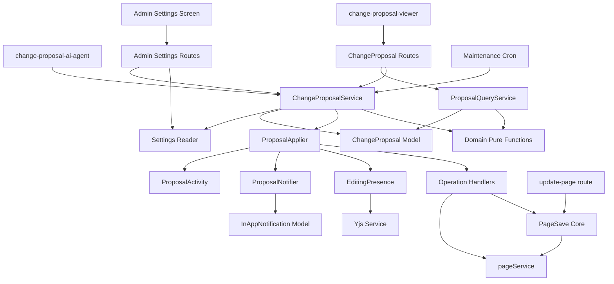
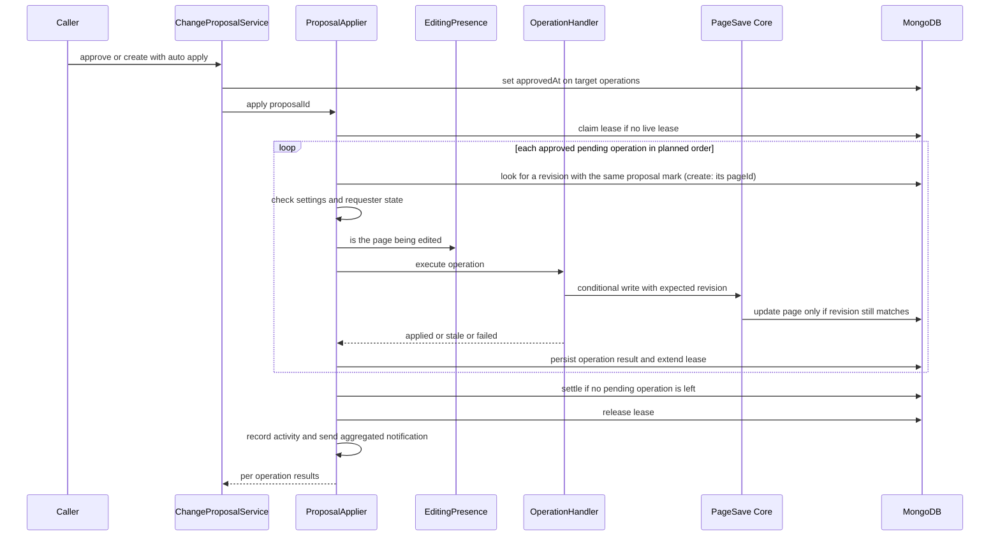
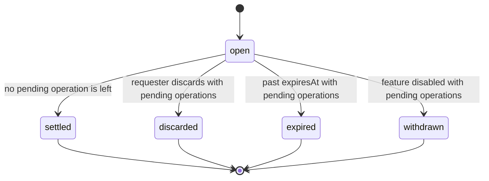

# Design Document: change-proposal-core

## この文書に書くこと・書かないこと

この文書は実装の記録ではなく、この機能を次に変えるときの出発点である。書くかどうかは「コードとテストのファイルを読めば分かるか」で決め、分かるものは書かない。迷ったら書かない。コードから分かることを書くと、コードが変わったときに黙って古くなり、文書全体が信用されなくなる。

| 書く | 書かない |
|---|---|
| 調べて初めて分かった事実（コードを少し読んだだけでは分からない動き、外部のライブラリの隠れた動き） | 関数の形、ファイルの配置、「どのファイルに何があるか」 |
| 変わった設計を選んだ理由。特に、試して退けた形とその理由 | 素直な実装の素直な説明 |
| 自動テストで確かめられないこと（残っている差） | どのテストが何を確かめているかの一覧 |
| コードから分からない手作業の確かめ方（環境の作り方、見るところ、合否を決める基準の値） | 差分があるか、いつ実装したかなど、その時点の経緯 |

requirements.md の受け入れ条件は、この基準で削らない。受け入れ条件は実装を測る約束で、番号は tasks.md・コード・テストから参照されている。

## Overview

**Purpose**: AI チャットなどの入口が作った「複数のページへの操作のまとまり」（Change Proposal）を保存し、LLM を使わずにサーバー側で反映し、取り消せるようにする。反映は人の保存と同じ上書き防止の確認を通り、確認と書き込みを 1 回の更新で行う。

**Users**: 入口を作る開発者（最初は `change-proposal-ai-agent`）と、反映後の画面を作る開発者（`change-proposal-viewer`）が、本 spec のサービスと API を使う。依頼した人は承認と取り消しを、他のユーザーは自分が閲覧できる範囲の取り消しを、管理者は書き込みの範囲と自動反映の方針を、それぞれ行う。

**Impact**: ページの更新の route（`update-page.ts`）から上書き防止の確認と書き込みを切り出し、人の保存と反映が同じ処理を通るようにする。書き込みは「最新のリビジョンが期待どおりなら書く」条件付きの更新になる。リビジョンに、作った Change Proposal の印（Change Proposal の ID と、操作の `key`）を足す。ページには項目を足さない。

本書で使う言い方（操作・元のリビジョン・依頼した人・入口・見る人・編集中の人がいるページ・操作の 7 つの状態）は、[requirements.md](./requirements.md) の「本要件で使う言い方」と同じである。調べた事実と判断の理由は [research.md](./research.md) にある。

### Goals
- Change Proposal を保存し、その状態を操作ごとに持つ（要件 1・2）
- 人の保存とぶつからず、共同編集中の入力を消さない反映（要件 3）
- 管理者の方針による自動反映と、依頼した人によるページ単位の承認（要件 4）
- 取り消し用の Change Proposal による取り消しと、戻してよい条件の判定（要件 5）
- リビジョンへの印、まとめたアプリ内通知、新しい activity（要件 6・7）
- 反映でページごとの通知を出すかを、管理者の設定と Change Proposal ごとの指定で決め、出すときは人の操作と同じ通知を出す（要件 7.1・7.10–7.19・8.9）
- 管理者の設定と画面（要件 8）、見る人ごとに絞った API（要件 9）、人の保存を変えないこと（要件 10）
- 兄弟の spec の画面が使う共通の部品（表示名の表と、diff2html の設定と見た目）（要件 11）
- 「待ち」の操作が無くなった Change Proposal を自動で完了にし、依頼した人にだけ段階と達成度を返す（要件 2.9–2.11・12）
- 後続・見直しの Change Proposal を元の Change Proposal に結び付けて保存し、つながりを見る人ごとに絞って返す（要件 13・14）

### Non-Goals
- AI に Change Proposal を作らせる道具、置き換えの指示からの本文の組み立て、内容が大きく消える操作の拒否（`change-proposal-ai-agent`）
- 詳細ページ・一覧画面・各画面の印・取り消しボタン・まとめた通知の表示（`change-proposal-viewer`）
- REST での Change Proposal の作成（将来の `change-proposal-mcp` などの入口が作る。research.md の判断を参照）
- 差分の塊ごとの承認、元のリビジョンが変わった案の自動の合わせ込み
- 複数台のサーバーの間で、編集中の人がいるかを確かめる仕組み（未決の論点）
- 後続・見直しの Change Proposal の中身を作ること（入口が作る。AI チャットでは `change-proposal-ai-agent`）。core は、新しい操作が元の操作と同じページを対象にしているかを確かめない

## Boundary Commitments

### This Spec Owns
- Change Proposal のデータ（新しいコレクション `changeproposals`。`schema.prisma` の model と Prisma の拡張で読み書きし、索引は migration `20261110120000-add-change-proposal-indexes.js` が作る）と、その状態の移り変わり。全体の状態を操作の状態から決める純関数
- 段階 `settled`（完了）への自動の移り変わりと、依頼した人にだけ返す段階と達成度（`requesterState`）
- 後続・見直しのつながり（`basedOn`）の保存・作成のときの検査・つながりの読み出しと、見る人ごとの絞り込み。どの操作の状態ならつながりを作れるかの表（`BASED_ON_ELIGIBLE_STATUSES`）
- Change Proposal の作成・承認・飛ばす・破棄・取り消し・期限切れ・取り下げを行うサービス
- 反映の実行（反映の順序、1 つの処理だけが反映する仕組み、二度書かない仕組み、操作の種類ごとの書き込み）
- 上書き防止の確認と書き込みを 1 回の更新で行う、人の保存と共通の処理（`server/service/page-save/`）
- 戻してよいかの判定（見る人ごと、その時点のページの状態で）
- リビジョンの `proposalId` / `proposalOperationKey` の書き込み（ページには項目を足さない）
- まとめたアプリ内通知のデータ（受け取る人ごとの中身）と、新しい activity の action
- 反映でページごとの通知を出すかの判断（管理者の設定 `changeProposal:perPageNotificationsEnabled` と、Change Proposal ごとの指定 `perPageNotifications`）と、出すときの呼び出し。指定を依頼した人が変える API
- 人の保存と反映が共通に使う、ページごとの通知の処理（`server/service/page-save/page-notifications.ts`。グローバル通知の送信と、編集の `PAGE_UPDATE` の activity の記録）
- 管理者の設定キー、設定の API、設定画面
- Change Proposal の取得・一覧・承認・飛ばす・破棄・取り消し・リビジョンの印の取得の REST API と、その応答の形
- 兄弟の spec の画面で共通に使う client の部品（`features/change-proposal/client/shared/`）: 操作の種類・操作の状態・全体の状態・理由・戻せない理由・段階・つながりの関係の表示名の表と達成度の文言、`translation` の名前空間の `change_proposal.*` の翻訳キー（5 言語）、`i18next.config.ts` の `preservePatterns`、達成度の割合と残りの操作を決める純関数、diff2html の設定と CSS、詳細ページの URL を作る `buildProposalHref`。ページ履歴の差分（`RevisionDiff`）もこれを使う

### Out of Boundary
- 入口ごとの違い（AI チャット・Vault・MCP）。反映・承認・取り消しの振る舞いは入口によって変えない
- 本文の中身の評価（短くなりすぎの判定など）。入口の責任とする
- AI が書いた要約・会話の保存と表示（`change-proposal-ai-agent` が Change Proposal の ID を鍵にして持つ）
- まとめたアプリ内通知の画面での表示と文言（viewer の `commons`）、「本人に戻すよう頼む」通知（`change-proposal-viewer`）
- それぞれの画面だけで使う文言（`change_proposal_viewer.*` と `change_proposal_chat.*`）。表示名の表にある言葉は、兄弟の spec が自分では持たない
- ページ履歴・Recent Changes・ページの見出しの印の画面（`change-proposal-viewer`）
- 閲覧できるかどうかの新しい判定の規則。既存の `Page.findByIdAndViewer` / `findByIdsAndViewer` だけを使う
- `isUpdatable` の判定の中身と、エディタが `revisionId` を送るかどうかの判定（変えない）

### Allowed Dependencies
- `apps/app/src/server/service/page/`（`pageService.updatePage` / `create` / `renamePage` / `deleteCompletely`）と `pageOperationService.canOperate`
- `apps/app/src/server/models/`（`Page`・`Revision`・`PageRedirect`・`Subscription`・`InAppNotification`・`User`）
- `crowi.globalNotificationService`（`page-save/page-notifications.ts` の `firePageGlobalNotification` から呼ぶ）と、`server/service/activity/` の `shouldGenerateUpdate`（`emitPageUpdateActivity` から呼ぶ）
- `apps/app/prisma/schema.prisma` と `apps/app/src/utils/prisma.ts`（`createPrisma()` に Change Proposal の拡張を登録する）
- `apps/app/src/server/service/yjs/` の `IYjsService`
- `apps/app/src/server/service/activity/`（`beginActivity` / `pendingActivityContext`）と `activityService.createActivity`
- `configManager`、`CronService`
- `@growi/core` の型と純関数（`isCreatablePage` など。リビジョンの印の型 `IRevisionProposalMark` もここに足す）
- 依存の向き: `interfaces` → `server/domain`（純関数）→ `server/models` → `server/services` → `server/routes`・cron → `client`。`server/service/page-save/` は `features/change-proposal` に依存しない（人の保存の route も使うため）。`page-save` と `pageService` が受け取るリビジョンの印の型は `@growi/core` の `IRevisionProposalMark` で、`features/change-proposal` は自分の `ProposalMark` を純関数 `toRevisionProposalMark` で変えて渡す。`utils/prisma.ts` は `features/change-proposal/server/models/change-proposal.ts` を直接 import する（server の barrel を通すと、barrel → サービス → `utils/prisma.ts` → barrel と import が循環するため。`refreshed-model-catalog.ts` の前例と同じ）。`features/change-proposal` は `@mastra/*` / `ai` / `@ai-sdk/*` を import しない（`server-boot-imports.md`）。`client/shared/` は server のコードを import せず、`interfaces` の型だけを使う。ページ履歴の差分（`client/components/PageHistory/RevisionDiff.tsx`）は `client/shared/` の diff2html の部品を import する

### Revalidation Triggers
次の変更をしたときは、`change-proposal-ai-agent` と `change-proposal-viewer` の結合を確かめ直す。
- `ChangeProposalService` の公開の関数（作成・承認・取得）の入力と結果の形（作成の任意の `trigger` を含む）と、`ServiceError` の値
- server の barrel が export するもの（`createChangeProposalService` と型 `ChangeProposalService`。`createProposal`・`approve`・`getForViewer` などは、この関数が返すサービスの関数である。ほかに型 `ProposalQuery`、`readChangeProposalSettings`、router を作る関数）と、`interfaces` の barrel が export するもの（型、`MAX_TOTAL_BODY_BYTES`、`ApplyTrigger` / `ApplyResult` / `RevertResult`）
- REST API の応答の形（`ChangeProposalView` / `OperationView` / `ApplyResult` / `RevertResult`）、戻せない理由の値（`RevertRefusalReason`）、操作の種類・状態・理由の値。ページがもう無い操作に返すパス（`recordedPathOf`。完全な削除は元の新規作成のパス、編集は反映した時点に記録したパス `appliedPagePath`）と、一覧の要約の `pages` にそのパスを入れる扱い（`pages[].path` は任意で、パスを記録する前に反映した編集の操作はページの ID だけで入る）
- 依頼した人以外の見る人に返す操作の決まり（`selectVisibleOperations`。対象のページがもう無い操作を取り消しの相手にも表示のために返し、取り消しの対象には入れない扱いを含む）と、依頼した人以外に返す `lastAppliedAt` の決め方。viewer の詳細ページは、取り消しの元と先のリンクがどちらの相手にも開けることと、取り消したあとに取り直した詳細に取り消した操作が残ることを、この決まりに頼っている
- まとめたアプリ内通知の snapshot の形と、`targetModel` の名前、受け取る人の決め方
- リビジョンの `proposalId` / `proposalOperationKey` の意味（何を記録するか）
- `client/shared/` の表の名前・翻訳キーの名前・diff2html の部品の形
- Change Proposal の詳細ページの URL（`buildProposalHref` が作る `/me/change-proposals/{id}`）を変えるとき（`change-proposal-viewer` のページの route と合わせる）
- 承認の単位（同じページへの操作をまとめて承認する扱い）と、編集中の人がいたときに「待ち」に残す扱い
- 管理者の設定キーの名前と意味
- 編集中の人の確かめ方を、複数台のサーバーに対応させたとき
- Prisma の版を上げたとき（条件付きの更新を 1 回の処理として扱えることを、ChangeProposal Model の同時実行の結合テストで確かめ直す。research.md の「新しいコレクションは Prisma で読み書きし、索引は migration で作る」）
- 段階の値（`ProposalLifecycle`。`settled` を含む）と、完了にする条件（「待ち」の操作が 1 つも無い）。完了した Change Proposal に、承認・飛ばす・破棄が `not-open` を返し、取り消しと後続・見直しの作成は受け付けること
- 依頼した人にだけ返す `requesterState`（段階と達成度）の形と、達成度の数え方（分子と分母に入る状態、取り消しの Change Proposal には返さないこと）
- `basedOn` の形、関係の値（`BasedOnRelation`）、関係ごとに元の操作として認める状態（`BASED_ON_ELIGIBLE_STATUSES`）、`createProposal` が返す `based-on-unavailable` / `based-on-operation-not-eligible`、見直しを自動反映しない扱い
- つながり（`OperationView.linkedProposals` と `ChangeProposalView.basedOn`）を依頼した人以外に返す条件
- ページごとの通知: `createProposal` の任意の `perPageNotifications`、依頼した人にだけ返す `requesterState.perPageNotifications` の形、指定を変える API（`PUT /change-proposals/:id/per-page-notifications`）、出すかの決め方（管理者の設定と Change Proposal ごとの指定の両方が真のときだけ）、取り消しの Change Proposal が元の指定を引き継ぐこと
- 操作数の上限と 1 日の件数の上限の初期値（50 と「上限なし」）を変えるとき（ai-agent の書き込みの道具が 1 回に受ける操作の数 `MAX_OPERATIONS_PER_CALL` との大小が変わるため）

## Architecture

### Existing Architecture Analysis
- ページの更新は route（`routes/apiv3/page/update-page.ts`）が、上書き防止の確認（`isUpdatable`）・書き込み（`pageService.updatePage`）・activity・通知・共同編集の文書の置き換えを順に呼ぶ。書き込みのときに最新のリビジョンを条件にしていない。
- 作成・更新の通知は route から、移動・完全な削除のアプリ内通知は `pageService` の中から出る。全文検索・GROWI Vault・画面の更新は `crowi.events.page` を受けて動く。
- 人の操作のページごとの通知の出どころは次のとおりである。グローバル通知（`globalNotificationService.fire`）は、どれも route が送る（編集 `PAGE_EDIT` は `update-page.ts`、新規作成 `PAGE_CREATE` は `create-page.ts`、移動 `PAGE_MOVE` は `apiv3/pages/index.js`、完全な削除 `PAGE_DELETE` は `routes/page.js`。完全な削除でも、ごみ箱へ移すときと同じ `PAGE_DELETE` を、削除する前のページで送る）。`fire` は中で、ページの閲覧範囲から送るかどうかを決める（`isSendNotification`。リンクを知る人だけ・特定のユーザーだけのページには送らず、本人だけ・グループのページは管理者の設定に従う）。購読している人へのアプリ内通知は、編集では route の `generateUpdateActivity` が `PAGE_UPDATE` の activity を `preNotify` つきで知らせることで作られ（同じ人の 5 分以内の更新では `shouldGenerateUpdate` が作らない）、移動・完全な削除では `pageService` の中で作られる。新規作成ではアプリ内通知は出ない。
- 共同編集の接続数は、プロセスごとのメモリにだけある。

### Architecture Pattern & Boundary Map



**Architecture Integration**:
- 採用する形: 確認と書き込みを共通の処理に切り出し、反映と人の保存が同じ処理を通る（research.md の案 C）。通知・activity・共同編集の文書の扱いは、呼び出し側が選ぶ。
- 機能の境界: 反映の流れの判断（順序、状態、戻せるか、見えるか）は純関数にし、DB と既存のサービスへの書き込みは、操作の種類ごとの handler の中だけで行う。handler の一覧は種類をキーにした表で持ち、実行する側は種類で分岐しない。
- 変えずに従う既存の決まり: route の middleware の順（`activity-recording.md`）、見えないページへの一様な 404（`page-write-action-403-404.md`）、読み書きは Prisma の拡張、索引の作成は migration（`model.md`）、`isUpdatable` の中身。
- 新しい部品の理由: 反映は request が無い場面（期限切れの処理の再開、自動反映）でも動くため、route に依存しないサービスとして作る。

## File Structure Plan

部品の分け方（`features/change-proposal/` の中の `interfaces`・`server/domain`・`server/models`・`server/services`・`server/routes`・`client/admin`・`client/shared` と、人の保存と共通にする `server/service/page-save/`）と依存の向きは、Allowed Dependencies に書いた。ファイルの一覧は木を読めば分かるので書かない。

### Modified Files
既存のコードへの変更のうち、兄弟の spec が前提にしている決め事だけを書く。
- ページ（`pages`）には項目を足さない。新規作成で作ったページがどの Change Proposal によるものかは、そのページの最初のリビジョンの印で分かる（Physical Data Model）。
- リビジョン（`revisions`）に足す項目は `proposalId` と `proposalOperationKey`（操作の `key`）の 2 つだけで、並び順の番号は書かない。`@growi/core` の `IRevision` にも同じ名前の任意の 2 項目を足し、その 2 つをまとめた型 `IRevisionProposalMark` を置く（changeset つき）。
- アプリ内通知の一覧の API（`server/service/in-app-notification.ts`）は、`targetModel` が `ChangeProposal` の通知の `target` を `_id` だけにして返す。一覧の取得は `target` を中身ごと読み込んで返すので、そのままだと受け取る人に Change Proposal のすべての操作が渡り、受け取る人ごとに絞った snapshot の意味が無くなるためである。

## System Flows

### 反映の流れ



- 承認は先に記録する（`approvedAt`）。そのあとで反映の権利（lease）を取る。別の処理が反映中で lease を取れなかったときは、記録した承認を、反映中の処理が最後に読み直して続けて反映する。反映中の処理が止まった場合は、保守用の cron が lease の期限切れを見て再開する（要件 3.14・3.15）。
- 各操作の前に、同じ Change Proposal の印（`proposalId` と操作の `key`）を持つリビジョンがすでにあるかを探す（新規作成では、見つかったリビジョンの `pageId` が作ったページである）。あれば書かずに「反映済み」として記録する。
- 編集中の人がいるとき、または重なる `PageOperation` が決まった時間を過ぎても残るときは、その操作を「待ち」に戻し、`approvedAt` を消す（もう一度の承認が要る。要件 3.5・4.8）。
- すでに反映した操作は、後の操作が失敗しても戻さない（要件 3.13）。
- 各操作の前に、ページごとの通知を出すかを決める。管理者の設定と、その時点で保存されている Change Proposal の指定を読み直し、両方が真のときだけ handler に「出す」を渡す（要件 7.1・7.10・7.13）。

### 操作の状態の移り変わり

```mermaid
stateDiagram-v2
    [*] --> pending
    pending --> applied: applied
    pending --> stale: base revision changed
    pending --> failed: permission or settings or path
    pending --> skipped: requester skip or discard or expire or withdraw
    pending --> pending: page being edited or page operation busy
    applied --> reverted: revert proposal applied
    applied --> revertRefused: revert conditions not met
    revertRefused --> reverted: revert requested again and conditions met
    reverted --> [*]
```



- 状態の値は `pending`（待ち）・`applied`（反映済み）・`failed`（失敗）・`stale`（古い）・`skipped`（飛ばした）・`reverted`（取り消し済み）・`revert-refused`（取り消しを断られた）。
- 「取り消しを断られた」の操作は、もう一度取り消しを求められたときに判定し直す。条件を満たせば「取り消し済み」になる。
- 後続・見直しの Change Proposal を作っても反映しても、元の操作の状態は変わらない。`reverted` にするのは取り消しの Change Proposal の反映だけである（要件 13.5・13.6）。

### Change Proposal の段階の移り変わり



- 段階の値は `open`（承認待ち）・`settled`（完了）・`discarded`（破棄）・`expired`（期限切れ）・`withdrawn`（取り下げ）。`open` 以外からは動かない。
- 完了にする書き込みは、「待ち」の操作の状態を変えた書き込みのすぐあとに、同じ処理が `settleIfNoPending`（`lifecycle: 'open'` で「待ち」の操作が 1 つも無いことを条件にした更新）で行う。呼ぶのは、反映の 1 回の実行の終わり（`ProposalApplier`）と、飛ばす処理（`skip`）のあとである。条件付きの更新なので、何度呼んでも結果は同じで、最後の待ちを同時に変えた 2 つの処理のうち、あとに書いたほうが必ず完了にする（research.md の「完了は、待ちの状態を変えた書き込みのすぐあとの条件付きの更新で決める」）。
- 2 つの書き込みの間で処理が止まると、`open` のまま「待ち」が無い Change Proposal が残る。保守用の cron がこれを探して完了にする（`findIdsOpenWithoutPending`）。期限切れと取り下げは「待ち」の操作が 1 つ以上あることを条件にするので、こうした Change Proposal を期限切れや取り下げにすることは無い（要件 2.11）。
- 完了した Change Proposal は承認・飛ばす・破棄の対象にならない（`lifecycle` が `open` であることを条件にしているため、`not-open` が返る）。反映済みの操作の取り消しは、段階を見ないので今までどおり動く（要件 2.10）。

### 後続と見直しの作成の流れ
1. 入口が `createProposal` に `basedOn`（元の Change Proposal の ID・関係・元の操作の `key` の一覧）を渡す。
2. サービスは、ほかの検査（Requirement 1）のあとで元の Change Proposal を読み（`findProposal`）、`validateBasedOn` で確かめる。元が無い、依頼した人が違う、元が取り消しの Change Proposal である、のどれでも同じ `based-on-unavailable` を返す。元の操作が空、元に無い `key`、関係に合わない状態の操作があれば `based-on-operation-not-eligible`（最初に合わなかった `key` つき）を返す（要件 13.2・13.3）。
3. 保存する。`key` の重なりは 1 つにまとめる。元の Change Proposal と元の操作は書き換えない（要件 13.5）。
4. 自動反映の対象を決める。関係が `rework` なら `selectAutoApplyTargets` は空を返し、すべての操作が承認待ちになる（要件 13.4）。`follow-up` は通常と同じ（要件 13.7）。

### 取り消しの流れ
1. 取り消しを求めた人が閲覧できるページの操作（依頼した人には、ページがもう無い操作も含む）から、指定された操作（指定が無ければ、反映済みと取り消しを断られたの操作のすべて）を選ぶ（`selectVisibleOperations`）。取り消しの相手の扱い（要件 9.11）は表示のための決まりなので、ここでは使わない（`contextFor` に取り消しの相手の値を空で渡す）。そのため、取り消しの相手として表示されているだけの操作は、取り消しの対象にならず、状態も変わらない。
2. 選んだ操作ごとに、その時点のページの状態で戻せるかを判定する（`judgeRevertability`）。戻せない操作は、元の Change Proposal の中で「取り消しを断られた」にし、理由を記録する。
3. 戻せる操作から、取り消しの Change Proposal の操作を作る（`buildRevertOperations`）。入口の種類は `revert`、依頼した人は取り消しを求めた人、各操作は戻す相手（元の Change Proposal の ID と、元の操作の `key`）を持つ。編集は元の本文に戻す編集、新規作成はページを完全に削除する操作（`delete-completely`。ごみ箱には残さない）、移動は元のパスへ戻す移動になる。取り消しの Change Proposal の操作を戻すときは、編集と移動は同じ形になる。`delete-completely` は、消したページを戻せないので取り消せない（`judgeRevertability` が `target-unavailable` で断る。要件 5.12・5.15）。
4. 自動反映の方針と承認を通さず、すぐに反映する（要件 5.10）。取り消しの Change Proposal の操作は、作る時点で `approvedAt` に作成の日時を入れて保存する（取り消しを求めた人が承認したものとして扱う）。これにより、`ProposalApplier`（`approvedAt` を持つ「待ち」の操作だけを反映する）と保守用の cron の再開の候補が、通常の承認済みの操作と同じようにこの操作を拾う。反映が終わったあとの完了は `settleIfNoPending` が行う。
5. 反映済みになった取り消しの操作に対応する元の操作を「取り消し済み」にし、取り消しの Change Proposal の ID を記録する。取り消しの操作が「古い」「失敗」になったときは、元の操作を「取り消しを断られた」にし、次の表で理由を決める。編集中の人がいたときは、取り消しの操作を「飛ばした」にし、元の操作は「反映済み」のまま残す（要件 5.11）。

| 取り消しの操作の結果 | 元の操作に記録する理由（`RevertRefusalReason`） |
|---|---|
| 古い（`base-revision-changed`） | `edited-after-apply` |
| 失敗で、理由がすでに `RevertRefusalReason` の値（`target-unavailable`・`has-children`・`not-deletable` など） | その値のまま |
| 失敗で、理由が `path-occupied` | `original-path-occupied` |
| 重なる `PageOperation` が決めた時間を過ぎても残った | `page-operation-in-progress` |
| 失敗で、それ以外の理由（`write-error`・`requester-not-allowed`・`grant-not-assignable`） | `apply-failed` |

- 「取り消しを断られた」の操作は、もう一度取り消しを求めれば判定し直すので、表の後の 2 つは、時間をおいて求め直せば戻せることがある。

## Components and Interfaces

| Component | Domain/Layer | Intent | Key Dependencies | Contracts |
|-----------|--------------|--------|------------------|-----------|
| Domain Pure Functions | domain | 状態・順序・承認・戻せるか・見えるか・達成度・つながり・ページごとの通知の判断 | なし | Service |
| ChangeProposal Model | data | 新しいコレクションの読み書き（Prisma の拡張）と、通知の `target` を読み込むための Mongoose のモデルの登録 | Prisma (P0)、Mongoose（空の schema の登録だけ）(P0) | Service, State |
| Settings | services | 設定キーの読み書き | configManager (P0) | Service |
| EditingPresence | services | 編集中の人がいるかの確認 | IYjsService (P0) | Service |
| PageSave Core | server/service/page-save | 確認と条件付きの書き込み（人の保存と共通） | pageService (P0)、Page model (P0) | Service |
| Operation Handlers | services | 操作の種類ごとの書き込みと、ページごとの通知 | PageSave Core (P0)、pageService (P0)、page-notifications (P1) | Service |
| ProposalApplier | services | 反映の実行 | Handlers (P0)、Presence (P0)、Model (P0) | Service, State |
| ProposalNotifier | services | まとめたアプリ内通知 | InAppNotification (P0)、Subscription (P1) | Service, Event |
| ProposalActivity | services | activity の記録 | activity service (P0) | Service |
| ChangeProposalService | services | 作成・承認・飛ばす・破棄・取り消し・期限切れ・取り下げ・ページごとの通知の指定の変更 | Applier (P0)、Model (P0)、Settings (P0) | Service |
| ProposalQueryService | services | 見る人ごとに絞った取得 | Model (P0)、Page model (P0) | Service |
| MaintenanceCron | services | 期限切れ・取り下げ・再開・完了の書き込みの前で止まった Change Proposal の完了 | CronService (P0) | Batch |
| ChangeProposal Routes | routes | 利用者の REST API | Service (P0)、Query (P0) | API |
| Admin Settings Routes | routes | 管理者の設定の API | Settings (P0)、Service (P1) | API |
| Admin Settings Screen | client | 管理者の設定画面 | Admin Routes (P0) | — |
| Client Shared | client | 兄弟の spec の画面と `RevisionDiff` が使う表示名の表と diff2html の部品 | interfaces (P0)、diff2html (P0) | — |

### Domain（純関数）

#### Domain Pure Functions

| Field | Detail |
|-------|--------|
| Intent | DB を読まない判断をすべて純関数にし、サービスはそれに入力を渡すだけにする |

**Responsibilities & Constraints**
- どの関数も DB・設定・時刻を直接読まない。必要な値は引数で受け取る。
- 各ファイルに同じ場所の `*.spec.ts` を置く。

**Contracts**: Service [x]

- `deriveProposalStatus` の決め方（上から順に当てはめる）:
  1. `lifecycle` が `open` で、「待ち」の操作が 1 つ以上ある → `pending`
  2. 反映済み・取り消し済み・取り消しを断られたの操作が 1 つも無い → `lifecycle` が `discarded` / `expired` / `withdrawn` ならその値、`open` か `settled` なら `not-applied`
  3. それらの操作がすべて取り消し済み → `reverted`
  4. 取り消し済みが 1 つ以上ある → `partially-reverted`
  5. 失敗・古い・飛ばしたの操作が 1 つ以上ある → `partially-applied`
  6. それ以外 → `applied`
- 依頼した人以外への応答では、`deriveProposalStatus` に見える操作だけを渡す（見えない操作の状態が全体の状態に表れないようにする。要件 9.4）。依頼した人以外に見える操作は「反映済み」「取り消し済み」「取り消しを断られた」だけなので、規則 1・2・5 には当てはまらず、全体の状態は `applied` / `reverted` / `partially-reverted` のどれかになる（`pending` と `partially-applied` にはならない。要件 9.2）。
- `selectVisibleOperations` の規則（要件の「見る人に返す操作」をそのまま表す。1 件の取得・反映済みの一覧・リビジョンの印・つながりの判定・取り消しの対象の選び方が、すべてこの関数を通す。取り消しの対象の選び方だけは、取り消しの相手の値を空にした文脈で通す）:
  - 対象のページ（編集・移動・完全な削除では `pageId`、新規作成では反映で作った `resultPageId`）が `viewablePageIds` に無い操作は返さない。ただし、対象のページがもう存在しない操作（`deletedPageIds`。完全に削除されたページ）は、依頼した人と取り消しの相手に返す（要件 9.11）。取り消しの相手には、状態が `applied` / `reverted` / `revert-refused` の操作だけを返す。ページが無いので閲覧できるかを判定できないが、この 2 人はどちらも、その操作のページを見る権利があったことが確かである（research.md の決定「ページがもう無い操作は、取り消しの相手にも見せる」）。ほかの見る人には存在も知らせない。`loadViewablePages` は、見る人が読めなかったページだけについて、存在するかを 1 回の問い合わせで確かめる。
  - 取り消しの相手かどうかは、文脈（`VisibilityContext`）の 2 つの値で決める。`isOriginalRequester` は、見ている Change Proposal が取り消しの Change Proposal で、見る人がその元（`revertOf`）の依頼した人であるときに真。`revertProposalIdsByViewer` は、見る人が依頼した取り消しの Change Proposal の ID の集合で、操作の `revertedByProposalId` がこれに入れば、見る人はその操作の取り消しの相手である。操作の側では `revertedByProposalId` を判断に使う（`VisibilityOperationFacts` に含める）。
  - 依頼した人以外には、状態が `applied` / `reverted` / `revert-refused` でない操作を返さない。Change Proposal の `lifecycle` はこの判断に使わない（要件 9.2）。
  - 依頼した人以外には、`anyoneWithLinkPageIds` に入るページの操作を返さない（要件 9.5）。
  - まだページが無い新規作成の操作（待ち・失敗・古い・飛ばした）は、依頼した人にだけ返す。取り消しの相手の扱いは、ページがもう無い操作にだけ当てる。
- 文脈を作るのは `proposal-view-parts.ts` の `contextFor` だけにする。`selectVisibleOperations` を呼ぶどの処理も `contextFor` を使う（取り消しの対象を選ぶ `revert-action.ts` も、自分で文脈を組み立てない）。取り消しの相手の値を渡すのは、1 件の取得・自分の一覧・反映済みの一覧・つながりの判定である。`revert-action.ts` は空の値（`isOriginalRequester` は偽、`revertProposalIdsByViewer` は空の集合）を渡す。リビジョンの印（`revision-marks-query.ts`）も空の値を渡す。`deleteCompletely` はページのリビジョンも消す（`server/service/page/delete-completely-operation.ts`）ので、印がページのもう無い操作を指すことは無く、取り消しの相手の扱いが効く場面が無いためである。
- `recordedPathOf` の規則: ページがもう無い操作のパスを、操作の記録から決める。新規作成は `path`、移動は移動先の `toPath`、編集は反映したときに記録した `appliedPagePath`（要件 6.7）、完全な削除は `collectCreatedPaths` で元の新規作成から引いたパス。記録に無いとき（`appliedPagePath` を記録する前に反映した編集など）は無し。1 件の取得の操作と、一覧の要約のページの一覧の両方がこの関数を使う（要件 9.13）。呼び出し側は、`selectVisibleOperations` を通った操作（依頼した人か取り消しの相手に返す操作）にだけ使うので、ページがもう無い操作のパスがほかの人に渡ることは無い。
- `collectCreatedPaths` の規則: Change Proposal の操作のうち新規作成のものから、操作の `key` からパスへの表を作る。取り消しの Change Proposal の完全な削除の操作のパスは、この表を元の Change Proposal の操作で作り、`revertTarget.operationKey` で引く。応答の操作の `path`（要件 9.12）と、まとめた通知で元の依頼した人に入れる完全に削除したページのパス（要件 7.8）は、どちらもこの関数を使う。
- `judgeRevertability` の規則（`Revertability` は Data Models を参照）。操作の種類ごとに規則を持ち、種類で分岐する場所はこの関数の中の表だけにする:
  - 状態が `applied` か `revert-refused` でない → `not-revertible-state`
  - ページが無い → `target-unavailable`
  - 編集: `latestRevisionId` が反映で作ったリビジョンでない → `edited-after-apply`
  - 新規作成: 子のページがある → `has-children`。最新のリビジョンが反映で作ったリビジョンでない → `edited-after-apply`
  - 移動: ページのパスが移動先のままでない → `moved-after-apply`。移動元のパスが使われている → `original-path-occupied`
  - 完全な削除（取り消しで行った操作。要件 5.15）: いつも `target-unavailable`（消したページは戻せない）
  - 新規作成の取り消し（完全な削除）の削除権限（要件 5.16）: 子のページ → 反映後の編集 の判定のあと、取り消しを求めた人がそのページを完全に削除してよくなければ `not-deletable`。判定は `createCanDeletePageCompletely`（`services/page-delete-permission.ts`）で、人の完全な削除の route（`routes/page.js`）と同じ `canDeleteCompletely`（管理者設定 `security:pageCompleteDeletionAuthority`。複数のグループに公開されたページで公開先のすべてのグループに属することを求める設定もこの中で見る。所属グループは `pageGrantService.getUserRelatedGroups` で 1 人につき 1 回読む）と、ユーザーのホームのページでの `canDeleteUserHomepageByConfig` と `isUsersHomepageOwnerAbsent` に加えて、route が見ていない `canDelete`（`security:pageDeletionAuthority`）も求める。作成者は `getCreatorIdForCanDelete` で求める。人の操作より弱くならないように、どちらの権限も満たすことを条件にする。`CurrentPageFacts.canDelete` は ProposalService が取り消しを求めた人（取得では見る人）の権限で、新規作成で作ったページについてだけまとめて読む。handler も書き込みの直前に同じ関数で確かめるので、表示する「戻せるか」と実際の判定がずれない
  - それ以外 → 戻せる
- `selectAutoApplyTargets` は、`relation` が `rework` なら方針にかかわらず空を返す（見直しは依頼した人が差分を確かめてから反映する。要件 13.4）。`follow-up` と `null` は今までどおり方針で決める（要件 13.7）。
- `validateBasedOn` の規則（上から順に当てはめる）:
  1. `base` が無い、`base.requester` が `requesterId` でない、`base.entry` が `revert` → `based-on-unavailable`（3 つを区別しない。要件 13.2）
  2. `operationKeys` が空 → `based-on-operation-not-eligible`（`operationKey` 無し）
  3. `key` が `base.operations` に無い、または状態が `BASED_ON_ELIGIBLE_STATUSES[relation]` に入らない → `based-on-operation-not-eligible`（最初に当たった `key`。要件 13.3）
  4. それ以外 → 重なった `key` を 1 つにまとめた `basedOn` を返す
- `BASED_ON_ELIGIBLE_STATUSES`（`interfaces/change-proposal.ts` の表）: `follow-up` は `stale`・`failed`・`skipped`（理由を問わない）、`rework` は `applied`・`revert-refused`。`pending` は元の Change Proposal でまだ承認できるので後続にしない。`reverted` はすでに戻した内容なので見直さない。兄弟の spec の画面も、ボタンを出すかの判断にこの表を使う。
- `computeAchievement` の規則: `entry` が `revert` なら返さない（取り消しの操作の「古い」「失敗」は、元の操作の「取り消しを断られた」として表すため。要件 12.3）。それ以外は、`applied` を「状態が `applied`・`reverted`・`revert-refused`（`APPLIED_AT_LEAST_ONCE_STATUSES`）の操作の数」、`attempted` を「全体の操作の数から、状態が `skipped` で理由が `skipped-by-requester` の操作の数を引いた数」にする（要件 12.2）。`attempted` が 0 のときも 0 のまま返し、割合にするのは画面の側（`toAchievementPercent`）である。
- `shouldSendPerPageNotifications` の規則: 管理者の設定と Change Proposal の指定の両方が真のときだけ真を返す。取り消しの Change Proposal も同じ規則で決める（取り消しは書き込み機能の設定を確かめないが、ページごとの通知の設定は確かめる）。2 つの値を組み合わせる場所をこの関数 1 つにし、handler と applier は結果の真偽だけを扱う（要件 7.1・7.10）。
- `buildProposalLinks` の規則: `returnedOperationKeys` に入る `key` にだけ、つながりを付ける（見る人に返さない元の操作には付けない）。`isVisibleToViewer` が偽のつながりは付けない（要件 14.3）。同じ Change Proposal が同じ操作を 2 回指すことは無い（`validateBasedOn` が `key` をまとめるため）。

### Data

#### ChangeProposal Model

| Field | Detail |
|-------|--------|
| Intent | Change Proposal を 1 文書として保存する。操作は文書の中の配列に持つ。読み書きはすべて Prisma の拡張の関数を通す |

**Responsibilities & Constraints**
- 読み書きは、`server/models/change-proposal.ts` の Prisma の拡張の関数（`prisma.changeproposals.<関数>`）だけで行う。サービスは Prisma の `findMany` や `updateMany` を直接呼ばない。Mongoose のモデルでは読み書きしない。
- 索引は、migration `apps/app/src/migrations/20261110120000-add-change-proposal-indexes.js` が `createIndex` で作る（`model.md`。理由は research.md の「新しいコレクションは Prisma で読み書きし、索引は migration で作る」）。同じファイルには、項目も索引も持たない空の Mongoose の schema を `getOrCreateModel('ChangeProposal', new Schema({}))` で登録し、export しない。登録の名前 `ChangeProposal` は、アプリ内通知と activity の `targetModel` の値と同じにする（通知の一覧が `target` を `refPath` で読み込むため）。この名前から Mongoose が決めるコレクション名は `changeproposals` で、Prisma の model の名前と同じになる。
- TTL 索引を持たない。反映済みの操作を含む文書を消す処理を持たない（要件 2.8・6.5）。
- 操作の結果の書き込みは、配列の 1 つの要素だけを書き換える更新（composite type の list への `updateMany`）で行い、文書全体を書き戻さない。
- 拡張の関数は、Prisma の行を純関数 `toChangeProposalDocument` で `ChangeProposalDocument`（操作は種類ごとの `OperationRecord` の union）に変えて返す。composite type は 1 つの形しか持てないので、DB の上では、種類ごとの項目をすべて任意にした 1 つの形（`ChangeproposalsOperations`）で持つ。種類に必要な項目が欠けた行は、変換で例外を投げる（文書を作るのは拡張の関数だけなので、DB を直接書き換えたときにだけ起きる）。
- 編集の操作では、DB の項目 `path` に、反映した時点のページのパスを入れる（要件 6.7）。新規作成では同じ `path` が作るときのパスなので、どちらの意味かは種類で決まる。`toChangeProposalDocument` は、編集の行の `path` を `OperationRecord.appliedPagePath` に変える。操作の `path` で絞り込む問い合わせは無いので、同じ項目を使っても問い合わせの結果は変わらない。項目を足さないので、schema と migration は変えない。
- 任意の項目を消すときは `unset: true` を使い、null を書かない。項目が無いことを条件にするときは、`isSet: false` と null の両方を条件に含める（Prisma は「値が null」と「項目そのものが無い」を区別するため）。
- `createdAt` は `@default(now())`、`updatedAt` は `@updatedAt` で Prisma が書く。`__v` は `utils/prisma.ts` が更新のたびに 1 増やすので、`__v` の値に頼る処理を作らない。

**Contracts**: Service [x] / State [x]

##### Service Interface（Prisma の拡張の関数）

状態を変える関数は、どれも「今の状態を where に入れた `updateMany`」で書き、結果の件数が 1 なら真（この呼び出しが書いた）、0 なら偽を返す。条件の決め方のうち、コードから読み取りにくい理由は research.md の決定「新しいコレクションは Prisma で読み書きし、索引は migration で作る」にある。

- `appliedPageIds` に重ねて足さないのは、lease を持つ処理だけがこの項目を書くためである。lease の期限が切れて 2 つの処理が書いた場合に重なっても、読む側（反映済みの一覧）は集合として扱うので結果は変わらない。

##### State Management
- State model: Data Models の「Logical Data Model」。
- Persistence & consistency: 状態の変化はすべて、今の状態を where に入れた `updateMany` で行い、結果の件数で、この呼び出しが書いたかを決める。Prisma のクエリエンジンは、条件に合う文書を読んでから `_id` で書く処理を MongoDB の transaction の中で行い、間に別の書き込みが入ると最初からやり直すので、同じ条件で 2 つの処理が同時に書いても、件数が 1 になるのは 1 つだけである（research.md）。書き込みの衝突が続いて Prisma が `P2034` を返したときは、件数 0 と同じに扱う。
- Concurrency strategy: 反映の権利は `applyLease`（`token` と `expiresAt`）で表す。`applyLease` が無いか期限切れのときだけ取れる。lease の長さは定数 `APPLY_LEASE_MS`（5 分）で、操作を 1 つ反映するたびに延ばす。操作の結果の記録は、lease の `token` も条件に含めるので、lease を失った処理は結果を書けない。

### Services

#### Settings

| Field | Detail |
|-------|--------|
| Intent | 設定キーを読み、型付きの値として返す。管理者の API から書く |

**Contracts**: Service [x]

##### Service Interface
```typescript
type ChangeProposalSettings = {
  readonly isEnabled: boolean;
  readonly enabledOperationTypes: ReadonlySet<CreatableOperationType>;
  readonly autoApplyPolicy: AutoApplyPolicy;
  readonly maxOperationsPerProposal: number | null;   // default 50; null: not checked (only when an admin clears it)
  readonly maxProposalsPerUserPerDay: number | null;  // default null: no limit; checked only when an admin sets a number
  readonly pendingExpirationSeconds: number | null;   // null: never expires (default 30 days; 0 or less reads as null)
  readonly perPageNotificationsEnabled: boolean;      // default false: apply sends no per-page notifications
};
function readChangeProposalSettings(): ChangeProposalSettings;
function updateChangeProposalSettings(input: ChangeProposalSettingsUpdate): Promise<void>; // configManager.updateConfigs
```
- 読むたびに `configManager` から取る（他のサーバーで変更されても、次の読み込みで反映される）。
- `readChangeProposalSettings` は機能の server の barrel から export する。Express の側で動く兄弟の spec の処理（ai-agent の道具を渡すかの判断など）は、設定キーを直接読まず、この関数を使う。
- Next.js の SSR（`getServerSideProps`）で動く処理は、この関数を呼ばない。この関数は `configManager` を直接 import しており、SSR の側で直接 import した `configManager` は、設定を読み込んでいない別の実体になるためである（`pages/common-props/commons.ts` の `aiEnabled` の注記と、`crowi.isAiReady()` の注記）。SSR では、`crowi` から取った `configManager` で読む（viewer の画面の共通の値は `crowi.configManager.getConfig('app:changeProposalEnabled')`。`commons.ts` がほかのキーを読むときと同じ形）。
- ブラウザの画面は `readChangeProposalSettings` を呼べず、管理者の設定の API は管理者だけが使える。そのため、ページごとの通知の管理者の設定は、依頼した人への取得の応答（`requesterState.perPageNotifications.isEnabledBySettings`）に入れて返す。兄弟の spec の画面は、この値で指定の表示を出すかを決める（要件 7.18）。

#### EditingPresence

| Field | Detail |
|-------|--------|
| Intent | ページに編集中の人がいるかを返す |

**Contracts**: Service [x]

- 次のどちらかなら編集中とする: `yjsService.getConnectionCount(pageId) > 0`、または `await yjsService.getYDocStatus(pageId) === YDocStatus.DRAFT`。
- **分かっている制約**: 接続数はこのプロセスの分しか見えない。複数台のサーバーで動かしている場合、別のプロセスにつながっている編集者は見えない。その場合でも、その編集者のエディタには衝突の知らせが出て、次の保存は上書き防止の確認で止まる（反映したリビジョンの `origin` が空のため）。確かめ方は未決の論点（OQ-6）として残す。

#### PageSave Core（`server/service/page-save/`）

| Field | Detail |
|-------|--------|
| Intent | 上書き防止の確認と、条件付きの書き込みを 1 か所にまとめる。人の保存の route と反映の両方が使う |

**Responsibilities & Constraints**
- `isUpdatable` の判定の中身は変えない。確認を飛ばすかどうかは今のまま `isUpdatable` で決める。
- 書き込みは、ページを読んだ時点の `page.revision`（人の保存）または元のリビジョン（反映）を `expectedRevisionId` として `pageService.updatePage` に渡す。`Page.pushRevision` はそれを条件に `findOneAndUpdate` で書き、一致しなければ作ったリビジョンを消して `RevisionConflictError` を投げる。
- 人の保存で `RevisionConflictError` になったときは、ページを読み直して `isUpdatable` をもう一度通す。通れば定数 `HUMAN_SAVE_MAX_ATTEMPTS`（3）まで書き直す。通らなければ今と同じ 409 `conflict` の結果を返す。
- 反映では書き直さない。一致しなければ結果を `conflict` として返し、呼び出し側が「古い」にする。
- 通知・activity・共同編集の文書の置き換えは、この処理の中では行わない。人の保存のあとの処理は `human-save-effects.ts` に移し、route が今と同じ時点で呼ぶ。

**Dependencies**
- Inbound: `update-page.ts`（人の保存）、EditHandler・取り消しの編集（反映）(P0)
- Outbound: `pageService.updatePage`、`Page.isUpdatable`、`normalizeLatestRevisionIfBroken` (P0)

**Contracts**: Service [x]

- `page-notifications.ts` は、人の保存の route に今ある処理を動きを変えずに移したものである。`firePageGlobalNotification` は `globalNotificationService.fire` を呼び、失敗をログに残すだけにする（ページの閲覧範囲による送る・送らないの判定は `fire` の中のまま）。`emitPageUpdateActivity` は、`update-page.ts` の `generateUpdateActivity` の中身（`shouldGenerateUpdate` の判断と、`PAGE_UPDATE` の activity を対象のページと `preNotify` つきで知らせる `emit`）である。route は今までどおり自分の activity の ID を渡す。
- 人が保存のたびに Slack のチャンネルを選んで送る通知（`userNotificationService`）と、共同編集の文書の置き換えは `human-save-effects.ts` に残し、反映からは呼ばない（要件 7.11）。
- Preconditions: `mode: 'proposal'` では `origin` を渡さない（反映のリビジョンの `origin` は空、要件 6.4）。
- Postconditions: `updated` のとき、最新のリビジョンは今回作ったもので、`mode: 'proposal'` ならそのリビジョンが `proposalId` と `proposalOperationKey` を持つ。
- Invariants: `mode: 'human'` では、リビジョンに Change Proposal の印を付けない（要件 6.3）。

**Implementation Notes**
- Integration: `update-page.ts` の middleware の順と、`generateUpdateActivity` を応答の前に待つ位置は変えない（`activity-recording.md`）。`postAction` の中身は `runAfterHumanUpdate` に移すだけで、順序と条件（`origin` が `view` か空のときの共同編集の文書の置き換えなど）を変えない。
- Risks: `updatePage` は `pushRevision` の前に `save()` で閲覧範囲や WIP の値を書く。書き込みで負けたときに、それらの値だけが先に保存される。人の保存では書き直しで同じ値になる。ただし、保存の前後で閲覧範囲が「リンクを知っている人だけ」かどうかが変わる保存は例外で、この場合はページが木に載るかどうかが変わり、負けて書き直すと子の付け替えと空のページの削除が飛ばされる。そのため、この保存は期待するリビジョンを渡さず条件なしで 1 回だけ書く（以前と同じ動き。反映と同時に起きると、反映の内容を確認なしに上書きしうる）。反映では閲覧範囲と WIP を渡さない（`wip` を渡さないと `wipExpiredAt` だけが消える既存の動きはそのまま）。

#### Operation Handlers

| Field | Detail |
|-------|--------|
| Intent | 1 つの操作を、既存のページのサービスを通して書き込む |

**Responsibilities & Constraints**
- 種類をキーにした表（`OPERATION_HANDLERS`）で持ち、実行する側は種類で分岐しない。
- 書き込みはすべて `pageService` か PageSave Core を通す。全文検索・GROWI Vault・画面の更新は、`pageService` の中から出る `crowi.events.page` でそのまま動く（要件 3.17）。
- route の応答のあとの処理（`runAfterHumanUpdate` / `runAfterHumanCreate`。保存ごとに選んだ Slack のチャンネルへの通知、購読の作成、共同編集の文書の置き換え）は呼ばない（要件 7.11）。
- ページごとの通知は、`OperationContext.perPageNotifications`（`shouldSendPerPageNotifications` の結果。ProposalApplier が操作ごとに決める）だけで出すかを決める。handler は設定も Change Proposal の指定も読まない。偽のときは、どの種類でもページごとの通知を出さない（要件 7.1）。真のときは、人が同じ操作をしたときと同じ通知を、次の表のとおりに出す（要件 7.10）。移動・完全な削除のアプリ内通知は、`pageService` の呼び出しの指定で `execute` の中で出る。それ以外（表の `sendPerPageNotifications` の列）は、ProposalApplier が操作の結果を記録したあとで呼ぶ `sendPerPageNotifications` が出す。

| 操作の種類 | 購読している人へのアプリ内通知 | グローバル通知（`sendPerPageNotifications`） |
|---|---|---|
| edit | `sendPerPageNotifications` の中で、`beginActivity` で依頼した人を操作者とする activity の ID を作り、`emitPageUpdateActivity` を呼ぶ（人の保存と同じく、同じ人の 5 分以内の更新では作らない。作らなかったときは `pendingActivityContext.clear` で文脈を消す） | `firePageGlobalNotification(PAGE_EDIT)` |
| create | 出さない（人の作成でも出ない） | `firePageGlobalNotification(PAGE_CREATE)` |
| move | `renamePage` に `isInAppNotificationSuppressed: false` を渡す | `firePageGlobalNotification(PAGE_MOVE, { oldPath: fromPath })` |
| delete-completely | `deleteCompletely` に `isInAppNotificationSuppressed: false` を渡す | `firePageGlobalNotification(PAGE_DELETE)`（削除する前のページで送る。消したあとは読み直せないので、`execute` が消す前のページを操作ごとに覚えておき（操作の object を鍵にした `WeakMap`）、`sendPerPageNotifications` で使う） |

- `sendPerPageNotifications` は、ProposalApplier が `recordOperationOutcome` で「反映済み」を記録できたあとで、`perPageNotifications` が真のときだけ呼ぶ。グローバル通知はメールと Slack の送信を待つので、送るのが遅くても、書けた結果の記録が遅れないようにするためである。`findExistingResult` が前の実行の書き込みを見つけた操作では呼ばない（前の実行が通知を送る前に止まった場合、その操作のページごとの通知は出ないままになる）。送るのに失敗してもログに残すだけで、操作の結果は変えない。ページの閲覧範囲による送る・送らないの判定は `globalNotificationService.fire` の中の既存の判定のままにする。
- 編集で作る `PAGE_UPDATE` の activity は、人の保存と同じく監査ログにも残る。反映の activity（`CHANGE_PROPOSAL_APPLY`）とは別の行になる。
- 作者は依頼した人（`requester` の `IUserHasId`）にする（要件 3.10）。

**Contracts**: Service [x]

- edit の `execute` は、書き込みの前に読んだページのパスを、反映の結果（`RecordedOutcome` の `applied` の任意の `appliedPagePath`）に入れる。結果を書く `recordOperationOutcome` は、この値があるときだけ操作の `path` に書く（要件 6.7）。ほかの種類は入れない。
- `findExistingResult`: edit と create は、同じ `proposalId` と `proposalOperationKey` を持つリビジョンを探す。edit は、ページがまだあればそのパスを `appliedPagePath` に入れる（止まったあとのやり直しで記録できるようにするため。ページがもう無ければ入れない）。create は、見つかったリビジョンの `pageId` を作ったページとする。move は、ページのパスがすでに移動先なら反映済みとみなす。delete-completely は、ページがもう存在しなければ反映済みとみなす（ごみ箱にあるページは、まだ存在するので反映済みとみなさない）。

**Implementation Notes**
- Integration: `renamePage`・`deleteCompletely` は、通知を止めても activity（`PAGE_RENAME`・`PAGE_DELETE_COMPLETELY` など）を今のまま記録する。
- Risks: 子のページの移動は裏で続き、反映の処理は待たない（今の移動と同じ）。`pageService.create` はページを保存してからリビジョンを書くので、その間で処理が止まると、印の付いたリビジョンの無いページが残る。もう一度反映したときは印が見つからず、パスが使われているので `failed: path-occupied` になる。二度書くことは無いが、その操作は「失敗」として残る。

#### ProposalApplier

| Field | Detail |
|-------|--------|
| Intent | 承認された「待ち」の操作を、決めた順に 1 つずつ反映し、結果を記録する |

**Responsibilities & Constraints**
- lease を取れたときだけ反映する。取れなければ、何もせずに `{ type: 'in-progress' }` を返す（承認は記録済みなので、反映中の処理が最後に読み直して反映するか、保守用の cron が反映する）。
- 対象は「`status` が `pending` で `approvedAt` がある操作」。順序は `planApplyOrder` で決める。1 周したあとに対象を読み直し、この実行でまだ試していない対象があれば続ける。
- 各操作の前の確認（順に）:（1 で前の実行の書き込みが見つかれば、2 以降の確認は行わず、その結果を記録する。中断した実行がすでに書いた操作を、あとで機能が無効になった・依頼した人が無効になったことで「失敗」と記録しないため。反映の流れの図と同じ順）
  1. `findExistingResult` で、前の実行の書き込みが無いか（あれば、その結果を記録して次へ）
  2. 取り消しの Change Proposal でなければ、書き込み機能と操作の種類が有効か（だめなら `failed: feature-disabled` / `operation-type-disabled`）
  3. 依頼した人が、まだ有効なユーザーで、読み取り専用でないか（だめなら `failed: requester-not-allowed`）
  4. `checkEditingPresence` で編集中でないか（編集中なら、通常の操作は `pending` に戻して `approvedAt` を消し、理由 `page-being-edited` を記録。取り消しの操作は `skipped: page-being-edited`）
  5. `pageOperationService.canOperate` で重なる処理が無いか。あれば定数 `PAGE_OPERATION_WAIT_MS`（30 秒）まで間隔を空けて確かめ直し、それでも残れば、通常の操作は 4 と同じく `pending` に戻す（理由 `page-operation-in-progress`）。取り消しの操作は `failed: page-operation-in-progress` にし、元の操作を「取り消しを断られた」（理由 `page-operation-in-progress`）にする
- 確認をすべて通った操作を書き込む直前に、ページごとの通知を出すかを決める。`readChangeProposalSettings().perPageNotificationsEnabled` と、`readPerPageNotifications(id)` で読み直した Change Proposal の指定を `shouldSendPerPageNotifications` に渡し、結果を `OperationContext.perPageNotifications` に入れる。実行の始めに読んだ値を使い回さないので、反映の途中で依頼した人が指定を変えても、そのあとに書く操作には新しい値が使われる。作成の直後の自動反映では、作成のときに保存した値がそのまま読まれる（要件 7.13）。取り消しの Change Proposal でも、書き込み機能の設定は確かめないが、この判断は同じように行う。
- lease は ChangeProposal Model の `claimApplyLease` / `extendApplyLease` / `releaseApplyLease` で扱う。
- 操作の結果は、その場で `recordOperationOutcome` で文書に書く（`status`、`reason`、`appliedAt`、`resultPageId`、`resultRevisionId`）。この書き込みは lease の `token` と「その操作がまだ待ち」を条件にするので、偽が返ったら、その実行を止める。前に反映した操作は戻さない（要件 3.13）。
- 取り消しの Change Proposal では、操作の結果に応じて、元の Change Proposal の操作を `markOriginalOperation` で更新する（`reverted` と `revertedByProposalId`、または `revert-refused` と、「取り消しの流れ」の表で決めた理由）。
- 元の Change Proposal の操作を `markOriginalOperation` で書き換えるのは、取り消しの Change Proposal（`entry: 'revert'`）のときだけである。後続・見直しの Change Proposal を反映しても、元の操作には何も書かない（要件 13.5・13.6）。
- 1 回の実行で試す操作をすべて試し終えたら、lease を手放す前に `settleIfNoPending` を呼ぶ（要件 2.9）。lease を失って途中で止めた実行は呼ばない（続きを反映する処理が呼ぶ）。
- `execute` が「反映済み」を返し、`recordOperationOutcome` で記録できたあとで、`perPageNotifications` が真なら、その handler の `sendPerPageNotifications` を呼んでから次の操作へ進む（要件 7.10）。
- 1 つ以上が反映済みになったら、lease を手放したあとで ProposalActivity と ProposalNotifier を呼ぶ。

**Contracts**: Service [x] / State [x]

- Idempotency & recovery: 同じ Change Proposal を何度 `apply` しても、同じ操作は一度しか書き込まれない（lease で同時の実行を防ぎ、`findExistingResult` で前の実行の書き込みを見つける）。

#### ProposalNotifier

| Field | Detail |
|-------|--------|
| Intent | 反映が終わったときに、Change Proposal ごとに 1 つのアプリ内通知を、受け取る人ごとの中身で作る |

**Responsibilities & Constraints**
- 対象のページ: 反映済みの編集と移動の操作のページ。取り消しの Change Proposal では、完全に削除する操作（`delete-completely`）のページも含める（人が完全に削除するときも、そのページを購読している人にアプリ内通知が出るため。要件 7.8）。完全に削除したページは誰も閲覧できないので、受け取る人ごとの閲覧の判定では外れる。元の Change Proposal の依頼した人にだけ、元の新規作成の操作のパスで加える（パスは `collectCreatedPaths` で引く。その人は元の Change Proposal でその新規作成をすでに見られるので、新しく知らせることは無い）。元の依頼した人への通知の snapshot は、`proposalId` と `entry` を元の Change Proposal のものにする。元の Change Proposal には、その人が頼んだ操作のすべてと、それぞれが取り消されたかどうかが記録されているためである（research.md の決定「取り消しの通知は、元の依頼した人にも送る」）。ほかの受け取る人の通知は取り消しの Change Proposal を指す。人の保存で新規作成をしてもアプリ内通知は出ないので、新規作成のページは対象にしない。
- 受け取る人: 対象のページを購読している人（`Subscription.getSubscription`）の和集合。取り消しの Change Proposal では、元の Change Proposal（`revertOf`）の依頼した人も加える。そこから、この Change Proposal の依頼した人（取り消しでは取り消した人）を除き、有効なユーザーだけに絞る。
- 受け取る人ごとに、対象のページ ID を `Page.findByIdsAndViewer(pageIds, user, null, false, false)` で確かめ（リンクを知る人だけが見られるページは含めない）、閲覧できるページの分だけで snapshot を作る。1 つも無ければその人には作らない（要件 7.4）。元の Change Proposal の依頼した人にも、同じ絞り込みを行う。
- ページごとの通知の管理者の設定と Change Proposal の指定は見ない。ページごとの通知を出した反映でも、まとめた通知は同じように作る（要件 7.12）。そのため、両方を有効にすると、購読している人は同じ変更についてページごとの通知とまとめた通知の両方を受け取る。
- `InAppNotification.insertMany` で、1 人に 1 件ずつ入れる（`upsertByActivity` は全員に同じ中身を使うので使わない）。入れたあとで、既存のアプリ内通知のサービスと同じ Socket.IO の知らせを受け取る人に送る。

**Contracts**: Service [x] / Event [x]

##### Event Contract
- Published: `InAppNotification` の文書（`targetModel: 'ChangeProposal'`、`target: proposalId`、`action`、`activities: [activityId]`、`snapshot`: `ChangeProposalNotificationSnapshot` の JSON 文字列）。
- 通知の一覧の API が返す `target` は `_id` だけにする（Modified Files の `in-app-notification.ts`）。受け取る人が中身として受け取るのは snapshot だけである。
- Ordering / delivery: 反映が終わり lease を手放したあとに 1 回だけ作る。作るのに失敗してもログに残すだけで、反映の結果は変えない。

#### ProposalActivity

| Field | Detail |
|-------|--------|
| Intent | `CHANGE_PROPOSAL_*` の activity を、操作者つきで記録する |

**Responsibilities & Constraints**
- `ApplyTrigger` が `request` なら、route の `addActivity` が作った activity の ID に、応答を返す前に `activityEvent.emit('update', activityId, { action, targetModel: 'ChangeProposal', target })` で記録する（`activity-recording.md` の規則 1）。target を 4 番目の引数に渡さないので、既存のアプリ内通知の経路は動かない（まとめた通知は ProposalNotifier が作る）。
- `background` なら、`beginActivity` で文脈（操作者は依頼した人、または取り消した人）を作ってから同じ `emit` を行い、失敗したときは `pendingActivityContext.clear` を呼ぶ（`revertDeletedPage` の前例）。
- 作成（`CHANGE_PROPOSAL_CREATE`）は、`createProposal` に渡された `trigger` で記録する。`trigger` が `request`（入口の route の `addActivity` が作った activity）なら、その activity を `CHANGE_PROPOSAL_CREATE` として、`createProposal` が結果を返す前に記録する。これで入口の route には、作成のための activity が 1 つだけ残り、記録されないままの activity（`ACTION_UNSETTLED`）が別に残らない（要件 7.9）。`trigger` が無いか `background` なら、`beginActivity` で文脈を作って記録する。監査ログの設定に従う（要件 7.7）。
- 1 つの activity の ID は 1 つの action にしか使えない。そこで作成の直後の自動反映（`CHANGE_PROPOSAL_APPLY`）は、`trigger` にかかわらず `background` として `apply` を呼び、自分で activity を作る。そのときの `ip` と `endpoint` は `createProposal` の `request` の値を使う。
- 反映と取り消しは `EssentialActionGroup` に入れ、監査ログの設定にかかわらず記録する（要件 7.5）。
- 監査ログの分類（`SupportedActionCategory.CHANGE_PROPOSAL = 'ChangeProposal'`）の正規表現は `^CHANGE_PROPOSAL_` を直接書く。分類名を大文字にするだけの既存の書き方では `CHANGEPROPOSAL` になり、action の名前と合わないためである。

**Contracts**: Service [x]

#### ChangeProposalService

| Field | Detail |
|-------|--------|
| Intent | 入口と route が Change Proposal を扱うときに呼ぶ、ただ 1 つのサービス |

**Responsibilities & Constraints**
- 作成: 依頼した人がゲスト・読み取り専用でないこと、`validateProposalInput`、1 日の件数（依頼した人が、サーバーの日付の 0 時から作った、入口の種類が `revert` でない Change Proposal の数）、対象のページを依頼した人が閲覧できること（`findByIdAndViewer`、人の保存と同じ判定）、元のリビジョンが対象のページのものであること、`basedOn` があれば `validateBasedOn`（「後続と見直しの作成の流れ」）、を確かめてから保存する。閲覧できない場合と存在しない場合は同じ `target-unavailable` を返す（要件 1.11）。保存のあとで `selectAutoApplyTargets`（`basedOn` の関係を渡す。見直しなら空）の操作に `approvedAt` を付け、`apply` を呼ぶ。ページごとの通知の指定は、入口が `perPageNotifications` を渡せばその値、渡さなければ `true` で保存する。後続・見直しも同じ（要件 1.17）。操作数の上限は設定の値（初期値 50）で `validateProposalInput` が確かめ、1 日の件数は設定に数があるときだけ確かめる（初期値は値が無く、確かめない。要件 8.10）。（対象のページの確認では、反映時と同じ `findUserPageWriteRefusal` で、ユーザーページの保護（無効の `/user` 配下、存在しないユーザーのホームの下）にあたる操作も `target-unavailable`（操作の番号つき）で断る。AI には「ページが無いか、閲覧できない」と同じ値で伝わる）（対象のページの確認には、移動元が `isMovableSourcePath` を満たすこともある）
- ページごとの通知の指定の変更: 依頼した人でなければ `not-found`、`lifecycle` が `open` でなければ `not-open` を返す（承認と同じ。要件 7.14–7.16）。`setPerPageNotifications` で書き、すでに反映した操作には何もしない。管理者の設定が無効のときも値は保存する（画面は、管理者の設定が有効なときだけ切り替えを出す）。
- 承認・飛ばす・破棄: 依頼した人でなければ `not-found` を返す（要件 4.6）。`lifecycle` が `open` でなければ（完了を含む）`not-open` を返す（要件 4.7・2.10）。承認は `expandApprovalTargets` で同じページへの「待ち」の操作に広げる。飛ばすは、書いたあとで `settleIfNoPending` を呼ぶ（要件 2.9）。破棄は「待ち」が 1 つ以上あることを条件にし、「待ち」が無い Change Proposal（完了の書き込みの前で止まったもの）では `settleIfNoPending` を呼んで完了にしてから `not-open` を返す。
- 取り消し: 「取り消しの流れ」のとおり。取り消しの Change Proposal のページごとの通知の指定は、元の Change Proposal の値をそのまま保存する（取り消した人が元の依頼した人と違っても同じ。要件 7.17）。取り消しの Change Proposal の操作は `approvedAt` に作成の日時を入れて保存し（取り消しを求めた人が承認したものとして扱う）、保存のあとで `apply` を呼ぶ。書き込み機能の設定と件数の上限を確かめない（要件 5.13）。読み取り専用・ゲストは受け付けない。元の Change Proposal の段階は見ないので、完了した Change Proposal も取り消せる（要件 2.10）。
- 期限切れと取り下げ: `lifecycle: open` で lease を持っていない Change Proposal の ID を、決まった件数ずつ読み（`findIdsDueForExpiry` / `findIdsOpenForWithdraw`）、1 件ずつ `closeIfStillOpen` で `lifecycle` を `expired` / `withdrawn` にし、「待ち」の操作を `skipped`（理由 `expired` / `withdrawn`）にする。`closeIfStillOpen` は読んだときと同じ条件を where に入れるので、真が返った文書だけを、この処理が閉じた件数に数える。1 回の処理の中では、一度試した ID をもう一度試さない。取り消しの Change Proposal は取り下げの対象にしない。「待ち」の操作が無い Change Proposal は、どちらの対象にもしない（要件 2.11）。

**Dependencies**
- Inbound: `change-proposal-ai-agent`（作成・承認・取得）、Routes、Admin Routes、MaintenanceCron (P0)
- Outbound: ProposalApplier、ChangeProposal Model、Settings、Domain、ProposalActivity (P0)

**Contracts**: Service [x]

##### Service Interface
```typescript
type InputRejection = // validateProposalInput
  | { readonly code: 'unsupported-operation-type'; readonly index: number }
  | { readonly code: 'multiple-move-operations' }
  | { readonly code: 'too-many-operations'; readonly max: number }
  | { readonly code: 'body-too-large' }
  | { readonly code: 'operation-type-disabled'; readonly index: number }
  | { readonly code: 'invalid-path'; readonly index: number }
  | { readonly code: 'empty-operations' };
type CreateInputRejection = // the shape check of the createProposal input, before validateProposalInput
  | InputRejection
  | { readonly code: 'invalid-entry' }
  | { readonly code: 'model-label-too-long'; readonly max: number } // modelLabel over 100 code points
  | { readonly code: 'invalid-operation'; readonly index: number }; // not a well-formed edit / create / move
type ServiceError =
  | { readonly code: 'not-found' }                 // missing, not requester, or nothing the caller may see — one shape
  | { readonly code: 'not-open' }
  | { readonly code: 'input-rejected'; readonly rejection: CreateInputRejection }
  | { readonly code: 'feature-disabled' }
  | { readonly code: 'daily-limit-reached'; readonly max: number }
  | { readonly code: 'target-unavailable'; readonly index: number }
  | { readonly code: 'base-revision-mismatch'; readonly index: number }
  | { readonly code: 'user-not-allowed' }
  | { readonly code: 'based-on-unavailable' }                                      // basedOn: missing base, other requester's, or a revert proposal — one shape
  | { readonly code: 'based-on-operation-not-eligible'; readonly operationKey?: string }; // basedOn: empty, unknown key, or status not eligible for the relation
type ServiceResult<T> = { readonly ok: true; readonly value: T } | { readonly ok: false; readonly error: ServiceError };

interface ChangeProposalService {
  createProposal(input: {
    readonly requester: IUserHasId;
    readonly entry: CreatableEntry;               // 'ai-chat' | 'vault' | 'mcp' (never 'revert')
    readonly modelLabel?: string;
    readonly operations: readonly CreatableOperationInput[];
    readonly request?: { readonly ip?: string; readonly endpoint?: string };
    readonly trigger?: ApplyTrigger;              // request: settle the caller route's activity as CHANGE_PROPOSAL_CREATE
    readonly basedOn?: BasedOn;                   // follow-up / rework of one of the requester's own proposals
    readonly perPageNotifications?: boolean;      // the proposal's own per-page notification switch; default true
  }): Promise<ServiceResult<{ readonly proposalId: string; readonly apply: ApplyResult | null }>>;
  setPerPageNotifications(proposalId: string, user: IUserHasId, value: boolean): Promise<ServiceResult<void>>; // requester only, open only
  approve(proposalId: string, user: IUserHasId, targets: readonly string[] | 'all', trigger: ApplyTrigger): Promise<ServiceResult<ApplyResult>>; // operation keys
  skip(proposalId: string, user: IUserHasId, keys: readonly string[]): Promise<ServiceResult<void>>;
  discard(proposalId: string, user: IUserHasId): Promise<ServiceResult<void>>;
  revert(proposalId: string, user: IUserHasId, keys: readonly string[] | 'all-visible', trigger: ApplyTrigger): Promise<ServiceResult<RevertResult>>;
  expireDueProposals(now: Date): Promise<number>;
  withdrawAllPending(): Promise<number>;
  resumeInterruptedApplies(now: Date): Promise<number>;
  settleStalledProposals(): Promise<number>;    // open proposals with no pending op left (a run stopped between the two writes)
}
```
- `RevertResult`（形は Data Contracts）は、取り消しを求めた人が閲覧できる操作の分だけ、操作を `key` で指して、結果（`reverted` / `revert-refused` と理由 / `skipped` と `page-being-edited`）を持つ。取り消しの Change Proposal を作ったときは、その ID を `revertProposalId` に入れる（戻せる操作が 1 つも無く作らなかったときは無し）。
- `createProposal` の `trigger` は任意で、渡さなければ `background` と同じに扱う。ServiceError のどの値が返り得るかは、入口の spec が誤りの対応表を作るために使う（Revalidation Triggers）。`createProposal` が返し得る値は `input-rejected`・`feature-disabled`・`daily-limit-reached`・`target-unavailable`・`base-revision-mismatch`・`user-not-allowed`・`based-on-unavailable`・`based-on-operation-not-eligible` の 8 つで、`not-found` と `not-open` は返さない（この 2 つは承認・飛ばす・破棄・取得が返す）。後の 2 つは `basedOn` を渡したときだけ返る。`based-on-unavailable` は、元の Change Proposal が無い場合と他の人の Change Proposal である場合を区別しない（他の人の Change Proposal があるかどうかを入口に伝えないため）。

#### ProposalQueryService

| Field | Detail |
|-------|--------|
| Intent | 見る人が見てよい分だけを、決まった形で返す |

**Responsibilities & Constraints**
- 1 件の取得: 操作のページ ID をまとめて `Page.findByIdsAndViewer(ids, viewer, null, false, true)` で確かめ、その結果のうち `grant` が `GRANT_RESTRICTED` のものを `anyoneWithLinkPageIds` にする。`selectVisibleOperations` に通す。依頼した人でなく、残った操作が 1 つも無ければ `not-found` を返す（要件 9.2・9.3）。`lifecycle` は見せるかどうかの判断に使わない。承認待ちの Change Proposal でも、反映済みの操作があれば、依頼した人以外にはその操作だけを返す。
- 取り消しの相手を決める値: `selectVisibleOperations` に通す Change Proposal のうち、取り消しの Change Proposal の `revertOf` と、対象のページがもう無い操作の `revertedByProposalId` を集め、その Change Proposal を Prisma の拡張の関数 `findRevertCounterparts(ids)` で 1 回の問い合わせでまとめて読む。この関数は、Change Proposal ごとに依頼した人と、操作の `key`・`type`・`path` を返す。依頼した人から Change Proposal ごとに `isOriginalRequester` と `revertProposalIdsByViewer` を決めて `contextFor` に渡し、操作から `collectCreatedPaths` で完全な削除の操作のパスを決める。1 件の取得・反映済みの一覧（読んだ 1 回分ごと）・自分の一覧・つながりの判定で、同じ読み方をする（文書ごとに読まない）。つながりの判定で読む後続・見直しの操作（`findLinkedProposals`）も、`revertedByProposalId` を読む。取り消しの対象の選び方（`revert-action.ts`）とリビジョンの印（`revision-marks-query.ts`）は、取り消しの相手の値を使わないので、この読み込みをしない。
- 1 件の取得の操作のパス（`toOperationView` に渡す `path`）: 完全な削除の操作には、ページがあるかどうかにかかわらず、元の Change Proposal の新規作成の操作から引いたパスをいつも渡す（要件 9.12）。編集の操作には、ページがもう無いときだけ `recordedPathOf` で決めたパス（反映した時点に記録したパス）を渡す。新規作成は今までどおり作るときの `path` を、移動は `fromPath` と `toPath` を返す。ページが残っている操作には、今までどおり今のページ（`page`）も返す。画面は、移動以外の種類で `page?.path ?? path` を表示する（要件 9.13）。
- 戻せるかどうかの判定（`revertability`）は、取り消しの相手として表示されているだけの操作には付けない。そのような操作は「見る人が依頼した人でなく、対象のページが `deletedPageIds` に入る操作」とちょうど同じなので、この条件で判定から外す（`selectVisibleOperations` をもう一度通さない）。表示する判定と、取り消しの実際の対象がずれないようにするためである（要件 5.14）。
- 依頼した人以外への `lastAppliedAt` は、残った操作の `appliedAt` の最も新しいものにする。文書に保存した `lastAppliedAt` は、見えない操作の反映の日時を含むことがあるので、そのまま返さない（要件 9.10）。依頼した人には保存した値を返す。
- 反映済みの操作ごとに、その時点のページの状態を 1 回の問い合わせでまとめて取り、`judgeRevertability` の結果を付ける（要件 5.14）。依頼した人以外には、その人が取り消せる操作の判定だけを付ける。
- 依頼した人にだけ、`requesterState`（段階 `lifecycle` と、`computeAchievement` で数えた達成度）を付ける。依頼した人以外には付けない。依頼した人以外に見える操作は反映に関わった操作だけなので、段階（承認待ちか完了か）と達成度の分母から、見えない「待ち」の操作があるかどうかや数が分かってしまうためである（要件 12.1・12.4）。
- `requesterState` には、ページごとの通知の指定（文書の `perPageNotifications`）と、取得した時点の管理者の設定（`readChangeProposalSettings().perPageNotificationsEnabled`）も入れる。設定は 1 回の要求で 1 回だけ読む。依頼した人以外には付けない（要件 7.18）。
- 後続・見直しへのつながり: 1 件の取得では、`findLinkedProposals(proposalId)` で、この Change Proposal を元にした後続・見直しを読む。依頼した人以外には、読んだ Change Proposal の操作のページ ID も、最初の 1 回の `findByIdsAndViewer` にまとめて確かめ、Change Proposal ごとに `selectVisibleOperations`（`isRequester` は偽）に通して、残る操作が 1 つ以上あるものだけを見える（`isVisibleToViewer`）とする。依頼した人には、すべて見える（後続・見直しの依頼した人は、元の Change Proposal の依頼した人と同じであるため）。そのうえで `buildProposalLinks` で、返す操作ごとの `linkedProposals` を作る（要件 14.1・14.3）。
- 元の Change Proposal へのつながり: 1 件の取得で、Change Proposal が `basedOn` を持つときは、元の Change Proposal を `findProposal` で読み、依頼した人以外には元の操作のページを同じ問い合わせにまとめて確かめる。元の Change Proposal が `selectVisibleOperations` で 1 つも残らなければ `basedOn` を返さない。残るときは、`operationKeys` を、元の Change Proposal で見る人に返す操作の `key` だけに絞る。絞った結果の一覧が空なら、`basedOn` のキーごと返さない（後続の元の操作が、見る人に返す操作に 1 つも含まれない場合がこれに当たる。要件 14.2–14.5）。返す `basedOn` の `operationKeys` は、いつも 1 件以上である。依頼した人には、保存した値をそのまま返す。
- 一覧（自分の一覧と反映済みの一覧）の要約には、つながりを付けない（文書ごとに元とつながった先を読むと、一覧の問い合わせが増えるため）。`requesterState` は、依頼した人の文書にだけ付ける（反映済みの一覧では、`isRequester` が真の文書だけ）。
- 自分の一覧: `requester` と `createdAt` の索引で、新しい順に `page` / `limit` でページ送りする。
- 反映済みの一覧: `appliedPageIds` を持つ文書を `lastAppliedAt` の新しい順に定数 `APPLIED_LIST_SCAN_BATCH`（50 件）ずつ読み、その分のページ ID をまとめて 1 回の `findByIdsAndViewer(ids, viewer, null, false, true)` で確かめる。文書ごとに、1 件の取得と同じく `selectVisibleOperations` に通し（`isRequester` は文書ごとに決める）、残った操作のうち状態が反映済み・取り消し済み・取り消しを断られたのものが 1 つ以上ある文書だけを残す。依頼した人以外には、リンクを知る人だけが見られるページの操作は残らないので、そのページだけを含む文書は一覧に出ない（要件 9.5・9.7）。1 回の要求で読む文書は定数 `APPLIED_LIST_SCAN_LIMIT`（500 件）までとし、続きの位置を `cursor` として返す。件数は返さない。
- 一覧の要約（`ChangeProposalSummaryView`）の `lastAppliedAt`・`status`・`pages` も、1 件の取得と同じく残った操作だけから作る（要件 9.10）。読む順は文書に保存した `lastAppliedAt` のままにする（Security Considerations の「対策せずに受け入れる危険」）。
- 一覧の要約の `pages`（`proposal-list-query.ts` の `visiblePagesOf`。自分の一覧と反映済みの一覧で共通）: 残った操作のうち、ページが今閲覧できるものは今のページのパスを使う。ページがもう無いもの（`deletedPageIds`）は、`recordedPathOf` で記録から決めたパスを、ページの ID とともに入れる。パスが記録に無い操作（パスを記録する前に反映した編集）は、パスを付けずに `{ id }` だけを入れる。どれもページの ID で重なりを除く。ここに来る操作は `selectVisibleOperations` を通ったもの（依頼した人か取り消しの相手に返すもの）だけなので、ほかの人に ID やパスは渡らない（要件 9.13）。
- リビジョンの印: 指定されたリビジョン（100 件まで）のうち `proposalId` を持つものを取り、その印が指す操作（`proposalOperationKey`）を Change Proposal からまとめて引く。ページを `findByIdsAndViewer(ids, viewer, null, false, true)` で確かめ、操作ごとに `selectVisibleOperations` に通して、残った操作が作ったリビジョンの印だけを返す。取り消しで作られたかどうかは、Change Proposal の入口の種類から付ける（要件 9.8）。

**Contracts**: Service [x]

##### Service Interface
```typescript
interface ProposalQueryService {
  getForViewer(proposalId: string, viewer: IUserHasId): Promise<ServiceResult<ChangeProposalView>>;
  listMine(viewer: IUserHasId, page: number, limit: number): Promise<{ readonly items: readonly ChangeProposalSummaryView[]; readonly hasNext: boolean }>;
  listAppliedVisible(viewer: IUserHasId, cursor: string | null, limit: number): Promise<{ readonly items: readonly ChangeProposalSummaryView[]; readonly nextCursor: string | null }>;
  getRevisionMarks(viewer: IUserHasId, revisionIds: readonly string[]): Promise<readonly RevisionMarkView[]>;
}
```

#### MaintenanceCron

| Field | Detail |
|-------|--------|
| Intent | 期限切れ、無効にしたときの取り下げ、止まった反映の再開を、決まった間隔で行う |

**Contracts**: Batch [x]

##### Batch / Job Contract
- Trigger: `CronService` を継承し、`changeProposal:maintenanceCronSchedule` の間隔で動く。`wip-page-cleanup-cron.ts` と同じく、始める前に複数台の間でずらすための待ちを入れ、保守モードのときは動かない。書き込み機能の有効・無効にかかわらず起動する（無効のときに承認待ちを取り下げるため）。実行の間隔の設定が空のときだけ起動しない。
- 1 回の処理: 書き込み機能が無効なら `withdrawAllPending`。そのあとで `expireDueProposals(now)` と `resumeInterruptedApplies(now)`（`applyLease` が無いか期限が切れていて、`approvedAt` を持つ「待ち」の操作が残っているものを `apply(…, { kind: 'background' })`。候補は `findIdsWithInterruptedApply`）。最後に `settleStalledProposals`（`findIdsOpenWithoutPending` の文書を 1 件ずつ `settleIfNoPending` で完了にする。要件 2.9）。
- Idempotency & recovery: 期限切れと取り下げは `closeIfStillOpen`、完了は `settleIfNoPending`、再開は `apply` の中の `claimApplyLease` で、条件付きの更新の件数を見て 1 件ずつ取るので、複数台で同時に動いても同じ Change Proposal を二度処理しない。

### Routes

#### ChangeProposal Routes（利用者）

**Contracts**: API [x]

すべて `/_api/v3/change-proposals` の下。読む API は `accessTokenParser([SCOPE.READ.FEATURES.PAGE], { acceptLegacy: true })` → `loginRequiredStrictly` → 入力の検査 → handler。書く API は `accessTokenParser([SCOPE.WRITE.FEATURES.PAGE], { acceptLegacy: true })` → `loginRequiredStrictly` → `excludeReadOnlyUser` → `addActivity` → 入力の検査 → `apiV3FormValidator` → handler（`activity-recording.md` の順）。

| Method | Endpoint | Request | Response | Errors |
|--------|----------|---------|----------|--------|
| GET | `/change-proposals/:id` | — | `{ proposal: ChangeProposalView }` | 404 `notfound` |
| GET | `/change-proposals/mine` | `page`, `limit`（50 まで） | `{ items, hasNext }` | 400 |
| GET | `/change-proposals/applied` | `cursor`, `limit`（50 まで） | `{ items, nextCursor }` | 400 |
| POST | `/change-proposals/:id/approve` | `{ operationKeys?: string[] }`（無ければ全体） | `{ result: ApplyResult }` | 404 `notfound`、409 `not_open` |
| POST | `/change-proposals/:id/skip` | `{ operationKeys: string[] }` | `{}` | 404、409 `not_open` |
| POST | `/change-proposals/:id/discard` | — | `{}` | 404、409 `not_open` |
| POST | `/change-proposals/:id/revert` | `{ operationKeys?: string[] }`（無ければ見えるもの全部） | `{ result: RevertResult }` | 404 `notfound` |
| POST | `/change-proposals/revision-marks` | `{ revisionIds: string[] }`（100 まで） | `{ marks: RevisionMarkView[] }` | 400 |
| PUT | `/change-proposals/:id/per-page-notifications` | `{ enabled: boolean }` | `{}` | 404 `notfound`、409 `not_open`、400 |

- 見えない・存在しない・依頼した人でない、はすべて同じ 404 `notfound` にする（`page-write-action-403-404.md`、要件 9.3・4.6）。
- ページごとの通知の指定を変える route は、書く API の middleware の順（飛ばすと同じ。読み取り専用ユーザーを `excludeReadOnlyUser` で断る。要件 7.19）で作り、`setPerPageNotifications` の `not-found` を 404 `notfound`、`not-open` を 409 `not_open` にする（要件 7.14–7.16）。
- 承認・取り消しの route は、handler の中でサービスを待ってから activity を記録し、そのあとで応答を返す（`ApplyTrigger` は `{ kind: 'request', activityId: res.locals.activity._id }`）。
- OpenAPI の JSDoc を各 route に書き、`generate-spec-apiv3.sh` の対象に足す。

#### Admin Settings Routes

**Contracts**: API [x]

`routerForAdmin` の `/change-proposal-settings` に置く。`accessTokenParser([SCOPE.READ.ADMIN.APP] / [SCOPE.WRITE.ADMIN.APP], { acceptLegacy: true })` → `loginRequiredStrictly` → `adminRequired` →（PUT は）`addActivity` → 入力の検査 → `apiV3FormValidator` → handler。

| Method | Endpoint | Request | Response | Errors |
|--------|----------|---------|----------|--------|
| GET | `/change-proposal-settings` | — | `{ settings: ChangeProposalSettingsView }` | 403（ゲスト）。管理者でないユーザーは `adminRequired` の標準の動きで `/` へ 302 |
| PUT | `/change-proposal-settings` | `ChangeProposalSettingsUpdate` | `{ settings: ChangeProposalSettingsView }` | 400（入力の誤り、環境変数で固定されているときは `settings_fixed_by_env_vars`）、403（ゲスト）、302（管理者でない） |

- PUT で `isEnabled` が真から偽に変わったら、`withdrawAllPending` を呼んでから応答する（要件 8.5）。activity `ADMIN_CHANGE_PROPOSAL_SETTINGS_UPDATE` を応答の前に記録する。
- 環境変数で固定されている値は、GET の応答の `useOnlyEnvVars`（真偽値 1 つ）で分かるようにし、画面では変更できない表示にする（既存の設定画面と同じ扱い。AI の設定と同じ `ENV_ONLY_GROUPS` の仕組みで、設定キー `env:useOnlyEnvVars:changeProposal`（環境変数 `CHANGE_PROPOSAL_USES_ONLY_ENV_VARS`、初期値 `false`）が真のとき、画面で変える 8 つのキーをまとめて固定する）。固定されている間の PUT は 400 `settings_fixed_by_env_vars` で全部断る。`ChangeProposalSettingsUpdate` には `useOnlyEnvVars` を含めない。
- 取り下げ（`withdrawAllPending`）が失敗しても設定はすでに保存されているので、ログに残して 200 を返す。取り下げは保守用の cron がやり直す（cron は `changeProposal:maintenanceCronSchedule` が空でないときだけ動く）。OpenAPI のタグは `ChangeProposalSettings`（System Management API のグループ）。
- `ChangeProposalSettingsUpdate` と `ChangeProposalSettingsView` に `perPageNotificationsEnabled`（boolean）を含める。操作数の上限は 1 以上の整数か空（確かめない）、1 日の件数の上限は 1 以上の整数か空（上限なし）を受け付ける（要件 8.9・8.10）。

### Client

#### Admin Settings Screen（summary only）
- `pages/admin/change-proposal.page.tsx` は `pages/admin/ai.page.tsx` と同じ形（`dynamic` で `features/change-proposal/client/admin` の `ChangeProposalSettings` を読み込み、`getServerSideAdminCommonProps` を使う）。
- 文言は `useTranslation('admin')` と `admin.json` の `change_proposal_settings.*` だけを使う（管理画面は `commons` と `admin` だけを読み込む）。5 言語すべてに同じキーを足す（要件 8.7）。
- 管理メニュー（`AdminNavigation.tsx`）には項目を足さない。core だけでは Change Proposal を作る入口が無く、設定を変えても何も起きないため。画面には URL（`/admin/change-proposal`）で直接開ける。項目は、最初の入口である `change-proposal-ai-agent` が足す（同 spec の tasks.md 6.8）。
- ページごとの通知の設定は、1 つの切り替えと説明文で出す。説明文では、有効にすると人の保存と同じページごとの通知（購読している人へのアプリ内通知と、グローバル通知）が出ること、依頼した人が Change Proposal ごとに止められること、まとめた通知は設定にかかわらず出ることを伝える（要件 8.9）。1 日の件数の上限の入力欄は、空のとき「上限なし」と表示する。

#### Client Shared（`features/change-proposal/client/shared/`）

| Field | Detail |
|-------|--------|
| Intent | 兄弟の spec の画面とページ履歴の差分が、同じ表示名と同じ差分の見た目を使えるようにする |

**Responsibilities & Constraints**
- 表示名は「値 → 翻訳キー」の表で持つ。画面は `t(OPERATION_STATUS_LABEL_KEYS[status])` のように引く。表はどれも `satisfies Record<値の型, string>` で宣言し、型に値が増えたのに表に足し忘れると型の検査で止まるようにする（要件 11.2）。
- 翻訳キーは `translation` の名前空間に置く。キーの最後の部分は、値の `-` を `_` にしたもの（例: `page-being-edited` → `change_proposal.reason.page_being_edited`）。5 言語すべてに同じキーを足す（要件 11.1）。管理画面は `translation` を読み込まないので、この表は管理画面では使わない。
- `change_proposal.` で始まるキーは、この表からだけ引く。画面ごとの文言は、兄弟の spec がそれぞれ `change_proposal_viewer.*` と `change_proposal_chat.*` に置く。
- diff2html の設定は `RevisionDiff.tsx` から移し、`RevisionDiff` も同じ関数を使う。設定の値（`outputFormat: 'side-by-side'`、`drawFileList: false`）と、色の決め方（GROWI のテーマの明暗、テーマが両方に対応するときは利用者の明暗の設定、どちらも無ければ `AUTO`）は今のまま変えない（要件 11.3）。
- diff2html の CSS は `diff2html.vendor-styles.ts` を入口にし、画面は prebuild で作られる `diff2html.vendor-styles.prebuilt` を読み込む（`vendor-styles-components` の決まり）。
- 状態 `stale` の表示名は、ページが先に変わっていたために見送ったことを表す言葉にし、対応が要る誤りとしては表さない。全体の状態 `discarded` と段階 `discarded` の表示名は、残りの操作を反映せずに閉じたことを表す言葉にする（要件 11.5。5 言語の文言は `translation.json` にある）。
- 達成度の文言は、`ACHIEVEMENT_LABEL_KEY` に `percent`（`toAchievementPercent` の値）を渡して作る。`toAchievementPercent` が null（分母が 0）のときと、`achievement` が無い（取り消しの Change Proposal）ときは、段階 `settled` の表示名だけを出す。この文言は依頼した人にだけ返る値から作るので、件数を画面に出さない決まり（viewer）には当たらない。
- 残りの操作（`selectRemainingOperations`）は、状態が `BASED_ON_ELIGIBLE_STATUSES['follow-up']` に入り、理由が `skipped-by-requester` でない操作である。達成度の分母に入って分子に入らない操作のうち、まだ承認できる「待ち」を除いたものに当たる。viewer の「反映されなかった操作」の一覧と、ai-agent の「後続 Change Proposal を作る」の対象が、どちらもこの関数を使う。

**Contracts**: Service [x]

##### Service Interface
```typescript
// label-keys.ts
const OPERATION_TYPE_LABEL_KEYS: { readonly [K in OperationType]: string };            // change_proposal.operation_type.*
const OPERATION_STATUS_LABEL_KEYS: { readonly [K in OperationStatus]: string };        // change_proposal.operation_status.*
const PROPOSAL_STATUS_LABEL_KEYS: { readonly [K in ProposalStatus]: string };          // change_proposal.proposal_status.*
const OPERATION_REASON_LABEL_KEYS: { readonly [K in OperationReason]: string };        // change_proposal.reason.*
const REVERT_REFUSAL_REASON_LABEL_KEYS: { readonly [K in RevertRefusalReason]: string }; // change_proposal.revert_refusal_reason.*
const PROPOSAL_LIFECYCLE_LABEL_KEYS: { readonly [K in ProposalLifecycle]: string };     // change_proposal.lifecycle.*
type ProposalLinkKind = BasedOnRelation | 'based-on';                                    // 'based-on': the link from a derived proposal to its base
const PROPOSAL_LINK_LABEL_KEYS: { readonly [K in ProposalLinkKind]: string };           // change_proposal.link.*
const ACHIEVEMENT_LABEL_KEY = 'change_proposal.achievement.settled_with_percent';       // {{percent}}

// proposal-progress.ts
function toAchievementPercent(achievement: ProposalAchievement): number | null; // Math.floor(applied / attempted * 100); null when attempted is 0
function selectRemainingOperations(operations: readonly OperationView[]): readonly OperationView[];

// proposal-links.ts
function formatProposalShortId(proposalId: string): string; // '#' + the last 8 characters of the id
function buildProposalHref(proposalId: string): string;      // `/me/change-proposals/${proposalId}`; the detail page route is owned by change-proposal-viewer

// diff2html-options.ts
function buildDiff2HtmlOptions(colorScheme: ColorSchemeType): Diff2HtmlConfig;
function useDiff2HtmlColorScheme(): ColorSchemeType; // GROWI theme first, then the user's light/dark setting
```
- `buildProposalHref` は、Change Proposal の詳細ページの URL（`/me/change-proposals/{id}`）を作る唯一の場所である。ページの route とファイルは `change-proposal-viewer` が持ち、画面の部品（viewer と ai-agent のカード）はこの関数でリンクを作る。URL を直接書かない。
- 入口の種類（`ProposalEntry`）の表示名は、この表に含めない。

## Data Models

### Domain Model
- 集約の単位は Change Proposal 1 件。操作は Change Proposal の中にだけあり、単独では存在しない。
- 不変の条件:
  - 移動の操作は 1 件に 1 つまで（取り消しの Change Proposal も同じ）。
  - 入口の種類が `revert` の Change Proposal は `revertOf` を持ち、各操作が `revertTarget` を持つ。操作の種類 `delete-completely` は、入口の種類が `revert` の Change Proposal にだけある。
  - 操作の `index` は作成のときに 0 から振り、変えない。
  - 全体の状態は保存しない。`lifecycle` と操作の状態から `deriveProposalStatus` で決める。
  - `lifecycle` が `settled` の Change Proposal には「待ち」の操作が無い。`open` 以外の `lifecycle` は変わらない。
  - `basedOn` を持つ Change Proposal の依頼した人は、元の Change Proposal の依頼した人と同じである。入口の種類が `revert` の Change Proposal は `basedOn` を持たず、`basedOn` の元にもならない。
  - 後続・見直しの Change Proposal は、元の Change Proposal の文書を書き換えない。つながりは後続・見直しの側の `basedOn` にだけ持ち、元の側からは `basedOn.proposalId` の索引で引く。

### Logical Data Model

```typescript
type ProposalEntry = 'ai-chat' | 'vault' | 'mcp' | 'revert';
type CreatableEntry = Exclude<ProposalEntry, 'revert'>;
type CreatableOperationType = 'edit' | 'create' | 'move';
type OperationType = CreatableOperationType | 'delete-completely'; // delete-completely: revert proposals only
type ProposalLifecycle = 'open' | 'settled' | 'discarded' | 'expired' | 'withdrawn';
type OperationStatus = 'pending' | 'applied' | 'failed' | 'stale' | 'skipped' | 'reverted' | 'revert-refused';
type ProposalStatus =
  | 'pending' | 'applied' | 'partially-applied' | 'reverted' | 'partially-reverted'
  | 'not-applied' | 'discarded' | 'expired' | 'withdrawn';
type AutoApplyPolicy = 'none' | 'own-pages' | 'all';

type WaitingReason = 'page-being-edited' | 'page-operation-in-progress';
type FailureReason =
  | 'target-unavailable' | 'path-occupied' | 'grant-not-assignable' | 'feature-disabled'
  | 'operation-type-disabled' | 'requester-not-allowed' | 'write-error'
  | RevertRefusalReason; // a revert op that fails at apply time; mapped onto the original op per the table in the revert flow
type StaleReason = 'base-revision-changed';
type SkipReason = 'skipped-by-requester' | 'discarded' | 'expired' | 'withdrawn' | 'page-being-edited';
type RevertRefusalReason =
  | 'not-revertible-state' | 'target-unavailable' | 'edited-after-apply' | 'has-children'
  | 'moved-after-apply' | 'original-path-occupied' | 'not-deletable'
  | 'page-operation-in-progress' | 'apply-failed';
type OperationReason = WaitingReason | FailureReason | StaleReason | SkipReason;
type Revertability = { readonly revertible: true } | { readonly revertible: false; readonly reason: RevertRefusalReason };

type BasedOnRelation = 'follow-up' | 'rework';
type BasedOn = {
  readonly proposalId: string;                     // the base proposal (same requester, never a revert proposal)
  readonly relation: BasedOnRelation;
  readonly operationKeys: readonly string[];       // base operation keys; de-duplicated, never empty
};
const BASED_ON_ELIGIBLE_STATUSES: { readonly [K in BasedOnRelation]: readonly OperationStatus[] } = {
  'follow-up': ['stale', 'failed', 'skipped'],
  rework: ['applied', 'revert-refused'],
};
const APPLIED_AT_LEAST_ONCE_STATUSES: readonly OperationStatus[] = ['applied', 'reverted', 'revert-refused'];
type ProposalAchievement = { readonly applied: number; readonly attempted: number };

type ProposalMark = { readonly proposalId: string; readonly operationKey: string }; // never carries the order index
// Written on revisions as @growi/core's IRevisionProposalMark ({ proposalId, proposalOperationKey }) via toRevisionProposalMark

type OperationPayload =
  | { readonly type: 'edit'; readonly pageId: string; readonly baseRevisionId: string; readonly body: string }
  | { readonly type: 'create'; readonly path: string; readonly body: string }
  | { readonly type: 'move'; readonly pageId: string; readonly fromPath: string; readonly toPath: string; readonly removeRedirectsFrom?: string }
  | { readonly type: 'delete-completely'; readonly pageId: string; readonly expectedRevisionId: string };

type OperationRecord = OperationPayload & {
  readonly index: number;
  readonly key: string;                            // random UUID assigned at creation, used by the API
  readonly status: OperationStatus;
  readonly reason?: OperationReason;
  readonly approvedAt?: Date;
  readonly appliedAt?: Date;
  readonly resultPageId?: string;
  readonly resultRevisionId?: string;
  readonly appliedPagePath?: string;               // edit only: the page path when applied (stored in the operation's path field)
  readonly revertTarget?: ProposalMark;            // only in revert proposals
  readonly revertedByProposalId?: string;          // set on the original op
  readonly revertedAt?: Date;
};

type ChangeProposalDocument = {
  readonly _id: string;
  readonly requester: string;                      // User id
  readonly entry: ProposalEntry;
  readonly modelLabel?: string;                    // max 100 chars
  readonly revertOf?: string;                      // only when entry === 'revert'
  readonly basedOn?: BasedOn;                      // only for follow-up / rework proposals
  readonly lifecycle: ProposalLifecycle;
  readonly operations: readonly OperationRecord[];
  readonly appliedPageIds: readonly string[];      // pages touched by applied ops (for listAppliedVisible)
  readonly lastAppliedAt?: Date;
  readonly applyLease?: { readonly token: string; readonly expiresAt: Date } | null;
  readonly expiresAt?: Date;                       // createdAt + pendingExpirationSeconds at creation; absent when no expiry is configured
  readonly perPageNotifications: boolean;          // the requester's per-page notification switch; default true, revert proposals copy the original's value
  readonly createdAt: Date;
  readonly updatedAt: Date;
};
```

### Physical Data Model

**`changeproposals`（新しいコレクション。読み書きは Prisma、索引の作成は migration）**
- 操作は文書の中の配列に持つ。本文の合計は `MAX_TOTAL_BODY_BYTES`（8 MiB）までで、1 文書の上限（16MB）より十分小さくする。
- 索引（migration の `createIndex` で作り、`schema.prisma` にも同じ項目と名前の `@@index` を書く）:
  - `{ requester: 1, createdAt: -1 }`（`requester_1_createdAt_-1`）— 自分の一覧、1 日の件数
  - `{ lifecycle: 1, expiresAt: 1 }`（`lifecycle_1_expiresAt_1`）— 期限切れの処理
  - `{ 'applyLease.expiresAt': 1 }`（疎、`applyLease.expiresAt_1`）— 止まった反映の再開
  - `{ lastAppliedAt: -1 }`（疎、`lastAppliedAt_-1`）— 反映済みの一覧
  - `{ revertOf: 1 }`（疎、`revertOf_1`）— 取り消しの Change Proposal から元をたどる
  - `{ 'basedOn.proposalId': 1 }`（疎、`basedOn.proposalId_1`）— 元の Change Proposal から後続・見直しをたどる（`findLinkedProposals`）
- TTL 索引は持たない。
- `schema.prisma` の model では、状態・種類・理由の値は `-` を含むので Prisma の `enum` にせず `String` で持ち、`toChangeProposalDocument` で値を確かめる。

- `perPageNotifications` は索引に使わないので、migration の索引には入れない。
- `requester` などは他のコレクションへの `@relation` を持たない（ID だけを持つ。`include` で読み込む使い方をしない）。model の名前はコレクション名と同じなので `@@map` は書かない（既存の model と同じ）。

**`revisions`（既存、項目を足す）**
- `proposalId`（ObjectId、任意）と `proposalOperationKey`（文字列、任意。操作の `key`）。
- 索引 `{ proposalId: 1, proposalOperationKey: 1 }` を、同じ migration で疎な索引として作る（値を持つ文書だけが入るので、既存の文書の分は増えない）。Prisma の schema には、項目と、同じ項目と名前（`proposalId_1_proposalOperationKey_1`）の `@@index` を、疎であることの注記つきで足す（`pages.wipExpiredAt` の前例）。
- `pages` には項目を足さない。新規作成で作ったページがどの Change Proposal によるものかは、そのページの最初のリビジョンの印で分かる。
- `revisions` の `origin` には新しい値を足さない。反映のリビジョンでは空にする。

**設定キー（`config-definition.ts`）**

| キー | 型 | 初期値 | 環境変数 | 画面 |
|---|---|---|---|---|
| `app:changeProposalEnabled` | boolean | `false` | `CHANGE_PROPOSAL_ENABLED` | あり |
| `changeProposal:isEditEnabled` | boolean | `true` | `CHANGE_PROPOSAL_IS_EDIT_ENABLED` | あり |
| `changeProposal:isCreateEnabled` | boolean | `true` | `CHANGE_PROPOSAL_IS_CREATE_ENABLED` | あり |
| `changeProposal:isMoveEnabled` | boolean | `true` | `CHANGE_PROPOSAL_IS_MOVE_ENABLED` | あり |
| `changeProposal:autoApplyPolicy` | `AutoApplyPolicy` | `'none'` | `CHANGE_PROPOSAL_AUTO_APPLY_POLICY` | あり |
| `changeProposal:maxOperationsPerProposal` | number | `50` | `CHANGE_PROPOSAL_MAX_OPERATIONS_PER_PROPOSAL` | あり |
| `changeProposal:maxProposalsPerUserPerDay` | number | `null`（上限なし） | `CHANGE_PROPOSAL_MAX_PROPOSALS_PER_USER_PER_DAY` | あり |
| `changeProposal:pendingExpirationSeconds` | number | `2592000`（30 日） | `CHANGE_PROPOSAL_PENDING_EXPIRATION_SECONDS` | なし |
| `changeProposal:maintenanceCronSchedule` | string | `'*/10 * * * *'` | `CHANGE_PROPOSAL_MAINTENANCE_CRON_SCHEDULE` | なし |
| `changeProposal:perPageNotificationsEnabled` | boolean | `false` | `CHANGE_PROPOSAL_PER_PAGE_NOTIFICATIONS_ENABLED` | あり |
| `env:useOnlyEnvVars:changeProposal` | boolean | `false` | `CHANGE_PROPOSAL_USES_ONLY_ENV_VARS` | なし（`ENV_ONLY_GROUPS` の切り替え。真のとき画面で変える 8 つのキーを環境変数で固定する） |

- 操作数の上限の初期値は 50 である。管理者は数を変えられ、空にすると確かめない。1 日の件数の上限の初期値は `null`（値が無い）で、これは「上限なし」を意図した初期値である。管理者が数を入れたときだけ確かめる（要件 8.10）。
- 承認待ちの期限の初期値は 30 日（`2592000` 秒）である（OQ-1 で決定）。作成のときに `createdAt` にこの秒数を足して `expiresAt` に入れ、保守用の cron はこの `expiresAt` を見て期限切れにする。値が 0 以下・数字以外のときは `null`（期限なし）と読み、期限切れにしない。この設定は画面に出していないので、期限をなくすには環境変数に `0` を入れる。
- ページごとの通知の初期値は `false` である。初期の状態では、反映でページごとの通知を出さない（要件 8.9）。
- 操作ごとの有効化の初期値は有効にする。全体の書き込み機能が初期値で無効なので、管理者が有効にしたときに 3 つとも使える状態から始まる。

### Data Contracts & Integration

**API Data Transfer**
```typescript
type OperationView = {
  readonly key: string;                                             // opaque per-operation id
  readonly index?: number;                                          // requester only
  readonly type: OperationType;
  readonly status: OperationStatus;
  readonly reason?: OperationReason;
  readonly appliedAt?: string;
  readonly page?: { readonly id: string; readonly path: string };   // current page, only when visible
  readonly path?: string;                                           // create: target path; delete-completely: the path of the create it reverts (always); edit: appliedPagePath, only when the page no longer exists
  readonly fromPath?: string;                                       // move
  readonly toPath?: string;                                         // move
  readonly baseRevisionId?: string;                                 // edit
  readonly resultRevisionId?: string;
  readonly proposedBody?: string;                                   // requester only
  readonly revertedByProposalId?: string;
  readonly revertTarget?: ProposalMark;                             // proposalId + operationKey of the op this revert op undoes
  readonly revertability?: Revertability;                           // applied/revert-refused ops the viewer may revert
  readonly linkedProposals?: readonly ProposalLinkView[];          // follow-up / rework proposals that point at this op and that the viewer can open
};
type ProposalLinkView = { readonly proposalId: string; readonly relation: BasedOnRelation };
type RequesterProposalState = {
  readonly lifecycle: ProposalLifecycle;
  readonly achievement?: ProposalAchievement;                       // absent for revert proposals
  readonly perPageNotifications: PerPageNotificationsView;
};
type PerPageNotificationsView = {
  readonly value: boolean;                // the proposal's own switch (perPageNotifications)
  readonly isEnabledBySettings: boolean;  // changeProposal:perPageNotificationsEnabled when this response was built
};
type ChangeProposalView = {
  readonly id: string;
  readonly requester: { readonly id: string; readonly username: string; readonly name: string };
  readonly entry: ProposalEntry;
  readonly modelLabel?: string;
  readonly createdAt: string;
  readonly lastAppliedAt?: string;        // non-requesters: newest appliedAt among the returned operations
  readonly status: ProposalStatus;        // derived from visible operations for non-requesters
  readonly isRequester: boolean;
  readonly revertOf?: string;
  readonly basedOn?: BasedOn;             // requester: as stored. Non-requester: only when the viewer can open the base AND operationKeys narrowed to the base ops returned to this viewer is non-empty; otherwise omitted entirely
  readonly requesterState?: RequesterProposalState; // requester only
  readonly operations: readonly OperationView[];
};
type ChangeProposalSummaryView = Omit<ChangeProposalView, 'operations' | 'basedOn'> & {
  readonly pages: readonly { readonly id: string; readonly path?: string }[]; // visible pages; a deleted page uses the recorded path, absent for an edit applied before paths were recorded
};
type RevisionMarkView = { readonly revisionId: string; readonly proposalId: string; readonly isRevert: boolean };

type ApplyTrigger =
  | { readonly kind: 'request'; readonly activityId: string } // activity minted by the calling route's addActivity
  | { readonly kind: 'background' };                         // cron or service-initiated; mints via beginActivity
type ApplyResult =
  | {
      readonly type: 'done';
      readonly results: readonly { readonly key: string; readonly status: OperationStatus; readonly reason?: OperationReason }[];
    }
  | { readonly type: 'in-progress' };
type RevertResult = {
  readonly revertProposalId?: string;     // absent when no operation was revertible
  readonly operations: readonly (
    | { readonly key: string; readonly outcome: 'reverted' }
    | { readonly key: string; readonly outcome: 'revert-refused'; readonly reason: RevertRefusalReason }
    | { readonly key: string; readonly outcome: 'skipped'; readonly reason: 'page-being-edited' }
  )[];
};
```
- `ApplyTrigger`・`ApplyResult`・`RevertResult` は `interfaces/api.ts` に宣言し、`interfaces` の barrel から export する。兄弟の spec はこの名前をそのまま使う。`ApplyResult` と `RevertResult` は、操作を `index` ではなく `key` で指す。
- 応答に、見えない操作の件数・全体の操作数・「ほかにある」を示す値を入れない（要件 9.4）。`requesterState` は依頼した人への応答にだけ入れる（要件 12.4）。依頼した人以外への応答では、つながりは見る人が開ける Change Proposal の分だけ、`basedOn.operationKeys` は見る人に返す元の操作の分だけにする。絞った結果が空のときは `basedOn` を返さない（要件 14.3–14.5）。
- `BasedOn`・`BasedOnRelation`・`BASED_ON_ELIGIBLE_STATUSES`・`ProposalAchievement`・`RequesterProposalState`・`PerPageNotificationsView`・`ProposalLinkView` は `interfaces` の barrel から export する。兄弟の spec はこの名前をそのまま使う。
- 操作の `index`（0 から振った並び順）は、依頼した人への応答にだけ入れる。依頼した人以外への応答に `index` を入れると、番号が飛んでいることから「間に見えない操作がある」と分かってしまうためである。
- 操作を指定するときは、どの API でも `key` を使う。`key` は、作成のときに操作ごとに振る乱数の ID（UUID）で、並び順の情報を持たない。取り消しの操作が戻す相手（`revertTarget`）と、リビジョンの印（`proposalOperationKey`）も `key` で持つ。
- リビジョンを返す既存の API のうち、`/revisions/list` とページを取得したときに読み込まれるリビジョンは、リビジョンの文書をそのまま返すので、応答に `proposalId` と `proposalOperationKey` が入る（`/pages/recent` はリビジョンを読み込まず ID の文字列だけを返すので、印は入らない）。リビジョンには `key` だけを書き、並び順の番号を書かないので、それを見ても、同じ Change Proposal の他の操作の数・並び順・あるかどうかは分からない（要件 6.6）。並び順の番号をリビジョンに書くと、番号が飛んでいることから見えない操作があると分かってしまう。

**通知の snapshot（`interfaces/notification.ts`、viewer が読む）**
```typescript
type ChangeProposalNotificationSnapshot = {
  readonly proposalId: string;
  readonly entry: ProposalEntry;
  readonly kind: 'apply' | 'revert';
  readonly requester: { readonly id: string; readonly username: string };
  readonly pages: readonly { readonly id: string; readonly path: string }[]; // only pages this recipient can view
};
```

## Error Handling

### Error Strategy
- サービスは例外ではなく `ServiceResult` の判別共用体で失敗を返す。route はそれを HTTP の状態と `ErrorV3` の code に写す。
- 操作ごとの失敗は Change Proposal の中の操作の状態と理由で表し、Change Proposal 全体の失敗にしない（要件 3.13）。
- 予期しない例外（DB の障害など）は、その操作を `failed: write-error` にして記録し、次の操作へ進む。lease の延長に失敗したときは、その実行を止める（再開は cron が行う）。 反映の実行そのものが途中で例外になった場合も、その回で反映済みになった操作が 1 件以上あれば、lease を手放したあとで ProposalActivity と ProposalNotifier を 1 回だけ呼び（要件 7.5・7.2・7.8）、元の例外をそのまま呼び出し側へ投げ直す（呼び出し側は `in-progress` として扱い、残りは保守用の cron が再開する）。記録と通知の呼び出し自体が失敗しても、ログに残すだけで元の例外を隠さない。
- 取り消しの結果を元の操作に書く `markOriginalOperation` が例外になったときは、短い間（既定 150 ミリ秒）を置いて 2 回までやり直す（最初の 1 回と合わせて最大 3 回）。やり直すのは例外のときだけで、`false`（元の操作がもう取り消せる状態でない）はやり直さず、今までどおり警告のログに残す。3 回とも例外なら、ログに残して次の操作へ進み、その実行は止めない。この書き込みは、反映の後（ProposalApplier）と、取り消しの前に断ると決めた操作の記録（`revert` の受付）の 2 か所にあり、どちらも同じやり直しを使う。断った記録が書けなくても、応答には断った理由を返し、ほかの取り消せる操作の取り消しは続ける。保守用の cron で後から書き直す処理は作らない。やり直しても書けなかった元の操作は「反映済み」のまま残り、もう一度取り消しを求めれば判定し直される。待つ間（`markRetryWait`）と書き込みそのもの（`writeOriginalMark`）は ProposalApplier と ChangeProposalService の依存で差し替えられ、テストでは待たずに失敗する書き込みを渡す。

### Error Categories and Responses
- **入力の誤り（400）**: `input-rejected`（理由の code を返す）、`daily-limit-reached`、`base-revision-mismatch`。
- **見つからない（404）**: Change Proposal が無い、見てよい操作が無い、依頼した人でない、対象のページを閲覧できない。どれも同じ `notfound` にする。
- **状態の衝突（409）**: `not-open`（完了・期限切れ・破棄・取り下げ）。
- **後続・見直しの元が合わない**: `based-on-unavailable` と `based-on-operation-not-eligible`。`createProposal` だけが返し、core の REST には出てこない。入口の spec が、自分の誤りの対応表で HTTP の状態や道具の結果に置き換える。
- **機能が無効（403 ではなく 400 `feature_disabled`）**: 書き込み機能や操作の種類が無効なとき。管理者の設定であることを伝える。
- **読み取り専用ユーザー**: `excludeReadOnlyUser` の既存の応答。

### Monitoring
- `loggerFactory('growi:features:change-proposal:*')` で、反映の開始・終了・操作ごとの結果（Change Proposal の ID・操作の `key`・状態・理由）を記録する。本文は記録しない。
- 保守用の cron は、期限切れにした件数・取り下げた件数・再開した件数を記録する。

## Testing Strategy

### 自動テストで確かめられないこと
- 複数台のサーバーで動かしたときの、編集中の人の確認（OQ-6）。接続数はプロセスごとにしか見えず、結合テストは 1 つのプロセスで動く。
- 本番の MongoDB（ネットワーク越しの replica set）での反映の所要時間。測った値は開発用のコンテナのもので、research.md の「反映の所要時間の計測（8.4）」にある。
- 条件付きの更新が 1 回の処理として扱えること。Prisma のクエリエンジンの作りに頼っていて、Prisma の文書に書かれた約束ではない。同時実行の結合テストで確かめているが、Prisma の版を上げたときは確かめ直す（Revalidation Triggers）。
- 大きな wiki で、`revisions` に疎な索引を足したときに起動が遅くならないか。
- まとめた通知の画面での表示。表示の部品は `change-proposal-viewer` が作る。

## Security Considerations
- 見えないページの存在を示さない: 取得・一覧・通知・エラーのすべてで、見る人が閲覧できるページの分だけを使う。存在しない場合と見えない場合の応答をそろえる（umbrella の Constraints、`page-write-action-403-404.md`）。
- 新規作成と移動の「パスが使われている」（`path-occupied`）は、依頼した人にだけ返る。これは既存の作成・移動の API と同じ扱いで、パスを知っていれば分かる情報である（同じ規則の「This cannot be made airtight」）。
- 依頼した人の権限は反映のたびに確かめ直す（作成から時間が経って権限が変わる場合に備える）。
- 段階と達成度は依頼した人にだけ返す。依頼した人以外には反映に関わった操作しか返さないので、段階が承認待ちのままであることや、達成度の分母から、見えない「待ち」の操作の有無と数が分かってしまうためである（要件 12.4）。
- つながりは、依頼した人以外には、見る人が開ける Change Proposal へのものだけを返す。承認待ちの見直しのように、他の人には「見つからない」になる Change Proposal へのつながりを返すと、その Change Proposal があることが分かってしまう。元へのつながりの元の操作の `key` も、見る人に返す操作の分だけにする（要件 14.3・14.4）。
- 後続・見直しは、元の Change Proposal の依頼した人だけが作れる。元が無い場合と他の人の Change Proposal である場合は、同じ `based-on-unavailable` にする（他の人の Change Proposal の ID があるかどうかを確かめる手段にしないため）。
- 操作の指定は、並び順の情報を持たない `key` で受ける。取り消しでは、存在しない `key` と、見えない操作の `key` を、どちらも同じように対象から外し、応答でも区別しない（要件 5.4）。リビジョンの印も `key` だけを持つ（要件 6.6）。
- 依頼した人以外には、閲覧できるページに対する反映済み・取り消し済み・取り消しを断られたの操作だけを返す。承認待ち・失敗・古い・飛ばしたの操作は、そのページを閲覧できても返さない（要件 9.2）。`lastAppliedAt` と全体の状態も、返す操作だけから決める（要件 9.10）。
- 対象のページがもう無い操作は、依頼した人と取り消しの相手にだけ返す（要件 9.11）。この 2 人は、ページが消える前にそのページを見る権利があったことが確かである（依頼した人の代わりにページが作られ、取り消した人は取り消すときにそのページを閲覧できた）。ほかの人には、ページが消えたあとで見る権利を確かめる手段が無いので返さない。記録から決めたパスとページの ID（要件 9.13）も、この 2 人に返す操作と一覧の要約にだけ入る。取り消しの相手に返すのは表示のためだけで、その人が取り消しを求めたときの対象は広げない（要件 9.11）。
- 対策せずに受け入れる危険: 反映済みの一覧は、文書に保存した `lastAppliedAt` の順に読む。そのため、見えない操作があとから反映された Change Proposal は、表示する `lastAppliedAt`（見える操作の日時）よりも新しい位置に並ぶことがある。並び順の食い違いから分かるのは「見えない何かが、より新しく反映された」ことだけで、ページのパス・件数・中身は分からない。見る人ごとに並べ直すには、見る人ごとの反映の日時を別に保存して索引を作る必要がある。分かることが上のとおり少ないので、その仕組みは作らない。
- ページごとの通知を出すときは、人が同じ操作をしたときと同じ受け取る人の決め方と、同じ閲覧範囲の判定（グローバル通知の `isSendNotification`）をそのまま使う。人の保存で届く人以外には届かないので、見えないページについて新しく分かることは増えない。
- ログに本文を書かない。
- アプリ内通知の一覧の API は、通知の対象を中身ごと読み込んで返す。Change Proposal を対象にした通知では `target` を `_id` だけにし、受け取る人が見られるのは、その人のために作った snapshot だけにする。監査ログの一覧は対象の中身を返さないので、変更は要らない。

## Open Questions / Risks

決まっていない論点を挙げる。決まった論点（OQ-2・OQ-5 と、OQ-1 の期限の部分）は research.md の決定に書いてある。番号は付け替えない。

| ID | 論点 | 本 design での扱い |
|---|---|---|
| OQ-1 | 破棄・期限切れの案の本文をいつ消すか | 未決。本文を消す処理は作らず、決まるまで残す。承認待ちの期限そのものは 30 日に決まった（research.md の決定「承認待ちの期限の初期値は 30 日にする」） |
| OQ-3 | 自動反映の「自分が作ったページだけ」の「作った」の定義（作成者か、最後の更新者か） | 判定を `isOwnPageForAutoApply` 1 つにまとめる。決まるまでは作成者で判定する仮の実装にする |
| OQ-4 | AI が新しく作るページを WIP にするかどうか | 作成の操作は WIP の指定を持たない。決まったら、作成の操作に指定を足す |
| OQ-6 | 複数台のサーバーで動かしている場合に、編集中の人がいるかどうかを確かめる方法 | 今の数え方（このプロセスの接続数）と `draft` の確認だけを行い、分かっている制約として書く |

その他のリスク:
- まとめた通知を画面に表示する部品は viewer が作る。それまでの間も、未読の件数にはまとめた通知が数えられるので、利用者には開いても何も表示されない未読の印が出る。core と viewer の通知の表示は同じ版で出す。
- `revisions` に疎な索引を足す。大きな wiki では起動時の索引作成に時間がかかるおそれがあるため、結合テストの環境で確かめる。
- `changeproposals` の条件付きの更新が 1 回の処理として扱えるのは、Prisma のクエリエンジンが、読んでから書く処理を MongoDB の transaction の中で行い、衝突したらやり直す作りによる。Prisma の文書に書かれた約束ではない。ChangeProposal Model の同時実行の結合テストで確かめ、Prisma の版を上げたときに確かめ直す（Revalidation Triggers）。成り立たないと分かった関数だけを `$runCommandRaw` に置き換える。
- 1 回の条件付きの更新は、読み・書き・transaction の確定の 3 回の往復になり、書き込みが衝突するとやり直す。反映は操作ごとに数回の更新を行う。操作数の上限いっぱい（50）で測った結果は、research.md の「反映の所要時間の計測（8.4）」にある。
- 1 つの Change Proposal の中で、前の操作の裏の処理（`PageOperation`）が残っていると次の操作が待たされる。待つ時間の上限を超えたら「待ち」に戻す（取り消しの操作は、元の操作を `page-operation-in-progress` で「取り消しを断られた」にする）。
- 完全に削除したページは戻せない。新規作成の取り消しを取り消したくなっても、もう一度作り直すしかない（research.md の決定「新規作成の取り消しは完全な削除にする」）。
- 「待ち」の操作の状態を変える書き込みと完了の書き込みは別々の更新なので、その間で処理が止まると、`open` のまま「待ち」が無い Change Proposal が保守用の cron の次の実行まで残る。その間に承認と飛ばすを求めても、反映するもの・飛ばすものが無い。破棄を求めると、「待ち」があることを条件にしているので破棄にはならず、その場で完了にしてから `not-open` を返す。期限切れと取り下げの対象にもならない。そのため、利用者に見える違いは段階が「完了」と表示されるのが遅れることだけである。
- 1 件の取得で、後続・見直しのつながりを読むために問い合わせが 1 回増え、依頼した人以外には、つながった先の操作のページも閲覧の確認に加わる。読むつながりは `LINKED_PROPOSALS_LIMIT`（50 件）までにし、それより古いつながりは返さない。
