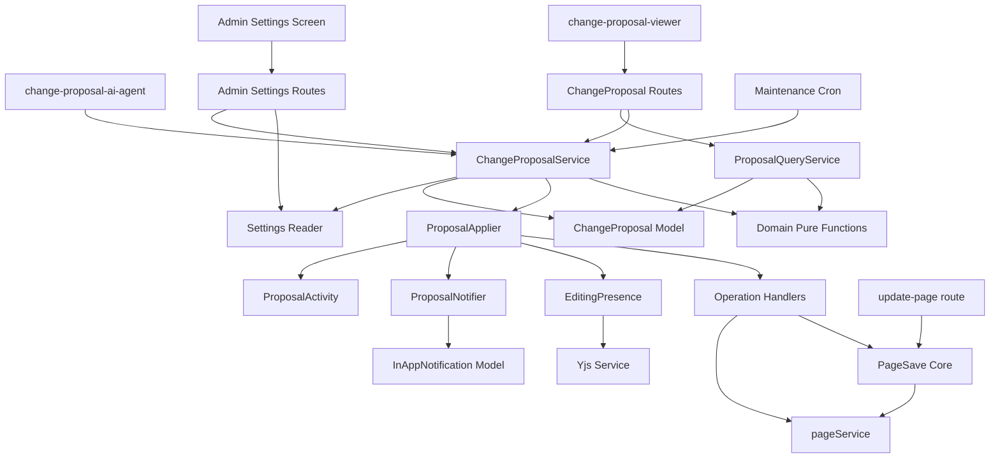
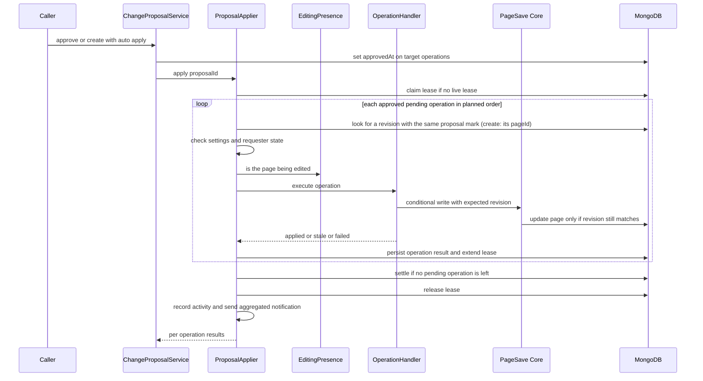
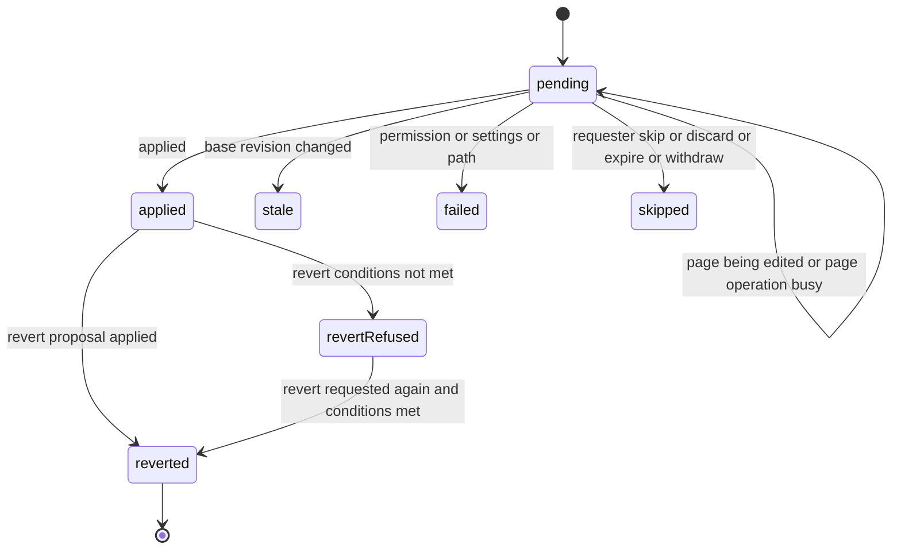
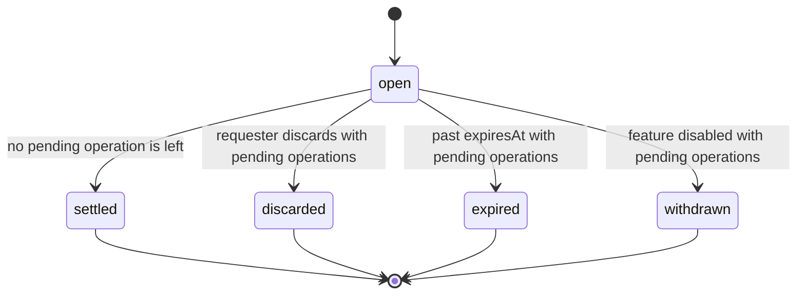

# Design Document: change-proposal-core

## Overview

**Purpose**: AI チャットなどの入口が作った「複数のページへの操作のまとまり」（Change Proposal）を保存し、LLM を使わずにサーバー側で反映し、取り消せるようにする。反映は人の保存と同じ上書き防止の確認を通り、確認と書き込みを 1 回の更新で行う。

**Users**: 入口を作る開発者（最初は `change-proposal-ai-agent`）と、反映後の画面を作る開発者（`change-proposal-viewer`）が、本 spec のサービスと API を使う。依頼した人は承認と取り消しを、他のユーザーは自分が閲覧できる範囲の取り消しを、管理者は書き込みの範囲と自動反映の方針を、それぞれ行う。

**Impact**: ページの更新の route（`update-page.ts`）から上書き防止の確認と書き込みを切り出し、人の保存と反映が同じ処理を通るようにする。書き込みは「最新のリビジョンが期待どおりなら書く」条件付きの更新になる。リビジョンに、作った Change Proposal の印（Change Proposal の ID と、操作の `key`）を足す。ページには項目を足さない。

本書で使う言い方（操作・元のリビジョン・依頼した人・入口・見る人・編集中の人がいるページ・操作の 7 つの状態）は、[requirements.md](./requirements.md) の「本要件で使う言い方」と同じである。調べた事実と判断の理由は [research.md](./research.md) にある。

### Goals
- Change Proposal を保存し、その状態を操作ごとに持つ（要件 1・2）
- 人の保存とぶつからず、共同編集中の入力を消さない反映（要件 3）
- 管理者の方針による自動反映と、依頼した人によるページ単位の承認（要件 4）
- 取り消し用の Change Proposal による取り消しと、戻してよい条件の判定（要件 5）
- リビジョンへの印、まとめたアプリ内通知、新しい activity（要件 6・7）
- 管理者の設定と画面（要件 8）、見る人ごとに絞った API（要件 9）、人の保存を変えないこと（要件 10）
- 兄弟の spec の画面が使う共通の部品（表示名の表と、diff2html の設定と見た目）（要件 11）
- 「待ち」の操作が無くなった Change Proposal を自動で完了にし、依頼した人にだけ段階と達成度を返す（要件 2.9–2.11・12）
- 後続・見直しの Change Proposal を元の Change Proposal に結び付けて保存し、つながりを見る人ごとに絞って返す（要件 13・14）

### Non-Goals
- AI に Change Proposal を作らせる道具、置き換えの指示からの本文の組み立て、内容が大きく消える操作の拒否（`change-proposal-ai-agent`）
- 詳細ページ・一覧画面・各画面の印・取り消しボタン・まとめた通知の表示（`change-proposal-viewer`）
- REST での Change Proposal の作成（将来の `change-proposal-mcp` などの入口が作る。research.md の判断を参照）
- 差分の塊ごとの承認、元のリビジョンが変わった案の自動の合わせ込み
- 複数台のサーバーの間で、編集中の人がいるかを確かめる仕組み（未決の論点）
- 後続・見直しの Change Proposal の中身を作ること（入口が作る。AI チャットでは `change-proposal-ai-agent`）。core は、新しい操作が元の操作と同じページを対象にしているかを確かめない

## Boundary Commitments

### This Spec Owns
- Change Proposal のデータ（新しいコレクション `changeproposals`。`schema.prisma` の model と Prisma の拡張で読み書きし、コレクションと索引は Mongoose の schema が作る）と、その状態の移り変わり。全体の状態を操作の状態から決める純関数
- 段階 `settled`（完了）への自動の移り変わりと、依頼した人にだけ返す段階と達成度（`requesterState`）
- 後続・見直しのつながり（`basedOn`）の保存・作成のときの検査・つながりの読み出しと、見る人ごとの絞り込み。どの操作の状態ならつながりを作れるかの表（`BASED_ON_ELIGIBLE_STATUSES`）
- Change Proposal の作成・承認・飛ばす・破棄・取り消し・期限切れ・取り下げを行うサービス
- 反映の実行（反映の順序、1 つの処理だけが反映する仕組み、二度書かない仕組み、操作の種類ごとの書き込み）
- 上書き防止の確認と書き込みを 1 回の更新で行う、人の保存と共通の処理（`server/service/page-save/`）
- 戻してよいかの判定（見る人ごと、その時点のページの状態で）
- リビジョンの `proposalId` / `proposalOperationKey` の書き込み（ページには項目を足さない）
- まとめたアプリ内通知のデータ（受け取る人ごとの中身）と、新しい activity の action
- 管理者の設定キー、設定の API、設定画面
- Change Proposal の取得・一覧・承認・飛ばす・破棄・取り消し・リビジョンの印の取得の REST API と、その応答の形
- 兄弟の spec の画面で共通に使う client の部品（`features/change-proposal/client/shared/`）: 操作の種類・操作の状態・全体の状態・理由・戻せない理由・段階・つながりの関係の表示名の表と達成度の文言、`translation` の名前空間の `change_proposal.*` の翻訳キー（5 言語）、`i18next.config.ts` の `preservePatterns`、達成度の割合と残りの操作を決める純関数、diff2html の設定と CSS、詳細ページの URL を作る `buildProposalHref`。ページ履歴の差分（`RevisionDiff`）もこれを使う

### Out of Boundary
- 入口ごとの違い（AI チャット・Vault・MCP）。反映・承認・取り消しの振る舞いは入口によって変えない
- 本文の中身の評価（短くなりすぎの判定など）。入口の責任とする
- AI が書いた要約・会話の保存と表示（`change-proposal-ai-agent` が Change Proposal の ID を鍵にして持つ）
- まとめたアプリ内通知の画面での表示と文言（viewer の `commons`）、「本人に戻すよう頼む」通知（`change-proposal-viewer`）
- それぞれの画面だけで使う文言（`change_proposal_viewer.*` と `change_proposal_chat.*`）。表示名の表にある言葉は、兄弟の spec が自分では持たない
- ページ履歴・Recent Changes・ページの見出しの印の画面（`change-proposal-viewer`）
- 閲覧できるかどうかの新しい判定の規則。既存の `Page.findByIdAndViewer` / `findByIdsAndViewer` だけを使う
- `isUpdatable` の判定の中身と、エディタが `revisionId` を送るかどうかの判定（変えない）

### Allowed Dependencies
- `apps/app/src/server/service/page/`（`pageService.updatePage` / `create` / `renamePage` / `deletePage` / `revertDeletedPage`）と `pageOperationService.canOperate`
- `apps/app/src/server/models/`（`Page`・`Revision`・`PageRedirect`・`Subscription`・`InAppNotification`・`User`）
- `apps/app/prisma/schema.prisma` と `apps/app/src/utils/prisma.ts`（`createPrisma()` に Change Proposal の拡張を登録する）
- `apps/app/src/server/service/yjs/` の `IYjsService`
- `apps/app/src/server/service/activity/`（`beginActivity` / `pendingActivityContext`）と `activityService.createActivity`
- `configManager`、`CronService`
- `@growi/core` の型と純関数（`isCreatablePage` など。リビジョンの印の型 `IRevisionProposalMark` もここに足す）
- 依存の向き: `interfaces` → `server/domain`（純関数）→ `server/models` → `server/services` → `server/routes`・cron → `client`。`server/service/page-save/` は `features/change-proposal` に依存しない（人の保存の route も使うため）。`page-save` と `pageService` が受け取るリビジョンの印の型は `@growi/core` の `IRevisionProposalMark` で、`features/change-proposal` は自分の `ProposalMark` を純関数 `toRevisionProposalMark` で変えて渡す。`utils/prisma.ts` は `features/change-proposal/server/models/change-proposal.ts` を直接 import する（server の barrel を通すと、barrel → サービス → `utils/prisma.ts` → barrel と import が循環するため。`refreshed-model-catalog.ts` の前例と同じ）。`features/change-proposal` は `@mastra/*` / `ai` / `@ai-sdk/*` を import しない（`server-boot-imports.md`）。`client/shared/` は server のコードを import せず、`interfaces` の型だけを使う。ページ履歴の差分（`client/components/PageHistory/RevisionDiff.tsx`）は `client/shared/` の diff2html の部品を import する

### Revalidation Triggers
次の変更をしたときは、`change-proposal-ai-agent` と `change-proposal-viewer` の結合を確かめ直す。
- `ChangeProposalService` の公開の関数（作成・承認・取得）の入力と結果の形（作成の任意の `trigger` を含む）と、`ServiceError` の値
- server の barrel が export するもの（`createProposal`・`approve`・`getForViewer`・`readChangeProposalSettings`）と、`interfaces` の barrel が export するもの（型、`MAX_TOTAL_BODY_BYTES`、`ApplyTrigger` / `ApplyResult` / `RevertResult`）
- REST API の応答の形（`ChangeProposalView` / `OperationView` / `ApplyResult` / `RevertResult`）、戻せない理由の値（`RevertRefusalReason`）、操作の種類・状態・理由の値
- 依頼した人以外の見る人に返す操作の決まり（`selectVisibleOperations`）と、依頼した人以外に返す `lastAppliedAt` の決め方
- まとめたアプリ内通知の snapshot の形と、`targetModel` の名前、受け取る人の決め方
- リビジョンの `proposalId` / `proposalOperationKey` の意味（何を記録するか）
- `client/shared/` の表の名前・翻訳キーの名前・diff2html の部品の形
- Change Proposal の詳細ページの URL（`buildProposalHref` が作る `/me/change-proposals/{id}`）を変えるとき（`change-proposal-viewer` のページの route と合わせる）
- 承認の単位（同じページへの操作をまとめて承認する扱い）と、編集中の人がいたときに「待ち」に残す扱い
- 管理者の設定キーの名前と意味
- 編集中の人の確かめ方を、複数台のサーバーに対応させたとき
- Prisma の版を上げたとき（条件付きの更新を 1 回の処理として扱えることを、ChangeProposal Model の同時実行の結合テストで確かめ直す。research.md の「新しいコレクションは Prisma で読み書きし、索引は Mongoose の schema で作る」）
- 段階の値（`ProposalLifecycle`。`settled` を含む）と、完了にする条件（「待ち」の操作が 1 つも無い）。完了した Change Proposal に、承認・飛ばす・破棄が `not-open` を返し、取り消しと後続・見直しの作成は受け付けること
- 依頼した人にだけ返す `requesterState`（段階と達成度）の形と、達成度の数え方（分子と分母に入る状態、取り消しの Change Proposal には返さないこと）
- `basedOn` の形、関係の値（`BasedOnRelation`）、関係ごとに元の操作として認める状態（`BASED_ON_ELIGIBLE_STATUSES`）、`createProposal` が返す `based-on-unavailable` / `based-on-operation-not-eligible`、見直しを自動反映しない扱い
- つながり（`OperationView.linkedProposals` と `ChangeProposalView.basedOn`）を依頼した人以外に返す条件

## Architecture

### Existing Architecture Analysis
- ページの更新は route（`routes/apiv3/page/update-page.ts`）が、上書き防止の確認（`isUpdatable`）・書き込み（`pageService.updatePage`）・activity・通知・共同編集の文書の置き換えを順に呼ぶ。書き込みのときに最新のリビジョンを条件にしていない。
- 作成・更新の通知は route から、移動・ごみ箱への移動のアプリ内通知は `pageService` の中から出る。全文検索・GROWI Vault・画面の更新は `crowi.events.page` を受けて動く。
- 共同編集の接続数は、プロセスごとのメモリにだけある。

### Architecture Pattern & Boundary Map



**Architecture Integration**:
- 採用する形: 確認と書き込みを共通の処理に切り出し、反映と人の保存が同じ処理を通る（research.md の案 C）。通知・activity・共同編集の文書の扱いは、呼び出し側が選ぶ。
- 機能の境界: 反映の流れの判断（順序、状態、戻せるか、見えるか）は純関数にし、DB と既存のサービスへの書き込みは、操作の種類ごとの handler の中だけで行う。handler の一覧は種類をキーにした表で持ち、実行する側は種類で分岐しない。
- 変えずに従う既存の決まり: route の middleware の順（`activity-recording.md`）、見えないページへの一様な 404（`page-write-action-403-404.md`）、読み書きは Prisma の拡張、コレクションと索引の作成は Mongoose の schema（`model.md`）、`isUpdatable` の中身。
- 新しい部品の理由: 反映は request が無い場面（期限切れの処理の再開、自動反映）でも動くため、route に依存しないサービスとして作る。

### Technology Stack

| Layer | Choice / Version | Role in Feature | Notes |
|-------|------------------|-----------------|-------|
| Frontend | React 18、Next.js 16 Pages Router、react-hook-form、reactstrap、SWR | 管理者の設定画面 | `features/mastra/client/admin/` と同じ形 |
| Backend | Express（apiv3）、express-validator | REST API | 既存の route の形 |
| Data | MongoDB（replica set）、Prisma ^6.19.2（`changeproposals` の読み書き、`revisions` の項目追加）、Mongoose ^6.13.6（`changeproposals` のコレクションと索引の作成、`revisions` の索引） | Change Proposal の保存、印の記録 | 条件付きの更新は、Prisma のクエリエンジンが transaction の中で行う（research.md）。`pages` には項目を足さない |
| Realtime | y-websocket 2.1.0（既存） | 編集中の人の確認 | プロセスごとの接続数だけが見える |
| Jobs | node-cron（既存の `CronService`） | 期限切れ・取り下げ・止まった反映の再開 | 新しい依存は無い |

新しい外部ライブラリは足さない。

## File Structure Plan

### Directory Structure
```
apps/app/src/features/change-proposal/
├── interfaces/
│   ├── index.ts                    # Barrel: every type below + MAX_TOTAL_BODY_BYTES
│   ├── change-proposal.ts          # Entry kinds, operation types, statuses, reason codes, document shape, MAX_TOTAL_BODY_BYTES
│   ├── api.ts                      # REST/service result types (ChangeProposalView, OperationView, ApplyTrigger, ApplyResult, RevertResult, ...)
│   ├── settings.ts                 # AutoApplyPolicy and settings shape shared by server and admin UI
│   └── notification.ts             # Snapshot shape of the aggregated in-app notification (read by viewer)
├── server/
│   ├── index.ts                    # Barrel: createProposal, approve, getForViewer, readChangeProposalSettings, route factories, cron starter
│   ├── models/
│   │   ├── change-proposal.ts      # Index-only Mongoose schema (collection + indexes) + Prisma extension (all reads/writes)
│   │   ├── to-change-proposal-document.ts       # Pure: Prisma row -> ChangeProposalDocument (OperationRecord union)
│   │   └── to-change-proposal-document.spec.ts
│   ├── domain/                     # Pure functions only, each with a co-located *.spec.ts
│   │   ├── index.ts
│   │   ├── validate-proposal-input.ts
│   │   ├── derive-proposal-status.ts
│   │   ├── plan-apply-order.ts
│   │   ├── select-auto-apply-targets.ts   # includes isOwnPageForAutoApply (provisional definition)
│   │   ├── expand-approval-targets.ts     # expands chosen operations to all pending ops on the same page
│   │   ├── judge-revertability.ts
│   │   ├── build-revert-operations.ts
│   │   ├── select-visible-operations.ts
│   │   ├── validate-based-on.ts           # base exists / same requester / not a revert proposal / eligible op keys
│   │   ├── compute-achievement.ts         # applied-at-least-once / attempted, requester view only
│   │   ├── build-proposal-links.ts        # per-operation back-links from derived proposals, filtered per viewer
│   │   └── to-revision-proposal-mark.ts   # ProposalMark -> IRevisionProposalMark (@growi/core)
│   ├── services/
│   │   ├── settings.ts             # Reads/writes the change-proposal config keys
│   │   ├── editing-presence.ts     # "Is someone editing this page" check via IYjsService
│   │   ├── operation-handlers/
│   │   │   ├── index.ts            # Handler table keyed by operation type
│   │   │   ├── types.ts            # OperationHandler contract
│   │   │   ├── edit.ts
│   │   │   ├── create.ts
│   │   │   ├── move.ts
│   │   │   ├── trash.ts            # Used only by revert proposals
│   │   │   └── restore.ts          # Used only by revert proposals; wraps pageService.revertDeletedPage
│   │   ├── proposal-applier.ts     # Lease, ordering, idempotent re-run, result persistence
│   │   ├── proposal-notifier.ts    # Aggregated per-recipient in-app notification
│   │   ├── proposal-activity.ts    # Records CHANGE_PROPOSAL_* activities
│   │   ├── change-proposal-service.ts  # create / approve / skip / discard / revert / expire / withdraw
│   │   ├── proposal-query-service.ts   # get / list / revision marks with viewer filtering
│   │   └── maintenance-cron.ts     # Expire, withdraw when disabled, resume interrupted applies
│   └── routes/
│       ├── index.ts                # User router factory mounted at /change-proposals
│       ├── get-proposal.ts
│       ├── list-mine.ts
│       ├── list-applied.ts
│       ├── approve.ts
│       ├── skip.ts
│       ├── discard.ts
│       ├── revert.ts
│       ├── revision-marks.ts
│       └── admin/
│           ├── index.ts            # Admin router factory mounted at /change-proposal-settings
│           ├── get-settings.ts
│           └── put-settings.ts
└── client/
    ├── admin/
    │   ├── index.ts
    │   ├── ChangeProposalSettings.tsx
    │   └── use-change-proposal-settings.ts
    └── shared/                         # Used by change-proposal-viewer, change-proposal-ai-agent and RevisionDiff
        ├── index.ts                    # Barrel
        ├── label-keys.ts               # Value -> i18n key tables (operation type / status / proposal status / reason / revert refusal reason / lifecycle / link kind) + achievement key
        ├── label-keys.spec.ts          # Every table key exists in all 5 locales' translation.json
        ├── proposal-progress.ts        # Pure: toAchievementPercent, selectRemainingOperations
        ├── proposal-progress.spec.ts
        ├── proposal-links.ts           # Pure: formatProposalShortId, buildProposalHref
        ├── proposal-links.spec.ts
        ├── diff2html-options.ts        # buildDiff2HtmlOptions + useDiff2HtmlColorScheme (moved out of RevisionDiff.tsx)
        ├── diff2html-options.spec.ts
        └── diff2html.vendor-styles.ts  # diff2html CSS entry (replaces RevisionDiff.vendor-styles.ts)

apps/app/src/server/service/page-save/
├── index.ts                        # Barrel
├── update-page-body.ts             # Conflict check + conditional write shared by human save and apply
└── human-save-effects.ts           # Post-save notifications/yjs sync moved out of update-page/create-page routes

apps/app/src/pages/admin/change-proposal.page.tsx   # Admin page (same shape as admin/ai.page.tsx)
```

### Modified Files
- `packages/core/src/interfaces/revision.ts` — リビジョンの印の型 `IRevisionProposalMark = { proposalId: string; proposalOperationKey: string }` を `IRevision` の隣に足し、`IRevision` に任意の `proposalId?: string` と `proposalOperationKey?: string` を足す（`IPage` は変えない）
- `.changeset/*.md` — `@growi/core` の `IRevision` と `IRevisionProposalMark` の変更の changeset（published package のため）
- `apps/app/prisma/schema.prisma` — `revisions` に `proposalId String? @db.ObjectId` と `proposalOperationKey String?` と、疎な索引の `@@index`（注記つき）を足す（`pages` は変えない）。新しい model `changeproposals` と、その composite type（文書の中に持つ形）を足す（Physical Data Model）
- `apps/app/src/utils/prisma.ts` — `createPrisma()` の `$extends` の並びに、Change Proposal の拡張を足す。この拡張は他の拡張の関数を使わないので、並びの位置に決まりは無い（`Tag` → `PageTagRelation` のような順序の制約は無い）
- `apps/app/src/server/models/revision.ts` — Mongoose の schema に 2 項目と疎な索引 `{ proposalId: 1, proposalOperationKey: 1 }` を足す。`prepareRevision` が任意の `proposalMark: IRevisionProposalMark` を受け取り、リビジョンの入力に入れる
- `apps/app/src/server/models/page.ts` — `pushRevision` に任意の `{ expectedRevisionId }` を足し、渡されたときは条件付きの更新で書く（ページの schema に項目は足さない）
- `apps/app/src/server/models/errors.ts` — `RevisionConflictError` を足す
- `apps/app/src/interfaces/page.ts` — `IOptionsForUpdate` に `expectedRevisionId?` と `proposalMark?: IRevisionProposalMark`、`IOptionsForCreate` に `proposalMark?: IRevisionProposalMark` を足す（作成では、印は最初のリビジョンにだけ書く）。型は `@growi/core` から import し、`features/change-proposal` は import しない
- `apps/app/src/server/service/page/index.ts` / `page-service.ts` — `updatePage` と `create` が `proposalMark` と `expectedRevisionId` を下へ渡す。`renamePage` と `deletePage` の options に `isInAppNotificationSuppressed?` を足し、真のときは `activityEvent.emit('updated', …)` を出さない（activity の記録は今のまま）。`revertDeletedPage` の options にも同じ指定を足す。子のページを含めない戻し方では今 `activityEvent.emit('update', activityId, parameters, page, preNotifyService.generatePreNotify)` を出しているので、指定が真のときは 4 番目と 5 番目の引数を渡さずに `emit` する（activity は今のまま記録し、アプリ内通知は作らない）
- `apps/app/src/server/models/page-redirect.ts` — `deleteRedirectsFromPathTree(fromPath)`（`fromPath` 自身と、その下のパスを起点とするリダイレクトを消す）を Prisma の拡張に足す。ごみ箱から戻す操作は、既存の `deleteByFromPath` を使う
- `apps/app/src/server/service/yjs/yjs.ts` — `IYjsService` に `getConnectionCount(pageId): number` を足す（このプロセスの `docs.get(pageId)?.conns.size ?? 0`）
- `apps/app/src/server/routes/apiv3/page/update-page.ts` — 確認と書き込みを `updatePageBody` に、`postAction` を `human-save-effects` に移す。middleware の順と activity の emit の位置は変えない
- `apps/app/src/server/routes/apiv3/page/create-page.ts` — `postAction` を `human-save-effects` に移す
- `apps/app/src/interfaces/activity.ts` — action `CHANGE_PROPOSAL_CREATE` / `CHANGE_PROPOSAL_APPLY` / `CHANGE_PROPOSAL_REVERT` / `ADMIN_CHANGE_PROPOSAL_SETTINGS_UPDATE`、target model `ChangeProposal`、監査ログの分類（`SupportedActionCategory.CHANGE_PROPOSAL = 'ChangeProposal'`）を足す。分類の正規表現は `^CHANGE_PROPOSAL_` を直接書く（分類名を大文字にするだけの既存の書き方では `CHANGEPROPOSAL` になり、action の名前と合わないため）。`APPLY` と `REVERT` は `EssentialActionGroup` に入れる
- `apps/app/src/client/components/Admin/AuditLog/SelectActionDropdown.tsx`（分類を表示している部品）— 新しい分類を足す
- `apps/app/src/server/service/in-app-notification.ts` — 通知の一覧で、`targetModel` が `ChangeProposal` の通知の `target` を `_id` だけにして返す（一覧の取得は `target` を中身ごと読み込んで返すため。そのままだと受け取る人に Change Proposal の全部の操作が渡り、受け取る人ごとに絞った snapshot の意味が無くなる）
- `apps/app/src/server/service/config-manager/config-definition.ts` — 設定キー（Data Models の「設定キー」）
- `apps/app/src/server/routes/apiv3/index.js` — `router.use('/change-proposals', …)` と `routerForAdmin.use('/change-proposal-settings', …)`
- `apps/app/src/server/crowi/index.ts` — `setupCron` で保守用の cron を起動する。書き込み機能の有効・無効にかかわらず起動し（無効のときに承認待ちを取り下げるため）、実行の間隔の設定が空のときだけ起動しない
- `apps/app/src/components/Admin/Common/AdminNavigation.tsx` — 管理メニューに 1 項目を足す
- `apps/app/public/static/locales/{en_US,ja_JP,zh_CN,fr_FR,ko_KR}/admin.json` — 設定画面の文言と `audit_log_action.CHANGE_PROPOSAL_*` / `ADMIN_CHANGE_PROPOSAL_SETTINGS_UPDATE`
- `apps/app/public/static/locales/{en_US,ja_JP,zh_CN,fr_FR,ko_KR}/translation.json` — `client/shared/` の表が指す `change_proposal.operation_type.*` / `operation_status.*` / `proposal_status.*` / `reason.*` / `revert_refusal_reason.*` / `lifecycle.*` / `link.*` / `achievement.*`
- `apps/app/i18next.config.ts` — `extract.preservePatterns` に上の 8 つの接頭辞のワイルドカード（`change_proposal.operation_type.*` など）を足す。キーの全体を表から引く呼び方なので、静的な解析ではどのキーも使われていないように見えるためである。`change_proposal.` で始まる静的な `t('…')` の呼び出しは作らないので、ワイルドカードで隠れるキーは無い
- `apps/app/src/client/components/PageHistory/RevisionDiff.tsx` — diff2html の設定（`outputFormat: 'side-by-side'`、`drawFileList: false`、テーマから決めた `colorScheme`）と色の決め方を `client/shared/diff2html-options.ts` から取り、CSS は `client/shared/diff2html.vendor-styles.prebuilt` を読み込む。表示は変えない
- `apps/app/src/client/components/PageHistory/RevisionDiff.vendor-styles.ts` — 削除する（`client/shared/diff2html.vendor-styles.ts` に移す。`vite.vendor-styles-components.ts` は `src/**/*.vendor-styles.ts` を集めるので、置き場所を変えても prebuild の対象に入る）
- `apps/app/bin/openapi/generate-spec-apiv3.sh` — 新しい route のディレクトリを OpenAPI の生成対象に足す

## System Flows

### 反映の流れ



- 承認は先に記録する（`approvedAt`）。そのあとで反映の権利（lease）を取る。別の処理が反映中で lease を取れなかったときは、記録した承認を、反映中の処理が最後に読み直して続けて反映する。反映中の処理が止まった場合は、保守用の cron が lease の期限切れを見て再開する（要件 3.14・3.15）。
- 各操作の前に、同じ Change Proposal の印（`proposalId` と操作の `key`）を持つリビジョンがすでにあるかを探す（新規作成では、見つかったリビジョンの `pageId` が作ったページである）。あれば書かずに「反映済み」として記録する。
- 編集中の人がいるとき、または重なる `PageOperation` が決まった時間を過ぎても残るときは、その操作を「待ち」に戻し、`approvedAt` を消す（もう一度の承認が要る。要件 3.5・4.8）。
- すでに反映した操作は、後の操作が失敗しても戻さない（要件 3.13）。

### 操作の状態の移り変わり



- 状態の値は `pending`（待ち）・`applied`（反映済み）・`failed`（失敗）・`stale`（古い）・`skipped`（飛ばした）・`reverted`（取り消し済み）・`revert-refused`（取り消しを断られた）。
- 「取り消しを断られた」の操作は、もう一度取り消しを求められたときに判定し直す。条件を満たせば「取り消し済み」になる。
- 後続・見直しの Change Proposal を作っても反映しても、元の操作の状態は変わらない。`reverted` にするのは取り消しの Change Proposal の反映だけである（要件 13.5・13.6）。

### Change Proposal の段階の移り変わり



- 段階の値は `open`（承認待ち）・`settled`（完了）・`discarded`（破棄）・`expired`（期限切れ）・`withdrawn`（取り下げ）。`open` 以外からは動かない。
- 完了にする書き込みは、「待ち」の操作の状態を変えた書き込みのすぐあとに、同じ処理が `settleIfNoPending`（`lifecycle: 'open'` で「待ち」の操作が 1 つも無いことを条件にした更新）で行う。呼ぶのは、反映の 1 回の実行の終わり（`ProposalApplier`）と、飛ばす処理（`skip`）のあとである。条件付きの更新なので、何度呼んでも結果は同じで、最後の待ちを同時に変えた 2 つの処理のうち、あとに書いたほうが必ず完了にする（research.md の「完了は、待ちの状態を変えた書き込みのすぐあとの条件付きの更新で決める」）。
- 2 つの書き込みの間で処理が止まると、`open` のまま「待ち」が無い Change Proposal が残る。保守用の cron がこれを探して完了にする（`findIdsOpenWithoutPending`）。期限切れと取り下げは「待ち」の操作が 1 つ以上あることを条件にするので、こうした Change Proposal を期限切れや取り下げにすることは無い（要件 2.11）。
- 完了した Change Proposal は承認・飛ばす・破棄の対象にならない（`lifecycle` が `open` であることを条件にしているため、`not-open` が返る）。反映済みの操作の取り消しは、段階を見ないので今までどおり動く（要件 2.10）。

### 後続と見直しの作成の流れ
1. 入口が `createProposal` に `basedOn`（元の Change Proposal の ID・関係・元の操作の `key` の一覧）を渡す。
2. サービスは、ほかの検査（Requirement 1）のあとで元の Change Proposal を読み（`findProposal`）、`validateBasedOn` で確かめる。元が無い、依頼した人が違う、元が取り消しの Change Proposal である、のどれでも同じ `based-on-unavailable` を返す。元の操作が空、元に無い `key`、関係に合わない状態の操作があれば `based-on-operation-not-eligible`（最初に合わなかった `key` つき）を返す（要件 13.2・13.3）。
3. 保存する。`key` の重なりは 1 つにまとめる。元の Change Proposal と元の操作は書き換えない（要件 13.5）。
4. 自動反映の対象を決める。関係が `rework` なら `selectAutoApplyTargets` は空を返し、すべての操作が承認待ちになる（要件 13.4）。`follow-up` は通常と同じ（要件 13.7）。

### 取り消しの流れ
1. 取り消しを求めた人が閲覧できる、指定された操作（指定が無ければ、閲覧できる反映済みの操作のすべて）を選ぶ（`selectVisibleOperations`）。
2. 選んだ操作ごとに、その時点のページの状態で戻せるかを判定する（`judgeRevertability`）。戻せない操作は、元の Change Proposal の中で「取り消しを断られた」にし、理由を記録する。
3. 戻せる操作から、取り消しの Change Proposal の操作を作る（`buildRevertOperations`）。入口の種類は `revert`、依頼した人は取り消しを求めた人、各操作は戻す相手（元の Change Proposal の ID と、元の操作の `key`）を持つ。編集は元の本文に戻す編集、新規作成はごみ箱へ移す操作（`trash`）、移動は元のパスへ戻す移動になる。取り消しの Change Proposal の操作を戻すときは、編集と移動は同じ形で、`trash` はごみ箱から戻す操作（`restore`）、`restore` はもう一度 `trash` になる（要件 5.12・5.15・5.16）。
4. 自動反映の方針と承認を通さず、すぐに反映する（要件 5.10）。取り消しの Change Proposal の操作は、作る時点で `approvedAt` に作成の日時を入れて保存する（取り消しを求めた人が承認したものとして扱う）。これにより、`ProposalApplier`（`approvedAt` を持つ「待ち」の操作だけを反映する）と保守用の cron の再開の候補が、通常の承認済みの操作と同じようにこの操作を拾う。反映が終わったあとの完了は `settleIfNoPending` が行う。
5. 反映済みになった取り消しの操作に対応する元の操作を「取り消し済み」にし、取り消しの Change Proposal の ID を記録する。取り消しの操作が「古い」「失敗」になったときは、元の操作を「取り消しを断られた」にし、次の表で理由を決める。編集中の人がいたときは、取り消しの操作を「飛ばした」にし、元の操作は「反映済み」のまま残す（要件 5.11）。

| 取り消しの操作の結果 | 元の操作に記録する理由（`RevertRefusalReason`） |
|---|---|
| 古い（`base-revision-changed`） | `edited-after-apply` |
| 失敗で、理由がすでに `RevertRefusalReason` の値（`target-unavailable`・`has-children`・`not-in-trash` など） | その値のまま |
| 失敗で、理由が `path-occupied` | `original-path-occupied` |
| 重なる `PageOperation` が決めた時間を過ぎても残った | `page-operation-in-progress` |
| 失敗で、それ以外の理由（`write-error`・`requester-not-allowed`・`grant-not-assignable`） | `apply-failed` |

- 「取り消しを断られた」の操作は、もう一度取り消しを求めれば判定し直すので、表の後の 2 つは、時間をおいて求め直せば戻せることがある。

## Requirements Traceability

| Requirement | Summary | Components | Interfaces | Flows |
|-------------|---------|------------|------------|-------|
| 1.1–1.4 | 作成と操作の種類 | ChangeProposalService、ChangeProposal Model | `createProposal` | — |
| 1.5–1.7, 1.13, 1.16 | 形の検査、移動は 1 つ、操作数、パス、大きさ | validateProposalInput | `validateProposalInput` | — |
| 1.8 | 1 日の件数 | ChangeProposalService | `createProposal` | — |
| 1.9 | 機能と操作の種類の有効化 | Settings、validateProposalInput | `readSettings` | — |
| 1.10 | 読み取り専用とゲスト | ChangeProposalService | `createProposal` | — |
| 1.11, 1.12 | 閲覧できない対象、元のリビジョンの所属 | ChangeProposalService | `createProposal` | — |
| 1.14 | 入口の種類「取り消し」は作成で受けない | validateProposalInput | `CreatableEntry` 型 | — |
| 1.15 | モデル名 | ChangeProposal Model | `modelLabel` | — |
| 2.1, 2.2 | 操作の状態と全体の状態 | deriveProposalStatus | `deriveProposalStatus` | 状態の移り変わり |
| 2.3, 2.4 | 飛ばす、破棄 | ChangeProposalService | `skip` / `discard` | — |
| 2.5 | 期限切れ | ChangeProposalService、MaintenanceCron | `expireDueProposals` | — |
| 2.6, 2.7 | 反映の日時と結果、理由の値 | ProposalApplier | `OperationResult` | 反映の流れ |
| 2.8 | 反映済みを消さない | ChangeProposal Model | TTL 索引を持たない | — |
| 3.1 | LLM を使わない | ProposalApplier、Operation Handlers | — | 反映の流れ |
| 3.2 | 順序、移動は最後 | planApplyOrder | `planApplyOrder` | 反映の流れ |
| 3.3, 3.4, 3.16 | 確認と書き込みを 1 回で、古い、同時の保存 | PageSave Core、EditHandler | `updatePageBody`、`pushRevision` | 反映の流れ |
| 3.5 | 編集中の人 | EditingPresence | `isBeingEdited` | 反映の流れ |
| 3.6, 3.7 | 反映時の権限・読み取り専用・設定 | ProposalApplier、Operation Handlers | `OperationHandler.execute` | — |
| 3.8 | パスの重なり | CreateHandler、MoveHandler | — | — |
| 3.9 | 親と同じ閲覧範囲 | CreateHandler | `pageService.create` | — |
| 3.10 | 作者は依頼した人 | Operation Handlers | — | — |
| 3.11, 3.12 | 開いていたエディタの保存、次に開いたときの本文 | PageSave Core（`origin` 空） | — | — |
| 3.13 | 前の操作を戻さない | ProposalApplier | — | 反映の流れ |
| 3.14, 3.15 | 二度書かない、同時に反映しない | ProposalApplier | lease、印の検索 | 反映の流れ |
| 3.17 | 全文検索などの更新 | Operation Handlers（`pageService` 経由） | — | — |
| 4.1–4.3 | 自動反映の方針 | selectAutoApplyTargets | `selectAutoApplyTargets`、`isOwnPageForAutoApply` | — |
| 4.4, 4.5 | ページ単位の承認と全体の承認 | expandApprovalTargets、ChangeProposalService | `approve` | 反映の流れ |
| 4.6, 4.7 | 本人以外と終わった案の承認 | ChangeProposalService | `approve` | — |
| 4.8 | 編集中で待ちに残す | ProposalApplier | — | 反映の流れ |
| 5.1, 5.10 | 取り消しの Change Proposal とすぐの適用 | ChangeProposalService | `revert` | 取り消しの流れ |
| 5.2–5.4 | 誰が何を取り消せるか | selectVisibleOperations | `revert` | 取り消しの流れ |
| 5.5–5.8 | 戻してよい条件 | judgeRevertability、buildRevertOperations | `judgeRevertability` | 取り消しの流れ |
| 5.15 | ごみ箱へ移した操作の取り消し（ごみ箱から戻す） | judgeRevertability、buildRevertOperations、RestoreHandler | `judgeRevertability`、`pageService.revertDeletedPage` | 取り消しの流れ |
| 5.16 | ごみ箱から戻した操作の取り消し（もう一度ごみ箱へ） | judgeRevertability、buildRevertOperations、TrashHandler | `judgeRevertability` | 取り消しの流れ |
| 5.7 | リダイレクトを消す | MoveHandler | `deleteRedirectsFromPathTree` | — |
| 5.9 | 取り消し済みの記録 | ProposalApplier | — | 取り消しの流れ |
| 5.11 | 編集中のページの取り消し | ProposalApplier | — | 取り消しの流れ |
| 5.12 | 取り消しの取り消し | judgeRevertability | — | — |
| 5.13 | 設定に左右されない | ChangeProposalService、ProposalApplier | `isRevertProposal` | — |
| 5.14 | 見る人ごとの戻せるかの判定 | ProposalQueryService、judgeRevertability | `OperationView.revertability` | — |
| 6.1, 6.2 | リビジョンの印（新規作成は最初のリビジョン） | PageSave Core、CreateHandler、Revision の schema | `IRevisionProposalMark`（`@growi/core`）、`toRevisionProposalMark` | — |
| 6.3, 6.4 | 人の保存に印を付けない、`origin` を空に | PageSave Core | — | — |
| 6.5 | 消えない記録 | ChangeProposal Model | — | — |
| 6.6 | 既存のリビジョンの応答から他の操作が分からない | Revision の schema（`key` だけを持つ） | `proposalOperationKey` | — |
| 7.1 | ページごとの通知を止める | Operation Handlers、pageService の options | `isInAppNotificationSuppressed` | — |
| 7.2–7.4 | まとめた通知、見えるページだけ | ProposalNotifier | `notifyApplied` | 反映の流れ |
| 7.8 | 取り消しの通知（元の依頼した人、ごみ箱の操作のページ） | ProposalNotifier | `notifyApplied` | 取り消しの流れ |
| 7.5, 7.7 | activity | ProposalActivity | `recordProposalActivity` | — |
| 7.9 | request の中の作成は、その request の activity に記録 | ProposalActivity、ChangeProposalService | `createProposal` の `trigger` | — |
| 7.6 | 人の保存の通知を変えない | PageSave Core、human-save-effects | — | — |
| 8.1–8.4 | 設定 | Settings、config-definition | 設定キー | — |
| 8.5 | 無効にしたら取り下げ | ChangeProposalService、Admin Routes、MaintenanceCron | `withdrawAllPending` | — |
| 8.6–8.8 | 設定画面、5 言語、管理者だけ | Admin UI、Admin Routes | Admin API | — |
| 9.1–9.5 | 取得と絞り込み | ProposalQueryService、selectVisibleOperations | `GET /change-proposals/:id` | — |
| 9.6, 9.7 | 一覧 | ProposalQueryService、selectVisibleOperations | `GET /change-proposals/mine`・`/applied` | — |
| 9.8 | リビジョンの印の取得 | ProposalQueryService、selectVisibleOperations | `POST /change-proposals/revision-marks` | — |
| 9.9 | 読み取り専用ユーザー | Routes（`excludeReadOnlyUser`） | — | — |
| 9.10 | 依頼した人以外の `lastAppliedAt` は見える操作から | ProposalQueryService | `ChangeProposalView.lastAppliedAt` | — |
| 10.1–10.3 | 人の保存への影響が無い | PageSave Core、human-save-effects | — | — |
| 11.1, 11.2 | 表示名の表と 5 言語の翻訳キー | Client Shared | `label-keys.ts` | — |
| 11.3 | diff2html の設定と見た目の共通化 | Client Shared、RevisionDiff | `buildDiff2HtmlOptions` | — |
| 2.9 | 待ちが無くなったら完了にする | ChangeProposal Model、ProposalApplier、ChangeProposalService、MaintenanceCron | `settleIfNoPending`、`findIdsOpenWithoutPending` | 段階の移り変わり |
| 2.10 | 完了した案の承認・飛ばす・破棄は断り、取り消しと後続・見直しは受ける | ChangeProposalService | `approve` / `skip` / `discard` の `not-open`、`revert`、`validateBasedOn` | 段階の移り変わり |
| 2.11 | 完了した案を期限切れ・取り下げにしない | ChangeProposal Model、MaintenanceCron | `closeIfStillOpen` | 段階の移り変わり |
| 11.4 | 段階・つながりの関係・達成度の表示名 | Client Shared | `PROPOSAL_LIFECYCLE_LABEL_KEYS`、`PROPOSAL_LINK_LABEL_KEYS`、`ACHIEVEMENT_LABEL_KEY`、`toAchievementPercent` | — |
| 11.5 | 「古い」と「破棄」の言葉 | Client Shared | `OPERATION_STATUS_LABEL_KEYS`、`PROPOSAL_STATUS_LABEL_KEYS`、`PROPOSAL_LIFECYCLE_LABEL_KEYS` | — |
| 12.1, 12.4 | 段階と達成度は依頼した人にだけ返す | ProposalQueryService | `ChangeProposalView.requesterState` | — |
| 12.2, 12.3 | 達成度の数え方、取り消しの Change Proposal には返さない | computeAchievement | `computeAchievement` | — |
| 13.1 | つながりの保存 | ChangeProposalService、ChangeProposal Model | `createProposal` の `basedOn` | 後続と見直しの作成の流れ |
| 13.2, 13.3 | 元の Change Proposal と元の操作の検査 | validateBasedOn、ChangeProposalService | `validateBasedOn`、`based-on-unavailable`、`based-on-operation-not-eligible` | 後続と見直しの作成の流れ |
| 13.4, 13.7 | 見直しは自動反映しない、後続は通常どおり | selectAutoApplyTargets | `selectAutoApplyTargets` の `relation` | 後続と見直しの作成の流れ |
| 13.5, 13.6 | 元の操作の状態を変えない、取り消し済みにするのは取り消しだけ | ProposalApplier、ChangeProposalService | `markOriginalOperation` は取り消しの反映だけが呼ぶ | 操作の状態の移り変わり |
| 14.1–14.5 | つながりの取得と、見る人ごとの絞り込み | ProposalQueryService、buildProposalLinks、selectVisibleOperations | `OperationView.linkedProposals`、`ChangeProposalView.basedOn`、`findLinkedProposals` | — |

## Components and Interfaces

| Component | Domain/Layer | Intent | Req Coverage | Key Dependencies | Contracts |
|-----------|--------------|--------|--------------|------------------|-----------|
| Domain Pure Functions | domain | 状態・順序・承認・戻せるか・見えるか・達成度・つながりの判断 | 1.5–1.7, 1.13, 1.14, 1.16, 2.1, 2.2, 3.2, 4.1–4.5, 5.2–5.8, 5.12, 5.15, 5.16, 9.1–9.5, 9.7, 9.8, 12.2, 12.3, 13.2–13.4, 13.7, 14.1–14.4 | なし | Service |
| ChangeProposal Model | data | 新しいコレクションの読み書き（Prisma の拡張）と、索引を作る Mongoose の schema | 1.1–1.4, 1.15, 2.6–2.9, 2.11, 6.5, 13.1, 14.1 | Prisma (P0)、Mongoose（コレクションと索引の作成だけ）(P0) | Service, State |
| Settings | services | 設定キーの読み書き | 1.9, 8.1–8.4 | configManager (P0) | Service |
| EditingPresence | services | 編集中の人がいるかの確認 | 3.5, 5.11 | IYjsService (P0) | Service |
| PageSave Core | server/service/page-save | 確認と条件付きの書き込み（人の保存と共通） | 3.3, 3.4, 3.11, 3.12, 3.16, 6.1, 6.3, 6.4, 10.1–10.3 | pageService (P0)、Page model (P0) | Service |
| Operation Handlers | services | 操作の種類ごとの書き込み | 3.6–3.10, 3.17, 5.7, 5.15, 5.16, 6.2, 7.1 | PageSave Core (P0)、pageService (P0) | Service |
| ProposalApplier | services | 反映の実行 | 2.6, 2.7, 2.9, 3.1–3.17, 4.8, 5.9, 5.11, 13.5, 13.6 | Handlers (P0)、Presence (P0)、Model (P0) | Service, State |
| ProposalNotifier | services | まとめたアプリ内通知 | 7.2–7.4, 7.8 | InAppNotification (P0)、Subscription (P1) | Service, Event |
| ProposalActivity | services | activity の記録 | 7.5, 7.7, 7.9 | activity service (P0) | Service |
| ChangeProposalService | services | 作成・承認・飛ばす・破棄・取り消し・期限切れ・取り下げ | 1.*, 2.3–2.5, 2.9, 2.10, 4.*, 5.1–5.13, 8.5, 13.1–13.7 | Applier (P0)、Model (P0)、Settings (P0) | Service |
| ProposalQueryService | services | 見る人ごとに絞った取得 | 5.14, 9.1–9.8, 9.10, 12.1, 12.4, 14.1–14.4 | Model (P0)、Page model (P0) | Service |
| MaintenanceCron | services | 期限切れ・取り下げ・再開・完了の書き込みの前で止まった Change Proposal の完了 | 2.5, 2.9, 2.11, 3.14, 8.5 | CronService (P0) | Batch |
| ChangeProposal Routes | routes | 利用者の REST API | 4.4–4.7, 5.1–5.4, 9.*  | Service (P0)、Query (P0) | API |
| Admin Settings Routes | routes | 管理者の設定の API | 8.1–8.6, 8.8 | Settings (P0)、Service (P1) | API |
| Admin Settings Screen | client | 管理者の設定画面 | 8.6, 8.7 | Admin Routes (P0) | — |
| Client Shared | client | 兄弟の spec の画面と `RevisionDiff` が使う表示名の表と diff2html の部品 | 11.1–11.5 | interfaces (P0)、diff2html (P0) | — |

### Domain（純関数）

#### Domain Pure Functions

| Field | Detail |
|-------|--------|
| Intent | DB を読まない判断をすべて純関数にし、サービスはそれに入力を渡すだけにする |
| Requirements | 1.5–1.7, 1.13, 1.14, 1.16, 2.1, 2.2, 3.2, 4.1–4.5, 5.2–5.8, 5.12, 5.15, 5.16, 9.1–9.5, 9.7, 9.8, 12.2, 12.3, 13.2–13.4, 13.7, 14.1–14.4 |

**Responsibilities & Constraints**
- どの関数も DB・設定・時刻を直接読まない。必要な値は引数で受け取る。
- 各ファイルに同じ場所の `*.spec.ts` を置く。

**Contracts**: Service [x]

##### Service Interface
```typescript
// validate-proposal-input.ts
type ProposalInputLimits = {
  readonly maxOperations: number | null;            // null: not checked
  readonly maxTotalBodyBytes: number;       // MAX_TOTAL_BODY_BYTES (8 MiB) from interfaces/change-proposal.ts
  readonly enabledOperationTypes: ReadonlySet<CreatableOperationType>;
};
type InputRejection =
  | { readonly code: 'unsupported-operation-type'; readonly index: number }
  | { readonly code: 'multiple-move-operations' }
  | { readonly code: 'too-many-operations'; readonly max: number }
  | { readonly code: 'body-too-large' }
  | { readonly code: 'operation-type-disabled'; readonly index: number }
  | { readonly code: 'invalid-path'; readonly index: number }
  | { readonly code: 'empty-operations' };
function validateProposalInput(
  operations: readonly CreatableOperationInput[],
  limits: ProposalInputLimits,
): { readonly ok: true } | { readonly ok: false; readonly rejection: InputRejection };

// derive-proposal-status.ts
function deriveProposalStatus(
  lifecycle: ProposalLifecycle,
  operations: readonly Pick<OperationRecord, 'status'>[],
): ProposalStatus;

// plan-apply-order.ts — keeps the stored order, moves the single move op to the end
function planApplyOrder(operations: readonly OperationRecord[], targetIndices: readonly number[]): readonly number[];

// select-auto-apply-targets.ts
type AutoApplyPageFacts = { readonly pageId: string; readonly creatorId: string | null; readonly lastUpdateUserId: string | null };
function isOwnPageForAutoApply(page: AutoApplyPageFacts, requesterId: string): boolean;  // provisional: creatorId === requesterId (OQ-3)
function selectAutoApplyTargets(
  policy: AutoApplyPolicy,
  operations: readonly OperationRecord[],
  pageFacts: ReadonlyMap<string, AutoApplyPageFacts>,
  requesterId: string,
  relation: BasedOnRelation | null,                 // basedOn.relation of the new proposal; 'rework' -> always []
): readonly number[];

// expand-approval-targets.ts — same page = same pageId (edit/move) or same path (create)
function expandApprovalTargets(operations: readonly OperationRecord[], chosenIndices: readonly number[] | 'all'): readonly number[];

// judge-revertability.ts
type CurrentPageFacts = {
  readonly exists: boolean;
  readonly path: string | null;
  readonly latestRevisionId: string | null;
  readonly hasChildren: boolean;
  readonly isPathOccupied: (path: string) => boolean; // pre-fetched occupancy of the paths this op needs
};
function judgeRevertability(op: OperationRecord, proposalEntry: ProposalEntry, facts: CurrentPageFacts): Revertability;

// build-revert-operations.ts
function buildRevertOperations(
  target: { readonly proposalId: string; readonly operations: readonly OperationRecord[] },
  revertible: readonly {
    readonly key: string;
    readonly originalBody?: string;   // edit: body of the base revision
    readonly restoreToPath?: string;  // trash: the path the page had before it was trashed
  }[],
): readonly RevertOperationInput[];

// select-visible-operations.ts
type VisibilityContext = {
  readonly isRequester: boolean;
  readonly viewablePageIds: ReadonlySet<string>;     // from findByIdsAndViewer
  readonly anyoneWithLinkPageIds: ReadonlySet<string>; // GRANT_RESTRICTED pages among the viewable ones
};
function selectVisibleOperations(operations: readonly OperationRecord[], ctx: VisibilityContext): readonly OperationRecord[];

// to-revision-proposal-mark.ts — the only place that maps the Change Proposal mark onto the Revision field names
function toRevisionProposalMark(mark: ProposalMark): IRevisionProposalMark; // { proposalId, proposalOperationKey: mark.operationKey }

// validate-based-on.ts — base is null when findProposal found nothing
type BasedOnRejection =
  | { readonly code: 'based-on-unavailable' }                                         // missing, other requester's, or a revert proposal — one shape
  | { readonly code: 'based-on-operation-not-eligible'; readonly operationKey?: string }; // operationKey absent: the key list is empty
function validateBasedOn(
  basedOn: BasedOn,
  base: Pick<ChangeProposalDocument, 'requester' | 'entry' | 'operations'> | null,
  requesterId: string,
): { readonly ok: true; readonly basedOn: BasedOn } | { readonly ok: false; readonly rejection: BasedOnRejection }; // ok: keys de-duplicated

// compute-achievement.ts — callers pass every operation of the proposal (requester view only)
function computeAchievement(entry: ProposalEntry, operations: readonly Pick<OperationRecord, 'status' | 'reason'>[]): ProposalAchievement | undefined; // undefined for 'revert'

// build-proposal-links.ts
type LinkedProposalFacts = {
  readonly proposalId: string;
  readonly relation: BasedOnRelation;
  readonly operationKeys: readonly string[];     // basedOn.operationKeys of the derived proposal
  readonly isVisibleToViewer: boolean;           // selectVisibleOperations(derived ops) is non-empty, or the viewer is the requester
};
function buildProposalLinks(
  returnedOperationKeys: readonly string[],      // keys of the base operations this viewer receives
  linked: readonly LinkedProposalFacts[],
): ReadonlyMap<string, readonly ProposalLinkView[]>; // base operation key -> links, newest first
```
- `deriveProposalStatus` の決め方（上から順に当てはめる）:
  1. `lifecycle` が `open` で、「待ち」の操作が 1 つ以上ある → `pending`
  2. 反映済み・取り消し済み・取り消しを断られたの操作が 1 つも無い → `lifecycle` が `discarded` / `expired` / `withdrawn` ならその値、`open` か `settled` なら `not-applied`
  3. それらの操作がすべて取り消し済み → `reverted`
  4. 取り消し済みが 1 つ以上ある → `partially-reverted`
  5. 失敗・古い・飛ばしたの操作が 1 つ以上ある → `partially-applied`
  6. それ以外 → `applied`
- 依頼した人以外への応答では、`deriveProposalStatus` に見える操作だけを渡す（見えない操作の状態が全体の状態に表れないようにする。要件 9.4）。依頼した人以外に見える操作は「反映済み」「取り消し済み」「取り消しを断られた」だけなので、規則 1・2・5 には当てはまらず、全体の状態は `applied` / `reverted` / `partially-reverted` のどれかになる（`pending` と `partially-applied` にはならない。要件 9.2）。
- `selectVisibleOperations` の規則（要件の「見る人に返す操作」をそのまま表す。1 件の取得・反映済みの一覧・リビジョンの印の 3 つが、すべてこの関数を通す）:
  - 対象のページ（編集・移動・ごみ箱・ごみ箱から戻すでは `pageId`、新規作成では反映で作った `resultPageId`）が `viewablePageIds` に無い操作は返さない。
  - 依頼した人以外には、状態が `applied` / `reverted` / `revert-refused` でない操作を返さない。Change Proposal の `lifecycle` はこの判断に使わない（要件 9.2）。
  - 依頼した人以外には、`anyoneWithLinkPageIds` に入るページの操作を返さない（要件 9.5）。
  - まだページが無い新規作成の操作（待ち・失敗・古い・飛ばした）は、依頼した人にだけ返す。
- `judgeRevertability` の規則（`Revertability` は Data Models を参照）。操作の種類ごとに規則を持ち、種類で分岐する場所はこの関数の中の表だけにする:
  - 状態が `applied` か `revert-refused` でない → `not-revertible-state`
  - ページが無い → `target-unavailable`
  - 編集: `latestRevisionId` が反映で作ったリビジョンでない → `edited-after-apply`
  - 新規作成: 子のページがある → `has-children`。最新のリビジョンが反映で作ったリビジョンでない → `edited-after-apply`
  - 移動: ページのパスが移動先のままでない → `moved-after-apply`。移動元のパスが使われている → `original-path-occupied`
  - ごみ箱（取り消しで行った操作。要件 5.15）: ページのパスが、ごみ箱へ移したときのパス（`/trash` で始まるパス）のままでない → `not-in-trash`。ごみ箱へ移す前のパス（今のパスから先頭の `/trash` を除いたもの。既存の `Page.getRevertDeletedPageName` と同じ）に空でないページがある → `original-path-occupied`。最新のリビジョンが、この操作の `expectedRevisionId`（元の新規作成で作ったリビジョン）でない → `edited-after-apply`
  - ごみ箱から戻す（取り消しで行った操作。要件 5.16）: 新規作成と同じ規則（子のページ、最新のリビジョンが `expectedRevisionId` のままか）
  - それ以外 → 戻せる
- ごみ箱へ移す前のパスに空のページ（子のページのためだけにある、中身の無いページ）があっても、使われているとはみなさない。既存の `revertDeletedPage` は、空のページがあればそれと置き換え、空でないページがあるときだけ `PathAlreadyExistsError` を投げるので、その判断に合わせる。
- `selectAutoApplyTargets` は、`relation` が `rework` なら方針にかかわらず空を返す（見直しは依頼した人が差分を確かめてから反映する。要件 13.4）。`follow-up` と `null` は今までどおり方針で決める（要件 13.7）。
- `validateBasedOn` の規則（上から順に当てはめる）:
  1. `base` が無い、`base.requester` が `requesterId` でない、`base.entry` が `revert` → `based-on-unavailable`（3 つを区別しない。要件 13.2）
  2. `operationKeys` が空 → `based-on-operation-not-eligible`（`operationKey` 無し）
  3. `key` が `base.operations` に無い、または状態が `BASED_ON_ELIGIBLE_STATUSES[relation]` に入らない → `based-on-operation-not-eligible`（最初に当たった `key`。要件 13.3）
  4. それ以外 → 重なった `key` を 1 つにまとめた `basedOn` を返す
- `BASED_ON_ELIGIBLE_STATUSES`（`interfaces/change-proposal.ts` の表）: `follow-up` は `stale`・`failed`・`skipped`（理由を問わない）、`rework` は `applied`・`revert-refused`。`pending` は元の Change Proposal でまだ承認できるので後続にしない。`reverted` はすでに戻した内容なので見直さない。兄弟の spec の画面も、ボタンを出すかの判断にこの表を使う。
- `computeAchievement` の規則: `entry` が `revert` なら返さない（取り消しの操作の「古い」「失敗」は、元の操作の「取り消しを断られた」として表すため。要件 12.3）。それ以外は、`applied` を「状態が `applied`・`reverted`・`revert-refused`（`APPLIED_AT_LEAST_ONCE_STATUSES`）の操作の数」、`attempted` を「全体の操作の数から、状態が `skipped` で理由が `skipped-by-requester` の操作の数を引いた数」にする（要件 12.2）。`attempted` が 0 のときも 0 のまま返し、割合にするのは画面の側（`toAchievementPercent`）である。
- `buildProposalLinks` の規則: `returnedOperationKeys` に入る `key` にだけ、つながりを付ける（見る人に返さない元の操作には付けない）。`isVisibleToViewer` が偽のつながりは付けない（要件 14.3）。同じ Change Proposal が同じ操作を 2 回指すことは無い（`validateBasedOn` が `key` をまとめるため）。

### Data

#### ChangeProposal Model

| Field | Detail |
|-------|--------|
| Intent | Change Proposal を 1 文書として保存する。操作は文書の中の配列に持つ。読み書きはすべて Prisma の拡張の関数を通す |
| Requirements | 1.1–1.4, 1.15, 2.6–2.9, 2.11, 6.5, 13.1, 14.1 |

**Responsibilities & Constraints**
- 読み書きは、`server/models/change-proposal.ts` の Prisma の拡張の関数（`prisma.changeproposals.<関数>`、下の表）だけで行う。サービスは Prisma の `findMany` や `updateMany` を直接呼ばない。Mongoose のモデルでは読み書きしない。
- コレクションと索引は、同じファイルの Mongoose の schema が作る（`model.md`。理由は research.md の「新しいコレクションは Prisma で読み書きし、索引は Mongoose の schema で作る」）。schema は索引に使う項目だけを持ち、`getOrCreateModel('ChangeProposal', schema)` で登録して export しない。登録の名前 `ChangeProposal` は、アプリ内通知と activity の `targetModel` の値と同じにする（通知の一覧が `target` を `refPath` で読み込むため）。この名前から Mongoose が決めるコレクション名は `changeproposals` で、Prisma の model の名前と同じになる。
- TTL 索引を持たない。反映済みの操作を含む文書を消す処理を持たない（要件 2.8・6.5）。
- 操作の結果の書き込みは、配列の 1 つの要素だけを書き換える更新（composite type の list への `updateMany`）で行い、文書全体を書き戻さない。
- 拡張の関数は、Prisma の行を純関数 `toChangeProposalDocument` で `ChangeProposalDocument`（操作は種類ごとの `OperationRecord` の union）に変えて返す。composite type は 1 つの形しか持てないので、DB の上では、種類ごとの項目をすべて任意にした 1 つの形（`ChangeproposalsOperations`）で持つ。種類に必要な項目が欠けた行は、変換で例外を投げる（文書を作るのは拡張の関数だけなので、DB を直接書き換えたときにだけ起きる）。
- 任意の項目を消すときは `unset: true` を使い、null を書かない。項目が無いことを条件にするときは、`isSet: false` と null の両方を条件に含める（Prisma は「値が null」と「項目そのものが無い」を区別するため）。
- `createdAt` は `@default(now())`、`updatedAt` は `@updatedAt` で Prisma が書く。`__v` は `utils/prisma.ts` が更新のたびに 1 増やすので、`__v` の値に頼る処理を作らない。

**Contracts**: Service [x] / State [x]

##### Service Interface（Prisma の拡張の関数）

状態を変える関数は、どれも「今の状態を where に入れた `updateMany`」で書き、結果の件数が 1 なら真（この呼び出しが書いた）、0 なら偽を返す。

| 関数 | 使う場面 | Prisma の呼び方と条件 | 偽のとき |
|---|---|---|---|
| `createProposal` | 作成 | `create`。操作の `key` は UUID を振り、`index` は 0 から振る。`basedOn` が渡されたときは、`validateBasedOn` が返した値をそのまま書く | — |
| `findProposal` | 反映・取り消し・取得の読み込み | `findUnique`（`id`） | — |
| `claimApplyLease(id, token, now)` | 反映の権利を取る | where: `id`、かつ `applyLease` が無い（`isSet: false` または null）か `applyLease.expiresAt < now`。data: `applyLease: { set: { token, expiresAt: now + APPLY_LEASE_MS } }` | 取れなかった（`in-progress` を返す） |
| `extendApplyLease(id, token, now)` | 操作を 1 つ反映するたび | where: `id` と `applyLease.token = token`。data: `applyLease.expiresAt` を延ばす | lease を失ったので、その実行を止める |
| `releaseApplyLease(id, token)` | 反映の終わり | where: `id` と `applyLease.token = token`。data: `applyLease: { unset: true }` | 何もしない（期限が切れ、別の処理が取ったあと） |
| `markApproved(id, requesterId, keys, now)` | 承認、作成の直後の自動反映（取り消しの Change Proposal は使わず、操作を作る時点で `approvedAt` を入れて保存する） | where: `id`・`requester`・`lifecycle: 'open'`。data: `operations: { updateMany: { where: { key: { in: keys }, status: 'pending' }, data: { approvedAt: now } } }` | 読み直して `not-found` か `not-open` を返す |
| `skipPendingOperations(id, requesterId, keys, closing?)` | 飛ばす・破棄 | where: `id`・`requester`・`lifecycle: 'open'`。data: 対象の「待ち」の要素を `status: 'skipped'`・`reason`・`approvedAt: { unset: true }` にする。破棄では同じ更新で `lifecycle: 'discarded'` にし、where に `operations: { some: { status: 'pending' } }` も入れる（「待ち」が無い文書を破棄にしない）。飛ばすでは、真が返ったあとで呼び出し側が `settleIfNoPending` を呼ぶ | 同上。破棄で「待ち」が無く偽になったときは、`settleIfNoPending` を呼んでから `not-open` を返す |
| `recordOperationOutcome(id, token, key, outcome, now)` | 操作の結果の記録（反映済み・失敗・古い・飛ばした、「待ち」に戻す） | where: `id`、`applyLease.token = token`、`operations: { some: { key, status: 'pending' } }`。data: その要素だけを `operations.updateMany` で書き換える。反映済みのときは、同じ更新で `lastAppliedAt: now` にし、読んだ文書の `appliedPageIds` に無いページなら `appliedPageIds: { push: pageId }` を足す。「待ち」に戻すときは `status` を変えずに `reason` を書き、`approvedAt: { unset: true }` にする | lease を失ったか、別の処理がすでに書いたので、その実行を止める |
| `markOriginalOperation(id, key, change)` | 取り消しの結果を元の操作に書く | where: `id` と `operations: { some: { key, status: { in: ['applied', 'revert-refused'] } } }`。data: その要素の `status` と、`revertedByProposalId`・`revertedAt`、または `reason` | ログに残して次へ（元の操作が、すでに別の取り消しで変わっている） |
| `closeIfStillOpen(id, closing, now)` | 期限切れ・取り下げ | where: `id`・`lifecycle: 'open'`・lease が無いか期限切れ・`operations: { some: { status: 'pending' } }`（「待ち」が無い文書は完了にするほうへ回す）。期限切れでは `expiresAt <= now`、取り下げでは `entry` が `revert` でない。data: `lifecycle` を `expired` / `withdrawn` にし、「待ち」の要素を `skipped`（理由 `expired` / `withdrawn`）にして `approvedAt` を消す | 別の処理が先に閉じたか、反映中なので、何もしない |
| `findIdsDueForExpiry` / `findIdsOpenForWithdraw` / `findIdsWithInterruptedApply` | 保守用の cron の候補 | `findMany`（`select: { id: true }`、件数の上限つき）。期限切れと取り下げの条件は `closeIfStillOpen` と同じ。再開では、lease が無いか期限切れ（`claimApplyLease` と同じ条件）で、`approvedAt` を持つ「待ち」の要素がある文書を選ぶ。lease が無い文書も含めるのは、反映中の処理が最後に読み直したあとで承認が記録され、その承認の側は lease を取れず、そのあとで反映中の処理が lease を手放した場合に、承認された「待ち」の操作が lease の無い文書に残るためである | — |
| `settleIfNoPending(id)` | 完了にする（反映の 1 回の実行の終わり、飛ばすのあと、保守用の cron） | where: `id`・`lifecycle: 'open'`・`operations: { none: { status: 'pending' } }`。data: `lifecycle: 'settled'` | 「待ち」が残っているか、すでに `open` でないので、何もしない |
| `findIdsOpenWithoutPending` | 保守用の cron が、完了の書き込みが止まった文書を探す | `findMany`（`select: { id: true }`、件数の上限つき）。where は `settleIfNoPending` と同じ。lease を持つ文書も含める（完了は lease と関係なく書ける） | — |
| `findLinkedProposals(baseId, limit)` | つながりの読み出し | `findMany`。where: `basedOn: { is: { proposalId: baseId } }`。並びは `createdAt` の新しい順、件数は `LINKED_PROPOSALS_LIMIT`（50）まで。`select` は `id`・`requester`・`entry`・`basedOn` と、操作の `key`・`type`・`status`・`pageId`・`resultPageId`（本文は読まない） | — |
| `countCreatedSince(requesterId, since)` | 1 日の件数 | `count`。where: `requester`・`createdAt >= since`・`entry` が `revert` でない | — |
| `listByRequester` / `listAppliedAfterCursor` / `findOperationsForMarks` | 一覧とリビジョンの印 | `findMany`。並びは `createdAt` の新しい順、または `lastAppliedAt` の新しい順と `id`（cursor）。`select` で操作の本文（`body`）を読まない | — |

- `appliedPageIds` に重ねて足さないのは、lease を持つ処理だけがこの項目を書くためである。lease の期限が切れて 2 つの処理が書いた場合に重なっても、読む側（反映済みの一覧）は集合として扱うので結果は変わらない。
- 「待ち」の操作の状態を変える書き込みと完了の書き込み（`settleIfNoPending`）は、別々の更新である。Prisma の更新は `data` を条件で切り替えられないので、「この操作が最後の待ちなら段階も変える」を 1 つの更新では書けない。完了の書き込みは「`open` で待ちが 1 つも無い」を条件にした更新なので、何度呼んでも結果は同じで、待ちを最後の待ちを同時に変えた 2 つの処理のうち、あとに呼んだほうが必ず完了にする（research.md の「完了は、待ちの状態を変えた書き込みのすぐあとの条件付きの更新で決める」）。
- composite type の list の条件 `some` / `none` は Prisma の文書にある書き方である。今の `schema.prisma` には composite type の list が無く、生成された型ではまだ確かめていない。タスク 1.4 で、生成された型と結合テストで確かめる。
- 生の MongoDB のコマンド（`$runCommandRaw`）は使わない。同時実行の結合テストで、条件付きの更新が 1 回の処理として扱えないと分かった場合にだけ、その関数の中身を `$runCommandRaw` の `update` コマンド（条件を `q` に入れる）に置き換える。そのときは `updatedAt` と `$inc: { __v: 1 }` を自分で書き、ObjectId と日時は `{ $oid }` と `{ $date }` で渡す（`bookmark-folder.ts` の前例）。

##### State Management
- State model: Data Models の「Logical Data Model」。
- Persistence & consistency: 状態の変化はすべて、今の状態を where に入れた `updateMany` で行い、結果の件数で、この呼び出しが書いたかを決める。Prisma のクエリエンジンは、条件に合う文書を読んでから `_id` で書く処理を MongoDB の transaction の中で行い、間に別の書き込みが入ると最初からやり直すので、同じ条件で 2 つの処理が同時に書いても、件数が 1 になるのは 1 つだけである（research.md）。書き込みの衝突が続いて Prisma が `P2034` を返したときは、件数 0 と同じに扱う。
- Concurrency strategy: 反映の権利は `applyLease`（`token` と `expiresAt`）で表す。`applyLease` が無いか期限切れのときだけ取れる。lease の長さは定数 `APPLY_LEASE_MS`（5 分）で、操作を 1 つ反映するたびに延ばす。操作の結果の記録は、lease の `token` も条件に含めるので、lease を失った処理は結果を書けない。

**Implementation Notes**
- Validation: 結合テストで、同じ文書に対して同じ条件付きの更新（`claimApplyLease`・`recordOperationOutcome`・`closeIfStillOpen`）を 10 個以上同時に呼び、それを 20 回以上くり返して、毎回、真が 1 つだけであることを確かめる（2 つだけを同時に呼ぶと、片方が読む前にもう片方が書き終わることが多く、条件と書き込みが分かれていても成功してしまうため）。条件付きの `updateMany` のあとで `updatedAt` が新しくなることも確かめる。最後の 2 つの「待ち」の操作を、反映の結果の記録と飛ばす処理で同時に「待ち」でなくし、それぞれのあとで `settleIfNoPending` を呼ぶことを 20 回以上くり返し、毎回、終わりの段階が `settled` になることを確かめる。「待ち」が残る文書と、`open` でない文書は `settleIfNoPending` で変わらないことも確かめる。Mongoose のモデルの `init()` を待ってから、コレクションの索引の名前と疎の指定が Physical Data Model のとおりであることを確かめる。`toChangeProposalDocument` は単体テストで、5 つの種類それぞれの変換と、項目が欠けた行で例外になることを確かめる。

### Services

#### Settings

| Field | Detail |
|-------|--------|
| Intent | 設定キーを読み、型付きの値として返す。管理者の API から書く |
| Requirements | 1.9, 8.1–8.4 |

**Contracts**: Service [x]

##### Service Interface
```typescript
type ChangeProposalSettings = {
  readonly isEnabled: boolean;
  readonly enabledOperationTypes: ReadonlySet<CreatableOperationType>;
  readonly autoApplyPolicy: AutoApplyPolicy;
  readonly maxOperationsPerProposal: number | null;   // null: no limit until OQ-2 is decided
  readonly maxProposalsPerUserPerDay: number | null;  // null: no limit until OQ-2 is decided
  readonly pendingExpirationSeconds: number | null;   // null: never expires until OQ-1 is decided
};
function readChangeProposalSettings(): ChangeProposalSettings;
function updateChangeProposalSettings(input: ChangeProposalSettingsUpdate): Promise<void>; // configManager.updateConfigs
```
- 読むたびに `configManager` から取る（他のサーバーで変更されても、次の読み込みで反映される）。
- `readChangeProposalSettings` は機能の server の barrel から export する。兄弟の spec（viewer の画面の共通の値、ai-agent の道具を渡すかの判断）は、設定キーを直接読まず、この関数を使う。

#### EditingPresence

| Field | Detail |
|-------|--------|
| Intent | ページに編集中の人がいるかを返す |
| Requirements | 3.5, 5.11 |

**Contracts**: Service [x]

##### Service Interface
```typescript
type EditingPresenceResult =
  | { readonly isBeingEdited: false }
  | { readonly isBeingEdited: true; readonly cause: 'connected-in-this-process' | 'unsaved-draft' };
function checkEditingPresence(yjsService: IYjsService, pageId: string): Promise<EditingPresenceResult>;
```
- 次のどちらかなら編集中とする: `yjsService.getConnectionCount(pageId) > 0`、または `await yjsService.getYDocStatus(pageId) === YDocStatus.DRAFT`。
- **分かっている制約**: 接続数はこのプロセスの分しか見えない。複数台のサーバーで動かしている場合、別のプロセスにつながっている編集者は見えない。その場合でも、その編集者のエディタには衝突の知らせが出て、次の保存は上書き防止の確認で止まる（反映したリビジョンの `origin` が空のため）。確かめ方は未決の論点（OQ-6）として残す。

#### PageSave Core（`server/service/page-save/`）

| Field | Detail |
|-------|--------|
| Intent | 上書き防止の確認と、条件付きの書き込みを 1 か所にまとめる。人の保存の route と反映の両方が使う |
| Requirements | 3.3, 3.4, 3.11, 3.12, 3.16, 6.1, 6.3, 6.4, 10.1–10.3 |

**Responsibilities & Constraints**
- `isUpdatable` の判定の中身は変えない。確認を飛ばすかどうかは今のまま `isUpdatable` で決める。
- 書き込みは、ページを読んだ時点の `page.revision`（人の保存）または元のリビジョン（反映）を `expectedRevisionId` として `pageService.updatePage` に渡す。`Page.pushRevision` はそれを条件に `findOneAndUpdate` で書き、一致しなければ作ったリビジョンを消して `RevisionConflictError` を投げる。
- 人の保存で `RevisionConflictError` になったときは、ページを読み直して `isUpdatable` をもう一度通す。通れば定数 `HUMAN_SAVE_MAX_ATTEMPTS`（3）まで書き直す。通らなければ今と同じ 409 `conflict` の結果を返す。
- 反映では書き直さない。一致しなければ結果を `conflict` として返し、呼び出し側が「古い」にする。
- 通知・activity・共同編集の文書の置き換えは、この処理の中では行わない。人の保存のあとの処理は `human-save-effects.ts` に移し、route が今と同じ時点で呼ぶ。

**Dependencies**
- Inbound: `update-page.ts`（人の保存）、EditHandler・取り消しの編集（反映）(P0)
- Outbound: `pageService.updatePage`、`Page.isUpdatable`、`normalizeLatestRevisionIfBroken` (P0)

**Contracts**: Service [x]

##### Service Interface
```typescript
type UpdatePageBodyInput =
  | {
      readonly mode: 'human';
      readonly page: HydratedDocument<PageDocument>;
      readonly body: string;
      readonly user: IUserHasId;
      readonly clientRevisionId: string | undefined;
      readonly origin: Origin | undefined;
      readonly options: Omit<IOptionsForUpdate, 'expectedRevisionId' | 'proposalMark' | 'origin'>;
    }
  | {
      readonly mode: 'proposal';
      readonly page: HydratedDocument<PageDocument>;
      readonly body: string;
      readonly user: IUserHasId;
      readonly expectedRevisionId: string;
      readonly proposalMark: IRevisionProposalMark; // from @growi/core; page-save never imports features/change-proposal
    };

type UpdatePageBodyResult =
  | { readonly type: 'updated'; readonly page: HydratedDocument<PageDocument>; readonly previousRevision: IRevisionHasId | null }
  | { readonly type: 'conflict'; readonly latestRevisionId: string };

function updatePageBody(deps: { readonly pageService: IPageService }, input: UpdatePageBodyInput): Promise<UpdatePageBodyResult>;

// human-save-effects.ts — moved verbatim from the routes' postAction
function runAfterHumanUpdate(crowi: Crowi, args: HumanUpdateEffectArgs): Promise<void>;
function runAfterHumanCreate(crowi: Crowi, args: HumanCreateEffectArgs): Promise<void>;
```
- Preconditions: `mode: 'proposal'` では `origin` を渡さない（反映のリビジョンの `origin` は空、要件 6.4）。
- Postconditions: `updated` のとき、最新のリビジョンは今回作ったもので、`mode: 'proposal'` ならそのリビジョンが `proposalId` と `proposalOperationKey` を持つ。
- Invariants: `mode: 'human'` では、リビジョンに Change Proposal の印を付けない（要件 6.3）。

**Implementation Notes**
- Integration: `update-page.ts` の middleware の順と、`generateUpdateActivity` を応答の前に待つ位置は変えない（`activity-recording.md`）。`postAction` の中身は `runAfterHumanUpdate` に移すだけで、順序と条件（`origin` が `view` か空のときの共同編集の文書の置き換えなど）を変えない。
- Validation: 既存の `update-page.integ.ts` / `update-page-previous-revision.integ.ts` / `create-page.integ.ts` / `sync-latest-revision-body-to-yjs-draft.integ.ts` を変更せずに通すことを完了条件にする。
- Risks: `updatePage` は `pushRevision` の前に `save()` で閲覧範囲や WIP の値を書く。書き込みで負けたときに、それらの値だけが先に保存される。人の保存では書き直しで同じ値になる。反映では閲覧範囲と WIP を渡さない（`wip` を渡さないと `wipExpiredAt` だけが消える既存の動きはそのまま）。

#### Operation Handlers

| Field | Detail |
|-------|--------|
| Intent | 1 つの操作を、既存のページのサービスを通して書き込む |
| Requirements | 3.6–3.10, 3.17, 5.7, 5.15, 5.16, 6.2, 7.1 |

**Responsibilities & Constraints**
- 種類をキーにした表（`OPERATION_HANDLERS`）で持ち、実行する側は種類で分岐しない。
- 書き込みはすべて `pageService` か PageSave Core を通す。全文検索・GROWI Vault・画面の更新は、`pageService` の中から出る `crowi.events.page` でそのまま動く（要件 3.17）。
- route の通知の処理（グローバル通知、Slack 通知、購読の作成、共同編集の文書の置き換え）は呼ばない。移動・ごみ箱・ごみ箱から戻すでは `isInAppNotificationSuppressed: true` を渡す（要件 7.1）。
- 作者は依頼した人（`requester` の `IUserHasId`）にする（要件 3.10）。

**Contracts**: Service [x]

##### Service Interface
```typescript
type OperationContext = {
  readonly proposalId: string;
  readonly operationKey: string;
  readonly requester: IUserHasId;
  readonly activityParameters: { readonly ip?: string; readonly endpoint?: string };
};
type OperationOutcome =
  | { readonly status: 'applied'; readonly resultPageId: string; readonly resultRevisionId: string | null }
  | { readonly status: 'stale'; readonly reason: 'base-revision-changed' }
  | { readonly status: 'failed'; readonly reason: FailureReason };
interface OperationHandler<T extends OperationRecord> {
  // Detects a write already done by an interrupted run (same proposal mark, or the page already at the target path)
  findExistingResult(op: T, ctx: OperationContext): Promise<OperationOutcome | null>;
  execute(op: T, ctx: OperationContext): Promise<OperationOutcome>;
}
```
- **edit**: `Page.findByIdAndViewer(pageId, requester)` で取れなければ `failed: target-unavailable`。取れたら `updatePageBody({ mode: 'proposal', expectedRevisionId: baseRevisionId, proposalMark: toRevisionProposalMark({ proposalId, operationKey }), … })`。`conflict` なら `stale`。
- **create**: 近い祖先のページを依頼した人が閲覧できなければ `failed: target-unavailable`。パスが使われていれば（`Page.exists({ path, isEmpty: false })`）`failed: path-occupied`。`pageService.create(path, body, requester, { proposalMark: toRevisionProposalMark({ proposalId, operationKey }) })` を、`grant` を渡さずに呼ぶ（閲覧範囲は祖先から引き継がれる。要件 3.9）。印は最初のリビジョンにだけ書き、ページには書かない（要件 6.2）。閲覧範囲を依頼した人に割り当てられずに断られたときは `failed: grant-not-assignable`。WIP は指定しない（OQ-4）。
- **move**: 移動元のページを依頼した人が閲覧できなければ `failed: target-unavailable`。移動先が使われていれば `failed: path-occupied`。`pageService.renamePage(page, toPath, requester, { isRecursively: page.descendantCount > 0, createRedirectPage: true, updateMetadata: true, isInAppNotificationSuppressed: true }, activityParameters)`。取り消しの移動（`removeRedirectsFrom` を持つ）では `createRedirectPage: false` にし、移動のあとで `deleteRedirectsFromPathTree(removeRedirectsFrom)` を呼ぶ（要件 5.7）。
- **trash**（取り消しだけ。新規作成の取り消しと、ごみ箱から戻した操作の取り消しに使う）: ページの最新のリビジョンが `expectedRevisionId` でない、または子のページがあれば `failed`（理由は `judgeRevertability` と同じ値）。`pageService.deletePage(page, requester, { isInAppNotificationSuppressed: true }, false, activityParameters)`。
- **restore**（取り消しだけ。ごみ箱へ移した操作の取り消しに使う。要件 5.15）: ページを依頼した人が閲覧できなければ `failed: target-unavailable`。ページのパスが `/trash` で始まらなければ `failed: not-in-trash`。最新のリビジョンが `expectedRevisionId` でなければ `failed: edited-after-apply`。`pageService.revertDeletedPage(page, requester, { isInAppNotificationSuppressed: true }, false, activityParameters)` を呼び、`PathAlreadyExistsError` なら `failed: original-path-occupied`。戻したあとで、ごみ箱へ移したときに作られた「元のパス → ごみ箱のパス」のリダイレクトを `deleteByFromPath(toPath)` で消す（コードを読んだ範囲では、子のページを含めない `revertDeletedPage` はこのリダイレクトを消しておらず、ページを開くときはリダイレクトがページより先に調べられる。動かしては確かめていないので、タスク 4.3 の結合テストで確かめる）。子のページを持たないページだけが対象なので、`isRecursively` は常に偽にする。
- `findExistingResult`: edit と create は、同じ `proposalId` と `proposalOperationKey` を持つリビジョンを探す。create は、見つかったリビジョンの `pageId` を作ったページとする。move は、ページのパスがすでに移動先なら反映済みとみなす。trash は、ページがすでにごみ箱にあれば反映済みとみなす。restore は、ページが `toPath` にあり、ごみ箱に無ければ反映済みとみなす。

**Implementation Notes**
- Integration: `renamePage`・`deletePage`・`revertDeletedPage` は、通知を止めても activity（`PAGE_RENAME`・`PAGE_DELETE`・`PAGE_REVERT` など）を今のまま記録する。
- Validation: 結合テストで「反映のあとに `InAppNotification` が増えていない」「グローバル通知の送信が呼ばれていない」を確かめる。
- Risks: 子のページの移動は裏で続き、反映の処理は待たない（今の移動と同じ）。`pageService.create` はページを保存してからリビジョンを書くので、その間で処理が止まると、印の付いたリビジョンの無いページが残る。もう一度反映したときは印が見つからず、パスが使われているので `failed: path-occupied` になる。二度書くことは無いが、その操作は「失敗」として残る。

#### ProposalApplier

| Field | Detail |
|-------|--------|
| Intent | 承認された「待ち」の操作を、決めた順に 1 つずつ反映し、結果を記録する |
| Requirements | 2.6, 2.7, 2.9, 3.1–3.17, 4.8, 5.9, 5.11, 13.5, 13.6 |

**Responsibilities & Constraints**
- lease を取れたときだけ反映する。取れなければ、何もせずに `{ type: 'in-progress' }` を返す（承認は記録済みなので、反映中の処理が最後に読み直して反映するか、保守用の cron が反映する）。
- 対象は「`status` が `pending` で `approvedAt` がある操作」。順序は `planApplyOrder` で決める。1 周したあとに対象を読み直し、この実行でまだ試していない対象があれば続ける。
- 各操作の前の確認（順に）:
  1. 取り消しの Change Proposal でなければ、書き込み機能と操作の種類が有効か（だめなら `failed: feature-disabled` / `operation-type-disabled`）
  2. 依頼した人が、まだ有効なユーザーで、読み取り専用でないか（だめなら `failed: requester-not-allowed`）
  3. `findExistingResult` で、前の実行の書き込みが無いか（あれば、その結果を記録して次へ）
  4. `checkEditingPresence` で編集中でないか（編集中なら、通常の操作は `pending` に戻して `approvedAt` を消し、理由 `page-being-edited` を記録。取り消しの操作は `skipped: page-being-edited`）
  5. `pageOperationService.canOperate` で重なる処理が無いか。あれば定数 `PAGE_OPERATION_WAIT_MS`（30 秒）まで間隔を空けて確かめ直し、それでも残れば、通常の操作は 4 と同じく `pending` に戻す（理由 `page-operation-in-progress`）。取り消しの操作は `failed: page-operation-in-progress` にし、元の操作を「取り消しを断られた」（理由 `page-operation-in-progress`）にする
- lease は ChangeProposal Model の `claimApplyLease` / `extendApplyLease` / `releaseApplyLease` で扱う。
- 操作の結果は、その場で `recordOperationOutcome` で文書に書く（`status`、`reason`、`appliedAt`、`resultPageId`、`resultRevisionId`）。この書き込みは lease の `token` と「その操作がまだ待ち」を条件にするので、偽が返ったら、その実行を止める。前に反映した操作は戻さない（要件 3.13）。
- 取り消しの Change Proposal では、操作の結果に応じて、元の Change Proposal の操作を `markOriginalOperation` で更新する（`reverted` と `revertedByProposalId`、または `revert-refused` と、「取り消しの流れ」の表で決めた理由）。
- 元の Change Proposal の操作を `markOriginalOperation` で書き換えるのは、取り消しの Change Proposal（`entry: 'revert'`）のときだけである。後続・見直しの Change Proposal を反映しても、元の操作には何も書かない（要件 13.5・13.6）。
- 1 回の実行で試す操作をすべて試し終えたら、lease を手放す前に `settleIfNoPending` を呼ぶ（要件 2.9）。lease を失って途中で止めた実行は呼ばない（続きを反映する処理が呼ぶ）。
- 1 つ以上が反映済みになったら、lease を手放したあとで ProposalActivity と ProposalNotifier を呼ぶ。

**Contracts**: Service [x] / State [x]

##### Service Interface
```typescript
// ApplyTrigger and ApplyResult are declared in interfaces/api.ts (see Data Contracts)
interface ProposalApplier {
  apply(proposalId: string, trigger: ApplyTrigger): Promise<ApplyResult>;
}
```
- Idempotency & recovery: 同じ Change Proposal を何度 `apply` しても、同じ操作は一度しか書き込まれない（lease で同時の実行を防ぎ、`findExistingResult` で前の実行の書き込みを見つける）。

#### ProposalNotifier

| Field | Detail |
|-------|--------|
| Intent | 反映が終わったときに、Change Proposal ごとに 1 つのアプリ内通知を、受け取る人ごとの中身で作る |
| Requirements | 7.2–7.4, 7.8 |

**Responsibilities & Constraints**
- 対象のページ: 反映済みの編集と移動の操作のページ。取り消しの Change Proposal では、ごみ箱へ移す操作（`trash`）とごみ箱から戻す操作（`restore`）のページも含める（人がごみ箱へ移す・戻すときも、そのページを購読している人にアプリ内通知が出るため。要件 7.8）。人の保存で新規作成をしてもアプリ内通知は出ないので、新規作成のページは対象にしない。
- 受け取る人: 対象のページを購読している人（`Subscription.getSubscription`）の和集合。取り消しの Change Proposal では、元の Change Proposal（`revertOf`）の依頼した人も加える。そこから、この Change Proposal の依頼した人（取り消しでは取り消した人）を除き、有効なユーザーだけに絞る。
- 受け取る人ごとに、対象のページ ID を `Page.findByIdsAndViewer(pageIds, user, null, false, false)` で確かめ（リンクを知る人だけが見られるページは含めない）、閲覧できるページの分だけで snapshot を作る。1 つも無ければその人には作らない（要件 7.4）。元の Change Proposal の依頼した人にも、同じ絞り込みを行う。
- `InAppNotification.insertMany` で、1 人に 1 件ずつ入れる（`upsertByActivity` は全員に同じ中身を使うので使わない）。入れたあとで、既存のアプリ内通知のサービスと同じ Socket.IO の知らせを受け取る人に送る。

**Contracts**: Service [x] / Event [x]

##### Service Interface
```typescript
function notifyApplied(args: {
  readonly proposal: ChangeProposalDocument;
  readonly activityId: string;
  readonly action: typeof SupportedAction.ACTION_CHANGE_PROPOSAL_APPLY | typeof SupportedAction.ACTION_CHANGE_PROPOSAL_REVERT;
}): Promise<void>;
```

##### Event Contract
- Published: `InAppNotification` の文書（`targetModel: 'ChangeProposal'`、`target: proposalId`、`action`、`activities: [activityId]`、`snapshot`: `ChangeProposalNotificationSnapshot` の JSON 文字列）。
- 通知の一覧の API が返す `target` は `_id` だけにする（Modified Files の `in-app-notification.ts`）。受け取る人が中身として受け取るのは snapshot だけである。
- Ordering / delivery: 反映が終わり lease を手放したあとに 1 回だけ作る。作るのに失敗してもログに残すだけで、反映の結果は変えない。

#### ProposalActivity

| Field | Detail |
|-------|--------|
| Intent | `CHANGE_PROPOSAL_*` の activity を、操作者つきで記録する |
| Requirements | 7.5, 7.7, 7.9 |

**Responsibilities & Constraints**
- `ApplyTrigger` が `request` なら、route の `addActivity` が作った activity の ID に、応答を返す前に `activityEvent.emit('update', activityId, { action, targetModel: 'ChangeProposal', target })` で記録する（`activity-recording.md` の規則 1）。target を 4 番目の引数に渡さないので、既存のアプリ内通知の経路は動かない（まとめた通知は ProposalNotifier が作る）。
- `background` なら、`beginActivity` で文脈（操作者は依頼した人、または取り消した人）を作ってから同じ `emit` を行い、失敗したときは `pendingActivityContext.clear` を呼ぶ（`revertDeletedPage` の前例）。
- 作成（`CHANGE_PROPOSAL_CREATE`）は、`createProposal` に渡された `trigger` で記録する。`trigger` が `request`（入口の route の `addActivity` が作った activity）なら、その activity を `CHANGE_PROPOSAL_CREATE` として、`createProposal` が結果を返す前に記録する。これで入口の route には、作成のための activity が 1 つだけ残り、記録されないままの activity（`ACTION_UNSETTLED`）が別に残らない（要件 7.9）。`trigger` が無いか `background` なら、`beginActivity` で文脈を作って記録する。監査ログの設定に従う（要件 7.7）。
- 1 つの activity の ID は 1 つの action にしか使えない。そこで作成の直後の自動反映（`CHANGE_PROPOSAL_APPLY`）は、`trigger` にかかわらず `background` として `apply` を呼び、自分で activity を作る。そのときの `ip` と `endpoint` は `createProposal` の `request` の値を使う。
- 反映と取り消しは `EssentialActionGroup` に入れ、監査ログの設定にかかわらず記録する（要件 7.5）。

**Contracts**: Service [x]

##### Service Interface
```typescript
function recordProposalActivity(args: {
  readonly action: ChangeProposalAction;
  readonly proposalId: string;
  readonly operator: IUserHasId;
  readonly trigger: ApplyTrigger;
  readonly request?: { readonly ip?: string; readonly endpoint?: string };
}): void;
```

#### ChangeProposalService

| Field | Detail |
|-------|--------|
| Intent | 入口と route が Change Proposal を扱うときに呼ぶ、ただ 1 つのサービス |
| Requirements | 1.*, 2.3–2.5, 2.9, 2.10, 4.*, 5.1–5.13, 8.5, 13.1–13.7 |

**Responsibilities & Constraints**
- 作成: 依頼した人がゲスト・読み取り専用でないこと、`validateProposalInput`、1 日の件数（依頼した人が、サーバーの日付の 0 時から作った、入口の種類が `revert` でない Change Proposal の数）、対象のページを依頼した人が閲覧できること（`findByIdAndViewer`、人の保存と同じ判定）、元のリビジョンが対象のページのものであること、`basedOn` があれば `validateBasedOn`（「後続と見直しの作成の流れ」）、を確かめてから保存する。閲覧できない場合と存在しない場合は同じ `target-unavailable` を返す（要件 1.11）。保存のあとで `selectAutoApplyTargets`（`basedOn` の関係を渡す。見直しなら空）の操作に `approvedAt` を付け、`apply` を呼ぶ。
- 承認・飛ばす・破棄: 依頼した人でなければ `not-found` を返す（要件 4.6）。`lifecycle` が `open` でなければ（完了を含む）`not-open` を返す（要件 4.7・2.10）。承認は `expandApprovalTargets` で同じページへの「待ち」の操作に広げる。飛ばすは、書いたあとで `settleIfNoPending` を呼ぶ（要件 2.9）。破棄は「待ち」が 1 つ以上あることを条件にし、「待ち」が無い Change Proposal（完了の書き込みの前で止まったもの）では `settleIfNoPending` を呼んで完了にしてから `not-open` を返す。
- 取り消し: 「取り消しの流れ」のとおり。取り消しの Change Proposal の操作は `approvedAt` に作成の日時を入れて保存し（取り消しを求めた人が承認したものとして扱う）、保存のあとで `apply` を呼ぶ。書き込み機能の設定と件数の上限を確かめない（要件 5.13）。読み取り専用・ゲストは受け付けない。元の Change Proposal の段階は見ないので、完了した Change Proposal も取り消せる（要件 2.10）。
- 期限切れと取り下げ: `lifecycle: open` で lease を持っていない Change Proposal の ID を、決まった件数ずつ読み（`findIdsDueForExpiry` / `findIdsOpenForWithdraw`）、1 件ずつ `closeIfStillOpen` で `lifecycle` を `expired` / `withdrawn` にし、「待ち」の操作を `skipped`（理由 `expired` / `withdrawn`）にする。`closeIfStillOpen` は読んだときと同じ条件を where に入れるので、真が返った文書だけを、この処理が閉じた件数に数える。1 回の処理の中では、一度試した ID をもう一度試さない。取り消しの Change Proposal は取り下げの対象にしない。「待ち」の操作が無い Change Proposal は、どちらの対象にもしない（要件 2.11）。

**Dependencies**
- Inbound: `change-proposal-ai-agent`（作成・承認・取得）、Routes、Admin Routes、MaintenanceCron (P0)
- Outbound: ProposalApplier、ChangeProposal Model、Settings、Domain、ProposalActivity (P0)

**Contracts**: Service [x]

##### Service Interface
```typescript
type ServiceError =
  | { readonly code: 'not-found' }                 // missing, not requester, or nothing the caller may see — one shape
  | { readonly code: 'not-open' }
  | { readonly code: 'input-rejected'; readonly rejection: InputRejection }
  | { readonly code: 'feature-disabled' }
  | { readonly code: 'daily-limit-reached'; readonly max: number }
  | { readonly code: 'target-unavailable'; readonly index: number }
  | { readonly code: 'base-revision-mismatch'; readonly index: number }
  | { readonly code: 'user-not-allowed' }
  | { readonly code: 'based-on-unavailable' }                                      // basedOn: missing base, other requester's, or a revert proposal — one shape
  | { readonly code: 'based-on-operation-not-eligible'; readonly operationKey?: string }; // basedOn: empty, unknown key, or status not eligible for the relation
type ServiceResult<T> = { readonly ok: true; readonly value: T } | { readonly ok: false; readonly error: ServiceError };

interface ChangeProposalService {
  createProposal(input: {
    readonly requester: IUserHasId;
    readonly entry: CreatableEntry;               // 'ai-chat' | 'vault' | 'mcp' (never 'revert')
    readonly modelLabel?: string;
    readonly operations: readonly CreatableOperationInput[];
    readonly request?: { readonly ip?: string; readonly endpoint?: string };
    readonly trigger?: ApplyTrigger;              // request: settle the caller route's activity as CHANGE_PROPOSAL_CREATE
    readonly basedOn?: BasedOn;                   // follow-up / rework of one of the requester's own proposals
  }): Promise<ServiceResult<{ readonly proposalId: string; readonly apply: ApplyResult | null }>>;
  approve(proposalId: string, user: IUserHasId, targets: readonly string[] | 'all', trigger: ApplyTrigger): Promise<ServiceResult<ApplyResult>>; // operation keys
  skip(proposalId: string, user: IUserHasId, keys: readonly string[]): Promise<ServiceResult<void>>;
  discard(proposalId: string, user: IUserHasId): Promise<ServiceResult<void>>;
  revert(proposalId: string, user: IUserHasId, keys: readonly string[] | 'all-visible', trigger: ApplyTrigger): Promise<ServiceResult<RevertResult>>;
  expireDueProposals(now: Date): Promise<number>;
  withdrawAllPending(): Promise<number>;
  resumeInterruptedApplies(now: Date): Promise<number>;
  settleStalledProposals(): Promise<number>;    // open proposals with no pending op left (a run stopped between the two writes)
}
```
- `RevertResult`（形は Data Contracts）は、取り消しを求めた人が閲覧できる操作の分だけ、操作を `key` で指して、結果（`reverted` / `revert-refused` と理由 / `skipped` と `page-being-edited`）を持つ。取り消しの Change Proposal を作ったときは、その ID を `revertProposalId` に入れる（戻せる操作が 1 つも無く作らなかったときは無し）。
- `createProposal` の `trigger` は任意で、渡さなければ `background` と同じに扱う。ServiceError のどの値が返り得るかは、入口の spec が誤りの対応表を作るために使う（Revalidation Triggers）。`createProposal` が返し得る値は `input-rejected`・`feature-disabled`・`daily-limit-reached`・`target-unavailable`・`base-revision-mismatch`・`user-not-allowed`・`based-on-unavailable`・`based-on-operation-not-eligible` の 8 つで、`not-found` と `not-open` は返さない（この 2 つは承認・飛ばす・破棄・取得が返す）。後の 2 つは `basedOn` を渡したときだけ返る。`based-on-unavailable` は、元の Change Proposal が無い場合と他の人の Change Proposal である場合を区別しない（他の人の Change Proposal があるかどうかを入口に伝えないため）。

#### ProposalQueryService

| Field | Detail |
|-------|--------|
| Intent | 見る人が見てよい分だけを、決まった形で返す |
| Requirements | 5.14, 9.1–9.8, 9.10, 12.1, 12.4, 14.1–14.4 |

**Responsibilities & Constraints**
- 1 件の取得: 操作のページ ID をまとめて `Page.findByIdsAndViewer(ids, viewer, null, false, true)` で確かめ、その結果のうち `grant` が `GRANT_RESTRICTED` のものを `anyoneWithLinkPageIds` にする。`selectVisibleOperations` に通す。依頼した人でなく、残った操作が 1 つも無ければ `not-found` を返す（要件 9.2・9.3）。`lifecycle` は見せるかどうかの判断に使わない。承認待ちの Change Proposal でも、反映済みの操作があれば、依頼した人以外にはその操作だけを返す。
- 依頼した人以外への `lastAppliedAt` は、残った操作の `appliedAt` の最も新しいものにする。文書に保存した `lastAppliedAt` は、見えない操作の反映の日時を含むことがあるので、そのまま返さない（要件 9.10）。依頼した人には保存した値を返す。
- 反映済みの操作ごとに、その時点のページの状態を 1 回の問い合わせでまとめて取り、`judgeRevertability` の結果を付ける（要件 5.14）。依頼した人以外には、その人が取り消せる操作の判定だけを付ける。
- 依頼した人にだけ、`requesterState`（段階 `lifecycle` と、`computeAchievement` で数えた達成度）を付ける。依頼した人以外には付けない。依頼した人以外に見える操作は反映に関わった操作だけなので、段階（承認待ちか完了か）と達成度の分母から、見えない「待ち」の操作があるかどうかや数が分かってしまうためである（要件 12.1・12.4）。
- 後続・見直しへのつながり: 1 件の取得では、`findLinkedProposals(proposalId)` で、この Change Proposal を元にした後続・見直しを読む。依頼した人以外には、読んだ Change Proposal の操作のページ ID も、最初の 1 回の `findByIdsAndViewer` にまとめて確かめ、Change Proposal ごとに `selectVisibleOperations`（`isRequester` は偽）に通して、残る操作が 1 つ以上あるものだけを見える（`isVisibleToViewer`）とする。依頼した人には、すべて見える（後続・見直しの依頼した人は、元の Change Proposal の依頼した人と同じであるため）。そのうえで `buildProposalLinks` で、返す操作ごとの `linkedProposals` を作る（要件 14.1・14.3）。
- 元の Change Proposal へのつながり: 1 件の取得で、Change Proposal が `basedOn` を持つときは、元の Change Proposal を `findProposal` で読み、依頼した人以外には元の操作のページを同じ問い合わせにまとめて確かめる。元の Change Proposal が `selectVisibleOperations` で 1 つも残らなければ `basedOn` を返さない。残るときは、`operationKeys` を、元の Change Proposal で見る人に返す操作の `key` だけに絞る。絞った結果の一覧が空なら、`basedOn` のキーごと返さない（後続の元の操作が、見る人に返す操作に 1 つも含まれない場合がこれに当たる。要件 14.2–14.5）。返す `basedOn` の `operationKeys` は、いつも 1 件以上である。依頼した人には、保存した値をそのまま返す。
- 一覧（自分の一覧と反映済みの一覧）の要約には、つながりを付けない（文書ごとに元とつながった先を読むと、一覧の問い合わせが増えるため）。`requesterState` は、依頼した人の文書にだけ付ける（反映済みの一覧では、`isRequester` が真の文書だけ）。
- 自分の一覧: `requester` と `createdAt` の索引で、新しい順に `page` / `limit` でページ送りする。
- 反映済みの一覧: `appliedPageIds` を持つ文書を `lastAppliedAt` の新しい順に定数 `APPLIED_LIST_SCAN_BATCH`（50 件）ずつ読み、その分のページ ID をまとめて 1 回の `findByIdsAndViewer(ids, viewer, null, false, true)` で確かめる。文書ごとに、1 件の取得と同じく `selectVisibleOperations` に通し（`isRequester` は文書ごとに決める）、残った操作のうち状態が反映済み・取り消し済み・取り消しを断られたのものが 1 つ以上ある文書だけを残す。依頼した人以外には、リンクを知る人だけが見られるページの操作は残らないので、そのページだけを含む文書は一覧に出ない（要件 9.5・9.7）。1 回の要求で読む文書は定数 `APPLIED_LIST_SCAN_LIMIT`（500 件）までとし、続きの位置を `cursor` として返す。件数は返さない。
- 一覧の要約（`ChangeProposalSummaryView`）の `lastAppliedAt`・`status`・`pages` も、1 件の取得と同じく残った操作だけから作る（要件 9.10）。読む順は文書に保存した `lastAppliedAt` のままにする（Security Considerations の「対策せずに受け入れる危険」）。
- リビジョンの印: 指定されたリビジョン（100 件まで）のうち `proposalId` を持つものを取り、その印が指す操作（`proposalOperationKey`）を Change Proposal からまとめて引く。ページを `findByIdsAndViewer(ids, viewer, null, false, true)` で確かめ、操作ごとに `selectVisibleOperations` に通して、残った操作が作ったリビジョンの印だけを返す。取り消しで作られたかどうかは、Change Proposal の入口の種類から付ける（要件 9.8）。

**Contracts**: Service [x]

##### Service Interface
```typescript
interface ProposalQueryService {
  getForViewer(proposalId: string, viewer: IUserHasId): Promise<ServiceResult<ChangeProposalView>>;
  listMine(viewer: IUserHasId, page: number, limit: number): Promise<{ readonly items: readonly ChangeProposalSummaryView[]; readonly hasNext: boolean }>;
  listAppliedVisible(viewer: IUserHasId, cursor: string | null, limit: number): Promise<{ readonly items: readonly ChangeProposalSummaryView[]; readonly nextCursor: string | null }>;
  getRevisionMarks(viewer: IUserHasId, revisionIds: readonly string[]): Promise<readonly RevisionMarkView[]>;
}
```

#### MaintenanceCron

| Field | Detail |
|-------|--------|
| Intent | 期限切れ、無効にしたときの取り下げ、止まった反映の再開を、決まった間隔で行う |
| Requirements | 2.5, 2.9, 2.11, 3.14, 8.5 |

**Contracts**: Batch [x]

##### Batch / Job Contract
- Trigger: `CronService` を継承し、`changeProposal:maintenanceCronSchedule` の間隔で動く。`wip-page-cleanup-cron.ts` と同じく、始める前に複数台の間でずらすための待ちを入れ、保守モードのときは動かない。設定が空なら起動しない。
- 1 回の処理: 書き込み機能が無効なら `withdrawAllPending`。そのあとで `expireDueProposals(now)` と `resumeInterruptedApplies(now)`（`applyLease` が無いか期限が切れていて、`approvedAt` を持つ「待ち」の操作が残っているものを `apply(…, { kind: 'background' })`。候補は `findIdsWithInterruptedApply`）。最後に `settleStalledProposals`（`findIdsOpenWithoutPending` の文書を 1 件ずつ `settleIfNoPending` で完了にする。要件 2.9）。
- Idempotency & recovery: 期限切れと取り下げは `closeIfStillOpen`、完了は `settleIfNoPending`、再開は `apply` の中の `claimApplyLease` で、条件付きの更新の件数を見て 1 件ずつ取るので、複数台で同時に動いても同じ Change Proposal を二度処理しない。

### Routes

#### ChangeProposal Routes（利用者）

**Contracts**: API [x]

すべて `/_api/v3/change-proposals` の下。読む API は `accessTokenParser([SCOPE.READ.FEATURES.PAGE], { acceptLegacy: true })` → `loginRequiredStrictly` → 入力の検査 → handler。書く API は `accessTokenParser([SCOPE.WRITE.FEATURES.PAGE], { acceptLegacy: true })` → `loginRequiredStrictly` → `excludeReadOnlyUser` → `addActivity` → 入力の検査 → `apiV3FormValidator` → handler（`activity-recording.md` の順）。

| Method | Endpoint | Request | Response | Errors |
|--------|----------|---------|----------|--------|
| GET | `/change-proposals/:id` | — | `{ proposal: ChangeProposalView }` | 404 `notfound` |
| GET | `/change-proposals/mine` | `page`, `limit`（50 まで） | `{ items, hasNext }` | 400 |
| GET | `/change-proposals/applied` | `cursor`, `limit`（50 まで） | `{ items, nextCursor }` | 400 |
| POST | `/change-proposals/:id/approve` | `{ operationKeys?: string[] }`（無ければ全体） | `{ result: ApplyResult }` | 404 `notfound`、409 `not_open` |
| POST | `/change-proposals/:id/skip` | `{ operationKeys: string[] }` | `{}` | 404、409 `not_open` |
| POST | `/change-proposals/:id/discard` | — | `{}` | 404、409 `not_open` |
| POST | `/change-proposals/:id/revert` | `{ operationKeys?: string[] }`（無ければ見えるもの全部） | `{ result: RevertResult }` | 404 `notfound` |
| POST | `/change-proposals/revision-marks` | `{ revisionIds: string[] }`（100 まで） | `{ marks: RevisionMarkView[] }` | 400 |

- 見えない・存在しない・依頼した人でない、はすべて同じ 404 `notfound` にする（`page-write-action-403-404.md`、要件 9.3・4.6）。
- 承認・取り消しの route は、handler の中でサービスを待ってから activity を記録し、そのあとで応答を返す（`ApplyTrigger` は `{ kind: 'request', activityId: res.locals.activity._id }`）。
- OpenAPI の JSDoc を各 route に書き、`generate-spec-apiv3.sh` の対象に足す。

#### Admin Settings Routes

**Contracts**: API [x]

`routerForAdmin` の `/change-proposal-settings` に置く。`accessTokenParser([SCOPE.READ.ADMIN.APP] / [SCOPE.WRITE.ADMIN.APP], { acceptLegacy: true })` → `loginRequiredStrictly` → `adminRequired` →（PUT は）`addActivity` → 入力の検査 → `apiV3FormValidator` → handler。

| Method | Endpoint | Request | Response | Errors |
|--------|----------|---------|----------|--------|
| GET | `/change-proposal-settings` | — | `{ settings: ChangeProposalSettingsView }` | 403（管理者でない） |
| PUT | `/change-proposal-settings` | `ChangeProposalSettingsUpdate` | `{ settings: ChangeProposalSettingsView }` | 400、403 |

- PUT で `isEnabled` が真から偽に変わったら、`withdrawAllPending` を呼んでから応答する（要件 8.5）。activity `ADMIN_CHANGE_PROPOSAL_SETTINGS_UPDATE` を応答の前に記録する。
- 環境変数で固定されている値は、GET の応答で分かるようにし、画面では変更できない表示にする（既存の設定画面と同じ扱い）。

### Client

#### Admin Settings Screen（summary only）
- `pages/admin/change-proposal.page.tsx` は `pages/admin/ai.page.tsx` と同じ形（`dynamic` で `features/change-proposal/client/admin` の `ChangeProposalSettings` を読み込み、`getServerSideAdminCommonProps` を使う）。
- 文言は `useTranslation('admin')` と `admin.json` の `change_proposal_settings.*` だけを使う（管理画面は `commons` と `admin` だけを読み込む）。5 言語すべてに同じキーを足す（要件 8.7）。
- `AdminNavigation.tsx` に 1 項目を足す（表示の分岐・リンク・狭い画面の一覧の 3 か所）。

#### Client Shared（`features/change-proposal/client/shared/`）

| Field | Detail |
|-------|--------|
| Intent | 兄弟の spec の画面とページ履歴の差分が、同じ表示名と同じ差分の見た目を使えるようにする |
| Requirements | 11.1–11.5 |

**Responsibilities & Constraints**
- 表示名は「値 → 翻訳キー」の表で持つ。画面は `t(OPERATION_STATUS_LABEL_KEYS[status])` のように引く。表はどれも `satisfies Record<値の型, string>` で宣言し、型に値が増えたのに表に足し忘れると型の検査で止まるようにする（要件 11.2）。
- 翻訳キーは `translation` の名前空間に置く。キーの最後の部分は、値の `-` を `_` にしたもの（例: `page-being-edited` → `change_proposal.reason.page_being_edited`）。5 言語すべてに同じキーを足す（要件 11.1）。管理画面は `translation` を読み込まないので、この表は管理画面では使わない。
- `change_proposal.` で始まるキーは、この表からだけ引く。画面ごとの文言は、兄弟の spec がそれぞれ `change_proposal_viewer.*` と `change_proposal_chat.*` に置く。
- diff2html の設定は `RevisionDiff.tsx` から移し、`RevisionDiff` も同じ関数を使う。設定の値（`outputFormat: 'side-by-side'`、`drawFileList: false`）と、色の決め方（GROWI のテーマの明暗、テーマが両方に対応するときは利用者の明暗の設定、どちらも無ければ `AUTO`）は今のまま変えない（要件 11.3）。
- diff2html の CSS は `diff2html.vendor-styles.ts` を入口にし、画面は prebuild で作られる `diff2html.vendor-styles.prebuilt` を読み込む（`vendor-styles-components` の決まり）。
- 状態 `stale` の表示名は、ページが先に変わっていたために見送ったことを表す言葉にし、対応が要る誤りとしては表さない。全体の状態 `discarded` と段階 `discarded` の表示名は、残りの操作を反映せずに閉じたことを表す言葉にする（要件 11.5。文言は下の表）。
- 達成度の文言は、`ACHIEVEMENT_LABEL_KEY` に `percent`（`toAchievementPercent` の値）を渡して作る。`toAchievementPercent` が null（分母が 0）のときと、`achievement` が無い（取り消しの Change Proposal）ときは、段階 `settled` の表示名だけを出す。この文言は依頼した人にだけ返る値から作るので、件数を画面に出さない決まり（viewer）には当たらない。
- 残りの操作（`selectRemainingOperations`）は、状態が `BASED_ON_ELIGIBLE_STATUSES['follow-up']` に入り、理由が `skipped-by-requester` でない操作である。達成度の分母に入って分子に入らない操作のうち、まだ承認できる「待ち」を除いたものに当たる。viewer の「反映されなかった操作」の一覧と、ai-agent の「後続 Change Proposal を作る」の対象が、どちらもこの関数を使う。

**Contracts**: Service [x]

##### Service Interface
```typescript
// label-keys.ts
const OPERATION_TYPE_LABEL_KEYS: { readonly [K in OperationType]: string };            // change_proposal.operation_type.*
const OPERATION_STATUS_LABEL_KEYS: { readonly [K in OperationStatus]: string };        // change_proposal.operation_status.*
const PROPOSAL_STATUS_LABEL_KEYS: { readonly [K in ProposalStatus]: string };          // change_proposal.proposal_status.*
const OPERATION_REASON_LABEL_KEYS: { readonly [K in OperationReason]: string };        // change_proposal.reason.*
const REVERT_REFUSAL_REASON_LABEL_KEYS: { readonly [K in RevertRefusalReason]: string }; // change_proposal.revert_refusal_reason.*
const PROPOSAL_LIFECYCLE_LABEL_KEYS: { readonly [K in ProposalLifecycle]: string };     // change_proposal.lifecycle.*
type ProposalLinkKind = BasedOnRelation | 'based-on';                                    // 'based-on': the link from a derived proposal to its base
const PROPOSAL_LINK_LABEL_KEYS: { readonly [K in ProposalLinkKind]: string };           // change_proposal.link.*
const ACHIEVEMENT_LABEL_KEY = 'change_proposal.achievement.settled_with_percent';       // {{percent}}

// proposal-progress.ts
function toAchievementPercent(achievement: ProposalAchievement): number | null; // Math.floor(applied / attempted * 100); null when attempted is 0
function selectRemainingOperations(operations: readonly OperationView[]): readonly OperationView[];

// proposal-links.ts
function formatProposalShortId(proposalId: string): string; // '#' + the last 8 characters of the id
function buildProposalHref(proposalId: string): string;      // `/me/change-proposals/${proposalId}`; the detail page route is owned by change-proposal-viewer

// diff2html-options.ts
function buildDiff2HtmlOptions(colorScheme: ColorSchemeType): Diff2HtmlConfig;
function useDiff2HtmlColorScheme(): ColorSchemeType; // GROWI theme first, then the user's light/dark setting
```
- `buildProposalHref` は、Change Proposal の詳細ページの URL（`/me/change-proposals/{id}`）を作る唯一の場所である。ページの route とファイルは `change-proposal-viewer` が持ち、画面の部品（viewer と ai-agent のカード）はこの関数でリンクを作る。URL を直接書かない。
- 入口の種類（`ProposalEntry`）の表示名は、この表に含めない。
- 段階・つながり・達成度のキーと、言葉を決めておくキーの 5 言語の文言（実装ではこのとおりに `translation.json` に入れる）:

| キー | en_US | ja_JP | zh_CN | fr_FR | ko_KR |
|---|---|---|---|---|---|
| `change_proposal.operation_status.stale` | Not applied (the page had changed) | 見送り（ページが先に変わっていた） | 未反映（页面已先被更改） | Non appliqué (la page avait changé) | 반영 보류 (페이지가 먼저 변경됨) |
| `change_proposal.proposal_status.discarded` | Closed without applying the rest | 残りを反映せずに閉じた | 已关闭，未反映其余部分 | Fermé sans appliquer le reste | 나머지를 반영하지 않고 닫음 |
| `change_proposal.lifecycle.open` | Awaiting approval | 承認待ち | 等待批准 | En attente d'approbation | 승인 대기 |
| `change_proposal.lifecycle.settled` | Completed | 完了 | 已完成 | Terminé | 완료 |
| `change_proposal.lifecycle.discarded` | Closed without applying the rest | 残りを反映せずに閉じた | 已关闭，未反映其余部分 | Fermé sans appliquer le reste | 나머지를 반영하지 않고 닫음 |
| `change_proposal.lifecycle.expired` | Expired | 期限切れ | 已过期 | Expiré | 기한 만료 |
| `change_proposal.lifecycle.withdrawn` | Withdrawn | 取り下げ | 已撤回 | Retiré | 철회됨 |
| `change_proposal.link.follow_up` | Follow-up | 後続 | 后续 | Suite | 후속 |
| `change_proposal.link.rework` | Rework | 見直し | 重新审视 | Révision | 재검토 |
| `change_proposal.link.based_on` | Based on | 元 | 来源 | Basé sur | 원본 |
| `change_proposal.achievement.settled_with_percent` | Completed ({{percent}}% achieved) | 完了（達成度 {{percent}}%） | 已完成（完成度 {{percent}}%） | Terminé ({{percent}} % réalisé) | 완료 (달성도 {{percent}}%) |

**Implementation Notes**
- Validation: `label-keys.spec.ts` で、7 つの表と `ACHIEVEMENT_LABEL_KEY` のすべてのキーが 5 言語の `translation.json` にあることを確かめる（`features/inline-comment/client/i18n-keys.spec.ts` と同じ形）。`diff2html-options.spec.ts` で、同じ差分と同じ色の指定から、移す前の `RevisionDiff` と同じ HTML ができることを確かめる。
- `proposal-progress.spec.ts` で、割合を切り捨てること（99.6% は 99）、分母が 0 で null になること、残りの操作に「待ち」と `skipped-by-requester` が入らないことを確かめる。`proposal-links.spec.ts` で、短い ID の形と、`buildProposalHref` が `/me/change-proposals/{id}` を返すことを確かめる。
- `i18next.config.ts` の `extract.preservePatterns` に、8 つの接頭辞のワイルドカードを足す。キーの全体を表から引くので、静的な解析ではどのキーも使われていないように見えるためである。

## Data Models

### Domain Model
- 集約の単位は Change Proposal 1 件。操作は Change Proposal の中にだけあり、単独では存在しない。
- 不変の条件:
  - 移動の操作は 1 件に 1 つまで（取り消しの Change Proposal も同じ）。
  - 入口の種類が `revert` の Change Proposal は `revertOf` を持ち、各操作が `revertTarget` を持つ。操作の種類 `trash` と `restore` は、入口の種類が `revert` の Change Proposal にだけある。
  - 操作の `index` は作成のときに 0 から振り、変えない。
  - 全体の状態は保存しない。`lifecycle` と操作の状態から `deriveProposalStatus` で決める。
  - `lifecycle` が `settled` の Change Proposal には「待ち」の操作が無い。`open` 以外の `lifecycle` は変わらない。
  - `basedOn` を持つ Change Proposal の依頼した人は、元の Change Proposal の依頼した人と同じである。入口の種類が `revert` の Change Proposal は `basedOn` を持たず、`basedOn` の元にもならない。
  - 後続・見直しの Change Proposal は、元の Change Proposal の文書を書き換えない。つながりは後続・見直しの側の `basedOn` にだけ持ち、元の側からは `basedOn.proposalId` の索引で引く。

### Logical Data Model

```typescript
type ProposalEntry = 'ai-chat' | 'vault' | 'mcp' | 'revert';
type CreatableEntry = Exclude<ProposalEntry, 'revert'>;
type CreatableOperationType = 'edit' | 'create' | 'move';
type OperationType = CreatableOperationType | 'trash' | 'restore'; // trash / restore: revert proposals only
type ProposalLifecycle = 'open' | 'settled' | 'discarded' | 'expired' | 'withdrawn';
type OperationStatus = 'pending' | 'applied' | 'failed' | 'stale' | 'skipped' | 'reverted' | 'revert-refused';
type ProposalStatus =
  | 'pending' | 'applied' | 'partially-applied' | 'reverted' | 'partially-reverted'
  | 'not-applied' | 'discarded' | 'expired' | 'withdrawn';
type AutoApplyPolicy = 'none' | 'own-pages' | 'all';

type WaitingReason = 'page-being-edited' | 'page-operation-in-progress';
type FailureReason =
  | 'target-unavailable' | 'path-occupied' | 'grant-not-assignable' | 'feature-disabled'
  | 'operation-type-disabled' | 'requester-not-allowed' | 'write-error'
  | RevertRefusalReason; // a revert op that fails at apply time; mapped onto the original op per the table in the revert flow
type StaleReason = 'base-revision-changed';
type SkipReason = 'skipped-by-requester' | 'discarded' | 'expired' | 'withdrawn' | 'page-being-edited';
type RevertRefusalReason =
  | 'not-revertible-state' | 'target-unavailable' | 'edited-after-apply' | 'has-children'
  | 'moved-after-apply' | 'original-path-occupied' | 'not-in-trash'
  | 'page-operation-in-progress' | 'apply-failed';
type OperationReason = WaitingReason | FailureReason | StaleReason | SkipReason;
type Revertability = { readonly revertible: true } | { readonly revertible: false; readonly reason: RevertRefusalReason };

type BasedOnRelation = 'follow-up' | 'rework';
type BasedOn = {
  readonly proposalId: string;                     // the base proposal (same requester, never a revert proposal)
  readonly relation: BasedOnRelation;
  readonly operationKeys: readonly string[];       // base operation keys; de-duplicated, never empty
};
const BASED_ON_ELIGIBLE_STATUSES: { readonly [K in BasedOnRelation]: readonly OperationStatus[] } = {
  'follow-up': ['stale', 'failed', 'skipped'],
  rework: ['applied', 'revert-refused'],
};
const APPLIED_AT_LEAST_ONCE_STATUSES: readonly OperationStatus[] = ['applied', 'reverted', 'revert-refused'];
type ProposalAchievement = { readonly applied: number; readonly attempted: number };

type ProposalMark = { readonly proposalId: string; readonly operationKey: string }; // never carries the order index
// Written on revisions as @growi/core's IRevisionProposalMark ({ proposalId, proposalOperationKey }) via toRevisionProposalMark

type OperationPayload =
  | { readonly type: 'edit'; readonly pageId: string; readonly baseRevisionId: string; readonly body: string }
  | { readonly type: 'create'; readonly path: string; readonly body: string }
  | { readonly type: 'move'; readonly pageId: string; readonly fromPath: string; readonly toPath: string; readonly removeRedirectsFrom?: string }
  | { readonly type: 'trash'; readonly pageId: string; readonly expectedRevisionId: string }
  | { readonly type: 'restore'; readonly pageId: string; readonly expectedRevisionId: string; readonly toPath: string };

type OperationRecord = OperationPayload & {
  readonly index: number;
  readonly key: string;                            // random UUID assigned at creation, used by the API
  readonly status: OperationStatus;
  readonly reason?: OperationReason;
  readonly approvedAt?: Date;
  readonly appliedAt?: Date;
  readonly resultPageId?: string;
  readonly resultRevisionId?: string;
  readonly revertTarget?: ProposalMark;            // only in revert proposals
  readonly revertedByProposalId?: string;          // set on the original op
  readonly revertedAt?: Date;
};

type ChangeProposalDocument = {
  readonly _id: string;
  readonly requester: string;                      // User id
  readonly entry: ProposalEntry;
  readonly modelLabel?: string;                    // max 100 chars
  readonly revertOf?: string;                      // only when entry === 'revert'
  readonly basedOn?: BasedOn;                      // only for follow-up / rework proposals
  readonly lifecycle: ProposalLifecycle;
  readonly operations: readonly OperationRecord[];
  readonly appliedPageIds: readonly string[];      // pages touched by applied ops (for listAppliedVisible)
  readonly lastAppliedAt?: Date;
  readonly applyLease?: { readonly token: string; readonly expiresAt: Date } | null;
  readonly expiresAt?: Date;                       // createdAt + pendingExpirationSeconds at creation; absent when no expiry is configured
  readonly createdAt: Date;
  readonly updatedAt: Date;
};
```

### Physical Data Model

**`changeproposals`（新しいコレクション。読み書きは Prisma、コレクションと索引の作成は Mongoose の schema）**
- 操作は文書の中の配列に持つ。本文の合計は `MAX_TOTAL_BODY_BYTES`（8 MiB）までで、1 文書の上限（16MB）より十分小さくする。
- 索引（Mongoose の schema で宣言し、`schema.prisma` にも同じ項目と名前の `@@index` を書く）:
  - `{ requester: 1, createdAt: -1 }`（`requester_1_createdAt_-1`）— 自分の一覧、1 日の件数
  - `{ lifecycle: 1, expiresAt: 1 }`（`lifecycle_1_expiresAt_1`）— 期限切れの処理
  - `{ 'applyLease.expiresAt': 1 }`（疎、`applyLease.expiresAt_1`）— 止まった反映の再開
  - `{ lastAppliedAt: -1 }`（疎、`lastAppliedAt_-1`）— 反映済みの一覧
  - `{ revertOf: 1 }`（疎、`revertOf_1`）— 取り消しの Change Proposal から元をたどる
  - `{ 'basedOn.proposalId': 1 }`（疎、`basedOn.proposalId_1`）— 元の Change Proposal から後続・見直しをたどる（`findLinkedProposals`）
- TTL 索引は持たない。
- `schema.prisma` の model（状態・種類・理由の値は `-` を含むので Prisma の `enum` にせず `String` で持ち、`toChangeProposalDocument` で値を確かめる）:

```prisma
type ChangeproposalsOperationsRevertTarget {
  proposalId   String @db.ObjectId
  operationKey String
}

// One shape for every operation type; toChangeProposalDocument maps it onto the OperationRecord union
type ChangeproposalsOperations {
  index                Int
  key                  String
  type                 String
  status               String
  reason               String?
  pageId               String?   @db.ObjectId
  baseRevisionId       String?   @db.ObjectId
  expectedRevisionId   String?   @db.ObjectId
  body                 String?
  path                 String?
  fromPath             String?
  toPath               String?
  removeRedirectsFrom  String?
  approvedAt           DateTime?
  appliedAt            DateTime?
  resultPageId         String?   @db.ObjectId
  resultRevisionId     String?   @db.ObjectId
  revertTarget         ChangeproposalsOperationsRevertTarget?
  revertedByProposalId String?   @db.ObjectId
  revertedAt           DateTime?
}

type ChangeproposalsBasedOn {
  proposalId    String   @db.ObjectId
  relation      String
  operationKeys String[]
}

type ChangeproposalsApplyLease {
  token     String
  expiresAt DateTime
}

model changeproposals {
  id             String                     @id @default(auto()) @map("_id") @db.ObjectId
  v              Int                        @default(0) @map("__v")
  requester      String                     @db.ObjectId
  entry          String
  modelLabel     String?
  revertOf       String?                    @db.ObjectId
  basedOn        ChangeproposalsBasedOn?
  lifecycle      String
  operations     ChangeproposalsOperations[]
  appliedPageIds String[]                   @db.ObjectId
  lastAppliedAt  DateTime?
  applyLease     ChangeproposalsApplyLease?
  expiresAt      DateTime?
  createdAt      DateTime                   @default(now())
  updatedAt      DateTime                   @updatedAt

  @@index([requester, createdAt(sort: Desc)], map: "requester_1_createdAt_-1")
  @@index([lifecycle, expiresAt], map: "lifecycle_1_expiresAt_1")
  // The next four are sparse in the mongoose schema; Prisma cannot express that,
  // so the sparse option must be re-applied once `prisma db push` owns index creation.
  @@index([applyLease.expiresAt], map: "applyLease.expiresAt_1")
  @@index([lastAppliedAt(sort: Desc)], map: "lastAppliedAt_-1")
  @@index([revertOf], map: "revertOf_1")
  @@index([basedOn.proposalId], map: "basedOn.proposalId_1")
}
```

- `requester` などは他のコレクションへの `@relation` を持たない（ID だけを持つ。`include` で読み込む使い方をしない）。model の名前はコレクション名と同じなので `@@map` は書かない（既存の model と同じ）。

**`revisions`（既存、項目を足す）**
- `proposalId`（ObjectId、任意）と `proposalOperationKey`（文字列、任意。操作の `key`）。
- 索引 `{ proposalId: 1, proposalOperationKey: 1 }` を疎な索引として Mongoose の schema に宣言する（値を持つ文書だけが入るので、既存の文書の分は増えない）。Prisma の schema には、項目と、同じ項目と名前（`proposalId_1_proposalOperationKey_1`）の `@@index` を、疎であることの注記つきで足す（`pages.wipExpiredAt` の前例）。
- `pages` には項目を足さない。新規作成で作ったページがどの Change Proposal によるものかは、そのページの最初のリビジョンの印で分かる。
- `revisions` の `origin` には新しい値を足さない。反映のリビジョンでは空にする。

**設定キー（`config-definition.ts`）**

| キー | 型 | 初期値 | 環境変数 | 画面 |
|---|---|---|---|---|
| `app:changeProposalEnabled` | boolean | `false` | `CHANGE_PROPOSAL_ENABLED` | あり |
| `changeProposal:isEditEnabled` | boolean | `true` | `CHANGE_PROPOSAL_IS_EDIT_ENABLED` | あり |
| `changeProposal:isCreateEnabled` | boolean | `true` | `CHANGE_PROPOSAL_IS_CREATE_ENABLED` | あり |
| `changeProposal:isMoveEnabled` | boolean | `true` | `CHANGE_PROPOSAL_IS_MOVE_ENABLED` | あり |
| `changeProposal:autoApplyPolicy` | `AutoApplyPolicy` | `'none'` | `CHANGE_PROPOSAL_AUTO_APPLY_POLICY` | あり |
| `changeProposal:maxOperationsPerProposal` | number | 未決（OQ-2） | `CHANGE_PROPOSAL_MAX_OPERATIONS_PER_PROPOSAL` | あり |
| `changeProposal:maxProposalsPerUserPerDay` | number | 未決（OQ-2） | `CHANGE_PROPOSAL_MAX_PROPOSALS_PER_USER_PER_DAY` | あり |
| `changeProposal:pendingExpirationSeconds` | number | 未決（OQ-1） | `CHANGE_PROPOSAL_PENDING_EXPIRATION_SECONDS` | なし |
| `changeProposal:maintenanceCronSchedule` | string | `'*/10 * * * *'` | `CHANGE_PROPOSAL_MAINTENANCE_CRON_SCHEDULE` | なし |

- 初期値が未決の 3 つのキーは、決まるまで初期値を `null`（値が無い）として宣言する。値が無い間は、その上限を確かめず、期限切れにもしない。決まった値を入れるまでを実装の完了の条件に含める（tasks.md の 8.1）。
- 操作ごとの有効化の初期値は有効にする。全体の書き込み機能が初期値で無効なので、管理者が有効にしたときに 3 つとも使える状態から始まる。

### Data Contracts & Integration

**API Data Transfer**
```typescript
type OperationView = {
  readonly key: string;                                             // opaque per-operation id
  readonly index?: number;                                          // requester only
  readonly type: OperationType;
  readonly status: OperationStatus;
  readonly reason?: OperationReason;
  readonly appliedAt?: string;
  readonly page?: { readonly id: string; readonly path: string };   // current page, only when visible
  readonly path?: string;                                           // create: target path
  readonly fromPath?: string;                                       // move
  readonly toPath?: string;                                         // move, restore
  readonly baseRevisionId?: string;                                 // edit
  readonly resultRevisionId?: string;
  readonly proposedBody?: string;                                   // requester only
  readonly revertedByProposalId?: string;
  readonly revertTarget?: ProposalMark;                             // proposalId + operationKey of the op this revert op undoes
  readonly revertability?: Revertability;                           // applied/revert-refused ops the viewer may revert
  readonly linkedProposals?: readonly ProposalLinkView[];          // follow-up / rework proposals that point at this op and that the viewer can open
};
type ProposalLinkView = { readonly proposalId: string; readonly relation: BasedOnRelation };
type RequesterProposalState = {
  readonly lifecycle: ProposalLifecycle;
  readonly achievement?: ProposalAchievement;                       // absent for revert proposals
};
type ChangeProposalView = {
  readonly id: string;
  readonly requester: { readonly id: string; readonly username: string; readonly name: string };
  readonly entry: ProposalEntry;
  readonly modelLabel?: string;
  readonly createdAt: string;
  readonly lastAppliedAt?: string;        // non-requesters: newest appliedAt among the returned operations
  readonly status: ProposalStatus;        // derived from visible operations for non-requesters
  readonly isRequester: boolean;
  readonly revertOf?: string;
  readonly basedOn?: BasedOn;             // requester: as stored. Non-requester: only when the viewer can open the base AND operationKeys narrowed to the base ops returned to this viewer is non-empty; otherwise omitted entirely
  readonly requesterState?: RequesterProposalState; // requester only
  readonly operations: readonly OperationView[];
};
type ChangeProposalSummaryView = Omit<ChangeProposalView, 'operations' | 'basedOn'> & {
  readonly pages: readonly { readonly id: string; readonly path: string }[]; // visible pages only
};
type RevisionMarkView = { readonly revisionId: string; readonly proposalId: string; readonly isRevert: boolean };

type ApplyTrigger =
  | { readonly kind: 'request'; readonly activityId: string } // activity minted by the calling route's addActivity
  | { readonly kind: 'background' };                         // cron or service-initiated; mints via beginActivity
type ApplyResult =
  | {
      readonly type: 'done';
      readonly results: readonly { readonly key: string; readonly status: OperationStatus; readonly reason?: OperationReason }[];
    }
  | { readonly type: 'in-progress' };
type RevertResult = {
  readonly revertProposalId?: string;     // absent when no operation was revertible
  readonly operations: readonly (
    | { readonly key: string; readonly outcome: 'reverted' }
    | { readonly key: string; readonly outcome: 'revert-refused'; readonly reason: RevertRefusalReason }
    | { readonly key: string; readonly outcome: 'skipped'; readonly reason: 'page-being-edited' }
  )[];
};
```
- `ApplyTrigger`・`ApplyResult`・`RevertResult` は `interfaces/api.ts` に宣言し、`interfaces` の barrel から export する。兄弟の spec はこの名前をそのまま使う。`ApplyResult` と `RevertResult` は、操作を `index` ではなく `key` で指す。
- 応答に、見えない操作の件数・全体の操作数・「ほかにある」を示す値を入れない（要件 9.4）。`requesterState` は依頼した人への応答にだけ入れる（要件 12.4）。依頼した人以外への応答では、つながりは見る人が開ける Change Proposal の分だけ、`basedOn.operationKeys` は見る人に返す元の操作の分だけにする。絞った結果が空のときは `basedOn` を返さない（要件 14.3–14.5）。
- `BasedOn`・`BasedOnRelation`・`BASED_ON_ELIGIBLE_STATUSES`・`ProposalAchievement`・`RequesterProposalState`・`ProposalLinkView` は `interfaces` の barrel から export する。兄弟の spec はこの名前をそのまま使う。
- 操作の `index`（0 から振った並び順）は、依頼した人への応答にだけ入れる。依頼した人以外への応答に `index` を入れると、番号が飛んでいることから「間に見えない操作がある」と分かってしまうためである。
- 操作を指定するときは、どの API でも `key` を使う。`key` は、作成のときに操作ごとに振る乱数の ID（UUID）で、並び順の情報を持たない。取り消しの操作が戻す相手（`revertTarget`）と、リビジョンの印（`proposalOperationKey`）も `key` で持つ。
- リビジョンを返す既存の API（`/pages/recent`、`/revisions/list`、ページを取得したときに読み込まれるリビジョン）は、リビジョンの文書をそのまま返すので、応答に `proposalId` と `proposalOperationKey` が入る。リビジョンには `key` だけを書き、並び順の番号を書かないので、それを見ても、同じ Change Proposal の他の操作の数・並び順・あるかどうかは分からない（要件 6.6）。並び順の番号をリビジョンに書くと、番号が飛んでいることから見えない操作があると分かってしまう。

**通知の snapshot（`interfaces/notification.ts`、viewer が読む）**
```typescript
type ChangeProposalNotificationSnapshot = {
  readonly proposalId: string;
  readonly entry: ProposalEntry;
  readonly kind: 'apply' | 'revert';
  readonly requester: { readonly id: string; readonly username: string };
  readonly pages: readonly { readonly id: string; readonly path: string }[]; // only pages this recipient can view
};
```

## Error Handling

### Error Strategy
- サービスは例外ではなく `ServiceResult` の判別共用体で失敗を返す。route はそれを HTTP の状態と `ErrorV3` の code に写す。
- 操作ごとの失敗は Change Proposal の中の操作の状態と理由で表し、Change Proposal 全体の失敗にしない（要件 3.13）。
- 予期しない例外（DB の障害など）は、その操作を `failed: write-error` にして記録し、次の操作へ進む。lease の延長に失敗したときは、その実行を止める（再開は cron が行う）。

### Error Categories and Responses
- **入力の誤り（400）**: `input-rejected`（理由の code を返す）、`daily-limit-reached`、`base-revision-mismatch`。
- **見つからない（404）**: Change Proposal が無い、見てよい操作が無い、依頼した人でない、対象のページを閲覧できない。どれも同じ `notfound` にする。
- **状態の衝突（409）**: `not-open`（完了・期限切れ・破棄・取り下げ）。
- **後続・見直しの元が合わない**: `based-on-unavailable` と `based-on-operation-not-eligible`。`createProposal` だけが返し、core の REST には出てこない。入口の spec が、自分の誤りの対応表で HTTP の状態や道具の結果に置き換える。
- **機能が無効（403 ではなく 400 `feature_disabled`）**: 書き込み機能や操作の種類が無効なとき。管理者の設定であることを伝える。
- **読み取り専用ユーザー**: `excludeReadOnlyUser` の既存の応答。

### Monitoring
- `loggerFactory('growi:features:change-proposal:*')` で、反映の開始・終了・操作ごとの結果（Change Proposal の ID・操作の `key`・状態・理由）を記録する。本文は記録しない。
- 保守用の cron は、期限切れにした件数・取り下げた件数・再開した件数を記録する。

## Testing Strategy

### 最初に固定する結合テスト（brief の「最初に確かめること」）
- **`origin` と上書き防止の確認**: 反映（`origin` 空）のあと、反映の前に開いていたエディタの保存（`origin: editor`、`revisionId` なし）が 409 `conflict` になる。反映の前の最新のリビジョンが `editor` のとき、エディタどうしの保存は今までどおり確認を飛ばして通る（要件 3.11・10.1）。
- **人の保存と反映が同時に起きたとき**: 同じページへの人の保存と反映を同時に走らせ、どちらの順になっても、最新のリビジョンが相手の内容を確認なしに上書きしていないこと、反映が負けたときは「古い」になることを確かめる（要件 3.3・3.4・3.16）。
- **移動を戻したときのリダイレクト**: A→B の移動（子のページあり）を取り消したあと、`/A` がページそのものを表示し、A と A の下を起点とするリダイレクトが残っていないこと（要件 5.7）。
- **ごみ箱から戻したときのリダイレクト**: 新規作成を取り消してごみ箱へ移し、その取り消しをさらに取り消したあと、元のパスがページそのものを表示し、元のパスを起点とするリダイレクトが残っていないこと（要件 5.15）。

### Unit Tests（純関数）
- `validateProposalInput`: 移動 2 つ、上限、本文の大きさ、無効な種類、使えないパス、`revert` の入口を受けない（要件 1.5–1.7・1.13・1.14・1.16）。
- `deriveProposalStatus`: 決め方の 6 つの規則と、見える操作だけを渡したときの値。依頼した人以外に見える操作だけを渡したときに、`pending` と `partially-applied` にならないこと。`lifecycle` が `settled` で反映に関わった操作が無いときに `not-applied` になり、`ProposalStatus` に無い値を返さないこと（要件 2.2・9.2・9.4）。
- `computeAchievement`: 分子に `applied`・`reverted`・`revert-refused` が入ること、分母から `skipped-by-requester` だけが引かれ、ほかの理由の `skipped`（`discarded`・`expired`・`withdrawn`）は引かれないこと、分母が 0 でも値を返すこと、取り消しの Change Proposal では返さないこと（要件 12.2・12.3）。
- `validateBasedOn`: 元が無い・依頼した人が違う・元が取り消しの Change Proposal、の 3 つが同じ `based-on-unavailable` になること。空の一覧、元に無い `key`、関係に合わない状態（後続での `applied`・`pending`・`reverted`、見直しでの `stale`・`reverted` など）が `based-on-operation-not-eligible` になること。重なった `key` がまとまること（要件 13.2・13.3）。
- `buildProposalLinks`: 返す操作にだけつながりが付くこと、見えないつながりが付かないこと（要件 14.1・14.3）。
- `planApplyOrder` と `expandApprovalTargets`: 移動を最後にする、同じページへの操作に広げる（要件 3.2・4.4・4.5）。
- `selectAutoApplyTargets`: 3 つの方針、新規作成の扱い、移動は移動元で判定。関係が `rework` なら方針が「すべて」でも空になり、`follow-up` は方針どおりになること（要件 4.1–4.3・13.4・13.7）。
- `judgeRevertability` と `buildRevertOperations`: 操作の種類ごと（編集・新規作成・移動・ごみ箱・ごみ箱から戻す）の理由の値と、取り消しの取り消しで作る操作の種類（要件 5.5–5.8・5.12・5.15・5.16）。
- `selectVisibleOperations`: 依頼した人とそれ以外、操作の 7 つの状態、リンクを知る人だけが見られるページ。依頼した人以外には「待ち」「失敗」「古い」「飛ばした」が返らないこと（要件 5.2–5.4・9.2・9.5）。
- `toRevisionProposalMark`: `operationKey` が `proposalOperationKey` になり、ほかの項目が入らないこと（要件 6.1・6.6）。
- `toChangeProposalDocument`: 5 つの操作の種類それぞれで、Prisma の行から `OperationRecord` の正しい種類になること。`basedOn` と段階 `settled` が読めること。種類に必要な項目が欠けた行と、知らない状態・段階・関係の値で例外になること。

### Integration Tests
- ChangeProposal Model（実際の MongoDB に対して Prisma の拡張を呼ぶ。`.integ.ts` の共通の準備が、Prisma を Mongoose と同じ worker ごとの DB につなぐ）: 作成と読み出し。配列の 1 つの要素だけが条件付きで書き換わり、ほかの要素と本文が変わらないこと。同じ文書に対して同じ条件付きの更新（`claimApplyLease`・`recordOperationOutcome`・`closeIfStillOpen`）を 10 個以上同時に呼ぶことを 20 回以上くり返し、毎回、真が 1 つだけであること。条件付きの `updateMany` のあとで `updatedAt` が新しくなること。lease が無い文書に承認された「待ち」の操作が残っているとき、再開の候補に入ること。lease の `token` が違う `recordOperationOutcome` が書けないこと。最後の 2 つの「待ち」を反映の結果の記録と飛ばす処理で同時に「待ち」でなくし、それぞれのあとで `settleIfNoPending` を呼ぶことを 20 回以上くり返し、毎回 `settled` で終わること。`closeIfStillOpen` が「待ち」の無い文書を閉じないこと。`findLinkedProposals` が `basedOn.proposalId` で後続・見直しだけを新しい順に返すこと。Mongoose のモデルの `init()` を待ったあとで、6 つの索引の名前と疎の指定（4 つが疎）が Physical Data Model のとおりで、TTL 索引が無いこと（要件 2.8・2.9・2.11・3.14・3.15・14.1）。
- 反映の流れ: 編集・新規作成・移動を含む Change Proposal を反映し、リビジョンの印（新規作成では最初のリビジョン）、ページに印の項目が無いこと、作者、閲覧範囲（親と同じ）、`origin` が空、を確かめる（要件 3.9・3.10・6.1・6.2・6.4）。
- 二度書かない: 反映の途中で処理を止めたことにして（lease を期限切れにする）、もう一度反映しても同じ操作のリビジョンが 1 つだけであること。同時に 2 回 `apply` しても同じ（要件 3.14・3.15）。
- 編集中の人: 接続数が 1 以上、または `draft` のとき「待ち」に残り `approvedAt` が消えること（要件 3.5・4.8）。
- 通知: 反映でページごとのアプリ内通知・グローバル通知が出ないこと。まとめた通知が受け取る人ごとに、閲覧できるページだけで 1 件ずつ作られ、何も閲覧できない人には作られないこと。取り消しでは、元の依頼した人にも届き、ごみ箱へ移した・戻したページも中身に入ること（要件 7.1–7.4・7.8）。
- 取り消し: 取り消しの Change Proposal の操作が `approvedAt` つきで保存され、`apply` が承認の手順なしにそれを反映し、反映が終わると `settleIfNoPending` で段階が `settled` になること。編集・新規作成・移動それぞれの戻せる場合と断られる場合、他の人による一部の取り消し、取り消しの取り消し、ごみ箱へ移した操作の取り消し（ごみ箱から戻す）と、その条件を満たさない場合（要件 5.*）。
- API: 見えない Change Proposal・依頼した人でない承認・存在しない ID がすべて同じ 404 であること、応答に見えない操作の件数が出ないこと。承認待ちの Change Proposal でも、反映済みの操作があれば依頼した人以外にはその操作だけが返り、`lastAppliedAt` が見える操作の日時になること（要件 9.1–9.5・9.10・4.6）。
- 既存のリビジョンの応答: `/pages/recent`・`/revisions/list`・ページの取得で読み込まれるリビジョンに、`proposalId` と `proposalOperationKey` 以外の印の項目（並び順の番号など）が入らないこと（要件 6.6）。
- 完了: 自動反映ですべての操作の状態が決まった作成、承認による反映で最後の操作の状態が決まったとき、最後の「待ち」を飛ばしたとき、取り消しの Change Proposal の反映が終わったときに、段階が `settled` になること。完了した Change Proposal の承認・飛ばす・破棄が 409 `not_open` になり、取り消しは受け付けられること。2 つの書き込みの間で止まったことにした文書（`open` で「待ち」が無い）を、保守用の cron が完了にし、期限切れにはしないこと（要件 2.9–2.11）。
- 後続と見直し: 自分の Change Proposal を元にした後続が保存され、方針どおりに自動反映されること。見直しは方針が「すべて」でも承認待ちになること。他の人の Change Proposal・存在しない ID・取り消しの Change Proposal を元にすると同じ `based-on-unavailable` になること。どちらを反映しても元の操作の状態が変わらないこと（要件 13.1–13.7）。
- つながりの取得: 依頼した人には、後続・見直しへのつながりと元へのつながりがすべて返ること。依頼した人以外には、見える元の操作にだけ、開ける Change Proposal へのつながりが付くこと。承認待ちの見直し（他の人には「見つからない」になる）へのつながりが他の人に返らないこと。元へのつながりの `operationKeys` が、見る人に返す元の操作の `key` だけになること。見る人に返す元の操作の `key` が 1 つも無い後続・見直しでは、依頼した人以外に `basedOn` が返らないこと（後続から元へのつながりが依頼した人以外に返らないこと）。`requesterState` が依頼した人にだけ返ること（要件 12.1・12.4・14.1–14.5）。
- 作成の activity: 入口が `trigger` に request の activity を渡したとき、その activity が `CHANGE_PROPOSAL_CREATE` として記録され、`ACTION_UNSETTLED` の行が別に残らないこと（要件 7.9）。
- 人の保存の非回帰: 既存の `update-page.integ.ts` などを変更せずに通す（要件 10.1–10.3）。

### Drift / Guard Tests
- `no-eager-ai-imports.spec.ts` の対象に `features/change-proposal/server` の入口を含めても通ること（AI の SDK を読み込まない）。
- `revisions` と `pages` に TTL 索引が無いこと（既存の `no-ttl-index-on-page.spec.ts` を通す）。
- `config-definition.spec.ts` に新しい設定キーを足す。
- 新しい翻訳キーが 5 言語すべてにあること（`new-key-locale-coverage.spec.ts` と `lint:i18n`。baseline は引き上げない）。`client/shared/` の表のキーは `label-keys.spec.ts` でも確かめる。
- `RevisionDiff` の diff2html の設定を移したあとも、同じ入力から同じ HTML ができること（`diff2html-options.spec.ts`）。

### Performance
- 反映済みの一覧: 見る人が閲覧できるものが少ない場合でも、1 回の要求で読む文書が `APPLIED_LIST_SCAN_LIMIT` を超えないこと。
- 操作数の上限いっぱいの Change Proposal を反映したときの所要時間を測り、承認の API の応答の時間として許せるかを確かめる。

## Security Considerations
- 見えないページの存在を示さない: 取得・一覧・通知・エラーのすべてで、見る人が閲覧できるページの分だけを使う。存在しない場合と見えない場合の応答をそろえる（umbrella の Constraints、`page-write-action-403-404.md`）。
- 新規作成と移動の「パスが使われている」（`path-occupied`）は、依頼した人にだけ返る。これは既存の作成・移動の API と同じ扱いで、パスを知っていれば分かる情報である（同じ規則の「This cannot be made airtight」）。
- 依頼した人の権限は反映のたびに確かめ直す（作成から時間が経って権限が変わる場合に備える）。
- 段階と達成度は依頼した人にだけ返す。依頼した人以外には反映に関わった操作しか返さないので、段階が承認待ちのままであることや、達成度の分母から、見えない「待ち」の操作の有無と数が分かってしまうためである（要件 12.4）。
- つながりは、依頼した人以外には、見る人が開ける Change Proposal へのものだけを返す。承認待ちの見直しのように、他の人には「見つからない」になる Change Proposal へのつながりを返すと、その Change Proposal があることが分かってしまう。元へのつながりの元の操作の `key` も、見る人に返す操作の分だけにする（要件 14.3・14.4）。
- 後続・見直しは、元の Change Proposal の依頼した人だけが作れる。元が無い場合と他の人の Change Proposal である場合は、同じ `based-on-unavailable` にする（他の人の Change Proposal の ID があるかどうかを確かめる手段にしないため）。
- 操作の指定は、並び順の情報を持たない `key` で受ける。取り消しでは、存在しない `key` と、見えない操作の `key` を、どちらも同じように対象から外し、応答でも区別しない（要件 5.4）。リビジョンの印も `key` だけを持つ（要件 6.6）。
- 依頼した人以外には、閲覧できるページに対する反映済み・取り消し済み・取り消しを断られたの操作だけを返す。承認待ち・失敗・古い・飛ばしたの操作は、そのページを閲覧できても返さない（要件 9.2）。`lastAppliedAt` と全体の状態も、返す操作だけから決める（要件 9.10）。
- 対策せずに受け入れる危険: 反映済みの一覧は、文書に保存した `lastAppliedAt` の順に読む。そのため、見えない操作があとから反映された Change Proposal は、表示する `lastAppliedAt`（見える操作の日時）よりも新しい位置に並ぶことがある。並び順の食い違いから分かるのは「見えない何かが、より新しく反映された」ことだけで、ページのパス・件数・中身は分からない。見る人ごとに並べ直すには、見る人ごとの反映の日時を別に保存して索引を作る必要がある。分かることが上のとおり少ないので、その仕組みは作らない。
- ログに本文を書かない。
- アプリ内通知の一覧の API は、通知の対象を中身ごと読み込んで返す。Change Proposal を対象にした通知では `target` を `_id` だけにし、受け取る人が見られるのは、その人のために作った snapshot だけにする。監査ログの一覧は対象の中身を返さないので、変更は要らない。

## Open Questions / Risks

umbrella の roadmap の「未決の論点」は、brief でも決まっていないので未決のまま残す。

| ID | 論点 | 本 design での扱い |
|---|---|---|
| OQ-1 | 承認待ちの Change Proposal の期限（何日で期限切れにするか）と、破棄・期限切れの案の本文をいつ消すか | 期限は設定キー `changeProposal:pendingExpirationSeconds` で持つが、初期値は未決。本文を消す処理は作らず、決まるまでは残す |
| OQ-2 | 1 回の実行で扱うページ数と操作数の上限の初期値 | 設定キーとして持つが、初期値は未決 |
| OQ-3 | 自動反映の「自分が作ったページだけ」の「作った」の定義（作成者か、最後の更新者か） | 判定を `isOwnPageForAutoApply` 1 つにまとめる。決まるまでは作成者で判定する仮の実装にする |
| OQ-4 | AI が新しく作るページを WIP にするかどうか | 作成の操作は WIP の指定を持たない。決まったら、作成の操作に指定を足す |
| OQ-5 | 管理者が設定したグローバル通知（Slack・メール）を、反映した Change Proposal でも出すか | brief に従い、反映中はページごとのグローバル通知を止める。Change Proposal ごとにまとめたグローバル通知は作らない。このままだと管理者は AI などによる変更をグローバル通知で知ることができない |
| OQ-6 | 複数台のサーバーで動かしている場合に、編集中の人がいるかどうかを確かめる方法 | 今の数え方（このプロセスの接続数）と `draft` の確認だけを行い、分かっている制約として書く |

その他のリスク:
- まとめた通知を画面に表示する部品は viewer が作る。それまでの間も、未読の件数にはまとめた通知が数えられるので、利用者には開いても何も表示されない未読の印が出る。core と viewer の通知の表示は同じ版で出す。
- 人の保存の route に手が入る。既存の結合テストを変更なしで通すことをタスクの完了条件にする。
- `revisions` に疎な索引を足す。大きな wiki では起動時の索引作成に時間がかかるおそれがあるため、結合テストの環境で確かめる。
- `changeproposals` の条件付きの更新が 1 回の処理として扱えるのは、Prisma のクエリエンジンが、読んでから書く処理を MongoDB の transaction の中で行い、衝突したらやり直す作りによる。Prisma の文書に書かれた約束ではない。ChangeProposal Model の同時実行の結合テストで確かめ、Prisma の版を上げたときに確かめ直す（Revalidation Triggers）。成り立たないと分かった関数だけを `$runCommandRaw` に置き換える。
- 1 回の条件付きの更新は、読み・書き・transaction の確定の 3 回の往復になり、書き込みが衝突するとやり直す。反映は操作ごとに数回の更新を行うので、操作数の上限いっぱいの Change Proposal で反映の時間を測る（Performance）。
- 1 つの Change Proposal の中で、前の操作の裏の処理（`PageOperation`）が残っていると次の操作が待たされる。待つ時間の上限を超えたら「待ち」に戻す（取り消しの操作は、元の操作を `page-operation-in-progress` で「取り消しを断られた」にする）。
- ごみ箱から戻す操作は、既存の `revertDeletedPage` に頼る。戻したあとに「元のパス → ごみ箱のパス」のリダイレクトが残るかどうかは、コードを読んだだけで動かしては確かめていない。restore の handler は戻したあとでそのリダイレクトを消し、結合テストで元のパスを開いて確かめる。
- 「待ち」の操作の状態を変える書き込みと完了の書き込みは別々の更新なので、その間で処理が止まると、`open` のまま「待ち」が無い Change Proposal が保守用の cron の次の実行まで残る。その間に承認と飛ばすを求めても、反映するもの・飛ばすものが無い。破棄を求めると、「待ち」があることを条件にしているので破棄にはならず、その場で完了にしてから `not-open` を返す。期限切れと取り下げの対象にもならない。そのため、利用者に見える違いは段階が「完了」と表示されるのが遅れることだけである。
- 1 件の取得で、後続・見直しのつながりを読むために問い合わせが 1 回増え、依頼した人以外には、つながった先の操作のページも閲覧の確認に加わる。読むつながりは `LINKED_PROPOSALS_LIMIT`（50 件）までにし、それより古いつながりは返さない。
