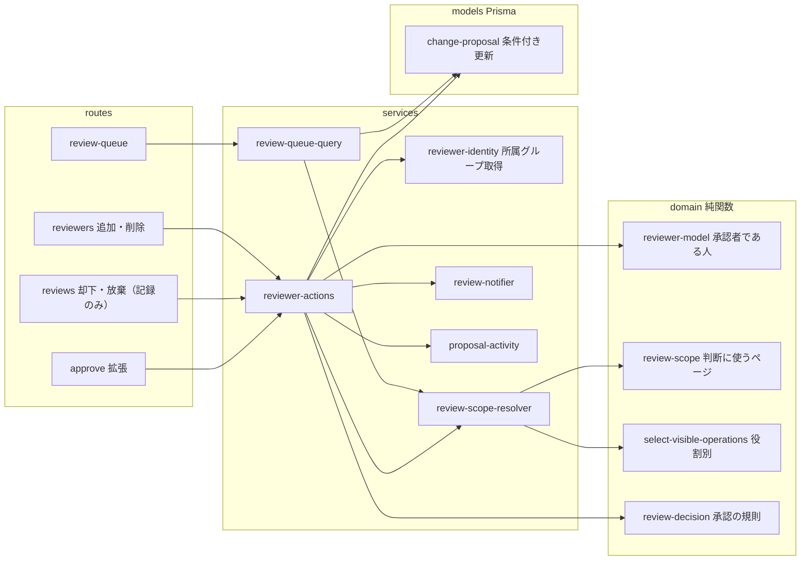
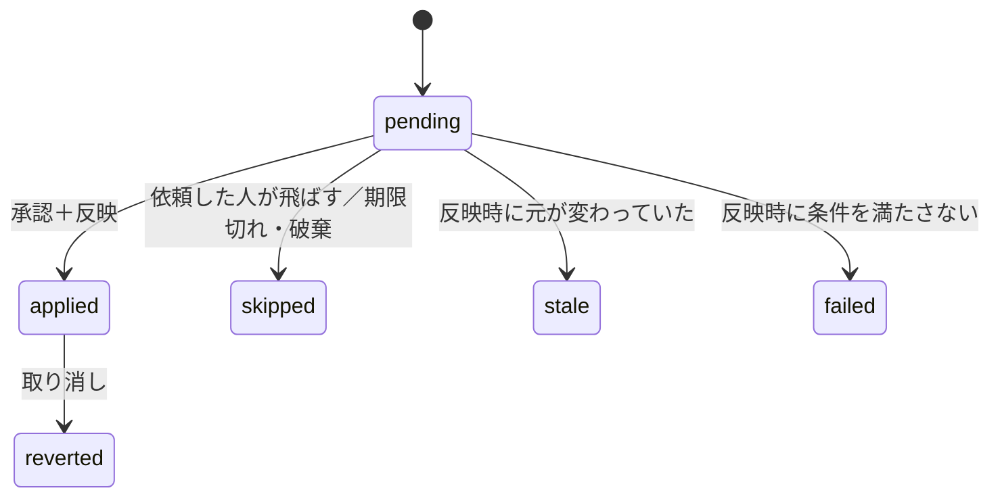

# Design Document: change-proposal-reviewers

この文書は、`change-proposal-core` の amend spec の設計である。要件は [requirements.md](./requirements.md)、判断の理由は [research.md](./research.md) にある。完了後は、本文を core の design.md に書き戻し（変更が元からなかったものとして）、判断の理由を core の research.md に移し、この spec を削除する（[spec-lifecycle](../../../.claude/rules/spec-lifecycle.md)）。

## Amend target

| 変更する spec | 変わる契約 |
|---|---|
| `change-proposal-core` | 承認者を持つ（要件 1）。承認を依頼した人以外に広げ、却下・放棄の記録を足す（要件 2・3）。承認者の追加と削除（要件 4）。承認待ちの見え方（要件 5。core の 9.1〜9.4 の「承認待ちは依頼した人だけ」を広げる）。通知と activity（要件 6）。後続・見直しが承認者を引き継ぐ（core 13.4・13.7）。操作の状態は変えない（却下と放棄は記録だけ）。 |
| `change-proposal-viewer` | 承認待ちを依頼した人以外に見せない前提（viewer の 1.3、1.8、2.10、2.12、11.4、13.4、design の U5・U6）。承認の画面・承認待ちの一覧・新しい通知・却下と放棄の記録の表示（表示名は、止めない意味が伝わる「変更を依頼」など）は viewer 側に足す。 |
| `change-proposal-ai-agent` | 承認・飛ばす・破棄の画面は依頼した人の前提のまま（承認者向けの出し分けは別に判断）。 |

## Overview

**Purpose**: Change Proposal に承認者（ユーザー・グループ）を持たせ、依頼した人以外が、自分の閲覧できるページの操作を承認・却下・放棄できるようにする。依頼した人は、これまでどおりいつでも承認できる。

**Users**: AI などに Change Proposal を作らせた依頼した人、承認を頼まれた人（個人・グループの所属者）、運用する管理者。

**Impact**: 承認・飛ばす・破棄を「依頼した人だけ」としていた判定を、承認者にも広げる。承認待ちを依頼した人以外にも返す。却下と放棄は、操作の状態を変えず、記録と通知だけにする。反映のときの権限の確認と作者は変えない（依頼した人のまま）。

### Goals
- 要件 1〜8 を、既存の「条件付きの 1 回の更新」と「見る人ごとの絞り込み」の作りの上で満たす。
- 承認者かどうか・承認の対象かどうかの判定を、1 つの純関数の組にして、ルート・サービス・一覧の問い合わせで同じものを使う。
- 見る人が閲覧できないページの存在・件数を、応答・通知・エラーから分からないままにする。

### Non-Goals
- 承認・却下・放棄・承認者の追加と削除の画面、承認待ちの一覧の画面、通知の表示（viewer）。AI チャットで承認者を選ぶ画面と指定の道具（ai-agent）。
- ページのパスごとの既定の承認者、本人の承認を禁止する管理者の設定、自動割り当て、期限前の催促、同じ提案の更新と再レビュー。
- 既存の「飛ばす」の競合の穴（research.md）の修正。

## Boundary Commitments

### This Spec Owns
- 承認者の保存と、承認者である人・承認の対象の判定。
- 承認・却下・放棄・承認者の追加と削除のサーバー側の処理と API。承認待ちの取得と一覧（承認者向け）。
- 承認・却下・放棄の記録（却下と放棄は、操作の状態・承認・段階を変えない）。
- 承認者への通知と、依頼した人への判断の結果の通知の作成（snapshot の契約を含む）。新しい activity の種類。
- 後続・見直しの承認者の引き継ぎ、承認者を指定した提案の自動反映の抑止。

### Out of Boundary
- 反映の仕組み（元のリビジョンの確認、編集中の人、権限の確認、並び順、二重書き込みの防止）。変更しない。
- 閲覧できるかどうかの判定そのもの（`Page.findByIdsAndViewer` ほか）。再利用する。
- viewer・ai-agent の画面と文言（新しい通知の表示文言は viewer の spec が持つ。本 spec は snapshot の契約までを決める）。

### Allowed Dependencies
- `change-proposal-core` の既存のモデル・サービス・ルート・通知・activity。
- GROWI の既存のグループ所属の判定（`pageGrantService.getUserRelatedGroups`）と閲覧の判定。
- 依存の向き: viewer と ai-agent は本 spec のサーバー側の契約（API と view の型）に依存する。本 spec は viewer・ai-agent に依存しない。

### Revalidation Triggers
- 操作の状態（`OperationStatus`）は変わらない。却下と放棄は判断の記録（`reviews[]`）として `OperationView` に加わる（viewer の表示は、操作の状態ではなく、この記録から作る）。
- `ChangeProposalView` と `OperationView` に役割（`viewerRole`）、承認者、判断の記録、承認者向けの値が加わったこと。
- `POST /:id/approve` の応答の形は変えない（`{ result: ApplyResult }`）。ただし、(1) `done` の `results` は、求めたキーのうち見る人に見える操作のすべて（この回の反映の結果か、読み直した状態）になる。(2) `in-progress` に、省略できる項目 `results` が加わる（既存の読み手には追加の項目）。ai-agent の承認の画面は、依頼した人にとっては従来どおり。
- 承認待ちが、依頼した人以外にも（承認者に）返るようになったこと（viewer の「見える操作」の定義、承認待ちを見せない前提の要件）。
- activity の snapshot の型に、経路の項目（`reviewChannel`）を足した新しい型（`ChangeProposalReviewSnapshot`）と type guard（`isChangeProposalReviewActivity`）が加わったこと（`ActivitiesSnapshot` と `ISnapshot` を使う、監査ログの表示・検索の処理）。
- 通知に新しい種類（`review-request`、`review-result`）が加わったこと（viewer の `parse-notification-snapshot.ts`、`ChangeProposalNotification.tsx`、`commons.json`）。
- 公開の順序: viewer の承認画面と承認待ちの一覧、ai-agent の承認者の指定の入口が入ったあとで、機能の切り替え `app:changeProposalReviewersEnabled` を有効にすること（初期値は無効。無効の間は、承認者の指定と追加を受け付けない）。

## Architecture

### Existing Architecture Analysis
- 保存は Prisma。操作の `status` と `reason` は文字列。状態を書き換える処理は「条件付きの 1 回の `updateMany`」で、同時実行は条件と排他の印（リース）で防ぐ。
- 「依頼した人だけ」の判定は、サービス（`requester-actions.ts`）と書き込みの条件（`models/change-proposal.ts` の `where {requester, lifecycle:'open'}`、`toRequesterWriteMiss`）の 2 か所にある。
- 見る人ごとの絞り込みは `select-visible-operations.ts` が持ち、依頼した人以外には、反映済み・取り消し済み・取り消しを断られた、の 3 状態だけを返す。「見つからない」は、見える操作が 0 件のときに同じ応答を返すことで作っている。
- 通知は `InAppNotification.create` を直接呼ぶ前例（戻すよう頼む）がある。activity は 1 つの ID に 1 行。

### Architecture Pattern & Boundary Map



**Architecture Integration**:
- Selected pattern: 承認者の判定を純関数にし、DB に触る層（所属グループの取得、閲覧の判定）を `services/` の薄い層に分ける。
- Existing patterns preserved: 条件付きの 1 回の更新、見る人ごとの絞り込み、「見つからない」の同一応答、`InAppNotification.create` の直接呼び出し、activity を応答の前に送る。
- New components rationale: 承認者の判定（`reviewer-model`）、判断に使うページの決め方（`review-scope`）、状態の規則（`review-decision`）は、複数のルート・一覧で同じ結果が要るので純関数にする。
- Steering compliance: 認可は標準の middleware（`writeAccessChain`、`readAccessChain`）を再利用し、並行実装しない。

### Technology Stack

| Layer | Choice / Version | Role in Feature | Notes |
|---|---|---|---|
| Backend / Services | Express、TypeScript（既存） | ルート、サービス、純関数 | `.claude/rules/` の ESM・import 規約に従う |
| Data / Storage | MongoDB + Prisma（既存） | 承認者・判断の記録・索引 | 索引は migrate-mongo の migration |
| Messaging | アプリ内通知（既存） | 承認者・依頼した人への通知 | `InAppNotification.create` |
| Frontend | なし（型と表示名の追従のみ） | 型の網羅に必要な最小の追従 | 画面は viewer |

## File Structure Plan

`apps/app/src/features/change-proposal/` からの相対パス。

### New Files
```
interfaces/
└── reviewer.ts                      # ReviewerRef、ReviewChannel、上限の定数、判断の記録の型
server/
├── domain/
│   ├── reviewer-model.ts            # 承認者である人・依頼した人を含む承認者・外部の承認者の有無（純関数）
│   ├── review-scope.ts              # 操作ごとの「判断に使うページ」の決め方（純関数）
│   ├── derive-visible-stage.ts      # 見える操作だけから決める「見える段階」（純関数）
│   └── review-decision.ts           # 承認を受け付ける操作の状態の規則（純関数）
├── services/
│   ├── reviewer-identity.ts         # ユーザーの所属グループ ID の取得（既存の関数を包む）
│   ├── review-scope-resolver.ts     # 判断に使うページの解決と閲覧の判定（DB）
│   ├── reviewer-actions.ts          # 承認・却下・全体の却下・放棄・承認者の追加と削除
│   ├── review-queue-query.ts        # 承認者としての一覧（カーソル、1 回に調べる上限）
│   └── review-notifier.ts           # review-request と review-result の通知
└── routes/
    ├── reviews.ts                   # POST /:id/reviews（却下・全体の却下・放棄の記録）
    ├── reviewers.ts                 # PATCH /:id/reviewers（追加・削除）
    └── review-queue.ts              # GET /review-queue
src/migrations/
└── 2026111XXXXXXX-add-change-proposal-reviewer-indexes.js   # 索引と reviewers の補完
```

### Modified Files
- `prisma/schema.prisma` — `changeproposals` に `reviewers`、`purpose`、`reviews`（却下と放棄の記録）を足し、操作の複合型に承認の項目（`approvedBy`、`approvedChannel`、`decisionToken`）を足す。共有の composite 型 `ActivitiesSnapshot` にも、`reviewChannel String?` を足す。`@@index` を宣言する。
- `interfaces/api.ts` — `ChangeProposalView`・`OperationView` に役割、承認者、判断の記録、承認者向けの値を足す。`ApplyResult` の `in-progress` に、省略できる `results`（見える操作の読み直した状態）を足す。
- `interfaces/notification.ts` — snapshot の `kind` に `review-request`、`review-result` を足す。
- `server/models/change-proposal.ts` — 承認の書き込み（`markApproved`）の条件を広げる。作成直後の自動反映（`change-proposal-service.ts`）は `markApproved` を使うので、`approvedBy`・`approvedChannel`・`decisionToken` を書かない呼び方を残す。取り消しの作成（`revert-action.ts`）は、`createProposal` の中で `approvedAt` を直接書くので、変更しない。`toRequesterWriteMiss` は、飛ばす・破棄・ページごとの通知の指定の変更（依頼した人だけの操作）でも使うので**変えず**、承認者向けに別の関数 `toReviewerWriteMiss` を足す（「同時に承認者から外された」場合を `not-found`、「提案が閉じた」場合を `not-open` として区別する）。さらに、承認者の追加・削除、却下・放棄の記録（`reviews[]` への追加と置き換え）の書き込み関数を足す。`approvedAt` を消す 3 か所（`:326`、`:444`、`query-parts.ts:161`）で、足した承認の項目も消す。
- `server/models/change-proposal-query-parts.ts`、`to-change-proposal-document.ts` — 選択する項目（`operationSummarySelect`、`summarySelect`）と、新しい項目を足す（`OPERATION_STATUSES` は変えない）。書き込みの条件に承認者を足す。
- `server/services/requester-actions.ts` — 承認の処理を `reviewer-actions.approve` へ移す（承認の入口を 1 つにまとめる）。飛ばす・破棄・ページごとの通知の指定の変更は、依頼した人だけのまま、ここに残す。
- `server/services/change-proposal-service.ts` — 作成に `reviewers`・`purpose` を受け、後続・見直しで承認者を引き継ぎ、承認者を指定した提案の自動反映を抑止する。
- `server/services/normalize-create-input.ts`、`server/domain/select-auto-apply-targets.ts`。
- `server/domain/select-visible-operations.ts`、`server/services/proposal-view-parts.ts`、`proposal-query.ts`、`proposal-list-query.ts`、`to-operation-view.ts` — 役割（依頼した人・承認者・それ以外）で見える操作と値を分ける。依頼した人以外には、実際の `lifecycle` ではなく `visibleStage` を、全体の状態の計算（`proposal-view-parts.ts:172` の `deriveProposalStatus` の入力）に渡す。後続・見直しへのリンクと、元の Change Proposal へのリンク（`proposal-query.ts` の取得）は、相手の提案ごとに、見る人の役割と承認者の一覧を読んで決め直し、相手の提案で見える操作が 0 件なら、そのリンクを出さない（相手の提案の存在を知らせないため）。承認者には、反映済み・取り消し済み・取り消しを断られた操作は今の「それ以外の人」の規則（対象のページ）で、それ以外の状態（待ち・飛ばした・古い・失敗）の操作は、判断に使うページ（編集は対象のページ、新規作成は親、移動は移動元と移動先の親）をすべて閲覧でき、リンクを知る人だけのページを含まない場合に返す（要件 5.1、5.6、5.10）。却下・放棄の記録は、依頼した人と、その操作のページを閲覧できる承認者にだけ返す（全体の却下の記録は依頼した人にだけ返す。要件 3.8）。依頼した人と、承認者でもない人の見える操作は変えない。
- `server/services/proposal-activity.ts`（`ChangeProposalAction` の型に新しい 5 つの action を足す）、`proposal-applier.ts`（承認の求めで動く反映を、背景の反映と同じ形で呼び、新しい activity ID で記録する。背景の形で呼ぶときは、求めの `ip` と `endpoint` を渡さない。反映の activity の操作者は依頼した人なので、承認者の `ip` を並べると、監査ログを誤って読ませるため。承認者の `ip` と `endpoint` は、承認の activity が持つ）、`proposal-notifier.ts`。
- `server/services/current-page-facts.ts` — `loadViewablePages` に、取得済みの所属グループ（`ViewerIdentity`）を渡せるようにする（今は所属グループに `null` を渡して、中でもう一度取得している）。
- `server/routes/approve.ts`（承認者にも開く。swagger の説明「Only the requester may approve」を直す）、`index.ts`（ルート登録。`/review-queue` は `/:id` より前）、`write-access.ts`（`respondWithServiceError` に新しいエラーコード）、`openapi.spec.ts`。
- `apps/app/src/interfaces/activity.ts` — 新しい activity の action（`CHANGE_PROPOSAL_APPROVE`、`CHANGE_PROPOSAL_REJECT`、`CHANGE_PROPOSAL_ABSTAIN`、`CHANGE_PROPOSAL_REVIEWER_ADD`、`CHANGE_PROPOSAL_REVIEWER_REMOVE`）を `SupportedAction`、`EssentialActionGroup`、`MediumActionGroup` に足す。経路（`ui`、`api`、`ai-tool`）を activity に残すため、snapshot の型に、経路の項目を足した新しい型（`ChangeProposalReviewSnapshot`: `username?` と `reviewChannel?`）と、type guard（`isChangeProposalReviewActivity`。`action` で判別する）を足し、型を `ISnapshot` の和集合に足す（リポジトリの snapshot の配置方針と、添付ファイルの activity が `AttachmentSnapshot` を足した前例に沿う。型と guard は `interfaces/activity.ts` に置き、snapshot を作る処理は `features/change-proposal/` の `proposal-activity.ts` に置く）。保存先の `prisma/schema.prisma` の `ActivitiesSnapshot` は、全 activity で共有する 1 つの composite 型で、union にできないので、専用の型は作れない。ここに `reviewChannel String?` を足す（Mongo では migration は要らない。「channel」は Slack のチャンネルと取り違えやすいので、機能に固有の名前にする。添付ファイルの項目名も、同じ考え方）。**activity を実際に保存する経路は、`emit('update')` → `settleActivityRecord` → `createByParameters`（`server/models/activity.ts`）で、`createByParameters` が snapshot の項目（`username`、`originalName`、`pagePath`、`pageId`、`fileSize`）を固定で組み立てている。ここに `reviewChannel` を足す（足さないと、書いても保存されず、黙って捨てられる）。`updateByParameters` が使う `buildSnapshotUpdateEnvelope` にも、同じ項目を足して、2 つをそろえる（本番の記録の経路では、こちらは呼ばれない）。`proposal-activity.ts` の `recordProposalActivity` には、経路の引数（`channel`）を足し、snapshot に `reviewChannel` として入れて、`emit` で送る。`createByParameters` は snapshot を `AttachmentRemoveSnapshot` 型の変数で受けているので、`reviewChannel` を型の上で読めるように、受ける型を、すべての variant の項目を読める型（`ISnapshot` を絞った型）に広げる。****通知の action（`ACTION_CHANGE_PROPOSAL_REVIEW_REQUEST`、`ACTION_CHANGE_PROPOSAL_REVIEW_RESULT`）も、`SupportedAction` に足す**（`InAppNotification` の `action` 項目は `AllSupportedActions` の値しか受け付けないので、足さないと通知の作成が検証で失敗する）。名前が `CHANGE_PROPOSAL_` で始まるので監査ログの絞り込みの一覧にも出るため、`admin.json` の 5 言語に、通知の action の表示名も足す。承認者の追加から送る通知にも、承認者の追加の activity の ID を、`activities` に渡す（「戻すよう頼む」通知が `activities: [activityId]` を渡すのと同じ作り方。`activities` が空だと、通知の一覧の `actionUsers` が空になる）。`review-result` の通知にも、その求めの activity の ID を渡す。
- 設定キー `app:changeProposalReviewersEnabled`（真偽値、既定は無効、環境変数 `CHANGE_PROPOSAL_REVIEWERS_ENABLED`）の定義。`config-definition.ts` の `app:changeProposalEnabled`（環境変数 `CHANGE_PROPOSAL_ENABLED`）と同じ場所に足し、`config-definition.spec.ts` の表に 1 行足す。管理画面の項目は作らない。この値は、既存の設定の読み出し（`server/services/settings.ts` の `readChangeProposalSettings()`）に足し、設定を読む場所を 1 つにまとめる。この値を読んで確かめるのは、承認者を保存する 2 か所だけにする（オーナー決定）。(1) 作成で、呼び出し側が `reviewers` を指定したとき（依頼した人以外を含むとき）、(2) `addReviewers`。無効なら、どちらも 400 `reviewers-disabled` を返す。承認者が保存されなければ、ほかの経路（承認者の承認、却下・放棄、承認者としての一覧、承認者への通知）は、承認者がいないので、自然に何も起きない。後続・見直しが引き継ぐ承認者は、すでに保存されたものなので、この確認の対象外にする。無効にしても、すでに指定された承認者の動きは止めない。純関数は設定を読まない。
- locale（5 言語）: `translation.json`（`change_proposal.*` の表示名）、`commons.json`（通知の種類の文言は viewer が足すので、本 spec ではキーの契約だけを決める）、`admin.json`（`audit_log_action.*`）。

## System Flows

### 承認者による承認（グループ宛て、反映まで）


- 条件に合わない操作（すでに承認済み・反映済み・飛ばしたなど）は書き込まず、その時点の状態を返す（要件 2.11）。
- 反映は `applyLease` を取った 1 つの処理だけが動く。同時に承認が来ても、書き込みは 1 回（要件 2.5）。承認の書き込みは、承認した人・経路を操作に残す。

### 操作の状態（変更なし）



- 却下と放棄は、操作の status を変えない。`reviews[]` に記録を足すだけで、承認との競合の条件も、`settleIfNoPending` の呼び出しも要らない。
- 却下の記録があっても、承認は通常どおり働く（要件 3.9）。

### 承認者としての一覧

`GET /review-queue?cursor=` は、`{lifecycle:'open', reviewers に、本人かその所属グループの ID を持ち、かつ外されていない（`removedAt` が `isSet: false` または `null`）要素を含む}` を、作成が古い順（`_id` の昇順）に読み、1 回に調べる件数の上限まで繰り返す。期限は、作成時に「作成時刻 ＋ 設定値」で書かれ、ほかで書き換えないので、作成が古い順は、期限が近い順と同じになる。読んだ Change Proposal ごとに、その人の承認の対象（「待ち」で、判断に使うページを閲覧できるもの）を 1 つ以上持つものだけを返す。続きの位置（カーソル）を返す。

## Requirements Traceability

| Requirement | Summary | Components | Interfaces | Flows |
|---|---|---|---|---|
| 1.1〜1.7 | 承認者の指定、既定、検証、上限 | `normalize-create-input`、`reviewer-model`、`change-proposal-service`、model | `CreateProposalInput.reviewers`、`ReviewerRef` | — |
| 1.8〜1.10 | 変更の目的 | `normalize-create-input`、model、`to-operation-view`（返却） | `CreateProposalInput.purpose` | — |
| 1.11 | 承認者を指定したら自動反映しない | `select-auto-apply-targets`、`reviewer-model.hasForeignReviewer` | — | — |
| 2.1〜2.4 | 承認（個別・全体・依頼した人・グループ） | `reviewer-actions.approve`、`reviewer-model`、`review-scope-resolver`、model | `POST /:id/approve` | 承認 |
| 2.5、2.11 | 同時承認、待ちでない操作 | model の条件付き更新、`review-decision` | — | 承認、状態 |
| 2.6、2.7 | 見えない操作・非関係者の応答 | `reviewer-actions`、`write-access`（同一の「見つからない」） | — | — |
| 2.8 | 承認の記録（人・日時・経路・本人か） | model（`approvedBy` など）、`detectChannel` | 操作の項目 | 承認 |
| 2.9、2.10 | 閉じた提案、編集中で残った承認 | `reviewer-actions`、`derive-visible-stage`、`toReviewerWriteMiss` | `not-open` | — |
| 3.1〜3.3 | 却下・全体の却下・放棄の記録 | `reviewer-actions`、model（`reviews[]`） | `POST /:id/reviews` | — |
| 3.4 | 同じ人の後の判断で記録を置き換える | model（`reviews[]` の削除と追加） | — | — |
| 3.5〜3.8 | コメントの記録・長さ・文字のまま・見える範囲 | `reviewer-actions`、`to-operation-view`、`select-visible-operations` | `COMMENT_MAX_LENGTH` | — |
| 3.9 | 却下・放棄が status・承認・段階・達成度を変えない | `reviewer-actions`（status を書かない）、`review-decision`（承認の規則だけ） | — | 状態 |
| 3.10、3.11 | 依頼した人は却下・放棄しない、非関係者 | `reviewer-actions` | `requester-cannot-review` | — |
| 4.1〜4.4、4.6〜4.9 | 承認者の追加・削除、既定への戻り、検証 | `reviewer-actions`、`reviewer-model`、model | `PATCH /:id/reviewers` | — |
| 4.5、4.10〜4.12 | 存在しない承認者、記録、通知、削除後の記録 | `reviewer-actions`、`review-notifier`、model（記録は残す） | — | — |
| 5.1、5.2 | 承認待ちの取得と承認者向けの値 | `proposal-query`、`proposal-view-parts`、`to-operation-view` | `ChangeProposalView`、`OperationView` | — |
| 5.3、5.4 | 非関係者には返さない、見える操作が 0 件なら「見つからない」 | `select-visible-operations`、`proposal-query` | — | — |
| 5.5、5.6 | 承認者としての一覧、見える操作だけ | `review-queue-query`、`review-scope-resolver` | `GET /review-queue` | 一覧 |
| 5.7、5.8 | 承認者・判断の記録を返す、依頼した人だけの値は返さない | `proposal-view-parts`、`to-operation-view` | — | — |
| 5.9、5.10 | 所属が外れたら承認者でない、反映済みの振る舞いは不変 | `reviewer-identity`（読むときに判定）、`select-visible-operations` | — | — |
| 6.1〜6.4 | 承認者への通知（個人のみ、見える分だけ） | `review-notifier` | snapshot `kind: 'review-request'` | — |
| 6.5、6.6 | 依頼した人への結果の通知 | `review-notifier` | snapshot `kind: 'review-result'` | 承認 |
| 6.7 | 反映のまとめた通知は不変 | `proposal-notifier`（変更なし） | — | — |
| 6.8〜6.10 | 新しい activity（承認・却下・放棄・承認者の追加・削除。経路つき）、反映の activity | `proposal-activity`、`activity.ts`、`ActivitiesSnapshot` | 新しい action 5 つ、snapshot の `reviewChannel` | 承認 |
| 7.1〜7.7 | 反映時の権限・作者、読み取り専用、無効化 | `proposal-applier`（変更なし）、`writeAccessChain` | — | 承認 |
| 8.1〜8.6 | 既存の動きの維持、後続・見直しの引き継ぎ | `change-proposal-service`、`reviewer-model`、`select-auto-apply-targets` | — | — |
| 8.7 | 5 言語の表示名・activity 名 | locale、`label-keys` | — | — |

## Components and Interfaces

| Component | Layer | Intent | Req Coverage | Key Dependencies | Contracts |
|---|---|---|---|---|---|
| reviewer-model | domain | 承認者である人の判定と補助 | 1.4、1.11、2.1〜2.4、4.4、5.9 | — | Service |
| review-scope | domain | 操作ごとの判断に使うページの決め方 | 2.2、5.6 | — | Service |
| derive-visible-stage | domain | 見える操作だけから決める提案の段階（409 の判定と全体の状態に使う） | 2.9、4.8、5.1、5.6 | — | Service |
| review-decision | domain | 承認を受け付ける操作の状態の規則 | 2.5、2.11 | — | Service |
| reviewer-identity | service | 所属グループ ID の取得 | 2.4、5.9 | `pageGrantService` | Service |
| review-scope-resolver | service | 判断に使うページの解決と閲覧の判定 | 2.2、5.5、5.6 | `loadViewablePages`、`Page` | Service |
| reviewer-actions | service | 承認・却下・放棄・承認者の追加と削除 | 2、3、4 | model、resolver、notifier、activity | Service、API |
| review-queue-query | service | 承認者としての一覧 | 5.5 | model、resolver | API |
| review-notifier | service | 承認者・依頼した人への通知 | 6.1〜6.6 | `InAppNotification` | Event |
| routes（4 本） | route | HTTP の入口 | 2〜5 | `writeAccessChain`、`readAccessChain` | API |

### domain

#### reviewer-model

```typescript
type ReviewerKind = 'user' | 'user-group' | 'external-user-group';

interface ReviewerRef {
  readonly kind: ReviewerKind;
  readonly id: string;        // ユーザー or グループの ObjectId の文字列
  readonly addedBy: string;
  readonly addedAt: Date;
  readonly removedBy?: string;   // 外した人。要素は消さず、外した記録を残す（要件 4.10、4.12）
  readonly removedAt?: Date;     // 値があれば、承認者ではない。「外されていない」の条件は、`isSet: false` または `null` の両方を書く（`change-proposal-query-parts.ts` の前例と同じ）
}

interface ViewerIdentity {
  readonly userId: string;
  readonly userGroupIds: ReadonlySet<string>;
  readonly externalUserGroupIds: ReadonlySet<string>;
}

// 有効な承認者（removedAt が無い要素）。以下のすべての判定は、有効な要素だけを見る
function activeReviewers(reviewers: readonly ReviewerRef[]): readonly ReviewerRef[];
// 有効な承認者が空なら依頼した人だけが承認者とみなす（要件 1.4、4.4）
function isReviewer(reviewers: readonly ReviewerRef[], requesterId: string, viewer: ViewerIdentity): boolean;
// 依頼した人以外のユーザーまたはグループが 1 つでも含まれるか（要件 1.11、8.5）
function hasForeignReviewer(reviewers: readonly ReviewerRef[], requesterId: string): boolean;
function dedupeReviewerInputs(inputs: readonly ReviewerInput[]): readonly ReviewerInput[]; // 作成・追加の入力の重複をまとめる
type ViewerRole = 'requester' | 'reviewer' | 'other';
function deriveViewerRole(requesterId: string, reviewers: readonly ReviewerRef[], viewer: ViewerIdentity): ViewerRole; // 依頼した人が優先
```

- 承認者の判定は、操作の時点の所属で行う（要件 5.9）。呼び出し側が `ViewerIdentity` を 1 回だけ取得して渡す。
- `isReviewer` は依頼した人を承認者に含めない（`reviewers` が空でない場合）が、承認の権限は依頼した人に常にある（要件 2.3）。承認の許可は「依頼した人 または isReviewer」で判定する。

#### review-scope

```typescript
// 操作が判断に使うページ（これらをすべて閲覧できる承認者が、その操作の承認の対象を持つ）
type ReviewScope = {
  readonly pageIds: readonly string[];          // 既存のページ
  readonly ancestorPaths: readonly string[];    // まだ無いページの、親の候補のパス（長い順）
};
function reviewScopeOf(op: OperationRecord): ReviewScope;
// 操作の種類「完全な削除」は、取り消しの Change Proposal だけが持ち、取り消しは承認者を持たない（要件 8.6）ので、
// 承認者の判定には使わない。呼ばれたときは、対象のページを返す。
// 編集 → 対象のページ。新規作成 → 親（無ければ最も近い上のページ）。移動 → 移動元＋移動先の親（同上）。
function resolveAncestors(candidatePaths: readonly string[], existingPaths: ReadonlySet<string>): string | null;
```

- 新規作成・移動の「親」は、core の反映と同じ規則（`findNonEmptyClosestAncestor`）で決める。`dirname(path)` を上へたどった、**空でない**最初の既存のページ（空のページは飛ばす）。ルート（`/`）まで無ければ、ルートのページとする。

#### review-decision

```typescript
type ApproveVerdict =
  | { readonly accepted: true }
  | { readonly accepted: false; readonly currentStatus: OperationStatus; readonly awaitingApply?: boolean };
function canApprove(op: Pick<OperationRecord, 'status' | 'approvedAt'>): ApproveVerdict;
```

- `canApprove`: `status === 'pending'`（すでに `approvedAt` があれば成功として何も書かない）。
- 却下と放棄は、操作の状態を見ず、判断の対象（`status === 'pending'` の見える操作）に記録を足すだけなので、この関数は使わない。

### service

#### reviewer-actions

```typescript
type ReviewChannel = 'ui' | 'api' | 'ai-tool';

// `trigger` は既存の `ApplyTrigger`: HTTP の求めなら `{ kind: 'request', activityId }`（承認の activity を、その求めの ID で記録する）、
// AI の道具など、求めの activity が無いときは `{ kind: 'background' }`（新しい activity ID を作る）。`recordProposalActivity` が `operator` に取る `IUserHasId` として、`user` を持つ。
interface ReviewActor { readonly user: IUserHasId; readonly channel: ReviewChannel; readonly trigger: ApplyTrigger }

// 応答は、既存の承認の応答（`{ result: ApplyResult }`。`type` は `done` か `in-progress`）と同じ形を保つ。
// `done` の `results` は `{ key, status, reason }` の配列で、その人に見える操作のキーだけに絞る。
// `changed`（この求めで書き込んだか）は内部の値で、応答には出さない。
interface DecisionOutcome {
  readonly operationKey: string;
  readonly status: OperationStatus;
  readonly reason: OperationReason | null;
  readonly changed: boolean;             // 内部のみ
}

type ReviewerActionError =
  | 'not-found' | 'not-open' | 'comment-too-long' | 'reviewer-not-found'
  | 'too-many-reviewers' | 'requester-cannot-review' | 'reviewers-disabled' | 'invalid-request';

interface ReviewerActions {
  // 承認の唯一の入口。依頼した人も、承認者も、ここを通る（`requester-actions.ts` の承認はここへ移す）
  approve(id: string, actor: ReviewActor, operationKeys?: readonly string[]): Promise<Result<ApproveResponse, ReviewerActionError>>;
  rejectOperations(id: string, actor: ReviewActor, operationKeys: readonly string[], comment?: string): Promise<Result<DecisionResponse, ReviewerActionError>>;
  rejectAll(id: string, actor: ReviewActor, comment?: string): Promise<Result<DecisionResponse, ReviewerActionError>>;
  abstain(id: string, actor: ReviewActor, operationKeys: readonly string[], comment?: string): Promise<Result<DecisionResponse, ReviewerActionError>>;
  addReviewers(id: string, actor: ReviewActor, inputs: readonly ReviewerInput[]): Promise<Result<void, ReviewerActionError>>;
  removeReviewers(id: string, actor: ReviewActor, inputs: readonly ReviewerInput[]): Promise<Result<void, ReviewerActionError>>;
}
```

- 事前条件: 呼び出し側は、読み取り専用ユーザーとゲストを `writeAccessChain` で断っている（要件 7.5）。
- 共通の手順（6 つの操作すべてに、この順で適用する）:
  1. Change Proposal を読む。存在しなければ `not-found`。
  2. 所属グループを取得し、依頼した人または承認者かを判定する。どちらでもなければ `not-found`（要件 2.7）。
  3. 見える操作を解決する（`resolveReviewScope`）。**依頼した人でない場合、見える操作（状態を問わない）が 0 件なら `not-found` を返す**（要件 2.7、5.4）。取得（GET）と同じ関数・同じ集合で判定する。これは、キーを使わない操作（`rejectAll`、`addReviewers`、`removeReviewers`）にも同じく適用する。この確認は `not-open` の判定より先に行う（見える操作が無い人に、提案が閉じているかどうかを知らせないため）。見える操作が 1 つでもある場合、**依頼した人でない人にとっての提案の段階は、見える操作だけから決めた値（「見える段階」`visibleStage`。`deriveVisibleStage` が決める。下の `ReviewScopeResult` の説明）を使う**。`not-open`（409）の判定（`visibleStage` が `open` 以外なら 409）、取得（GET）の全体の状態（`proposal-view-parts.ts` で `deriveProposalStatus` に渡す段階。今は実際の `proposal.lifecycle` を渡している）、一覧の見出しの全体の状態は、すべてこの値を使う。実際の `lifecycle` を渡すと、見えない「待ち」の操作の有無が、全体の状態（`discarded`、`expired` など）の言葉から分かってしまう（見える操作が「失敗」1 件だけで、見えない「待ち」が 1 件ある提案を破棄すると、その人の画面だけ `discarded` になる。操作が 1 件だけの提案なら `not-applied`）。書き込みの条件には、実際の `lifecycle: 'open'` を残す（同時に閉じられた場合の防御）。そのため、提案が実際には開いているが、見える「待ち」が 0 件の承認者にも 409 が返る（下の「要件との差と読み方」）。
  4. `rejectOperations`・`rejectAll`・`abstain` は、依頼した人なら `requester-cannot-review`（要件 3.10）。
  5. キーを使う操作は、次の順で絞る。(a) 求められたキーのうち、見える操作に入らないものは、存在しないキーと同じに扱って無視する（要件 2.6）。(b) 残ったキーに「同じページの操作をまとめる処理」（`expandApprovalTargets`）を、**見える操作の中だけで**適用する（見えないキーを送って、同じページの見える操作を承認させることはできない。まとめる対象も見える操作に限り、見えない移動の操作などは含めない）。(c) 見える操作に入り、判断の対象（`reviewTargetKeys` = 見える操作のうち、状態が「待ち」のもの。自分が放棄した操作も含む）に入らないキー（すでに反映済み・飛ばしたなど）は、書き込まず、その時点の状態を返す（要件 2.11、2.5）。(d) 判断の対象だけを書き込む（承認は承認の書き込み、却下・放棄は記録の追加）。全体の承認（キーなし）は、求めたキーを `reviewTargetKeys` とし、依頼した人は、これまでどおり依頼した人に返す「待ち」の操作全部とする。全体の却下（`rejectAll`）はキーを使わず、操作の対象を選ばない（下の事後条件）。
  6. 書き込む。すべての判断（承認・却下・放棄）と、承認者の追加・削除は、書き込みの前に `not-open`（見える段階が承認待ちでない）を確かめる。却下と放棄は、`reviews[]` に記録を足すだけで、操作の status と `approvedAt` を書かない。新しい記録を足してから、同じ人が同じ操作（または全体）について前に残した記録（今回の記録の日時より前のもの）を、`reviews[]` から `deleteMany` で消す（要件 3.4）。承認では、承認として受け付けたキー（判断の対象に入るもの）のすべてについて、同じ人の却下・放棄の記録を `reviews[]` から消す（この求めで書き換えなかった操作、たとえば編集中の人がいて「待ち」のまま残った操作も含む）。キーを指定しない全体の承認は、同じ人の全体の却下の記録（`operationKey` が空のもの）も消す（要件 3.4）。キーを指定した承認は、全体の却下の記録を消さない。記録は状態を決めないので、削除と追加を別の更新にして、途中で止まっても、最悪は古い記録が残るだけにする。読み出し側は、同じ人・同じキーの記録は、最新の 1 件だけを使う。
  7. 承認では、下の「書き込んだ操作の判定」で決めた操作だけから、却下・放棄では、記録を足した操作（と、全体の却下）から、通知と activity を作る。
  8. 応答を、1 つの組み立て関数（`buildDecisionResponse`）で作る。`done` の `results` は、**求めたキーのうち、その人に見える操作のすべて**を並べる。この回の反映が扱った操作には反映の結果（状態と理由）を、それ以外の操作（すでに反映済み・飛ばしたなど、この回は書かなかった操作）には、書き込みのあとに読み直した状態と理由を入れる（要件 2.5、2.11）。反映の処理は、ほかの人が承認した操作も読み直してまとめて反映するので、反映の結果には、その人に見えない操作が混ざりうる。そのため、反映の結果を、その人に見える操作のキーだけに絞ってから並べる。別の処理が排他の印（リース）を持っていて反映が動かせないとき（`in-progress`）は、今の応答の形に、見えるキーの読み直した状態の `results`（省略できる項目）を足して返す。これは既存の `in-progress` の読み手（ai-agent）にとって追加の項目なので、約束を壊さない。
- **書き込んだ操作の判定（承認のみ）**: Prisma の `updateMany` が返す件数は、文書の数で、文書の中の操作を何件書き換えたかではない（条件に合う操作が 0 件でも、文書が外側の条件に合えば 1 を返す）。そのため、承認の書き込みのあとで文書を読み直し、この求めの印（`decisionToken`）を持つ操作だけを「この求めで書き換えたもの」とする。求めの処理の最初に、ランダムな印（UUID）を 1 つ作り、承認の書き込みで操作の項目 `decisionToken` に書く。同じ人が同時に 2 回求めても、印が違うので、書き換えたものに数えない。時刻の一致には頼らない（同じミリ秒の 2 回の求めを区別できないため）。却下と放棄は、条件に合うかどうかを問わず記録を足すだけなので、この判定は要らない（足した記録は、この求めで作ったものとして分かる）。
- 事後条件: 却下（操作ごと、全体）と放棄は、操作の status を書かず、`settleIfNoPending` も呼ばず、Change Proposal の段階も変えない（要件 3.9）。全体の却下は、`reviews[]` に、`operationKey` が空の要素を 1 件足す（却下する操作の範囲を持たないので、閲覧できないページの操作に何かを書くことも、その存在を知らせることもない）。承認の書き込みの条件の「未承認」は、`approvedAt` が項目として無い、または `null`（Prisma は「項目が無い」と「値が `null`」を区別するので、`isSet: false` または `null` の両方を条件に書く。既存の `change-proposal-query-parts.ts` の前例と同じ）。
- `addReviewers`・`removeReviewers`: 読んでから全体を書き直す手順は使わず、要素ごとの条件付きの書き込みにする。同時に別の人が別の承認者を足しても、片方の追加が消えない。
  - 追加: 入力の重複をまとめ、存在確認（ユーザーまたはグループ）をしてから、入力 1 件ごとに、`lifecycle: 'open'` かつ「同じ `(kind, id)` で `removedAt` が無い要素が無い」を条件に、`reviewers` へ要素を 1 件 `push` する（同時に同じ承認者を足しても、重複しない）。外されたことがある `(kind, id)` を足し直すときは、新しい要素を足す（古い外した記録は残る）。
  - 削除: 条件（`lifecycle: 'open'`）のもとで、一致する有効な要素に `removedBy`・`removedAt` を書く（要素は消さない。要件 4.10、4.12）。
  - 閉じていれば `not-open`（要件 4.8）。承認者の合計（有効な要素）が上限（20）を超えるなら、書く前の読み取りで `too-many-reviewers` を返す。同時の追加で、上限を数件超えることがありうるが、上限は安全のためではなく通知と一覧の量の目安なので、許容する。
  - 有効な承認者が空になったら、依頼した人だけを承認者とみなす（要件 4.4）。
- Invariants: 反映は `proposal-applier` を呼ぶだけで、書き込みの権限と作者は依頼した人のまま（要件 7.1〜7.3）。

#### reviewer-identity / review-scope-resolver

```typescript
function loadViewerIdentity(userId: string): Promise<ViewerIdentity>;
interface ReviewScopeResult {
  // 見える操作（状態を問わない）。取得（GET）で返す操作と同じ集合。
  // - 依頼した人: 今の規則のまま（依頼した人が閲覧できなくなったページの操作は隠す。`select-visible-operations.ts` の今の規則）
  // - それ以外の人（承認者を含む）の、反映済み・取り消し済み・取り消しを断られた操作: 今の「それ以外の人」の規則のまま
  //   （対象のページ。新規作成なら作られたページ `resultPageId`）。承認者かどうかで見え方を変えない（要件 5.10）
  // - 承認者の、それ以外の状態（待ち・飛ばした・古い・失敗）の操作: 判断に使うページをすべて閲覧でき、
  //   リンクを知る人だけのページを含まない操作（新規作成は親、移動は移動元と移動先の親）
  readonly visibleKeys: ReadonlySet<string>;
  // 依頼した人でない人にとっての提案の段階（「見える段階」）。見える操作だけから決める純関数 `deriveVisibleStage` の結果:
  // 見える「待ち」の操作が 1 件以上あれば 'open'。無ければ、見える「飛ばした」の操作の理由（期限切れ・破棄・取り下げ）が
  // あればその段階（'expired' | 'discarded' | 'withdrawn'）。それも無ければ 'settled'（実際の段階を一切使わない）。
  readonly visibleStage: 'open' | 'expired' | 'discarded' | 'withdrawn' | 'settled';
  // 判断の対象（要件の「承認の対象」） = 見える操作 ∧ status が pending（自分が放棄した操作も含む。放棄は対象から外さない）。
  // 承認・却下・放棄の書き込み、一覧、通知に使う
  readonly reviewTargetKeys: ReadonlySet<string>;
}
function resolveReviewScope(
  operations: readonly OperationRecord[],
  viewer: ViewerIdentity,
  role: ViewerRole,
): Promise<ReviewScopeResult>;
```

- 「見つからない」の判定は `visibleKeys` が空かどうか（取得と 6 つの操作で同じ関数を使う）。判断の対象は、書き込むキーを選ぶときと、一覧・通知に使う。

- 判断に使うページのパスは、まとめて 1 回の問い合わせで引く（上のページの候補を全部集めてから `Page.find({path: {$in}})`）。閲覧の判定は `loadViewablePages` を再利用し、渡す所属は `loadViewerIdentity` の結果を使う。

#### review-queue-query

```typescript
interface ReviewQueuePage { readonly items: readonly ChangeProposalSummaryView[]; readonly nextCursor: string | null }
function listReviewQueue(viewer: ViewerIdentity, cursor: string | null, limit: number): Promise<ReviewQueuePage>;
```

- 1 回に調べる件数の上限（`REVIEW_QUEUE_SCAN_LIMIT`、`listAppliedVisible` と同じ値）に達したら、見つかった分と続きの位置を返す。カーソルは、一覧に出した最後の提案の `_id` を、そのまま文字にしたもの（暗号化しない。core の反映済みの一覧と同じ作り）。調べた最後の提案の ID は返さない。調べた最後の提案が、その人に返す操作が 0 件の提案のとき、その ID をカーソルにすると、その提案が実際に開いていることが分かり、取得で見える段階が「閉じている」と表示される提案については、見えない「待ち」の操作の存在を推測できてしまうため（オーナー決定）。上限に達したとき、1 件以上出していればカーソルは出した最後の提案の ID（次の呼び出しは、その次から調べ直す。読む量は増えるが、1 回に調べる上限は変わらない）。1 件も出していなければカーソルは `null` で、その回の一覧はそこで終わる（データの終わりと区別できない）。この制限が起きるのは、承認者として指定された開いている提案が、判断の対象を持たないまま上限の件数以上連続する場合だけである。不正な値は、既存の前例（`list-applied.ts` と `proposal-list-query.ts`）に合わせ、ルートが 400 で断り、サービスは空の結果を返す。

#### review-notifier

```typescript
interface ReviewRequestSnapshot { kind: 'review-request'; proposalId: string; requester: { id: string; username: string }; pages: readonly NotificationPage[] }
interface ReviewResultSnapshot {
  kind: 'review-result'; proposalId: string;
  reviewer: { id: string; username: string };
  items: readonly { path: string; result: 'approved' | 'rejected' | 'abstained'; comment?: string }[];
  wholeRejection?: { comment?: string };   // この求めで、全体の却下を記録したとき。コメントが無くても、全体の却下を表せる
}
```

- `review-request`: 新しく承認者である人になった**個人のユーザー**（要件 6.2：グループの所属者には送らない）のうち、依頼した人と追加した人を除き、承認の対象を 1 つ以上持つ人に、1 人 1 件。`pages` は、その人の承認の対象のページだけで作る（要件 6.3）。
- `review-result`: 1 回の求めにつき 1 件を、依頼した人に（求めた人が依頼した人自身のときは送らない。要件 6.6）。`items` は、「この求めで承認した、または却下・放棄の記録を足した操作」のうち、**依頼した人に見える操作**（依頼した人の規則で絞った操作。依頼した人が閲覧できなくなったページの操作は隠す。`select-visible-operations.ts` の依頼した人の規則）だけから作る。絞った結果が 0 件で、かつ、この求めが全体の却下を記録していなければ、通知を送らない（反映の通知と同じ作り方）。全体の却下を記録した求めは、`items` が空でも通知を送る（全体の却下は、操作に紐づかず、閲覧できないページの情報を含まない）。コメントは、操作ごとのコメントと全体の却下のコメントをそのまま入れる（全体の却下のコメントは、依頼した人が受け取る通知なので入れてよい）。
- どちらも `InAppNotification.create` を直接呼ぶ（`upsertByActivity` は使わない）。action は `ACTION_CHANGE_PROPOSAL_REVIEW_REQUEST`、`ACTION_CHANGE_PROPOSAL_REVIEW_RESULT`。
- 通知の表示（viewer の `parse-notification-snapshot.ts`、`ChangeProposalNotification.tsx`、`commons.json` の文言）は viewer の spec が足す。それまでは、`parse` が `null` を返す通知は一覧に出ない。

#### proposal-activity

- 新しい action: `CHANGE_PROPOSAL_APPROVE`、`CHANGE_PROPOSAL_REJECT`（操作ごとの却下と全体の却下）、`CHANGE_PROPOSAL_ABSTAIN`、`CHANGE_PROPOSAL_REVIEWER_ADD`、`CHANGE_PROPOSAL_REVIEWER_REMOVE`。5 つとも `EssentialActionGroup` と `MediumActionGroup` に入れる（要件 6.8、監査ログの設定にかかわらず記録）。
- 承認の求めでは、承認の activity をその求めの ID で記録する。承認の求めで動く反映は、背景の反映と同じ形（`trigger.kind: 'background'`）で呼び、反映の activity は新しい ID（`beginActivity`）で、操作者を依頼した人として記録する（既存の背景の経路と同じ。反映の中身は変えない）。1 回の反映が複数の人の承認をまとめて書くことがあるので、承認した人は、承認の activity と、操作の項目（`approvedBy`）で分かる（要件 6.9）。
- 承認者の追加・削除は、`CHANGE_PROPOSAL_REVIEWER_ADD`・`CHANGE_PROPOSAL_REVIEWER_REMOVE` の activity として記録する（要件 6.10。1 つの求めは、追加か削除のどちらか 1 つだけを受け付けるので、1 つの求めにつき 1 行で、action も決まる。誰を追加・削除したかは、Change Proposal の中の `reviewers` の記録で分かる）。作成のときの承認者の指定は、作成の activity（core の 7.7）に含まれ、別には記録しない。
- 承認・却下・放棄・承認者の追加・削除の activity には、snapshot の `reviewChannel` に、`ReviewActor.channel` を書く（要件 6.8、6.10）。`recordProposalActivity` の引数に経路を足し、snapshot に入れて `emit` で送る。`username` は、`settle-activity-record.ts` の `?? context?.username` で保たれる（既存の仕組み）。

#### 応答と入力の型（`interfaces/reviewer.ts`）

```typescript
interface ReviewerInput { readonly kind: ReviewerKind; readonly id: string }
// 承認の応答は既存の ApplyResult（`type: 'done'` か `'in-progress'`）。done の results は { key, status, reason } の配列。
type ApproveResponse = ApplyResult;
// 却下・放棄の応答は、done と同じ形（`{ type: 'done', results }`）。
type DecisionResponse = { readonly type: 'done'; readonly results: readonly { key: string; status: OperationStatus; reason: OperationReason | null }[] };
```

### route

| Method | Path | Middleware | Request | Response | Errors |
|---|---|---|---|---|---|
| POST | `/:id/approve`（既存を拡張。応答の形は変えない） | `writeAccessChain` | `{ operationKeys? }` | `{ result: ApplyResult }`（`type: 'done'` の `results` は、求めたキーのうち、その人に見える操作のすべて。`in-progress` には、見える操作の読み直した状態の `results`（省略できる項目）を足す） | 404、409（`not-open`） |
| POST | `/:id/reviews` | `writeAccessChain` | `{ kind: 'reject' \| 'abstain', operationKeys?, comment? }`。`reject` で `operationKeys` を省くと、Change Proposal 全体の却下。`operationKeys` が空の配列なら 400 `invalid-request`。`abstain` は `operationKeys` が必須 | `{ result: { type: 'done', results } }`（承認と同じ形。全体の却下では、操作に何も書かないので、`results` は空） | 400（`comment-too-long`、`requester-cannot-review`、`invalid-request`）、404、409 |
| PATCH | `/:id/reviewers` | `writeAccessChain` | `{ add: [{kind, id}] }` または `{ remove: [{kind, id}] }`。**どちらか 1 つだけ**（両方、またはどちらも無ければ 400 `invalid-request`） | 204 | 400（`reviewer-not-found`、`too-many-reviewers`、`reviewers-disabled`、`invalid-request`）、404、409（`not-open`） |
| GET | `/review-queue` | `readAccessChain` | `?cursor=` | `{ items, nextCursor }` | — |

- すべてのルートの `@swagger` の tag は `ChangeProposals`。`openapi.spec.ts` の操作の一覧とテスト名を更新する。`/review-queue` は `/:id` より前に登録する。
- 存在しない場合と、見る人に関係のない場合は、同じ `404 notfound`（既存の `proposalNotFound()`）。新しいエラーコードは `respondWithServiceError` の switch に足す（足さないと既定の 500 になる）。
- 経路は `detectChannel(req)`（アクセストークン認証なら `'api'`、そうでなければ `'ui'`）で決める。AI の道具は service を直接呼び、`'ai-tool'` を渡す。

## Data Models

### Domain Model
- Change Proposal（集約）が、承認者（`reviewers`）、却下と放棄の記録（`reviews`。全体の却下を含む）、変更の目的（`purpose`）を持つ。操作は、承認の記録を自分の項目として持つ。
- 不変条件: `reviewers` の、`removedAt` が無い要素は、`(kind, id)` で一意。`reviews` の要素は、`kind`（`reject` か `abstain`）、`operationKey`（空なら全体）、`by`、`at` を持つ。承認の求めで `approvedAt` が付いた操作は `approvedBy` と `approvedChannel` を持つ。作成の直後の自動反映と、取り消しの Change Proposal の作成（`revert-action.ts`）で `approvedAt` だけが付く操作は、`approvedBy` を持たない（承認の求めではないため）。

### Physical Data Model（`prisma/schema.prisma` の `changeproposals`）

| 場所 | 項目 | 型 | 意味 |
|---|---|---|---|
| 文書 | `reviewers` | `ReviewerRef[]`（複合型） | 承認者。`kind`・`id`・`addedBy`・`addedAt`・`removedBy?`・`removedAt?`。外しても要素は消さない。既存の文書は migration で `[]` に補完 |
| 文書 | `purpose` | `String?` | 変更の目的（文字のまま） |
| 文書 | `reviews` | `Review[]`（複合型） | 却下と放棄の記録。`{kind: 'reject' \| 'abstain', operationKey?, by, at, comment?, channel}`。`operationKey` が空なら、Change Proposal 全体の却下。人ごと・操作ごとに最新の 1 件を使う。全体の却下の記録は、依頼した人にだけ返す |
| 操作 | `approvedBy`、`approvedChannel` | `String?` | 承認した人・経路（`approvedAt` と同時に書き、同時に消す） |
| 操作 | `decisionToken` | `String?` | 承認を書いた求めの印（UUID）。「この求めで書き換えたか」の判定に使う |

- 索引（新しい migration で `createIndex`、schema.prisma に同じ名前で `@@index`）: `{lifecycle: 1, 'reviewers.id': 1, _id: 1}`。
- 補完: 同じ migration で、`reviewers` が無い文書に `$set: { reviewers: [], reviews: [] }`。

### Data Contracts & Integration（API の型）

```typescript
interface ChangeProposalView {
  // 既存の項目に加えて
  readonly viewerRole: 'requester' | 'reviewer' | 'other';
  readonly purpose?: string;                          // 依頼した人と承認者に返す
  readonly reviewers?: readonly ReviewerView[];       // 依頼した人と承認者に返す
  readonly wholeRejections?: readonly { by: UserSummary; at: string; comment?: string }[]; // 全体の却下の記録（人ごとに最新の 1 件）。依頼した人にだけ返す（承認者には返さない）
}
interface OperationView {
  // 既存の項目に加えて
  readonly proposedBody?: string;                     // 依頼した人、または承認者（判断の対象の操作のみ。自分が放棄した操作を含む）
  readonly baseIsLatest?: boolean;                    // 承認者向け: 元のリビジョンが今も最新か
  readonly order?: number;                            // 依頼した人: 元の番号。承認者: 見える操作の中での順位
  // approval・rejections・abstentions は、依頼した人と承認者にだけ返す。承認者でも依頼した人でもない人には返さない（要件 5.10）。
  readonly approval?: { by: UserSummary; at: string; channel: ReviewChannel };
  readonly rejections?: readonly { by: UserSummary; at: string; comment?: string }[];
  readonly abstentions?: readonly { by: UserSummary; at: string; comment?: string }[];
}
```

- 返す範囲: 承認者には、その人が閲覧できるページの操作だけを返す（要件 5.6）。`rejections[]` と `abstentions[]`（コメントを含む）は、依頼した人と、そのページを閲覧できる承認者にだけ返す（要件 3.8）。`wholeRejections[]`（記録そのもの。却下した人・日時・コメント）は、依頼した人にだけ返す。承認者には、見える操作ごとの `rejections[].by` で、誰が却下したかが分かる（要件 5.7）。
- `baseIsLatest` は、編集の操作だけについて、`baseRevision` が今のページの最新のリビジョンかを、1 回のまとめた問い合わせで計算する。
- 依頼した人にだけ返す値（段階、達成度、AI の要約・会話、ページごとの通知の指定、`requesterState`）は、承認者には返さない（要件 5.8）。

## Error Handling

| 状況 | 応答 | 理由 |
|---|---|---|
| 存在しない／依頼した人でも承認者でもない／見える操作（状態を問わない）が 0 件（全 6 操作と取得に共通。閉じた提案でも、これを先に判定する） | 404 `notfound`（同一） | 要件 2.7、5.4 |
| 見えないページの操作のキー／存在しないキー | 無視（`results` に含めない） | 要件 2.6 |
| 見える操作だが、判断の対象でない（反映済み・飛ばしたなど） | 書き込まず、その時点の状態を返す | 要件 2.5、2.11 |
| 提案は実際には開いているが、その人に見える「待ち」が 0 件（「見える段階」が open でない）で、判断・承認者の追加・削除を求めた | 409 `not-open`（実際の段階を知らせないため） | 要件 5.6、2.9 |
| 機能の切り替え `app:changeProposalReviewersEnabled` が無効で、承認者を指定して作成、または承認者の追加を求めた | 400 `reviewers-disabled` | 公開の順序 |
| 閉じた提案への判断・承認者の追加・削除 | 409 `not-open` | 要件 2.9、4.8 |
| コメントが長い | 400 `comment-too-long` | 要件 3.6 |
| `PATCH /:id/reviewers` で `add` と `remove` が両方ある、どちらも無い、または空の配列。`POST /:id/reviews` で `operationKeys` が空の配列、または `abstain` に `operationKeys` が無い | 400 `invalid-request` | route の仕様 |
| 依頼した人が却下・放棄を求めた | 400 `requester-cannot-review` | 要件 3.10 |
| 承認者の追加：存在しない／上限超過 | 400 `reviewer-not-found`／`too-many-reviewers` | 要件 4.5、4.9 |
| 読み取り専用ユーザー・ゲスト | `writeAccessChain` が断る | 要件 7.5 |

## Testing Strategy

### Unit（純関数）
- `reviewer-model`: 依頼した人のみ（`reviewers` が空）、ユーザーとグループの混在、グループの所属が外れたあと、重複のまとめ、`hasForeignReviewer` が依頼した人だけのときに偽になること。
- `review-scope`: 編集・新規作成（親がある／無い／上のページが遠い）・移動（移動先の親）の判断に使うページ。
- `review-decision`: 「待ち」でない操作、すでに承認済み（反映待ち）の操作を承認しても書き込まず、状態を返すこと。
- `select-visible-operations`: 役割別の見える操作。承認者には、待ち・飛ばした・古い・失敗の操作が、判断に使うページ（新規作成は親、移動は移動元と移動先の親）をすべて閲覧でき、リンクを知る人だけのページを含まない場合に見えること。反映済み・取り消し済み・取り消しを断られた操作は、承認者でも、今の「それ以外の人」の規則（対象のページ。新規作成は作られたページ）で決まること（例: 親は公開で、作られたページはグループ X だけの場合、X に入らない承認者には見えない）。「見つからない」が、見える操作 0 件で決まること。
- 承認者の「見える操作」（状態を問わない）と「判断の対象」（見える操作のうち「待ち」のもの。自分が放棄した操作も含む）の違い（放棄した操作を、あとから承認・却下できること。期限切れの提案への判断が 404 でなく 409 になること）。
- `deriveVisibleStage`: 見える操作が「失敗」1 件で、見えない「待ち」が 1 件ある提案を、破棄・期限切れ・取り下げにしても、見える操作が 1 件だけの提案と同じ全体の状態（`not-applied`）になること。見える「待ち」があれば `open`。見える「飛ばした」の理由が期限切れ・破棄・取り下げのときだけ、その段階になること。
- 「提案は実際には開いているが、見える待ちが 0 件」の承認者に、判断を求めると 409 `not-open` が返ること（実際の段階を使った 409 にならないこと）。
- 依頼した人が見られなくなったページの操作が、承認の求めで「失敗」にならず「待ち」のまま残ること（既存は「失敗」。要件 2.1 に従った意図した変更）。

### Integration（結合。実 DB）
- 承認者による承認 → 反映 → 作者と権限が依頼した人のまま（要件 7.1〜7.3）。承認の記録（人・経路・日時）。
- グループが承認者のとき、所属者 1 人の承認で反映され、2 人目の同時の承認は二重に書かないこと（要件 2.4、2.5）。
- 却下と放棄が、操作の status・段階・達成度を変えず、承認を止めないこと。却下された操作を、ほかの承認者または依頼した人が承認すると、通常どおり反映されること。全体の却下の記録のあとも、承認できること（要件 3.1、3.2、3.9）。全体の却下で、閲覧できないページの操作に何も書かれないこと。
- 却下・放棄の記録と、同じ人の後の判断による置き換え（要件 3.3、3.4）。コメントの見える範囲（要件 3.8）。全体の却下の記録を依頼した人にだけ返すこと。
- 同じ人が全体を却下したあとに全体を承認すると、全体の却下の記録（`wholeRejections[]`）が消えること。キーを指定した承認では消えないこと（要件 3.4）。
- `PATCH /:id/reviewers` が、`add` と `remove` の両方、どちらも無い、空の配列のとき 400 `invalid-request` を返すこと。`POST /:id/reviews` が、`operationKeys` が空の配列のとき 400 を返すこと。
- 承認者の追加・削除、全員が外れたら依頼した人だけに戻ること（要件 4.4）。閉じた提案での `not-open`。
- 承認者としての一覧のページ送り（カーソル、上限、見えない操作のみの提案を返さない）。
- 「見つからない」の同一性: 存在しない提案、関係のない人、見える操作が 0 件の承認者の 3 つで応答が同じ。
- 後続・見直しの承認者の引き継ぎと、承認者を指定した提案の自動反映の抑止（要件 1.11、8.4、8.5）。
- 通知: 全体の却下を記録した求めが、`items` が空でも `review-result` を依頼した人に送ること（要件 6.5）。`review-request` の宛先（個人のみ、依頼した人と追加した人を除く）、中身が受け取る人の閲覧できるページだけであること。`review-result` の宛先と、本人が承認したときは送らないこと。
- activity: 承認・却下・放棄・承認者の追加・削除が、経路（`reviewChannel`）とともに、監査ログの設定にかかわらず記録されること。`reviewChannel` が `emit('update')` の経路（`createByParameters`）で保存されること。snapshot の `username` が保たれること。承認の求めで動いた反映の activity の操作者が依頼した人であること（承認した人は承認の activity と `approvedBy` で分かること）。

### 追従のテスト
- i18n の監査が基準内であること（新しいキーは 5 言語を同じ作業で訳す）。操作の状態（`OperationStatus`）は変えないので、viewer の型の網羅への追従は要らない。

## Security Considerations
- **見えないページの存在を漏らさない**: 承認者に返す操作と、通知の中身は、受け取る人が閲覧できるページ（リンクを知る人だけのページを除く）だけで作る。見えない操作のキーは存在しないキーと同じに扱う。「見つからない」の応答は 1 種類。
- **権限の抜け道を作らない**: 反映は依頼した人の権限で確かめ、作者も依頼した人。承認者に指定されても、閲覧・編集の権限は増えない。書き込みの条件に「承認者の一覧に本人かその所属グループの ID を含む」を入れ、判定のあとで承認者が外された場合も防ぐ。
- **コメントと変更の目的は文字のまま扱う**（書式・HTML として解釈しない）。長さの上限は定数（コメント 500、変更の目的 2000）。
- 新しいルートの認可は、標準の middleware（`writeAccessChain`、`readAccessChain`）を再利用する。`tools/authz-matrix/baselines/route-middleware.json` に change-proposals のルートが 1 件も入っていないので、必要なら取り直す（既存の状態であり、本 spec の変更ではない）。

## Performance & Scalability
- 承認者としての一覧は、カーソルと 1 回に調べる上限で、最悪の読み取りを抑える（1500〜2000 ユーザー、数百人が提案を作る規模を想定）。
- グループの所属の取得は、1 回の求めにつき 1 回。グループの所属者全員への通知は作らないので、大きなグループを承認者にしても書き込みは増えない。
- 判断に使うページの解決は、上のページの候補のパスをまとめて 1 回で引く。
- 配列の索引の実際の効き方は未測定。実装のタスクで、代表的な規模のデータで計測する。

## Migration Strategy
1. migration: `reviewers`・`reviews` の補完と、`{lifecycle, reviewers.id, _id}` の索引を `createIndex`。schema.prisma に `@@index` を宣言。`down` は索引を落とす。
2. サーバーのコード（新しい項目を読み書きする）。
3. viewer・ai-agent の追従（別の spec）。
4. 機能の切り替え `app:changeProposalReviewersEnabled` を有効にする（最後の手順。viewer と ai-agent の追従が入ったあと）。

## 要件との差と読み方
1. **要件 6.9**: 設計の検証で、「反映の activity に承認した人を含める」では、1 回の反映が複数の人の承認をまとめて書くため、承認した人が 1 人に決まらないと分かった。そこで要件 6.9 を、「承認した人を承認の activity と操作の項目に残す。反映の activity は変えない」に直した（要件の変更として扱った）。
2. **「見える段階」（要件 2.9、4.8、5.6）**: 依頼した人でない人には、提案の実際の段階ではなく、見える操作から決めた段階（見える「待ち」が 1 件以上なら `open`、無ければ閉じている）を、409 の判定と全体の状態の計算に使う。見えない「待ち」の操作があるかどうかを、409 の有無や全体の状態から知らせないため。副作用として、提案は実際には開いているが、その人に見える「待ち」が無い場合も、判断を求めると 409 `not-open` になる。要件 2.5・2.11 についても同じ差がある。たとえばグループの所属者 M1 と M2 が同じ操作を承認し、M1 の承認で操作が反映されたあと、その操作しか見えない M2 の求めには、提案が実際にはまだ開いていても 409 が返る。そのため、要件 2.5・2.11 の「その時点の操作の状態を返す」は、「依頼した人以外には、その人に見える『待ち』の操作が残っている限り」の条件つきに直した（下の 7 番）。依頼した人には、この「見える段階」を使わず、実際の段階で 409 かどうかを決める（依頼した人に見えない「待ち」だけが残る場合は、409 ではなく 200 になる。依頼した人は自分の提案の全体を知っているので、漏洩にならない）。
3. **機能の切り替え**: 新しい設定キー `app:changeProposalReviewersEnabled`（既定は無効。管理画面の項目は作らない）を足す。無効の間は、承認者を指定した作成と、承認者の追加を受け付けない（400 `reviewers-disabled`）。確かめる場所は、この 2 か所だけで、ほかの経路は、承認者が保存されないことで働かない。すでに指定された承認者の動きは、無効にしても止めない。viewer と ai-agent の追従が入るまで、書き込み機能が有効な環境でも、画面が無いまま承認者の機能が使われないようにするため。
4. **要件 5.2（並び順）**: 依頼した人には元の番号を返し、承認者には見える操作の中での順位を返す。元の番号から隠した操作の存在が分かるのを避けるため。
5. **要件 1.7、3.6、1.9 の上限の値**: 承認者は 20、コメントは 500 文字、変更の目的は 2000 文字（定数）。管理者の設定にはしない。
6. **要件 5.5（並び順）**: 承認者としての一覧は、作成が古い順（`_id` 順）に並べる。期限が作成時にだけ書かれ、全体で 1 つの設定値から決まるので、期限が近い順と同じになる（設定値を途中で変えると、その前後で少しずれる）。カーソルは暗号化しない（オーナー決定。5.5 の文言を直した）。
7. **見える操作が 0 件の承認者**: 承認者であっても、その人に返す操作が 0 件なら、判断だけでなく承認者の追加・削除も、存在しない場合と同じ 404 になる（要件 2.7 の文言を直した。要件 5.4 と同じ基準）。409 `not-open` の応答には `results` を入れない（要件 2.5・2.11 の「その時点の状態を返す」は、「見える段階」が open の場合に限る。要件の文言も直した）。
8. **要件 6.10 の変更**: 承認者の追加・削除も、新しい activity（経路つき）として記録する（オーナー決定。当初は、Change Proposal の中の記録だけだった）。
9. **依頼した人の承認の変更**: 今の承認は、依頼した人が閲覧できなくなったページの操作を、見えるかどうかで絞らずに承認し、反映時の権限の確認で「失敗」にする。新しい設計の承認は、要件 2.1 のとおり、依頼した人に見える操作だけを対象にするので、そのような操作は「待ち」のまま残る（期限切れで「飛ばした」になる）。意図した変更で、テストに入れる。
10. **却下は反映を止めない**（オーナー決定）: 却下と放棄は、操作の status も承認の条件も変えない記録と通知である。そのため、操作の status は 7 つのままで、却下しても Change Proposal は完了にならない。依頼した人が操作を「飛ばす」か Change Proposal を破棄するまで残り、放置されると期限切れになる。承認との競合の条件も、`settleIfNoPending` の呼び出しも要らない。viewer の表示名は、止めない意味が伝わる語（「変更を依頼」など）にする案（viewer の spec で決める）。API の名前は `reject` のままにするので、実装では、`reject` が反映を止めないことを、コメントで明記する。
11. **既存の「飛ばす」の競合の穴**: 本 spec では直さず、別の修正として記録する（research.md）。

## 実装時に確かめる点
research.md の「実装時に確かめる点」。特に、(1) 配列の複合型に張る `@@index` の前例が既存に無い（既存の 5 件はどれも配列でない複合型）ので、schema.prisma に書いて Prisma が受け付けるかと、(4) アクセストークン認証かどうかの判別は、最初のタスクで小さく試して結果を記録する。
