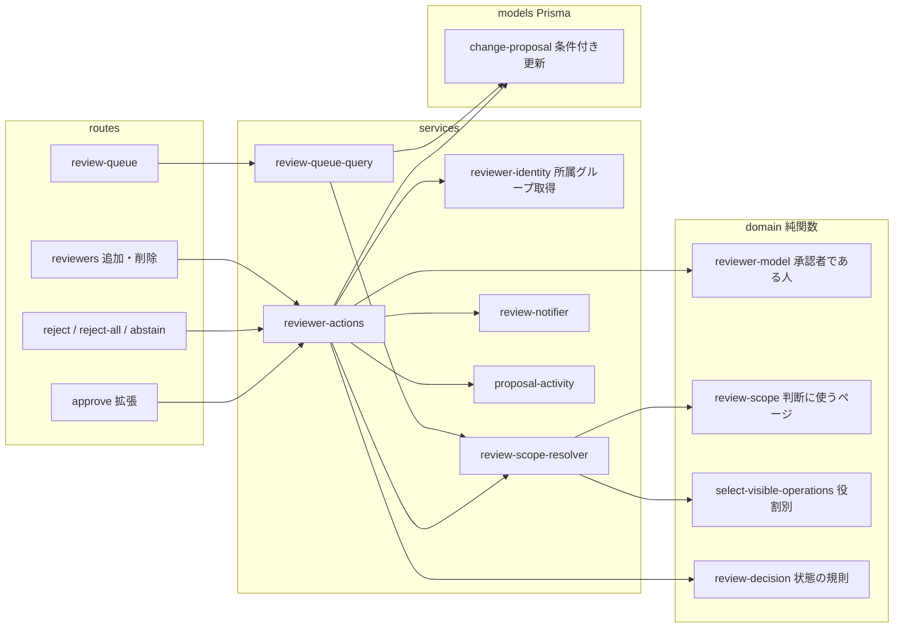
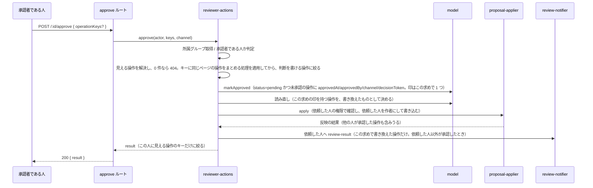
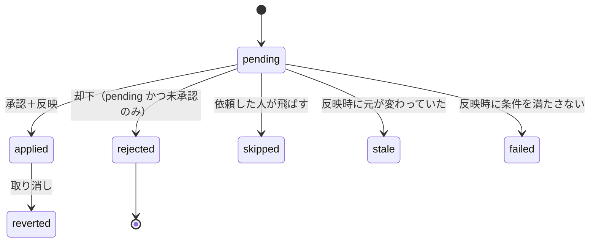

# Design Document: change-proposal-reviewers

この文書は、`change-proposal-core` の amend spec の設計である。要件は [requirements.md](./requirements.md)、判断の理由は [research.md](./research.md) にある。完了後は、本文を core の design.md に書き戻し（変更が元からなかったものとして）、判断の理由を core の research.md に移し、この spec を削除する（[spec-lifecycle](../../../.claude/rules/spec-lifecycle.md)）。

## Amend target

| 変更する spec | 変わる契約 |
|---|---|
| `change-proposal-core` | 承認者を持つ（要件 1）。承認を依頼した人以外に広げ、却下・放棄を足す（要件 2・3）。承認者の追加と削除（要件 4）。承認待ちの見え方（要件 5。core の 9.1〜9.4 の「承認待ちは依頼した人だけ」を広げる）。通知と activity（要件 6）。操作の状態に `rejected` を足す（core 2.1）。後続・見直しが承認者を引き継ぐ（core 13.3・13.4）。 |
| `change-proposal-viewer` | 承認待ちを依頼した人以外に見せない前提（viewer の 1.3、1.8、2.10、2.12、11.4、13.4、design の U5・U6）。型の網羅で必要な最小の追従（`status-appearance.ts`、`label-keys.ts`）だけを本 spec が行い、承認の画面・承認待ちの一覧・新しい通知の表示は viewer 側に足す。 |
| `change-proposal-ai-agent` | 「後続を作る」条件に `rejected` が加わる（`BASED_ON_ELIGIBLE_STATUSES`）。承認・飛ばす・破棄の画面は依頼した人の前提のまま（承認者向けの出し分けは別に判断）。 |

## Overview

**Purpose**: Change Proposal に承認者（ユーザー・グループ）を持たせ、依頼した人以外が、自分の閲覧できるページの操作を承認・却下・放棄できるようにする。依頼した人は、これまでどおりいつでも承認できる。

**Users**: AI などに Change Proposal を作らせた依頼した人、承認を頼まれた人（個人・グループの所属者）、運用する管理者。

**Impact**: 承認・飛ばす・破棄を「依頼した人だけ」としていた判定を、承認者にも広げる。承認待ちを依頼した人以外にも返す。操作の状態に「却下」を足す。反映のときの権限の確認と作者は変えない（依頼した人のまま）。

### Goals
- 要件 1〜8 を、既存の「条件付きの 1 回の更新」と「見る人ごとの絞り込み」の作りの上で満たす。
- 承認者かどうか・承認の対象かどうかの判定を、1 つの純関数の組にして、ルート・サービス・一覧の問い合わせで同じものを使う。
- 見る人が閲覧できないページの存在・件数を、応答・通知・エラーから分からないままにする。

### Non-Goals
- 承認・却下・放棄・承認者の追加と削除の画面、承認待ちの一覧の画面、通知の表示（viewer）。AI チャットで承認者を選ぶ画面と指定の道具（ai-agent）。
- ページのパスごとの既定の承認者、本人の承認を禁止する管理者の設定、自動割り当て、期限前の催促、同じ提案の更新と再レビュー。
- 既存の「飛ばす」の競合の穴（research.md）の修正。

## Boundary Commitments

### This Spec Owns
- 承認者の保存と、承認者である人・承認の対象の判定。
- 承認・却下・放棄・承認者の追加と削除のサーバー側の処理と API。承認待ちの取得と一覧（承認者向け）。
- 操作の状態 `rejected` と、承認・却下・放棄の記録。
- 承認者への通知と、依頼した人への判断の結果の通知の作成（snapshot の契約を含む）。新しい activity の種類。
- 後続・見直しの承認者の引き継ぎ、承認者を指定した提案の自動反映の抑止。

### Out of Boundary
- 反映の仕組み（元のリビジョンの確認、編集中の人、権限の確認、並び順、二重書き込みの防止）。変更しない。
- 閲覧できるかどうかの判定そのもの（`Page.findByIdsAndViewer` ほか）。再利用する。
- viewer・ai-agent の画面と文言（新しい通知の表示文言は viewer の spec が持つ。本 spec は snapshot の契約までを決める）。

### Allowed Dependencies
- `change-proposal-core` の既存のモデル・サービス・ルート・通知・activity。
- GROWI の既存のグループ所属の判定（`pageGrantService.getUserRelatedGroups`）と閲覧の判定。
- 依存の向き: viewer と ai-agent は本 spec のサーバー側の契約（API と view の型）に依存する。本 spec は viewer・ai-agent に依存しない。

### Revalidation Triggers
- `OperationStatus` に `rejected` が加わったこと（viewer の `status-appearance.ts`・`label-keys.ts`、ai-agent の「後続を作る」条件、`derive-proposal-status.ts`）。
- `ChangeProposalView` と `OperationView` に役割（`viewerRole`）、承認者、判断の記録、承認者向けの値が加わったこと。
- `POST /:id/approve` の応答の形は変えない（`{ result: ApplyResult }`）。ただし、`done` の `results` は、見る人に見える操作のキーだけに絞られること（ai-agent の承認の画面は、依頼した人にとっては従来どおり）。
- 承認待ちが、依頼した人以外にも（承認者に）返るようになったこと（viewer の「見える操作」の定義、承認待ちを見せない前提の要件）。
- 通知に新しい種類（`review-request`、`review-result`）が加わったこと（viewer の `parse-notification-snapshot.ts`、`ChangeProposalNotification.tsx`、`commons.json`）。
- 公開の順序: viewer の承認画面と承認待ちの一覧、ai-agent の承認者の指定の入口が入るまで、書き込み機能を有効にしないこと。

## Architecture

### Existing Architecture Analysis
- 保存は Prisma。操作の `status` と `reason` は文字列。状態を書き換える処理は「条件付きの 1 回の `updateMany`」で、同時実行は条件と排他の印（リース）で防ぐ。
- 「依頼した人だけ」の判定は、サービス（`requester-actions.ts`）と書き込みの条件（`models/change-proposal.ts` の `where {requester, lifecycle:'open'}`、`toRequesterWriteMiss`）の 2 か所にある。
- 見る人ごとの絞り込みは `select-visible-operations.ts` が持ち、依頼した人以外には、反映済み・取り消し済み・取り消しを断られた、の 3 状態だけを返す。「見つからない」は、見える操作が 0 件のときに同じ応答を返すことで作っている。
- 通知は `InAppNotification.create` を直接呼ぶ前例（戻すよう頼む）がある。activity は 1 つの ID に 1 行。

### Architecture Pattern & Boundary Map



**Architecture Integration**:
- Selected pattern: 承認者の判定を純関数にし、DB に触る層（所属グループの取得、閲覧の判定）を `services/` の薄い層に分ける。
- Existing patterns preserved: 条件付きの 1 回の更新、見る人ごとの絞り込み、「見つからない」の同一応答、`InAppNotification.create` の直接呼び出し、activity を応答の前に送る。
- New components rationale: 承認者の判定（`reviewer-model`）、判断に使うページの決め方（`review-scope`）、状態の規則（`review-decision`）は、複数のルート・一覧で同じ結果が要るので純関数にする。
- Steering compliance: 認可は標準の middleware（`writeAccessChain`、`readAccessChain`）を再利用し、並行実装しない。

### Technology Stack

| Layer | Choice / Version | Role in Feature | Notes |
|---|---|---|---|
| Backend / Services | Express、TypeScript（既存） | ルート、サービス、純関数 | `.claude/rules/` の ESM・import 規約に従う |
| Data / Storage | MongoDB + Prisma（既存） | 承認者・判断の記録・索引 | 索引は migrate-mongo の migration |
| Messaging | アプリ内通知（既存） | 承認者・依頼した人への通知 | `InAppNotification.create` |
| Frontend | なし（型と表示名の追従のみ） | 型の網羅に必要な最小の追従 | 画面は viewer |

## File Structure Plan

`apps/app/src/features/change-proposal/` からの相対パス。

### New Files
```
interfaces/
└── reviewer.ts                      # ReviewerRef、ReviewChannel、上限の定数、判断の記録の型
server/
├── domain/
│   ├── reviewer-model.ts            # 承認者である人・依頼した人を含む承認者・外部の承認者の有無（純関数）
│   ├── review-scope.ts              # 操作ごとの「判断に使うページ」の決め方（純関数）
│   └── review-decision.ts           # 承認・却下・放棄を受け付ける操作の状態の規則（純関数）
├── services/
│   ├── reviewer-identity.ts         # ユーザーの所属グループ ID の取得（既存の関数を包む）
│   ├── review-scope-resolver.ts     # 判断に使うページの解決と閲覧の判定（DB）
│   ├── reviewer-actions.ts          # 承認・却下・全体の却下・放棄・承認者の追加と削除
│   ├── review-queue-query.ts        # 承認者としての一覧（カーソル、1 回に調べる上限）
│   └── review-notifier.ts           # review-request と review-result の通知
└── routes/
    ├── reject.ts                    # POST /:id/reject
    ├── reject-all.ts                # POST /:id/reject-all
    ├── abstain.ts                   # POST /:id/abstain
    ├── reviewers.ts                 # POST /:id/reviewers（追加）、POST /:id/reviewers/remove（削除）
    └── review-queue.ts              # GET /review-queue
src/migrations/
└── 2026111XXXXXXX-add-change-proposal-reviewer-indexes.js   # 索引と reviewers の補完
```

### Modified Files
- `prisma/schema.prisma` — `changeproposals` に `reviewers`、`purpose`、`abstentions`、`wholeRejection` を足し、操作の複合型に承認・却下の項目を足す。`@@index` を宣言する。
- `interfaces/change-proposal.ts` — `OperationStatus` に `rejected`。`BASED_ON_ELIGIBLE_STATUSES['follow-up']` に `rejected`。
- `interfaces/api.ts` — `ChangeProposalView`・`OperationView` に役割、承認者、判断の記録、承認者向けの値を足す。
- `interfaces/notification.ts` — snapshot の `kind` に `review-request`、`review-result` を足す。
- `server/models/change-proposal.ts` — 承認の書き込みの条件を広げ、承認者の追加・削除、却下、全体の却下、放棄の書き込み関数を足す。`approvedAt` を消す 3 か所（`:326`、`:444`、`query-parts.ts:161`）で、足した承認の項目も消す。
- `server/models/change-proposal-query-parts.ts`、`to-change-proposal-document.ts` — 選択する項目（`operationSummarySelect`、`summarySelect`）と、`OPERATION_STATUSES` に `rejected` と新しい項目を足す。書き込みの条件に承認者を足す。
- `server/services/requester-actions.ts` — 承認の処理を `reviewer-actions.approve` へ移す（承認の入口を 1 つにまとめる）。飛ばす・破棄・ページごとの通知の指定の変更は、依頼した人だけのまま、ここに残す。
- `server/services/change-proposal-service.ts` — 作成に `reviewers`・`purpose` を受け、後続・見直しで承認者を引き継ぎ、承認者を指定した提案の自動反映を抑止する。
- `server/services/normalize-create-input.ts`、`server/domain/select-auto-apply-targets.ts`、`server/domain/validate-based-on.ts`（`rejected` を元にできる状態に）。
- `server/domain/select-visible-operations.ts`、`server/services/proposal-view-parts.ts`、`proposal-query.ts`、`proposal-list-query.ts`、`to-operation-view.ts` — 役割（依頼した人・承認者・それ以外）で見える操作と値を分ける。承認者には、判断に使うページ（編集は対象のページ、新規作成は親、移動は移動元と移動先の親）をすべて閲覧でき、リンクを知る人だけのページを含まない操作を、状態を問わず返す（要件 5.1、5.6）。依頼した人以外の、承認者でもない人の見える状態は変えない。
- `server/domain/derive-proposal-status.ts` — 「反映できなかった操作がある」の判定に `rejected` を足す（コンパイルで見つからないので、手で直す）。
- `server/services/proposal-activity.ts`、`proposal-applier.ts`（承認の求めで動く反映を、背景の反映と同じ形で呼び、新しい activity ID で記録する）、`proposal-notifier.ts`。
- `server/services/current-page-facts.ts` — `loadViewablePages` に、取得済みの所属グループ（`ViewerIdentity`）を渡せるようにする（今は所属グループに `null` を渡して、中でもう一度取得している）。
- `server/routes/approve.ts`（承認者にも開く）、`index.ts`（ルート登録。`/review-queue` は `/:id` より前）、`write-access.ts`（`respondWithServiceError` に新しいエラーコード）、`openapi.spec.ts`。
- `client/shared/label-keys.ts`、`client/viewer/components/status-appearance.ts`、`client/viewer/domain/derive-revert-progress.ts` — `rejected` を足す（型の網羅のための最小の追従）。
- `apps/app/src/interfaces/activity.ts` — 新しい action を `SupportedAction`、`EssentialActionGroup`、`MediumActionGroup` に足す。
- locale（5 言語）: `translation.json`（`change_proposal.*` の表示名）、`commons.json`（通知の種類の文言は viewer が足すので、本 spec ではキーの契約だけを決める）、`admin.json`（`audit_log_action.*`）。

## System Flows

### 承認者による承認（グループ宛て、反映まで）



- 条件に合わない操作（すでに承認済み・却下済み・反映済みなど）は書き込まず、その時点の状態を返す（要件 2.11）。
- 反映は `applyLease` を取った 1 つの処理だけが動く。同時に承認が来ても、書き込みは 1 回（要件 2.5）。承認の書き込みは、承認した人・経路を操作に残す。

### 操作の状態



- 却下は、`approvedAt` が付いた「待ち」（反映待ち）には書かない。承認が先なら承認が勝つ。
- 却下されたあとの承認は、`status: pending` の条件に合わず、何も書かない。

### 承認者としての一覧

`GET /review-queue?cursor=` は、`{lifecycle:'open', reviewers に本人かその所属グループの ID を含む}` を、期限が近い順（`expiresAt` 昇順、次に `_id`）に読み、1 回に調べる件数の上限まで繰り返す。読んだ Change Proposal ごとに、その人の承認の対象（放棄していない「待ち」で、判断に使うページを閲覧できるもの）を 1 つ以上持つものだけを返す。続きの位置（カーソル）を返す。

## Requirements Traceability

| Requirement | Summary | Components | Interfaces | Flows |
|---|---|---|---|---|
| 1.1〜1.7 | 承認者の指定、既定、検証、上限 | `normalize-create-input`、`reviewer-model`、`change-proposal-service`、model | `CreateProposalInput.reviewers`、`ReviewerRef` | — |
| 1.8〜1.10 | 変更の目的 | `normalize-create-input`、model、`to-operation-view`（返却） | `CreateProposalInput.purpose` | — |
| 1.11 | 承認者を指定したら自動反映しない | `select-auto-apply-targets`、`reviewer-model.hasForeignReviewer` | — | — |
| 2.1〜2.4 | 承認（個別・全体・依頼した人・グループ） | `reviewer-actions.approve`、`reviewer-model`、`review-scope-resolver`、model | `POST /:id/approve` | 承認 |
| 2.5、2.11 | 同時承認、待ちでない操作 | model の条件付き更新、`review-decision` | — | 承認、状態 |
| 2.6、2.7 | 見えない操作・非関係者の応答 | `reviewer-actions`、`write-access`（同一の「見つからない」） | — | — |
| 2.8 | 承認の記録（人・日時・経路・本人か） | model（`approvedBy` など）、`detectChannel` | 操作の項目 | 承認 |
| 2.9、2.10 | 閉じた提案、編集中で残った承認 | `reviewer-actions`、`toRequesterWriteMiss` の拡張 | `not-open` | — |
| 3.1〜3.3、3.5 | 却下・全体の却下・放棄 | `reviewer-actions`、`review-decision`、model | `POST /:id/reject`、`/reject-all`、`/abstain` | 状態 |
| 3.4 | 放棄を後の判断で置き換える | model（`abstentions` の削除と追加） | — | — |
| 3.6〜3.9 | コメントの記録・長さ・文字のまま・見える範囲 | `reviewer-actions`、`to-operation-view`、`select-visible-operations` | `COMMENT_MAX_LENGTH` | — |
| 3.10、3.11 | 完了への移り変わり、却下の記録 | `settleIfNoPending`（既存）、model | — | 状態 |
| 3.12、3.13 | 達成度の分母、後続の元にできる状態 | `compute-achievement`（変更なし）、`BASED_ON_ELIGIBLE_STATUSES`、`validate-based-on` | — | — |
| 3.14、3.15 | 依頼した人は却下・放棄しない、非関係者 | `reviewer-actions` | `requester-cannot-review` | — |
| 4.1〜4.4、4.6〜4.9 | 承認者の追加・削除、既定への戻り、検証 | `reviewer-actions`、`reviewer-model`、model | `POST /:id/reviewers`、`/reviewers/remove` | — |
| 4.5、4.10〜4.12 | 存在しない承認者、記録、通知、削除後の記録 | `reviewer-actions`、`review-notifier`、model（記録は残す） | — | — |
| 5.1、5.2 | 承認待ちの取得と承認者向けの値 | `proposal-query`、`proposal-view-parts`、`to-operation-view` | `ChangeProposalView`、`OperationView` | — |
| 5.3、5.4 | 非関係者には返さない、見える操作が 0 件なら「見つからない」 | `select-visible-operations`、`proposal-query` | — | — |
| 5.5、5.6 | 承認者としての一覧、見える操作だけ | `review-queue-query`、`review-scope-resolver` | `GET /review-queue` | 一覧 |
| 5.7、5.8 | 承認者・判断の記録を返す、依頼した人だけの値は返さない | `proposal-view-parts`、`to-operation-view` | — | — |
| 5.9、5.10 | 所属が外れたら承認者でない、反映済みの振る舞いは不変 | `reviewer-identity`（読むときに判定）、`select-visible-operations` | — | — |
| 6.1〜6.4 | 承認者への通知（個人のみ、見える分だけ） | `review-notifier` | snapshot `kind: 'review-request'` | — |
| 6.5、6.6 | 依頼した人への結果の通知 | `review-notifier` | snapshot `kind: 'review-result'` | 承認 |
| 6.7 | 反映のまとめた通知は不変 | `proposal-notifier`（変更なし） | — | — |
| 6.8〜6.10 | 新しい activity、反映の activity、記録しない範囲 | `proposal-activity`、`activity.ts` | 新しい action 3 つ | 承認 |
| 7.1〜7.7 | 反映時の権限・作者、読み取り専用、無効化 | `proposal-applier`（変更なし）、`writeAccessChain` | — | 承認 |
| 8.1〜8.6 | 既存の動きの維持、後続・見直しの引き継ぎ | `change-proposal-service`、`reviewer-model`、`select-auto-apply-targets` | — | — |
| 8.7 | 5 言語の表示名・activity 名 | locale、`label-keys` | — | — |

## Components and Interfaces

| Component | Layer | Intent | Req Coverage | Key Dependencies | Contracts |
|---|---|---|---|---|---|
| reviewer-model | domain | 承認者である人の判定と補助 | 1.4、1.11、2.1〜2.4、4.4、5.9 | — | Service |
| review-scope | domain | 操作ごとの判断に使うページの決め方 | 2.2、5.6 | — | Service |
| review-decision | domain | 承認・却下・放棄を受け付ける状態の規則 | 2.5、2.11、3.1〜3.5 | — | Service |
| reviewer-identity | service | 所属グループ ID の取得 | 2.4、5.9 | `pageGrantService` | Service |
| review-scope-resolver | service | 判断に使うページの解決と閲覧の判定 | 2.2、5.5、5.6 | `loadViewablePages`、`Page` | Service |
| reviewer-actions | service | 承認・却下・放棄・承認者の追加と削除 | 2、3、4 | model、resolver、notifier、activity | Service、API |
| review-queue-query | service | 承認者としての一覧 | 5.5 | model、resolver | API |
| review-notifier | service | 承認者・依頼した人への通知 | 6.1〜6.6 | `InAppNotification` | Event |
| routes（5 本） | route | HTTP の入口 | 2〜5 | `writeAccessChain`、`readAccessChain` | API |

### domain

#### reviewer-model

```typescript
type ReviewerKind = 'user' | 'user-group' | 'external-user-group';

interface ReviewerRef {
  readonly kind: ReviewerKind;
  readonly id: string;        // ユーザー or グループの ObjectId の文字列
  readonly addedBy: string;
  readonly addedAt: Date;
  readonly removedBy?: string;   // 外した人。要素は消さず、外した記録を残す（要件 4.10、4.12）
  readonly removedAt?: Date;     // 値があれば、承認者ではない
}

interface ViewerIdentity {
  readonly userId: string;
  readonly userGroupIds: ReadonlySet<string>;
  readonly externalUserGroupIds: ReadonlySet<string>;
}

// 有効な承認者（removedAt が無い要素）。以下のすべての判定は、有効な要素だけを見る
function activeReviewers(reviewers: readonly ReviewerRef[]): readonly ReviewerRef[];
// 有効な承認者が空なら依頼した人だけが承認者とみなす（要件 1.4、4.4）
function isReviewer(reviewers: readonly ReviewerRef[], requesterId: string, viewer: ViewerIdentity): boolean;
// 依頼した人以外のユーザーまたはグループが 1 つでも含まれるか（要件 1.11、8.5）
function hasForeignReviewer(reviewers: readonly ReviewerRef[], requesterId: string): boolean;
function dedupeReviewerInputs(inputs: readonly ReviewerInput[]): readonly ReviewerInput[]; // 作成・追加の入力の重複をまとめる
type ViewerRole = 'requester' | 'reviewer' | 'other';
function deriveViewerRole(requesterId: string, reviewers: readonly ReviewerRef[], viewer: ViewerIdentity): ViewerRole; // 依頼した人が優先
```

- 承認者の判定は、操作の時点の所属で行う（要件 5.9）。呼び出し側が `ViewerIdentity` を 1 回だけ取得して渡す。
- `isReviewer` は依頼した人を承認者に含めない（`reviewers` が空でない場合）が、承認の権限は依頼した人に常にある（要件 2.3）。承認の許可は「依頼した人 または isReviewer」で判定する。

#### review-scope

```typescript
// 操作が判断に使うページ（これらをすべて閲覧できる承認者が、その操作の承認の対象を持つ）
type ReviewScope = {
  readonly pageIds: readonly string[];          // 既存のページ
  readonly ancestorPaths: readonly string[];    // まだ無いページの、親の候補のパス（長い順）
};
function reviewScopeOf(op: OperationRecord): ReviewScope;
// 編集 → 対象のページ。新規作成 → 親（無ければ最も近い上のページ）。移動 → 移動元＋移動先の親（同上）。
function resolveAncestors(candidatePaths: readonly string[], existingPaths: ReadonlySet<string>): string | null;
```

- 新規作成・移動の「親」は、core の反映と同じ規則（`findNonEmptyClosestAncestor`）で決める。`dirname(path)` を上へたどった、**空でない**最初の既存のページ（空のページは飛ばす）。ルート（`/`）まで無ければ、ルートのページとする。

#### review-decision

```typescript
type DecisionKind = 'approve' | 'reject' | 'abstain';
type DecisionOutcome =
  | { readonly accepted: true }
  | { readonly accepted: false; readonly currentStatus: OperationStatus; readonly awaitingApply?: boolean };
function canDecide(op: Pick<OperationRecord, 'status' | 'approvedAt'>, kind: DecisionKind): DecisionOutcome;
```

- `approve`: `status === 'pending'`（すでに `approvedAt` があれば成功として何も書かない）。
- `reject`: `status === 'pending'` かつ `approvedAt` が無い。
- `abstain`: `status === 'pending'`。

### service

#### reviewer-actions

```typescript
type ReviewChannel = 'ui' | 'api' | 'ai-tool';

interface ReviewActor { readonly userId: string; readonly channel: ReviewChannel }

// 応答は、既存の承認の応答（`{ result: ApplyResult }`。`type` は `done` か `in-progress`）と同じ形を保つ。
// `done` の `results` は `{ key, status, reason }` の配列で、その人に見える操作のキーだけに絞る。
// `changed`（この求めで書き込んだか）は内部の値で、応答には出さない。
interface DecisionOutcome {
  readonly operationKey: string;
  readonly status: OperationStatus;
  readonly reason: OperationReason | null;
  readonly changed: boolean;             // 内部のみ
}

type ReviewerActionError =
  | 'not-found' | 'not-open' | 'comment-too-long' | 'reviewer-not-found'
  | 'too-many-reviewers' | 'requester-cannot-review';

interface ReviewerActions {
  // 承認の唯一の入口。依頼した人も、承認者も、ここを通る（`requester-actions.ts` の承認はここへ移す）
  approve(id: string, actor: ReviewActor, operationKeys?: readonly string[]): Promise<Result<ApproveResponse, ReviewerActionError>>;
  rejectOperations(id: string, actor: ReviewActor, operationKeys: readonly string[], comment?: string): Promise<Result<DecisionResponse, ReviewerActionError>>;
  rejectAll(id: string, actor: ReviewActor, comment?: string): Promise<Result<DecisionResponse, ReviewerActionError>>;
  abstain(id: string, actor: ReviewActor, operationKeys: readonly string[], comment?: string): Promise<Result<DecisionResponse, ReviewerActionError>>;
  addReviewers(id: string, actor: ReviewActor, inputs: readonly ReviewerInput[]): Promise<Result<void, ReviewerActionError>>;
  removeReviewers(id: string, actor: ReviewActor, inputs: readonly ReviewerInput[]): Promise<Result<void, ReviewerActionError>>;
}
```

- 事前条件: 呼び出し側は、読み取り専用ユーザーとゲストを `writeAccessChain` で断っている（要件 7.5）。
- 共通の手順（6 つの操作すべてに、この順で適用する）:
  1. Change Proposal を読む。存在しなければ `not-found`。
  2. 所属グループを取得し、依頼した人または承認者かを判定する。どちらでもなければ `not-found`（要件 2.7）。
  3. 見える操作を解決する（`resolveReviewScope`）。**依頼した人でない場合、見える操作（状態を問わない）が 0 件なら `not-found` を返す**（要件 2.7、5.4）。取得（GET）と同じ関数・同じ集合で判定する。これは、キーを使わない操作（`rejectAll`、`addReviewers`、`removeReviewers`）にも同じく適用する。この確認は `not-open` の判定より先に行う（見える操作が無い人に、提案が閉じているかどうかを知らせないため）。見える操作が 1 つでもあれば、閉じた提案への判断は `not-open`（409）になる（期限切れ・破棄になった提案では、承認者が閲覧できるページの操作が「飛ばした」として見える）。
  4. `rejectOperations`・`rejectAll`・`abstain` は、依頼した人なら `requester-cannot-review`（要件 3.14）。
  5. キーを使う操作は、求められたキーに「同じページの操作をまとめる処理」（`expandApprovalTargets`）を適用し、**そのあとで**、次のように分ける。(a) 見える操作に入らないキーは、存在しないキーと同じに扱って無視する（要件 2.6）。(b) 見える操作に入り、判断を書ける操作（`decidableKeys`）に入らないキー（すでに反映済み・却下済みなど）は、書き込まず、その時点の状態を返す（要件 2.11、2.5）。(c) 判断を書ける操作だけを書き込む。全体の承認（キーなし）は、`reviewTargetKeys`（自分が放棄した操作を除く）を対象にする。
  6. 条件付きで書き込む。承認と却下の書き込みの前に、`not-open`（段階が承認待ちでない）を確かめる。
  7. 書き込んだ操作を、下の「書き込んだ操作の判定」で決め、その操作だけから通知と activity を作る。
  8. 応答の結果は、反映や却下の結果をそのまま返さず、**その人に見える操作のキーだけ**に絞って返す（依頼した人は、これまでどおり全部）。反映の処理は、ほかの人が承認した操作も読み直してまとめて反映するので、結果には、その人に見えない操作が混ざりうる。
- **書き込んだ操作の判定**: Prisma の `updateMany` が返す件数は、文書の数で、文書の中の操作を何件書き換えたかではない（条件に合う操作が 0 件でも、文書が外側の条件に合えば 1 を返す）。そのため、書き込みのあとで文書を読み直し、この求めの印（`decisionToken`）を持つ操作だけを「この求めで書き換えたもの」とする。求めの処理の最初に、ランダムな印（UUID）を 1 つ作り、承認・却下では操作の項目 `decisionToken` に、放棄では `abstentions` の要素に、その印を書く。
  - 却下・承認: `decisionToken` がこの求めの印と等しい操作。
  - 放棄: `abstentions` に、この求めの印を持つ要素があるキー。
  同じ人が同時に 2 回求めても、印が違うので、書き換えたものに数えない。時刻の一致には頼らない（同じミリ秒の 2 回の求めを区別できないため）。
- 事後条件: `rejectAll` は、すべての `pending` かつ未承認の操作を `rejected` にし、`wholeRejection` を記録し、`settleIfNoPending` で完了にする。承認済み（反映待ち）の操作は却下せず、その時点の状態を返す。操作ごとの却下（`rejectOperations`）でも、書き込みのあとで `settleIfNoPending` を呼び、「待ち」が無くなったら完了にする（要件 3.10。既存の「飛ばす」と同じ）。却下の条件の「未承認」は、`approvedAt` が項目として無い、または `null`（Prisma は「項目が無い」と「値が `null`」を区別するので、`isSet: false` または `null` の両方を条件に書く。既存の `change-proposal-query-parts.ts` の前例と同じ）。
- `addReviewers`・`removeReviewers`: 読んでから全体を書き直す手順は使わず、要素ごとの条件付きの書き込みにする。同時に別の人が別の承認者を足しても、片方の追加が消えない。
  - 追加: 入力の重複をまとめ、存在確認（ユーザーまたはグループ）をしてから、入力 1 件ごとに、`lifecycle: 'open'` かつ「同じ `(kind, id)` で `removedAt` が無い要素が無い」を条件に、`reviewers` へ要素を 1 件 `push` する（同時に同じ承認者を足しても、重複しない）。外されたことがある `(kind, id)` を足し直すときは、新しい要素を足す（古い外した記録は残る）。
  - 削除: 条件（`lifecycle: 'open'`）のもとで、一致する有効な要素に `removedBy`・`removedAt` を書く（要素は消さない。要件 4.10、4.12）。
  - 閉じていれば `not-open`（要件 4.8）。承認者の合計（有効な要素）が上限（20）を超えるなら、書く前の読み取りで `too-many-reviewers` を返す。同時の追加で、上限を数件超えることがありうるが、上限は安全のためではなく通知と一覧の量の目安なので、許容する。
  - 有効な承認者が空になったら、依頼した人だけを承認者とみなす（要件 4.4）。
  - 放棄の置き換え（要件 3.4）は、(1) 同じ人・同じキーの古い要素を `deleteMany`、(2) 新しい要素を `push`、の 2 回の更新で書く。放棄は状態を決めない記録なので、途中で止まっても、最悪は放棄の記録が消えるだけ。
- Invariants: 反映は `proposal-applier` を呼ぶだけで、書き込みの権限と作者は依頼した人のまま（要件 7.1〜7.3）。

#### reviewer-identity / review-scope-resolver

```typescript
function loadViewerIdentity(userId: string): Promise<ViewerIdentity>;
interface ReviewScopeResult {
  // 見える操作（状態を問わない）。取得（GET）で返す操作と同じ集合。承認者は、判断に使うページをすべて閲覧でき、
  // リンクを知る人だけのページを含まない操作。依頼した人は全部。それ以外は反映済み・取り消し済み・取り消しを断られたのみ
  readonly visibleKeys: ReadonlySet<string>;
  // 判断を書ける操作 = 見える操作 ∧ status が pending（自分が放棄した操作を含む。要件 3.4）
  readonly decidableKeys: ReadonlySet<string>;
  // 要件の「承認の対象」 = decidableKeys から、自分が放棄した操作を除いたもの（要件 3.5）。一覧・通知・全体の承認に使う
  readonly reviewTargetKeys: ReadonlySet<string>;
}
function resolveReviewScope(
  operations: readonly OperationRecord[],
  abstentions: readonly Abstention[],
  viewer: ViewerIdentity,
  role: ViewerRole,
): Promise<ReviewScopeResult>;
```

- 「見つからない」の判定は `visibleKeys` が空かどうか（取得と 6 つの操作で同じ関数を使う）。承認の対象は、書き込むキーを選ぶときと、一覧・通知にだけ使う。

- 判断に使うページのパスは、まとめて 1 回の問い合わせで引く（上のページの候補を全部集めてから `Page.find({path: {$in}})`）。閲覧の判定は `loadViewablePages` を再利用し、渡す所属は `loadViewerIdentity` の結果を使う。

#### review-queue-query

```typescript
interface ReviewQueuePage { readonly items: readonly ChangeProposalSummaryView[]; readonly nextCursor: string | null }
function listReviewQueue(viewer: ViewerIdentity, cursor: string | null, limit: number): Promise<ReviewQueuePage>;
```

- 1 回に調べる件数の上限（`REVIEW_QUEUE_SCAN_LIMIT`、`listAppliedVisible` と同じ値）に達したら、見つかった分と続きの位置を返す。カーソルは `期限-ID` の文字列で、不正な値は先頭から読む。

#### review-notifier

```typescript
interface ReviewRequestSnapshot { kind: 'review-request'; proposalId: string; requester: { id: string; username: string }; pages: readonly NotificationPage[] }
interface ReviewResultSnapshot {
  kind: 'review-result'; proposalId: string;
  reviewer: { id: string; username: string };
  items: readonly { path: string; result: 'approved' | 'rejected' | 'abstained'; comment?: string }[];
  wholeRejectionComment?: string;
}
```

- `review-request`: 新しく承認者である人になった**個人のユーザー**（要件 6.2：グループの所属者には送らない）のうち、依頼した人と追加した人を除き、承認の対象を 1 つ以上持つ人に、1 人 1 件。`pages` は、その人の承認の対象のページだけで作る（要件 6.3）。
- `review-result`: 1 回の求めにつき 1 件を、依頼した人に（求めた人が依頼した人自身のときは送らない。要件 6.6）。コメントは、操作ごとのコメントと全体の却下のコメントをそのまま入れる。
- どちらも `InAppNotification.create` を直接呼ぶ（`upsertByActivity` は使わない）。action は `ACTION_CHANGE_PROPOSAL_REVIEW_REQUEST`、`ACTION_CHANGE_PROPOSAL_REVIEW_RESULT`。
- 通知の表示（viewer の `parse-notification-snapshot.ts`、`ChangeProposalNotification.tsx`、`commons.json` の文言）は viewer の spec が足す。それまでは、`parse` が `null` を返す通知は一覧に出ない。

#### proposal-activity

- 新しい action: `CHANGE_PROPOSAL_APPROVE`、`CHANGE_PROPOSAL_REJECT`（操作ごとの却下と全体の却下）、`CHANGE_PROPOSAL_ABSTAIN`。3 つとも `EssentialActionGroup` と `MediumActionGroup` に入れる（要件 6.8、監査ログの設定にかかわらず記録）。
- 承認の求めでは、承認の activity をその求めの ID で記録する。承認の求めで動く反映は、背景の反映と同じ形（`trigger.kind: 'background'`）で呼び、反映の activity は新しい ID（`beginActivity`）で、操作者を依頼した人として記録する（既存の背景の経路と同じ。反映の中身は変えない）。1 回の反映が複数の人の承認をまとめて書くことがあるので、承認した人は、承認の activity と、操作の項目（`approvedBy`）で分かる（要件 6.9）。
- 承認者の指定・追加・削除の activity は記録しない（要件 6.10）。

### route

| Method | Path | Middleware | Request | Response | Errors |
|---|---|---|---|---|---|
| POST | `/:id/approve`（既存を拡張。応答の形は変えない） | `writeAccessChain` | `{ operationKeys? }` | `{ result: ApplyResult }`（`type: 'done'` なら `results` を、その人に見える操作のキーだけに絞る。`in-progress` はそのまま） | 404、409（`not-open`） |
| POST | `/:id/reject` | `writeAccessChain` | `{ operationKeys, comment? }` | `{ result: { type: 'done', results } }`（承認と同じ形） | 400（`comment-too-long`、`requester-cannot-review`）、404、409 |
| POST | `/:id/reject-all` | `writeAccessChain` | `{ comment? }` | 同上 | 400、404、409 |
| POST | `/:id/abstain` | `writeAccessChain` | `{ operationKeys, comment? }` | 同上 | 400、404、409 |
| POST | `/:id/reviewers` | `writeAccessChain` | `{ reviewers: [{kind, id}] }` | 204 | 400（`reviewer-not-found`、`too-many-reviewers`）、404、409（`not-open`） |
| POST | `/:id/reviewers/remove` | `writeAccessChain` | `{ reviewers: [{kind, id}] }` | 204 | 404、409 |
| GET | `/review-queue` | `readAccessChain` | `?cursor=` | `{ items, nextCursor }` | — |

- すべてのルートの `@swagger` の tag は `ChangeProposals`。`openapi.spec.ts` の操作の一覧とテスト名を更新する。`/review-queue` は `/:id` より前に登録する。
- 存在しない場合と、見る人に関係のない場合は、同じ `404 notfound`（既存の `proposalNotFound()`）。新しいエラーコードは `respondWithServiceError` の switch に足す（足さないと既定の 500 になる）。
- 経路は `detectChannel(req)`（アクセストークン認証なら `'api'`、そうでなければ `'ui'`）で決める。AI の道具は service を直接呼び、`'ai-tool'` を渡す。

## Data Models

### Domain Model
- Change Proposal（集約）が、承認者（`reviewers`）、放棄（`abstentions`）、全体の却下（`wholeRejection`）、変更の目的（`purpose`）を持つ。操作は、承認・却下の記録を自分の項目として持つ。
- 不変条件: `reviewers` の、`removedAt` が無い要素は、`(kind, id)` で一意。`status: 'rejected'` の操作は `rejectedBy`・`rejectedAt` を持つ。承認の求めで `approvedAt` が付いた操作は `approvedBy` と `approvedChannel` を持つ。作成の直後の自動反映と、取り消しの Change Proposal の作成（`revert-action.ts`）で `approvedAt` だけが付く操作は、`approvedBy` を持たない（承認の求めではないため）。

### Physical Data Model（`prisma/schema.prisma` の `changeproposals`）

| 場所 | 項目 | 型 | 意味 |
|---|---|---|---|
| 文書 | `reviewers` | `ReviewerRef[]`（複合型） | 承認者。`kind`・`id`・`addedBy`・`addedAt`・`removedBy?`・`removedAt?`。外しても要素は消さない。既存の文書は migration で `[]` に補完 |
| 文書 | `purpose` | `String?` | 変更の目的（文字のまま） |
| 文書 | `abstentions` | `Abstention[]`（複合型） | `{operationKey, by, at, comment?}`。人ごと・操作ごとに 1 件（置き換え） |
| 文書 | `wholeRejection` | `{by, at, channel, comment?}?` | 全体の却下（コメントは依頼した人にだけ返す） |
| 操作 | `approvedBy`、`approvedChannel` | `String?` | 承認した人・経路（`approvedAt` と同時に書き、同時に消す） |
| 操作 | `decisionToken` | `String?` | 承認・却下を書いた求めの印（UUID）。「この求めで書き換えたか」の判定に使う。放棄の要素にも同じ印を持たせる |
| 操作 | `rejectedBy`、`rejectedAt`、`rejectedChannel`、`rejectComment` | `String?`／`DateTime?` | 却下の記録。全体の却下で却下になった操作の `rejectComment` は空 |
| 操作 | `status` | 文字列 | 値に `'rejected'` を足す（enum は無いので migration は要らない） |

- 索引（新しい migration で `createIndex`、schema.prisma に同じ名前で `@@index`）: `{lifecycle: 1, 'reviewers.id': 1, expiresAt: 1, _id: 1}`。
- 補完: 同じ migration で、`reviewers` が無い文書に `$set: { reviewers: [], abstentions: [] }`。
- 古い版のコードは `rejected` を `toMember` で読むと例外になる。版を戻す運用での注意をリリースノートに書く。

### Data Contracts & Integration（API の型）

```typescript
interface ChangeProposalView {
  // 既存の項目に加えて
  readonly viewerRole: 'requester' | 'reviewer' | 'other';
  readonly purpose?: string;                          // 依頼した人と承認者に返す
  readonly reviewers?: readonly ReviewerView[];       // 依頼した人と承認者に返す
  readonly wholeRejection?: { by: UserSummary; at: string; comment?: string }; // コメントは依頼した人にだけ
}
interface OperationView {
  // 既存の項目に加えて
  readonly proposedBody?: string;                     // 依頼した人、または承認者（承認の対象の操作のみ）
  readonly baseIsLatest?: boolean;                    // 承認者向け: 元のリビジョンが今も最新か
  readonly order?: number;                            // 依頼した人: 元の番号。承認者: 見える操作の中での順位
  readonly approval?: { by: UserSummary; at: string; channel: ReviewChannel };
  readonly rejection?: { by: UserSummary; at: string; comment?: string };
  readonly abstentions?: readonly { by: UserSummary; at: string; comment?: string }[];
}
```

- 返す範囲: 承認者には、その人が閲覧できるページの操作だけを返す（要件 5.6）。`rejection.comment` と `abstentions[].comment` は、依頼した人と、そのページを閲覧できる承認者にだけ返す（要件 3.9）。`wholeRejection.comment` は依頼した人にだけ返す。
- `baseIsLatest` は、編集の操作だけについて、`baseRevision` が今のページの最新のリビジョンかを、1 回のまとめた問い合わせで計算する。
- 依頼した人にだけ返す値（段階、達成度、AI の要約・会話、ページごとの通知の指定、`requesterState`）は、承認者には返さない（要件 5.8）。

## Error Handling

| 状況 | 応答 | 理由 |
|---|---|---|
| 存在しない／依頼した人でも承認者でもない／見える操作（状態を問わない）が 0 件（全 6 操作と取得に共通。閉じた提案でも、これを先に判定する） | 404 `notfound`（同一） | 要件 2.7、5.4 |
| 見えないページの操作のキー／存在しないキー | 無視（`results` に含めない） | 要件 2.6 |
| 見える操作だが、判断を書けない（反映済み・却下済みなど） | 書き込まず、その時点の状態を返す | 要件 2.5、2.11 |
| 閉じた提案への判断・承認者の追加・削除 | 409 `not-open` | 要件 2.9、4.8 |
| コメントが長い | 400 `comment-too-long` | 要件 3.7 |
| 依頼した人が却下・放棄を求めた | 400 `requester-cannot-review` | 要件 3.14 |
| 承認者の追加：存在しない／上限超過 | 400 `reviewer-not-found`／`too-many-reviewers` | 要件 4.5、4.9 |
| 読み取り専用ユーザー・ゲスト | `writeAccessChain` が断る | 要件 7.5 |

## Testing Strategy

### Unit（純関数）
- `reviewer-model`: 依頼した人のみ（`reviewers` が空）、ユーザーとグループの混在、グループの所属が外れたあと、重複のまとめ、`hasForeignReviewer` が依頼した人だけのときに偽になること。
- `review-scope`: 編集・新規作成（親がある／無い／上のページが遠い）・移動（移動先の親）の判断に使うページ。
- `review-decision`: 承認済み（反映待ち）の操作を却下できないこと、却下済みの操作を承認できないこと、放棄は待ちの操作にだけ効くこと。
- `select-visible-operations`: 役割別の見える操作（承認者には、判断に使うページをすべて閲覧できる操作が、状態を問わず見えること。リンクを知る人だけのページを含まないこと。「見つからない」が、見える操作 0 件で決まること）。
- 承認者の「見える操作」（状態を問わない）と「判断を書ける操作」と「承認の対象」（自分が放棄した操作を除く）の 3 つの集合の違い（放棄した操作を、あとから承認・却下できること。期限切れの提案への判断が 404 でなく 409 になること）。
- `derive-proposal-status`: 反映済みと却下が混ざった提案が「反映済み」にならないこと。

### Integration（結合。実 DB）
- 承認者による承認 → 反映 → 作者と権限が依頼した人のまま（要件 7.1〜7.3）。承認の記録（人・経路・日時）。
- グループが承認者のとき、所属者 1 人の承認で反映され、2 人目の同時の承認は二重に書かないこと（要件 2.4、2.5）。
- 却下と承認の競合（承認済みは却下できない、却下済みは承認されない）。全体の却下で、見えないページの「待ち」も却下になり、提案が完了になること（要件 3.2、3.10）。
- 放棄の記録と置き換え（要件 3.3、3.4）。コメントの見える範囲（要件 3.9）。
- 承認者の追加・削除、全員が外れたら依頼した人だけに戻ること（要件 4.4）。閉じた提案での `not-open`。
- 承認者としての一覧のページ送り（カーソル、上限、見えない操作のみの提案を返さない）。
- 「見つからない」の同一性: 存在しない提案、関係のない人、見える操作が 0 件の承認者の 3 つで応答が同じ。
- 後続・見直しの承認者の引き継ぎと、承認者を指定した提案の自動反映の抑止（要件 1.11、8.4、8.5）。
- 通知: `review-request` の宛先（個人のみ、依頼した人と追加した人を除く）、中身が受け取る人の閲覧できるページだけであること。`review-result` の宛先と、本人が承認したときは送らないこと。
- activity: 承認・却下・放棄が監査ログの設定にかかわらず記録されること。承認の求めで動いた反映の activity の操作者が依頼した人であること（承認した人は承認の activity と `approvedBy` で分かること）。

### 追従のテスト（型の網羅）
- `OperationStatus` に `rejected` を足したとき、viewer の `status-appearance`、`label-keys`、`derive-revert-progress` が型検査を通ること。i18n の監査が基準内であること（新しいキーは 5 言語を同じ作業で訳す）。

## Security Considerations
- **見えないページの存在を漏らさない**: 承認者に返す操作と、通知の中身は、受け取る人が閲覧できるページ（リンクを知る人だけのページを除く）だけで作る。見えない操作のキーは存在しないキーと同じに扱う。「見つからない」の応答は 1 種類。
- **権限の抜け道を作らない**: 反映は依頼した人の権限で確かめ、作者も依頼した人。承認者に指定されても、閲覧・編集の権限は増えない。書き込みの条件に「承認者の一覧に本人かその所属グループの ID を含む」を入れ、判定のあとで承認者が外された場合も防ぐ。
- **コメントと変更の目的は文字のまま扱う**（書式・HTML として解釈しない）。長さの上限は定数（コメント 500、変更の目的 2000）。
- 新しいルートの認可は、標準の middleware（`writeAccessChain`、`readAccessChain`）を再利用する。`tools/authz-matrix/baselines/route-middleware.json` に change-proposals のルートが 1 件も入っていないので、必要なら取り直す（既存の状態であり、本 spec の変更ではない）。

## Performance & Scalability
- 承認者としての一覧は、カーソルと 1 回に調べる上限で、最悪の読み取りを抑える（1500〜2000 ユーザー、数百人が提案を作る規模を想定）。
- グループの所属の取得は、1 回の求めにつき 1 回。グループの所属者全員への通知は作らないので、大きなグループを承認者にしても書き込みは増えない。
- 判断に使うページの解決は、上のページの候補のパスをまとめて 1 回で引く。
- 配列の索引の実際の効き方は未測定。実装のタスクで、代表的な規模のデータで計測する。

## Migration Strategy
1. migration: `reviewers`・`abstentions` の補完と、`{lifecycle, reviewers.id, expiresAt, _id}` の索引を `createIndex`。schema.prisma に `@@index` を宣言。`down` は索引を落とす。
2. サーバーのコード（新しい項目を読み書きする）。
3. viewer・ai-agent の追従（別の spec）。書き込み機能を有効にする前に入っていること。

## 要件との差と読み方
1. **要件 6.9**: 設計の検証で、「反映の activity に承認した人を含める」では、1 回の反映が複数の人の承認をまとめて書くため、承認した人が 1 人に決まらないと分かった。そこで要件 6.9 を、「承認した人を承認の activity と操作の項目に残す。反映の activity は変えない」に直した（要件の変更として扱った）。
2. **要件 5.2（並び順）**: 依頼した人には元の番号を返し、承認者には見える操作の中での順位を返す。元の番号から隠した操作の存在が分かるのを避けるため。
3. **要件 1.7、3.7、1.9 の上限の値**: 承認者は 20、コメントは 500 文字、変更の目的は 2000 文字（定数）。管理者の設定にはしない。
4. **要件 5.5（期限が近い順）**: 期限が無い文書（設定で期限を無効にした場合だけ）は、MongoDB の昇順で先頭に並ぶ。専用の扱いは作らない。
5. **既存の「飛ばす」の競合の穴**: 本 spec では直さず、別の修正として記録する（research.md）。

## 実装時に確かめる点
research.md の「実装時に確かめる点」の 5 つ。特に、(1) 配列の `push` と `deleteMany` の併用、(4) アクセストークン認証かどうかの判別は、最初のタスクで小さく試して結果を記録する。
