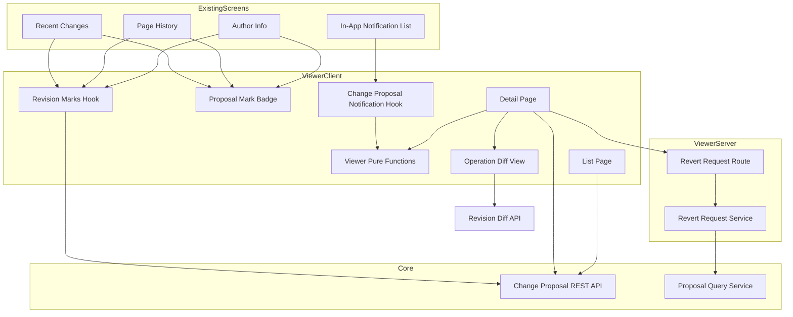
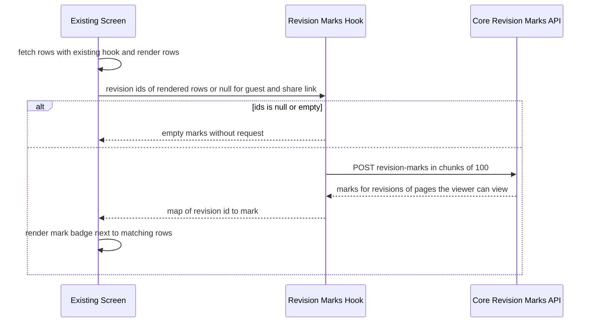
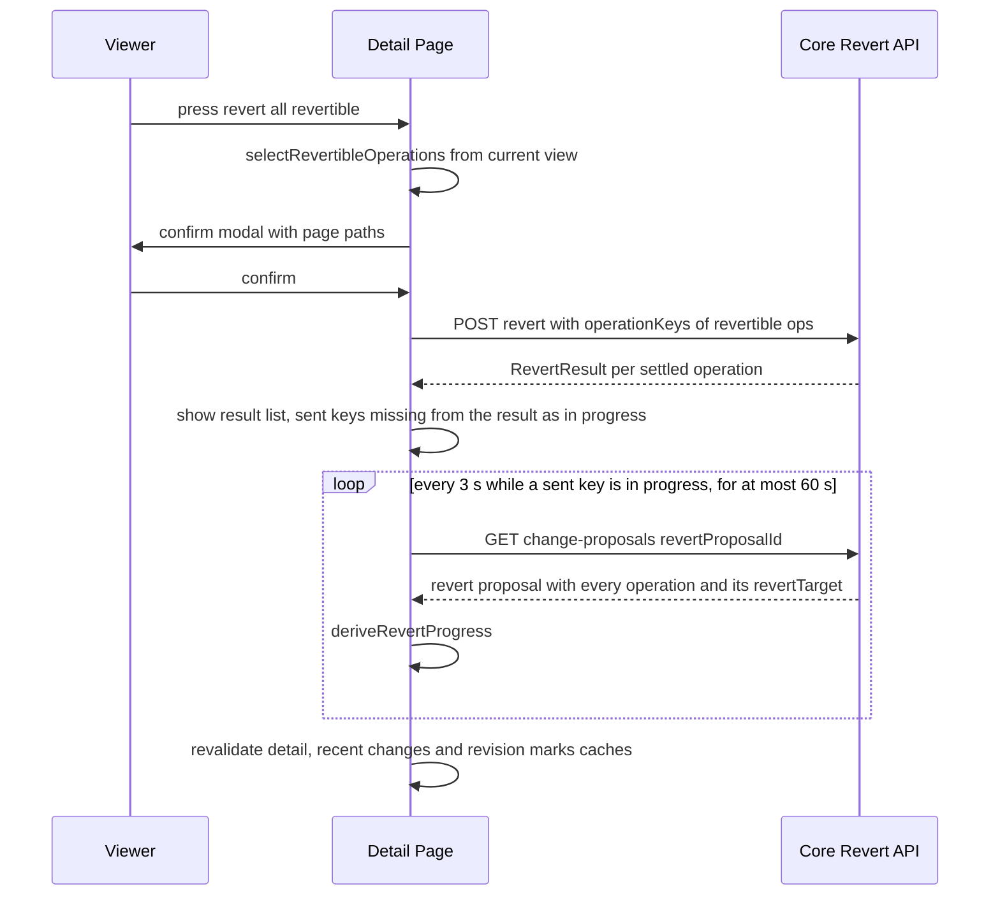
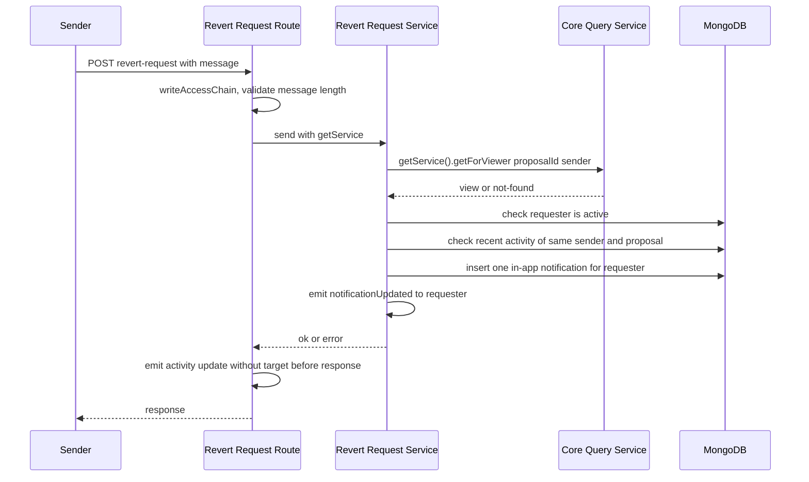

# Design Document: change-proposal-viewer

## Overview

**Purpose**: 反映された Change Proposal を、依頼した本人にも他のユーザーにも、1 つのまとまりとして見せる。詳細ページ・一覧・既存の画面の印・画面からの取り消し・「本人に戻すよう頼む」通知・まとめた通知の表示を作る。

**Users**: wiki を使うすべてのログインしたユーザー。依頼した人は、自分の Change Proposal を後から確かめて戻す。他のユーザーは、Recent Changes・ページ履歴・ページの作者の表示・通知から Change Proposal に気付き、自分が見られるページの分を戻すか、本人に戻すよう頼む。

**Impact**: Recent Changes・ページ履歴・ページの作者の表示・アプリ内通知の画面に、Change Proposal の印と表示を足す。どの画面も、データの取得の処理は変えず、取得したあとで `change-proposal-core` の API に問い合わせて表示を足す。

本書で使う言い方（詳細ページ・見える操作・戻せるかどうかの判定・印・今の版・頼む通知・まとめた通知）は、[requirements.md](./requirements.md) の「本要件で使う言い方」と同じである。core の言い方（操作・依頼した人・入口・見る人・操作の 7 つの状態）は [core の requirements.md](../change-proposal-core/requirements.md) と同じ。調べた事実と判断の理由は [research.md](./research.md) にある。

### Goals
- 詳細ページで、Change Proposal 全体と操作ごとの差分・状態・戻せるかどうかを、見える操作の分だけ表示する（要件 1・2）
- 「戻せるものを全部戻す」と「本人に戻すよう頼む」を、見えない操作の存在を示さずに提供する（要件 3・4）
- ページ履歴・Recent Changes・作者の表示の印を、各画面の表示を遅くせずに付ける（要件 5・6・7）
- 自分の Change Proposal と、自分が見られるページを含む反映済みの Change Proposal の一覧（要件 8）
- まとめた通知と頼む通知の表示（要件 9）、5 言語の文言、見えないページの存在を示さないこと（要件 10）
- 依頼した人への完了と達成度の表示、つながりの表示、反映されなかった操作の一覧、入口の spec が宣言した本人向けの操作の置き場所（要件 11・12・13）

### Non-Goals
- 戻せるかどうかの判定、取り消しの実行、見る人ごとの絞り込み、まとめた通知の中身を作ること（`change-proposal-core`）
- 承認待ちの Change Proposal の承認・飛ばす・破棄（`change-proposal-ai-agent` のチャット画面）
- AI が書いた要約と会話の保存と、それを返す API（`change-proposal-ai-agent`）
- Recent Changes を Change Proposal 単位でまとめ直すこと、ページ履歴の一般的な「この版に戻す」ボタン、Change Proposal へのコメント

## Boundary Commitments

### This Spec Owns
- 詳細ページ（`/me/change-proposals/{id}`）と一覧（`/me/change-proposals`）の画面
- ページ履歴・Recent Changes・作者の表示に付ける印の部品と、印を取得する SWR の hook
- 詳細ページの差分の表示（`POST /revisions/diff` で取った差分を、core の画面の共通の部品にある diff2html の設定と見た目で表示する部品）
- 「戻せるものを全部戻す」の画面の流れ（確認・送信・結果の表示・関係する表示の更新）
- 頼む通知: 送る API（`POST /_api/v3/change-proposals/:id/revert-request`）、そのサービス、snapshot の形、新しい action `CHANGE_PROPOSAL_REVERT_REQUEST`
- `targetModel` が `ChangeProposal` のアプリ内通知の画面での表示（反映・取り消し・頼む通知の 3 つの action）
- 本人だけに出す内容を入口ごとに宣言する表（`requester-only-sections.ts` の `REQUESTER_ONLY_SECTIONS`。部品が受け取る値は `{ proposalId: string }`）と、それを読み込む場所。表は `'ai-chat'` の行を持たない状態で出し、`'ai-chat'` の行（`AiRecordSection`）は `change-proposal-ai-agent` が足す
- 本人向けの操作を入口ごとに宣言する表（`requester-action-slots.ts` の `REQUESTER_ACTION_SLOTS`。Change Proposal 全体に置く部品は `ProposalActionSlotProps = { proposal: ChangeProposalView }`、操作ごとに置く部品は `OperationActionSlotProps = { proposal: ChangeProposalView; operation: OperationView }` を受け取る）と、それを読み込む場所（`RequesterActionSlot`）。表は `'ai-chat'` の行を持たない状態で出し、`'ai-chat'` の行（`ProposalFollowUpAction` / `OperationReworkAction`）は `change-proposal-ai-agent` が足す
- 完了と達成度の表示（`ProposalProgressLabel`）、つながりの表示（`ProposalLinkChips`）、反映されなかった操作の一覧（`RemainingOperationsList`）
- Recent Changes の一覧へのリンクを出すかどうかを決める画面の共通の値（`changeProposalEnabled`。SSR で `crowi.configManager.getConfig('app:changeProposalEnabled')` から作る。core の `readChangeProposalSettings()` の `isEnabled` と同じ設定キー）
- 「戻せるものを全部戻す」のあとで、結果の決まっていない操作を「処理中」と表示し、決まるまで取り直す流れ（`deriveRevertProgress` と `useRevertProgress`）
- core の変更の実装（tasks.md のグループ 8）: ページがもう無い操作を取り消しの相手にも表示のために返す見え方の決まり（core の要件 9.11。取り消しの対象は広げない）、完全な削除の操作の `path`（core の要件 9.12）、編集の操作に反映した時点のページのパスを記録すること（core の要件 6.7）、ページがもう無い操作のパスを操作の記録から決めて 1 件の取得と一覧の要約の両方で返すこと（core の要件 9.13）。決まり（契約）は core の spec が持ち、本 spec は同じ PR でそれを実装するタスクだけを持つ
- 入口を表す言葉の表と、その翻訳のキー（`change_proposal_viewer.*`）。この表から実行時に決まるキーの `preservePatterns`
- 本 spec の画面だけで使う文言（`translation` の `change_proposal_viewer.*`）と通知の文言（`commons` の `in_app_notification.change_proposal.*`）の 5 言語の翻訳

### Out of Boundary
- 見る人ごとの絞り込み・戻せるかどうかの判定・リビジョンの印の判定（core の `ProposalQueryService`）。viewer は結果をそのまま表示し、判定をやり直さない
- 取り消しの実行と、取り消しの Change Proposal の作成（core の `ChangeProposalService.revert`）
- まとめた通知の中身と受け取る人の決め方（core の `ProposalNotifier`）。通知の一覧の API が `target` を `_id` だけにすること（core の変更）
- core がリビジョンに書く `proposalId` / `proposalOperationKey`（ページには項目を足さない）。viewer はこれらの項目を既存の応答から読まず、印はリビジョンの印の API だけから取る
- 本人だけに出す内容の中身と、それを返す API。`'ai-chat'` の行に登録する `AiRecordSection`（`change-proposal-ai-agent`）
- 本人向けの操作の中身（後続・見直しを頼むボタンと、その依頼の送り方）。`'ai-chat'` の行に登録する `ProposalFollowUpAction` / `OperationReworkAction`（`change-proposal-ai-agent`）。Vault・MCP の入口の本人向けの操作（将来の spec）
- 段階・達成度・つながりを決めることと、依頼した人以外に返すかどうかの判断（core の `ProposalQueryService`）。反映されなかった操作の決め方（core の `selectRemainingOperations`）
- core の画面の共通の部品（`apps/app/src/features/change-proposal/client/shared/`）: 操作の種類・操作の状態・全体の状態・理由・戻せない理由の言葉の表、その翻訳のキー（`translation` の `change_proposal.*`）と 5 言語の翻訳、それらのキーの `preservePatterns`、`RevisionDiff` から切り出した diff2html の設定と見た目（`diff2html-options.ts`）
- Recent Changes とページ履歴の取得の処理とページ送り（変えない）
- `RevisionDiff` の表示の中身（core が diff2html の設定を切り出す。viewer は手を入れない）

### Allowed Dependencies
- `change-proposal-core` の REST API: `GET /change-proposals/:id`、`GET /change-proposals/mine`、`GET /change-proposals/applied`、`POST /change-proposals/:id/revert`、`POST /change-proposals/revision-marks`
- `change-proposal-core` の型（`features/change-proposal/interfaces/`）: `ChangeProposalView`、`OperationView`、`ChangeProposalSummaryView`、`RevisionMarkView`、`RevertResult`（`interfaces/api.ts`）、`OperationStatus`、`OperationReason`、`RevertRefusalReason`、`ProposalEntry`、`ProposalStatus`、`ChangeProposalNotificationSnapshot`、`RequesterProposalState`、`ProposalLinkView`、`BasedOn`、`CreatableEntry`。`ApplyResult` は使わない（viewer は承認の操作を持たない）
- `change-proposal-core` のサービス: 頼む通知の API の中だけで、1 件の取得 `getForViewer` を使う。`getForViewer` は server の barrel が export する関数ではなく、core のサービス（`createChangeProposalService` が作る `ChangeProposalService`）の関数である。core の router（`server/routes/index.ts`）はサービスを最初の要求で 1 つだけ作り、それを返す `getService`（型 `GetChangeProposalService`、`server/routes/read-access.ts`）を各 route の handler を作る関数に渡す。頼む通知の route も同じ `getService` を受け取り、サービスに渡す
- 画面の共通の値は、core の関数を呼ばずに、SSR で `crowi.configManager` から設定キー `app:changeProposalEnabled` を読む（core の design の Settings。理由は research.md の「書き込み機能が有効なときだけ、Recent Changes に一覧へのリンクを出す」）
- `change-proposal-core` の画面の共通の部品（`features/change-proposal/client/shared/` の barrel）: 操作の種類・操作の状態・全体の状態・理由・戻せない理由の言葉の表（`label-keys.ts`）、段階・つながりの関係の言葉の表と達成度の文言（`PROPOSAL_LIFECYCLE_LABEL_KEYS`・`PROPOSAL_LINK_LABEL_KEYS`・`ACHIEVEMENT_LABEL_KEY`）、`toAchievementPercent`・`selectRemainingOperations`・`formatProposalShortId`・`buildProposalHref`、diff2html の設定（`diff2html-options.ts` の `buildDiff2HtmlOptions` / `useDiff2HtmlColorScheme`）
- diff2html のあらかじめ用意した CSS: barrel からは export されていない。読み込むだけの import `import '~/features/change-proposal/client/shared/diff2html.vendor-styles.prebuilt'` で読む（ページ履歴の `client/components/PageHistory/RevisionDiff.tsx` と同じ書き方）
- `revision-diff` の `POST /_api/v3/revisions/diff` と、その DTO の型
- 既存の部品と仕組み: `ModelNotification`、`useModelNotification`、`AuthorInfo`、`Revision`、`PageRevisionTable`、`RecentChangesSubstance`、`useSWRxPageInfo`、`useIsGuestUser` / `useIsReadOnlyUser` / `useIsSharedUser`、`InAppNotification` のモデル、`inAppNotificationService.emitSocketIo`、`activityEvent`、`Activity` のモデル、`User` のモデル
- diff2html と `diff`（既存の依存）。新しい外部ライブラリは足さない
- 依存の向き: `interfaces` → `client/viewer/domain`（純関数）→ `client/viewer/stores`（SWR）→ `client/viewer/components` → 既存の画面の部品・`pages/me/change-proposals/`。`client/shared/`（core）は `client/viewer/components` から import する。server の側は `interfaces` → `server/services/revert-request-service.ts` → `server/routes/revert-request.ts`。client は server のファイルを import しない

### Revalidation Triggers
次の変更があったときは、viewer との結合を確かめ直す。
- core の `ChangeProposalView` / `OperationView` / `ChangeProposalSummaryView` / `RevisionMarkView` / `RevertResult` の形（`RevertResult` の `outcome` の値と、それぞれが持つ `reason` の値を含む）、状態と理由の値の増減
- core が依頼した人以外に返す操作の条件（閲覧できるページへの操作のうち、状態が反映済み・取り消し済み・取り消しを断られた、のどれかである操作だけ。リンクを知る人だけが見られるページの操作は除く。ページがもう無い操作は、取り消しの相手にも返す）と、依頼した人以外への `lastAppliedAt` の決め方（見える操作だけから決める）。取り消しの元と先のリンクがどちらの相手にも開けること、取り消したあとの詳細ページに取り消した操作が残ることは、この条件に頼っている
- core が操作に返すパス（新規作成の `path`、移動の `fromPath` / `toPath`、完全な削除の `path`（いつも）、ページがもう無い編集の `path`）と、ページの `page` を返す条件。一覧の要約の `pages[].path` が任意であること（パスを記録する前に反映した編集の操作で、ページがもう無いものはページの ID だけで入る）
- core の取り消しの結果（`RevertResult`）に、結果がまだ決まっていない操作を入れない扱いと、取り消しの Change Proposal の操作の `revertTarget`（「処理中」の操作を元の操作に結び付けるのに使う）
- core の画面の共通の部品（`client/shared/`）の言葉の表の名前と翻訳のキー、`diff2html-options.ts` の関数の形
- core の `buildProposalHref` が作る詳細ページの URL。viewer のページの route（`pages/me/change-proposals/[id].page.tsx`）はこの URL と一致させる。URL を変えるときは core と viewer を一緒に直す
- 書き込み機能の設定キー `app:changeProposalEnabled` の名前と意味（core の `readChangeProposalSettings()` の `isEnabled` と同じキー）
- core のまとめた通知の snapshot の形と、`targetModel` の名前、通知の一覧の API の `target` の扱い
- core の取り消しの API の `operationKeys` の意味（省いたときの対象）
- core のリビジョンの印の API の 1 回あたりの件数の上限と、絞り込みの条件
- `revision-diff` の `POST /revisions/diff` の 1 回あたりの組の上限と応答の形
- `REQUESTER_ONLY_SECTIONS` の部品が受け取る値（`{ proposalId: string }`）と、表の鍵（入口の種類）。`change-proposal-ai-agent` の `AiRecordSection` が同じ値を受け取って `'ai-chat'` の行に登録されているので、変えるときは ai-agent の部品も合わせて直す
- 頼む通知の snapshot の形と、action の名前
- core の `requesterState.perPageNotifications`（ページごとの通知の指定 `value` と管理者の設定 `isEnabledBySettings`）の形と、依頼した人にだけ返す扱い
- core の `requesterState`（段階と達成度）・`OperationView.linkedProposals`・`ChangeProposalView.basedOn` の形と、依頼した人以外に返す条件、`selectRemainingOperations` の決め方、段階とつながりの言葉の表の名前
- `REQUESTER_ACTION_SLOTS` の部品が受け取る値（`ProposalActionSlotProps` / `OperationActionSlotProps`）と、表の鍵（入口の種類）。`change-proposal-ai-agent` の `ProposalFollowUpAction` / `OperationReworkAction` が同じ値を受け取って `'ai-chat'` の行に登録されているので、変えるときは ai-agent の部品も合わせて直す

## Architecture

### Existing Architecture Analysis
- Recent Changes は `GET /pages/recent` を 20 件ずつ読む。各行は今のリビジョンの ID（`revision`）を持つが、見る人が実際に閲覧できるかを示す値は持たない。core はページに項目を足さないので、行が Change Proposal で作られたかどうかは、今のリビジョンの `proposalId` を core が引いて決める。一覧の表示の方針（初期設定）により、他の人の非公開ページの行も出る。
- ページ履歴は `GET /revisions/list` を 10 件ずつ（比べる 2 つの版が URL で指定されたときは全件）読む。
- ページの見出しには作者を出していない。最後に更新した人は、ページの下（`PageContentFooter`）と、設定が有効なときのページの横（`PageSideContents`）の `AuthorInfo` に出ている。
- アプリ内通知の画面は、`targetModel` ごとの hook を順に呼び、最初に null でない結果を表示する。知らない種類は表示しない。

### Architecture Pattern & Boundary Map



**Architecture Integration**:
- 採用する形: 既存の画面は取得の処理を変えず、取得したリビジョンの ID を core のリビジョンの印の API に送って、返った印だけを表示する（research.md の案 B）。印を付けるかどうかの判断は core の 1 か所だけにする。
- 機能の境界: 表示の判断（入口の言葉、戻せる操作の選び方、snapshot の読み取り）は純関数にし、部品は結果を表示するだけにする。値と翻訳のキーの対応は表で持ち、部品の中で値ごとに分岐しない。操作の種類・操作の状態・全体の状態・理由・戻せない理由の表は core の `client/shared/` のものを使い、viewer は同じ表を持たない。表示する反映日時は core が見る人ごとに決めた `lastAppliedAt` をそのまま使う。
- 変えずに従う既存の決まり: route の middleware の順と activity の記録の順（`activity-recording.md`）、見えないものへの一様な 404（`page-write-action-403-404.md`）、reactstrap の `target` に `useId()` を渡さない（`ui-pitfalls.md`）、名前空間を明示して翻訳する（tech.md の i18n）。
- 入口ごとに違うもの（本人向けの内容と本人向けの操作）は、入口をキーにした宣言の表（`REQUESTER_ONLY_SECTIONS` と `REQUESTER_ACTION_SLOTS`）から部品を引き、詳細ページは入口の種類で分岐しない。入口の spec が自分の行に部品を登録する。表に行が無い入口（Vault・MCP）では、反映されなかった操作の一覧だけが出る（research.md の「本人向けの操作は、入口ごとの宣言の表から引く」）。
- 新しい部品の理由: 頼む通知は core の Out of Boundary にあり、viewer だけが持つ書き込みである。そのため server の route とサービスを 1 組だけ足す。

### Technology Stack

| Layer | Choice / Version | Role in Feature | Notes |
|-------|------------------|-----------------|-------|
| Frontend | React 18、Next.js 16 Pages Router、SWR（`useSWR` / `useSWRInfinite`）、Jotai、reactstrap | 詳細ページ・一覧・印・通知の表示 | 既存の画面と同じ形 |
| Frontend | diff2html、`diff`（既存） | 差分の表示 | 設定と見た目は core の `client/shared/diff2html-options.ts` を使う（`RevisionDiff` と同じもの） |
| Backend | Express（apiv3）、express-validator | 頼む通知の API | core の router に 1 つの route を足す |
| Data | MongoDB、Mongoose（既存の `InAppNotification` と `Activity`） | 頼む通知の保存と、短い間に何度も送っていないかの確認 | 新しいコレクションは作らない |
| Realtime | Socket.IO（既存の `notificationUpdated`） | 受け取る人の未読の件数を数え直す | 既存のまま |
| i18n | i18next（`translation` / `commons` / `admin`） | 5 言語の文言 | baseline は引き上げない |

新しい外部ライブラリは足さない。

## File Structure Plan

### Directory Structure
```
apps/app/src/features/change-proposal/
├── interfaces/
│   ├── index.ts                          # Barrel created by core task 1.1; viewer adds only one line: export * from './revert-request'
│   └── revert-request.ts                 # Revert-request API body/response and notification snapshot shape (viewer-owned; viewer adds `export * from './revert-request'` to this barrel, the one line it edits there)
├── server/
│   ├── services/
│   │   └── revert-request-service.ts     # Visibility check via core's getForViewer (service from getService), cooldown, notification insert
│   └── routes/
│       └── revert-request.ts             # POST /change-proposals/:id/revert-request (write chain)
└── client/
    └── viewer/
        ├── index.ts                      # Barrel: page components, mark badge, marks hook, notification hook
        ├── consts.ts                     # List href, chunk sizes, message limit, auto-continue limit, revert progress poll interval/timeout (the detail href builder lives in core's client/shared)
        ├── domain/                       # Pure functions only, each with a co-located *.spec.ts
        │   ├── index.ts
        │   ├── entry-labels.ts        # Table: entry -> i18n key (operation / proposal status / reason tables live in core's client/shared/label-keys.ts)
        │   ├── select-revertible-operations.ts
        │   ├── build-revision-mark-map.ts
        │   ├── chunk-revision-ids.ts
        │   ├── parse-notification-snapshot.ts  # Never throws; returns null for anything malformed
        │   └── derive-revert-progress.ts       # Per sent key: in-progress / reverted / revert-refused / skipped / not-targeted
        ├── stores/
        │   ├── use-swrx-change-proposal.ts           # GET /change-proposals/:id
        │   ├── use-swrinfx-change-proposal-lists.ts  # GET /mine (page) and /applied (cursor)
        │   ├── use-swrx-revision-marks.ts            # POST /revision-marks, chunked, null ids = no request
        │   ├── use-swrx-operation-diff.ts            # POST /revisions/diff for one operation, on demand
        │   ├── proposal-actions.ts                   # revert / send revert request, plus cache refresh
        │   └── use-revert-progress.ts                # Polls the revert proposal until every sent key settles or the timeout passes
        └── components/
            ├── ProposalMarkBadge.tsx                 # Mark + link, shared by all existing screens
            ├── CurrentRevisionProposalMark.tsx       # Mark for the latest revision of the current page
            ├── UnifiedDiffView.tsx                   # Renders a unified diff string with core's client/shared diff2html options and styles
            ├── RequesterOnlySection.tsx              # Loads the entry's requester-only component, requester only
            ├── requester-only-sections.ts            # Declared table: entry -> lazy component ({ proposalId }); 'ai-chat' row added by change-proposal-ai-agent
            ├── RequesterActionSlot.tsx               # Loads the entry's proposal-level / operation-level action component, requester only
            ├── requester-action-slots.ts             # Declared table: entry -> { proposal?, operation? } lazy components; 'ai-chat' row added by change-proposal-ai-agent
            ├── ProposalProgressLabel.tsx             # Requester only: 完了（達成度 N%） or the lifecycle label
            ├── PerPageNotificationsLabel.tsx         # Requester only, admin switch on: the proposal's per-page notification switch (read-only)
            ├── ProposalLinkChips.tsx                 # 後続: #id / 見直し: #id / 元: #id links
            ├── ChangeProposalNotification.tsx        # useChangeProposalModelNotification hook
            ├── detail/
            │   ├── ChangeProposalDetail.tsx          # Summary, operations, actions, not-found state
            │   ├── ProposalSummaryHeader.tsx
            │   ├── OperationItem.tsx                 # One operation: type, paths, status, revertability, diff toggle
            │   ├── OperationDiff.tsx
            │   ├── RevertAllButton.tsx               # Button + confirm modal + result list
            │   ├── RevertResultList.tsx
            │   ├── RevertRequestModal.tsx
            │   └── RemainingOperationsList.tsx       # Requester only: operations that were not applied (core selectRemainingOperations)
            └── list/
                ├── ChangeProposalLists.tsx           # Two tabs: mine / applied
                └── ChangeProposalSummaryItem.tsx

apps/app/src/pages/me/change-proposals/
├── index.page.tsx                        # List page (/me/change-proposals)
└── [id].page.tsx                         # Detail page (/me/change-proposals/{id})
```

`apps/app/src/features/change-proposal/client/shared/`（言葉の表、`change_proposal.*` の翻訳のキー、`diff2html-options.ts`）は core が作る。viewer はそこから import するだけで、ファイルを足さない。

### Modified Files
- `apps/app/src/client/components/PageHistory/PageRevisionTable.tsx` — 読み込んだリビジョンの ID で印の hook を呼び、行ごとに印を `Revision` に渡す
- `apps/app/src/client/components/PageHistory/Revision.tsx` — 任意の `proposalMark` を受け取り、作者の名前の横（「最新」の印の隣）に `ProposalMarkBadge` を出す
- `apps/app/src/client/components/Sidebar/RecentChanges/RecentChangesSubstance.tsx` — 読み込んだ 1 回分（20 件）ごとに印の hook を呼び、`PageItem` のタイトルの横に印を出す。見出しの部品に、`changeProposalEnabled` が真のときだけ一覧へのリンクを足す
- `apps/app/src/client/components/AuthorInfo/AuthorInfo.tsx` — 任意の `badge?: ReactNode` を受け取り、利用者の表示の横に出す
- `apps/app/src/components/PageView/PageContentFooter.tsx` / `apps/app/src/client/components/PageSideContents/PageSideContents.tsx` — 最後に更新した人の `AuthorInfo` に `badge={<CurrentRevisionProposalMark pageId=… />}` を渡す
- `apps/app/src/client/components/InAppNotification/ModelNotification/index.tsx` — `useChangeProposalModelNotification` を `??` の並びに足す
- `apps/app/src/interfaces/activity.ts` — action `ACTION_CHANGE_PROPOSAL_REVERT_REQUEST = 'CHANGE_PROPOSAL_REVERT_REQUEST'` を足し、`EssentialActionGroup` に入れる（core のタスク 1.5 のあとで足す。分類の正規表現 `^CHANGE_PROPOSAL_` に自動で含まれる）
- `apps/app/src/features/change-proposal/server/routes/index.ts`（core が作る）— `router.post('/:id/revert-request', revertRequestRouteHandlersFactory(crowi, getService))` を、`router.get('/:id', …)` より前に、ほかの書く route と並べて登録する
- `apps/app/src/pages/common-props/commons.ts` — `changeProposalEnabled` を足す。値は `crowi` から取った `configManager` で読む `getConfig('app:changeProposalEnabled')`（同じファイルが `app:siteUrl` などを読むのと同じ形）。core の server の barrel の `readChangeProposalSettings()` は import しない（research.md の「書き込み機能が有効なときだけ、Recent Changes に一覧へのリンクを出す」）
- core の server のファイル（tasks.md のグループ 8。決まりは core の design が持つ）: `server/domain/select-visible-operations.ts`（取り消しの相手の扱い）、`server/domain/` に `collectCreatedPaths` と `recordedPathOf` を足す、`server/services/to-operation-view.ts`（ページがもう無い操作の `path`）、`server/services/proposal-view-parts.ts`（`contextFor`）、`server/services/proposal-query.ts`（取り消しの相手の値、操作のパス、`revertability` を付ける操作の絞り込み）・`proposal-list-query.ts`（取り消しの相手の値と、`visiblePagesOf` で記録から決めたパス、またはパスの無い `{ id }`）・`revision-marks-query.ts` と `revert-action.ts`（`contextFor` に空の値を渡す。取り消しの対象と印は今のまま）、`server/services/proposal-notifier.ts`（`collectCreatedPaths` を使い、注記を今の扱いに直す）、`server/services/operation-handlers/edit.ts`（反映した時点のページのパスを結果に入れる。`findExistingResult` で読むページの項目に `path` を足す）・`operation-handlers/types.ts`（`AppliedOutcome` に `appliedPagePath`）・`proposal-applier.ts`（結果をそのまま記録に渡していることを確かめる）、`server/models/change-proposal.ts`（`findRevertCounterparts` を足し、`findLinkedProposals` で `revertedByProposalId` を読み、`recordOperationOutcome` で編集のパスを書く）・`change-proposal-query-parts.ts`（`toOutcomeData`）・`to-change-proposal-document.ts`（編集の `path` を `appliedPagePath` に変える）・`change-proposal-types.ts`（`RecordedOutcome` と `LinkedProposalRecord`）、`interfaces/change-proposal.ts`（`OperationRecord.appliedPagePath`）、`interfaces/api.ts`（`ChangeProposalSummaryView.pages[].path` を任意にする）
- `apps/app/src/states/server-configurations/server-configurations.ts` / `apps/app/src/states/global/hydrate.ts` — `changeProposalEnabledAtom` を足して値を入れる
- `apps/app/public/static/locales/{en_US,ja_JP,zh_CN,fr_FR,ko_KR}/translation.json` — 本 spec の画面だけで使う文言（`change_proposal_viewer.*`。入口の言葉を含む）。操作の種類・操作の状態・全体の状態・理由・戻せない理由の言葉（`change_proposal.*`）は core が足すので、viewer は足さない
- `apps/app/public/static/locales/{en_US,ja_JP,zh_CN,fr_FR,ko_KR}/commons.json` — 通知の文言（`in_app_notification.change_proposal.*`）
- `apps/app/public/static/locales/{en_US,ja_JP,zh_CN,fr_FR,ko_KR}/admin.json` — 監査ログの action の名前（`audit_log_action.CHANGE_PROPOSAL_REVERT_REQUEST`）
- `apps/app/i18next.config.ts` — viewer の `entry-labels.ts` の表から実行時に決まるキー（入口の言葉）だけを `extract.preservePatterns` に 1 つずつ書く。core の表のキー（`change_proposal.*`）の分は core が書く。翻訳の検査の道具は `t(TABLE[value])` のキーをコードから見つけられず、書かないと「使われていないキー」に数えて `lint:i18n` が失敗するため。同じ接頭辞に固定の `t()` の呼び出しもあるので、`*` ではなく 1 つずつ書く（このファイルの決まり）

## System Flows

### 印を付ける流れ（Recent Changes・ページ履歴・作者の表示で共通）



- 行は印を待たずに表示する。印の hook は suspense を使わず、取得中と失敗のときは空の印を返す（要件 5.5・6.5・6.6・7.4）。
- Recent Changes は、読み込んだ 1 回分（20 件）ごとに印を取る。続きを読み込んでも、前の分の印は取り直さない。
- 作者の表示は、`useSWRxPageInfo` の `latestRevisionId`（今の版）を 1 件だけ送る。他の人の保存で今の版が変わると、問い合わせの鍵が変わって取り直す（要件 6.3・7.3）。

### 取り消しの流れ



- 送る `operationKeys` は、押した時点で「戻せる」と表示していた操作の key だけにする（要件 3.3）。
- 404 や通信の失敗のときは、詳細ページの表示を変えずにエラーを出す（要件 3.6）。
- core は、取り消しの反映が別の処理に引き継がれたときや途中で止まったときに、まだ結果の決まっていない操作を `RevertResult.operations` に入れない（core の tasks.md の Implementation Notes の 6.4）。送った key が結果に無いときは、その操作を「処理中」と表示する（要件 3.9）。
- 「処理中」を決めるのは、元の Change Proposal ではなく取り消しの Change Proposal（`RevertResult.revertProposalId`）である。元の Change Proposal では、編集中の人がいたために見送った操作も「反映済み」のまま残るので（core の要件 5.11）、まだ処理中の操作と区別できない。取り消しの Change Proposal は、取り消した人が依頼した人なので、待ちの操作を含めてすべての操作が返る。各操作の `revertTarget.operationKey` で、送った key に結び付ける。
- 取り直しは 3 秒ごと、最初の応答から 60 秒までとする（`REVERT_PROGRESS_POLL_INTERVAL_MS = 3000`、`REVERT_PROGRESS_POLL_TIMEOUT_MS = 60000`）。60 秒を過ぎても「処理中」が残るときは取り直しをやめ、処理はサーバーで続いていて、しばらくしてから再読み込みすると結果が分かることを表示する（要件 3.10。値の理由は research.md の「取り消しの結果が決まるまで、取り消しの Change Proposal を取り直す」）。すべて決まったとき、または 60 秒を過ぎたときに、`refreshAfterRevert` を 1 回呼ぶ。

### 頼む通知の流れ



- 判定の順は、見られるか（だめなら 404）→ 依頼した人自身か → 依頼した人が有効か → 短い間に送っていないか、とする。見られるかどうかの判定は core のサービスの `getForViewer` だけを使い、見えない操作の状態は読まない（要件 4.6・4.8）。core の見え方の決まりにより、取り消しの相手は、ページがもう無い操作だけを含む Change Proposal も見られるので、頼む通知を送れる（たとえば、他の人の新規作成だけを取り消した人が、元の Change Proposal の依頼した人に「自分には見えない残りの操作も戻してほしい」と頼む。元の依頼した人は、残りの反映済みの操作を自分で取り消せる）。
- activity の記録は、通知を入れたあとで、応答の前に行う（`activity-recording.md` の規則 1）。断ったときは activity の middleware の仕組みで「試みた」記録（`ACTION_UNSETTLED`）だけが残り、短い間に何度も送っていないかの確認には数えない。

## Requirements Traceability

| Requirement | Summary | Components | Interfaces | Flows |
|-------------|---------|------------|------------|-------|
| 1.1, 1.2 | 全体の表示、入口の言葉 | ChangeProposalDetail、ProposalSummaryHeader、entry-labels | `ChangeProposalView`、`ENTRY_LABEL_KEYS`、core の `client/shared/label-keys.ts` | — |
| 1.3 | 一様な「見つからない」 | ChangeProposalDetail、useSWRxChangeProposal | `ChangeProposalFetchResult` | — |
| 1.4 | 件数を出さない | ChangeProposalDetail、ProposalSummaryHeader | 翻訳のキーに件数を入れない | — |
| 1.5 | 見える操作の反映日時 | ProposalSummaryHeader | `ChangeProposalView.lastAppliedAt`（core が見る人ごとに決めた値） | — |
| 1.6 | 取り消しの元へのリンク | ProposalSummaryHeader | `buildProposalHref` | — |
| 1.7, 1.8 | 本人向けの内容 | RequesterOnlySection、requester-only-sections | `REQUESTER_ONLY_SECTIONS` | — |
| 1.9 | ログインを求める | detail page、`/me/*` の `loginRequiredStrictly` | — | — |
| 2.1, 2.4, 2.5 | 種類・パス・移動の 2 つのパス、接尾辞を出さない | OperationItem、core の `client/shared/` の種類と状態の表 | `OperationView`（`page.path`・`path`・`fromPath`・`toPath`） | — |
| 2.2, 2.3, 2.11 | 差分、空との差分、取れないとき | OperationDiff、UnifiedDiffView（core の `diff2html-options.ts`）、useSWRxOperationDiff | `toDiffPair`（ページの ID は `op.page?.id`）、`OperationDiffResult` | — |
| 2.6 | 理由の言葉 | OperationItem、core の `client/shared/` の理由の表 | `OperationView.reason` | — |
| 2.7, 2.8 | 戻せるかの表示（core が返したときだけ）、判定しない | OperationItem、core の `client/shared/` の戻せない理由の表 | `OperationView.revertability`（無ければ何も出さない） | — |
| 2.9 | 取り消した Change Proposal へのリンク | OperationItem | `buildProposalHref` | — |
| 2.10 | 本人以外に番号を出さない | OperationItem | `OperationView.index` を表示しない | — |
| 2.12 | 未反映の操作は状態だけ | OperationItem | `toDiffPair` の `no-diff` | — |
| 3.1, 3.7, 3.8 | ボタンを出す条件 | RevertAllButton、selectRevertibleOperations | `selectRevertibleOperations` | 取り消しの流れ |
| 3.2, 3.3 | 確認、戻せる操作だけを送る | RevertAllButton、proposal-actions | `revertOperations` | 取り消しの流れ |
| 3.4, 3.5 | 結果の表示、表示の更新 | RevertResultList、proposal-actions | `RevertResult.operations[].outcome`、`refreshAfterRevert` | 取り消しの流れ |
| 3.6 | 失敗のとき | RevertAllButton | `RevertActionResult` | 取り消しの流れ |
| 3.9, 3.10 | 結果の決まっていない操作を「処理中」と出し、決まるまで取り直す | RevertResultList、useRevertProgress、deriveRevertProgress | `RevertProgressEntry`、`REVERT_PROGRESS_POLL_INTERVAL_MS`、`REVERT_PROGRESS_POLL_TIMEOUT_MS` | 取り消しの流れ |
| 3.11 | 取り消したあとも取り消した操作をパスつきで出す | OperationItem、ChangeProposalDetail | core の要件 9.11・9.12（tasks.md のグループ 8） | 取り消しの流れ |
| 4.1 | 頼む操作を出す条件 | ChangeProposalDetail、RevertRequestModal | — | — |
| 4.2, 4.9 | 頼む通知を 1 件送る、中身 | RevertRequestService | `sendRevertRequest`、`ChangeProposalRevertRequestSnapshot` | 頼む通知の流れ |
| 4.3 | 文字数 | revert-request route、RevertRequestModal | `REVERT_REQUEST_MESSAGE_MAX_LENGTH` | 頼む通知の流れ |
| 4.4 | 短い間に送らない | RevertRequestService | `REVERT_REQUEST_COOLDOWN_MS` | 頼む通知の流れ |
| 4.5, 4.7 | 本人自身、依頼した人が無効 | RevertRequestService | `RevertRequestError` | 頼む通知の流れ |
| 4.6, 4.8 | 見られないときは 404、見えない操作で変えない | RevertRequestService | `getService().getForViewer` | 頼む通知の流れ |
| 4.10 | activity の記録 | revert-request route | `ACTION_CHANGE_PROPOSAL_REVERT_REQUEST` | 頼む通知の流れ |
| 4.11 | 読み取り専用・ゲスト | revert-request route（core の `writeAccessChain`: `loginRequiredFactory(crowi)`・`excludeReadOnlyUser`）、RevertRequestModal | — | — |
| 5.1–5.4 | ページ履歴の印 | PageRevisionTable、Revision、ProposalMarkBadge、useSWRxRevisionMarks | `RevisionMarkView` | 印を付ける流れ |
| 5.5 | 印の失敗で止めない | useSWRxRevisionMarks | `RevisionMarksState` | 印を付ける流れ |
| 6.1–6.3 | Recent Changes の印 | RecentChangesSubstance、ProposalMarkBadge、useSWRxRevisionMarks | `RevisionMarkView` | 印を付ける流れ |
| 6.4–6.6 | 一覧を変えない、待たない、失敗しても行を出す | RecentChangesSubstance、useSWRxRevisionMarks | — | 印を付ける流れ |
| 6.7 | 一覧へのリンク | RecentChangesSubstance、`changeProposalEnabledAtom` | `changeProposalEnabled` | — |
| 7.1–7.4 | 作者の表示の印 | CurrentRevisionProposalMark、AuthorInfo | `latestRevisionId` | 印を付ける流れ |
| 8.1–8.3 | 2 つの一覧 | ChangeProposalLists、ChangeProposalSummaryItem、useSWRInfx 一覧 | `ChangeProposalSummaryView` | — |
| 8.4 | 件数を出さない | ChangeProposalLists、ChangeProposalSummaryItem | — | — |
| 8.5 | 空の続き | useSWRInfxAppliedChangeProposals | `APPLIED_LIST_AUTO_CONTINUE_LIMIT` | — |
| 8.6 | 失敗のとき | ChangeProposalLists | — | — |
| 8.7 | ログインを求める | list page、`/me/*` の `loginRequiredStrictly` | — | — |
| 9.1–9.3 | 3 つの通知の表示（リンク先は snapshot の `proposalId`） | ChangeProposalNotification、parseNotificationSnapshot | `ParsedChangeProposalNotification` | — |
| 9.4 | 一言を文字のまま | ChangeProposalNotification | — | — |
| 9.5 | 中身以外を出さない | ChangeProposalNotification | — | — |
| 9.6 | 読めない通知だけを出さない | parseNotificationSnapshot | null を返す | — |
| 9.7 | 既読 | 既存の `InAppNotificationElm` | — | — |
| 9.8 | どこでも受け取った人の言語 | ChangeProposalNotification（`commons` の名前空間） | — | — |
| 10.1 | 見えないページを示さない | 全部品、RevertRequestService | — | — |
| 10.2 | ゲスト・共有リンク | useSWRxRevisionMarks、CurrentRevisionProposalMark | ids が null なら問い合わせない | 印を付ける流れ |
| 10.3 | 読み取り専用 | RevertAllButton、ChangeProposalDetail | `useIsReadOnlyUser` | — |
| 10.4 | 5 言語 | locales | — | — |
| 10.5 | 入口で振る舞いを変えない（本人向けの内容と操作の有無を除く） | 全部品、requester-only-sections、requester-action-slots | — | — |
| 11.1–11.4 | 完了と達成度、段階の言葉、本人だけ | ProposalProgressLabel、ProposalSummaryHeader、ChangeProposalSummaryItem | core の `requesterState`、`toAchievementPercent`、`ACHIEVEMENT_LABEL_KEY`、`PROPOSAL_LIFECYCLE_LABEL_KEYS` | — |
| 11.5 | 「古い」を見送りとして出す | OperationItem、RemainingOperationsList | core の `OPERATION_STATUS_LABEL_KEYS` | — |
| 11.6, 11.7 | ページごとの通知の指定の表示（本人だけ、管理者の設定が有効なときだけ、変える操作は置かない） | PerPageNotificationsLabel、ProposalSummaryHeader | core の `requesterState.perPageNotifications`、`change_proposal_viewer.per_page_notifications.*` | — |
| 12.1–12.4 | つながりの表示 | ProposalLinkChips、OperationItem、ProposalSummaryHeader | core の `linkedProposals`・`basedOn`、`PROPOSAL_LINK_LABEL_KEYS`、`formatProposalShortId`（`#` を含む） | — |
| 13.1, 13.2 | 本人向けの操作の置き場所 | RequesterActionSlot、requester-action-slots | `REQUESTER_ACTION_SLOTS`、`ProposalActionSlotProps`、`OperationActionSlotProps` | — |
| 13.3 | 反映されなかった操作の一覧 | RemainingOperationsList | core の `selectRemainingOperations` | — |
| 13.4 | 本人以外には出さない | RequesterActionSlot、RemainingOperationsList | `view.isRequester` | — |

## Components and Interfaces

| Component | Domain/Layer | Intent | Req Coverage | Key Dependencies | Contracts |
|-----------|--------------|--------|--------------|------------------|-----------|
| Viewer Pure Functions | client/viewer/domain | 表示の判断と snapshot の読み取り | 1.2, 3.3, 3.9, 3.10, 5.3, 6.1, 9.6 | core の型 (P0) | Service |
| Revision Marks Hook | client/viewer/stores | リビジョンの印をまとめて取る | 5.1–5.5, 6.1–6.6, 7.1–7.4, 10.2 | core の印の API (P0) | Service |
| Proposal Data Hooks | client/viewer/stores | 詳細・一覧・差分の取得、取り消しと頼む通知の送信、取り消しの結果が決まるまでの取り直し | 1.3, 2.2, 2.3, 2.11, 3.2–3.6, 3.9, 3.10, 8.1, 8.2, 8.5 | core の REST API (P0)、revisions/diff (P0) | Service |
| ProposalMarkBadge / CurrentRevisionProposalMark | client/viewer/components | 印とリンクの表示 | 5.1, 5.2, 6.1, 7.1–7.3 | Revision Marks Hook (P0) | — |
| ChangeProposalDetail と子の部品 | client/viewer/components/detail | 詳細ページ | 1.*, 2.*, 3.*, 4.1, 4.3, 10.3 | Proposal Data Hooks (P0)、core の `client/shared/` (P0) | — |
| RequesterOnlySection | client/viewer/components | 本人向けの内容の場所 | 1.7, 1.8, 10.5 | 入口の spec の部品 (P2) | State |
| RequesterActionSlot | client/viewer/components | 本人向けの操作の場所 | 10.5, 13.1, 13.2, 13.4 | 入口の spec の部品 (P2) | State |
| ProposalProgressLabel / PerPageNotificationsLabel / ProposalLinkChips / RemainingOperationsList | client/viewer/components | 完了と達成度、ページごとの通知の指定、つながり、反映されなかった操作 | 11.*, 12.*, 13.3, 13.4 | core の `client/shared/` (P0) | — |
| ChangeProposalLists | client/viewer/components/list | 2 つの一覧 | 8.* | Proposal Data Hooks (P0) | — |
| ChangeProposalNotification | client/viewer/components | 通知の表示の hook | 9.* | ModelNotification (P0) | — |
| Pages | pages/me/change-proposals | URL と SSR の props | 1.9, 8.7 | BasicLayout (P0) | — |
| RevertRequestService | server/services | 頼む通知を送る | 4.2–4.9 | core の `getForViewer` (P0)、InAppNotification (P0)、Activity (P1) | Service |
| Revert Request Route | server/routes | 頼む通知の API | 4.3, 4.10, 4.11 | RevertRequestService (P0) | API |
| Existing Screen Integrations | 既存の部品 | 印・リンク・通知の差し込み | 5.*, 6.*, 7.*, 9.7, 9.8 | 既存の部品 (P0) | — |

### Client: Domain（純関数）

#### Viewer Pure Functions

| Field | Detail |
|-------|--------|
| Intent | 画面の判断をすべて純関数にし、部品は結果を表示するだけにする |
| Requirements | 1.2, 3.3, 3.9, 3.10, 5.3, 6.1, 9.6 |

**Responsibilities & Constraints**
- どの関数も、通信・時刻・翻訳の仕組みを直接使わない。必要な値は引数で受け取る。
- 入口の値から翻訳のキーへの対応は、値をキーにした表（`Record<…, string>`）で持つ。core が値を足したときに型の検査で表の不足が分かるよう、`satisfies Record<ProposalEntry, string>` の形で宣言する。
- 操作の種類・操作の状態・全体の状態・理由・戻せない理由の表は持たない。部品は core の `client/shared/` の表を使う。
- 各ファイルに同じ場所の `*.spec.ts` を置く。

**Contracts**: Service [x]

##### Service Interface
```typescript
// entry-labels.ts — table only; components call t(ENTRY_LABEL_KEYS[entry]). Keys live under change_proposal_viewer.*
const ENTRY_LABEL_KEYS: Readonly<Record<ProposalEntry, string>>;

// select-revertible-operations.ts
function selectRevertibleOperations(operations: readonly OperationView[]): readonly OperationView[];
// keeps only operations whose revertability is { revertible: true }

// build-revision-mark-map.ts
function buildRevisionMarkMap(marks: readonly RevisionMarkView[]): ReadonlyMap<string, RevisionMarkView>;

// chunk-revision-ids.ts — dedupe, sort, split into chunks of at most `size`
function chunkRevisionIds(ids: readonly string[], size: number): readonly (readonly string[])[];

// parse-notification-snapshot.ts — never throws
type ParsedChangeProposalNotification =
  | { readonly kind: 'apply' | 'revert'; readonly proposalId: string; readonly actorUsername: string; readonly pagePaths: readonly string[] }
  | { readonly kind: 'revert-request'; readonly proposalId: string; readonly senderUsername: string; readonly message: string };
function parseChangeProposalNotification(action: string, snapshot: unknown): ParsedChangeProposalNotification | null;

// derive-revert-progress.ts — what to show for each key sent to the revert API
type RevertProgressEntry =
  | { readonly key: string; readonly state: 'in-progress' }
  | { readonly key: string; readonly state: 'reverted' }
  | { readonly key: string; readonly state: 'revert-refused'; readonly reason?: RevertRefusalReason }
  | { readonly key: string; readonly state: 'skipped'; readonly reason: 'page-being-edited' }
  | { readonly key: string; readonly state: 'not-targeted' };
function deriveRevertProgress(args: {
  readonly originalProposalId: string;
  readonly sentKeys: readonly string[];
  readonly result: RevertResult;
  readonly revertProposal: ChangeProposalView | null; // null until the first poll answers, or when result has no revertProposalId
  readonly originalOperations: readonly OperationView[]; // the original's operations as last fetched, for refusal reasons
}): { readonly entries: readonly RevertProgressEntry[]; readonly isSettled: boolean };
```
- `deriveRevertProgress` は、送った key ごとに、次の順で表示を決める。
  1. `result.operations` に同じ `key` があれば、その `outcome` をそのまま使う。
  2. `result.revertProposalId` が無ければ（取り消しの Change Proposal が作られなかった）、`not-targeted`。
  3. `revertProposal` がまだ無ければ（最初の取り直しの応答の前）、`in-progress`。
  4. `revertProposal.operations` のうち、`revertTarget` が `{ proposalId: originalProposalId, operationKey: key }` の操作を探す。無ければ `not-targeted`（core が、見る人にもう見えない key を対象から外した場合など）。
  5. その操作の状態が `pending` なら `in-progress`、`applied` なら `reverted`（取り消しの操作がそのあとさらに取り消された `reverted` と `revert-refused` も、一度は反映されたので `reverted`）、`skipped` なら `skipped`（`page-being-edited`）、`failed` か `stale` なら `revert-refused`。断られた理由は、`originalOperations` の同じ `key` の操作が `revert-refused` で `reason` を持つときだけ付ける（元の操作に結果を書く処理が遅れたり失敗したりしたときは、理由を付けずに「断られた」とだけ出す）。
- `isSettled` は、`in-progress` が 1 つも無いときに真。
- `parseChangeProposalNotification` は action で形を選ぶ。`CHANGE_PROPOSAL_APPLY` / `CHANGE_PROPOSAL_REVERT` なら core の `ChangeProposalNotificationSnapshot`、`CHANGE_PROPOSAL_REVERT_REQUEST` なら `ChangeProposalRevertRequestSnapshot` として読む。JSON として読めない、必要な項目が無い、型が違う、知らない action、`proposalId` が ObjectId の形でない、のどれでも null を返す。

### Client: Stores（SWR）

#### Revision Marks Hook

| Field | Detail |
|-------|--------|
| Intent | 表示しているリビジョンの印を、表示を止めずにまとめて取る |
| Requirements | 5.1–5.5, 6.1–6.6, 7.1–7.4, 10.2 |

**Responsibilities & Constraints**
- ids が null（ゲスト・共有リンク）または空のときは、問い合わせない。
- 100 件ずつに分けて `POST /_api/v3/change-proposals/revision-marks` を並べて呼び、結果をまとめる。
- `suspense` を使わない。取得中・失敗のときは空の印を返す。失敗はログに残すだけで、利用者には出さない。
- 鍵は `['/change-proposals/revision-marks', ...並べ替えた ids]`。取り消しのあとは、この鍵の先頭で絞って一斉に取り直す。
- `revalidateOnFocus: false`。

**Contracts**: Service [x]

##### Service Interface
```typescript
type RevisionMarksState = { readonly marks: ReadonlyMap<string, RevisionMarkView>; readonly isLoading: boolean };
function useSWRxRevisionMarks(revisionIds: readonly string[] | null): RevisionMarksState;
function mutateAllRevisionMarks(): Promise<void>;
```

#### Proposal Data Hooks

| Field | Detail |
|-------|--------|
| Intent | 詳細・一覧・差分の取得と、取り消し・頼む通知の送信 |
| Requirements | 1.3, 2.2, 2.3, 2.11, 3.2–3.6, 4.2, 8.1, 8.2, 8.5, 8.6 |

**Contracts**: Service [x]

##### Service Interface
```typescript
// use-swrx-change-proposal.ts — 404 becomes { type: 'not-found' }, every other failure is an error
type ChangeProposalFetchResult = { readonly type: 'found'; readonly proposal: ChangeProposalView } | { readonly type: 'not-found' };
function useSWRxChangeProposal(proposalId: string | null): SWRResponse<ChangeProposalFetchResult, Error>;

// use-swrinfx-change-proposal-lists.ts
function useSWRInfxMyChangeProposals(limit: number): SWRInfiniteResponse<{ readonly items: readonly ChangeProposalSummaryView[]; readonly hasNext: boolean }, Error>;
function useSWRInfxAppliedChangeProposals(limit: number): SWRInfiniteResponse<{ readonly items: readonly ChangeProposalSummaryView[]; readonly nextCursor: string | null }, Error>;
const APPLIED_LIST_AUTO_CONTINUE_LIMIT = 3; // consecutive empty batches loaded without a click

// use-swrx-operation-diff.ts — fetched only while the operation's diff is open
type OperationDiffResult = { readonly type: 'diff'; readonly unifiedDiff: string } | { readonly type: 'unavailable' };
// edit: base→result, create: null→result; pageId is op.page?.id (OperationView has no resultPageId)
type DiffPairResult = { readonly type: 'pair'; readonly pair: RevisionDiffRequestPair } | { readonly type: 'no-diff' } | { readonly type: 'unavailable' };
function toDiffPair(op: OperationView): DiffPairResult;
function useSWRxOperationDiff(op: OperationView, isOpen: boolean): SWRResponse<OperationDiffResult, Error>;

// proposal-actions.ts
type RevertActionResult = { readonly type: 'done'; readonly result: RevertResult } | { readonly type: 'not-found' } | { readonly type: 'error' };
function revertOperations(proposalId: string, operationKeys: readonly string[]): Promise<RevertActionResult>;
function refreshAfterRevert(proposalId: string): Promise<void>; // detail + recent changes + all revision marks
type RevertRequestActionResult =
  | { readonly type: 'sent' }
  | { readonly type: 'error'; readonly code: 'not-found' | 'message-too-long' | 'recently-requested' | 'own-proposal' | 'requester-unavailable' | 'unknown' };
function sendRevertRequest(proposalId: string, message: string): Promise<RevertRequestActionResult>;

// use-revert-progress.ts — polls GET /change-proposals/{revertProposalId} while some sent key is in progress
type RevertProgressState = {
  readonly entries: readonly RevertProgressEntry[];
  readonly isSettled: boolean;
  readonly isTimedOut: boolean; // stopped polling with keys still in progress
};
function useRevertProgress(args: {
  readonly originalProposalId: string;
  readonly sentKeys: readonly string[];
  readonly result: RevertResult;
  readonly originalOperations: readonly OperationView[];
}): RevertProgressState;
```
- 差分は、操作を開いたときに 1 組だけ `POST /revisions/diff` で取る。`toDiffPair` は、移動・完全な削除・まだ反映していない操作で `no-diff` を返し、それらには差分の開閉を出さない（要件 2.12）。
- `OperationView` は作ったページの ID（`resultPageId`）を持たない。`POST /revisions/diff` に渡すページの ID は、core が今のページを返したときの `op.page?.id` から取る。`page` は、ページが削除されたか見る人が閲覧できないときに返らないので、そのとき `toDiffPair` は `unavailable` を返し、差分の部分に「表示できない」を出す（要件 2.11）。取り消された新規作成の操作は、ページが完全に削除されているので、依頼した人にも取り消した人にも、いつもこの表示になる。`resultRevisionId` が無い反映済みの編集も `unavailable` にする。
- `POST /revisions/diff` の結果が `forbidden` / `invalid` のときと通信の失敗のときも `unavailable` にする（要件 2.11）。
- `useRevertProgress` は、`deriveRevertProgress` が `in-progress` を返す key があり、`result.revertProposalId` があり、最初の応答から `REVERT_PROGRESS_POLL_TIMEOUT_MS` を過ぎていない間だけ、`useSWRxChangeProposal(revertProposalId)` を `refreshInterval: REVERT_PROGRESS_POLL_INTERVAL_MS` で取り直す。それ以外のときは問い合わせない。取り直しの失敗（通信の失敗、「見つからない」）は「処理中」のままとして扱い、時間を過ぎたら止める。`isSettled` が真になったとき、または時間を過ぎたときに、`refreshAfterRevert` を 1 回だけ呼ぶ。`originalOperations` は、そのあとで取り直した元の Change Proposal の操作で、断られた理由に使う。
- core は、取り消しの操作の結果を書いてから、元の操作に印（`revertedByProposalId`）を書く（`proposal-applier.ts` の `applyOne`。印はやり直しを含めて書く）。取り直しがこの 2 つの書き込みの間に当たると、取り消しの Change Proposal では決まっているのに、元の Change Proposal にはまだ印が無い。そのとき、取り消した人が新規作成だけを見ていた元の Change Proposal を取り直すと、一時的に「見つからない」になる（ページが消えた新規作成の操作は、印が付いてから取り消した人に返る。core の要件の 9.11 の残っている差）。要件 3.11 は、元の操作に印が書かれたあとで成り立つ。この間は、元の操作への書き込みとそのやり直し（150 ミリ秒の間を置いて 2 回まで）の分だけの短いもので（長さは測っていない）、再読み込みで直るので、viewer では対策しない。
- `refreshAfterRevert` は、詳細の鍵、`mutateRecentlyUpdated()`、`mutateAllRevisionMarks()` を取り直す（要件 3.4・3.5）。
- `RevertResult` は core の `interfaces/api.ts` の型をそのまま使い、viewer で形を作り直さない。形は `{ revertProposalId?: string; operations: ({ key; outcome: 'reverted' } | { key; outcome: 'revert-refused'; reason: RevertRefusalReason } | { key; outcome: 'skipped'; reason: 'page-being-edited' })[] }` で、操作は `key` で指す（要件 3.4）。
- 反映済みの一覧は、続きの 1 回分が空で `nextCursor` があるときに、続けて `APPLIED_LIST_AUTO_CONTINUE_LIMIT` 回まで読む。それでも空なら「さらに読み込む」ボタンを出す。「これ以上無い」は `nextCursor` が null のときだけ出す（要件 8.5）。

### Client: Components

基本の形: 詳細ページと一覧の部品は、取得の hook の結果を受けて表示するだけにし、判断は Domain の純関数に任せる。画面の文言は `useTranslation('translation')` の `change_proposal_viewer.*` を使う。操作の種類・操作の状態・全体の状態・理由・戻せない理由の言葉は、core の `client/shared/` の表を引いて、同じ `translation` の名前空間の `change_proposal.*` で訳す。通知の部品だけは `commons` を使う。

#### ProposalMarkBadge / CurrentRevisionProposalMark（summary）
- `ProposalMarkBadge({ mark: RevisionMarkView, size?: 'sm' | 'md' })`: `mark.isRevert` で「取り消し」か「Change Proposal」の印を選び、`buildProposalHref(mark.proposalId)` へのリンクにする。tooltip は reactstrap の `UncontrolledTooltip` に ref を渡す（`ui-pitfalls.md`）。
- `CurrentRevisionProposalMark({ pageId })`: `useSWRxPageInfo(pageId)` の `latestRevisionId` を 1 件だけ印の hook に渡す。ゲスト・共有リンクでは null を渡す。印が無ければ何も表示しない。

#### ChangeProposalDetail と子の部品（summary）
- `ChangeProposalDetail({ proposalId })`: `useSWRxChangeProposal` の結果が `not-found` なら、理由を区別しない「見つからない」表示にする（要件 1.3）。取得の失敗は別のエラー表示にする（存在の有無と関係が無い通信の失敗のため）。
  - 取り消しの結果（`RevertResultList`）を表示している間は、最後に `found` で取れた表示を残し、取り直しの結果が `not-found` でも「見つからない」に置き換えない。core は取り消しの操作の結果を書いてから元の操作に印を書く（`proposal-applier.ts` の `applyOne`）ので、その間に取り直すと、ページが消えた新規作成しか見えていなかった取り消した人には、元の Change Proposal が一時的に「見つからない」になるためである。結果の表示を閉じたあと、またはページを読み直したあとは、取り直しの結果をそのまま表示する。
- `ProposalSummaryHeader`: 依頼した人、入口（`ENTRY_LABEL_KEYS`）、モデル名、作成日時、反映日時（core の `lastAppliedAt` をそのまま。依頼した人以外には、core が見える操作だけから決めた値が入っている）、全体の状態（core の表から引く）、`ProposalProgressLabel`、`PerPageNotificationsLabel`、`basedOn` の `ProposalLinkChips`、本人向けの操作の場所（`RequesterActionSlot`）。入口が `revert` なら `revertOf` へのリンク。件数は出さない（要件 1.4）。
- `OperationItem`: 種類、パス、状態と理由、戻せるかどうか（`revertability` があるときだけ。無いときは戻せるかどうかについて何も出さない。core は、反映済みか取り消しを断られたの操作で、かつ見る人が書き込みを求められるとき（有効なユーザーで読み取り専用でない）にだけ判定を付ける。要件 2.7。種類・状態・理由・戻せない理由の言葉は core の `client/shared/` の表から引く）、取り消し済みなら `revertedByProposalId` へのリンク、`linkedProposals` の `ProposalLinkChips`、本人向けの操作の場所（`RequesterActionSlot` に `operation` を渡す）、差分の開閉。`index` は表示しない（要件 2.10）。操作は応答の順に並べる。
  - パスの決め方: 移動は `fromPath` → `toPath`。編集・新規作成・完全な削除は、同じ規則 `page?.path ?? path` で決める（ページがあれば今のページのパス、無ければ core が返した `path`）。core は、新規作成には作るときの `path` を、完全な削除にはページがあるかどうかにかかわらず元の新規作成のパスを（core の要件 9.12）、編集にはページがもう無いときだけ反映した時点に記録したパスを（core の要件 6.7・9.13）、`path` として返す。そのため、編集中の人がいたために見送った（飛ばした）完全な削除の操作のように、ページがまだある行も、今のページのパスで出る。
  - ページがもう無い操作（`page` が無い反映済み・取り消し済みの操作）も、上のパスで表示する。core は、取り消された新規作成の操作を取り消した人に、取り消しの Change Proposal の完全な削除の操作を元の依頼した人に、それぞれパスつきで返す（core の要件 9.11）。そのため、取り消しの元と先のリンク（要件 1.6・2.9）は両方の相手に開け、取り消したあとに取り直した詳細ページにも、取り消した操作がパスつきで残る（要件 3.11）。
  - `page` も `path` も無いとき（core がパスを記録する前に反映した編集の操作で、そのあと人がページを完全に削除した場合）だけ、パスの代わりに「ページはもうありません」（`change_proposal_viewer.operation.page_gone`）と出す（core の要件の「今の制限」）。
  - 取り消しの相手として表示されているだけの操作には、core は戻せるかどうかの判定を付けない。そのため「戻せるものを全部戻す」の対象にもならない（core の要件 9.11）。
- `RevertAllButton`: `selectRevertibleOperations` の結果が 1 つ以上で、ゲストでも読み取り専用でもないときだけ出す。押すと対象のパスを並べた確認の modal を出し、確定で `revertOperations` を呼ぶ。送信中は押せない。結果を `useRevertProgress` に渡して `RevertResultList` に表示する。`refreshAfterRevert` は `useRevertProgress` が、すべての結果が決まったとき（結果がはじめから全部そろっていれば、すぐ）か時間を過ぎたときに 1 回呼ぶ。
- `RevertResultList`: 確認の modal に並べた操作（送った key）の 1 つずつを、そのパスとともに、`useRevertProgress` の `entries` の `state` ごとに出す。「取り消した」（`reverted`）、断られた理由（`revert-refused`。`reason` を core の戻せない理由の表で訳す。`reason` が無ければ「断られた」だけ）、見送った理由（`skipped`。`page-being-edited` を core の理由の表で訳す）、「処理中」（`in-progress`。要件 3.9）、「取り消しの対象にならなかった」（`not-targeted`）。`isTimedOut` が真なら、「処理はサーバーで続いています。しばらくしてから再読み込みしてください」と出す（要件 3.10）。件数は出さない。
- `RevertRequestModal`: 依頼した人以外で、ゲストでも読み取り専用でもないときに、操作の状態にかかわらず開ける（要件 4.1）。一言の入力は `REVERT_REQUEST_MESSAGE_MAX_LENGTH` を超えると送信できない。結果の code ごとの文言を出す。
- Implementation Notes: 詳細ページ全体で、件数を表す数字を文言に入れない（翻訳のキーに `{{count}}` を使わない）。

#### RequesterOnlySection

| Field | Detail |
|-------|--------|
| Intent | 入口の spec が用意する本人向けの内容を、依頼した人にだけ表示する |
| Requirements | 1.7, 1.8, 10.5 |

**Contracts**: State [x]

##### State Management
```typescript
// requester-only-sections.ts — declared table; ships without the 'ai-chat' row, which change-proposal-ai-agent adds (AiRecordSection)
type RequesterOnlySectionProps = { readonly proposalId: string };
type RequesterOnlySectionLoader = () => Promise<ComponentType<RequesterOnlySectionProps>>;
const REQUESTER_ONLY_SECTIONS: Readonly<Partial<Record<CreatableEntry, RequesterOnlySectionLoader>>> = {};
```
- `RequesterOnlySection({ view })` は、`view.isRequester` が真で、`REQUESTER_ONLY_SECTIONS[view.entry]` があるときだけ、`next/dynamic` で読み込んで表示する。それ以外は何も表示せず、場所の見出しも出さない（要件 1.8）。
- 詳細ページは、入口の種類で分岐しない。表を引くだけにする。
- 本人にだけ中身を返すことは、中身を返す API（入口の spec）が守る。viewer は画面の表示を本人に限るだけである。

#### RequesterActionSlot

| Field | Detail |
|-------|--------|
| Intent | 入口の spec が宣言した本人向けの操作の部品を、依頼した人にだけ、詳細ページの決まった場所に表示する |
| Requirements | 10.5, 13.1, 13.2, 13.4 |

**Contracts**: State [x]

##### State Management
```typescript
// requester-action-slots.ts — declared table; ships without the 'ai-chat' row, which change-proposal-ai-agent adds
type ProposalActionSlotProps = { readonly proposal: ChangeProposalView };
type OperationActionSlotProps = { readonly proposal: ChangeProposalView; readonly operation: OperationView };
type RequesterActionSlots = {
  readonly proposal?: () => Promise<ComponentType<ProposalActionSlotProps>>;   // placed in the summary header
  readonly operation?: () => Promise<ComponentType<OperationActionSlotProps>>; // placed in every OperationItem
};
const REQUESTER_ACTION_SLOTS: Readonly<Partial<Record<CreatableEntry, RequesterActionSlots>>> = {};
```
- `RequesterActionSlot({ view, operation? })` は、`view.isRequester` が真で、`REQUESTER_ACTION_SLOTS[view.entry]` に該当する部品（`operation` を渡したときは `operation`、渡さないときは `proposal`）があるときだけ、`next/dynamic` で読み込んで表示する。それ以外は何も表示せず、読み込みも起きない（要件 13.1・13.4）。
- 詳細ページは、見出しに `proposal` の場所を 1 つ、各 `OperationItem` に `operation` の場所を 1 つ置く。どの操作に部品が何を出すか（出さないか）は、部品が決める。viewer は操作の状態で場所の有無を変えない（要件 13.2）。
- 部品に渡す `proposal` は、詳細ページが表示している core の応答そのもの。取り消しなどで詳細を取り直すと、新しい値が渡る。
- 部品の中の操作（AI チャットでは後続・見直しの依頼）の結果を、viewer は扱わない。

#### ProposalProgressLabel / ProposalLinkChips / RemainingOperationsList（summary）
- `ProposalProgressLabel({ view })`: `view.requesterState` が無ければ何も出さない（依頼した人以外。要件 11.4）。段階が `settled` なら、`achievement` があり `toAchievementPercent` が数を返すときは `ACHIEVEMENT_LABEL_KEY`（「完了（達成度 N%）」）、`achievement` が無い（取り消しの Change Proposal）か null のときは段階の言葉（「完了」）を出す（要件 11.1・11.2）。`discarded`・`expired`・`withdrawn` なら段階の言葉を出す（破棄は core の言葉で「残りを反映せずに閉じた」。要件 11.3）。`open` なら何も出さない（全体の状態の表示で足りる）。詳細ページの見出しと一覧の項目の両方で使う。
- `PerPageNotificationsLabel({ view })`: `view.requesterState` が無い（依頼した人以外）か、`requesterState.perPageNotifications.isEnabledBySettings` が偽なら何も出さない。真なら、`value` に応じて「ページごとの通知: 出す」か「出さない」を、詳細ページの見出し（`ProposalSummaryHeader`）に文字だけで出す。段階にかかわらず出す。管理者の設定の値は表示した時点のもので、過去の反映で実際に通知を出したかの記録ではない。切り替えのボタンは置かない。指定を変えるのは、承認を行う入口の画面（AI チャットでは `change-proposal-ai-agent` の `ProposalCard`）である。詳細ページに承認の操作を置かない判断（OQ-V3）と同じく、反映の前に決めることは承認と同じ画面にまとめる（要件 11.6・11.7）。一覧の項目には出さない。
- `ProposalLinkChips`: 操作の `linkedProposals` を「後続: #ID」「見直し: #ID」、Change Proposal の `basedOn` を「元: #ID」として、`buildProposalHref` へのリンクで出す。言葉は core の `PROPOSAL_LINK_LABEL_KEYS`、#ID は `formatProposalShortId` の戻り値をそのまま使う（戻り値はすでに先頭に `#` を含む。`client/shared/proposal-links.ts`）。部品の側で `#` を足さない。core が返さなかったつながりは出さない（要件 12.1–12.4）。
- `RemainingOperationsList({ view })`: 依頼した人にだけ、core の `selectRemainingOperations(view.operations)` が返す操作のパスと状態（理由つき）を、詳細ページの操作の並びの前に「反映されなかった操作」として並べる。0 件なら何も出さない。入口の種類にかかわらず出す（Vault・MCP では、これが続きを考えるための唯一の表示になる。要件 13.3）。
- 「古い」の操作は、core の言葉（「見送り（ページが先に変わっていた）」）で出し、誤りの色や印を使わない（要件 11.5）。

#### ChangeProposalLists（summary）
- タブで「自分の Change Proposal」（`useSWRInfxMyChangeProposals`）と「反映済み」（`useSWRInfxAppliedChangeProposals`）を切り替える。
- `ChangeProposalSummaryItem`: 依頼した人、入口、モデル名、日時（自分のは作成日時、反映済みは core が見る人ごとに決めた `lastAppliedAt`）、全体の状態、`ProposalProgressLabel`（core が依頼した人の項目にだけ `requesterState` を付ける）、見られるページのパス（最初の 3 件を出し、残りは「さらに表示」で開く。件数は出さない）。項目全体を詳細ページへのリンクにする。core の要約の `pages` には、今閲覧できるページの今のパスと、ページがもう無い操作（依頼した人と取り消しの相手にだけ返る）の記録から決めたパスが入る（core の要件 9.13）。そのため、ページがもう無い操作だけが見える Change Proposal でも、取り消されたページのパスが出る。core の要約の `pages[].path` は任意である（core の interface の変更。tasks.md のグループ 8）。`path` の無い項目（パスを記録する前に反映した編集の操作で、ページがもう無いもの。core がページの ID で重なりを除いて `{ id }` だけを入れる）は、詳細ページと同じく「ページはもうありません」（`change_proposal_viewer.operation.page_gone`）と出す。
- 取得に失敗したら、表示済みの項目を残してエラーを出す（要件 8.6）。

#### ChangeProposalNotification

| Field | Detail |
|-------|--------|
| Intent | `targetModel` が `ChangeProposal` の通知を、既存の通知の部品で表示する |
| Requirements | 9.1–9.8 |

**Implementation Notes**
- `useChangeProposalModelNotification(notification): ModelNotificationUtils | null`。`targetModel` が `ChangeProposal` でないとき、または `parseChangeProposalNotification` が null のときは null を返す（その通知は表示されない。要件 9.6）。
- `clickLink` は `buildProposalHref(parsed.proposalId)`。`notification.target` は読まない（core が `_id` だけにするため）。取り消しの通知では、snapshot の `proposalId` が指すのは、ふつうは取り消しの Change Proposal だが、元の Change Proposal の依頼した人が受け取った通知では、元の Change Proposal（`entry` も元のもの）である（core の `proposal-notifier.ts` と core の要件 7.8）。リンク先は、どちらの場合も snapshot が指す Change Proposal にする（要件 9.2）。
- `ModelNotification` に渡す値: `actionMsg` は `t('in_app_notification.change_proposal.applied' | 'reverted' | 'revert_requested', { ns: 'commons' })`、`hidePath: true`、`subMsg` は反映・取り消しでは `pagePaths` の最初の 3 件と「ほかのページもあります」（件数を出さない）、頼む通知では一言（React の文字として表示し、2 行で省略する）。
- 操作した人は、既存の仕組みのとおり通知に付けた activity の `user` から出る。
- `useActionAndMsg.ts` の switch には足さない（英語の文字列を直接書く仕組みで、翻訳できないため）。

### Pages

#### `pages/me/change-proposals/index.page.tsx` と `[id].page.tsx`（summary）
- 形は `pages/me/[[...path]].page.tsx` と `pages/_news/index.page.tsx` と同じ: `BasicLayout`、`getServerSideCommonInitialProps` / `getServerSideCommonEachProps` / `getServerSideBasicLayoutProps` / `getServerSideI18nProps(context, ['translation', 'commons'])`。部品は `next/dynamic` の `ssr: false` で読む。
- `/me/*` は Express で `loginRequiredStrictly` を通るので、ログインしていない人はログイン画面へ移る（要件 1.9・8.7）。Next.js では、決まった名前のファイルが `pages/me/[[...path]].page.tsx` より先に選ばれる。
- `[id]` は ObjectId の形でなければ、取得せずに「見つからない」を表示する。
- 詳細ページの URL を作る `buildProposalHref(id)`（`/me/change-proposals/${id}`）は core の `client/shared/` が持ち、viewer の部品はそれを使う。viewer はこの URL のページの route（`[id].page.tsx`）を持つ。一覧の URL `/me/change-proposals` は `consts.ts` に置く。

### Server

#### RevertRequestService

| Field | Detail |
|-------|--------|
| Intent | 依頼した人に頼む通知を 1 件送る |
| Requirements | 4.2–4.9 |

**Responsibilities & Constraints**
- 見られるかどうかは core のサービスの `getForViewer(proposalId, sender)` だけで決める。サービスは route から受け取る `getService`（core の `GetChangeProposalService`）で得る。core の server の barrel は `getForViewer` を関数として export していない（barrel が export するのは `createChangeProposalService` と型 `ProposalQuery` など）ので、サービスを自分で作らず、core の router が作った 1 つの実体を使う。`not-found` ならそのまま `not-found` を返す（要件 4.6）。ほかの判定はこの結果の `isRequester` と `requester.id` だけを使い、操作の中身は読まない（要件 4.8）。
- `isRequester` が真なら `own-proposal`（要件 4.5）。
- 依頼した人の `User` が有効でなければ `requester-unavailable`（要件 4.7）。送る人は依頼した人の名前を詳細ページで見ているので、これは新しい情報を渡さない。
- 同じ送る人・同じ Change Proposal で、action が `CHANGE_PROPOSAL_REVERT_REQUEST` の activity が `REVERT_REQUEST_COOLDOWN_MS` 以内にあれば `recently-requested`（要件 4.4）。
- 通知は `InAppNotification` に 1 件だけ入れ、`inAppNotificationService.emitSocketIo([requesterId])` で知らせる。`upsertByActivity` は使わない（7 日以内の同じ中身をまとめる動きがあるため）。
- 一言はログに書かない。

**Dependencies**
- Inbound: Revert Request Route (P0)
- Outbound: core の `ChangeProposalService` の `getForViewer`（`getService` から得る。P0）、`InAppNotification` のモデル (P0)、`Activity` のモデル (P1)、`User` のモデル (P1)、`inAppNotificationService` (P1)

**Contracts**: Service [x]

##### Service Interface
```typescript
// interfaces/revert-request.ts
const REVERT_REQUEST_MESSAGE_MAX_LENGTH = 500;
const REVERT_REQUEST_COOLDOWN_MS = 24 * 60 * 60 * 1000;
type RevertRequestBody = { readonly message?: string };
type ChangeProposalRevertRequestSnapshot = {
  readonly proposalId: string;
  readonly kind: 'revert-request';
  readonly sender: { readonly id: string; readonly username: string };
  readonly message: string; // '' when omitted; plain text
};

// server/services/revert-request-service.ts
type RevertRequestError =
  | { readonly code: 'not-found' }
  | { readonly code: 'own-proposal' }
  | { readonly code: 'requester-unavailable' }
  | { readonly code: 'recently-requested' };
function sendRevertRequest(args: {
  readonly getService: GetChangeProposalService; // core's lazily built service, passed down from the router
  readonly proposalId: string;
  readonly sender: IUserHasId;
  readonly message: string;
  readonly activityId: string;
  readonly now: Date;
}): Promise<{ readonly ok: true } | { readonly ok: false; readonly error: RevertRequestError }>;
```
- Postconditions: `ok: true` のとき、依頼した人を `user` に、`targetModel: 'ChangeProposal'`、`target: proposalId`、`action: CHANGE_PROPOSAL_REVERT_REQUEST`、`status: UNOPENED`、`activities: [activityId]`、`snapshot: JSON.stringify(ChangeProposalRevertRequestSnapshot)` の通知がちょうど 1 件増えている。
- Invariants: 送る人に見えない操作の状態が違っても、同じ入力に同じ結果を返す。

#### Revert Request Route

**Contracts**: API [x]

`/_api/v3/change-proposals/:id/revert-request` に置く。handler を作る関数は `revertRequestRouteHandlersFactory(crowi: Crowi, getService: GetChangeProposalService): RequestHandler[]` で、core の `server/routes/index.ts` に `router.post('/:id/revert-request', revertRequestRouteHandlersFactory(crowi, getService))` として、ほかの書く route と同じく `GET /:id` より前に登録する。middleware の順は、core の `writeAccessChain(crowi)`（`server/routes/write-access.ts`。`accessTokenParser([SCOPE.WRITE.FEATURES.PAGE], { acceptLegacy: true })` → `loginRequiredFactory(crowi)` → `excludeReadOnlyUser` → `addActivity`）→ 入力の検査（`body('message').optional().isString().isLength({ max: REVERT_REQUEST_MESSAGE_MAX_LENGTH })`）→ `apiV3FormValidator` → handler（`activity-recording.md` の順）。core のほかの書く route と同じ並びを、手で書き直さずに使う。
- `:id` の形は確かめない（`param('id').isMongoId()` を置かない）。core は、形の正しくない ID を存在しない ID と同じ 404 `notfound` にするために ID を検査しない（`server/routes/get-proposal.ts` の `proposalNotFound` と「No id validator」の注記）。頼む通知も、形の正しくない ID を `getForViewer` に渡し、同じ 404 `notfound` を返す。

| Method | Endpoint | Request | Response | Errors |
|--------|----------|---------|----------|--------|
| POST | `/change-proposals/:id/revert-request` | `RevertRequestBody` | `{}` | 400 `validation`（文字数）、400 `own_proposal`、400 `requester_unavailable`、404 `notfound`、409 `revert_request_recently_sent` |

- 送れたときだけ、応答の前に `activityEvent.emit('update', res.locals.activity._id, { action: ACTION_CHANGE_PROPOSAL_REVERT_REQUEST, targetModel: 'ChangeProposal', target: proposalId })` を呼ぶ。4 番目の引数（target の文書）は渡さない（決まった形の通知の処理を動かさないため）。
- 存在しない ID・形の正しくない ID・見られない Change Proposal・本人でなく見える操作に反映済み（反映済み・取り消し済み・取り消しを断られた）のものが無い（すべて待ちの場合を含む）、はすべて同じ 404 `notfound` にする（`page-write-action-403-404.md`）。この判定は core の `getForViewer` の結果だけで決まる。
- OpenAPI の JSDoc を書く（core が `generate-spec-apiv3.sh` の対象に足すディレクトリに置くので、生成の対象に入る）。

### Existing Screen Integrations（summary）
- **Recent Changes**: `RecentChangesContent` は、`useSWRINFxRecentlyUpdated` の 1 回分ごとに、その行の `revision` の ID を印の hook に渡す小さな部品を、行の一覧の部品と行の部品の間に置く（1 回分 = 20 件）。ゲストのときは null を渡す。`PageItem` は任意の `proposalMark` を受け取り、WIP の印の横に `ProposalMarkBadge` を出す。見出しの部品は `changeProposalEnabledAtom` が真のときだけ一覧へのリンクを出す。一覧の取得の hook とページ送りは変えない（要件 6.4）。
- **ページ履歴**: `PageRevisionTable` は、読み込んだリビジョンの ID を印の hook に渡し（全件を読んだときも hook が 100 件ずつに分ける）、`Revision` に `proposalMark` を渡す。`Revision` は「最新」の印の隣に `ProposalMarkBadge` を出す。差分のない行の簡単な表示にも同じように出す。
- **作者の表示**: `AuthorInfo` に任意の `badge` を足し、`PageContentFooter` と `PageSideContents` は最後に更新した人の `AuthorInfo` にだけ `CurrentRevisionProposalMark` を渡す。
- **通知**: `useModelNotification` の `??` の並びの最後に `useChangeProposalModelNotification` を足す。既読にする動きと未読の件数は既存のまま（要件 9.7）。
- **差分の設定**: `UnifiedDiffView` は、core が `RevisionDiff.tsx` から `client/shared/diff2html-options.ts` に切り出した diff2html の設定（`buildDiff2HtmlOptions` / `useDiff2HtmlColorScheme`。barrel から import する）を使う。あらかじめ用意した CSS は barrel から export されていないので、`RevisionDiff.tsx` と同じく、読み込むだけの import `import '~/features/change-proposal/client/shared/diff2html.vendor-styles.prebuilt'` で読む。viewer は `RevisionDiff.tsx` に手を入れない。
- **差分の見た目の調整**: ページ履歴の差分の見た目は、この 2 つだけでは決まらない。`.d2h-wrapper` に `position: relative` を当てる指定と、表を `table-layout: fixed` にする指定は、core の `client/shared/` ではなく `client/components/PageHistory/RevisionDiff.module.scss` に残っている（その CSS module の class の中だけに効く）。「ページ履歴の差分と同じ見た目」（要件 2.2・2.3）にするため、`UnifiedDiffView` も自分の CSS module に同じ指定を持つ。core の `client/shared/` に移して 2 か所から使う形にはしない（`RevisionDiff.module.scss` は core が持つ部品ではなく、移すとページ履歴の画面に手を入れることになるため）。

## Data Models

### Data Contracts & Integration

viewer は新しいコレクションを作らない。core の型を使い、次の形だけを足す。

**頼む通知（`InAppNotification` の 1 件）**

| 項目 | 値 |
|---|---|
| `user` | 依頼した人の ID |
| `targetModel` | `'ChangeProposal'` |
| `target` | Change Proposal の ID |
| `action` | `'CHANGE_PROPOSAL_REVERT_REQUEST'` |
| `activities` | `[送信の activity の ID]` |
| `snapshot` | `ChangeProposalRevertRequestSnapshot` の JSON 文字列 |

**画面の共通の値**
- `CommonInitialProps.changeProposalEnabled: boolean`（`crowi.configManager.getConfig('app:changeProposalEnabled')`。core の `readChangeProposalSettings().isEnabled` と同じキーを、SSR で使える形で読む）。Recent Changes の一覧へのリンクを出すかどうかだけに使う。

**翻訳のキー**
- `translation.json`: `change_proposal_viewer.*`（詳細ページ、一覧、印、入口の言葉、取り消しと頼む通知の画面）。操作の種類・操作の状態・全体の状態・理由・戻せない理由の言葉（`change_proposal.*`）は core が持ち、viewer は同じ意味のキーを足さない
- `commons.json`: `in_app_notification.change_proposal.*`（3 つの通知の言葉、「ほかのページもあります」）。管理画面は `commons` と `admin` だけを読み込むので、通知の文言は `commons` に置く（要件 9.8）
- `admin.json`: `audit_log_action.CHANGE_PROPOSAL_REVERT_REQUEST`
- 5 言語すべてに同じキーを足す。件数を差し込むキー（`{{count}}`）は作らない。達成度の割合（core の `ACHIEVEMENT_LABEL_KEY` の `{{percent}}`）は、依頼した人にだけ返る値なので、この決まりに当たらない。
- 段階・つながり・達成度の言葉は core の `change_proposal.*` を使い、viewer は足さない。viewer が足すのは「反映されなかった操作」の見出しと、ページごとの通知の指定の表示の 2 つである（チャット画面の `change_proposal_chat.*` のキーは使わない）:

| キー | en_US | ja_JP | zh_CN | fr_FR | ko_KR |
|---|---|---|---|---|---|
| `change_proposal_viewer.remaining_operations.title` | Changes that were not applied | 反映されなかった操作 | 未反映的操作 | Modifications non appliquées | 반영되지 않은 작업 |
| `change_proposal_viewer.per_page_notifications.enabled` | Per-page notifications: sent | ページごとの通知: 出す | 逐页通知：发送 | Notifications par page : envoyées | 페이지별 알림: 보냄 |
| `change_proposal_viewer.per_page_notifications.disabled` | Per-page notifications: not sent | ページごとの通知: 出さない | 逐页通知：不发送 | Notifications par page : non envoyées | 페이지별 알림: 보내지 않음 |

取り消しの結果が決まるまでの表示（要件 3.9・3.10）と、パスが記録されていない編集の操作の表示のために、次のキーも足す。

| キー | en_US | ja_JP | zh_CN | fr_FR | ko_KR |
|---|---|---|---|---|---|
| `change_proposal_viewer.revert_result.in_progress` | In progress | 処理中 | 处理中 | En cours | 처리 중 |
| `change_proposal_viewer.revert_result.not_targeted` | Not included in the revert | 取り消しの対象になりませんでした | 未包含在撤销中 | Non inclus dans l'annulation | 되돌리기 대상이 되지 않았습니다 |
| `change_proposal_viewer.revert_result.timed_out` | The revert is still running on the server. Reload this page later to see the result. | 取り消しはサーバーで続いています。しばらくしてからこのページを再読み込みすると、結果が分かります。 | 撤销仍在服务器上进行。请稍后重新加载此页面查看结果。 | L'annulation est toujours en cours sur le serveur. Rechargez cette page plus tard pour voir le résultat. | 되돌리기가 서버에서 계속 진행 중입니다. 잠시 후 이 페이지를 다시 불러오면 결과를 확인할 수 있습니다. |
| `change_proposal_viewer.operation.page_gone` | The page no longer exists | ページはもうありません | 该页面已不存在 | La page n'existe plus | 페이지가 더 이상 없습니다 |

## Error Handling

### Error Strategy
- 画面は、「見つからない」と「通信やサーバーの失敗」を分けて表示する。前者は理由を区別しない 1 つの表示にする。
- 印は、失敗しても利用者に出さず、印が無い状態として表示する（行の表示を優先する）。
- 差分は、取れなかった操作の差分の部分にだけ「表示できない」と出す。
- 通知は、読めない通知だけを表示しない。

### Error Categories and Responses
- **頼む通知の API**: 入力の誤り（400 `validation`）、自分の Change Proposal（400 `own_proposal`）、依頼した人が無効（400 `requester_unavailable`）、見つからない（404 `notfound`）、短い間に送った（409 `revert_request_recently_sent`）。読み取り専用ユーザーは `excludeReadOnlyUser` の既存の応答。
- **core の API の結果**: 404 は「見つからない」、取り消しの結果の操作ごとの「断られた」「見送った」は理由の言葉で表示する。

### Monitoring
- `loggerFactory('growi:features:change-proposal:revert-request')` で、送った・断った（理由の code）を Change Proposal の ID と送る人の ID つきで記録する。一言は記録しない。
- 画面の側の失敗は `loggerFactory('growi:features:change-proposal:viewer')` で記録する。

## Testing Strategy

### 最初に固定するテスト（brief の「最初に確かめること」）
- **Recent Changes の表示を遅くしない**: 印の API の応答を遅らせた場合と失敗させた場合に、Recent Changes の行がすべて表示され、印の無い状態で操作できること。応答が届いたあとで、該当する行にだけ印が出ること（要件 6.5・6.6）。
- **印の問い合わせの回数と大きさ**: 一覧の 1 回分（20 件）ごとに印の問い合わせが 1 回だけ出ること、続きを読み込んでも前の分を取り直さないこと、ページ履歴で 100 件を超えるリビジョンを読んだときに 100 件ずつに分かれること（要件 5.4・6.4）。

### Unit Tests（純関数）
- `entry-labels`: すべての入口に翻訳のキーがあること（型と、キーが 5 言語の `translation.json` にあることの両方）と、表のキーがすべて `preservePatterns` に書かれていること（要件 1.2・10.4）。操作の種類・操作の状態・全体の状態・理由・戻せない理由の表の確認は core のテストが持つ。
- `selectRevertibleOperations`: 戻せる・戻せない・判定の無い操作が混ざったときに、戻せるものだけを返す（要件 3.3）。
- `chunkRevisionIds` と `buildRevisionMarkMap`: 重複・順番・100 件の境目（要件 5.4）。
- `parseChangeProposalNotification`: 3 つの action の正しい形、壊れた JSON、項目の欠け、型の違い、知らない action、ObjectId でない ID のどれでも例外を投げず null を返すこと（要件 9.6）。
- `deriveRevertProgress`: 結果にある key は `outcome` のまま、結果に無い key は取り消しの Change Proposal の操作の状態（待ち・反映済み・飛ばした・失敗・古い）から決まること、最初の応答の前は「処理中」、取り消しの Change Proposal が無いときと、そこに結び付く操作が無いときは「対象にならなかった」、断られた理由は元の操作に `revert-refused` の理由があるときだけ付くこと、`isSettled` が「処理中」の有無で決まること（要件 3.9・3.10）。
- `toDiffPair`: 編集・新規作成で組ができること、`page` が無いとき（ページが削除された・閲覧できない）と `resultRevisionId` が無いときに `unavailable`、移動・完全な削除・まだ反映していない操作で `no-diff` になること（要件 2.11・2.12）。

### Component Tests
- `ProposalProgressLabel`: 依頼した人で完了なら「完了（達成度 N%）」が出て割合が切り捨てになること、分母が 0 のときと取り消しの Change Proposal（達成度が無い）では「完了」だけになること、破棄・期限切れ・取り下げで段階の言葉が出ること、`requesterState` が無い（依頼した人以外）ときに何も出ないこと。詳細ページと一覧の項目の両方で確かめる（要件 11.1–11.4）。
- `PerPageNotificationsLabel`: 依頼した人で管理者の設定が有効なときだけ、指定の値に応じた言葉が出ること、管理者の設定が無効のときと `requesterState` が無いときに何も出ないこと、切り替えのボタンが無いこと（要件 11.6・11.7）。
- `ProposalLinkChips`: 後続・見直し・元のリンクの言葉と行き先、core が返さないつながりが出ないこと（要件 12.1–12.4）。
- `RequesterActionSlot` と `RemainingOperationsList`: 依頼した人で表に行がある入口だけ部品が読み込まれ、見出しと操作ごとの場所に表示されること。依頼した人以外では読み込みが起きないこと。表に行が無い入口（Vault・MCP を表す仮の値）でも、反映されなかった操作の一覧が出ること。「古い」が見送りの言葉で出て誤りの見た目にならないこと（要件 10.5・11.5・13.1–13.4）。
- `OperationItem`: 状態ごとの表示、取り消し済みのリンク、本人以外に並び順の番号が出ないこと、まだ反映していない操作に差分の開閉が出ないこと、移動の 2 つのパス、`revertability` が無い操作に戻せるかどうかの表示が何も出ないこと、`page` の無い取り消し済みの新規作成と完全な削除の操作が `path` で表示されること、ページがまだある完全な削除の操作（飛ばした・失敗した・待ちのもの）が今のページのパスで表示されること、`page` の無い編集の操作が core の返した `path` で出て、`path` も無いときだけ「ページはもうありません」が出ること（要件 2.1・2.4・2.6・2.7・2.9・2.10・2.12・3.11）。
- `ChangeProposalDetail`: 404 のときの表示が 1 種類であること、操作の件数の数字がどこにも出ないこと、本人以外に本人向けの場所が出ないこと、反映日時が core の `lastAppliedAt` のまま表示されること、取り消しの結果を表示している間に詳細の取り直しが `not-found` を返しても、最後に取れた表示と結果の一覧が残ること（要件 1.3・1.4・1.5・1.8・3.11）。
- `RevertAllButton` と `RevertResultList`: 戻せる操作が無い・読み取り専用・ゲストのときに出ないこと、確認で取り消すと戻せる操作の key だけが送られること、`outcome` の 3 つの値ごとの結果の表示と表示の更新（要件 3.1–3.7）。
- `useRevertProgress` と `RevertResultList`（fake timer で時間を進める）: 結果に無い key がパスつきで「処理中」と出ること、取り消しの Change Proposal の取り直しが 3 秒ごとに出て、すべて決まると止まり、表示が結果に変わり、`refreshAfterRevert` が 1 回だけ呼ばれること、60 秒を過ぎると取り直しが止まり再読み込みを促す文言が出ること、結果がはじめから全部そろっているときは取り直しが 1 回も出ないこと（要件 3.9・3.10）。
- `RevertRequestModal` の出し方: 見える操作がすべて戻せる場合も、すべて取り消し済みの場合も、依頼した人以外には出ること。依頼した人・読み取り専用には出ないこと。文字数を超えると送れないこと（要件 4.1・4.3・10.3）。
- `useChangeProposalModelNotification`: 3 つの通知の文言・リンク先が snapshot の `proposalId` から作られること、元の Change Proposal の依頼した人が受け取る取り消しの通知（snapshot の `proposalId` と `entry` が元の Change Proposal のもの）のリンク先が元の Change Proposal になること、`target` が `_id` だけでも動くこと、一言が HTML として解釈されないこと、読めない snapshot で null になること（要件 9.1–9.6）。
- `ChangeProposalLists`: 空の 1 回分が続いたときに「これ以上無い」と出ず、自動で読み続ける回数に上限があること、件数が出ないこと、`pages` の項目のうち `path` の無いものに「ページはもうありません」が出ること（要件 8.3・8.4・8.5）。
- `CurrentRevisionProposalMark`: 古い版を表示していても今の版の印が出ること、ゲスト・共有リンクで問い合わせないこと（要件 7.3・10.2）。

### Integration Tests（server）
- 頼む通知の API: 送れたときに依頼した人への通知が 1 件だけ増え、snapshot の形が決めたとおりであること。存在しない ID・見られない Change Proposal・本人でなく見える操作がすべて待ちのものが、すべて同じ 404 であること。自分の Change Proposal は 400、短い間の 2 回目は 409、読み取り専用は既存の応答で断られ通知が増えないこと。依頼した人が無効なら 400（要件 4.2–4.7・4.11）。
- 見えない操作で応答が変わらないこと: 送る人に見えない操作が「反映済み」「取り消し済み」のどちらでも、応答と通知の中身が同じであること（要件 4.8・10.1）。
- activity: 監査ログが無効でも、送った人を操作者とする `CHANGE_PROPOSAL_REVERT_REQUEST` の activity が記録されること。応答をすぐに返しても操作者が残ること（`activity-recording.md` の規則 1 の確認）（要件 4.10）。
- 通知の一覧の API が、頼む通知の `target` を `_id` だけで返し、snapshot の中身が受け取る人（依頼した人）向けのものだけであること（core の変更との結合）。
- core の見え方の変更（tasks.md のグループ 8。core の要件 6.7・9.11・9.12・9.13）: ほかの人が新規作成を取り消したあと、取り消した人が元の Change Proposal を取得すると、その新規作成の操作が取り消し済みとしてパスつきで返り、反映済みの一覧の要約にもそのパスが入ること。元の Change Proposal の依頼した人が取り消しの Change Proposal を取得すると、完全な削除の操作が元の新規作成のパスつきで返り、`revertability` が付かないこと。元の依頼した人が、取り消しの相手としてだけ見えている取り消しの Change Proposal に「見えるもの全部を取り消す」を求めると、404 `notfound` になり、完全な削除の操作の状態が変わらないこと。編集を反映するとページのパスが記録され、そのあと人がページを完全に削除しても、依頼した人にそのパスが返ること。パスを記録する前に反映した編集の操作（パスの無い記録）でページが消えると、一覧の要約にページの ID だけの項目が入ること。どちらでもない第三者には、ページがもう無い操作だけの Change Proposal が「見つからない」になり、ほかの操作が見える Change Proposal でもページがもう無い操作もそのパスも返らないこと（1 件の取得と一覧の要約の両方）。

### E2E（core の実装のあとで）
- 編集と新規作成を含む Change Proposal を反映し、他のユーザーで Recent Changes の印 → 詳細ページ → 差分 → 「戻せるものを全部戻す」までをたどる。そのあと、編集したページの行の印が「取り消し」の印に変わること（編集の取り消しは新しいリビジョンを作り、そのリビジョンは取り消しの Change Proposal の印を持つ。core の `revision-marks-query.ts` が `isRevert` を真で返す）、新規作成したページの行が消えること（ページが完全に削除されるため）を確かめる。新規作成の取り消しには、取り消す人がそのページを完全に削除してよいことが要る（core の要件 5.16）ので、E2E の準備で、2 人目のユーザーが完全な削除とごみ箱へ移すことをできる設定にしておく。詳細ページを取り直しても、取り消した 2 つの操作がパスつきで取り消し済みとして残ることも確かめる。一部のページだけを閲覧できるユーザーで、見えないページのパスと件数が詳細ページに出ないことも確かめる（要件 2.2・3.4・3.5・6.1・6.3・10.1）。

### i18n
- `pnpm run lint:i18n` が baseline を引き上げずに通ること。5 言語すべてに新しいキーがあること（要件 10.4）。

## Security Considerations
- 見えないページの存在を示さない: どの画面も、core が見る人ごとに絞った結果だけを表示する。件数を表示しない。印は core のリビジョンの印の API だけから取り、既存の応答に載るリビジョンの `proposalId` は読まない（一覧の表示の方針で出しているだけの行に印が付くのを防ぐ）。ただし、ページがもう無い操作は、core が依頼した人と取り消しの相手にだけ、記録から決めたパスつきで返すので、その 2 人には表示する（要件 10.1 の例外。core の要件 9.11・9.13）。完全に削除されたページは誰も閲覧できないが、この 2 人はページが消える前にそのページを見る権利があった。ほかの人には core が返さないので、画面にも出ない。
- 頼む通知の API は、存在しない・見られない・本人でなく見える反映済みの操作が無いを同じ 404 にし、見えない操作の状態で応答を変えない。
- 頼む通知の一言は利用者が書いた文なので、通知と画面のどちらでも React の文字として表示し、HTML や Markdown として解釈しない。長さは 500 文字までにする。
- 依頼した人以外に、操作の並び順の番号を表示しない。反映日時は core の `lastAppliedAt` をそのまま表示する（依頼した人以外には、core が見える操作だけから決めた値が入っている）。
- 本人向けの内容の場所は、本人のときだけ読み込む。中身を本人にだけ返すことは入口の spec の API が守る。

## Upstream issues for change-proposal-core

viewer が前提にしている core の決まりを挙げる。どれも core の design に書かれており、viewer はその結果を使う。

| ID | 決めた理由 | core が決めた扱い（core の design の場所） | viewer の扱い |
|---|---|---|---|
| U1 | リビジョンやページに書いた項目は、既存の応答（ページの `revision` の読み込み、`/revisions/list`、`/pages/recent`）にそのまま載る。並び順の番号を書くと、番号が飛んでいることから見えない操作があると分かるため、番号は書かない | ページには項目を足さない。リビジョンには `proposalId` と `proposalOperationKey`（操作ごとの乱数の `key`）だけを書く。`key` は並び順の情報を持たないので、ほかの操作について何も分からない（core の File Structure の Modified Files と Physical Data Model） | 印は `revision-marks` の API だけから取り、既存の応答の `proposalId` / `proposalOperationKey` は読まない。Recent Changes と作者の表示の印は、今のリビジョンの `proposalId` を core が引いて返す |
| U2 | 見えない操作も含めた最後の反映日時を依頼した人以外に返すと、見える操作の日時との食い違いから、ほかに操作があると分かる | 依頼した人以外への詳細と一覧の `lastAppliedAt` は、見える操作だけから決める。反映済みの一覧を読む順は保存した値のままで、これは core が受け入れたリスクとして記録している（core の `ProposalQueryService`） | 詳細と一覧のどちらも core の `lastAppliedAt` をそのまま表示する |
| U3 | viewer は取り消しの結果を操作ごとに表示するので、項目の名前と値を型として 1 か所で決めておく必要がある | `interfaces/api.ts` に `RevertResult` を型として宣言する（形は Proposal Data Hooks の注記に書いた）。`ApplyResult` も操作を `key` で指す | `RevertResultList` が `outcome` の 3 つの値ごとに表示する。`ApplyResult` は使わない |
| U4 | まとめた通知の受け取る人は操作のページを購読している人なので、それだけでは、他の人が取り消したことが元の Change Proposal を依頼した人に届かない | 取り消しの Change Proposal の通知では、元の Change Proposal を依頼した人を受け取る人に加え、完全に削除する操作のページも含める（完全に削除したページは、元の Change Proposal を依頼した人にだけ、元の新規作成のパスで含める）。中身は受け取る人ごとに絞る。元の Change Proposal を依頼した人への通知の snapshot は、`proposalId` と `entry` が元の Change Proposal のもので、`kind` は取り消し（core の `ProposalNotifier` と core の要件 7.8） | 通知の表示（`useChangeProposalModelNotification`）は、取り消しの通知でもリンク先を snapshot の `proposalId` から作る。元の依頼した人の通知では、それが元の Change Proposal になる（要件 9.2） |
| U5 | 印・反映済みの一覧・まとめた通知が指す Change Proposal を、本人以外が開いて「見つからない」になってはいけない | 依頼した人以外には、閲覧できるページへの操作のうち状態が反映済み・取り消し済み・取り消しを断られた、のどれかである操作だけを返し、それが 1 つ以上あるときに返す。ページがもう無い操作は、取り消しの相手にも返し、パスを付ける（core の要件 9.11・9.12。実装は本 spec の tasks.md のグループ 8）。`lifecycle` は条件に入らない。同じ条件を 1 件の取得・反映済みの一覧・リビジョンの印に当てる（core の `selectVisibleOperations` と、core のサービスの `getForViewer`） | 詳細ページは core の結果をそのまま表示する。依頼した人以外には、待ち・失敗・古い・飛ばしたの操作と、全体の状態の「承認待ち」「一部だけ反映」は届かない |
| U6 | 段階と達成度、つながりを依頼した人以外に返すと、見えない操作の有無や、他の人には「見つからない」になる Change Proposal の存在が分かる | 段階と達成度は `requesterState` として依頼した人にだけ返す。つながりは、見る人が開ける Change Proposal へのものだけを、見る人に返す操作にだけ付けて返し、元の操作の `key` も見る人に返す分に絞る（core の要件 12・14） | viewer は core が返したものだけを表示し、自分では判定しない |

あわせて、次の前提を core の実装で守ってほしい（core の design にすでに書いてある内容の確認）。
- 通知の一覧の API が `target` を `_id` だけにする扱いを、action によらず `targetModel` が `ChangeProposal` のすべての通知に当てる（viewer の頼む通知も含めるため）。
- `interfaces/activity.ts` の `^CHANGE_PROPOSAL_` の分類に、viewer が足す `CHANGE_PROPOSAL_REVERT_REQUEST` も入る。

## Open Questions / Risks

| ID | 論点 | 本 design での扱い |
|---|---|---|
| OQ-V1 | 本人向けの内容（AI が書いた要約と会話）を出す部品の受け取る値と置き場所 | 決定。置き場所は viewer の `requester-only-sections.ts` の `REQUESTER_ONLY_SECTIONS`、部品が受け取る値は `{ proposalId: string }`。viewer は `'ai-chat'` の行を持たない表を出し、`change-proposal-ai-agent` が `AiRecordSection` を作って `'ai-chat'` の行に登録する（ai-agent のこのタスクは viewer のタスク 5.6 のあとで行う）。受け取る値を変えるときは Revalidation Triggers に従う |
| OQ-V2 | 頼む通知の一言の長さ（500 文字）と、同じ人が送れる間隔（24 時間） | 定数として持つ。運用で変える必要が出たら設定キーにする |
| OQ-V3 | 依頼した人が、詳細ページから承認待ちの操作を承認できるようにするか | 本 spec では承認の操作とページごとの通知の指定を変える操作を置かず、状態と指定の値だけを表示する。Vault や MCP の入口が来たときに、承認の画面をどこに置くかと一緒に決める |
| OQ-V4 | 書き込み機能を無効にしたあと、Recent Changes の一覧へのリンクも消してよいか | 消す（research.md の判断）。印・通知・URL からは行ける |
| OQ-V5 | ページがもう無い編集の操作にパスを出すか | 決定。core が反映のときに編集のページのパスを記録し（core の要件 6.7）、ページがもう無いときに返す（core の要件 9.13）。記録を始める前に反映した操作だけは「ページはもうありません」と出す |

その他のリスク:
- core のまとめた通知と viewer の通知の表示を別の版で出すと、未読の印だけが出て開いても何も表示されない通知が生まれる。tasks.md の先頭に、core と同じ版で出すことを書く。
- `interfaces/activity.ts` と core の router の index は core が作ったファイルである。core は master にあるので、viewer はそれに足すだけにする。
- 取り消しの結果が 60 秒で決まらないことがある（取り消しの反映が例外で止まり、保守用の cron が引き継ぐ場合など）。そのときは取り直しをやめ、再読み込みを促す。値の理由は research.md の「取り消しの結果が決まるまで、取り消しの Change Proposal を取り直す」。
- 反映済みの一覧は、core が返した順のまま並べる。core はこの一覧を保存した `lastAppliedAt` の順に読むので、依頼した人以外に表示する日時（見える操作だけから決めた値）の順と食い違うことがある。これは core が受け入れたリスクとして記録している。viewer は並べ替えない（続きの位置 `cursor` の意味が変わるため）。
- Recent Changes とページ履歴は多くの人が使う画面である。印の問い合わせが増える分の負荷は、core のリビジョンの印の API（`_id` で引き、疎な索引を使う）が軽いことに頼る。結合テストの環境で、20 件の問い合わせにかかる時間を測っておく。
