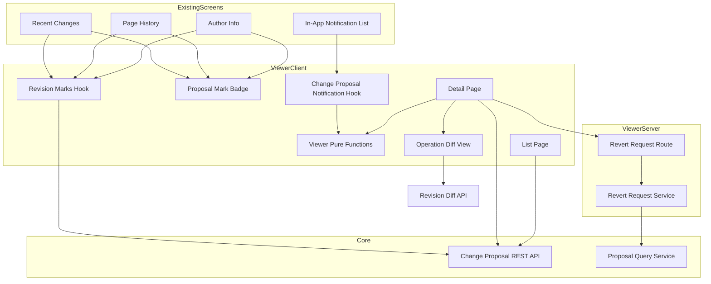
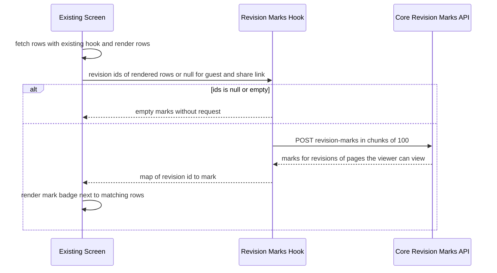
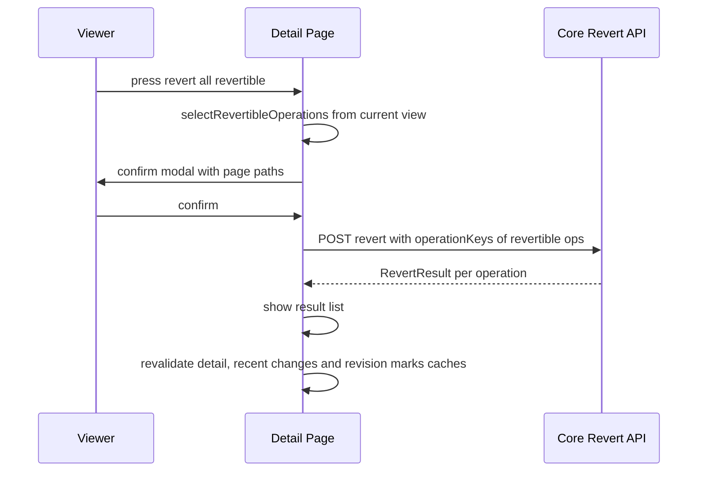
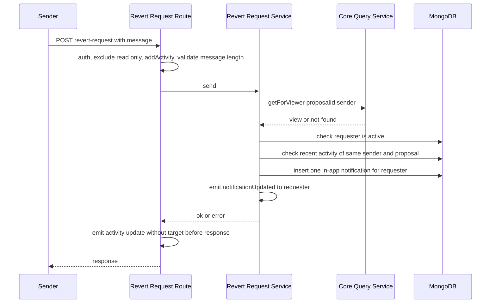

# Design Document: change-proposal-viewer

## Overview

**Purpose**: 反映された Change Proposal を、依頼した本人にも他のユーザーにも、1 つのまとまりとして見せる。詳細ページ・一覧・既存の画面の印・画面からの取り消し・「本人に戻すよう頼む」通知・まとめた通知の表示を作る。

**Users**: wiki を使うすべてのログインしたユーザー。依頼した人は、自分の Change Proposal を後から確かめて戻す。他のユーザーは、Recent Changes・ページ履歴・ページの作者の表示・通知から Change Proposal に気付き、自分が見られるページの分を戻すか、本人に戻すよう頼む。

**Impact**: Recent Changes・ページ履歴・ページの作者の表示・アプリ内通知の画面に、Change Proposal の印と表示を足す。どの画面も、データの取得の処理は変えず、取得したあとで `change-proposal-core` の API に問い合わせて表示を足す。

本書で使う言い方（詳細ページ・見える操作・戻せるかどうかの判定・印・今の版・頼む通知・まとめた通知）は、[requirements.md](./requirements.md) の「本要件で使う言い方」と同じである。core の言い方（操作・依頼した人・入口・見る人・操作の 7 つの状態）は [core の requirements.md](../change-proposal-core/requirements.md) と同じ。調べた事実と判断の理由は [research.md](./research.md) にある。

### Goals
- 詳細ページで、Change Proposal 全体と操作ごとの差分・状態・戻せるかどうかを、見える操作の分だけ表示する（要件 1・2）
- 「戻せるものを全部戻す」と「本人に戻すよう頼む」を、見えない操作の存在を示さずに提供する（要件 3・4）
- ページ履歴・Recent Changes・作者の表示の印を、各画面の表示を遅くせずに付ける（要件 5・6・7）
- 自分の Change Proposal と、自分が見られるページを含む反映済みの Change Proposal の一覧（要件 8）
- まとめた通知と頼む通知の表示（要件 9）、5 言語の文言、見えないページの存在を示さないこと（要件 10）

### Non-Goals
- 戻せるかどうかの判定、取り消しの実行、見る人ごとの絞り込み、まとめた通知の中身を作ること（`change-proposal-core`）
- 承認待ちの Change Proposal の承認・飛ばす・破棄（`change-proposal-ai-agent` のチャット画面）
- AI が書いた要約と会話の保存と、それを返す API（`change-proposal-ai-agent`）
- Recent Changes を Change Proposal 単位でまとめ直すこと、ページ履歴の一般的な「この版に戻す」ボタン、Change Proposal へのコメント

## Boundary Commitments

### This Spec Owns
- 詳細ページ（`/me/change-proposals/{id}`）と一覧（`/me/change-proposals`）の画面
- ページ履歴・Recent Changes・作者の表示に付ける印の部品と、印を取得する SWR の hook
- 詳細ページの差分の表示（`POST /revisions/diff` で取った差分を、core の画面の共通の部品にある diff2html の設定と見た目で表示する部品）
- 「戻せるものを全部戻す」の画面の流れ（確認・送信・結果の表示・関係する表示の更新）
- 頼む通知: 送る API（`POST /_api/v3/change-proposals/:id/revert-request`）、そのサービス、snapshot の形、新しい action `CHANGE_PROPOSAL_REVERT_REQUEST`
- `targetModel` が `ChangeProposal` のアプリ内通知の画面での表示（反映・取り消し・頼む通知の 3 つの action）
- 本人だけに出す内容を入口ごとに宣言する表（`requester-only-sections.ts` の `REQUESTER_ONLY_SECTIONS`。部品が受け取る値は `{ proposalId: string }`）と、それを読み込む場所。表は `'ai-chat'` の行を持たない状態で出し、`'ai-chat'` の行（`AiRecordSection`）は `change-proposal-ai-agent` が足す
- Recent Changes の一覧へのリンクを出すかどうかを決める画面の共通の値（`changeProposalEnabled`。core の `readChangeProposalSettings()` の `isEnabled` から作る）
- 入口を表す言葉の表と、その翻訳のキー（`change_proposal_viewer.*`）。この表から実行時に決まるキーの `preservePatterns`
- 本 spec の画面だけで使う文言（`translation` の `change_proposal_viewer.*`）と通知の文言（`commons` の `in_app_notification.change_proposal.*`）の 5 言語の翻訳

### Out of Boundary
- 見る人ごとの絞り込み・戻せるかどうかの判定・リビジョンの印の判定（core の `ProposalQueryService`）。viewer は結果をそのまま表示し、判定をやり直さない
- 取り消しの実行と、取り消しの Change Proposal の作成（core の `ChangeProposalService.revert`）
- まとめた通知の中身と受け取る人の決め方（core の `ProposalNotifier`）。通知の一覧の API が `target` を `_id` だけにすること（core の変更）
- core がリビジョンに書く `proposalId` / `proposalOperationKey`（ページには項目を足さない）。viewer はこれらの項目を既存の応答から読まず、印はリビジョンの印の API だけから取る
- 本人だけに出す内容の中身と、それを返す API。`'ai-chat'` の行に登録する `AiRecordSection`（`change-proposal-ai-agent`）
- core の画面の共通の部品（`apps/app/src/features/change-proposal/client/shared/`）: 操作の種類・操作の状態・全体の状態・理由・戻せない理由の言葉の表、その翻訳のキー（`translation` の `change_proposal.*`）と 5 言語の翻訳、それらのキーの `preservePatterns`、`RevisionDiff` から切り出した diff2html の設定と見た目（`diff2html-options.ts`）
- Recent Changes とページ履歴の取得の処理とページ送り（変えない）
- `RevisionDiff` の表示の中身（core が diff2html の設定を切り出す。viewer は手を入れない）

### Allowed Dependencies
- `change-proposal-core` の REST API: `GET /change-proposals/:id`、`GET /change-proposals/mine`、`GET /change-proposals/applied`、`POST /change-proposals/:id/revert`、`POST /change-proposals/revision-marks`
- `change-proposal-core` の型（`features/change-proposal/interfaces/`）: `ChangeProposalView`、`OperationView`、`ChangeProposalSummaryView`、`RevisionMarkView`、`RevertResult`（`interfaces/api.ts`）、`OperationStatus`、`OperationReason`、`RevertRefusalReason`、`ProposalEntry`、`ProposalStatus`、`ChangeProposalNotificationSnapshot`。`ApplyResult` は使わない（viewer は承認の操作を持たない）
- `change-proposal-core` のサービス（server の barrel から import する）: 頼む通知の API の中だけで、server の barrel の `getForViewer`、画面の共通の値を作るときだけ `readChangeProposalSettings`
- `change-proposal-core` の画面の共通の部品（`features/change-proposal/client/shared/` の barrel）: 操作の種類・操作の状態・全体の状態・理由・戻せない理由の言葉の表（`label-keys.ts`）、diff2html の設定と見た目（`diff2html-options.ts` の `buildDiff2HtmlOptions` / `useDiff2HtmlColorScheme`、`diff2html.vendor-styles.ts`）
- `revision-diff` の `POST /_api/v3/revisions/diff` と、その DTO の型
- 既存の部品と仕組み: `ModelNotification`、`useModelNotification`、`AuthorInfo`、`Revision`、`PageRevisionTable`、`RecentChangesSubstance`、`useSWRxPageInfo`、`useIsGuestUser` / `useIsReadOnlyUser` / `useIsSharedUser`、`InAppNotification` のモデル、`inAppNotificationService.emitSocketIo`、`activityEvent`、`Activity` のモデル、`User` のモデル
- diff2html と `diff`（既存の依存）。新しい外部ライブラリは足さない
- 依存の向き: `interfaces` → `client/viewer/domain`（純関数）→ `client/viewer/stores`（SWR）→ `client/viewer/components` → 既存の画面の部品・`pages/me/change-proposals/`。`client/shared/`（core）は `client/viewer/components` から import する。server の側は `interfaces` → `server/services/revert-request-service.ts` → `server/routes/revert-request.ts`。client は server のファイルを import しない

### Revalidation Triggers
次の変更があったときは、viewer との結合を確かめ直す。
- core の `ChangeProposalView` / `OperationView` / `ChangeProposalSummaryView` / `RevisionMarkView` / `RevertResult` の形（`RevertResult` の `outcome` の値と、それぞれが持つ `reason` の値を含む）、状態と理由の値の増減
- core が依頼した人以外に返す操作の条件（閲覧できるページへの操作のうち、状態が反映済み・取り消し済み・取り消しを断られた、のどれかである操作だけ。リンクを知る人だけが見られるページの操作は除く）と、依頼した人以外への `lastAppliedAt` の決め方（見える操作だけから決める）
- core の画面の共通の部品（`client/shared/`）の言葉の表の名前と翻訳のキー、`diff2html-options.ts` の関数の形
- core の `readChangeProposalSettings()` の戻り値の `isEnabled`
- core のまとめた通知の snapshot の形と、`targetModel` の名前、通知の一覧の API の `target` の扱い
- core の取り消しの API の `operationKeys` の意味（省いたときの対象）
- core のリビジョンの印の API の 1 回あたりの件数の上限と、絞り込みの条件
- `revision-diff` の `POST /revisions/diff` の 1 回あたりの組の上限と応答の形
- `REQUESTER_ONLY_SECTIONS` の部品が受け取る値（`{ proposalId: string }`）と、表の鍵（入口の種類）。`change-proposal-ai-agent` の `AiRecordSection` が同じ値を受け取って `'ai-chat'` の行に登録されているので、変えるときは ai-agent の部品も合わせて直す
- 頼む通知の snapshot の形と、action の名前

## Architecture

### Existing Architecture Analysis
- Recent Changes は `GET /pages/recent` を 20 件ずつ読む。各行は今のリビジョンの ID（`revision`）を持つが、見る人が実際に閲覧できるかを示す値は持たない。core はページに項目を足さないので、行が Change Proposal で作られたかどうかは、今のリビジョンの `proposalId` を core が引いて決める。一覧の表示の方針（初期設定）により、他の人の非公開ページの行も出る。
- ページ履歴は `GET /revisions/list` を 10 件ずつ（比べる 2 つの版が URL で指定されたときは全件）読む。
- ページの見出しには作者を出していない。最後に更新した人は、ページの下（`PageContentFooter`）と、設定が有効なときのページの横（`PageSideContents`）の `AuthorInfo` に出ている。
- アプリ内通知の画面は、`targetModel` ごとの hook を順に呼び、最初に null でない結果を表示する。知らない種類は表示しない。

### Architecture Pattern & Boundary Map



**Architecture Integration**:
- 採用する形: 既存の画面は取得の処理を変えず、取得したリビジョンの ID を core のリビジョンの印の API に送って、返った印だけを表示する（research.md の案 B）。印を付けるかどうかの判断は core の 1 か所だけにする。
- 機能の境界: 表示の判断（入口の言葉、戻せる操作の選び方、snapshot の読み取り）は純関数にし、部品は結果を表示するだけにする。値と翻訳のキーの対応は表で持ち、部品の中で値ごとに分岐しない。操作の種類・操作の状態・全体の状態・理由・戻せない理由の表は core の `client/shared/` のものを使い、viewer は同じ表を持たない。表示する反映日時は core が見る人ごとに決めた `lastAppliedAt` をそのまま使う。
- 変えずに従う既存の決まり: route の middleware の順と activity の記録の順（`activity-recording.md`）、見えないものへの一様な 404（`page-write-action-403-404.md`）、reactstrap の `target` に `useId()` を渡さない（`ui-pitfalls.md`）、名前空間を明示して翻訳する（tech.md の i18n）。
- 新しい部品の理由: 頼む通知は core の Out of Boundary にあり、viewer だけが持つ書き込みである。そのため server の route とサービスを 1 組だけ足す。

### Technology Stack

| Layer | Choice / Version | Role in Feature | Notes |
|-------|------------------|-----------------|-------|
| Frontend | React 18、Next.js 16 Pages Router、SWR（`useSWR` / `useSWRInfinite`）、Jotai、reactstrap | 詳細ページ・一覧・印・通知の表示 | 既存の画面と同じ形 |
| Frontend | diff2html、`diff`（既存） | 差分の表示 | 設定と見た目は core の `client/shared/diff2html-options.ts` を使う（`RevisionDiff` と同じもの） |
| Backend | Express（apiv3）、express-validator | 頼む通知の API | core の router に 1 つの route を足す |
| Data | MongoDB、Mongoose（既存の `InAppNotification` と `Activity`） | 頼む通知の保存と、短い間に何度も送っていないかの確認 | 新しいコレクションは作らない |
| Realtime | Socket.IO（既存の `notificationUpdated`） | 受け取る人の未読の件数を数え直す | 既存のまま |
| i18n | i18next（`translation` / `commons` / `admin`） | 5 言語の文言 | baseline は引き上げない |

新しい外部ライブラリは足さない。

## File Structure Plan

### Directory Structure
```
apps/app/src/features/change-proposal/
├── interfaces/
│   ├── index.ts                          # Barrel created by core task 1.1; viewer adds only one line: export * from './revert-request'
│   └── revert-request.ts                 # Revert-request API body/response and notification snapshot shape (viewer-owned; viewer adds `export * from './revert-request'` to this barrel, the one line it edits there)
├── server/
│   ├── services/
│   │   └── revert-request-service.ts     # Visibility check via core query service, cooldown, notification insert
│   └── routes/
│       └── revert-request.ts             # POST /change-proposals/:id/revert-request (write chain)
└── client/
    └── viewer/
        ├── index.ts                      # Barrel: page components, mark badge, marks hook, notification hook
        ├── consts.ts                     # Href builders, chunk sizes, message limit, auto-continue limit
        ├── domain/                       # Pure functions only, each with a co-located *.spec.ts
        │   ├── index.ts
        │   ├── entry-labels.ts        # Table: entry -> i18n key (operation / proposal status / reason tables live in core's client/shared/label-keys.ts)
        │   ├── select-revertible-operations.ts
        │   ├── build-revision-mark-map.ts
        │   ├── chunk-revision-ids.ts
        │   └── parse-notification-snapshot.ts  # Never throws; returns null for anything malformed
        ├── stores/
        │   ├── use-swrx-change-proposal.ts           # GET /change-proposals/:id
        │   ├── use-swrinfx-change-proposal-lists.ts  # GET /mine (page) and /applied (cursor)
        │   ├── use-swrx-revision-marks.ts            # POST /revision-marks, chunked, null ids = no request
        │   ├── use-swrx-operation-diff.ts            # POST /revisions/diff for one operation, on demand
        │   └── proposal-actions.ts                   # revert / send revert request, plus cache refresh
        └── components/
            ├── ProposalMarkBadge.tsx                 # Mark + link, shared by all existing screens
            ├── CurrentRevisionProposalMark.tsx       # Mark for the latest revision of the current page
            ├── UnifiedDiffView.tsx                   # Renders a unified diff string with core's client/shared diff2html options and styles
            ├── RequesterOnlySection.tsx              # Loads the entry's requester-only component, requester only
            ├── requester-only-sections.ts            # Declared table: entry -> lazy component ({ proposalId }); 'ai-chat' row added by change-proposal-ai-agent
            ├── ChangeProposalNotification.tsx        # useChangeProposalModelNotification hook
            ├── detail/
            │   ├── ChangeProposalDetail.tsx          # Summary, operations, actions, not-found state
            │   ├── ProposalSummaryHeader.tsx
            │   ├── OperationItem.tsx                 # One operation: type, paths, status, revertability, diff toggle
            │   ├── OperationDiff.tsx
            │   ├── RevertAllButton.tsx               # Button + confirm modal + result list
            │   ├── RevertResultList.tsx
            │   └── RevertRequestModal.tsx
            └── list/
                ├── ChangeProposalLists.tsx           # Two tabs: mine / applied
                └── ChangeProposalSummaryItem.tsx

apps/app/src/pages/me/change-proposals/
├── index.page.tsx                        # List page (/me/change-proposals)
└── [id].page.tsx                         # Detail page (/me/change-proposals/{id})
```

`apps/app/src/features/change-proposal/client/shared/`（言葉の表、`change_proposal.*` の翻訳のキー、`diff2html-options.ts`）は core が作る。viewer はそこから import するだけで、ファイルを足さない。

### Modified Files
- `apps/app/src/client/components/PageHistory/PageRevisionTable.tsx` — 読み込んだリビジョンの ID で印の hook を呼び、行ごとに印を `Revision` に渡す
- `apps/app/src/client/components/PageHistory/Revision.tsx` — 任意の `proposalMark` を受け取り、作者の名前の横（「最新」の印の隣）に `ProposalMarkBadge` を出す
- `apps/app/src/client/components/Sidebar/RecentChanges/RecentChangesSubstance.tsx` — 読み込んだ 1 回分（20 件）ごとに印の hook を呼び、`PageItem` のタイトルの横に印を出す。見出しの部品に、`changeProposalEnabled` が真のときだけ一覧へのリンクを足す
- `apps/app/src/client/components/AuthorInfo/AuthorInfo.tsx` — 任意の `badge?: ReactNode` を受け取り、利用者の表示の横に出す
- `apps/app/src/components/PageView/PageContentFooter.tsx` / `apps/app/src/client/components/PageSideContents/PageSideContents.tsx` — 最後に更新した人の `AuthorInfo` に `badge={<CurrentRevisionProposalMark pageId=… />}` を渡す
- `apps/app/src/client/components/InAppNotification/ModelNotification/index.tsx` — `useChangeProposalModelNotification` を `??` の並びに足す
- `apps/app/src/interfaces/activity.ts` — action `ACTION_CHANGE_PROPOSAL_REVERT_REQUEST = 'CHANGE_PROPOSAL_REVERT_REQUEST'` を足し、`EssentialActionGroup` に入れる（core のタスク 1.5 のあとで足す。分類の正規表現 `^CHANGE_PROPOSAL_` に自動で含まれる）
- `apps/app/src/features/change-proposal/server/routes/index.ts`（core が作る）— 頼む通知の route を登録する
- `apps/app/src/pages/common-props/commons.ts` — `changeProposalEnabled` を足す。値は core の server の barrel から import した `readChangeProposalSettings()` の `isEnabled` で、設定キーを直接読まない
- `apps/app/src/states/server-configurations/server-configurations.ts` / `apps/app/src/states/global/hydrate.ts` — `changeProposalEnabledAtom` を足して値を入れる
- `apps/app/public/static/locales/{en_US,ja_JP,zh_CN,fr_FR,ko_KR}/translation.json` — 本 spec の画面だけで使う文言（`change_proposal_viewer.*`。入口の言葉を含む）。操作の種類・操作の状態・全体の状態・理由・戻せない理由の言葉（`change_proposal.*`）は core が足すので、viewer は足さない
- `apps/app/public/static/locales/{en_US,ja_JP,zh_CN,fr_FR,ko_KR}/commons.json` — 通知の文言（`in_app_notification.change_proposal.*`）
- `apps/app/public/static/locales/{en_US,ja_JP,zh_CN,fr_FR,ko_KR}/admin.json` — 監査ログの action の名前（`audit_log_action.CHANGE_PROPOSAL_REVERT_REQUEST`）
- `apps/app/i18next.config.ts` — viewer の `entry-labels.ts` の表から実行時に決まるキー（入口の言葉）だけを `extract.preservePatterns` に 1 つずつ書く。core の表のキー（`change_proposal.*`）の分は core が書く。翻訳の検査の道具は `t(TABLE[value])` のキーをコードから見つけられず、書かないと「使われていないキー」に数えて `lint:i18n` が失敗するため。同じ接頭辞に固定の `t()` の呼び出しもあるので、`*` ではなく 1 つずつ書く（このファイルの決まり）

## System Flows

### 印を付ける流れ（Recent Changes・ページ履歴・作者の表示で共通）



- 行は印を待たずに表示する。印の hook は suspense を使わず、取得中と失敗のときは空の印を返す（要件 5.5・6.5・6.6・7.4）。
- Recent Changes は、読み込んだ 1 回分（20 件）ごとに印を取る。続きを読み込んでも、前の分の印は取り直さない。
- 作者の表示は、`useSWRxPageInfo` の `latestRevisionId`（今の版）を 1 件だけ送る。他の人の保存で今の版が変わると、問い合わせの鍵が変わって取り直す（要件 6.3・7.3）。

### 取り消しの流れ



- 送る `operationKeys` は、押した時点で「戻せる」と表示していた操作の key だけにする（要件 3.3）。
- 404 や通信の失敗のときは、詳細ページの表示を変えずにエラーを出す（要件 3.6）。

### 頼む通知の流れ



- 判定の順は、見られるか（だめなら 404）→ 依頼した人自身か → 依頼した人が有効か → 短い間に送っていないか、とする。見られるかどうかの判定は core の `getForViewer` だけを使い、見えない操作の状態は読まない（要件 4.6・4.8）。
- activity の記録は、通知を入れたあとで、応答の前に行う（`activity-recording.md` の規則 1）。断ったときは activity の middleware の仕組みで「試みた」記録（`ACTION_UNSETTLED`）だけが残り、短い間に何度も送っていないかの確認には数えない。

## Requirements Traceability

| Requirement | Summary | Components | Interfaces | Flows |
|-------------|---------|------------|------------|-------|
| 1.1, 1.2 | 全体の表示、入口の言葉 | ChangeProposalDetail、ProposalSummaryHeader、entry-labels | `ChangeProposalView`、`ENTRY_LABEL_KEYS`、core の `client/shared/label-keys.ts` | — |
| 1.3 | 一様な「見つからない」 | ChangeProposalDetail、useSWRxChangeProposal | `ChangeProposalFetchResult` | — |
| 1.4 | 件数を出さない | ChangeProposalDetail、ProposalSummaryHeader | 翻訳のキーに件数を入れない | — |
| 1.5 | 見える操作の反映日時 | ProposalSummaryHeader | `ChangeProposalView.lastAppliedAt`（core が見る人ごとに決めた値） | — |
| 1.6 | 取り消しの元へのリンク | ProposalSummaryHeader | `buildProposalHref` | — |
| 1.7, 1.8 | 本人向けの内容 | RequesterOnlySection、requester-only-sections | `REQUESTER_ONLY_SECTIONS` | — |
| 1.9 | ログインを求める | detail page、`/me/*` の `loginRequiredStrictly` | — | — |
| 2.1, 2.4, 2.5 | 種類・パス・移動の 2 つのパス、接尾辞を出さない | OperationItem、core の `client/shared/` の種類と状態の表 | `OperationView` | — |
| 2.2, 2.3, 2.11 | 差分、空との差分、取れないとき | OperationDiff、UnifiedDiffView（core の `diff2html-options.ts`）、useSWRxOperationDiff | `toDiffPair`、`OperationDiffResult` | — |
| 2.6 | 理由の言葉 | OperationItem、core の `client/shared/` の理由の表 | `OperationView.reason` | — |
| 2.7, 2.8 | 戻せるかの表示、判定しない | OperationItem、core の `client/shared/` の戻せない理由の表 | `OperationView.revertability` | — |
| 2.9 | 取り消した Change Proposal へのリンク | OperationItem | `buildProposalHref` | — |
| 2.10 | 本人以外に番号を出さない | OperationItem | `OperationView.index` を表示しない | — |
| 2.12 | 未反映の操作は状態だけ | OperationItem | `hasDiff` | — |
| 3.1, 3.7, 3.8 | ボタンを出す条件 | RevertAllButton、selectRevertibleOperations | `selectRevertibleOperations` | 取り消しの流れ |
| 3.2, 3.3 | 確認、戻せる操作だけを送る | RevertAllButton、proposal-actions | `revertOperations` | 取り消しの流れ |
| 3.4, 3.5 | 結果の表示、表示の更新 | RevertResultList、proposal-actions | `RevertResult.operations[].outcome`、`refreshAfterRevert` | 取り消しの流れ |
| 3.6 | 失敗のとき | RevertAllButton | `RevertActionResult` | 取り消しの流れ |
| 4.1 | 頼む操作を出す条件 | ChangeProposalDetail、RevertRequestModal | — | — |
| 4.2, 4.9 | 頼む通知を 1 件送る、中身 | RevertRequestService | `sendRevertRequest`、`ChangeProposalRevertRequestSnapshot` | 頼む通知の流れ |
| 4.3 | 文字数 | revert-request route、RevertRequestModal | `REVERT_REQUEST_MESSAGE_MAX_LENGTH` | 頼む通知の流れ |
| 4.4 | 短い間に送らない | RevertRequestService | `REVERT_REQUEST_COOLDOWN_MS` | 頼む通知の流れ |
| 4.5, 4.7 | 本人自身、依頼した人が無効 | RevertRequestService | `RevertRequestError` | 頼む通知の流れ |
| 4.6, 4.8 | 見られないときは 404、見えない操作で変えない | RevertRequestService | `getForViewer` | 頼む通知の流れ |
| 4.10 | activity の記録 | revert-request route | `ACTION_CHANGE_PROPOSAL_REVERT_REQUEST` | 頼む通知の流れ |
| 4.11 | 読み取り専用・ゲスト | revert-request route（`excludeReadOnlyUser`・`loginRequiredStrictly`）、RevertRequestModal | — | — |
| 5.1–5.4 | ページ履歴の印 | PageRevisionTable、Revision、ProposalMarkBadge、useSWRxRevisionMarks | `RevisionMarkView` | 印を付ける流れ |
| 5.5 | 印の失敗で止めない | useSWRxRevisionMarks | `RevisionMarksState` | 印を付ける流れ |
| 6.1–6.3 | Recent Changes の印 | RecentChangesSubstance、ProposalMarkBadge、useSWRxRevisionMarks | `RevisionMarkView` | 印を付ける流れ |
| 6.4–6.6 | 一覧を変えない、待たない、失敗しても行を出す | RecentChangesSubstance、useSWRxRevisionMarks | — | 印を付ける流れ |
| 6.7 | 一覧へのリンク | RecentChangesSubstance、`changeProposalEnabledAtom` | `changeProposalEnabled` | — |
| 7.1–7.4 | 作者の表示の印 | CurrentRevisionProposalMark、AuthorInfo | `latestRevisionId` | 印を付ける流れ |
| 8.1–8.3 | 2 つの一覧 | ChangeProposalLists、ChangeProposalSummaryItem、useSWRInfx 一覧 | `ChangeProposalSummaryView` | — |
| 8.4 | 件数を出さない | ChangeProposalLists、ChangeProposalSummaryItem | — | — |
| 8.5 | 空の続き | useSWRInfxAppliedChangeProposals | `APPLIED_LIST_AUTO_CONTINUE_LIMIT` | — |
| 8.6 | 失敗のとき | ChangeProposalLists | — | — |
| 8.7 | ログインを求める | list page、`/me/*` の `loginRequiredStrictly` | — | — |
| 9.1–9.3 | 3 つの通知の表示 | ChangeProposalNotification、parseNotificationSnapshot | `ParsedChangeProposalNotification` | — |
| 9.4 | 一言を文字のまま | ChangeProposalNotification | — | — |
| 9.5 | 中身以外を出さない | ChangeProposalNotification | — | — |
| 9.6 | 読めない通知だけを出さない | parseNotificationSnapshot | null を返す | — |
| 9.7 | 既読 | 既存の `InAppNotificationElm` | — | — |
| 9.8 | どこでも受け取った人の言語 | ChangeProposalNotification（`commons` の名前空間） | — | — |
| 10.1 | 見えないページを示さない | 全部品、RevertRequestService | — | — |
| 10.2 | ゲスト・共有リンク | useSWRxRevisionMarks、CurrentRevisionProposalMark | ids が null なら問い合わせない | 印を付ける流れ |
| 10.3 | 読み取り専用 | RevertAllButton、ChangeProposalDetail | `useIsReadOnlyUser` | — |
| 10.4 | 5 言語 | locales | — | — |
| 10.5 | 入口で振る舞いを変えない | 全部品、requester-only-sections | — | — |

## Components and Interfaces

| Component | Domain/Layer | Intent | Req Coverage | Key Dependencies | Contracts |
|-----------|--------------|--------|--------------|------------------|-----------|
| Viewer Pure Functions | client/viewer/domain | 表示の判断と snapshot の読み取り | 1.2, 3.3, 5.3, 6.1, 9.6 | core の型 (P0) | Service |
| Revision Marks Hook | client/viewer/stores | リビジョンの印をまとめて取る | 5.1–5.5, 6.1–6.6, 7.1–7.4, 10.2 | core の印の API (P0) | Service |
| Proposal Data Hooks | client/viewer/stores | 詳細・一覧・差分の取得、取り消しと頼む通知の送信 | 1.3, 2.2, 2.3, 2.11, 3.2–3.6, 8.1, 8.2, 8.5 | core の REST API (P0)、revisions/diff (P0) | Service |
| ProposalMarkBadge / CurrentRevisionProposalMark | client/viewer/components | 印とリンクの表示 | 5.1, 5.2, 6.1, 7.1–7.3 | Revision Marks Hook (P0) | — |
| ChangeProposalDetail と子の部品 | client/viewer/components/detail | 詳細ページ | 1.*, 2.*, 3.*, 4.1, 4.3, 10.3 | Proposal Data Hooks (P0)、core の `client/shared/` (P0) | — |
| RequesterOnlySection | client/viewer/components | 本人向けの内容の場所 | 1.7, 1.8, 10.5 | 入口の spec の部品 (P2) | State |
| ChangeProposalLists | client/viewer/components/list | 2 つの一覧 | 8.* | Proposal Data Hooks (P0) | — |
| ChangeProposalNotification | client/viewer/components | 通知の表示の hook | 9.* | ModelNotification (P0) | — |
| Pages | pages/me/change-proposals | URL と SSR の props | 1.9, 8.7 | BasicLayout (P0) | — |
| RevertRequestService | server/services | 頼む通知を送る | 4.2–4.9 | core の `getForViewer` (P0)、InAppNotification (P0)、Activity (P1) | Service |
| Revert Request Route | server/routes | 頼む通知の API | 4.3, 4.10, 4.11 | RevertRequestService (P0) | API |
| Existing Screen Integrations | 既存の部品 | 印・リンク・通知の差し込み | 5.*, 6.*, 7.*, 9.7, 9.8 | 既存の部品 (P0) | — |

### Client: Domain（純関数）

#### Viewer Pure Functions

| Field | Detail |
|-------|--------|
| Intent | 画面の判断をすべて純関数にし、部品は結果を表示するだけにする |
| Requirements | 1.2, 3.3, 5.3, 6.1, 9.6 |

**Responsibilities & Constraints**
- どの関数も、通信・時刻・翻訳の仕組みを直接使わない。必要な値は引数で受け取る。
- 入口の値から翻訳のキーへの対応は、値をキーにした表（`Record<…, string>`）で持つ。core が値を足したときに型の検査で表の不足が分かるよう、`satisfies Record<ProposalEntry, string>` の形で宣言する。
- 操作の種類・操作の状態・全体の状態・理由・戻せない理由の表は持たない。部品は core の `client/shared/` の表を使う。
- 各ファイルに同じ場所の `*.spec.ts` を置く。

**Contracts**: Service [x]

##### Service Interface
```typescript
// entry-labels.ts — table only; components call t(ENTRY_LABEL_KEYS[entry]). Keys live under change_proposal_viewer.*
const ENTRY_LABEL_KEYS: Readonly<Record<ProposalEntry, string>>;

// select-revertible-operations.ts
function selectRevertibleOperations(operations: readonly OperationView[]): readonly OperationView[];
// keeps only operations whose revertability is { revertible: true }

// build-revision-mark-map.ts
function buildRevisionMarkMap(marks: readonly RevisionMarkView[]): ReadonlyMap<string, RevisionMarkView>;

// chunk-revision-ids.ts — dedupe, sort, split into chunks of at most `size`
function chunkRevisionIds(ids: readonly string[], size: number): readonly (readonly string[])[];

// parse-notification-snapshot.ts — never throws
type ParsedChangeProposalNotification =
  | { readonly kind: 'apply' | 'revert'; readonly proposalId: string; readonly actorUsername: string; readonly pagePaths: readonly string[] }
  | { readonly kind: 'revert-request'; readonly proposalId: string; readonly senderUsername: string; readonly message: string };
function parseChangeProposalNotification(action: string, snapshot: unknown): ParsedChangeProposalNotification | null;
```
- `parseChangeProposalNotification` は action で形を選ぶ。`CHANGE_PROPOSAL_APPLY` / `CHANGE_PROPOSAL_REVERT` なら core の `ChangeProposalNotificationSnapshot`、`CHANGE_PROPOSAL_REVERT_REQUEST` なら `ChangeProposalRevertRequestSnapshot` として読む。JSON として読めない、必要な項目が無い、型が違う、知らない action、`proposalId` が ObjectId の形でない、のどれでも null を返す。

### Client: Stores（SWR）

#### Revision Marks Hook

| Field | Detail |
|-------|--------|
| Intent | 表示しているリビジョンの印を、表示を止めずにまとめて取る |
| Requirements | 5.1–5.5, 6.1–6.6, 7.1–7.4, 10.2 |

**Responsibilities & Constraints**
- ids が null（ゲスト・共有リンク）または空のときは、問い合わせない。
- 100 件ずつに分けて `POST /_api/v3/change-proposals/revision-marks` を並べて呼び、結果をまとめる。
- `suspense` を使わない。取得中・失敗のときは空の印を返す。失敗はログに残すだけで、利用者には出さない。
- 鍵は `['/change-proposals/revision-marks', ...並べ替えた ids]`。取り消しのあとは、この鍵の先頭で絞って一斉に取り直す。
- `revalidateOnFocus: false`。

**Contracts**: Service [x]

##### Service Interface
```typescript
type RevisionMarksState = { readonly marks: ReadonlyMap<string, RevisionMarkView>; readonly isLoading: boolean };
function useSWRxRevisionMarks(revisionIds: readonly string[] | null): RevisionMarksState;
function mutateAllRevisionMarks(): Promise<void>;
```

#### Proposal Data Hooks

| Field | Detail |
|-------|--------|
| Intent | 詳細・一覧・差分の取得と、取り消し・頼む通知の送信 |
| Requirements | 1.3, 2.2, 2.3, 2.11, 3.2–3.6, 4.2, 8.1, 8.2, 8.5, 8.6 |

**Contracts**: Service [x]

##### Service Interface
```typescript
// use-swrx-change-proposal.ts — 404 becomes { type: 'not-found' }, every other failure is an error
type ChangeProposalFetchResult = { readonly type: 'found'; readonly proposal: ChangeProposalView } | { readonly type: 'not-found' };
function useSWRxChangeProposal(proposalId: string | null): SWRResponse<ChangeProposalFetchResult, Error>;

// use-swrinfx-change-proposal-lists.ts
function useSWRInfxMyChangeProposals(limit: number): SWRInfiniteResponse<{ readonly items: readonly ChangeProposalSummaryView[]; readonly hasNext: boolean }, Error>;
function useSWRInfxAppliedChangeProposals(limit: number): SWRInfiniteResponse<{ readonly items: readonly ChangeProposalSummaryView[]; readonly nextCursor: string | null }, Error>;
const APPLIED_LIST_AUTO_CONTINUE_LIMIT = 3; // consecutive empty batches loaded without a click

// use-swrx-operation-diff.ts — fetched only while the operation's diff is open
type OperationDiffResult = { readonly type: 'diff'; readonly unifiedDiff: string } | { readonly type: 'unavailable' };
function toDiffPair(op: OperationView): RevisionDiffRequestPair | null; // edit: base→result, create: null→result, others: null
function useSWRxOperationDiff(op: OperationView, isOpen: boolean): SWRResponse<OperationDiffResult, Error>;

// proposal-actions.ts
type RevertActionResult = { readonly type: 'done'; readonly result: RevertResult } | { readonly type: 'not-found' } | { readonly type: 'error' };
function revertOperations(proposalId: string, operationKeys: readonly string[]): Promise<RevertActionResult>;
function refreshAfterRevert(proposalId: string): Promise<void>; // detail + recent changes + all revision marks
type RevertRequestActionResult =
  | { readonly type: 'sent' }
  | { readonly type: 'error'; readonly code: 'not-found' | 'message-too-long' | 'recently-requested' | 'own-proposal' | 'requester-unavailable' | 'unknown' };
function sendRevertRequest(proposalId: string, message: string): Promise<RevertRequestActionResult>;
```
- 差分は、操作を開いたときに 1 組だけ `POST /revisions/diff` で取る。`toDiffPair` が null の操作（移動・ごみ箱へ移す・ごみ箱から戻す・まだ反映していない操作）は差分を持たない（要件 2.12）。結果が `forbidden` / `invalid` のときと通信の失敗のときは `unavailable` にする（要件 2.11）。
- `refreshAfterRevert` は、詳細の鍵、`mutateRecentlyUpdated()`、`mutateAllRevisionMarks()` を取り直す（要件 3.4・3.5）。
- `RevertResult` は core の `interfaces/api.ts` の型をそのまま使い、viewer で形を作り直さない。形は `{ revertProposalId?: string; operations: ({ key; outcome: 'reverted' } | { key; outcome: 'revert-refused'; reason: RevertRefusalReason } | { key; outcome: 'skipped'; reason: 'page-being-edited' })[] }` で、操作は `key` で指す（要件 3.4）。
- 反映済みの一覧は、続きの 1 回分が空で `nextCursor` があるときに、続けて `APPLIED_LIST_AUTO_CONTINUE_LIMIT` 回まで読む。それでも空なら「さらに読み込む」ボタンを出す。「これ以上無い」は `nextCursor` が null のときだけ出す（要件 8.5）。

### Client: Components

基本の形: 詳細ページと一覧の部品は、取得の hook の結果を受けて表示するだけにし、判断は Domain の純関数に任せる。画面の文言は `useTranslation('translation')` の `change_proposal_viewer.*` を使う。操作の種類・操作の状態・全体の状態・理由・戻せない理由の言葉は、core の `client/shared/` の表を引いて、同じ `translation` の名前空間の `change_proposal.*` で訳す。通知の部品だけは `commons` を使う。

#### ProposalMarkBadge / CurrentRevisionProposalMark（summary）
- `ProposalMarkBadge({ mark: RevisionMarkView, size?: 'sm' | 'md' })`: `mark.isRevert` で「取り消し」か「Change Proposal」の印を選び、`buildProposalHref(mark.proposalId)` へのリンクにする。tooltip は reactstrap の `UncontrolledTooltip` に ref を渡す（`ui-pitfalls.md`）。
- `CurrentRevisionProposalMark({ pageId })`: `useSWRxPageInfo(pageId)` の `latestRevisionId` を 1 件だけ印の hook に渡す。ゲスト・共有リンクでは null を渡す。印が無ければ何も表示しない。

#### ChangeProposalDetail と子の部品（summary）
- `ChangeProposalDetail({ proposalId })`: `useSWRxChangeProposal` の結果が `not-found` なら、理由を区別しない「見つからない」表示にする（要件 1.3）。取得の失敗は別のエラー表示にする（存在の有無と関係が無い通信の失敗のため）。
- `ProposalSummaryHeader`: 依頼した人、入口（`ENTRY_LABEL_KEYS`）、モデル名、作成日時、反映日時（core の `lastAppliedAt` をそのまま。依頼した人以外には、core が見える操作だけから決めた値が入っている）、全体の状態（core の表から引く）。入口が `revert` なら `revertOf` へのリンク。件数は出さない（要件 1.4）。
- `OperationItem`: 種類、パス（`page.path`、新規作成は `path`、移動は `fromPath` → `toPath`）、状態と理由、戻せるかどうか（`revertability`。種類・状態・理由・戻せない理由の言葉は core の `client/shared/` の表から引く）、取り消し済みなら `revertedByProposalId` へのリンク、差分の開閉。`index` は表示しない（要件 2.10）。操作は応答の順に並べる。
- `RevertAllButton`: `selectRevertibleOperations` の結果が 1 つ以上で、ゲストでも読み取り専用でもないときだけ出す。押すと対象のパスを並べた確認の modal を出し、確定で `revertOperations` を呼ぶ。送信中は押せない。結果を `RevertResultList` に表示し、`refreshAfterRevert` を呼ぶ。
- `RevertResultList`: `RevertResult.operations` の 1 つずつを、`key` で確認の modal に並べた操作のパスと結び付け、`outcome` ごとに「取り消した」（`reverted`）、断られた理由（`revert-refused`。`reason` を core の戻せない理由の表で訳す）、見送った理由（`skipped`。`reason` の `page-being-edited` を core の理由の表で訳す）を出す。件数は出さない。
- `RevertRequestModal`: 依頼した人以外で、ゲストでも読み取り専用でもないときに、操作の状態にかかわらず開ける（要件 4.1）。一言の入力は `REVERT_REQUEST_MESSAGE_MAX_LENGTH` を超えると送信できない。結果の code ごとの文言を出す。
- Implementation Notes: 詳細ページ全体で、件数を表す数字を文言に入れない（翻訳のキーに `{{count}}` を使わない）。

#### RequesterOnlySection

| Field | Detail |
|-------|--------|
| Intent | 入口の spec が用意する本人向けの内容を、依頼した人にだけ表示する |
| Requirements | 1.7, 1.8, 10.5 |

**Contracts**: State [x]

##### State Management
```typescript
// requester-only-sections.ts — declared table; ships without the 'ai-chat' row, which change-proposal-ai-agent adds (AiRecordSection)
type RequesterOnlySectionProps = { readonly proposalId: string };
type RequesterOnlySectionLoader = () => Promise<ComponentType<RequesterOnlySectionProps>>;
const REQUESTER_ONLY_SECTIONS: Readonly<Partial<Record<CreatableEntry, RequesterOnlySectionLoader>>> = {};
```
- `RequesterOnlySection({ view })` は、`view.isRequester` が真で、`REQUESTER_ONLY_SECTIONS[view.entry]` があるときだけ、`next/dynamic` で読み込んで表示する。それ以外は何も表示せず、場所の見出しも出さない（要件 1.8）。
- 詳細ページは、入口の種類で分岐しない。表を引くだけにする。
- 本人にだけ中身を返すことは、中身を返す API（入口の spec）が守る。viewer は画面の表示を本人に限るだけである。

#### ChangeProposalLists（summary）
- タブで「自分の Change Proposal」（`useSWRInfxMyChangeProposals`）と「反映済み」（`useSWRInfxAppliedChangeProposals`）を切り替える。
- `ChangeProposalSummaryItem`: 依頼した人、入口、モデル名、日時（自分のは作成日時、反映済みは core が見る人ごとに決めた `lastAppliedAt`）、全体の状態、見られるページのパス（最初の 3 件を出し、残りは「さらに表示」で開く。件数は出さない）。項目全体を詳細ページへのリンクにする。
- 取得に失敗したら、表示済みの項目を残してエラーを出す（要件 8.6）。

#### ChangeProposalNotification

| Field | Detail |
|-------|--------|
| Intent | `targetModel` が `ChangeProposal` の通知を、既存の通知の部品で表示する |
| Requirements | 9.1–9.8 |

**Implementation Notes**
- `useChangeProposalModelNotification(notification): ModelNotificationUtils | null`。`targetModel` が `ChangeProposal` でないとき、または `parseChangeProposalNotification` が null のときは null を返す（その通知は表示されない。要件 9.6）。
- `clickLink` は `buildProposalHref(parsed.proposalId)`。`notification.target` は読まない（core が `_id` だけにするため）。
- `ModelNotification` に渡す値: `actionMsg` は `t('in_app_notification.change_proposal.applied' | 'reverted' | 'revert_requested', { ns: 'commons' })`、`hidePath: true`、`subMsg` は反映・取り消しでは `pagePaths` の最初の 3 件と「ほかのページもあります」（件数を出さない）、頼む通知では一言（React の文字として表示し、2 行で省略する）。
- 操作した人は、既存の仕組みのとおり通知に付けた activity の `user` から出る。
- `useActionAndMsg.ts` の switch には足さない（英語の文字列を直接書く仕組みで、翻訳できないため）。

### Pages

#### `pages/me/change-proposals/index.page.tsx` と `[id].page.tsx`（summary）
- 形は `pages/me/[[...path]].page.tsx` と `pages/_news/index.page.tsx` と同じ: `BasicLayout`、`getServerSideCommonInitialProps` / `getServerSideCommonEachProps` / `getServerSideBasicLayoutProps` / `getServerSideI18nProps(context, ['translation', 'commons'])`。部品は `next/dynamic` の `ssr: false` で読む。
- `/me/*` は Express で `loginRequiredStrictly` を通るので、ログインしていない人はログイン画面へ移る（要件 1.9・8.7）。Next.js では、決まった名前のファイルが `pages/me/[[...path]].page.tsx` より先に選ばれる。
- `[id]` は ObjectId の形でなければ、取得せずに「見つからない」を表示する。
- `buildProposalHref(id)` = `/me/change-proposals/${id}`、一覧は `/me/change-proposals`（`consts.ts`）。

### Server

#### RevertRequestService

| Field | Detail |
|-------|--------|
| Intent | 依頼した人に頼む通知を 1 件送る |
| Requirements | 4.2–4.9 |

**Responsibilities & Constraints**
- 見られるかどうかは core の server の barrel の `getForViewer(proposalId, sender)` だけで決める。`not-found` ならそのまま `not-found` を返す（要件 4.6）。ほかの判定はこの結果の `isRequester` と `requester.id` だけを使い、操作の中身は読まない（要件 4.8）。
- `isRequester` が真なら `own-proposal`（要件 4.5）。
- 依頼した人の `User` が有効でなければ `requester-unavailable`（要件 4.7）。送る人は依頼した人の名前を詳細ページで見ているので、これは新しい情報を渡さない。
- 同じ送る人・同じ Change Proposal で、action が `CHANGE_PROPOSAL_REVERT_REQUEST` の activity が `REVERT_REQUEST_COOLDOWN_MS` 以内にあれば `recently-requested`（要件 4.4）。
- 通知は `InAppNotification` に 1 件だけ入れ、`inAppNotificationService.emitSocketIo([requesterId])` で知らせる。`upsertByActivity` は使わない（7 日以内の同じ中身をまとめる動きがあるため）。
- 一言はログに書かない。

**Dependencies**
- Inbound: Revert Request Route (P0)
- Outbound: core の `ProposalQueryService` (P0)、`InAppNotification` のモデル (P0)、`Activity` のモデル (P1)、`User` のモデル (P1)、`inAppNotificationService` (P1)

**Contracts**: Service [x]

##### Service Interface
```typescript
// interfaces/revert-request.ts
const REVERT_REQUEST_MESSAGE_MAX_LENGTH = 500;
const REVERT_REQUEST_COOLDOWN_MS = 24 * 60 * 60 * 1000;
type RevertRequestBody = { readonly message?: string };
type ChangeProposalRevertRequestSnapshot = {
  readonly proposalId: string;
  readonly kind: 'revert-request';
  readonly sender: { readonly id: string; readonly username: string };
  readonly message: string; // '' when omitted; plain text
};

// server/services/revert-request-service.ts
type RevertRequestError =
  | { readonly code: 'not-found' }
  | { readonly code: 'own-proposal' }
  | { readonly code: 'requester-unavailable' }
  | { readonly code: 'recently-requested' };
function sendRevertRequest(args: {
  readonly proposalId: string;
  readonly sender: IUserHasId;
  readonly message: string;
  readonly activityId: string;
  readonly now: Date;
}): Promise<{ readonly ok: true } | { readonly ok: false; readonly error: RevertRequestError }>;
```
- Postconditions: `ok: true` のとき、依頼した人を `user` に、`targetModel: 'ChangeProposal'`、`target: proposalId`、`action: CHANGE_PROPOSAL_REVERT_REQUEST`、`status: UNOPENED`、`activities: [activityId]`、`snapshot: JSON.stringify(ChangeProposalRevertRequestSnapshot)` の通知がちょうど 1 件増えている。
- Invariants: 送る人に見えない操作の状態が違っても、同じ入力に同じ結果を返す。

#### Revert Request Route

**Contracts**: API [x]

`/_api/v3/change-proposals/:id/revert-request` に置き、core の `/change-proposals` の router に登録する。middleware の順は `accessTokenParser([SCOPE.WRITE.FEATURES.PAGE], { acceptLegacy: true })` → `loginRequiredStrictly` → `excludeReadOnlyUser` → `addActivity` → 入力の検査（`param('id').isMongoId()`、`body('message').optional().isString().isLength({ max: REVERT_REQUEST_MESSAGE_MAX_LENGTH })`）→ `apiV3FormValidator` → handler（`activity-recording.md` の順）。

| Method | Endpoint | Request | Response | Errors |
|--------|----------|---------|----------|--------|
| POST | `/change-proposals/:id/revert-request` | `RevertRequestBody` | `{}` | 400 `validation`（文字数）、400 `own_proposal`、400 `requester_unavailable`、404 `notfound`、409 `revert_request_recently_sent` |

- 送れたときだけ、応答の前に `activityEvent.emit('update', res.locals.activity._id, { action: ACTION_CHANGE_PROPOSAL_REVERT_REQUEST, targetModel: 'ChangeProposal', target: proposalId })` を呼ぶ。4 番目の引数（target の文書）は渡さない（決まった形の通知の処理を動かさないため）。
- 存在しない ID・見られない Change Proposal・本人でなく見える操作に反映済み（反映済み・取り消し済み・取り消しを断られた）のものが無い（すべて待ちの場合を含む）、はすべて同じ 404 `notfound` にする（`page-write-action-403-404.md`）。この判定は core の `getForViewer` の結果だけで決まる。
- OpenAPI の JSDoc を書く（core が `generate-spec-apiv3.sh` の対象に足すディレクトリに置くので、生成の対象に入る）。

### Existing Screen Integrations（summary）
- **Recent Changes**: `RecentChangesContent` は、`useSWRINFxRecentlyUpdated` の 1 回分ごとに、その行の `revision` の ID を印の hook に渡す小さな部品を、行の一覧の部品と行の部品の間に置く（1 回分 = 20 件）。ゲストのときは null を渡す。`PageItem` は任意の `proposalMark` を受け取り、WIP の印の横に `ProposalMarkBadge` を出す。見出しの部品は `changeProposalEnabledAtom` が真のときだけ一覧へのリンクを出す。一覧の取得の hook とページ送りは変えない（要件 6.4）。
- **ページ履歴**: `PageRevisionTable` は、読み込んだリビジョンの ID を印の hook に渡し（全件を読んだときも hook が 100 件ずつに分ける）、`Revision` に `proposalMark` を渡す。`Revision` は「最新」の印の隣に `ProposalMarkBadge` を出す。差分のない行の簡単な表示にも同じように出す。
- **作者の表示**: `AuthorInfo` に任意の `badge` を足し、`PageContentFooter` と `PageSideContents` は最後に更新した人の `AuthorInfo` にだけ `CurrentRevisionProposalMark` を渡す。
- **通知**: `useModelNotification` の `??` の並びの最後に `useChangeProposalModelNotification` を足す。既読にする動きと未読の件数は既存のまま（要件 9.7）。
- **差分の設定**: `UnifiedDiffView` は、core が `RevisionDiff.tsx` から `client/shared/diff2html-options.ts` に切り出した diff2html の設定と見た目を使う。viewer は `RevisionDiff.tsx` に手を入れない。

## Data Models

### Data Contracts & Integration

viewer は新しいコレクションを作らない。core の型を使い、次の形だけを足す。

**頼む通知（`InAppNotification` の 1 件）**

| 項目 | 値 |
|---|---|
| `user` | 依頼した人の ID |
| `targetModel` | `'ChangeProposal'` |
| `target` | Change Proposal の ID |
| `action` | `'CHANGE_PROPOSAL_REVERT_REQUEST'` |
| `activities` | `[送信の activity の ID]` |
| `snapshot` | `ChangeProposalRevertRequestSnapshot` の JSON 文字列 |

**画面の共通の値**
- `CommonInitialProps.changeProposalEnabled: boolean`（core の `readChangeProposalSettings().isEnabled`）。Recent Changes の一覧へのリンクを出すかどうかだけに使う。

**翻訳のキー**
- `translation.json`: `change_proposal_viewer.*`（詳細ページ、一覧、印、入口の言葉、取り消しと頼む通知の画面）。操作の種類・操作の状態・全体の状態・理由・戻せない理由の言葉（`change_proposal.*`）は core が持ち、viewer は同じ意味のキーを足さない
- `commons.json`: `in_app_notification.change_proposal.*`（3 つの通知の言葉、「ほかのページもあります」）。管理画面は `commons` と `admin` だけを読み込むので、通知の文言は `commons` に置く（要件 9.8）
- `admin.json`: `audit_log_action.CHANGE_PROPOSAL_REVERT_REQUEST`
- 5 言語すべてに同じキーを足す。件数を差し込むキー（`{{count}}`）は作らない。

## Error Handling

### Error Strategy
- 画面は、「見つからない」と「通信やサーバーの失敗」を分けて表示する。前者は理由を区別しない 1 つの表示にする。
- 印は、失敗しても利用者に出さず、印が無い状態として表示する（行の表示を優先する）。
- 差分は、取れなかった操作の差分の部分にだけ「表示できない」と出す。
- 通知は、読めない通知だけを表示しない。

### Error Categories and Responses
- **頼む通知の API**: 入力の誤り（400 `validation`）、自分の Change Proposal（400 `own_proposal`）、依頼した人が無効（400 `requester_unavailable`）、見つからない（404 `notfound`）、短い間に送った（409 `revert_request_recently_sent`）。読み取り専用ユーザーは `excludeReadOnlyUser` の既存の応答。
- **core の API の結果**: 404 は「見つからない」、取り消しの結果の操作ごとの「断られた」「見送った」は理由の言葉で表示する。

### Monitoring
- `loggerFactory('growi:features:change-proposal:revert-request')` で、送った・断った（理由の code）を Change Proposal の ID と送る人の ID つきで記録する。一言は記録しない。
- 画面の側の失敗は `loggerFactory('growi:features:change-proposal:viewer')` で記録する。

## Testing Strategy

### 最初に固定するテスト（brief の「最初に確かめること」）
- **Recent Changes の表示を遅くしない**: 印の API の応答を遅らせた場合と失敗させた場合に、Recent Changes の行がすべて表示され、印の無い状態で操作できること。応答が届いたあとで、該当する行にだけ印が出ること（要件 6.5・6.6）。
- **印の問い合わせの回数と大きさ**: 一覧の 1 回分（20 件）ごとに印の問い合わせが 1 回だけ出ること、続きを読み込んでも前の分を取り直さないこと、ページ履歴で 100 件を超えるリビジョンを読んだときに 100 件ずつに分かれること（要件 5.4・6.4）。

### Unit Tests（純関数）
- `entry-labels`: すべての入口に翻訳のキーがあること（型と、キーが 5 言語の `translation.json` にあることの両方）と、表のキーがすべて `preservePatterns` に書かれていること（要件 1.2・10.4）。操作の種類・操作の状態・全体の状態・理由・戻せない理由の表の確認は core のテストが持つ。
- `selectRevertibleOperations`: 戻せる・戻せない・判定の無い操作が混ざったときに、戻せるものだけを返す（要件 3.3）。
- `chunkRevisionIds` と `buildRevisionMarkMap`: 重複・順番・100 件の境目（要件 5.4）。
- `parseChangeProposalNotification`: 3 つの action の正しい形、壊れた JSON、項目の欠け、型の違い、知らない action、ObjectId でない ID のどれでも例外を投げず null を返すこと（要件 9.6）。

### Component Tests
- `OperationItem`: 状態ごとの表示、取り消し済みのリンク、本人以外に並び順の番号が出ないこと、まだ反映していない操作に差分の開閉が出ないこと、移動の 2 つのパス（要件 2.1・2.4・2.6・2.7・2.9・2.10・2.12）。
- `ChangeProposalDetail`: 404 のときの表示が 1 種類であること、操作の件数の数字がどこにも出ないこと、本人以外に本人向けの場所が出ないこと、反映日時が core の `lastAppliedAt` のまま表示されること（要件 1.3・1.4・1.5・1.8）。
- `RevertAllButton` と `RevertResultList`: 戻せる操作が無い・読み取り専用・ゲストのときに出ないこと、確認で取り消すと戻せる操作の key だけが送られること、`outcome` の 3 つの値ごとの結果の表示と表示の更新（要件 3.1–3.7）。
- `RevertRequestModal` の出し方: 見える操作がすべて戻せる場合も、すべて取り消し済みの場合も、依頼した人以外には出ること。依頼した人・読み取り専用には出ないこと。文字数を超えると送れないこと（要件 4.1・4.3・10.3）。
- `useChangeProposalModelNotification`: 3 つの通知の文言・リンク先が snapshot の `proposalId` から作られること、`target` が `_id` だけでも動くこと、一言が HTML として解釈されないこと、読めない snapshot で null になること（要件 9.1–9.6）。
- `ChangeProposalLists`: 空の 1 回分が続いたときに「これ以上無い」と出ず、自動で読み続ける回数に上限があること、件数が出ないこと（要件 8.4・8.5）。
- `CurrentRevisionProposalMark`: 古い版を表示していても今の版の印が出ること、ゲスト・共有リンクで問い合わせないこと（要件 7.3・10.2）。

### Integration Tests（server）
- 頼む通知の API: 送れたときに依頼した人への通知が 1 件だけ増え、snapshot の形が決めたとおりであること。存在しない ID・見られない Change Proposal・本人でなく見える操作がすべて待ちのものが、すべて同じ 404 であること。自分の Change Proposal は 400、短い間の 2 回目は 409、読み取り専用は既存の応答で断られ通知が増えないこと。依頼した人が無効なら 400（要件 4.2–4.7・4.11）。
- 見えない操作で応答が変わらないこと: 送る人に見えない操作が「反映済み」「取り消し済み」のどちらでも、応答と通知の中身が同じであること（要件 4.8・10.1）。
- activity: 監査ログが無効でも、送った人を操作者とする `CHANGE_PROPOSAL_REVERT_REQUEST` の activity が記録されること。応答をすぐに返しても操作者が残ること（`activity-recording.md` の規則 1 の確認）（要件 4.10）。
- 通知の一覧の API が、頼む通知の `target` を `_id` だけで返し、snapshot の中身が受け取る人（依頼した人）向けのものだけであること（core の変更との結合）。

### E2E（core の実装のあとで）
- 編集と新規作成を含む Change Proposal を反映し、他のユーザーで Recent Changes の印 → 詳細ページ → 差分 → 「戻せるものを全部戻す」→ 印が消える、までをたどる。一部のページだけを閲覧できるユーザーで、見えないページのパスと件数が詳細ページに出ないことも確かめる（要件 2.2・3.4・3.5・6.1・6.3・10.1）。

### i18n
- `pnpm run lint:i18n` が baseline を引き上げずに通ること。5 言語すべてに新しいキーがあること（要件 10.4）。

## Security Considerations
- 見えないページの存在を示さない: どの画面も、core が見る人ごとに絞った結果だけを表示する。件数を表示しない。印は core のリビジョンの印の API だけから取り、既存の応答に載るリビジョンの `proposalId` は読まない（一覧の表示の方針で出しているだけの行に印が付くのを防ぐ）。
- 頼む通知の API は、存在しない・見られない・本人でなく見える反映済みの操作が無いを同じ 404 にし、見えない操作の状態で応答を変えない。
- 頼む通知の一言は利用者が書いた文なので、通知と画面のどちらでも React の文字として表示し、HTML や Markdown として解釈しない。長さは 500 文字までにする。
- 依頼した人以外に、操作の並び順の番号を表示しない。反映日時は core の `lastAppliedAt` をそのまま表示する（依頼した人以外には、core が見える操作だけから決めた値が入っている）。
- 本人向けの内容の場所は、本人のときだけ読み込む。中身を本人にだけ返すことは入口の spec の API が守る。

## Upstream issues for change-proposal-core

viewer が前提にしている core の決まりを挙げる。どれも core の design に書かれており、viewer はその結果を使う。

| ID | 決めた理由 | core が決めた扱い（core の design の場所） | viewer の扱い |
|---|---|---|---|
| U1 | リビジョンやページに書いた項目は、既存の応答（ページの `revision` の読み込み、`/revisions/list`、`/pages/recent`）にそのまま載る。並び順の番号を書くと、番号が飛んでいることから見えない操作があると分かるため、番号は書かない | ページには項目を足さない。リビジョンには `proposalId` と `proposalOperationKey`（操作ごとの乱数の `key`）だけを書く。`key` は並び順の情報を持たないので、ほかの操作について何も分からない（core の File Structure の Modified Files と Physical Data Model） | 印は `revision-marks` の API だけから取り、既存の応答の `proposalId` / `proposalOperationKey` は読まない。Recent Changes と作者の表示の印は、今のリビジョンの `proposalId` を core が引いて返す |
| U2 | 見えない操作も含めた最後の反映日時を依頼した人以外に返すと、見える操作の日時との食い違いから、ほかに操作があると分かる | 依頼した人以外への詳細と一覧の `lastAppliedAt` は、見える操作だけから決める。反映済みの一覧を読む順は保存した値のままで、これは core が受け入れたリスクとして記録している（core の `ProposalQueryService`） | 詳細と一覧のどちらも core の `lastAppliedAt` をそのまま表示する |
| U3 | viewer は取り消しの結果を操作ごとに表示するので、項目の名前と値を型として 1 か所で決めておく必要がある | `interfaces/api.ts` に `RevertResult` を型として宣言する（形は Proposal Data Hooks の注記に書いた）。`ApplyResult` も操作を `key` で指す | `RevertResultList` が `outcome` の 3 つの値ごとに表示する。`ApplyResult` は使わない |
| U4 | まとめた通知の受け取る人は操作のページを購読している人なので、それだけでは、他の人が取り消したことが元の Change Proposal を依頼した人に届かない | 取り消しの Change Proposal の通知では、元の Change Proposal を依頼した人を受け取る人に加え、ごみ箱へ移す操作と、ごみ箱から戻す操作のページも含める。中身は受け取る人ごとに絞る（core の `ProposalNotifier`） | 通知の表示（`useChangeProposalModelNotification`）は変えない |
| U5 | 印・反映済みの一覧・まとめた通知が指す Change Proposal を、本人以外が開いて「見つからない」になってはいけない | 依頼した人以外には、閲覧できるページへの操作のうち状態が反映済み・取り消し済み・取り消しを断られた、のどれかである操作だけを返し、それが 1 つ以上あるときに返す。`lifecycle` は条件に入らない。同じ条件を 1 件の取得・反映済みの一覧・リビジョンの印に当てる（core の `selectVisibleOperations` と server の barrel の `getForViewer`） | 詳細ページは core の結果をそのまま表示する。依頼した人以外には、待ち・失敗・古い・飛ばしたの操作と、全体の状態の「承認待ち」「一部だけ反映」は届かない |

あわせて、次の前提を core の実装で守ってほしい（core の design にすでに書いてある内容の確認）。
- 通知の一覧の API が `target` を `_id` だけにする扱いを、action によらず `targetModel` が `ChangeProposal` のすべての通知に当てる（viewer の頼む通知も含めるため）。
- `interfaces/activity.ts` の `^CHANGE_PROPOSAL_` の分類に、viewer が足す `CHANGE_PROPOSAL_REVERT_REQUEST` も入る。

## Open Questions / Risks

| ID | 論点 | 本 design での扱い |
|---|---|---|
| OQ-V1 | 本人向けの内容（AI が書いた要約と会話）を出す部品の受け取る値と置き場所 | 決定。置き場所は viewer の `requester-only-sections.ts` の `REQUESTER_ONLY_SECTIONS`、部品が受け取る値は `{ proposalId: string }`。viewer は `'ai-chat'` の行を持たない表を出し、`change-proposal-ai-agent` が `AiRecordSection` を作って `'ai-chat'` の行に登録する（ai-agent のこのタスクは viewer のタスク 5.6 のあとで行う）。受け取る値を変えるときは Revalidation Triggers に従う |
| OQ-V2 | 頼む通知の一言の長さ（500 文字）と、同じ人が送れる間隔（24 時間） | 定数として持つ。運用で変える必要が出たら設定キーにする |
| OQ-V3 | 依頼した人が、詳細ページから承認待ちの操作を承認できるようにするか | 本 spec では承認の操作を置かず、状態だけを表示する。Vault や MCP の入口が来たときに、承認の画面をどこに置くかと一緒に決める |
| OQ-V4 | 書き込み機能を無効にしたあと、Recent Changes の一覧へのリンクも消してよいか | 消す（research.md の判断）。印・通知・URL からは行ける |

その他のリスク:
- core のまとめた通知と viewer の通知の表示を別の版で出すと、未読の印だけが出て開いても何も表示されない通知が生まれる。tasks.md の先頭に、core と同じ版で出すことを書く。
- `interfaces/activity.ts` と core の router の index は core も変える。viewer のタスクは core の該当タスクのあとに置く。
- 反映済みの一覧は、core が返した順のまま並べる。core はこの一覧を保存した `lastAppliedAt` の順に読むので、依頼した人以外に表示する日時（見える操作だけから決めた値）の順と食い違うことがある。これは core が受け入れたリスクとして記録している。viewer は並べ替えない（続きの位置 `cursor` の意味が変わるため）。
- Recent Changes とページ履歴は多くの人が使う画面である。印の問い合わせが増える分の負荷は、core のリビジョンの印の API（`_id` で引き、疎な索引を使う）が軽いことに頼る。結合テストの環境で、20 件の問い合わせにかかる時間を測っておく。
