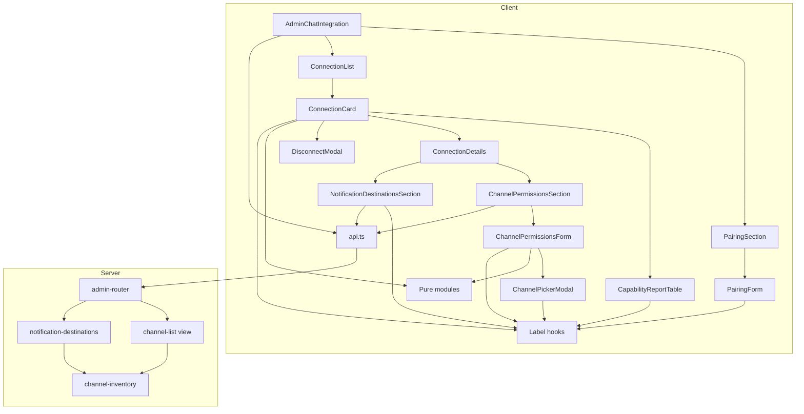
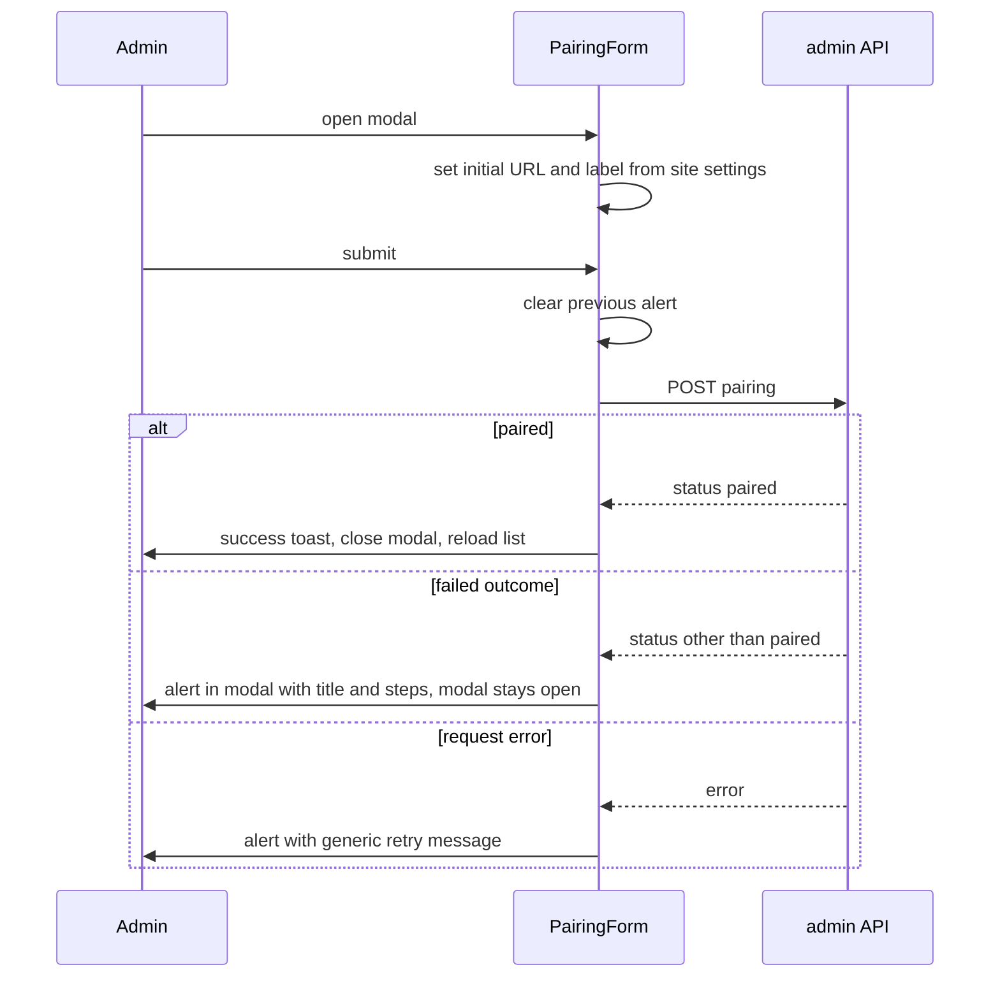
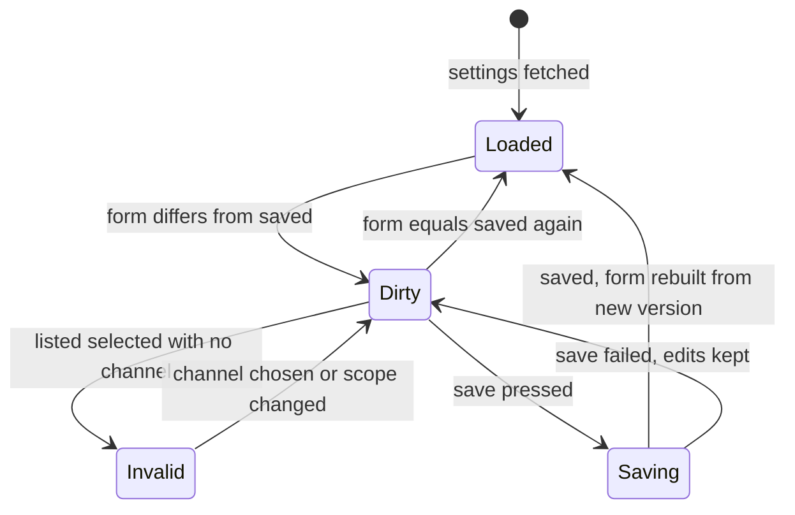

# Design Document: chat-integration-admin-ui

## Overview

**Purpose**: 管理画面（`/admin/chat-integration`）を作り直し、GROWI の管理者が、接続の追加、チャンネル権限と通知先の設定、接続の切断と再接続までを、画面の案内だけで進められるようにする。

**Users**: GROWI の管理者。チャットサービス（Slack など）と GROWI をつなぎ、どのチャンネルでどのコマンドを使わせるか、どのチャンネルへ通知するかを決める。

**Impact**: 変えるのは `apps/app/src/features/chat-integration/` の管理画面（`client/admin/`）と、その画面が呼ぶ 2 つの API（チャンネルの一覧、通知先の削除）、および `apps/app/public/static/locales/*/admin.json` の `chat_integration` 以下の文言（キーの追加と、既存の `connection_lost.detail` の書き直し）だけである。`@growi/chat` と chat-integration proxy の契約、GROWI application の他の部分（コマンドの処理、通知の送出、ペアリングの処理）は変えない。画面の文言は、英語の直書きから `admin` namespace の表示言語ごとの文言に改める。

### Goals

- 要件 1・2・9・11 の追記分（43 件中 1.23〜1.24、2.15〜2.17、9.14〜9.29、11.9〜11.20）と、要件 16 を満たす。
- チャンネルの指定を、手打ちの ID から、一覧からチェックして選ぶ操作に置き換える。選んだ結果は、これまでどおり識別子で保存する。
- 管理画面の文言を、GROWI の 5 つの表示言語（`en_US`・`ja_JP`・`zh_CN`・`fr_FR`・`ko_KR`）で用意し、`pnpm run lint:i18n` の基準値を上げない。

### Non-Goals

- チャットサービスへの bot の導入（OAuth の入口）の画面化。
- GROWI での切断を chat-integration proxy へ自動で伝えること。
- 切断済みの接続を、保持期間の前に手動で消すこと。
- 通知先を追加するときのチャンネルの選び方、および保存時の通知先の選択部品（要件 2.12〜2.14）。
- 「既定値」と「すべてのチャンネルで使う」が同じ結果になる場合の区別を見せる工夫。
- proxy が返す「代わりの方法」の文（`substitute`）の翻訳。proxy の契約を変えずには翻訳できない。

## Boundary Commitments

### This Spec Owns

- 管理画面（`client/admin/`）と、管理画面の API（`server/admin/admin-router.ts` のルート）。`chat-integration-app` から受け持ちを移す（下の「chat-integration-app から移す受け持ち」）。
- 管理画面の構成: 接続の追加、接続の一覧（並び順、2 列、折りたたみ、空の表示）、切断の確認と再接続の案内、状態と「できること」の表の言葉づかい。
- チャンネル権限の編集の仕組み: 4 つの選択肢、「既定値」の表示、チャンネルを選ぶ汎用の部品、一覧が取れないとき・一覧にないときの扱い、変更の検出、保存結果の言葉づかい。
- 通知先の削除と、配信イベントが 0 件の検査（管理画面の側）。
- 管理画面の API の追加 2 つ（チャンネルの一覧、通知先の削除）。
- `admin.json` の `chat_integration` 以下の文言（5 言語）。

### Out of Boundary

- `@growi/chat` の型・コマンドの語彙・特性（`COMMAND_TRAITS`）と、proxy の API。読むだけで、変えない。
- 設定の保存（`saveRelationSettings`）、ペアリング（`submitPairingRequest`）、切断（`unpairRelation`）の処理。呼ぶだけで、変えない。
- 通知の送出の経路。通知先を消しても、すでに outbox に書き留められた通知（書き留めた時点の宛先の写しを持つ）は、そのまま送られる。
- 管理画面の通知先を追加する側のチャンネルの選び方（`<select>`）。文言の i18n 化と、配信イベントの検査の表示だけを足す。
- `chat-integration-agent` が足した `agent` の行と DM の欄の振る舞い。この spec は、その上に載る。
- 権限（`RelationSettings` の保存の形）と通知先（`ChatNotificationDestination`）の model。`chat-integration-app` が持つ。

### Allowed Dependencies

- `@growi/chat`: `COMMAND_NAMES`・`COMMAND_TRAITS`・`CapabilityReport`・`ConnectionStatusView`・`RelationSettings`・`ChannelInventory`・`NativeChannelId` の型と値（読み取りのみ）。
- GROWI application の既存の部品: `useSiteUrl`・`useAppTitle`（`~/states/global`）、`apiv3-client`、`toastr`、reactstrap の `Modal`・`Collapse`、SWR、`next-i18next`。**新しい依存は足さない。**
- server 側: `loadChannelInventory`（`server/channel-inventory.ts`）、`ChatNotificationDestination` モデル。
- 依存の向き: 純粋な関数（フォーム・行の組み立て・並び順）と文言の hook ← 部品 ← `AdminChatIntegration`。client は server のコードを import しない。HTTP は `client/admin/api.ts` だけを通る。

### Revalidation Triggers

- `CommandTraits` に、管理画面の行の見せ方を変える新しい欄が増えたとき（今は `writes`・`directMessagePolicy`・`mayCreatePages`）。「既定値」の表示と DM の欄がそれに依存する。
- `COMMAND_NAMES` に、行の特性が `separate-flag` の読み取り系コマンドが足されたとき（下の「DM だけを許す行」）。
- `CapabilityReport` の機能の名前、`CapabilityLevel`、`ConnectionHealth` の値が増えたとき。知らない値は生のまま出るので壊れないが、言葉が未登録になる。
- 管理画面の API（`GET …/channels`、`DELETE …/notification-destinations`）を、管理画面の外から呼ぶ者が現れたとき。
- `chat-integration-app` の権限や通知先の model、または設定の保存・ペアリング・切断の処理の契約が変わったとき。
- 受け持ちを移す順番: `chat-integration-agent` のタスク 7.1 が `chat-integration-app` の design.md の管理画面の項を書き換える。この spec のタスク 7.3（app の design.md から管理画面の節を除く）は、その後に行う（下の「chat-integration-app から移す受け持ち」）。

## chat-integration-app から移す受け持ち

この spec は、umbrella `chat-integration` の下に、`chat-integration-protocol`・`-proxy`・`-app` と並ぶ 4 つ目の sub-spec として常に置く。書き戻して消す amend spec にはしない（理由は brief.md の「なぜ amend spec ではなく sub-spec にするか」）。管理画面の受け持ちを `chat-integration-app` から移し、要件は umbrella が持つ。

| 対象 | 場所 | 変わる内容 |
|---|---|---|
| `chat-integration`（umbrella） | `requirements.md`、`spec.json` | 要件 1・2・9・11 の末尾に、requirements.md の番号のまま受け入れ条件を足す。要件 16 を足す。既存の番号は振り直さない。この spec は番号を参照するだけにし、spec.json に `owned_by_umbrella: true` を付ける。umbrella の `sub_specs` にこの spec を足す |
| `chat-integration-app` | `design.md` の「管理画面と個人設定」の要約、「管理画面の関係の状態」、「触れない部品」、ファイル構成と API の表のうち管理画面の部分 | 管理画面の節を取り除き、この spec への参照に置き換える。Boundary Commitments の Out of Boundary に「`client/admin/` と管理画面の API」を足し、Revalidation Triggers に「権限や通知先の model を変えたら、`chat-integration-admin-ui` も確かめ直す」を足す |
| roadmap.md | Sub-specs の表、順 8 の行 | Sub-specs の表にこの spec を足す。順 8 の対象を本 spec の範囲に広げ、完了したときにこの行を消す |

- **Revalidation Triggers への影響**: `@growi/chat` と proxy の契約は変えないので、protocol と proxy の再検証は要らない。app には、上の表の Revalidation Triggers を足す。
- **app の design.md を書き換える順番**: `chat-integration-agent` のタスク 7.1 は、`chat-integration-app` の design.md の管理画面の項に「権限の行の 2 つの性質（コマンドの注意書きと DM の欄）と、DM だけを許す行は `allowedChannels: 'none'` で保存されること」を書く。本 spec のタスク 7.3 は、その項ごと app の design.md から除き、この design の「権限の行」の節（DM だけを許す行は、既定の挙動に等しい `allowedChannels` で書く）への参照に置き換える。そのため、agent の 7.1 が済んでから行う。
- 手順は tasks.md のタスク 7 に置く。設計の理由（research.md）は、この spec に残す。

## Architecture

### Existing Architecture Analysis

- 管理画面は `client/admin/AdminChatIntegration.tsx` の 1 ファイル（745 行）に、機能表・権限・切断・カードをまとめている。通知先と接続の追加は別ファイル。
- 画面は、この feature の client の決まりに従う。素の hook と `apiv3-client` を直接使い、`~/stores/*` には置かない。接続ごとに SWR で `capabilities`・`connection-status`・`settings`・`notification-destinations` を取る。通知先の取得は proxy へチャンネルの一覧を問い合わせるので、今は画面を開いただけで、接続ごとに proxy へ問い合わせが走る。
- 管理画面の API は `server/admin/admin-router.ts` に集まる（GET と POST のみ。通知先の削除は無い）。エラーは `ErrorV3` で返り、期待される結果は値で返る。
- ページは `pages/admin/chat-integration.page.tsx` が `ssr: false` で読み込む。管理画面の共通の props は `siteUrl`・`appTitle` を含む。

### Architecture Pattern & Boundary Map



**Architecture Integration**:

- **Selected pattern**: 既存の「素の hook と SWR の部品」を保ち、肥大した 1 ファイルを責務ごとの小さなファイルに割る。ロジックは純粋な関数に出し、部品は薄く保つ（`coding-style.md`）。
- **Domain/feature boundaries**: 部品は「何を見せるか」、純粋な関数は「何を意味するか（既定値の分類、フォームから保存の形への変換、変更の検出、行の組み立て、並び順）」、文言の hook は「値をどの言葉で示すか」を持つ。文言は、ほかの管理画面と同じく `useTranslation('admin')` を呼ぶ場所（部品か文言の hook）でだけ引く。HTTP は `api.ts` だけ。
- **Existing patterns preserved**: `data-testid` の名前、`ErrorV3` の code による分岐、反応の遅れを「保存は成功」と扱うこと、機能表を「proxy が決めた値を欠落させず出す」こと。
- **New components rationale**: チャンネルを選ぶ部品はサービスに依存しない汎用の部品として切り出す（Slack・Discord・Teams・Mattermost で共通）。ほかの新しい部品は、既存の 1 ファイルを割った結果である。
- **Steering compliance**: named export、`import type`、バレルは `index.ts` のみ、コメントは英語で「なぜ」だけ。

### Technology Stack

| Layer | Choice / Version | Role in Feature | Notes |
|-------|------------------|-----------------|-------|
| Frontend | React 18, reactstrap 9 (`Modal`, `Collapse`), Bootstrap 5 grid | カード、折りたたみ、モーダル、2 列 | 既存の依存のみ |
| Frontend state | SWR, `useState` | サーバーの値と編集中のフォーム | Jotai は使わない（この feature の決まり） |
| i18n | `next-i18next`（`admin` namespace） | 5 言語の文言 | `useTranslation('admin')` を呼ぶ部品か hook の中で、キーを `t('…')` の文字列リテラルで書く |
| Backend | Express（`admin-router.ts`）、Mongoose | チャンネル一覧の口、通知先の削除 | 既存の `loadChannelInventory`・`ChatNotificationDestination` を使う |
| Data | MongoDB `chat_notification_destinations` | 通知先の行の削除 | スキーマ・索引は変えない |

## File Structure Plan

### Directory Structure

```
apps/app/src/features/chat-integration/
├── client/admin/
│   ├── index.ts                         # Barrel: AdminChatIntegration only (unchanged)
│   ├── AdminChatIntegration.tsx         # Shell: encryption warning, PairingSection, ConnectionList
│   ├── api.ts                           # HTTP boundary: + fetchChannelsFor, deleteDestination
│   ├── types.ts                         # + AdminChannelListView
│   ├── relation-connection-state.ts     # Badge derivation (unchanged)
│   ├── pairing/
│   │   ├── PairingSection.tsx           # "Connections" heading + Add connection button + modal
│   │   ├── PairingForm.tsx              # Hints, initial values, persistent failure alert
│   │   ├── types.ts                     # PairingOutcome (moved from describe-pairing-outcome.ts)
│   │   └── use-pairing-failure-view.ts  # Hook: failed outcome -> { title, steps } (replaces describe-pairing-outcome.ts)
│   ├── connections/
│   │   ├── index.ts                     # Barrel: ConnectionList
│   │   ├── ConnectionList.tsx           # Ordering, 2-column grid, empty state
│   │   ├── EmptyConnections.tsx         # Empty-state message (with / without encryption key)
│   │   ├── ConnectionCard.tsx           # Header, status line, capability table, details toggle, unpaired guidance
│   │   ├── ConnectionDetails.tsx        # Collapse body: permissions, destinations, disconnect button
│   │   ├── DisconnectModal.tsx          # Confirmation modal (replaces UnpairButton)
│   │   └── sort-relations.ts            # Pure: active first, unpaired last, stable
│   ├── status/
│   │   ├── use-status-labels.ts         # Hook: badge / health -> words, unknown -> raw value
│   │   ├── use-capability-labels.ts     # Hook: platform / capability / level -> words, unknown -> raw value
│   │   └── CapabilityReportTable.tsx    # Generic table over CapabilityReport
│   ├── permissions/
│   │   ├── ChannelPermissionsSection.tsx # Fetches settings + channels, mounts the form keyed by version
│   │   ├── ChannelPermissionsForm.tsx   # Form state, dirty indicator, save
│   │   ├── PermissionRow.tsx            # One command: scope select, picked channels, DM flag
│   │   ├── permission-form.ts           # Pure: form model, default behavior, conversion, dirty check, validation
│   │   └── use-save-result-message.ts   # Hook: save outcome / failure -> message
│   ├── channel-picker/
│   │   ├── index.ts                     # Barrel: ChannelPickerModal, useDescribeChannel, PickerChannel
│   │   ├── ChannelPickerModal.tsx       # Generic checkbox list modal with filter
│   │   ├── channel-picker-rows.ts       # Pure: rows (listed / missing), filter
│   │   └── use-describe-channel.ts      # Hook: channel -> "#name (id)" + private marker
│   └── NotificationDestinationsSection.tsx # + i18n, delete button, zero-event guard
├── server/admin/
│   ├── admin-router.ts                  # + GET /relations/:relationId/channels, DELETE .../notification-destinations
│   ├── channel-list.ts                  # View builder for the channel list route
│   └── notification-destinations.ts     # + deleteNotificationDestination
apps/app/public/static/locales/{en_US,ja_JP,zh_CN,fr_FR,ko_KR}/admin.json   # chat_integration.* keys
```

> 各ファイルの `*.spec.ts(x)` は隣に置く。`describe-pairing-outcome.ts` は `use-pairing-failure-view.ts` に置き換え、型 `PairingOutcome` は `pairing/types.ts` へ移す。`use-*.ts` は文言の hook で、中で `useTranslation('admin')` を呼ぶ（「文言の hook」）。

### Modified Files

- `client/admin/AdminChatIntegration.tsx` — 745 行を、シェル（警告、接続の追加、一覧）に縮める。機能表・権限・切断・カードは上のファイルへ移す。
- `client/admin/AdminChatIntegration.spec.tsx`（1,092 行）— 部品ごとの spec に割り、英語の直書きの文言への依存を、キーまたは表示された言葉への依存に改める。`data-testid` は維持する。
- `client/admin/NotificationDestinationsSection.tsx` — 文言を `t()` に。行に削除の操作を足す。配信イベントが 0 件のとき追加を押せなくし、理由を示す。チャンネルの表示を `useDescribeChannel`（`channel-picker`）に揃える。
- `client/admin/api.ts`・`types.ts` — 口の追加。
- `server/admin/admin-router.ts` — ルート 2 つの追加。
- `server/admin/notification-destinations.ts` — 削除の関数の追加。
- `public/static/locales/*/admin.json` — `chat_integration` 以下にキーを足す（5 言語を同時に。既存の `permissions` のキーは残し、`connection_lost.detail` は、切断の操作が折りたたみの中に入ることに合わせて文を直す）。

## System Flows

### 接続の追加（失敗の知らせを閉じずに残す）



失敗の知らせは、モーダルの中のアラートとして、次の送信を始めるまで、またはモーダルを閉じるまで残す（9.17）。入力を直している間は消さない。

### チャンネル権限の編集と保存



`Loaded` では保存を押せない（16.4）。`Dirty` と `Invalid` では「保存していない変更があります」を示す（16.5）。`Invalid` は、保存を押したときに該当の行にエラーを示して止める（11.20）。保存に成功すると、設定の版をキーにしてフォームを組み直す（今と同じ）。

## Requirements Traceability

| Requirement | Summary | Components | Interfaces / Contracts |
|---|---|---|---|
| 1.23 | 機能表を分かる言葉で | CapabilityReportTable, use-capability-labels | `useCapabilityLabels` の `describePlatform` / `describeCapability` / `describeCapabilityLevel` |
| 1.24 | 知らない値はそのまま、行を欠落させない | use-capability-labels, CapabilityReportTable | 各 `describe*` の既定は生の値。表は `flatMap` で全行を出す |
| 2.15 | 通知先の削除 | NotificationDestinationsSection, admin-router, notification-destinations | `DELETE …/notification-destinations`、`deleteNotificationDestination` |
| 2.16 | 削除後はその通知先へ投稿しない | notification-destinations | 行の削除。以降のイベントは、宛先を引く時点で行が無い（outbox の既存の行は対象外。後述） |
| 2.17 | 配信イベント 0 件は保存せず示す | NotificationDestinationsSection（表示）、`parseDestinationInput`（既存の 400） | 追加ボタンの無効化と理由の表示。サーバーの検査は既存のまま |
| 9.14 | 入力欄に例・説明 | PairingForm | placeholder と補足の文言 |
| 9.15 | URL と表示名の初期値 | PairingForm | `useSiteUrl()`・`useAppTitle()` から初期値 |
| 9.16 | サイト URL 未設定なら空と例 | PairingForm | 空の初期値と placeholder `https://wiki.example.com` |
| 9.17 | 失敗の知らせを閉じずに残す | PairingForm | アラートの状態（送信の開始・モーダルを閉じるときに消す） |
| 9.18 | 登録コードの期限切れ | use-pairing-failure-view | `code-expired` |
| 9.19 | 所有を確認できない（原因を断定しない） | use-pairing-failure-view | `ownership-unverified`（確認点 3 つ） |
| 9.20 | proxy に接続できない | use-pairing-failure-view | `call-failed`（`reason` を補足に） |
| 9.21 | すでに接続済み、`unregister` の案内 | use-pairing-failure-view | `already-paired`（`unregister` の手順を常に添える） |
| 9.22 | 識別子がすでにある | use-pairing-failure-view | `relation-already-known` |
| 9.23 | 暗号化キー未設定 | use-pairing-failure-view | `key-encryption-unconfigured` |
| 9.24 | 0 件の空状態（キーあり） | EmptyConnections | 「接続を追加」への案内 |
| 9.25 | 0 件の空状態（キーなし） | EmptyConnections | キー未設定を示し、誘導しない |
| 9.26 | 切断の確認（名前、確認までは切断しない） | DisconnectModal | タイトルに接続の名前 |
| 9.27 | 確認の 3 点 | DisconnectModal | 削除されるもの／残るもの／注意 |
| 9.28 | 切断済みの再接続の手順 | ConnectionCard | 切断済みのカードの案内 |
| 9.29 | 状態の言葉づかい | use-status-labels, ConnectionCard | `useStatusLabels` の `describeRelationBadge` / `describeConnectionHealth` |
| 11.9 | 4 つの選択肢 | PermissionRow, permission-form | `ScopeChoice` |
| 11.10 | 「既定値」に既定の挙動を添える | PermissionRow, permission-form | `defaultBehaviorOf` |
| 11.11 | 分類をコマンドの性質から決める | permission-form | `COMMAND_TRAITS[c].writes`。コマンド名で分岐しない |
| 11.12 | 保存された設定が無ければ「既定値」 | permission-form | `toFormState` |
| 11.13 | 「既定値」で保存すると設定を保存しない（DM を許したときは例外） | permission-form | `normalizeForm`（DM だけを許す行。後述） |
| 11.14 | 一覧から絞り込んでチェック | ChannelPickerModal | `ChannelPickerModalProps` |
| 11.15 | 名前と識別子、非公開の印 | use-describe-channel | `useDescribeChannel` |
| 11.16 | 識別子で保存 | permission-form | `CommandFormState.channelIds` |
| 11.17 | 一覧が取れないとき | ChannelPermissionsSection, PermissionRow | `AdminChannelListView.unavailable`。「チャンネルを選ぶ」の無効化と、`listed` の行の中の理由の表示 |
| 11.18 | 取れないあいだ、保存済みの指定を残す | permission-form | フォームは保存済みの識別子を保つ |
| 11.19 | 一覧にない識別子に印を付けて残す | channel-picker-rows, PermissionRow | `PickerRow` の `missing` |
| 11.20 | 「指定したチャンネルのみ」で 0 件は保存しない | permission-form, ChannelPermissionsForm | `validatePermissionForm` |
| 16.1 | 広い画面で 1 行 2 枚 | ConnectionList | Bootstrap `col-xl-6` |
| 16.2 | 詳細は閉じた状態 | ConnectionCard, ConnectionDetails | `Collapse`、初回に開くまで描かない |
| 16.3 | 切断済みは最後 | sort-relations | `sortRelations` |
| 16.4 | 変更が無ければ保存を押せない | ChannelPermissionsForm, permission-form | `isFormDirty`（`normalizeForm` の結果どうしの比較） |
| 16.5 | 未保存の変更を示す | ChannelPermissionsForm | 保存ボタンの横の表示 |
| 16.6 | 成功の文言 | use-save-result-message | 内部の用語を含まない |
| 16.7 | 反映の遅れの文言 | use-save-result-message | `push.ok === false` |
| 16.8 | 保存失敗の文言 | use-save-result-message | `ErrorV3` の code で分ける |
| 16.9 | 5 言語の文言 | admin.json ×5、全部品 | `t('…')` |
| 16.10 | 識別する値は翻訳しない | PermissionRow, channel-picker-rows | コマンド名・チャンネルの名前と識別子はそのまま |

## Components and Interfaces

| Component | Layer | Intent | Req Coverage | Key Dependencies (P0/P1) | Contracts |
|-----------|-------|--------|--------------|--------------------------|-----------|
| AdminChatIntegration | UI | 画面の骨組み | 9.24, 9.25 | ConnectionList (P0), PairingSection (P0) | — |
| PairingSection / PairingForm | UI | 接続の追加 | 9.14〜9.23 | use-pairing-failure-view (P0), `useSiteUrl`・`useAppTitle` (P0) | State |
| ConnectionList / EmptyConnections | UI | 一覧、並び、空の表示 | 9.24, 9.25, 16.1, 16.3 | sort-relations (P0) | — |
| ConnectionCard / ConnectionDetails | UI | 接続 1 件の表示と折りたたみ | 9.28, 9.29, 16.2 | use-status-labels (P0) | — |
| DisconnectModal | UI | 切断の確認 | 9.26, 9.27 | api (P0) | — |
| CapabilityReportTable | UI | 機能表 | 1.23, 1.24 | use-capability-labels (P0) | — |
| ChannelPermissionsSection / Form / PermissionRow | UI | 権限の編集 | 11.9〜11.20, 16.4〜16.8 | permission-form (P0), ChannelPickerModal (P0) | State |
| ChannelPickerModal | UI（汎用） | チャンネルの選択 | 11.14, 11.15, 11.19 | channel-picker-rows (P0) | State |
| NotificationDestinationsSection | UI | 通知先の一覧・追加・削除 | 2.15, 2.17 | api (P0) | API |
| permission-form ほかの純粋な関数 | Logic | 意味の決定 | 11.10〜11.13, 11.20, 16.3, 16.4 | `@growi/chat` (P0) | Service |
| 文言の hook（`use-*`） | Logic（i18n） | 値を表示の言葉に | 1.23, 1.24, 9.18〜9.23, 9.29, 11.15, 16.6〜16.8, 16.9 | `next-i18next`（`admin`）(P0) | Service |
| channel list route / delete route | Server | 管理画面の API | 11.14〜11.19, 2.15, 2.16 | `loadChannelInventory` (P0) | API |

### Logic（純粋な関数）

#### permission-form

| Field | Detail |
|-------|--------|
| Intent | 保存済みの設定とフォームと保存の形を相互に変換し、既定の挙動・変更・検査を決める |
| Requirements | 11.9〜11.13, 11.16, 11.18, 11.20, 16.4 |

**Responsibilities & Constraints**
- コマンドの一覧は `Object.values(COMMAND_NAMES)`。分類は `COMMAND_TRAITS` から引き、コマンド名では分岐しない。
- 保存の形（`RelationSettings['channelPermissions']`）は変えない。

```typescript
type ScopeChoice = 'default' | 'all' | 'listed' | 'none';
type DefaultBehavior = 'allow' | 'deny';

interface CommandFormState {
  readonly scope: ScopeChoice;
  /** Kept while the scope is not 'listed', so switching back loses nothing. */
  readonly channelIds: readonly NativeChannelId[];
  readonly allowedInDirectMessage: boolean;
}
type PermissionForm = Readonly<Record<CommandName, CommandFormState>>;

type FormValidationError = {
  readonly commandName: CommandName;
  readonly reason: 'no-channel-selected';
};
type ConvertResult =
  | { readonly ok: true; readonly channelPermissions: RelationSettings['channelPermissions'] }
  | { readonly ok: false; readonly errors: readonly FormValidationError[] };

/** A command that writes is denied when nothing is saved; any other is allowed. */
function defaultBehaviorOf(commandName: CommandName): DefaultBehavior;
function toFormState(saved: RelationSettings['channelPermissions']): PermissionForm;
/** Never fails: the canonical save shape of a form, without validation. */
function normalizeForm(form: PermissionForm): RelationSettings['channelPermissions'];
/** validatePermissionForm + normalizeForm. */
function toChannelPermissions(form: PermissionForm): ConvertResult;
function isFormDirty(saved: PermissionForm, current: PermissionForm): boolean;
```

- Preconditions: `saved` は `GET settings` が返した配列。
- Postconditions: `toFormState` は、行が無いコマンドを `scope: 'default'` にする（11.12）。`normalizeForm` は、`default` のコマンドの行を出力しない（11.13。DM だけを許す行は例外）。`listed` 以外の行に `channelIds` を出さず、`separate-flag` でないコマンドの行に `allowedInDirectMessage` を出さない。`channelIds` は重複を除いて並べ替える。`toChannelPermissions` は、`listed` で `channelIds` が空のコマンドを `errors` に入れて `ok: false` にし、それ以外は `normalizeForm` の結果を返す（11.20）。
- Invariants: `isFormDirty(saved, current)` は、`normalizeForm(saved)` と `normalizeForm(current)` が等しくないこと。「変更あり」は「保存すると送る内容が保存済みと違う」と同じ意味であり、フォームの欄ごとの比べ方の規則は持たない（`listed` から別の選択に変えて戻した、保存の形に出ない欄だけが変わった、などを、欄ごとの例外なしに「変更なし」と扱える）。`listed` で 0 件の行は、保存の形が保存済みと違うので「変更あり」になる（状態遷移図の `Invalid` は `Dirty` の一種）。
- **DM だけを許す行（11.13 のただし書き）**: DM の許可（`directMessagePolicy === 'separate-flag'`）は行の中にしか置けない。`default` のコマンドで DM を許したときは、行を 1 つ書く。行の `allowedChannels` は、そのコマンドの既定の挙動に等しい値（`deny` → `'none'`、`allow` → `'all'`）にして、チャンネルでの挙動を変えない。今の語彙で `separate-flag` は書き込み系の `agent` だけなので、結果は今と同じ `'none'` になる。保存後に読み込み直すと、その行は「使わない」＋DM の許可として現れる。

#### channel-picker-rows

```typescript
interface PickerChannel {
  readonly channelId: string;
  readonly channelName: string;
  readonly isPrivate: boolean;
}
type PickerRow =
  | { readonly kind: 'listed'; readonly channel: PickerChannel; readonly checked: boolean }
  | { readonly kind: 'missing'; readonly channelId: string };

function buildPickerRows(
  channels: readonly PickerChannel[],
  selectedIds: readonly string[],
  filter: string,
): readonly PickerRow[];
```

- `missing` は、選択済みなのに一覧にない識別子。**絞り込みに関わらず、常に先頭に出す**（絞り込みで隠れて、残っていることに気づけなくなるのを防ぐ。11.19）。
- 絞り込みは、名前または識別子への、大文字小文字を区別しない部分一致。

#### sort-relations

`sortRelations(relations: readonly AdminRelationListItem[]): readonly AdminRelationListItem[]` — `state === 'active'` を先、`unpaired` を後ろにし、同じ状態の中は元の順を保つ（16.3）。

### 文言の hook

値を画面の文に変える処理は、管理画面のほかの部品と同じく、`useTranslation('admin')` を呼ぶ場所に置く。同じ対応を部品ごとに書かないよう、小さな hook にまとめる。hook は、中で `useTranslation('admin')` を呼び、文を返す関数を返す。

- **`t` を引数で受け取る純粋な関数にはしない。** `pnpm run lint:i18n`（i18next-cli）は、同じ関数の中に `useTranslation('admin')` が無い `t('…')` を、既定の namespace（`translation`）のキーとして数える。`admin.json` のキーは未使用、`translation.json` には無いキーとなり、基準値が上がる（research.md の「i18n の検査」）。
- 既知の値は `switch` の各 `case` に、文字列リテラルの `t('chat_integration.…')` を書く（`admin:` の前置きは付けない。ほかの管理画面と同じ）。動的に組んだキーは、検査で使われているとみなされない。
- どの対応も、**知らない値には、受け取った値をそのまま返す**（1.24、9.29。知らない値を欠落させず、`undefined` にもしない）。

#### use-status-labels / use-capability-labels

```typescript
function useStatusLabels(): {
  readonly describeRelationBadge: (badge: RelationBadge) => string;
  readonly describeConnectionHealth: (health: string) => string;
};
function useCapabilityLabels(): {
  readonly describePlatform: (platform: string) => string;
  readonly describeCapability: (capability: string) => string;
  readonly describeCapabilityLevel: (level: string) => string;
};
```

- サービス名（Slack・Discord・Microsoft Teams・Mattermost）は固有名なので、5 言語で同じ値にする。
- `substitute`（代わりの方法）の文は、proxy が返した文をそのまま出す。

#### use-describe-channel

```typescript
/** "#general (C0123ABCDEF)" plus a private marker in the display language. */
function useDescribeChannel(): (channel: PickerChannel) => string;
```

- `channel-picker` の barrel から出し、`PermissionRow`・`ChannelPickerModal`・`NotificationDestinationsSection` が同じ表示を使う。

#### use-pairing-failure-view

```typescript
type PairingOutcome =
  | { readonly status: 'paired'; readonly relationId: string }
  | { readonly status: 'relation-already-known'; readonly relationId: string }
  | { readonly status: 'already-paired'; readonly detail: string }
  | { readonly status: 'code-expired' }
  | { readonly status: 'ownership-unverified'; readonly detail: string }
  | { readonly status: 'call-failed'; readonly reason: string }
  | { readonly status: 'key-encryption-unconfigured' };

interface PairingFailureView {
  readonly title: string;
  /** Things the administrator can check or do next, in order. */
  readonly steps: readonly string[];
}
function usePairingFailureView(): (
  outcome: Exclude<PairingOutcome, { status: 'paired' }>,
) => PairingFailureView;
```

- 型 `PairingOutcome` は `pairing/types.ts` に置く（hook のファイルに型を同居させない）。

- `ownership-unverified` は、`detail` を使わず、原因を断定しない（9.19）。確認点 3 つを `steps` に入れる。
- `call-failed` は `reason` を補足として `title` に添える（9.20）。
- `already-paired` は、一覧の確認を案内し、`unregister` の手順を `steps` に**常に**足す（9.21）。手順の文は、「一覧に有効な接続が無い場合は、proxy 側の登録が残っています」と、条件を自分で述べる形にする。proxy の `already-paired` の `detail` は、GROWI の表示名しか含まず、どのワークスペースかを特定できない。そのため、一覧の状態から出し分ける作りにすると、別のワークスペースの有効な接続があるだけで、手順が出なくなる。常に出せば、どの場合も要件を満たし、判断は管理者が一覧を見て行える。

#### use-save-result-message

```typescript
function useSaveResultMessage(): {
  /** Success, or saved but not yet pushed to the chat service (`push.ok === false`). */
  readonly describeSaved: (outcome: SaveSettingsOutcome) => string;
  /** By `ErrorV3` code: `save-conflict`, `invalid-settings`, `relation-not-found`, anything else. */
  readonly describeSaveFailure: (errorCode: string | undefined) => string;
};
```

- 成功・反映の遅れ・失敗の文を返す（16.6〜16.8）。どの文も、内部の用語（設定の版、proxy）を含めない。

### UI

#### PairingForm

- 初期値: 「この GROWI の URL」← `useSiteUrl()`（未設定なら空）、「表示名」← `useAppTitle()`。モーダルを開くたびに作り直す（閉じると状態が消える現在の作りのまま）。
- 4 つの入力欄すべてに placeholder を付ける（登録コード、proxy の URL、GROWI の URL の例、表示名）。何を入力するかの補足の文を、欄の下に置く（9.14）。
- 失敗の知らせは `alert alert-danger`（`role="alert"`）。`title` と、あれば `steps` の番号つきの一覧を示す。通信そのものの失敗など `PairingOutcome` にならない失敗は、汎用の「もう一度試す」文を出す。

#### ConnectionList / EmptyConnections

- 一覧の読み込みと暗号化キーの状態が、どちらも揃うまで、空の表示を出さない（揃う前に「接続がありません」と出して、すぐ変わるのを防ぐ）。
- 並びは `sortRelations`。`div.row` の中に `div.col-12.col-xl-6` で `ConnectionCard` を置く（16.1）。折りたたみの開閉でカードの高さが変わっても、隣のカードを引き伸ばさないため、`align-items-start` を付け、カードに `h-100` は付けない。
- 空の表示（9.24）: 暗号化キーが設定されているとき、「接続がありません。「接続を追加」から、チャットサービスと連携できます。」。設定されていないとき（9.25）、接続を追加できない理由が暗号化キーの未設定であることだけを示す。

#### ConnectionCard / ConnectionDetails / DisconnectModal

- カードの上部（折りたたみの外）: 名前（`label ?? workspaceName`）、サービス名、状態のバッジ（`useStatusLabels` の `describeRelationBadge`）、接続状態の行（同じく `describeConnectionHealth`。接続が切れているときは今の文言を使う）、機能表。
- 使用中のカードは、「チャンネル権限・通知先・切断」を 1 つの `Collapse` にまとめ、開閉のボタンで開く。**初めて開いたときに初めて描画し、そのあとは閉じても描画したままにする**（編集中の内容を、閉じても失わないため）。初めて開くまで、権限と通知先の取得（proxy へのチャンネル一覧の問い合わせを含む）は走らない。
- 接続が切れているカード（`connection-lost`）の説明（既存の `chat_integration.connection_lost.detail`）は、今、「下の「Disconnect」を押す」と案内している。切断の操作は折りたたみの中に入るので、この文を、5 言語すべてで、「この接続の設定を開き、「切断」を押すか、もう一度ペアリングする」という案内に直す。切断のボタンの名前は、画面の言語の「切断」にそろえる。自動で開く作りにはしない（開閉の状態を、接続の状態の取得の結果に結び付けないため）。
- 切断済みのカードは、`Collapse` を持たない。消える日（今と同じ）と、再接続の手順（チャットサービスで `unregister` を実行し、新しい登録コードで接続を追加する）を示す（9.28）。
- `DisconnectModal`: タイトルは「「{{name}}」との接続を切断しますか?」。本文は 3 つの見出し（削除されるもの／残るもの／注意）に分け、件数は出さない（9.27）。確認の操作が実行中のあいだ、閉じる・取り消しを無効にする。成功したら閉じ、一覧を読み直す。失敗したら、モーダルの中にアラートで示す。

#### ChannelPermissionsSection / Form / PermissionRow

- `ChannelPermissionsSection` が、設定（`GET settings`）とチャンネルの一覧（`GET channels`）を取る。チャンネルの一覧は、`revalidateOnFocus: false` にし、編集中に一覧が変わって「一覧にない」の判定が揺れないようにする。
- `ChannelPermissionsForm` は `PermissionForm` を持ち、`isFormDirty` で保存ボタンを制御する（押せるのは「変更あり」かつ「保存中でない」）。「保存していない変更があります」を保存ボタンの横に示す（16.5）。保存を押したとき、`toChannelPermissions` が `ok: false` なら、該当の行にエラーを示して、送らない（11.20）。エラーの文は、一覧が取れているときは「チャンネルを 1 つ以上選んでください」、取れていないときは「チャンネルの一覧を取得できないため、チャンネルを選べません。別の選択にするか、時間をおいてやり直してください」（選べない状態で「選んでください」と言わない）。
- `PermissionRow`: コマンド名（翻訳しない。16.10）、選択肢の `<select>`。「既定値」の項目は、`defaultBehaviorOf` に応じて「既定値（すべてのチャンネルで許可）」または「既定値（許可しない）」。`listed` のとき、選ばれたチャンネルを `useDescribeChannel` で並べ（一覧にない識別子には印を付ける）、「チャンネルを選ぶ」で `ChannelPickerModal` を開く。`mayCreatePages` の注意書きと、DM の欄は、今のまま（`chat-integration-agent` の範囲）。
- **一覧が取れないとき**（11.17）: 取れなかったことと理由（`unavailable`）を、セクションの上部に示す。選択肢の `<select>` は、`listed` を含め、すべて選べるままにする（項目を無効にすると、なぜ選べないかを示せないため）。「チャンネルを選ぶ」だけを無効にし、`listed` が選ばれた行の中に、「チャンネルの一覧を取得できないため、チャンネルを選べません。時間をおいて画面を開き直してください」を示す。新しく `listed` にした行は 0 件のままなので、保存は 11.20 の検査で止まり、誤った設定は保存されない。保存済みの指定チャンネルは、フォームが識別子を保つので、別の選択に変えて `listed` に戻しても残り、保存しても変わらない（11.18）。名前が引けないので、識別子だけを示し、「一覧にない」の印は付けない（一覧が無いので、判定できない）。
- 「設定の版」の表示は消す（16.6）。

#### ChannelPickerModal

```typescript
interface ChannelPickerModalProps {
  readonly isOpen: boolean;
  readonly title: string;
  readonly channels: readonly PickerChannel[];
  readonly selectedIds: readonly string[];
  readonly onConfirm: (selectedIds: readonly string[]) => void;
  readonly onCancel: () => void;
}
```

- サービスにも、権限という用途にも依存しない。渡されるのは平らなデータだけ。
- 内部に下書きの選択と絞り込みの文字列を持つ。「決定」で `onConfirm`、「キャンセル」と閉じる操作で `onCancel`（下書きは捨てる）。開くたびに、渡された `selectedIds` から下書きを作り直す。
- 絞り込みの入力欄、チェックボックスの一覧、選択数の表示。`missing` の行は先頭に、「一覧にない」の印つきで出し、チェックを外せる。

#### NotificationDestinationsSection

- 追加の側の見た目と選び方（`<select>`）は変えない。文言を `t()` にし、配信イベントの名前は、Gen 1 の通知設定の画面が使う既存のキー（`notification_settings.event_<値>`）を使う。
- 追加ボタンは、チャンネルが未選択か、配信イベントが 0 件のとき押せない。0 件のあいだ、「配信イベントを 1 つ以上選んでください」を示す（2.17）。サーバーの検査（既存の 400）はそのまま残る。
- 各行に「削除」を置く。押すと `DELETE` を呼び、成功したら一覧を読み直し、通知を出す。確認のモーダルは設けない（誤って足しても、足し直せば元に戻る。切断と違い、消えるのが 1 行だけである）。

### Server

#### API Contract

| Method | Endpoint | Request | Response | Errors |
|--------|----------|---------|----------|--------|
| GET | `/chat-integration/admin/relations/:relationId/channels` | — | `AdminChannelListView` | 401/403（既存の認可） |
| DELETE | `/chat-integration/admin/relations/:relationId/notification-destinations` | query: `channelId`, `pathPattern` | `{ status: 'deleted' }` | 400 `invalid-destination`、404 `destination-not-found` |

```typescript
type AdminChannelListView =
  | { readonly channels: ChannelInventory['channels']; readonly unavailable: null }
  | { readonly channels: readonly []; readonly unavailable: string };
```

- **チャンネルの一覧**: 通知先の画面の取得と同じく、proxy に届かないことを**エラーの状態にしない**。`200` で `unavailable` に理由を入れる（画面は、設定の保存を続けられる）。`loadChannelInventory` を通す（宛先の名前を最新に直す既存の副作用も、そのまま起きる）。
- **通知先の削除**: 識別は `(relationId, channelId, pathPattern)`。`pathPattern` は `/` を含むので、パスではなく query で渡す。`apiv3Delete(path, params)` が query にする。該当の行が無ければ `404`。クライアントは、`404` も「すでに無い」として一覧を読み直す。
- **2.16 の解釈**: 「以降」は、削除より後に起きるイベントのこと。通知は、ページの保存時に宛先を引いて outbox に書き留める（宛先の写しを持つ）ので、削除の前に書き留められた通知は、そのまま送られる（書き留めてから送るまで、およそ 15 分以内。umbrella 要件 2.9）。outbox の行を書き換えて消す処理は、この spec では足さない。
- 認可は既存の `loginRequired` と `adminRequired`。既存の管理画面の書き込みと同じく、監査ログ（`Activity`）には記録しない。

## Data Models

新しい保存の形は無い。`chat_notification_destinations` の行を 1 行消すだけで、スキーマ・索引は変えない。画面だけが持つ型は、`PermissionForm`（上）と `AdminChannelListView`（上）。

## Error Handling

| 場面 | 見せ方 |
|---|---|
| 接続の追加が `paired` 以外 | モーダルの中のアラート（`title` と `steps`）。閉じない |
| 接続の追加の通信の失敗 | 同じアラートに、汎用の「もう一度試す」 |
| 設定の保存の成功 | トースト（内部の用語を含まない） |
| 設定の保存はできたが、proxy への即時の反映に失敗 | トースト（保存はできていて、あとで自動で反映される） |
| 設定の保存の失敗 | トースト。`save-conflict` は「ほかの管理者が同時に保存したため保存されなかった。読み込み直して、もう一度」。それ以外は、汎用の「保存できなかった。もう一度」 |
| チャンネルの一覧が取れない | 権限のセクションの上部に、取れなかったことと理由。「チャンネルを選ぶ」を無効にし、`listed` の行の中に選べない理由を示す |
| 切断の失敗 | `DisconnectModal` の中のアラート |
| 通知先の削除の失敗 | トースト（汎用） |
| 機能表・接続状態の取得の失敗 | 今のまま（行の中に取得できなかったことを示す。文言は `t()`） |

サーバーが返す `ErrorV3` の英語のメッセージは、画面に出さない。画面は、`code` から自分の言語の文を引き、知らない `code` は汎用の文にする。

## Testing Strategy

### Unit Tests（純粋な関数）

- `permission-form`: 行が無いコマンドが `default` になる／`default` が保存の形に出ない／`listed` で空だと `ok: false`／`separate-flag` のコマンドで `default` に DM を許すと、既定の挙動に等しい `allowedChannels` の行が 1 つ出る／`isFormDirty` が `channelIds` の順序と重複を無視する／`listed` → 別の選択 → 元の選択と戻すと `isFormDirty` が偽になる（保持した `channelIds` を比べない）／`separate-flag` でないコマンドの `allowedInDirectMessage` だけを変えても `isFormDirty` が偽／`defaultBehaviorOf` が `writes` の真偽だけで決まる（`COMMAND_TRAITS` の全コマンドについて、書き込み系は `deny`、それ以外は `allow`）。
- `channel-picker-rows`: 絞り込みが名前と識別子の両方に効く／`missing` が絞り込みに関わらず先頭に出る。
- `sort-relations`: 切断済みが最後／同じ状態の中の順が保たれる。

### Hook Tests（文言の hook。`renderHook` と、キーをそのまま返す `t` の差し替え。既存の spec と同じ）

- `use-pairing-failure-view`: 6 つの失敗の status それぞれの `title`・`steps` のキー／`already-paired` で、`unregister` の手順が常に出る／`ownership-unverified` が原因を断定しない（`detail` を使わない）。
- `use-status-labels`・`use-capability-labels`: 既知の値がキーに対応する／知らない値が生のまま返る。
- `use-describe-channel`: `#名前 (識別子)` の形で、非公開のときだけ印のキーが付く。
- `use-save-result-message`: 成功／反映の遅れ／`save-conflict`／知らない code。

### Component Tests（`@testing-library/react`。`essential-test-design`・`essential-test-patterns` に従う）

- `PairingForm`: サイト URL とアプリ名が初期値に入る／サイト URL が未設定なら空で例を出す／失敗の outcome でアラートが出て、モーダルが閉じない／再送信でアラートが消える。
- `ConnectionList`: 切断済みが最後／空のとき、キーの有無で表示が変わる（キーなしでは「接続を追加」へ誘導しない）／読み込み中に空の表示を出さない。
- `ConnectionCard`: 詳細が初期は閉じていて、開くまで権限と通知先の取得が走らない／切断済みに再接続の手順が出る。
- `ChannelPermissionsForm`: 初期は保存を押せない／変更で押せて「未保存」が出る／変更を戻すと戻る／`listed` で 0 件の保存が止まり、行にエラーが出る／「既定値」で保存すると、そのコマンドの行が送られない／一覧が取れないとき、`listed` は選べるが「チャンネルを選ぶ」は押せず、行に理由が出る。新しく `listed` にした行の保存は止まり、選べない理由のエラーが出る。保存済みの `listed` の識別子は、別の選択から戻しても残り、保存で変わらない。
- `ChannelPickerModal`: 絞り込んでチェックして決定すると識別子の配列が返る／キャンセルで下書きが捨てられる／`missing` の行を外せる。
- `NotificationDestinationsSection`: 配信イベントが 0 件で追加を押せず理由が出る／削除の操作で `DELETE` が呼ばれ、一覧が読み直される。
- `DisconnectModal`: タイトルに接続の名前／確認するまで `unpair` を呼ばない／3 つの見出しが出る。

### Integration Tests（`admin-router.spec.ts` に足す）

- `GET channels`: proxy が答えたとき `channels`、届かないとき `unavailable` に理由（`200`）。
- `DELETE notification-destinations`: 該当の行が消える／別の relation の同じ `channelId`・`pathPattern` の行は消えない／無い行は `404`／`channelId` か `pathPattern` が無い、または文字列でない（`?channelId[$ne]=x` など）ときは `400`。

### Manual / Smoke（devcontainer で開発サーバーを起動）

- 画面幅が 1200px 以上で 2 列、未満で 1 列になる。2 列のカードの中で、権限の行が崩れない。
- 5 言語に切り替えて、キーの文字がそのまま出ていない。
- 実機の proxy があるときに、チャンネルの選択のモーダルが一覧を出し、選んだ結果が識別子で保存される。

### Mechanical Checks

- `pnpm run lint:i18n`: 基準値（`baseline.json`）を上げずに通る。5 言語に同時にキーを足す。`{ count }` を渡す文（チャンネルの選択数など）は、`_one`・`_other` のキーも足す（i18next-cli は複数形のキーを求める）。
- `turbo run lint --filter @growi/app`・`turbo run test --filter @growi/app`（chat-integration の spec は、1 ファイルずつ回す）。

## Security Considerations

- 新しい 2 つの口は、既存の `loginRequired` と `adminRequired` の下に置く。
- チャンネルは識別子で保存する（名前は、チャットサービスで誰でも変えられるので、権限の根拠にしない。今の方針のまま）。画面に出す名前は表示のためだけ。
- 通知先の削除は、`relationId` に属する行だけを消す。`channelId` と `pathPattern` は、query の値が文字列であること（Express の query の解析は、配列やオブジェクトも作る）を確かめてから、既存の保存（`parseDestinationInput`）と同じ上限で長さを検査する。文字列でない値は MongoDB の条件に渡さず `400` にする。

## Performance & Scalability

- 折りたたみの中を初回に開くまで描かないので、画面を開いたときの、接続ごとの proxy へのチャンネル一覧の問い合わせが無くなる（今は通知先の取得のたびに走る）。
- 一方、1 つのカードを開くと、チャンネル一覧が 2 回（権限の側と、通知先の側）問い合わせられる。通知先の側は変えない範囲なので、そのままにする。proxy の一覧の取得が遅いと分かったときの候補は、2 つの取得を 1 つにまとめること。
- チャンネルを選ぶ一覧は、全件を描く。1 つの workspace のチャンネルが数千件でも、チェックボックスの一覧として許容できると見込む。実機で遅いと分かったら、表示件数を絞る。

## Supporting References

### 主な文言（ja_JP）

en_US は同じ意味で、実装時に書く。zh_CN・fr_FR・ko_KR は同時に足す。

| 場面 | 文言 |
|---|---|
| 登録コードの placeholder | チャットサービスの bot が発行したコード |
| proxy の URL の placeholder | `https://chat-proxy.example.com` |
| GROWI の URL の placeholder（未設定のとき） | `https://wiki.example.com` |
| 空の表示（キーあり） | 接続がありません。「接続を追加」から、チャットサービスと連携できます。 |
| `code-expired` | 登録コードの有効期限が切れています。チャットサービスで新しいコードを発行してください。 |
| `ownership-unverified` | 接続を確認できませんでした。proxy から、この GROWI の URL にアクセスできませんでした。次を確認してください。① 「この GROWI の URL」が proxy から到達できる URL になっている ② GROWI が起動していて、HTTPS の証明書が有効である ③ 社内ネットワークの場合、proxy の許可リストに、この GROWI のホスト名が登録されている |
| `call-failed` | proxy に接続できませんでした。「proxy の URL」が正しいこと、proxy が起動していることを確認してください。（詳細: {{reason}}） |
| `already-paired` | このチャットサービスのワークスペースは、すでにこの GROWI と接続されています。接続の一覧を確認してください。一覧に有効な接続が無い場合は、proxy 側の登録が残っています。チャットサービスで `unregister` を実行してから、新しい登録コードでもう一度試してください。 |
| `relation-already-known` | この接続はすでに登録されています。接続の一覧を確認してください。 |
| `key-encryption-unconfigured` | 暗号化キーが設定されていないため、接続を追加できません。画面上部の案内に従ってください。 |
| 「既定値」（読み取り系／書き込み系） | 既定値（すべてのチャンネルで許可）／既定値（許可しない） |
| 選択肢 | すべてのチャンネルで使う／指定したチャンネルのみ／使わない |
| 切断のタイトル | 「{{name}}」との接続を切断しますか? |
| 切断：削除されるもの | チャンネル権限、通知先、署名用の鍵。元に戻せません。 |
| 切断：残るもの | ユーザーのアカウント連携。{{days}} 日間保持され、同じワークスペースを再接続すると引き継がれます。 |
| 切断：注意 | 切断は GROWI 側だけに反映され、チャットサービス側の登録は残ります。再接続するには、先にチャットサービスで `unregister` を実行してください。 |
| 切断済みのカード | 再接続するには、チャットサービスで `unregister` を実行してから、新しい登録コードで接続を追加してください。 |

- `private` の印は、`en_US` では今の `- private`、ほかの言語はその言語の「非公開」にする。
- 保存結果の 3 つの文言は、内部の用語（設定の版、proxy）を含めない。実装で、上の表と同じ水準の言葉づかいで書く。
