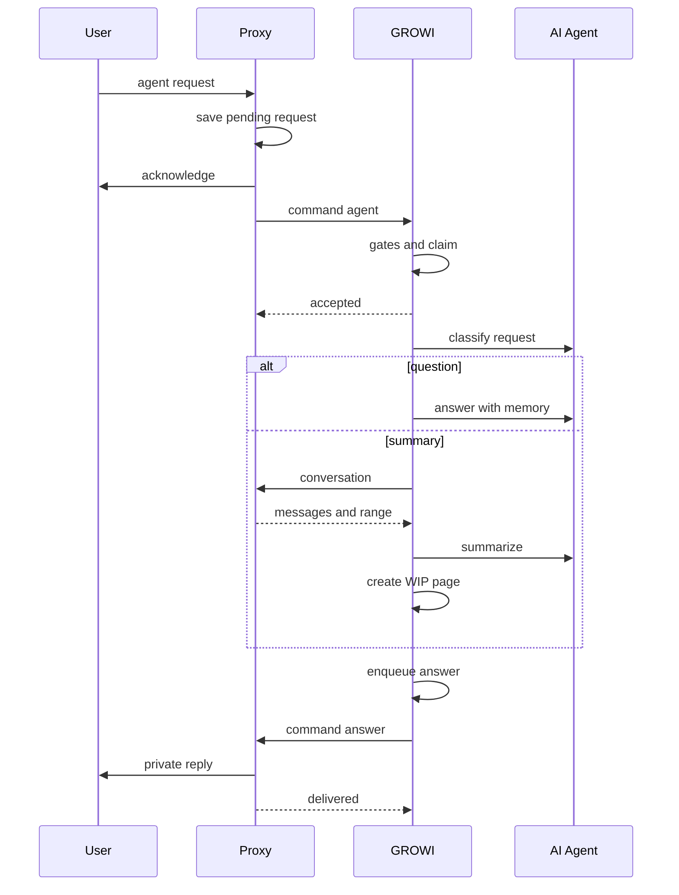
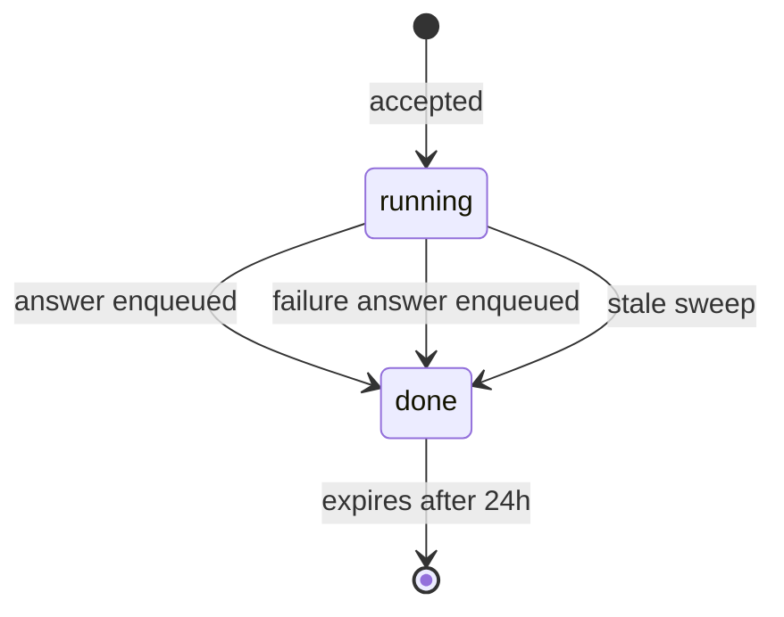

# Design Document

## Overview

**Purpose**: チャットの利用者が、GROWI を開かずに GROWI の AI に調べものや会話の要約を頼めるようにする。コマンドは `search`・`create-page`・`agent` の 3 つに再編し、`keep` は外す。

**Users**: チャットから GROWI を使うチームのメンバーが `agent` に頼む。GROWI の管理者が、`agent` を使わせる場所を決める。proxy の運用者が、Slack の AI アプリの画面を有効にするかを決める。

**Impact**: GROWI application は、依頼を受け付けた後で AI を動かし、答えをあとから chat-integration proxy へ送る。そのために、GROWI から proxy への口が 2 つ増える（答えを送る口、会話を求める口）。通知の書き留めは「種類つきの書き留め」に広がり、通知も答えも、書き留めた直後に送り始める。通知の定期処理は 5 分に 1 回になる。

この spec は amend spec である。番号の扱いと、既存の受け入れ条件との関係は `requirements.md` にある。

### Amend target

| 対象の spec | 変わる契約 |
|---|---|
| `chat-integration`（umbrella） | Out of scope の決定 4 の撤回。要件 5 の置き換え。要件 1・2・11・14 への追記。要件 15 の追加 |
| `chat-integration-protocol` | コマンドの語彙（`keep` → `agent`）、`ChannelRef.isDirectMessage`、権限の `allowedInDirectMessage`、2 つの新しい口（`command-answer`・`conversation`） |
| `chat-integration-proxy` | スレッドの根元の 2 つの欄、答えを待つ依頼の記録、あとから届く答えの届け方、会話の読み取り、Slack の AI アプリの画面、能力表 |
| `chat-integration-app` | `agent` の処理、要約のページ、種類つきの書き留めと送り手、直後に送る経路、定期処理の間隔（再検証が必要になる条件に、定期処理の間隔と取り直しの時間を足す） |

### Goals

- `agent` の依頼を、紐付けた GROWI ユーザーとして GROWI の AI Agent に渡し、答えを本人にだけ届ける（要件 15）
- 会話を要約して、作成中（WIP）のページにする（要件 5）
- 答えを送る仕組みと、通知を直後に送る仕組みを 1 つにする（要件 2.10・2.11・15.6・15.11）
- `agent` と DM の権限、ヘルプ、能力表、導入ドキュメントを足す（要件 1・11・14）

### Non-Goals

- GROWI の AI Agent そのもの（道具、指示文、言語モデルの選び方、利用量の記録の区分）の変更
- 答えの少しずつの書き出し、Slack の AI アプリの画面の依頼の例の表示、利用者が見ているものの通知、止めるボタンへの対応
- 要約のページを作る前の確認、変更の提案（Change Proposal）として出すこと
- スラッシュコマンド、Discord の DM からの依頼、管理者が決める回数の上限

## Boundary Commitments

### This Spec Owns

- コマンドの語彙の入れ替え（`keep` を外し、`agent` を足す）と、`agent` の依頼・応答の形
- GROWI から proxy への 2 つの口: 答えを送る口（`command-answer`）、会話を求める口（`conversation`）
- proxy: 答えを待つ依頼の記録、スレッドの根元を platform 層から command 層へ通すこと、あとから届く答えの届け方、会話の読み取り、Slack の AI アプリの画面での受け答え、bot への呼びかけの外し方
- app: `agent` の受け付け・実行・答えの書き留め、会話の要約とページの作成、種類つきの書き留めと送り手、直後に送る経路、定期処理の間隔
- `agent` の DM の権限（契約・保存・判定・管理画面）、ヘルプの条件、能力表の行、導入ドキュメント

### Out of Boundary

- `features/mastra` の中身。この spec は、`mastra.getAgent('growiAgent')`・`memory`・`getOrCreateThread`・`isAiReady` を呼ぶだけである
- 本人に宛てた返事の届け方の決まり（要件 1.6〜1.13）そのもの。`PrivateReplier` の「本人にだけ見えるメッセージ → DM → 届けられなかった知らせ」の順は変えない
- `search`・`create-page`・`link-preview`・`help` の処理の中身
- 管理画面の作り直し（roadmap の順 8）。この spec は、既存の画面に `agent` の行の注意書きと DM の欄を足すだけである

### Allowed Dependencies

- 依存の向きは今と同じ: `protocol` ← `proxy` / `app`。proxy と app は互いを知らない
- proxy の層の順（`types → capabilities → db → platform → command → relation → growi → orchestration → routes`）を守る。`chat`・`@chat-adapter/*` を import してよいのは `platform/` だけ
- app の chat-integration から `features/mastra` への import は、`is-ai-configured`（軽い判定）だけを静的に行う。それ以外は、`agent/load-growi-ai-gateway.ts` が dynamic import で読み込む `agent/growi-ai-gateway.ts` の中だけで行う
- `features/mastra` から chat-integration への import は作らない

### Revalidation Triggers

- `CommandRequest`・`CommandResponse`・`ChannelRef`・`RelationSettings` の形、または 2 つの新しい口の本文の形を変えたとき → proxy と app の両方を確かめ直す
- `PlatformEvent`・`Invocation` のスレッドの根元の欄、または `PrivateReplyOrigin` の形を変えたとき → proxy の既存のコマンド（聞き返しを含む）を確かめ直す
- `agentView` の既定値、または Slack のアダプタの版を変えたとき → DM へ届け直す動きと、DM での聞き返しを確かめ直す
- 書き留めの `kind` を足したとき、または取り直しの条件（`CLAIM_STALE_AFTER_MS`）や定期処理の間隔を変えたとき → 要件 2.9・2.11 の時間の約束を計算し直す
- `features/mastra` が `RequestContext` の形、`getOrCreateThread` の引数、会話の id の検査を変えたとき → `growi-ai-gateway.ts` を確かめ直す

## Architecture

### Existing Architecture Analysis

- コマンドは、proxy が解釈して GROWI へ署名つきで送り、GROWI が 10 秒以内に応答する一往復である。GROWI から proxy への口は、通知・設定の送信・鍵の登録などで、すべて同じ署名を使う
- proxy の `PrivateReplier` は、`origin.installationId` があれば、イベントの処理の外でも投稿できる。足りないのは、あとまで残る宛先と、スレッドの根元である
- app の通知は「書き留める → 定期処理が取って送る → 失敗したら間隔を空けて送り直す」の 2 段である。送り手（`drain`）は、誰から何度呼ばれても安全に作られている
- 詳しい調査は `research.md` にある

### Architecture Pattern & Boundary Map



**Architecture Integration**:

- 選んだ形: 受け付けてから、あとで届ける（書き留めつき）。GROWI の応答は 10 秒の内に `accepted` を返し、AI の実行は応答の後で行う
- 境界の分け方: 宛先は proxy が持ち、会話の id は GROWI が計算する。互いの持ち物を相手に渡さない
- 保つもの: 署名、口の表、層の順、`PrivateReplier` の届け方の順、`performWriteCommand` の書き込みの経路
- 足すものと理由: proxy の `pending_agent_request`（宛先を GROWI に預けないため）、app の `chat_agent_requests`（二重の実行と、止まった実行を扱うため）、種類つきの書き留め（送り方を 1 つにするため）

### Technology Stack

| Layer | Choice / Version | Role in Feature | Notes |
|---|---|---|---|
| Backend（proxy） | Chat SDK `chat` / `@chat-adapter/slack` 4.38.1 | スレッドの中の本人だけのメッセージ、`agentView`、`setAssistantStatus` | 版は固定のまま。新しい依存は無い |
| Backend（app） | `@mastra/core` 1.41.0（既存） | `growiAgent.generate`、会話の記録 | dynamic import だけで使う |
| Data（proxy） | PostgreSQL + Prisma | `pending_agent_request`、`channel_permission` の欄 | migration を足す |
| Data（app） | MongoDB + Mongoose | `chat_agent_requests`、書き留めの `kind` | 索引と既存の行の補完は migration で行う |
| Runtime（proxy） | 環境変数 `SLACK_AGENT_VIEW` | Slack の AI アプリの画面を使うか | 既定は無効 |

## File Structure Plan

### Directory Structure

```
packages/chat/src/
├── commands/command-names.ts          # keep を外し agent を足す。directMessagePolicy を足す
├── contract/
│   ├── command.ts                     # agent の依頼、accepted の応答、エラーの符号
│   ├── command-answer.ts              # 新規: 答えを送る口の本文と結果
│   ├── conversation.ts                # 新規: 会話を求める口の本文と結果
│   ├── common.ts                      # ChannelRef.isDirectMessage
│   └── settings.ts                    # allowedInDirectMessage
├── parse/
│   ├── parse-command-answer.ts        # 新規
│   └── parse-conversation.ts          # 新規
├── endpoints/op-names.ts              # 2 つの口の行
└── permission/channel-permission.ts   # DM の判定

apps/chat-integration-proxy/
├── prisma/schema.prisma               # PendingAgentRequest、ChannelPermission.allowedInDirectMessage
└── src/
    ├── types/                         # PlatformEvent と Invocation にスレッドの根元と、呼びかけを外した文章
    ├── capabilities/platform-capabilities.ts   # 能力表の行
    ├── db/repositories/pending-agent-request-repository.ts   # 新規
    ├── platform/
    │   ├── event-mapping.ts           # スレッドの根元、bot への呼びかけを外す
    │   ├── conversation-history.ts    # 新規: スレッドか直近の発言を読む
    │   ├── outbound.ts, index.ts      # スレッドの中への投稿、処理中の表示
    │   └── adapter-set.ts             # agentView
    ├── command/
    │   ├── command-set.ts             # agent の性質。keep を外す
    │   ├── invocation.ts              # 語の形での推測をやめる
    │   └── private-reply.ts           # origin にスレッドの根元と、場所の種類
    ├── orchestration/
    │   ├── agent-flow.ts              # 新規: agent の受け付けと、すぐ返る応答の扱い
    │   ├── answer-flow.ts             # 新規: あとから届く答えと、会話の求めへの応答
    │   ├── agent-answer-message.ts    # 新規: 答えを投稿の文面にする純粋関数
    │   └── event-sink.ts              # DM の自由な文章の振り分け
    ├── routes/agent-inbound-routes.ts # 新規: 2 つの口の受け口
    └── runtime/dependencies.ts        # 配線、掃除の一覧

apps/app/src/features/chat-integration/server/
├── agent/
│   ├── index.ts                       # 外へ出すのは handleAgentCommand と sweepStaleAgentRequests だけ
│   ├── handle-agent-command.ts        # 関門と受け付け
│   ├── run-agent-request.ts           # 種類の判断から答えの書き留めまで
│   ├── growi-ai-gateway.ts            # AI に触れる唯一のモジュール。dynamic import でだけ読み込まれる
│   ├── growi-ai-gateway-types.ts      # GrowiAiGateway などの型だけ
│   ├── load-growi-ai-gateway.ts       # growi-ai-gateway.ts を dynamic import する読み込み役
│   ├── conversation-thread-id.ts      # 会話の id の計算（純粋関数）
│   ├── summary-page.ts                # パスの決定とページの作成
│   ├── agent-answer.ts                # 実行の結果を AgentAnswer にする純粋関数
│   └── models/chat-agent-request.ts   # 実行中の依頼
├── outbox/                            # notification/ から送り直しの仕組みを移す
│   ├── index.ts
│   ├── chat-outbox.ts                 # enqueue と、直後に送り始める合図
│   ├── outbox-dispatcher.ts           # 取る、送る、送り直す。送る部分は表で受け取る
│   ├── outbox-dispatch-cron.ts        # 5 分に 1 回
│   ├── deliverers.ts                  # kind ごとの送り方の表（単一の宣言）
│   └── models/chat-outbox.ts          # 既存の collection に kind を足す
└── notification/notification-deliverer.ts   # 通知 1 件の送り方（今の deliverClaimedRow）
```

### Modified Files

- `packages/chat/src/parse/{parse-command,parse-responses,parse-settings}.ts`、各 barrel、`*.spec.ts` — 形の変更に追従する
- `apps/chat-integration-proxy/src/orchestration/command-flow.ts` — `keep` の経路を外し、`agent` を `agent-flow` へ渡す
- `apps/chat-integration-proxy/src/platform/history.ts`・`orchestration/time-range.ts`・`command/argument-collector.ts` の時間範囲の欄 — `keep` 専用なので削除する
- `apps/chat-integration-proxy/src/db/relation-cascade.ts`・`db/repositories/storage-round-trip.integ.ts`・`runtime/dependencies.spec.ts` — 新しいテーブルを足す
- `apps/chat-integration-proxy/docs/{setup-slack,setup-teams}.md` — 要件 1.21・1.22
- `apps/app/.../command/command-endpoint.ts` — `keep` を外す。`agent` を `handleAgentCommand` へ渡す。`performWriteCommand` を `command/perform-write-command.ts` に切り出し、作成の選択肢を受け取れるようにする
- `apps/app/.../content/help-content.ts` — `buildHelpContent({ aiReady })`。`content/conversation-page.ts` とその spec は削除する
- `apps/app/.../proxy-client.ts` — `sendCommandAnswer`・`fetchConversation`、HTTP の打ち切り時間
- `apps/app/.../settings/*`・`admin/save-relation-settings.ts`・`client/admin/AdminChatIntegration.tsx` — DM の欄と注意書き
- `apps/app/public/static/locales/*/admin.json` — 新しい文言を 5 言語で足す
- `apps/app/src/migrations/` — 書き留めの既存の行に `kind` を補う、索引、`keep` の権限の行の削除
- `apps/app/src/server/crowi/index.ts` — 定期処理の起動先の名前の変更

## System Flows

### 依頼の行の状態（app の `chat_agent_requests`）



- `running` の行は、GROWI ユーザーごとに 1 つだけ存在できる（一意の部分索引）。これが要件 15.12 の判定になる
- 1 件の依頼に書き留められる答えは 1 つだけである。書き留めの collection に、`kind: 'command-answer'` の行に限った `(relationId, requestId)` の一意の部分索引を張る。実行の側も掃除の側も「答えを書き留める → 行を `done` にする」の順で進み、書き留めが重複で失敗したら、もう片方が先に終えたとみなして行を `done` にするだけにする。書き留めた後、`done` にする前にプロセスが止まっても、次の掃除が重複を受けて行を閉じるだけで済む
- 実行の上限は 5 分（`AGENT_RUN_TIMEOUT_MS`）。上限を過ぎると実行を打ち切り、失敗の答えを書き留める
- プロセスが止まって `running` のまま残った行は、定期処理が「始めてから 7 分を過ぎた `running`」として見つけ、失敗の答えを書き留めて `done` にする

### DM に届いた文章の振り分け（proxy の `event-sink`）

Slack の AI アプリの画面（`agentView` が有効な Slack の DM）は「GROWI の AI と話す欄」として扱う。

AI アプリの画面:

1. その場所に、その利用者の聞き返し（複数の GROWI からの選択など）が残っていて、文章がその答えとして解釈できる → 聞き返しへの答えとして扱う。答えとして解釈できない文章なら、聞き返しを捨てて 2 へ進む（ふつうの DM の「新しいコマンドが優先」と同じ考え方。この欄には、ほかに聞き返しから抜け出す手段が無い）
2. それ以外 → 先頭の語にかかわらず、`agent` の依頼として始める（要件 15.15。「search for …」と書いても `search` にはしない）

ふつうの DM（今の振り分けのまま）:

1. 先頭の語が既知のコマンド → そのコマンドを始める
2. その場所に、その利用者の聞き返しが残っている → 聞き返しへの答えとして扱う
3. どれでもない → 何もしない

AI アプリの画面では、`agent` 以外のコマンド（`link` や運用者のコマンドを含む）は始まらない。`search`・`create-page`・`help` は、チャンネルとふつうの DM で使う。紐付けが無いときの返事には紐付けの URL が入るので、この欄で `link` が使えなくても困らない

## Requirements Traceability

| Requirement | Summary | Components | Interfaces |
|---|---|---|---|
| 1.20 | 能力表に `agent` の行 | CapabilityTable | `CAPABILITY_TABLE` |
| 1.21 | Slack の設定と権限の文書 | 導入ドキュメント | `docs/setup-slack.md` |
| 1.22 | Teams の個人の範囲の文書 | 導入ドキュメント | `docs/setup-teams.md` |
| 2.10 | 書き留めた直後に送り始める | ChatOutbox | `enqueue`、`requestDrain` |
| 2.11 | 定期処理は 5 分、取り直しは 10 分以内 | OutboxDispatchCron、OutboxDispatcher | `CLAIM_STALE_AFTER_MS` |
| 5.7 | 求めに応じて会話を読んで渡す | ConversationReader、AnswerFlow | `conversation` の口 |
| 5.8 | 要約をページにし、リンクを返す | RunAgentRequest、SummaryPage | `AgentAnswer` の `page-created` |
| 5.9 | 作成者と WIP | SummaryPage | `performWriteCommand` の選択肢 |
| 5.10 | 指定のパス、またはメモ置き場 | SummaryPage | `decideSummaryPath` |
| 5.11 | 既にある、権限が無い | SummaryPage | `AgentAnswer` の `failed` |
| 5.12 | 要約した範囲を示す | AgentAnswerMessage | `ConversationRange` |
| 5.13 | 履歴を取得できない | ConversationReader | `ConversationResult` の `not-in-channel` など |
| 5.14 | 発言が無い | ConversationReader | `ConversationResult` の `empty` |
| 5.15 | サービスが対応していない | ConversationReader | `ConversationResult` の `unsupported` |
| 5.16 | 読める件数が限られる | ConversationReader、AgentAnswerMessage | `truncated` |
| 5.17 | 頻度の制限で断られた | ConversationReader | `ConversationResult` の `rate-limited` |
| 5.18 | 自動削除の対象にしない | SummaryPage | `clearWipExpiry` |
| 11.6 | `agent` のチャンネルの設定 | CommandVocabulary、管理画面 | `COMMAND_NAMES.agent` |
| 11.7 | DM の設定を別に持つ | ChannelPermission | `directMessagePolicy`、`allowedInDirectMessage` |
| 11.8 | ページを作りうることを示す | 管理画面 | 文言 |
| 14.6 | AI が使えなければヘルプに出さない | HelpContent | `buildHelpContent({ aiReady })` |
| 15.1 | 依頼を GROWI へ渡す | AgentFlow | `CommandRequest` の `agent` |
| 15.2 | 紐付けた利用者として AI に渡す | RunAgentRequest、GrowiAiGateway | `RequestContext.user` |
| 15.3 | 紐付けが無ければ断る | HandleAgentCommand | `account-link-required` |
| 15.4 | AI が使えなければ断る | HandleAgentCommand | `error` の `ai-unavailable` |
| 15.5 | 受け付けたことを示す | AgentFlow | `PrivateReplier.acknowledge` |
| 15.6 | 時間にかかわらず答えを送る | RunAgentRequest、ChatOutbox | `kind: 'command-answer'` |
| 15.7 | 本人にだけ届ける | AnswerFlow | `PrivateReplier.reply` |
| 15.8 | スレッドの中に届ける | AnswerFlow、PlatformFacade | `threadRootId` |
| 15.9 | 続けられる場所の案内 | AgentAnswerMessage | `CONTINUE_PLACE` |
| 15.10 | 時間切れと失敗を知らせる | RunAgentRequest、sweepStaleAgentRequests | `AgentAnswer` の `failed` |
| 15.11 | 送り直しと、諦めたときの記録 | OutboxDispatcher | `NOTIFICATION_RETRY_CONFIG` |
| 15.12 | 同じ人は同時に 1 件 | ChatAgentRequest | 一意の部分索引 |
| 15.13 | 対象は 1 つの GROWI | CommandVocabulary | `targeting: 'single'` |
| 15.14 | 同じスレッドは 1 本の会話 | ConversationThreadId | `conversationKey` |
| 15.15 | AI アプリの画面の自由な文章 | EventSink | 振り分けの決まり（System Flows）、能力表の `free-text-agent-in-direct` |
| 15.16 | 処理中の表示 | AgentFlow、PlatformFacade | `setAssistantStatus` |
| 15.17 | 言及を落とさない | EventMapping | `textWithoutBotAddress` |
| 15.18 | AI の会話の記録として残す | GrowiAiGateway | `getOrCreateThread` |
| 15.19 | 外からの経路を足さない | 口の向き | `direction: 'growi-to-proxy'` |
| 15.20 | AI なしでも `search`・`create-page` | CommandEndpoint | 既存の経路を変えない |

## Components and Interfaces

| Component | Layer | Intent | Req | Contracts |
|---|---|---|---|---|
| CommandVocabulary | protocol | `agent` の宣言と依頼・応答の形 | 11.6, 15.1, 15.13 | Service |
| CommandAnswerContract | protocol | 答えを送る口 | 15.6, 15.7, 5.8, 5.12 | API |
| ConversationContract | protocol | 会話を求める口 | 5.7, 5.13〜5.17 | API |
| ChannelPermission | protocol | DM の判定 | 11.7 | Service |
| EventMapping | proxy platform | スレッドの根元と、呼びかけを外した文章 | 15.8, 15.17 | Service |
| ConversationReader | proxy platform | スレッドか直近の発言を読む | 5.7, 5.13〜5.17 | Service |
| PendingAgentRequestRepository | proxy db | 答えを待つ依頼 | 15.7 | State |
| AgentFlow | proxy orchestration | 受け付け、すぐ返る応答の扱い | 15.1, 15.5, 15.16 | Service |
| AnswerFlow | proxy orchestration | 答えの配達、会話の求めへの応答 | 15.7〜15.9, 5.7 | Service |
| HandleAgentCommand | app | 関門と受け付け | 15.3, 15.4, 15.12 | Service |
| RunAgentRequest | app | 実行と答えの書き留め | 15.2, 15.6, 15.10, 5.8 | Service, State |
| GrowiAiGateway | app | AI を呼ぶ唯一の場所 | 15.2, 15.18 | Service |
| SummaryPage | app | パスの決定とページの作成 | 5.9〜5.11, 5.18 | Service |
| ChatOutbox / OutboxDispatcher | app | 種類つきの書き留めと送り手 | 2.10, 2.11, 15.6, 15.11 | Batch, State |

### protocol（`packages/chat`）

#### CommandVocabulary

**Responsibilities & Constraints**

- `COMMAND_NAMES` から `keep` を外し、`agent` を足す。`agent` の性質は `{ writes: true, targeting: 'single', directMessagePolicy: 'separate-flag' }`。ほかのコマンドは `directMessagePolicy: 'follows-all-channels'`
- `writes: true` なので、設定の行が無い連携では `agent` は断られる。管理者が許すまで使わせない、という意図どおりの動きである

```typescript
// contract/common.ts
interface ChannelRef {
  readonly platform: PlatformName;
  readonly channelId: NativeChannelId;
  readonly channelName: string;
  readonly isPrivate: boolean;
  readonly isDirectMessage: boolean; // new
}

// contract/command.ts
interface AgentCommandRequest extends CommandEnvelope {
  readonly kind: 'agent'; // 既存の CommandRequest と同じく kind で種類を見分ける
  readonly text: string;            // bot への呼びかけを外した依頼の文章。最大 8000 文字
  readonly conversationKey: string; // チャット側の id だけから作った文字列。最大 256 文字
}

type CommandResponse =
  | /* 既存の種類 */
  | { readonly kind: 'accepted' };

type CommandErrorCode =
  | /* 既存の符号 */
  | 'ai-unavailable'
  | 'busy';
```

- `created` の `importedMessageCount` と、`KeepMessage`・`keep` の依頼の形は削除する
- `conversationKey` は `<platform>:<channelId>:<replyThreadRootId、無ければ依頼のメッセージの id>`。GROWI はこれを解釈せず、会話の id の計算の入力にだけ使う

#### CommandAnswerContract

| Method | Endpoint | Request | Response | Errors |
|---|---|---|---|---|
| POST | `{proxyUri}/chat-integration/command-answer` | `CommandAnswerRequest` | `CommandAnswerResult` | 400（本文の形が違う）、401（署名） |

```typescript
interface CommandAnswerRequest extends RequestEnvelope {
  readonly op: 'command-answer';
  readonly requestId: string; // 元の agent の依頼の requestId
  readonly answer: AgentAnswer;
}

type AgentAnswer =
  | { readonly kind: 'text'; readonly markdown: string; readonly sources: ReadonlyArray<AnswerSource> }
  | { readonly kind: 'page-created'; readonly pageUrl: string; readonly range: ConversationRange; readonly truncated: boolean }
  | { readonly kind: 'failed'; readonly reason: AgentFailureReason; readonly conversationFailure?: ConversationFailure };

interface AnswerSource { readonly title: string; readonly url: string }
interface ConversationRange { readonly messageCount: number; readonly firstPostedAt: string; readonly lastPostedAt: string }
type AgentFailureReason = 'timeout' | 'agent-error' | 'path-conflict' | 'forbidden' | 'conversation-unavailable';

interface CommandAnswerResult {
  readonly status: 'delivered' | 'undeliverable' | 'unknown-request' | 'in-progress';
}
```

- 上限: `markdown` は 30,000 文字、`sources` は 20 件。超える答えは、GROWI が切り詰めて、切り詰めたことを本文の末尾に書く
- 冪等性: 同じ `requestId` の 2 回目以降は、proxy が 1 回目の結果をそのまま返し、届け直さない
- `delivered`・`undeliverable`・`unknown-request` は、どれも終わりの状態である。GROWI が送り直すのは、`in-progress` と、HTTP の失敗と打ち切りのときである

#### ConversationContract

| Method | Endpoint | Request | Response | Errors |
|---|---|---|---|---|
| POST | `{proxyUri}/chat-integration/conversation` | `ConversationRequest` | `ConversationResult` | 400、401 |

```typescript
interface ConversationRequest extends RequestEnvelope {
  readonly op: 'conversation';
  readonly requestId: string; // 元の agent の依頼の requestId
}

interface ConversationMessage { readonly postedAt: string; readonly author: ChatAccountRef; readonly markdown: string }

type ConversationResult =
  | { readonly ok: true; readonly messages: ReadonlyArray<ConversationMessage>; readonly range: ConversationRange; readonly truncated: boolean }
  | { readonly ok: false; readonly failure: ConversationFailure };

interface ConversationFailure {
  readonly reason: 'not-in-channel' | 'not-permitted' | 'unsupported' | 'rate-limited' | 'empty' | 'unknown-request';
  readonly remedy: string | null; // 取得できるようにするための操作。proxy が作る
}
```

- GROWI は、どの会話かを指定しない。proxy が、依頼の記録から場所とスレッドを引く。GROWI が任意のチャンネルの会話を読めないようにするためである
- `messages` は最大 200 件、1 件の `markdown` は最大 20,000 文字（今の `keep` の上限と同じ）

#### ChannelPermission

```typescript
// contract/settings.ts
interface ChannelPermissionEntry {
  readonly commandName: CommandName;
  readonly allowedChannels: ReadonlyArray<NativeChannelId> | 'all' | 'none';
  readonly allowedInDirectMessage?: boolean; // directMessagePolicy が 'separate-flag' のコマンドだけが読む
}
```

- `judge(settings, commandName, channel)` の決まりを 1 つ足す。`channel.isDirectMessage` が真で、そのコマンドの `directMessagePolicy` が `'separate-flag'` なら、`allowedInDirectMessage === true` のときだけ許す。それ以外は今の決まり（決定 P16 を含む）のまま
- 判定はコマンドの名前で分岐しない。性質の表だけを見る

### proxy（`apps/chat-integration-proxy`）

#### EventMapping と Invocation

```typescript
// types/platform-event.ts（mention のイベントに足す欄）
interface MentionEvent {
  /* 既存の欄 */
  readonly threadRootId: string | null;      // 依頼が実際にスレッドの中にあったときだけ、その根元のメッセージの id。会話の読み取りに使う
  readonly replyThreadRootId: string | null; // 答えを置くスレッドの根元。conversationKey にも使う
  readonly textWithoutBotAddress: string;    // bot 自身への呼びかけだけを外した文章
  readonly isDirectMessage: boolean;
}

// types/invocation.ts（どちらも省略できる。pending_collection に JSON で残るため）
interface Invocation {
  /* 既存の欄 */
  readonly threadRootId?: string | null;
  readonly replyThreadRootId?: string | null;
  readonly isDirectMessage?: boolean;
}
```

- bot への呼びかけは、アダプタが知っている bot 自身の id・名前と突き合わせて外す。`command/invocation.ts` の、語の形での推測（`BOT_ADDRESS_SHAPE`・`stripAddressToken`）は削除する
- 根元は 2 つの欄に分ける。1 つの欄に「答えを置く場所」と「利用者が実際にスレッドの中で書いたか」を兼ねさせると、答えの置き場所のための決まりが、会話の読み取りに効いてしまうためである
  - `threadRootId`: 依頼がスレッドの中の発言なら、そのスレッドの根元。スレッドの外の発言なら `null`（DM でも同じ）。会話の読み取り（ConversationReader）はこちらだけを見る
  - `replyThreadRootId`: スレッドの中の発言なら `threadRootId` と同じ。チャンネルのスレッドの外の発言なら `null`。DM のスレッドの外の発言は、`agentView` の有無にかかわらず、その発言そのもの（Slack の DM は、`agentView` が無効だと先頭の発言のスレッドの欄が空になるため）。返信の階層の無いサービス（Teams）の DM では `null`
- `conversationKey` は `replyThreadRootId`（`null` なら依頼の発言の id）から作る。DM の答えは依頼のスレッドの中に置かれ、利用者がそのスレッドで返信すると、根元が依頼の発言の id になって、1 本の会話になる
- Teams の 1 対 1 の会話には返信の階層が無い。Teams の DM は、続けてやり取りできない場所として扱う（能力表の `CONTINUE_PLACE` は `'none'`）

#### ConversationReader（`platform/conversation-history.ts`）

```typescript
type ConversationOutcome =
  | { readonly ok: true; readonly messages: ReadonlyArray<HistoryMessage>; readonly truncated: boolean }
  | { readonly ok: false; readonly reason: 'not-in-channel' | 'not-permitted' | 'unsupported' | 'rate-limited'; readonly remedy: string | null };

interface PlatformFacade {
  fetchConversation(
    target: SdkChannelRef,
    range: { readonly threadRootId: string | null; readonly limit: number },
    scope: { readonly installationId: string },
  ): Promise<ConversationOutcome>;
}
```

- `threadRootId` があればそのスレッドの発言を、無ければその場所の直近の発言を、新しい順に `limit`（200）件まで読み、古い順に並べ直して返す。1 回の読み取りで終える（ページをたどらない）
- `truncated` は、サービスが「まだ古い発言がある」と答えたときに真にする。読める件数が限られる構成（Marketplace の外で配布した Slack アプリの 15 件）でも、同じ欄で表せる
- `rate-limited` は、サービスが頻度の制限で断ったとき。Slack のアダプタは既定で、制限された呼び出し（HTTP 429）を約 30 分かけて 10 回やり直すので、そのままでは制限が proxy から見えない。会話の読み取りだけは、installation のトークンで作った Slack の `WebClient` に `rejectRateLimitedCalls: true` と 5 秒の打ち切りを付けて呼び、429 をすぐ `rate-limited` に変える（アダプタ全体の設定は変えない。投稿の送り直しに影響するため）。Mattermost・Discord・Teams のアダプタが自前でやり直すかは、実装の最初に確かめ、やり直すなら同じく外す
- bot 自身の発言と、依頼のメッセージそのものは、結果から除く
- イベントの処理の外で呼ばれるので、`scope` は必須にする

#### PendingAgentRequestRepository

```prisma
model PendingAgentRequest {
  relationId     String
  requestId      String
  installationId String
  origin         Json      // StoredAnswerOrigin
  deliveryStatus String?   // 'delivering'、'delivered'、'undeliverable'
  deliveryClaimedAt DateTime? // 'delivering' にした時刻
  expiresAt      DateTime  // 受け付けから 24 時間
  @@id([relationId, requestId])
  @@index([expiresAt])
}
```

```typescript
interface StoredAnswerOrigin {
  readonly channel: SdkChannelRef;
  readonly actor: ChatAccountRef;
  readonly sourceMessageId: string | null;
  readonly threadRootId: string | null;
  readonly replyThreadRootId: string | null;
  readonly place: 'channel' | 'direct'; // 'direct' は bot との DM（AI アプリの画面を含む）
  readonly requestSummary: string;
}
```

- 持つのはチャット側の id と `requestId` だけで、GROWI ユーザーは持たない（要件 7.8）
- 掃除の一覧と、連携の解除で消す順序に足す

#### AgentFlow（`orchestration/agent-flow.ts`）

**Responsibilities & Constraints**

- GROWI を選ぶ（既存の `selector.select`。`targeting: 'single'` なので要件 8.2・8.3 がそのまま働く）
- 依頼の記録を保存してから、GROWI へ依頼を送る。順序を逆にすると、答えが記録より先に届きうる
- 受け付けたことを示す: 既存の `PrivateReplier.acknowledge`（リアクション）。場所が `direct` で、能力表が処理中の表示を持つなら、`setAssistantStatus` も呼ぶ
- GROWI の応答が `accepted` なら、ここで終わる。それ以外（`account-link-required`、`error`）なら、依頼の記録を消し、今のコマンドと同じ経路で本人に返す
- GROWI が 10 秒以内に応答しなかった場合は、依頼の記録を消さない。GROWI が受け付けたかどうかが proxy からは分からないためである（待つのをやめても、GROWI への要求は取り消されない）。本人には「受け付けの返事が時間内に来なかったこと」と「答えが後から届くことがあること」を返す。記録は 24 時間で掃除される

#### AnswerFlow（`orchestration/answer-flow.ts`）

```typescript
interface AnswerFlow {
  deliver(request: CommandAnswerRequest): Promise<CommandAnswerResult>;
  readConversation(request: ConversationRequest): Promise<ConversationResult>;
}
```

- `deliver`: 依頼の記録を引く。無ければ `unknown-request`。`deliveryStatus` が `delivered` か `undeliverable` なら、それを返す。そうでなければ、記録を条件つきの更新で `delivering` にしてから、`agent-answer-message` で文面を作り、届けて、結果を記録に書く。条件は「`deliveryStatus` が空」か「`delivering` で、取ってから 2 分を過ぎた」（`ANSWER_DELIVERY_RECLAIM_MS`。本人にだけ見えるメッセージ → DM → 届けられなかった知らせの 1 回分の最長より長く取る）
- まだ新しい `delivering` に当たったときは、`in-progress` を返す。GROWI はこれを送り直しの対象として数える。proxy が届けている途中で止まった答えは、2 分後の送り直しで届け直される。止まる直前に投稿が済んでいた場合は 2 回届きうるが、答えを黙って失うよりはよいと判断した（通知の重複除けの判断と同じ向き）
- 届け方は、記録の `place` で決める
  - `channel`: `PrivateReplier.reply`。スレッドの根元は、次のどちらかのときだけ渡す。依頼がスレッドの中にあったとき。または、能力表が「返事の無いメッセージのスレッドにも、本人にだけ見えるメッセージを出せる」としているとき。Slack は今は「未確認」なので、スレッドの外の依頼への答えは、今と同じくチャンネルの階層に出る
  - `direct`: その DM の、依頼のスレッドの中に、ふつうの投稿として返す（`replyThreadRootId` を使う）。DM は本人しか読めないので、本人にだけ見えるメッセージにする必要が無い。Teams のようにスレッドの無いサービスでは、DM にそのまま投稿する
- `page-created` と `failed` も、同じ経路で本人にだけ届ける
- `readConversation`: 依頼の記録を引き、`fetchConversation` を呼んで、protocol の形に直す。発言が 0 件なら `empty`

**文面（`agent-answer-message.ts`、純粋関数）**

- `text`: 本文、出典の一覧、場所が `channel` で続けられる場所があれば、その案内（要件 15.9）
- `page-created`: ページへのリンク、要約した発言の件数と最初・最後の日時（要件 5.12）、`truncated` なら範囲が限られたこと（要件 5.16）
- `failed`: 理由ごとの文。`conversation-unavailable` は、`conversationFailure` の理由と `remedy` から作る（要件 5.13〜5.15・5.17）
- 続けられる場所は、能力表の `CONTINUE_PLACE: Record<PlatformName, 'agent-pane' | 'direct-message' | 'none'>` から引く。サービスの名前で分岐しない。Slack は `agentView` が有効なら `'agent-pane'`、無効なら `'direct-message'`。Mattermost は `'direct-message'`。Discord（DM からの依頼は断る）と Teams（返信の階層が無い）は `'none'`（案内を付けない）

#### PlatformFacade に足す操作

```typescript
interface PlatformFacade {
  postEphemeral(target, user, message, scope?: { installationId?: string; requestMessageId?: string; threadRootId?: string }): Promise<...>;
  postInThread(target: SdkChannelRef, threadRootId: string, message: OutboundMessage, scope: { installationId: string }): Promise<PostOutcome>;
  setProcessingStatus(target: SdkChannelRef, threadRootId: string, scope: { installationId: string }): Promise<void>; // 対応しないサービスでは何もしない
}
```

- `ADAPTER_FACTORIES.slack.create` は、`SLACK_AGENT_VIEW` が真のときだけ `agentView: true` を渡す
- 能力表に足す行: `agent-answer-in-thread`、`agent-continue-conversation`、`conversation-summary`（読める範囲が限られるかも、この行の段階で示す。要件 1.20）、`ephemeral-in-unreplied-thread`、`free-text-agent-in-direct`

### app（`apps/app/src/features/chat-integration/server`）

#### HandleAgentCommand

```typescript
const handleAgentCommand: (request: AgentCommandRequest, auditContext: CommandAuditContext) => Promise<CommandResponse>;
```

関門は、次の順に調べる。

0. `checkChannelPermission`（protocol の `judge`）。許されなければ `error/not-permitted-in-channel`。ほかのコマンドと同じく、GROWI でも改めて判定する
1. `resolveActor`。紐付けが無ければ `account-link-required`（要件 15.3）。読み取り専用・無効な利用者は `error/forbidden`。`search` の「紐付けが無くても読める」扱いは使わない
2. `isAiReady()` が偽なら `error/ai-unavailable`（要件 15.4）
3. `chat_agent_requests` に `running` の行を挿入する。同じ `(relationId, requestId)` の行が既にあれば、再送なので `accepted` を返す。同じ利用者の `running` の行が既にあれば `error/busy`（要件 15.12）
4. `accepted` を返し、応答の後で `runAgentRequest` を始める（待たない。失敗はログに残す）

- `agent` は、既存の `handleWithIdempotency`（探す → 計算する → 保存する）を通さない。挿入を先に行うので、同じ依頼が同時に届いても AI は 1 回しか走らない

#### ChatAgentRequest（`agent/models/chat-agent-request.ts`）

| Field | Type | Note |
|---|---|---|
| `relationId`、`requestId` | string | 一意 |
| `userId` | ObjectId | `state: 'running'` の行に限った一意の部分索引 |
| `state` | `'running' \| 'done'` | |
| `text`、`conversationKey`、`actor`、`channel` | | 実行に要る入力 |
| `auditContext` | `{ ip?, endpoint?, requestArrivedAt }` | 受け付けたときの値を、あとのページ作成に使う |
| `startedAt`、`expiresAt` | Date | `expiresAt` は 24 時間後（TTL の索引） |

- 索引は migration で作る

#### RunAgentRequest

```typescript
const runAgentRequest: (request: ChatAgentRequestDocument) => Promise<void>;
const sweepStaleAgentRequests: (now: Date) => Promise<void>;
```

- 全体に 5 分の上限を掛け、`AbortSignal` を AI の呼び出しすべてに渡す。Mastra は打ち切られた `generate` を例外にせず結果を返すので、各呼び出しの後で `signal.aborted` を見て、真なら `failed/timeout` にする（suggest-path の `agentic-engine.ts` と同じ判定）
- `fetchConversation` が打ち切り・HTTP の失敗で終わったときは、`failed/conversation-unavailable` に、`conversationFailure.reason: 'rate-limited'` を付けて答える。本人には「時間を置いてやり直してください」と届く（要件 5.17）。proxy が答えた失敗は、その理由をそのまま使う
- 手順: 種類を判断する → 質問なら答えを作る、要約なら会話を求めて要約し、ページを作る → 結果を `AgentAnswer` にして `kind: 'command-answer'` で書き留める → 行を `done` にする
- どの段で失敗しても、`failed` の答えを書き留めてから `done` にする（要件 15.10）
- `sweepStaleAgentRequests` は、始めてから 7 分を過ぎた `running` の行に `failed/timeout` の答えを書き留めてから `done` にする。定期処理（5 分に 1 回）から呼ぶ
- 実行の側と掃除の側が同じ依頼を同時に終えようとしても、答えの一意の索引で片方だけが書き留められる（上の「依頼の行の状態」）。ページの作成は打ち切りの合図を受けないので、5 分の上限を過ぎてもページを作り終えることがある。その場合も、先に書き留められた答えだけが届く

#### GrowiAiGateway（`agent/growi-ai-gateway.ts`）

```typescript
interface AiRunContext { readonly user: IUserHasId; readonly signal: AbortSignal }

type RequestClassification =
  | { readonly intent: 'answer' }
  | { readonly intent: 'summarize-to-page'; readonly path: string | null };

interface GrowiAiGateway {
  classify(text: string, context: AiRunContext): Promise<RequestClassification>;
  answer(text: string, threadId: string, context: AiRunContext): Promise<{ readonly markdown: string; readonly sources: ReadonlyArray<AnswerSource> }>;
  summarize(messages: ReadonlyArray<ConversationMessage>, instruction: string, context: AiRunContext): Promise<{ readonly title: string; readonly body: string }>;
}

```

- 読み込み役は別のファイル `agent/load-growi-ai-gateway.ts` に置く。中身は `await import('./growi-ai-gateway')` だけで、失敗したら次の呼び出しで読み直す。`GrowiAiGateway` などの型は `agent/growi-ai-gateway-types.ts` に置き、`run-agent-request.ts` は型と読み込み役だけを静的に import する

- 3 つとも `mastra.getAgent('growiAgent').generate(...)` を、`RequestContext`（`user`・`searchService`・`modelKey`・`usageMeter`）つきで呼ぶ。形は suggest-path の `agentic-engine.ts` にならう
- `classify` と `summarize` は、出力の形を決め（`structuredOutput`）、`maxSteps: 1`、会話の記録なしで呼ぶ
- `answer` は、`maxSteps: 10`、会話の記録つき（`getOrCreateThread({ memory, resourceId: userId, threadId })`）で呼ぶ。ブラウザの AI と同じ設定である
- `sources` は、実行の中でページを読む道具が開いたページから作る。戻り値からの取り出し方は、実装の最初のタスクで確かめる
- `growi-ai-gateway.ts` だけが `features/mastra` の重いモジュールを読み込む。`no-eager-ai-imports.spec.ts` が、このファイルが静的な import の連なりに入らないことを検査する

#### ConversationThreadId（純粋関数）

```typescript
const conversationThreadIdOf: (input: { relationId: string; userId: string; conversationKey: string }) => string; // UUID v5
```

- 同じスレッドの続きの依頼は、同じ `conversationKey` を持つので、同じ会話になる（要件 15.14）。GROWI ユーザーを入力に入れるので、会話は利用者ごとに分かれる

#### SummaryPage

```typescript
const decideSummaryPath: (input: { requestedPath: string | null; user: IUserHasId; title: string; now: Date }) => { readonly path: string; readonly grant: PageGrant | undefined };

const performWriteCommand: (params: {
  /* 既存の引数 */
  readonly createOptions?: Pick<IOptionsForCreate, 'wip' | 'grant'>;
  readonly clearWipExpiry?: boolean;
}) => Promise<CommandResponse>;
```

- パスの指定があれば、そのパスと既定の公開範囲（`create-page` と同じ）。無ければ `/user/<username>/memo/<YYYY-MM-DD> <title>` と、本人だけの公開範囲（`GRANT_OWNER`）。題名は、パスに使えない文字を除き、100 文字までに切る
- 作成は `wip: true`。`clearWipExpiry` が真なら、作成の直後に自動削除の期限を外して保存する（`wip` は真のまま。`research.md` の Decision を参照）
- 既にページがある場合は `path-conflict`、作成できない場合は `forbidden` を、`failed` の答えにする（要件 5.11）。`performWriteCommand` の失敗のまとめ方は変えない
- `create-page` は、選択肢を渡さずに呼ぶので、動きは変わらない

#### ChatOutbox / OutboxDispatcher

```typescript
type OutboxKind = 'notification' | 'command-answer';

type OutboxEntry =
  | { readonly kind: 'notification'; readonly relationId: string; readonly payload: NotificationPayload }
  | { readonly kind: 'command-answer'; readonly relationId: string; readonly requestId: string; readonly answer: AgentAnswer };

type DeliveryVerdict =
  | { readonly outcome: 'sent' }
  | { readonly outcome: 'retry'; readonly retryAfterMs?: number }
  | { readonly outcome: 'give-up'; readonly detail: string };

type Deliverer<K extends OutboxKind> = (row: OutboxRow<K>, now: Date) => Promise<DeliveryVerdict>;

const createOutboxDispatcher: (deps: { readonly deliverers: { readonly [K in OutboxKind]: Deliverer<K> } }) => OutboxDispatcher;

interface ChatOutbox {
  enqueue(entry: OutboxEntry): Promise<void>; // 書き留めて、requestDrain を呼ぶ
}
```

##### Batch / Job Contract

- **Trigger**: (1) `enqueue` の直後の `requestDrain`、(2) 定期処理（`'*/5 * * * *'`）
- **`requestDrain`**: プロセスの中で、同時に走る `drain` を 1 つに限る。走っている間に呼ばれたら、終わった後にもう 1 回だけ走らせる。失敗はログに残し、`enqueue` の呼び出し元へは伝えない（要件 2.5）
- **取り直し**: `CLAIM_STALE_AFTER_MS` を 4 分にする。途中で止まった送信は、止まってから 4 分後の最初の定期処理で取り直されるので、最長でも 9 分で送り直しが始まる（要件 2.11）。これは、取り直すプロセスが「連携あり」と覚えている場合の値で、連携ができてから 10 分以内に別のプロセスが「連携なし」と覚えていると、最長で約 15 分になる（要件 2.9 と同じ前提）
- **取った時刻**: 行を 1 件取るたびに、その時点の現在時刻を `claimedAt` に入れる。今は `drain(now)` の開始時刻を全件に使っているので、1 回の `drain` が 4 分を超えると、後半の行は送っている最中に別のプロセスに取り直される
- **送り直し**: 回数と間隔（`NOTIFICATION_RETRY_CONFIG`）は変えず、両方の種類で使う。5 回目の失敗で諦め、行に理由を残す（要件 15.11）
- **通知 1 件の送り方**: 今の `deliverClaimedRow` を `notification/notification-deliverer.ts` に移す。宛先ごとの結果の合成と `inventory-not-ready` の特例は、そのまま
- **答え 1 件の送り方**: `sendCommandAnswer` を呼ぶ。結果が `delivered`・`undeliverable`・`unknown-request` なら `sent`。`in-progress`、HTTP の失敗と打ち切りなら `retry`
- **残し方**: 答えの行は、送れた時点で `answer` を消す。諦めた答えの行は 7 日で消す。通知の行の残し方は変えない
- **冪等性**: 行ごとの条件つき更新で取り合う（今と同じ）。答えは、1 件の依頼につき 1 行しか書き留められない（「依頼の行の状態」の一意の部分索引）。送り直しで同じ行が 2 回届いても、proxy が `requestId` で 2 回目を届けない

##### 定期処理

- 連携が 1 つも無ければ何もしない、という判定（要件 2.7）は今のまま。その後で `drain` と `sweepStaleAgentRequests` を呼ぶ
- 要件 2.9 の上限は、覚えている答えの期限（10 分）＋定期処理の間隔（5 分）で、およそ 15 分になる

#### proxy-client

```typescript
const sendCommandAnswer: (relationId: string, params: Pick<CommandAnswerRequest, 'requestId' | 'answer'>) => Promise<ProxyCallResult<CommandAnswerResult>>;
const fetchConversation: (relationId: string, params: Pick<ConversationRequest, 'requestId'>) => Promise<ProxyCallResult<ConversationResult>>;
```

- `sendSigned` に、口（op）ごとの打ち切り時間を足す。直後に送る経路が、応答しない proxy で止まり続けないようにするためである。通知は、proxy が全部の宛先へ投稿し終えてから応答するので、proxy 側の上限（8 秒）より長い 15 秒にする。答え・会話の求め・そのほかの口は 10 秒にする

#### HelpContent・設定・管理画面

- `buildHelpContent({ aiReady })`: `aiReady` が偽なら `agent` を含めない（要件 14.6）。`keep` の項目は削除する
- `chat_channel_permissions` に `allowedInDirectMessage` を足す。`keep` の行は migration で消す
- 管理画面（`ChannelPermissionsForm`）: `agent` の行に、ページを作りうることの注意書き（要件 11.8）と、「DM（Slack の AI アプリの画面を含む）で使わせる」の欄（要件 11.7）を足す。行の出し分けは、コマンドの性質（`directMessagePolicy`・`writes`）で決める。新しい文言は i18n のキーにし、5 言語で用意する

## Data Models

| Store | Change |
|---|---|
| proxy `pending_agent_request` | 新規。答えを待つ依頼。24 時間で掃除する |
| proxy `channel_permission` | `allowedInDirectMessage Boolean @default(false)` を足す（protocol の欄と同じ名前） |
| app `chat_agent_requests` | 新規。実行中の依頼。24 時間で消える |
| app `chat_notification_outbox` | `kind`（既存の行は migration で `'notification'`）と `answer` を足す。上の階層の `requestId` は両方の種類で使い、答えの行では元の `agent` の依頼の `requestId` を入れる。`kind: 'command-answer'` の行に限った `(relationId, requestId)` の一意の部分索引を張る。`targets`・`markdown`・`containsRestrictedPage` の必須は `kind: 'notification'` の行だけにする。collection の名前は変えない |
| app `chat_channel_permissions` | `allowedInDirectMessage` を足す。`keep` の行を消す |
| app `mastra_threads` | 変えない。計算した id の会話が、利用者の `resourceId` で作られる |

## Error Handling

| 場面 | 利用者に見えるもの | 記録 |
|---|---|---|
| 紐付けが無い | 紐付けの手順（今のコマンドと同じ） | — |
| AI が使えない | 使えない理由 | — |
| 前の依頼を処理中 | 処理中であること | — |
| GROWI が 10 秒以内に応答しない | 受け付けの返事が来なかったことと、答えが後から届くことがあること（依頼の記録は残す） | proxy のログ |
| AI の実行の時間切れ・失敗 | 答えを得られなかったこと | app のログ |
| 会話を読めない | 理由と、読めるようにするための操作 | — |
| ページを作れない | 既にある、または作れないこと | 既存の監査の記録 |
| 答えを送れない | 送れるまで何も届かない | 送り直しの後、書き留めの行に理由を残す（要件 15.11） |
| 答えを届けられない | 届けられなかったことの知らせ（要件 1.11） | proxy の既存の記録（要件 1.12） |

## Testing Strategy

### Unit Tests

- `judge`: DM で、`separate-flag` のコマンドは `allowedInDirectMessage` だけで決まり、`'all'` でも欄が偽なら断る。`follows-all-channels` のコマンドは今のまま（11.7）
- `conversationThreadIdOf`: 同じ入力は同じ UUID。利用者・連携・会話の鍵のどれかが違えば違う id（15.14）
- `decideSummaryPath`: パスの指定の有無、題名に使えない文字、長い題名（5.10）
- `agent-answer-message`: 答えの種類・場所・能力の組み合わせごとの文面。チャンネルでの答えだけに続きの案内が付く。範囲と「限られた」の表示（5.12・5.16・15.9）
- `event-mapping`: 4 サービスで、bot への呼びかけだけが外れ、先頭のほかの利用者への言及が残る（15.17）
- `buildHelpContent`: `aiReady` の真偽で `agent` の有無が変わる（14.6）
- `no-eager-ai-imports.spec.ts` が通り続ける

### Integration Tests

- app `handle-agent-command`: 紐付けなし、AI が使えない、同じ利用者の 2 件目、同じ `requestId` の再送（AI は 1 回だけ）（15.3・15.4・15.12）
- app `run-agent-request`（AI の入口を差し替える）: 質問 → `text` の答えが書き留められる。要約 → 会話を求め、WIP で期限の無いページができ、`page-created` が書き留められる。時間切れ → `failed`。プロセスが止まった行を掃除が拾う（5.8・5.9・5.18・15.6・15.10）
- app `outbox-dispatcher`: 2 種類の行が、それぞれの送り方で送られる。答えの行は送れたら本文が消える。`requestDrain` が、連続した `enqueue` で 1 つずつしか走らない。取り直しが 10 分以内に起きる（2.10・2.11・15.11）
- proxy `answer-flow`: 依頼の記録どおりの場所・スレッド・本人に届く。同じ答えの再送で 2 回届かない。記録が無ければ `unknown-request`。GROWI が指定しない場所へは届かない（15.7・15.8）
- proxy `conversation-history`（本物のアダプタと代役）: スレッドの読み取り、直近の読み取り、頻度の制限、まだ古い発言がある場合の `truncated`（5.7・5.13〜5.17）
- proxy `private-reply-adapters.integ.ts` と聞き返しの結合試験を、`agentView` が有効・無効の両方で回す
- app `run-agent-request`: 実行の側と掃除の側が同じ依頼を同時に終えても、答えが 1 つしか書き留められない（15.6・15.10）
- proxy `answer-flow`: 同じ答えが 2 つ同時に届いても、1 回しか届けない。GROWI が 10 秒以内に応答しなかった依頼でも、後から届いた答えが本人に届く（15.7）
- proxy `event-mapping`: `agentView` が無効の Slack の DM で、依頼の発言が答えの置き場所（`replyThreadRootId`）になり、そのスレッドでの返信が同じ `conversationKey` になる（15.14）
- proxy `answer-flow`: DM のスレッドの外で要約を頼むと、その DM の直近の発言を読む（`threadRootId` が `null`）（5.7）
- proxy `conversation-history`: Slack が 429 を返すと、待たずに `rate-limited` を返す。app はこれと、会話の求めの打ち切りを、「時間を置いて」の答えにする（5.17）
- proxy `answer-flow`: `delivering` のまま 2 分を過ぎた記録は、送り直しで届け直される。まだ新しい `delivering` には `in-progress` を返し、GROWI が送り直す（15.7・15.11）
- app `run-agent-request`: 打ち切られた `generate` が例外を投げずに返っても、`failed/timeout` になる（15.10）
- proxy `event-sink`: AI アプリの画面で、GROWI の選択の聞き返しが残っているときに、選択として解釈できない文章を書くと、新しい `agent` の依頼になる（15.15）

### E2E（`testing/` の偽の GROWI と偽のチャットサービス）

- チャンネルで `agent` を頼む → リアクション → 答えが本人にだけ届く
- Slack の AI アプリの画面（`agentView` が有効）で、コマンドの名前なしの文章 → 処理中の表示 → 同じスレッドに答え。続けて頼むと、同じ `conversationKey` が送られる（15.14〜15.16）
- 「この会話を要約してページにして」→ 会話の求め → `page-created` の文面

### 実機での確認（タスクに入れる）

- Slack: 返事の無いメッセージのスレッドに、本人にだけ見えるメッセージが表示されるか。結果で能力表の `ephemeral-in-unreplied-thread` を確定する
- Slack: AI アプリの画面が、無料のプランで使えるか
- Slack: 処理中の表示（`setAssistantStatus`）が、答えが届くまでの最長 5 分のあいだ消えずに残るか。途中で消えるなら、実行中に一定の間隔で表示し直す（要件 15.16）
- Teams: 本人にだけ見えるメッセージがスレッドの中に出るか。アプリを個人の範囲にも入れる必要があるか（1.22）

## Security Considerations

- **答えの宛先**: GROWI は宛先を指定できない。proxy が、自分で覚えた依頼の本人にだけ届ける。侵害された GROWI ができるのは、実際に依頼した人に、偽の答えを返すことまでである
- **会話の読み取り**: GROWI は、どの会話を読むかを指定できない。読めるのは、依頼が行われた場所（またはスレッド）だけで、依頼の記録が残っている 24 時間に限られる。ただし、ふつうの質問の依頼でも、その 24 時間は何度でも読める。侵害された GROWI は、依頼のあった場所の直近 200 件を 24 時間読み続けられる。回数を 1 回に絞る案は、2026-11-12 にユーザーが採らないと決めた
- **要約のページの公開範囲**: パスの指定が無ければ、本人だけが閲覧できるページにする。パスの指定があれば、`create-page` と同じく、そのパスの既定の公開範囲（いちばん近い祖先のページの範囲）になる。非公開チャンネルの要約を全員に公開される場所に指定すると、全員に見えるページになる（2026-11-12 にユーザーが決定）
- **AI が読む内容**: 既存の道具が、紐付けた GROWI ユーザーの閲覧権限で検索し、ページを読む。この spec は、権限の判定を足さない
- **答えの保存**: 答えの本文は、送れた時点で書き留めから消す。諦めた行も 7 日で消す
- **依頼の文章**: 長さの上限（8000 文字）を protocol の parser で検査する

## Migration Strategy

- Gen 2 はまだリリースしていないので、古い proxy と新しい GROWI（またはその逆）の組み合わせは考えない
- app の migration: 書き留めの既存の行に `kind: 'notification'` を補う。`chat_agent_requests` の索引を作る。`chat_channel_permissions` の `keep` の行を消す
- proxy の migration: `pending_agent_request` を作る。`channel_permission` に欄を足す
- 更新の後、`agent` は、管理者が設定を保存するまでどの連携でも使えない。導入ドキュメントに書く
- 最後のタスクで、この spec の内容を umbrella・protocol・proxy・app の各 spec に書き戻し、このディレクトリを削除する（`.claude/rules/spec-lifecycle.md`）
