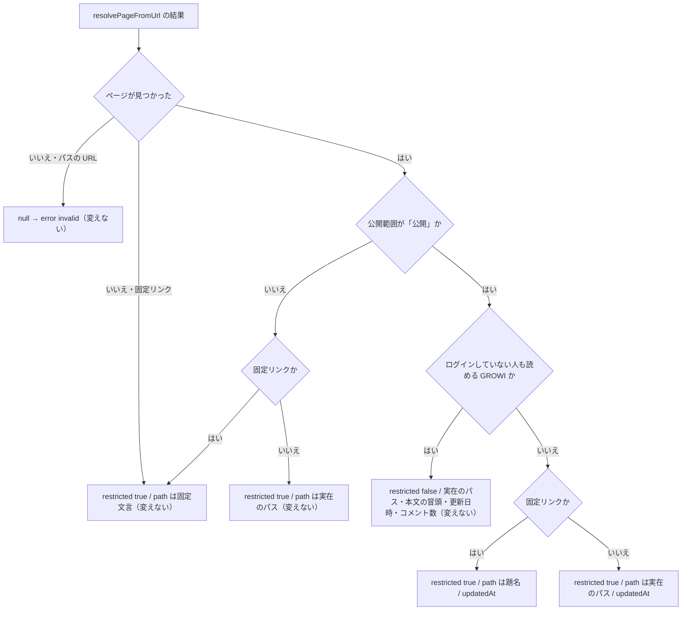

# Design Document — chat-integration-link-preview

## Overview

ログインが必要な GROWI でも、公開範囲が「公開」のページの URL を、題名と更新日時だけで展開する。
判定は GROWI の `buildLinkPreview` 1 か所で行い、proxy は受け取った要約を表示するだけにする。
通信契約（`@growi/chat` の `link-preview` 応答）の型の形は変えない。

言葉の意味（「公開範囲が『公開』」「ログインが必要な GROWI」「題名」）は [requirements.md](./requirements.md) の「この要件で使う言葉」に従う。

### Goals

- 公開範囲が「公開」のページは、ログインが必要な GROWI でも、固定リンクなら題名と更新日時、パスで指す URL ならパスと更新日時を展開する（6.9〜6.11）
- 公開範囲を絞ったページの扱いは今と同じバイト列の応答のまま変えない（6.12、6.8）
- proxy は、本文の冒頭とコメント数を出さずに、更新日時を出す（6.13）

### Non-Goals

- 投稿者に「全員に見せるか」を尋ねる確認フロー（umbrella の roadmap の 10）
- 閉じた GROWI で、紐付いていない人が URL を貼ったときの扱い。今は `resolveReadDenial` が `account-link-required` を返し、proxy の `previewLinks` が黙って捨てる。本 spec はこの順序を変えない（research.md の未決事項 1）
- コメント数・作成者など、更新日時以外の情報を「題名だけ」の展開に足すこと
- 応答の `path` の名前の付け直し

## Amend target

| 対象の spec | 書き戻す場所 | 変わる契約 |
|---|---|---|
| `chat-integration`（umbrella） | `requirements.md` の要件 6 | 受け入れ条件 6.9〜6.13 を末尾に足す。**6.3 を、番号を変えずに「6.9 の場合を除き」の形へ書き直す**。他の 6.x の文言は変えない |
| 〃 | `design.md` の要件の対応表 | `6.1–6.8` → `6.1–6.13` |
| 〃 | `research.md` | 「公開範囲が『公開』に限る理由」の要約 |
| `chat-integration-app` | `design.md`「`PublicPageFilter` を呼ぶ側も、閉じた GROWI での扱いを決める」の表 | **「リンクの展開 → パスだけにする」の行を撤回し**、「公開範囲が『公開』なら題名（パスで指す URL ならパス）と更新日時だけ。公開範囲を絞ったページはパスだけ」に書き直す |
| 〃 | `design.md` の Overview「固定リンクが見つからない場合の表示」 | 「ページの状態に関わらず常に同じ固定文言」を、「ページが無い場合と、公開範囲を絞ったページの場合は同じ固定文言。公開範囲が『公開』のページは題名と更新日時（閉じた GROWI）または全部（開いた GROWI）」に直す |
| 〃 | `design.md`「LinkPreviewMapper（固定リンクの応答）」 | System Flow・Service Interface の不変条件・Requirements Traceability を、本書の「Components and Interfaces」の形へ置き換える |
| 〃 | `design.md` の Revalidation Triggers | 1 行足す（下の「Revalidation Triggers」） |
| 〃 | `research.md` | 本 spec の research.md の決定 1〜4・Research Log・未決事項 |
| `chat-integration-protocol` | `design.md` の `link-preview` 応答の説明（`CommandResponse` の型の近く） | **型の形は変えない。** 「`restricted: true` のとき `excerpt`・`commentCount` は含まない。`updatedAt` は含むことがある。`path` は『場所として表示する文字列』で、実在のパス・題名・固定文言のどれかが入る」を書き足す |
| `chat-integration-proxy` | `design.md`（今は URL の展開の表示の決まりを書いた節が無い。`CommandFlow.previewLinks` を説明している近くに短い節を足す） | `restricted: true` でも `updatedAt` があれば表示する。`restricted: true` なら本文の冒頭とコメント数は出さない |

## Boundary Commitments

### This Spec Owns

- 「題名と更新日時だけ」を出すかどうかの判定（`buildLinkPreview`）
- 題名の決め方を、検索と URL の展開とで 1 つの関数に揃えること
- proxy の URL の展開の表示（`previewMarkdown`）の、`restricted: true` の場合の出し方

### Out of Boundary

- `resolvePageFromUrl`（URL からページを引く処理）。固定リンクの判定（24 桁の 16 進）も変えない
- `resolveReadDenial`（貼った人の紐付けの確認）と、`account-link-required` を proxy が捨てる扱い
- `@growi/chat` の型と解析関数（`parse-command.ts`）のコード
- 通知（要件 2.3）の扱い

### Allowed Dependencies

- `@growi/core` の `PageGrant`（既存の `isPubliclyReadablePage` 経由）
- `crowi.aclService.isGuestAllowedToRead()`（既存どおり `handleLinkPreview` が渡す）

### Revalidation Triggers

本 spec が触れる既存の Revalidation Triggers:

- **protocol「通信契約の型の形が変わったとき」には当たらない。** 型の形は変えない。ただし `restricted: true` の意味（何を含んでよいか）を変えるので、proxy と app の両方の design を、本 spec の書き戻しで同時に直す
- **app「`link-preview` に『見つからない』を独立に表すフィールドが足されたら見直す」は発動しない。** 固定文言はそのまま使う
- proxy「`@growi/chat` の契約が変わったとき」に当たる（意味の変更）。proxy の design を本 spec の書き戻しで直す

書き戻しで app の design.md に足す行:

- **GROWI のページの階層と公開範囲の決まり（子のページを親より広く公開できない正規化）や「公開」の意味が変わったとき**、題名だけの展開が漏らすものを見直す。
  また、固定リンクでパス全体を出すように変える提案が出たときは、research.md の決定 2（祖先の名前が漏れうる）を先に読む

## Architecture

### Existing Architecture Analysis

```
proxy: previewLinks
  → GROWI: handleLinkPreview
       → resolveReadDenial（閉じた GROWI で紐付いていない人なら account-link-required。変えない）
       → resolvePageFromUrl（URL → { isPermalink, page }。変えない）
       → buildLinkPreview(target, isGuestAllowedToRead)   ← ここだけを変える
  ← { kind: 'link-preview', path, restricted, excerpt?, updatedAt?, commentCount? }
proxy: previewMarkdown → attachPreview                     ← 表示だけを変える
```

### Technology Stack

新しい依存は無い。

## File Structure Plan

### Modified Files

| ファイル | 変更 |
|---|---|
| `apps/app/src/features/chat-integration/server/content/link-preview-mapper.ts` | 判定を 3 つの状態に分ける。冒頭のコメント（「2 つの状態」「閉じた GROWI ではパスだけ」の説明）を、新しい状態に合わせて書き直す |
| `apps/app/src/features/chat-integration/server/content/title-from-path.ts`（新規） | `titleFromPath` を `search-result-mapper.ts` から移す |
| `apps/app/src/features/chat-integration/server/content/search-result-mapper.ts` | `titleFromPath` を新しいファイルから読む（動きは変えない） |
| `apps/app/src/features/chat-integration/server/content/link-preview-mapper.spec.ts` | 新しい状態のテストを足し、既存の 2 つのテストを直す（「Testing Strategy」の 7） |
| `apps/app/src/features/chat-integration/server/command/command-endpoint.spec.ts` | 閉じた GROWI での固定リンクのテストを 1 つ足す |
| `apps/app/src/features/chat-integration/server/content/public-page-filter.ts` | 冒頭のコメントが要件 6.3 を「本文の冒頭・日時・コメント数を落とすかどうか」と説明しているので、新しい状態に合わせて直す（コードは変えない） |
| `apps/chat-integration-proxy/src/orchestration/command-flow.ts` | `previewMarkdown` の `restricted: true` の分岐で `updatedAt` を出す |
| `apps/chat-integration-proxy/src/orchestration/command-flow.spec.ts` | 表示のテストを足す |

`command-endpoint.ts` と `packages/chat` のコードは変えない。

## System Flows



今の実装との違いは、`Guest` が「いいえ」の枝（`T1`・`T2`）だけ。今は `Scope` と `Guest` を 1 つの真偽にまとめて、偽ならすべて `Unavailable`／`PathOnly` に流している。

## Requirements Traceability

| 要件 | 内容 | どこで満たすか | 図の枝 |
|---|---|---|---|
| 6.9 | 公開範囲が「公開」でログインが必要なら、題名と更新日時だけ | `buildLinkPreview` | `T1`・`T2` |
| 6.10 | 固定リンクなら題名、パス全体は出さない | `buildLinkPreview`（`titleFromPath`） | `T1` |
| 6.11 | パスで指す URL ならパスと更新日時 | `buildLinkPreview` | `T2` |
| 6.12 | 公開範囲を絞ったページは今どおり（更新日時は出さない。固定リンクは題名も出さず存在しない場合と同じ応答、パスの URL はパスだけ） | `buildLinkPreview`（変えない枝） | `Unavailable`・`PathOnly` |
| 6.13 | proxy は題名（パス）と更新日時を出し、本文の冒頭とコメント数は出さない | `previewMarkdown` | — |

## Components and Interfaces

### LinkPreviewMapper（`buildLinkPreview`）

引数と戻り値の型は変えない。

```typescript
function buildLinkPreview(
  target: LinkPreviewUrlTarget,
  isGuestAllowedToRead: boolean,
): LinkPreviewResult | null;
```

**判定**（上から順に見る）:

1. `page == null`: 今どおり（パスの URL なら `null`、固定リンクなら `{ path: PERMALINK_UNAVAILABLE_MESSAGE, restricted: true }`）
2. `!isPubliclyReadablePage(page)`: 今どおり（固定リンクなら固定文言、パスの URL なら実在のパス。`restricted: true`。他のフィールドは無し）
3. `isPubliclyReadablePage(page) && isGuestAllowedToRead`: 今どおり（全部出す）
4. **`isPubliclyReadablePage(page) && !isGuestAllowedToRead`（新しい状態）**:
   `{ path: isPermalink ? titleFromPath(page.path) : page.path, restricted: true, updatedAt: page.updatedAt.toISOString() }`

**不変条件**（app の design.md の Service Interface にある現行の不変条件を、書き戻しでこれに置き換える）:

- `restricted === true` のとき、`excerpt` と `commentCount` は含まない
- `restricted === true` かつ `updatedAt` を含むのは、状態 4 のときだけ
- `isPermalink === true` かつ `restricted === true` かつ `updatedAt` を含まないとき、`path` は常に `PERMALINK_UNAVAILABLE_MESSAGE`（ページが無い場合も、公開範囲を絞ったページの場合も同じ。6.8・6.12）
- `isPermalink === true` のとき、`path` に `page.path`（パス全体）が入るのは状態 3 のときだけ

`isGuestAllowedToRead` の名前と出どころは変えない。判定を 2 つの真偽（公開範囲・GROWI の設定）に分けて見る形にするだけで、新しい引数は要らない。

### titleFromPath（`content/title-from-path.ts`、新規）

```typescript
/** A page's display title: the last path segment, or the path itself for the root. */
export const titleFromPath = (path: string): string;
```

`search-result-mapper.ts` の今の実装（`nodePath.basename(path) || path`）をそのまま移す。検索の題名（要件 3.9）と URL の展開の題名が、別々に書かれてずれることを防ぐ。

### proxy の previewMarkdown

`restricted: true` の分岐を、次の形にする:

```
<growiLabel>: <path>
更新: <updatedAt>          ← updatedAt があるときだけ
```

- `restricted: true` のときは、`excerpt` と `commentCount` が届いても表示しない（GROWI 側の不変条件に加えて、proxy でも出さない。今の分岐が持っている性質を保つ）
- `updatedAt` の書き方は、`restricted: false` のときと同じ（今は GROWI から届いた文字列をそのまま出している）
- `path` が題名か実在のパスか固定文言かを proxy は区別しない。何を出すかは GROWI が決める

### `@growi/chat`（protocol）

コードは変えない。`parse-command.ts` は `restricted` の値に関係なく `updatedAt` を任意で受け付けているので、状態 4 の応答はそのまま通る。
design.md の型の説明に、上の不変条件のうち通信契約に関わる 2 つ（「`restricted: true` なら `excerpt`・`commentCount` は無い」「`path` は表示する場所の文字列」）を書き足す。

## Security Considerations

- **題名を出しても漏れにならない理由**: 状態 4 に入るのは、公開範囲が「公開」のページだけ。そのページは、その GROWI にログインできる人なら誰でも、題名（とパス）と更新日時を見られる。
  新しく見えるのは、チャンネルにいる GROWI のユーザーでない人に対してだけで、見えるのは題名と更新日時に限る。本文・コメント数・作成者は出さない
- **公開範囲を絞ったページ**: 題名はパスの最後の部分で、利用者が中身を表す言葉を書くことが多い（例: `/人事/2027年の組織変更`）。出すこと自体が漏れなので、状態 2 から変えない
- **「リンクを知っている人だけ」（`GRANT_RESTRICTED`）**: `isPubliclyReadablePage` が偽を返すので状態 2 になる。題名も出さない
- **固定リンクでパス全体を出さない理由**: 正規化されていない古いページでは、公開ページの祖先に公開範囲を絞ったページがありうる。パス全体を出すと祖先の名前が漏れる（research.md の決定 2）
- **固定リンク（`/<pageId>`）の形が要になる理由**: パスで指す URL は、URL 自体に題名を含むので、今でも要約にパスを出している（6.7）。題名だけの展開が新しく情報を足すのは固定リンクのときで、
  公開範囲を絞ったページの固定リンクから題名が漏れないことが、この変更の安全の条件になる。そのため、状態 2 の固定リンクの応答（固定文言）は今と同じバイト列のまま残し、テストで確かめる
- **存在の確かめ（6.8）**: 公開範囲が「公開」のページの固定リンクは、題名が返ることで存在が分かる。ログインできる人なら誰でも存在を知れるページなので、漏れではない。
  存在しない id と公開範囲を絞ったページの id は、今と同じく見分けられない
- **貼った人の確認**: 閉じた GROWI では、紐付いていない人が貼った URL は今どおり `buildLinkPreview` に届かない。題名を出す相手が増えるのは、紐付いた人が貼った場合だけ

## Error Handling

新しい失敗の経路は無い。`page.updatedAt` は `resolvePageFromUrl` が必ず埋める（今の状態 3 と同じ値）。

## Testing Strategy

GROWI（`link-preview-mapper.spec.ts`、純粋関数なので DB は要らない）:

1. 公開範囲が「公開」・閉じた GROWI・固定リンク → `path` が題名、`restricted: true`、`updatedAt` あり、`excerpt`・`commentCount` 無し（6.9・6.10）
2. 同じ条件・パスの URL → `path` が実在のパス、`updatedAt` あり（6.11）
3. 公開範囲を設定していない古いページでも 1・2 と同じ
4. ルートのページ（`/`）の固定リンク → `path` が `/`
5. 公開範囲を絞ったページ（`GRANT_OWNER`・`GRANT_USER_GROUP`・`GRANT_RESTRICTED`・`GRANT_SPECIFIED`）・閉じた GROWI・固定リンク → 存在しない固定リンクの応答と**完全に同じ**（`toStrictEqual`）（6.12・6.8）
6. 同じ条件・開いた GROWI でも 5 と同じ（GROWI の設定に関わらない、6.12）
7. 既存のテストのうち、次の 2 つを直す（それ以外の `link-preview-mapper.spec.ts` のテストは変えずに通ること）:
   - 「gives path-only for a GRANT_PUBLIC page in a CLOSED GROWI」— 今の振る舞いを確かめているので、新しい状態のテスト（1・2）に置き換える
   - 「never includes excerpt/updatedAt/commentCount when restricted」— 中身（`GRANT_RESTRICTED`・開いた GROWI）は今後も正しいが、名前が「restricted なら updatedAt を含まない」という、もう成り立たない決まりを述べている。「公開範囲を絞ったページでは含まない」という名前に変える

GROWI の受け口（`command-endpoint.spec.ts`）:

- 今の `link-preview` のテストはどれも開いた GROWI（`isGuestAllowedToRead: true`）なので、変更の影響を受けない（2026-10-27 に確認）
- 1 つ足す: 閉じた GROWI・紐付いた人・公開範囲が「公開」のページの固定リンク → `{ kind: "link-preview", restricted: true, path: <題名>, updatedAt }`。`handleLinkPreview` が `isGuestAllowedToRead()` を渡す配線ごと確かめる

検索（`search-result-mapper.spec.ts`）: `titleFromPath` を移した後も、既存のテストがそのまま通ること。

proxy（`command-flow.spec.ts`）:

8. `{ restricted: true, path, updatedAt }` → 1 行目が `<label>: <path>`、2 行目に `更新: <updatedAt>`（6.13）
9. `{ restricted: true, path, excerpt, commentCount }`（GROWI の不変条件に反する応答）→ 本文の冒頭とコメント数を出さない
10. 既存の `{ restricted: true, path }` の表示は変わらない

## Why（この形にした理由）

- **判定を GROWI 側の 1 か所に置く**: 何を誰に見せるかは、ページの公開範囲と GROWI の設定を知っている GROWI にしか決められない。proxy が URL の形を見て出し分けると、判定が 2 か所に分かれる
- **型を変えない**: 新しいフィールドや列挙を足す案は research.md の決定 3 で比べた。今の型と解析関数のままで状態 4 を表せ、古い proxy と組み合わせても壊れない
- **固定リンクは題名だけ**: パス全体を出すより狭く、roadmap の決定の文言とも合う。要件 6.6 も書き換えずに済む
- **公開範囲を「公開」に限る**: research.md の決定 1
