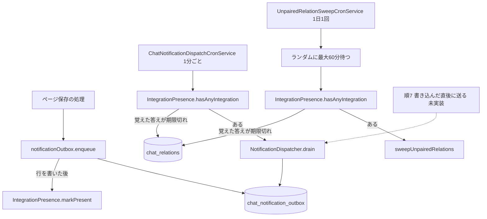
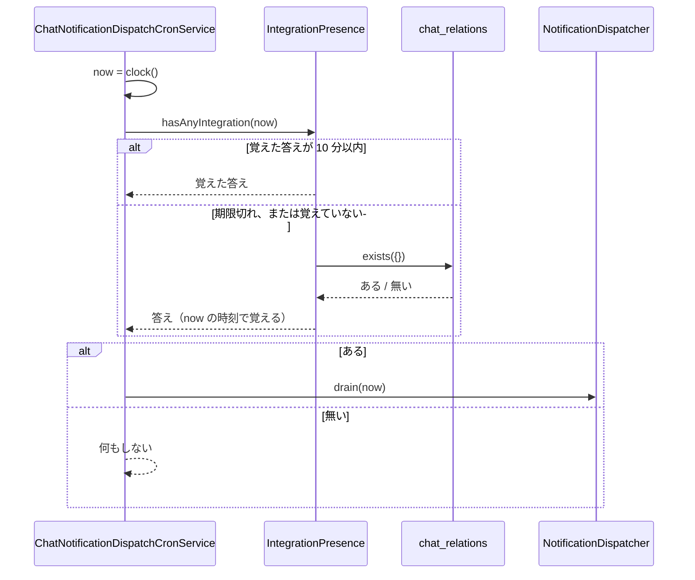

# Technical Design — chat-integration-notification-load

> amend spec。対象は `chat-integration`（umbrella）と `chat-integration-app`。
> 設計判断の理由は同じディレクトリの `research.md`（書き戻しのときに `chat-integration-app` の `research.md` へ移す）。

## Amend target

| 対象の spec | 変わる契約 | 書き戻す場所 |
|---|---|---|
| `chat-integration`（umbrella） | 要件 2 に受け入れ条件 2.7〜2.9、要件 9 に 9.8 を足す（2.10・2.11 は空き） | `requirements.md` の要件 2・9 の末尾。`roadmap.md` の順 6 を消す |
| `chat-integration-app` | 連携が無いときに通知の定期処理の問い合わせを飛ばす判定。解除済みの連携の掃除を別の定期処理にし、1 日 1 回にする | `design.md` の「通知を 2 段に分ける」（定期処理の説明。間隔の「既定 1 分」は変えない）、「紐付けの一意性に workspace の軸が要る」の「45 日の掃除は `NotificationDispatcher` と同じく条件つき更新で 1 台だけが回す」、File Structure Plan、Testing Strategy。`research.md` |

- `chat-integration-protocol` と `chat-integration-proxy` は変わらない。
- **Revalidation Triggers**: どの spec の Revalidation Triggers にも当たらない。通信の契約、検索・権限判定の呼び出し、proxy の能力表・通知契約には触れない。

## Overview

**Purpose**: 通知の定期処理が、チャット連携を使っていない GROWI でもデータベースへ問い合わせ続けている負荷を取り除き、使っている GROWI でも問い合わせの回数を減らす。

**Users**: 多くの GROWI が 1 つのデータベースを共有する環境（GROWI.cloud など）の運用者。

**Impact**: `apps/app/src/features/chat-integration/server/` の通知の定期処理と掃除、および `apps/app/src/server/crowi/index.ts` の定期処理の起動。ページの保存の流れ（要件 2.5）と、複数台での行ごとの排他は変えない。

### Goals

- 連携の無い GROWI のプロセスでは、通知と掃除の問い合わせを行わず、「連携があるか」の問い合わせも 10 分に 1 回以下にする（2.7）
- 通知を書き留めたプロセスは、覚えた答えに関係なく次の定期処理で送る（2.8）
- 行を書いたプロセスが止まっても、ほかのプロセスが、答えの期限（10 分）が切れた後の最初の回（1 分間隔なのでおよそ 11 分以内）で送る（2.9）
- 掃除は別の定期処理で 1 日 1 回（9.8）

### Non-Goals

- **通知を書き留めた直後に送ること。** roadmap 順 7 で、`chat-integration-agent` の「答えをあとから送る口」と同じ経路で作る。ただしこの設計は、定期処理が唯一の送り手であることを前提にしない（下記「書き込んだ直後に送る経路のための余地」）
- **通知の定期処理の間隔の変更（1 分のまま）。** `chat-integration-agent` で、書き込んだ直後に送る経路と一緒に作る（下記「書き込んだ直後に送る経路のための余地」）
- 送り直しの回数・間隔（`NOTIFICATION_RETRY_CONFIG`）、止まった送信とみなすまでの時間（`CLAIM_STALE_AFTER_MS` = 5 分）、1 回に送る行の上限（50 行）の変更
- 定期処理の時刻を設定で変えられるようにすること（今の通知の定期処理も設定を持たない）

## Boundary Commitments

### This Spec Owns

- 「この GROWI にチャット連携があるか」の判定と、その答えを覚える期間（`IntegrationPresence`）
- 通知の定期処理の中で、判定を使って問い合わせを飛ばすこと（間隔は変えない）
- 解除済みの連携の掃除を動かす定期処理（スケジュール、ランダムな待ち、判定）
- `enqueue` が行を書いた後に、自分のプロセスの答えを「ある」にすること

### Out of Boundary

- `drain` の中身（行の取り方、送り直し、諦め方）。変えない
- `sweepUnpairedRelations` の中身（何を消すか、どの順で消すか）。変えない（ファイル冒頭の注記だけ直す）
- 書き込んだ直後に送る経路（roadmap 順 7）
- proxy、通信の契約

### Allowed Dependencies

| 依存先 | 制約 |
|---|---|
| `ChatRelation`（`server/models/chat-relation.ts`） | 判定で `exists({})` を呼ぶだけ。スキーマと索引は変えない |
| `CronService`（`server/service/cron.ts`） | 継承する。変えない |
| `randomSleep`（`server/util/random-sleep.ts`） | 掃除の前の待ちに使う |

### Revalidation Triggers

この spec が入った後、次のことが起きたら、ここで決めた判定を見直す。

- outbox の行を書く場所が `notificationOutbox.enqueue` のほかに増えたとき（その場所でも「ある」の印を付けないと、要件 2.8 が崩れる）
- proxy へ通知を送る経路が `drain` のほかに増え、その経路が outbox の行を通らないとき
- `chat_relations` の行を、解除のときに残さず消すように変えたとき（判定が解除済みの連携を見落とし、掃除が飛ばされる）

## Architecture

### Existing Architecture Analysis

- 通知は「書き留める」（`notificationOutbox.enqueue` が `chat_notification_outbox` に 1 行書く）と「送る」（`NotificationDispatcher.drain(now)`）の 2 段。
- `ChatNotificationDispatchCronService`（`CronService` を継承、`'* * * * *'`）が、1 回の実行で `drain(now)` と `sweepUnpairedRelations(now)` を同じ `now` で呼ぶ。片方が失敗してももう片方は動く。
- すべての定期処理は `crowi/index.ts` の `setupCron` から、すべてのプロセスで起動する。共有の分散ロックは無く、排他は行ごとの条件つき更新が担う。
- テスト用の差し替え口は、定期処理のコンストラクタの `deps`（`dispatcher`、`sweep`）。

### Architecture Pattern & Boundary Map



- `IntegrationPresence` はプロセスに 1 つ。2 つの定期処理と `enqueue` が同じものを共有する。
- 点線は roadmap 順 7 で足される経路。`drain` はそのまま呼べる。

### Technology Stack

| Layer | Choice / Version | Role in Feature | Notes |
|---|---|---|---|
| 定期処理 | `node-cron` ^3.0.2（`CronService` 経由） | 1 分ごとの送信（変えない）、1 日 1 回の掃除 | 新しい依存は無い |
| データ | MongoDB / Mongoose（既存の `ChatRelation`） | `exists({})` で連携の有無を答える | 索引の追加は無い |

## File Structure Plan

### Directory Structure

```
apps/app/src/features/chat-integration/server/
├── integration-presence.ts            # 新規: 「連携があるか」の判定と、答えを覚える期間
├── integration-presence.spec.ts       # 新規
├── notification/
│   ├── notification-dispatch-cron.ts      # 変更: 判定で飛ばす、掃除を外す（間隔は 1 分のまま）
│   ├── notification-dispatch-cron.spec.ts # 変更
│   ├── notification-outbox.ts             # 変更: 行を書いた後に markPresent
│   └── notification-outbox.spec.ts        # 変更
└── pairing/
    ├── unpaired-relation-sweep-cron.ts      # 新規: 掃除の定期処理（1 日 1 回、ランダムに待つ、判定）
    ├── unpaired-relation-sweep-cron.spec.ts # 新規
    └── sweep-unpaired-relations.ts          # 変更: 冒頭の注記だけ（「通知と同じ回で動く」を直す）
```

`integration-presence.ts` を `server/` の直下に置くのは、`notification/` と `pairing/` の両方が使うから。どちらかの下に置くと、もう片方が横の階層の中へ手を伸ばすことになる。

### Modified Files

- `apps/app/src/server/crowi/index.ts` — `setupCron` で `unpairedRelationSweepCronService.startCron()` を足す（通知の定期処理の起動の直後）
- `apps/app/src/features/chat-integration/server/models/chat-relation.ts` — `unpairedAt` の注記にある「`NotificationDispatcher` が回すのと同じ 1 台だけの仕事」の記述を、別の定期処理になったことに合わせて直す（注記だけ）

## System Flows

通知の定期処理の 1 回（1 分ごと、すべてのプロセスで動く）:



掃除の定期処理（1 日 1 回、すべてのプロセスで動く）は、最初に最大 60 分ランダムに待ち、そのあと `now = clock()` を取って同じ判定をし、「ある」なら `sweepUnpairedRelations(now)` を呼ぶ。待ちの後に判定するのは、待っている間に答えが変わりうるから。

## Requirements Traceability

| Requirement | Summary | Components | Interfaces | Flows |
|---|---|---|---|---|
| 2.7 | 連携が無ければ問い合わせない。判定は 10 分に 1 回以下 | `IntegrationPresence`、両方の定期処理 | `hasAnyIntegration(now)` | 通知の定期処理の 1 回 |
| 2.8 | 書き留めたプロセスは覚えた答えに関係なく送る | `notificationOutbox`、`IntegrationPresence` | `markPresent(now)` | 図の `enqueue` → `markPresent` |
| 2.9 | 書き留めたプロセスが止まっても、ほかのプロセスが答えの期限切れ後の最初の回で送る | `IntegrationPresence`（10 分）、通知の定期処理（1 分） | `PRESENCE_ANSWER_TTL_MS`、スケジュール | 通知の定期処理の 1 回 |
| 9.8 | 掃除は別の定期処理で 1 日 1 回。期限から 1 日と 1 時間以内に消す | `UnpairedRelationSweepCronService` | `getCronSchedule()`、`SWEEP_MAX_JITTER_MS` | 掃除の定期処理 |

## Components and Interfaces

| Component | Layer | Intent | Req Coverage | Key Dependencies | Contracts |
|---|---|---|---|---|---|
| `IntegrationPresence` | server | 「連携があるか」を答え、10 分覚える | 2.7, 2.8, 2.9 | `ChatRelation`（P0） | Service, State |
| `ChatNotificationDispatchCronService` | server / 定期処理 | 1 分ごとに、連携があれば `drain` を呼ぶ | 2.7, 2.9 | `IntegrationPresence`（P0）、`NotificationDispatcher`（P0） | Batch |
| `UnpairedRelationSweepCronService` | server / 定期処理 | 1 日 1 回、ランダムに待ってから、連携があれば掃除する | 2.7, 9.8 | `IntegrationPresence`（P0）、`sweepUnpairedRelations`（P0） | Batch |
| `notificationOutbox` | server | 行を書き、自分のプロセスに「ある」の印を付ける | 2.8 | `ChatNotificationOutbox`（P0）、`IntegrationPresence`（P0） | Service |

### IntegrationPresence

| Field | Detail |
|---|---|
| Intent | この GROWI に `chat_relations` の行が 1 つでもあるか（状態を問わない）を答え、その答えを 10 分覚える |
| Requirements | 2.7, 2.8, 2.9 |

**Responsibilities & Constraints**

- 判定は `ChatRelation.exists({})`。**状態で絞らない。** 解除済みの連携も掃除の対象なので数える（`research.md`「連携があるか」を安く答えられる場所）。
- 「ある」も「無い」も、答えを決めた時刻から 10 分覚える。「ある」も期限で切るのは、最後の連携が掃除で消えた後に問い合わせを飛ばす状態へ戻すため。
- `markPresent(now)` は問い合わせをせずに、答えを「ある」・決めた時刻を `now` にする。
- 問い合わせが失敗したら「ある」を返し、答えは覚えない。判定の失敗で通知を止めないため。次の定期処理でもう一度問い合わせる。
- 時刻は呼ぶ側が `now` で渡す。この部品は時計を持たない（テストで時刻を指定できるようにするため）。
- 状態はプロセスの中だけに持つ。GROWI の 1 プロセスは 1 つのデータベースにだけ接続するので、プロセスの答えはそのテナントの答えになる。
- 状態は書き換えずに置き換える（`{ present, decidedAt }` の新しい値を作って差し替える）。

**Dependencies**

- Outbound: `ChatRelation`（`exists`）— P0

##### Service Interface

```typescript
/** How long a presence answer, either way, is trusted before asking again. */
export const PRESENCE_ANSWER_TTL_MS = 10 * 60 * 1000;

export interface IntegrationPresence {
  /** True when at least one `chat_relations` row exists, in any state. */
  hasAnyIntegration(now: Date): Promise<boolean>;
  /** Record that this process just wrote an outbox row. Never queries. */
  markPresent(now: Date): void;
}

export interface IntegrationPresenceDeps {
  /** Test seam; production uses `ChatRelation.exists({})`. */
  readonly anyRelationExists?: () => Promise<boolean>;
}

export const createIntegrationPresence: (
  deps?: IntegrationPresenceDeps,
) => IntegrationPresence;

/** The per-process instance shared by both crons and the outbox. */
export const integrationPresence: IntegrationPresence;
```

- Preconditions: `now` は呼ぶ側の時計の値。
- Postconditions: `hasAnyIntegration` が問い合わせに成功したら、その答えを `now` の時刻で覚える。
- Invariants: 覚えた答えの `decidedAt` から 10 分未満の `now` では、問い合わせない。

##### State Management

- State model: `{ present: boolean; decidedAt: number } | null`（`null` は起動直後でまだ答えが無い状態）
- Persistence: プロセスの中だけ。再起動で `null` に戻る
- Concurrency: 2 つの定期処理が同時に期限切れの答えを見たときに 2 回問い合わせないよう、問い合わせ中の Promise を 1 つだけ持ち、その間の呼び出しは同じ Promise の結果を待つ（要件 2.7 の「10 分に 1 回以下」を守るため）

### ChatNotificationDispatchCronService（変更）

| Field | Detail |
|---|---|
| Intent | 1 分ごとに、この GROWI に連携があれば `drain(now)` を呼ぶ |
| Requirements | 2.7, 2.9 |

**Responsibilities & Constraints**

- `getCronSchedule()` は今のまま `'* * * * *'`。
- `executeJob()`: `now = clock()` → `presence.hasAnyIntegration(now)` が偽なら何もせずに戻る → 真なら `dispatcher.drain(now)`。`drain` が失敗したらログに残して戻る（今と同じ）。
- **掃除はもう呼ばない。** `deps.sweep` を外す。
- 要件 2.9 は、ほかのプロセス B の覚えた「無い」が 10 分で切れ、その後の最初の回で問い合わせて「ある」になり `drain` を呼ぶことから成り立つ。B が答えを決めた回の起動の遅れを δ0、k 分後の回の遅れを δk とすると、答えが切れているのは `k × 60 秒 + δk − δ0 ≥ 600 秒` のときなので、k = 10（δ10 ≥ δ0 のとき）か k = 11（そうでないとき）。行は B が答えを決めた後に書かれるので、書いてから B が送るまでは最大およそ 11 分。

##### Batch / Job Contract

```typescript
export interface ChatNotificationDispatchCronDeps {
  readonly dispatcher?: NotificationDispatcher;
  readonly presence?: IntegrationPresence;
  /** Test seam; production uses `() => new Date()`. */
  readonly clock?: () => Date;
}
```

- Trigger: `node-cron`、1 分ごと（変えない）、すべてのプロセス
- Input / validation: なし
- Output / destination: `chat_notification_outbox` の行の状態（`drain` が書く）
- Idempotency & recovery: 行ごとの条件つき更新（変えない）

### UnpairedRelationSweepCronService（新規）

| Field | Detail |
|---|---|
| Intent | 1 日 1 回、ランダムに最大 60 分待ってから、連携があれば保持期間を過ぎた解除済みの連携を消す |
| Requirements | 2.7, 9.8 |

**Responsibilities & Constraints**

- `getCronSchedule()` は `'0 2 * * *'`（毎日 2 時。同じく毎日動く WIP ページの掃除の 3 時、AI のモデル一覧の更新の 4 時と重ねない）。
- `executeJob()`: `await sleep(SWEEP_MAX_JITTER_MS)` → `now = clock()` → `presence.hasAnyIntegration(now)` が偽なら戻る → 真なら `sweep(now)`。`sweep` が失敗したらログに残して戻る。
- 要件 9.8 の「1 日と 1 時間以内」は、1 日 1 回のスケジュールと、待ちの上限 60 分から成り立つ。
- 複数のプロセスが同じ日に掃除しても、`sweepUnpairedRelations` の条件つき削除で同じ結果になる（変えない）。

##### Batch / Job Contract

```typescript
export const UNPAIRED_RELATION_SWEEP_CRON_SCHEDULE = '0 2 * * *';
export const SWEEP_MAX_JITTER_MS = 60 * 60 * 1000;

export interface UnpairedRelationSweepCronDeps {
  readonly sweep?: typeof sweepUnpairedRelations;
  readonly presence?: IntegrationPresence;
  readonly clock?: () => Date;
  /** Test seam; production uses `randomSleep`. Receives the upper bound. */
  readonly sleep?: (maxMs: number) => Promise<void>;
}

export const unpairedRelationSweepCronService: UnpairedRelationSweepCronService;
```

### notificationOutbox（変更）

- `enqueue` が `ChatNotificationOutbox.create` に成功した直後に `presence.markPresent(new Date())` を呼ぶ。`create` が失敗したら印を付けない。
- テストのために `createNotificationOutbox(deps?: { presence?: IntegrationPresence })` を足し、`notificationOutbox` はその既定の値にする。外から見える形（`NotificationOutbox` の型と `notificationOutbox` の名前）は変えない。
- `markPresent` は問い合わせをしないので、ページ保存の時間は変わらない（要件 2.5）。

### 書き込んだ直後に送る経路のための余地

roadmap 順 7 は、通知を書き留めた直後に送る経路を、`chat-integration-agent` の「答えをあとから送る口」と同じ経路で作る。この spec はそれを作らないが、次の 3 点で邪魔をしない。

1. `drain(now)` は、誰から何度呼ばれても安全なまま（行ごとの条件つき更新）。「定期処理だけが呼ぶ」という前提を、コードにも文書にも書かない。
2. 「送るべきものができた」ことを知る場所は `enqueue` の 1 か所のまま。順 7 はここに処理を足せる。
3. 連携があるかの判定は、定期処理の中だけで使う。`drain` の中には入れない。直後に送る経路は、行を書いたばかりなので判定が要らない。

**定期処理の間隔を延ばす変更も、この spec では行わず `chat-integration-agent` に回す。** 直後に送る経路が無い今は、定期処理がふつうの通知の最初の送信も担っているので、間隔を 5 分にすると保存から届くまでが最大 5 分に延び、送れる通知の数も 1 分あたり 50 行から 10 行に減るためである（`research.md`「先に間隔を延ばす」の Decision）。

## Error Handling

- **判定の問い合わせの失敗**: 「ある」として扱い、`drain`・掃除を動かす。答えは覚えない。ログに警告を残す。判定の失敗で通知が止まるより、問い合わせが 1 回増えるほうがよい。
- **`drain` の失敗・掃除の失敗**: 今と同じくログに残して戻る。次の回で続く。
- 通知の定期処理と掃除が別の定期処理になったので、片方の失敗がもう片方を止めないという今の性質は、構造として保たれる。

## Testing Strategy

時間の経過は、すべて**時刻を引数や差し替え口で渡して**確かめる。実時間の待ちも、vitest の偽のタイマーも使わない（`randomSleep` は差し替え口 `sleep` で置き換える）。

### Unit Tests

1. `IntegrationPresence` — 問い合わせを数える偽の `anyRelationExists` を渡し、時刻 t で「無い」を覚えたあと、t + 9 分 59 秒 999 ミリ秒では問い合わせず、t + 10 分で 1 回だけ問い合わせること（2.7）
2. `IntegrationPresence` — t で「無い」を覚えたあと `markPresent(t + 1 分)` を呼ぶと、t + 1 分の `hasAnyIntegration` が問い合わせずに真を返すこと（2.8）
3. `IntegrationPresence` — 「ある」も 10 分で切れ、切れた後に問い合わせが「無い」を返せば偽になること（2.7）
4. `IntegrationPresence` — 問い合わせが失敗したら真を返し、次の呼び出しでもう一度問い合わせること
4a. `IntegrationPresence` — 答えが期限切れのときに 2 回同時に `hasAnyIntegration` を呼んでも、問い合わせが 1 回だけであること（2.7）
5. `ChatNotificationDispatchCronService` — スケジュールが今のまま `'* * * * *'` であること（既存のテストを残す）
6. `ChatNotificationDispatchCronService` — 判定が偽なら `drain` を呼ばず、真なら `clock()` の時刻で `drain` を 1 回呼ぶこと（2.7）
7. `ChatNotificationDispatchCronService` — `drain` が失敗しても `executeJob` が失敗しないこと
8. `ChatNotificationDispatchCronService` — 掃除を呼ばないこと（差し替え口に `sweep` が無いことを型で確かめ、実際の `sweepUnpairedRelations` を spy して 0 回であることを確かめる）（9.8）
9. 2.9 の上限 — 実際の `IntegrationPresence` と 1 分ごとの時刻を使い、プロセス B が t に「無い」を覚えた後、プロセス A が `enqueue` してすぐ止まったとき（B の偽の問い合わせはその後「ある」を返す）、t から 1 分刻みで B の `executeJob` を回すと、`drain` が最初に呼ばれるのが t + 10 分の回であること。境目として、B の t の回が遅れて始まった場合（t + 10 分の回ではまだ期限内）に t + 11 分の回で呼ばれることも確かめる
10. `UnpairedRelationSweepCronService` — スケジュールが 1 日 1 回（`'0 2 * * *'`）であること。`executeJob` が `sleep` を `60 * 60 * 1000` で呼び、その後に判定し、判定が真なら `clock()` の時刻で `sweep` を 1 回呼ぶこと。偽なら呼ばないこと（9.8、2.7）
11. `UnpairedRelationSweepCronService` — `sweep` が失敗しても `executeJob` が失敗しないこと
12. `notificationOutbox` — `enqueue` の後に、渡した `presence` の `markPresent` が呼ばれていること。行の書き込みが失敗したときは呼ばれないこと（2.8）

### Integration Tests（データベースを使う、既存の `notification-dispatcher.spec.ts` と同じやり方）

1. `IntegrationPresence` の既定の問い合わせ — `chat_relations` が空なら偽、`state: 'unpaired'` の行が 1 つだけでも真（2.7。解除済みを数えないと掃除が飛ばされる）
2. 起動の配線 — `crowi/index.ts` が `chatNotificationDispatchCronService.startCron()` と `unpairedRelationSweepCronService.startCron()` の両方を呼ぶこと（今ある配線のテストを広げる）
