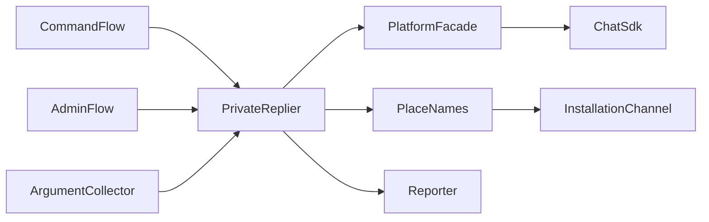
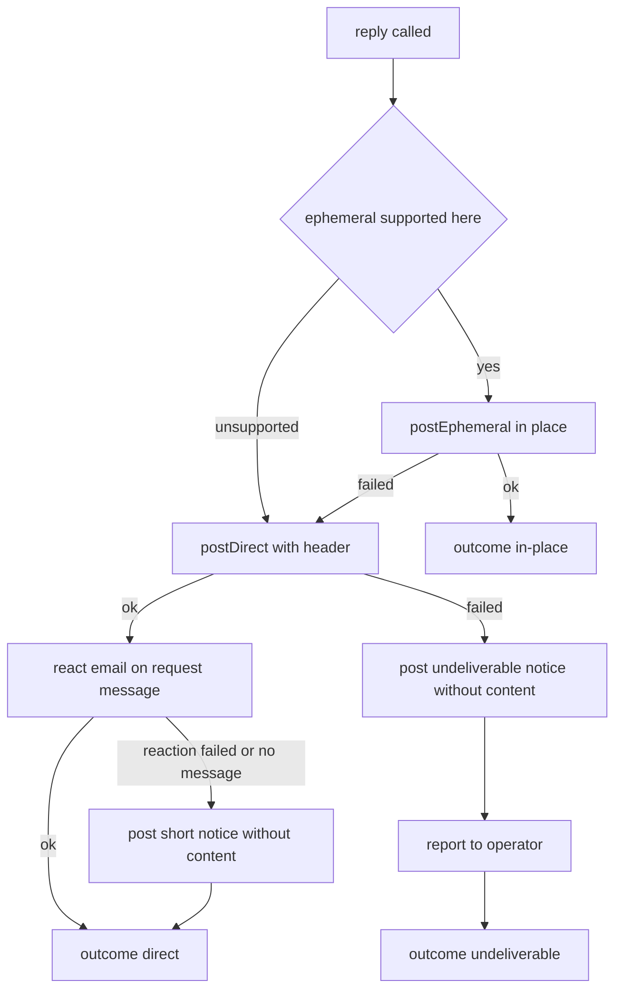
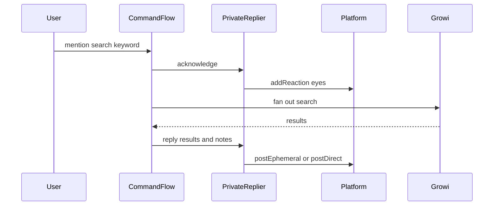
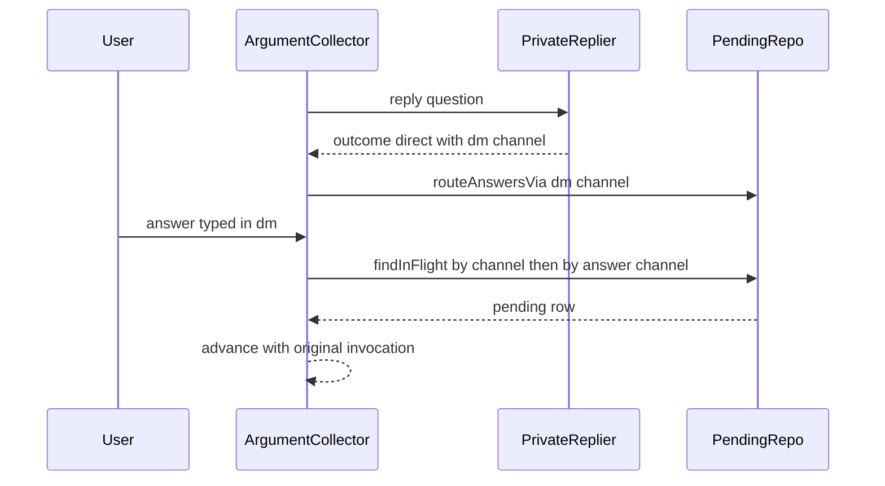

# Design Document — chat-integration-private-reply

## Overview

**Purpose**: chat-integration proxy が、依頼した本人にだけ返事を届ける仕組みを 1 か所にまとめる。
本人にだけ見えるメッセージを出せる場所ではそれを使い、出せないときや失敗したときは本人への DM で届ける。
どの失敗でも、返事の内容がチャンネルの全員に見える形にはならない。

**Users**: チャットから GROWI を検索・操作する人と、同じチャンネルの他の参加者。proxy の運用者。

**Impact**: 次の 3 点が変わる。
- `search` の結果は、チャンネルに出さず本人にだけ届く
- 今ある本人宛ての返事（登録コード、紐付けの URL と案内、許可されていないことの案内、エラー、引数の聞き返し、本人にだけ返している管理コマンドの返事）は、Mattermost でも Discord でも本人に届くようになる
- DM で聞き返したときは、DM での答えを受け付ける

### Goals

- 本人宛ての返事は、すべて 1 つの部品（`PrivateReplier`）を通る。部品を通らずに本人だけのメッセージを出す道を、型と試験でふさぐ
- 本人だけのメッセージ → 本人への DM → 内容を含まない知らせ、の順で落ちる。どの段でも返事の内容をチャンネルに出さない
- `search` の結果・注記・受け付けの知らせを本人にだけ届ける

### Non-Goals

- あとで（依頼の処理が終わった後で）届ける返事 — `chat-integration-agent` が、この部品の上に足す
- DM での installation の特定（roadmap の 2「DM や一覧にまだ無い場所でのコマンド」）。本 spec の DM の経路は、元のチャンネルで installation を引くので、これに依存しない
- 結果をチャンネルに共有する専用の操作
- 権限の有無を覚えて無駄な呼び出しを省くこと、DM の既読の確認

## Amend target

| 対象 | 変わる契約 | 書き戻し先 |
|---|---|---|
| `chat-integration`（umbrella）requirements.md | 要件 1（本人に届ける手段の違いと代わりの手段）・要件 3（検索の結果を本人にだけ届ける）の末尾に受け入れ条件を足す | 本 spec の requirements.md「書き戻し先（予定）」の表 |
| `chat-integration-proxy` design.md | プラットフォーム能力表（`ephemeralMessage` の Discord を `none`、Mattermost を `degraded` に。`directMessage` の行を足す）。検索の「いったん投稿して差し替える」段取り。引数の聞き返しが `ephemeralMessage` に寄りかかる記述。`pending_collection` の列。`PlatformFacade` の操作 | proxy design.md の能力表・検索の段取り・引数の収集・データモデル・`PlatformFacade` の節 |
| `chat-integration-proxy` の Revalidation Triggers | 変えない。能力表を変えるので、既存の「Chat SDK を更新したとき — 能力表を必ず突き合わせる」が本 spec の行にも効く | — |

`chat-integration-protocol` と `chat-integration-app` の契約は変わらない。能力の報告（`CapabilityReport`）の `capability` はただの文字列なので、`directMessage` を足しても protocol は変わらない。GROWI の管理画面は能力の名前をそのまま表示するので、`directMessage` の行が名前のまま加わる。

## Boundary Commitments

### This Spec Owns

- 本人宛ての返事をどう届けるかの判断（本人だけのメッセージ → DM → 内容を含まない知らせ → 運用者への報告）と、その順番
- DM で届けるときの見出し（どの場所の、何の依頼への返事か）と、内容を含まない知らせの文言
- platform 層の 3 つの仕組み: 本人だけのメッセージ（DM へは切り替えない）、本人への DM、依頼のメッセージへのリアクション
- `search` の結果・注記・受け付けの知らせの届け方
- DM で聞き返したときに、DM での答えを受け付けること（`pending_collection.answer_channel_id`）
- 能力表の `ephemeralMessage`・`directMessage` の行と、導入ドキュメントの関係する記述

### Out of Boundary

- 返事の中身（検索結果の並べ方・注記の内容・各コマンドの文言）。本 spec は届け方だけを変える
- チャンネルの全員に向けた返事（ヘルプ、ページ作成の成功の知らせ、URL の展開、通知、`unregister`・`weight`・`rotate-key` の返事）
- DM で打たれたコマンドの installation の特定（roadmap の 2）
- あとで届ける返事、少しずつの書き出し（`chat-integration-agent`）
- GROWI 側（`chat-integration-app`）と契約（`chat-integration-protocol`）

### Allowed Dependencies

- proxy の層の順（`types → capabilities → db → platform → command → relation → growi → orchestration → routes`）を守る。`PrivateReplier` は `command/` に置き、`platform/` と `db/`（の型）だけを使う
- Chat SDK に触れるのは `platform/` だけ（umbrella の決定 2）
- 場所の名前は `installation_channel`（既存の表）から読む。新しい表は作らない
- 運用者への報告は、既存の `reportOperationalFailure`（`runtime/` が注入する）を使う

### Revalidation Triggers

- `PrivateReplier` のインターフェースを変えたとき — `chat-integration-agent` が使う
- 能力表の `ephemeralMessage`・`directMessage` の値を変えたとき — GROWI の管理画面の表示（要件 1.3）と導入ドキュメント
- Chat SDK かアダプタを更新したとき — `postEphemeral`・`openDM`・`addReaction` の振る舞いを突き合わせる
- Slack アプリのマニフェストの権限を変えたとき — 導入済みの workspace は導入し直すまで新しい権限を持たない

## Architecture

### Existing Architecture Analysis

- 本人宛ての返事は、`platform.postEphemeral` を直接呼ぶ 5 か所に散っている（`command-flow.ts` の `tell`・`reportExpired`、`admin-flow.ts` の `say`、`argument-collector.ts` の 2 か所）
- `outbound.ts` の `postEphemeral` は Chat SDK の `fallbackToDM: true` に頼るが、これはアダプタに機能が無いとき（Discord）にしか働かない。Mattermost で権限が無いときのエラーや、Slack で本人がチャンネルにいないときのエラーは、そのまま `PostOutcome` の失敗になり、返事は落ちる
- 本人だけのメッセージは、チャンネルの直下に出る（`ChannelImpl` をチャンネルの id で作るので、Slack では `thread_ts` が付かない）。Slack の「返事の無いスレッドでは表示されない」制約は効かない
- `search` は、チャンネルに「検索しています…」を出して、結果で差し替える
- 聞き返しへの答えは、mention を (platform, チャンネル, 本人) で探す。DM での答えは見つからず、`stripAddressToken` が先頭の語を落とす

### Architecture Pattern & Boundary Map



- **Selected pattern**: 仕組みは platform 層、判断は `command/` の 1 か所（research.md の Architecture Pattern Evaluation の B）
- **呼ぶ側の型から `postEphemeral` を外す**: `CommandFlowPlatform`・`AdminFlowPlatform`・`ArgumentCollectorPlatform` は `postEphemeral` を持たない。本人宛ての返事は `PrivateReplier` 経由でしか出せない
- **場所の名前と報告は関数で受け取る**: `PrivateReplier` は repository も logger も import しない。`runtime/dependencies.ts` が組み立てて渡す（`.claude/rules/coding-style.md`「executor は work-set を引数で受け取る」と同じ向き）

### Technology Stack

| Layer | Choice / Version | Role in Feature | Notes |
|-------|------------------|-----------------|-------|
| Chat SDK | `chat@=4.38.1`、`@chat-adapter/{slack,discord,teams}@=4.38.1`、`chat-adapter-mattermost@=1.1.3` | 本人だけのメッセージ（`postEphemeral`）、DM（`openDM` + `postMessage`）、リアクション（`addReaction`） | 版は変えない。新しい依存は無い |
| Data | PostgreSQL + Prisma 6.19.2（既存） | `pending_collection.answer_channel_id` を足す | migration を 1 つ足す |
| Slack アプリ | マニフェスト | `im:write` を足す（DM を開くため） | 導入済みの workspace は導入し直しが要る |

## File Structure Plan

### Directory Structure

```
apps/chat-integration-proxy/
├── src/
│   ├── command/
│   │   ├── private-reply.ts          # 新規: PrivateReplier（届け方の判断・DM の見出し・知らせ・報告）
│   │   └── private-reply.spec.ts     # 新規: 失敗の組み合わせごとの試験
│   └── testing/
│       └── private-reply-adapters.integ.ts  # 新規: 本物のアダプタで DM・リアクション・本文の形を確かめる
└── prisma/migrations/
    └── <timestamp>_pending_collection_answer_channel/  # 新規: answer_channel_id と索引
```

### Modified Files

- `src/types/outbound-message.ts` — `PostOutcome` の失敗に `unsupported` を足す。`DirectPostOutcome`・`ReactionName` を足す
- `src/types/platform-event.ts` — `mention` に `inDirectMessage: boolean` と `messageId: string` を足す
- `src/types/invocation.ts` — `Invocation` に `sourceMessageId?: string | null` を足す（保存済みの行に無くても読めるよう省略可）
- `src/platform/outbound.ts` — `postEphemeral` は `fallbackToDM: false` で呼び、機能が無ければ `unsupported` を返す。`postDirect`・`addReaction` を足す
- `src/platform/index.ts` — `PlatformFacade` に `postDirect`・`addReaction` を足す
- `src/platform/event-mapping.ts` — mention に `inDirectMessage`（スレッドが DM か）と `messageId` を付ける
- `src/command/invocation.ts` — `normalize` と `stripAddressToken` が、DM では先頭の語を呼びかけとして落とさない（先頭が bot への呼びかけのときだけ落とす）。`sourceMessageId` を写す
- `src/command/argument-collector.ts` — 聞き返しを `PrivateReplier` で出す。`supports('ephemeralMessage')` による断りを外す。DM で届けたら `answer_channel_id` を記録し、`resume` はそれでも探す。`ArgumentCollectorPlatform` から `postEphemeral` を外す
- `src/command/index.ts` — `createPrivateReplier` と型を公開する
- `src/db/repositories/pending-collection-repository.ts` — `routeAnswersVia(correlationId, answerChannelId)`（同じ DM・同じ本人の古い行の経路を外す）と、`findInFlight` が `answer_channel_id` でも探すこと
- `prisma/schema.prisma` — `PendingCollection.answerChannelId` と索引
- `src/orchestration/command-flow.ts` — `tell`・`reportExpired`・`deliver` の代わりの経路を `PrivateReplier` に。`runSearch` を「受け付けの知らせ → 本人にだけ結果」に。`CommandFlowPlatform` から `postEphemeral` を外す
- `src/orchestration/admin-flow.ts` — `say` の本人宛て（`delivery: 'ephemeral'`）を `PrivateReplier` に。`AdminFlowPlatform` から `postEphemeral` を外す
- `src/capabilities/platform-capabilities.ts` — `ephemeralMessage` の Discord を `none`、Mattermost を `degraded`。`directMessage` の行（4 サービスとも `full`）と、`ephemeralMessage` の代わりの手段の文を足す
- `src/runtime/dependencies.ts` — `PrivateReplier` を組み立てる（facade、場所の名前の引き当て、`reportOperationalFailure`）
- `src/architecture.spec.ts` — `postEphemeral`・`postDirect` を呼んでよいのは `command/private-reply.ts` だけ、を確かめる
- `src/testing/command-flow-e2e.integ.ts` — 能力表の値の確認と、検索の結果がチャンネルに出ないことの確認を直す
- `docs/setup-slack.md`・`docs/manual-e2e-slack.md` — `im:write`。導入済みの workspace は導入し直すこと。実機試験の表（検索の結果は本人だけ、DM に落ちる場合）
- `docs/setup-mattermost.md` — 本人だけのメッセージにはシステム管理者の権限が要ること、与えなければ DM で届くこと
- `docs/setup-discord.md` — 本人宛ての返事は DM で届くこと。リアクションと DM に要る bot の権限
- `docs/setup-teams.md` — 本人宛ての返事の届き方と、DM に要る条件（利用者が一度 bot に呼びかけていること）

## System Flows

### 本人宛ての返事の届け方



- 「ephemeral supported here」は能力表ではなく、`postEphemeral` の結果で決める。能力表は運用者への説明（要件 4.1）のためのもので、実際の可否は呼んでみないと分からない（Mattermost は権限次第）
- DM が届いたあとの知らせ（リアクション・短い文）が失敗しても、返事は届いているので `direct` のまま
- 届けられなかったときの知らせ（短い文）の投稿も失敗しうる（bot がチャンネルにいない）。そのときは運用者への報告だけが残る。**どの分岐でも、返事の内容を含む投稿をチャンネルに出さない**

### 検索



- 受け付けの知らせは、依頼のメッセージへの `eyes` のリアクション。付けられないとき（依頼にメッセージが無い、サービスが拒んだ）は、本人宛ての返事として「「…」を検索しています…」を出す
- 紐付けの案内（`account-link-required`）は、今どおり GROWI ごとに本人宛てで出す。結果の一覧と注記は 1 通の本人宛ての返事にまとめる

### DM で聞き返したときの答え



- 答えを受け付けた後は、保存した invocation（元のチャンネル）で続ける。installation も元のチャンネルで引くので、DM での installation の特定には依存しない
- 同じ DM・同じ本人に別の聞き返しが届いたら、古い行の `answer_channel_id` を外す（新しい聞き返しが勝つ）。古い依頼は元のチャンネルでは引き続き答えられる

## Requirements Traceability

| Requirement | Summary | Components | Interfaces | Flows |
|-------------|---------|------------|------------|-------|
| 1.1 | 本人宛ての返事をチャンネルの全員に見せない | PrivateReplier、各呼び出し元の型、architecture.spec | `PrivateReplier.reply` | 本人宛ての返事の届け方 |
| 1.2 | 出せる場所では本人だけのメッセージ | PrivateReplier、PlatformFacade | `postEphemeral` | 同上 |
| 1.3 | 出せない場所では DM | PrivateReplier、outbound | `postEphemeral` の `unsupported`、`postDirect` | 同上 |
| 1.4 | 失敗したら DM で届け直す | PrivateReplier | `postDirect` | 同上 |
| 1.5 | DM に届いたことを内容なしで知らせる | PrivateReplier | `addReaction`、短い文 | 同上 |
| 1.6 | 届けられなかったことと取れる操作を内容なしで示す | PrivateReplier | `post`（短い文） | 同上 |
| 1.7 | 届けられなかったことを運用者向けに記録 | PrivateReplier、runtime | `reportUndeliverable` | 同上 |
| 1.8 | DM だけで、どこの何への返事か分かる | PrivateReplier、場所の名前の引き当て | `PrivateReplyOrigin.requestSummary`、`describePlace` | 同上 |
| 2.1 | 今ある本人宛ての返事を同じ仕組みで | CommandFlow、AdminFlow、ArgumentCollector | `PrivateReplier.reply` | — |
| 2.2 | DM になっても内容は同じ | PrivateReplier | 見出しを前に付けるだけ | — |
| 2.3 | DM での答えを受け付ける | ArgumentCollector、PendingCollectionRepository、event-mapping、invocation | `routeAnswersVia`、`findInFlight`、`inDirectMessage` | DM で聞き返したときの答え |
| 3.1 | 検索の結果を本人にだけ | CommandFlow（`runSearch`） | `PrivateReplier.reply` | 検索 |
| 3.2 | 注記も本人にだけ | CommandFlow | 同上 | 検索 |
| 3.3 | 受け付けたことを知らせる | CommandFlow、PrivateReplier | `acknowledge` | 検索 |
| 3.4 | 知らせに結果と注記を含めない | PrivateReplier | `acknowledge`・DM の知らせの文言 | 検索 |
| 3.5 | 並べ方と注記の内容は変えない | CommandFlow（`fuseResults`・`footerOf` は触らない） | — | — |
| 4.1 | 能力表で届き方を示す | platform-capabilities | `ephemeralMessage`・`directMessage` の行 | — |
| 4.2 | DM に要る権限を導入ドキュメントに | docs | — | — |
| 4.3 | 追加の権限が要るサービスの説明 | docs（Mattermost） | — | — |
| 5.1 | 全員向けの返事は変えない | CommandFlow（ヘルプ・作成の成功・URL の展開）、AdminFlow（`delivery: 'channel'`）、inbound-flow | 変えない | — |

## Components and Interfaces

| Component | Domain/Layer | Intent | Req Coverage | Key Dependencies | Contracts |
|-----------|--------------|--------|--------------|------------------|-----------|
| PrivateReplier | `command/` | 本人宛ての返事の届け方を決める唯一の場所 | 1.1〜1.8、2.2、3.3、3.4 | PlatformFacade (P0)、describePlace (P1)、reportUndeliverable (P1) | Service |
| PlatformFacade の追加 | `platform/` | 本人だけ・DM・リアクションの 3 つの仕組み | 1.2〜1.5 | Chat SDK アダプタ (P0) | Service |
| event-mapping / invocation | `platform/`・`command/` | DM の印と依頼のメッセージの id を運ぶ | 2.3、3.3 | — | State |
| ArgumentCollector の変更 | `command/` | 聞き返しを PrivateReplier で出し、DM の答えを受け付ける | 2.1、2.3 | PrivateReplier (P0)、PendingCollectionRepository (P0) | Service |
| PendingCollectionRepository の変更 | `db/` | 答えを受け付けるチャンネルを持つ | 2.3 | Prisma (P0) | State |
| CommandFlow / AdminFlow の変更 | `orchestration/` | 本人宛ての返事と検索を PrivateReplier に寄せる | 2.1、3.1〜3.5、5.1 | PrivateReplier (P0) | Service |
| 能力表 | `capabilities/` | 届き方を運用者に示す | 4.1 | — | State |

### command/

#### PrivateReplier

| Field | Detail |
|-------|--------|
| Intent | 本人宛ての返事を、本人だけのメッセージ → DM → 内容を含まない知らせ、の順で届ける |
| Requirements | 1.1, 1.2, 1.3, 1.4, 1.5, 1.6, 1.7, 1.8, 2.2, 3.3, 3.4 |

**Responsibilities & Constraints**
- 返事の内容を含む投稿は、本人だけのメッセージか本人への DM にしか出さない。`post`（全員に見える投稿）に渡すのは、内容を含まない知らせの文だけ
- DM の本文は「見出し + 元の返事」。見出しは「<場所> での「<依頼>」への返事です」。元の返事は変えない（要件 2.2）
- 例外を投げない。どの分岐でも `PrivateReplyOutcome` を返す
- 依頼のメッセージが無い（モーダルから再開した依頼など）ときは、リアクションの代わりに短い文で知らせる

**Dependencies**
- Outbound: `PlatformFacade` の `postEphemeral`・`postDirect`・`addReaction`・`post` (P0)
- Outbound: `describePlace(channel)` — `installation_channel.channel_name` を引く。無ければ `null` (P1)
- Outbound: `reportUndeliverable(fact)` — `reportOperationalFailure` に渡す。返事の内容は含めない (P1)

**Contracts**: Service [x]

##### Service Interface

```typescript
import type { ChatAccountRef, PlatformName } from '@growi/chat';
import type { PlatformFacade } from '../platform/index.js';
import type { OutboundMessage, SdkChannelRef } from '../types/index.js';

/** Who asked, where, and for what -- enough to address and label a reply. */
export interface PrivateReplyOrigin {
  readonly channel: SdkChannelRef;
  readonly actor: ChatAccountRef;
  /** The message that carried the request; `null` when there is none (modal, slash command). */
  readonly sourceMessageId: string | null;
  /** What was asked, as the DM header shows it, e.g. `search foo`. Never the reply itself. */
  readonly requestSummary: string;
}

export type PrivateReplyOutcome =
  | { readonly kind: 'in-place' }
  | { readonly kind: 'direct'; readonly directChannel: SdkChannelRef }
  | { readonly kind: 'undeliverable' };

export interface PrivateReplier {
  reply(origin: PrivateReplyOrigin, message: OutboundMessage): Promise<PrivateReplyOutcome>;
  /**
   * Tells the requester the request was received, without content: a reaction on the
   * request message, or -- when there is none or it fails -- `fallback` sent through `reply`.
   */
  acknowledge(origin: PrivateReplyOrigin, fallback: OutboundMessage): Promise<void>;
}

export interface PrivateReplierDeps {
  readonly platform: Pick<PlatformFacade, 'post' | 'postEphemeral' | 'postDirect' | 'addReaction'>;
  readonly describePlace: (channel: SdkChannelRef) => Promise<string | null>;
  readonly reportUndeliverable: (fact: UndeliverableFact) => void;
}

/** What the operator sees. Carries no reply content (Requirement 1.7). */
export interface UndeliverableFact {
  readonly platform: PlatformName;
  readonly channelId: string;
  readonly ephemeralFailure: string;
  readonly directFailure: string;
}

export const createPrivateReplier: (deps: PrivateReplierDeps) => PrivateReplier;
```

- Preconditions: `origin.actor.platform === origin.channel.platform`
- Postconditions: `in-place` なら本人だけのメッセージが出た。`direct` なら DM が届いた（知らせの成否は問わない）。`undeliverable` なら返事は誰にも届いておらず、運用者への報告を済ませた
- Invariants: 返事の内容を含む `post` を呼ばない

**Implementation Notes**
- 知らせの文言（DM に届いた・届けられなかった）と見出しは、このファイルに置く。届けられなかった知らせには、本人の表示名と「bot からの DM を受け取れるようにして、もう一度お試しください」を含める
- `acknowledge` の `eyes`、DM の知らせの `email` は Chat SDK の共通の絵文字名（platform 層で各サービスの名前に直る）
- Risks: Teams で bot がリアクションを付けられない場合は、短い文の経路に落ちる（実物で確かめる）

#### ArgumentCollector の変更

| Field | Detail |
|-------|--------|
| Intent | 聞き返しを `PrivateReplier` で出し、DM で届けたら DM での答えを受け付ける |
| Requirements | 2.1, 2.3 |

- `ask` と選択肢の聞き返しは `PrivateReplier.reply` を呼ぶ。`undeliverable` のときだけ、今の `unavailable` と同じく「聞き返せない」で終える。`supports('ephemeralMessage')` による事前の断りは外す（DM という代わりがある）
- `direct` が返ったら `pendingCollections.routeAnswersVia(correlationId, directChannel.channelId)` を呼ぶ
- `resume` の mention は、`findInFlight(platform, event.channel.channelId, actor)` が答えの行を、元のチャンネルか `answer_channel_id` のどちらかで探す
- 答えの本文は、`event.inDirectMessage` のとき先頭の語を落とさない（下の invocation の変更）
- `ArgumentCollectorPlatform` は `'openModal'` だけになる

#### invocation の変更

- `CommandInvocation.normalize(event)`: `event.kind === 'mention' && event.inDirectMessage` のとき、先頭の語が bot への呼びかけのときだけ落とす。呼びかけの形は、各サービスの本物の本文で確かめてから決める（`private-reply-adapters.integ.ts`）
- `stripAddressToken(text, { inDirectMessage })`: 同じ規則
- `sourceMessageId` に `event.messageId` を写す（slash-command は `null`）

### platform/

#### PlatformFacade の追加と変更

**Contracts**: Service [x]

```typescript
export type PostOutcome =
  | { readonly ok: true; readonly messageId: string }
  | { readonly ok: false; readonly reason: 'bot-not-in-channel'; readonly remedy: string }
  | { readonly ok: false; readonly reason: 'platform-error'; readonly detail: string }
  /** The adapter has no native ephemeral message. Nothing was posted. */
  | { readonly ok: false; readonly reason: 'unsupported' };

export type DirectPostOutcome =
  | { readonly ok: true; readonly messageId: string; readonly channel: SdkChannelRef }
  | { readonly ok: false; readonly detail: string };

/** Chat SDK's shared emoji names this app uses. */
export type ReactionName = 'eyes' | 'email';

export interface PlatformFacade {
  // ...existing operations...
  /** Only `user` can see it. Never falls back to a direct message. */
  postEphemeral(target: SdkChannelRef, user: ChatAccountRef, message: OutboundMessage,
    scope?: { readonly installationId: string }): Promise<PostOutcome>;
  /** Opens (or reuses) the 1:1 conversation with `user` and posts there. */
  postDirect(user: ChatAccountRef, message: OutboundMessage,
    scope?: { readonly installationId: string }): Promise<DirectPostOutcome>;
  addReaction(target: SdkMessageRef, reaction: ReactionName): Promise<PostOutcome>;
}
```

- `postEphemeral`: `ChannelImpl.postEphemeral(..., { fallbackToDM: false })`。`null`（アダプタに機能が無い）なら `unsupported`。例外は今どおり `classifyOutboundFailure` で分類する
- `postDirect`: アダプタの `openDM(user.accountId)` → `postMessage`。返す `channel` は DM のスレッド id から作った `SdkChannelRef`（既存の `channelRefOfThread` と同じ作り方）。Slack は `im:write` が無いと `openDM` が失敗する
- `addReaction`: アダプタの `addReaction(threadId, messageId, emoji)`。スレッド id は `channelThreadId` で作る
- 3 つとも例外を投げない（`attempt` で包む）

#### event-mapping の変更

- `fromMessage` が作る mention に、`inDirectMessage: thread.isDM` と `messageId: message.id` を付ける

### db/

#### PendingCollectionRepository の変更

**Contracts**: State [x]

```typescript
export interface PendingCollectionRepository {
  // ...existing...
  /**
   * Records that answers to this collection may arrive in `answerChannelId` (a DM).
   * Clears the same route from any other in-flight row of the same platform and actor,
   * so one DM answers at most one collection: the newest question wins.
   */
  routeAnswersVia(correlationId: string, answerChannelId: string): Promise<void>;
  /** Now also matches a row whose `answer_channel_id` equals `channelId`. The row's own channel wins. */
  findInFlight(platform: PlatformName, channelId: string, actorAccountId: string): Promise<PendingCollectionRecord | null>;
}
```

- `routeAnswersVia` は 1 つの transaction で「古い行の経路を外す」と「この行に書く」を行う
- `toRecord` の「保存した invocation のチャンネルと行のチャンネルの一致」の検査は変えない（`answer_channel_id` は別の列）
- 保存済みの invocation に `sourceMessageId` が無い行は、`null` として読む

### orchestration/

#### CommandFlow の変更

- `tell(invocation, message)` → `privateReplier.reply(originOf(invocation), message)`。`originOf` は `requestSummary` を `${commandName} ${argsText}`（空なら `commandName`）で作る
- `runSearch`: 仮の投稿（`platform.post` の「検索しています…」）をやめ、`privateReplier.acknowledge(origin, markdown('「…」を検索しています…'))` を呼ぶ。結果か「結果は得られませんでした」と注記は `privateReplier.reply` で 1 通にまとめて届ける。`fuseResults`・`footerOf` は変えない（要件 3.5）
- `deliver`（ヘルプの差し替え）の「仮の投稿に失敗したとき」の経路は `privateReplier.reply` にする。ヘルプ自体はチャンネルに出すまま（要件 5.1）
- `reportExpired(event)` → `privateReplier.reply`（DM の中で届いたイベントなら、DM の中で本人だけのメッセージか DM になる）。イベントは invocation を持たないので、`requestSummary` は「入力の続き」、`sourceMessageId` は mention の `messageId` にする
- `CommandFlowPlatform` は `'post' | 'replace' | 'attachPreview' | 'fetchHistory'` になる

#### AdminFlow の変更

- `say(invocation, text, 'ephemeral')` → `privateReplier.reply`。`'channel'` は今どおり `platform.post`
- `AdminFlowPlatform` は `'post'` だけになる

### capabilities/

| 能力 | Slack | Discord | Teams | Mattermost | 無いときの代わり |
|---|:--:|:--:|:--:|:--:|---|
| `ephemeralMessage`（本人だけのメッセージ） | ○ | × | ○ | △（bot にシステム管理者の権限が要る） | 本人への DM で届ける |
| `directMessage`（本人への DM） | ○ | ○ | ○ | ○ | — |

- `CAPABILITY_SUBSTITUTE.ephemeralMessage` に「Send it to that person as a direct message instead.」を足す
- `supports('ephemeralMessage', ...)` を呼ぶ箇所は残らない（届け方は呼んだ結果で決める）。表は運用者への説明のためにある

## Data Models

### Logical Data Model

`pending_collection` に 1 列と索引を足す。

| 列 | 型 | 意味 |
|---|---|---|
| `answer_channel_id` | `text`、null 可 | 聞き返しを DM で届けたとき、その DM の Chat SDK のチャンネル id。答えはここでも受け付ける |

- 索引: `(platform, answer_channel_id, actor_account_id)`
- 不変条件: 同じ (platform, `answer_channel_id`, `actor_account_id`) を持つ行は、期限内に高々 1 つ（`routeAnswersVia` が守る）
- 既存の行は `null` のまま。移行のためのデータの書き換えは要らない

## Error Handling

- **本人だけのメッセージの失敗**（`bot-not-in-channel`・`platform-error`・`unsupported`）: DM へ進む。利用者には何も出さない
- **DM の失敗**（Slack の `im:write` が無い、利用者が DM を受け取らない設定、Teams でテナントが分からない）: 内容を含まない知らせをその場に出し、運用者に報告する
- **知らせの失敗**: 運用者への報告だけ。返事の内容を含む投稿には決して落とさない
- 運用者への報告の文には、サービス名・チャンネルの id・2 つの失敗の理由だけを含め、返事の内容を含めない

## Testing Strategy

### Unit Tests（`command/private-reply.spec.ts`）

失敗の組み合わせ（本人だけのメッセージ: 成功 / 失敗 / 未対応 × DM: 成功 / 失敗 × 知らせ: 成功 / 失敗 × 依頼のメッセージ: 有り / 無し）のすべてで、次を確かめる。
- 返事の内容が `post`（全員に見える投稿）に一度も渡らない（1.1、3.4）
- 本人だけのメッセージが成功すれば DM を送らない（1.2）。未対応・失敗なら DM を送る（1.3、1.4）
- DM の本文が「見出し + 元の返事そのまま」で、見出しに場所の名前と依頼が入る。場所の名前が引けないときは「元のチャンネル」（1.8、2.2）
- DM が届いたら `email` のリアクション、付けられなければ内容を含まない短い文（1.5）
- 両方失敗したら、内容を含まない知らせと運用者への報告。報告に返事の内容が入らない（1.6、1.7）
- `acknowledge` はリアクションを付け、付けられなければ `fallback` を `reply` で届ける（3.3）

### Unit Tests（既存のファイル）

- `argument-collector.spec.ts`: DM で聞き返したら `routeAnswersVia` が呼ばれ、DM での答え（先頭の語を落とさない）で再開する。同じ DM に 2 つ目の聞き返しが届いたら、DM での答えは新しいほうに渡る（2.3）
- `invocation.spec.ts`: DM の mention は先頭の語を残す。DM でも先頭が呼びかけなら落とす（2.3）
- `command-flow.spec.ts`: `search` が `platform.post` を一度も呼ばず、結果と注記を `PrivateReplier.reply` の 1 通で届ける。並べ方と注記の文は変わらない（3.1、3.2、3.5）。ヘルプは今どおり `platform.post`（5.1）
- `admin-flow.spec.ts`: `delivery: 'ephemeral'` は `PrivateReplier`、`'channel'` は `platform.post`（2.1、5.1）
- `platform-capabilities.spec.ts`: 新しい行と値（4.1）
- `architecture.spec.ts`: `postEphemeral(`・`postDirect(` を呼ぶのは `command/private-reply.ts` だけ（1.1）

### Integration Tests

- `pending-collection-repository` の結合テスト（既存の `storage-round-trip.integ.ts` に足す）: `routeAnswersVia` が古い行の経路を外す。`findInFlight` が元のチャンネルと `answer_channel_id` の両方で見つけ、元のチャンネルを優先する。`sourceMessageId` の無い行を読める（2.3）
- `testing/private-reply-adapters.integ.ts`（本物のアダプタ、送信先の HTTP はスタブ）:
  - Discord で `postEphemeral` が `unsupported` になり、Chat SDK の自動の DM を通らない（見出しが必ず付く）
  - Mattermost の `/posts/ephemeral` が 403 を返したら DM（`/channels/direct`）に送る
  - 各サービスの DM のイベントで `inDirectMessage` が `true` になり、本文の先頭に呼びかけがどう表れるか（決定 6 の確認）
- `testing/command-flow-e2e.integ.ts`: 検索の結果がチャンネルへの投稿に含まれない。能力表の値の確認を新しい値に合わせる

### 実機試験（`docs/manual-e2e-slack.md`）

- 検索の結果が本人にだけ見える。別のアカウントからは見えない
- bot がいないチャンネル、または本人が抜けたチャンネルの依頼で、DM に届き、元のメッセージに封筒のリアクションが付く
- `im:write` の無い導入のままでは DM に落ちず、内容を含まない知らせになる（導入し直すと DM に届く）

## Migration Strategy

1. migration を当てる（`answer_channel_id` と索引。null 可なので既存の行はそのまま）
2. proxy を出す。保存済みの invocation に `sourceMessageId` が無くても読める
3. Slack: マニフェストに `im:write` を足し、**導入済みの workspace で導入し直してもらう**。導入し直すまでは、本人だけのメッセージが失敗したときに DM へ落ちず、内容を含まない知らせになる。返事の内容がチャンネルに出ることは無い
4. Mattermost: 運用者は、bot にシステム管理者の権限を与える（その場で本人だけに届く）か、与えずに DM で受け取るかを選ぶ

## Security Considerations

- 要件 1.1 の守りは 3 重にする: `PrivateReplier` の不変条件、呼ぶ側の型から `postEphemeral` を外すこと、`architecture.spec.ts` の検査
- 運用者への報告に返事の内容を入れない（登録コードや紐付けの URL が標準エラー出力に残らない）
- リアクションと内容を含まない知らせは、「この人が何かを頼んだ」ことだけを示す。頼んだこと自体は、メンションが全員に見えている時点で既に見えている
