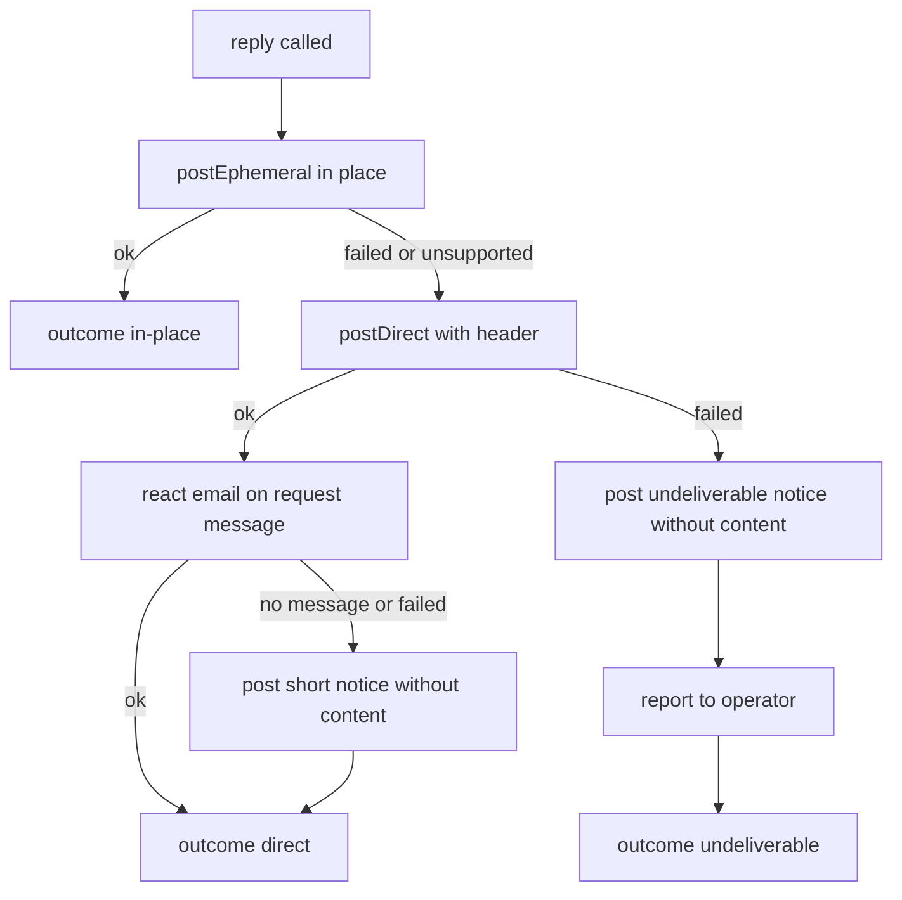

# Technical Design — chat-integration-proxy

> umbrella spec: [chat-integration](../chat-integration/)。要件は umbrella の `requirements.md` が持つ。
> 通信契約・署名・チャンネル権限の判定は [chat-integration-protocol](../chat-integration-protocol/) が持つ。
> 4 つの spec に共通する設計判断の根拠（決定 1〜14）は umbrella の `research.md`。本書で「決定 N」とだけ書くものはこちらを指す。
> proxy に固有の判断（本人宛ての返事の届け方の決定 P1〜P12、Discord の Gateway の開き方の決定 P13、接続の更新の失敗の決定 P14、Enterprise Grid のチャンネル一覧の決定 P15、イベントの installation の決定 P16）の根拠と、未解決の既知の問題は、本ディレクトリの `research.md`。

## Overview

**Purpose**: Slack・Mattermost・Discord・Microsoft Teams と GROWI をつなぐ中継サーバ。
1 台に**複数のチャット workspace と複数の GROWI** がぶら下がるハブとして動く。

**Impact**: 新規アプリ `apps/chat-integration-proxy`。**Gen 1（`apps/slackbot-proxy`）には手を入れない。**

### Non-Goals

- GROWI の権限判定・検索・ページ作成（`chat-integration-app`）
- 通信契約・署名・チャンネル権限の判定そのもの（`chat-integration-protocol`）
- Cloudflare Workers 向けの 2 つ目のビルド（決定 10 で不採用）

---

## Boundary Commitments

### This Spec Owns

- 4 サービスとのやり取り（Chat SDK 経由）と、**常時接続の生涯**
- 関係管理（1 workspace 対 N GROWI）、ペアリングの proxy 側、鍵の保管（PostgreSQL）
- コマンドの解釈、引数の収集、GROWI の選択、検索の待ち合わせと統合
- 本人宛ての返事の届け方（本人にだけ見えるメッセージ → 本人への DM → 内容を含まない知らせ。要件 1.6〜1.19・3.10〜3.14。能力表の届き方の行と導入ドキュメントの説明を含む）
- proxy 側の PostgreSQL スキーマ
- 閉域向け推奨構成のドキュメント

### Out of Boundary

- Gen 1 の実装 / Chat SDK のアダプタ実装（fork しない）
- 通信契約の型・署名・権限判定の実装（`@growi/chat` から使うだけ）

### Allowed Dependencies

| 依存先 | 使ってよい層 | 制約 |
|---|---|---|
| `chat@=4.38.1`、`@chat-adapter/{slack,discord,teams}@=4.38.1`、`chat-adapter-mattermost@=1.1.3`、`@chat-adapter/state-pg@=4.38.1` | **`src/platform/**` のみ** | 完全固定。他の層からの import を lint で禁止する |
| `@growi/chat` | すべての層 | 契約型・署名・権限判定 |
| `@prisma/client` 6.19.2 | `src/db/` と repository | apps/app と同じ版 |
| `hono@^4.13.5` | `src/routes/` と `src/runtime/` | 依存ゼロ。Web 標準の `Request`/`Response` を扱う |

**依存の向き**（左のものだけを import してよい）:

```
types → capabilities → db → platform → command → relation → growi → orchestration → routes
```

- `runtime/` は最も外側。上のどこからも import されない
- **repository が返す型は `types/` に置く。** `Relation` と `Invocation` を `relation/` と `command/` に置くと、
  `db`（3 番目）がそれより右の層を import することになる
- **`orchestration/` は relation と growi の右**。イベントを受けて各層を順に呼ぶ層で、
  アーキテクチャ図にある「束ねる処理」の実体
- **`relation/` は `growi/` を import しない。** `PairingService` が所有確認に必要とするのは
  「申告された URL へ確認値を送る関数」だけなので、**それを引数で受け取る**
  （`.claude/rules/coding-style.md`「executor は work-set を引数で受け取る」）
- **`src/platform/**` の外で `postEphemeral(`・`postDirect(` を呼んでよいのは `command/private-reply.ts` だけ。**
  facade は注入されるオブジェクトなので import の検査では表せず、`architecture.spec.ts` がソースの呼び出しを検査する
  （「PrivateReplier — 本人宛ての返事の届け方」）

### Revalidation Triggers

- `@growi/chat` の契約が変わったとき
- 対応するチャットサービスが増減したとき（能力表と要件 1.2 / 5.6 / 6.5 の対象が変わる）
- Chat SDK を更新したとき — **能力表を必ず突き合わせる**（docs が `protected` 拡張面を「まだ安定と見なしていない」と明記）
- 能力表の「要確認」の行を実物で確かめたとき（`plainReply`）
- Discord のアダプタを更新したとき — **`startGatewayListener` の約束を突き合わせる**: 聞き続ける処理の promise を `waitUntil` で渡す、
  決まった期間で閉じる、ログインの失敗を握りつぶして早く終わる、`webhookUrl` 無しならイベントを自分で Chat に渡す、`abortSignal` で止まる。
  proxy の Gateway の開き直し（決定 P13）はこの 5 つに寄りかかっている
- Chat SDK かアダプタを更新したとき — **`postEphemeral`・`openDM`・`addReaction` の振る舞いも突き合わせる**。
  本人だけのメッセージは `ChannelImpl` を通さずアダプタを直接呼び、DM への切り替えも proxy が自分で行う（proxy の research.md の決定 P2）ので、SDK 側の変更に自動では追従しない。
  `private-reply-adapters.integ.ts` を流し、DM のチャンネル id の一致・DM の本文の先頭の形・同じリアクションの 2 回付けを確かめ直す
- **`PrivateReplier` のインターフェース（`PrivateReplyOrigin`・`PrivateReplyOutcome`）を変えたとき** — `chat-integration-agent` が使う。
  「スレッドの中で本人だけに見せる」ためにスレッドの根元を `PrivateReplyOrigin` に足すのは、この変更に当たる
- **`PlatformFacade` の `postEphemeral`・`postDirect`・`addReaction` の約束を変えたとき** — 例外を投げない、`postEphemeral` は DM に切り替えない、
  同じリアクションが既に付いていれば成功、DM の結果に DM のチャンネルを返す、の 4 つに `PrivateReplier` が寄りかかっている
- 能力表の `ephemeralMessage`・`directMessage` の値か、能力の名前を変えたとき — GROWI の管理画面（要件 1.3・1.17）と導入ドキュメントの説明が変わる
- 保存する形を変えたとき — `pending_collection.invocation`（JSON）の `sourceMessageId` と、`pending_collection.answer_channel_id`。
  保存済みの行は `sourceMessageId` を持たないことがあり、`answer_channel_id` は DM での答え（要件 1.16）の唯一の手がかり
- Slack アプリのマニフェストの権限・設定（`im:write`、`features.app_home`）を変えたとき — 導入済みの workspace は導入し直すまで新しい権限を持たない
- **Chat SDK の並行処理（`concurrency`）を既定の `drop` から変えるとき** — イベントの installation は、ハンドラが受けたイベントと同じ非同期の流れの中で Slack の bot トークンを読んで決める（「どの installation のイベントか」）。`queue`・`debounce`・`burst` では待たされたメッセージが前のイベントの流れの中で処理され、別のイベントの workspace に決まりうる（proxy の research.md の決定 P16）
- **`ADAPTER_FACTORIES` の `workspaceOfEvent` を変えたとき、または Teams の installation を作る入口を足したとき** — DM と一覧に無いチャンネルでのコマンドがどの installation で動くかが変わる。`event-installation-adapters.integ.ts` を流す

---

## Architecture

### プラットフォーム能力表（設計の中核データ）

**唯一の宣言箇所。** 各所で `if (platform === 'mattermost')` と書かない。

**umbrella（`.kiro/specs/chat-integration/design.md`）の能力表とは測っているものが違う。** あちらは
研究ログ3のとおり「そのサービス／SDKのアダプタがスラッシュコマンドを受け取れるか」（Slack・Discordは○）
の実測を持つ。この proxy の表は「proxy 自身が今それを認識して起動できるか」（要件1.3で運用者に報告する値）
であり、`command/invocation.ts` の `normalize` が `/` を剥がしてコマンド語彙と突き合わせる正規化を
まだ実装していないため、Slack・Discordも含め4サービスとも`×`が正しい（`Testing Strategy`の該当項目・
本タスクの申し送りを参照）。

| 能力 | Slack | Discord | Teams | Mattermost | 無いときの代わり |
|---|:--:|:--:|:--:|:--:|---|
| `ephemeralMessage`（本人にだけ見えるメッセージ） | ○ | × | ○ | △ | 本人への DM で届ける（「PrivateReplier — 本人宛ての返事の届け方」）。Mattermost は bot にシステム管理者の権限（`create_post_ephemeral`）が要る |
| `directMessage`（本人への DM） | ○ | ○ | ○ | ○ | — |
| `slashCommand` | × | × | × | × | mention で起動する（決定 4）。proxy が正規化を実装すれば Slack・Discord は将来 ○ に変わりうる |
| `mention` | ○ | ○ | ○ | ○ | — |
| `modal` | ○ | × | ○ | × | コマンド行の引数 + 本人宛ての返事での聞き返し（決定 5） |
| `interactiveActions` | ○ | ○ | ○ | × | 番号つきの一覧を出して返信で選ばせる |
| `card` | ○ | ○ | ○ | △ | markdown で投稿する |
| `linkPreview` | ○ | × | × | × | 要件 6.5 に従い「使えない」と示す（Slack の `link_shared` に相当するものが他に無い） |
| `fetchMessages` | ○ | ○ | ○ | ○ | — |
| `plainReply` | 要確認 | 要確認 | 要確認 | 要確認 | **呼びかけ付きの返信にする**（下記） |

**接続をどの単位で張るか**は能力ではなく別の軸なので、表とは別に持つ。

**制約（能力ではない）**: `requiresInboundReachability`（外部からの接続を受ける必要があるか）は
**Teams だけ ○**、他の 3 つは ×。`supports()` の意味が反転する（true なら「使える」ではなく「穴が要る」）ので
能力表とは分けて持つ。要件 13.3 の接続元制限の対象。

| | 接続の単位 | ロックの鍵 | 根拠（実測 2026-08-27） |
|---|---|---|---|
| Slack | **アプリごと 1 本** | `app:slack` | `appToken`（`xapp-`）は app-level。README: 「Socket mode works with both single-workspace tokens and **multi-workspace OAuth**: events arriving over the socket resolve **per-installation tokens by `team_id`**」 |
| Discord | **アプリごと 1 本** | `app:discord` | Gateway は bot token 1 本 |
| Teams | 接続しない（外部から受ける） | — | Bot Framework が proxy へ POST してくる |
| Mattermost | **installation ごと** | `installation:{id}` | 接続先 `baseUrl` が installation ごとに違う |

> **Slack と Discord は「1 本の接続に全 workspace のイベントが届く」形である。**
> したがって installation の数だけ接続を開くことはなく、「同じ発言を workspace の数だけ処理する」も起きない。
> **ロックの鍵は接続の単位に合わせる** — アプリごとなら 1 台だけが 1 本を持ち、
> installation ごとなら installation の数だけ持ち分が分かれる。
> `ConnectionManager` はこの表を読んで動き、`if (platform === 'discord')` と書かない。

`CapabilityLevel` は `full` / `degraded` / `none` / `unverified` の 4 値。
表の ○ が `full`、△ が `degraded`、× が `none`、要確認が `unverified`。
`supports()` が `true` を返すのは **`full` のときだけ**。
- `degraded`（Mattermost の `card` と `ephemeralMessage`）— `false`。代わりの手段は表の右端の列のとおり（`card` は markdown で投稿、`ephemeralMessage` は本人への DM。後者は `supports()` を見ず、呼んだ結果で切り替える）。
  `levelOf()` で `degraded` を見分けられるので、「使えるが劣る」ことを利用者に示したい場所だけがそれを使う

> **`ephemeralMessage` と `directMessage` の行は、運用者への説明（要件 1.17）のためにある。** 本人宛ての返事の届け方は
> 表を見ずに、`postEphemeral` を呼んだ結果で決める（Mattermost で出せるかは bot の権限次第で、呼んでみないと分からない）。
> `supports('ephemeralMessage', …)` を呼ぶ箇所は無い。
- `unverified` — `false`。**確かめるまでその能力に寄りかからない**

> **`plainReply` に依存しない。** 番号つき一覧への答えは「`@growi 1`」と**呼びかけ付き**で返信させる。
> 必要な能力が全サービス ○ の `mention` だけになり、確かめるまで確定できない値への依存が消える。
> 利用者の手間は 1 語増える。
> **いまは呼びかけ無しの返信を受け付けない** — `PlatformEvent` から `reply` を外したので、
> 型として届かない。実測で `plainReply` を確かめられたら、型に `reply` を戻すところから始める
> （Revalidation Triggers に行がある）。

### 常時接続の生涯（要件 1.1 / 1.4 / 13.2）

**この proxy は webhook を待つだけのサーバではない。** Slack は Socket Mode、Discord は Gateway、
Mattermost は WebSocket で、**proxy 側から接続しに行く**（決定 7・10。閉域構成で外部から穴を開けずに済む理由がこれ）。
外部から接続を受けるのは **Teams だけ**。

したがって**接続を開く・閉じる・張り直す操作が要る**。webhook のハンドラだけでは成立しない。

```typescript
export interface ConnectionManager {
  start(): Promise<void>;
  stopAll(): Promise<void>;
  /**
   * **あるべき接続と今ある接続の差を埋める。** 一定間隔（既定 20 秒）で呼ぶ。
   * 起動時に 1 回ではなく**回し続ける**ことが要点（下記）。
   */
  reconcile(): Promise<void>;
  /**
   * 現在の接続状態。運用者が確認できる形で出す（要件 1.4 / 13.2）。
   * **接続 1 件の状態と、その接続が受け持つ installation の一覧を分けて返す** —
   * Slack と Discord は 1 本が多数の installation を受け持つので、
   * installation ごとの状態として返すと 100 件に同じ値が並ぶだけになる。
   */
  status(): Promise<ReadonlyArray<{
    readonly lockKey: string;                 // 'app:slack' | 'installation:{id}'
    readonly platform: PlatformName;
    readonly state: 'connected' | 'reconnecting' | 'failed' | 'held-by-other';
    readonly since: Date;
    readonly servedInstallationIds: ReadonlyArray<string>;
  }>>;
}
```

**切れたときは指数的に間隔を空けて張り直す。** 上限を超えたら `failed` として記録し、運用者に見える形で残す。
**1 つの接続の失敗を他へ波及させない**（要件 1.4）。

#### Discord の Gateway

Discord のアダプタは、初期化しただけでは Gateway を開かない。`startGatewayListener` を呼ぶと、
**決まった長さの間だけ**聞いて閉じる。そこで `app:discord` のロックを持っている間だけ、
`platform/listener-loop.ts` が 24 時間ずつ呼び直して開き続ける。

- **開く・閉じるは `ConnectionManager` の `open` / `close` に乗せる。** ロックを取ったら開き、
  ロックを失ったとき・終了するときに閉じる。閉じるときは、アダプタがイベントの処理をやめるのを待ってからロックを返す。
  ただし待つのは最大 5 秒で、他の接続のロックの延長を止めない
- **期間ごとに別の abort 用の signal を渡す。** アダプタは時間切れで終わった期間の listener を signal から外さないので、使い回すと終わった Client がメモリに残る
- **サービス名で分けない。** `ADAPTER_FACTORIES` のエントリが `startListenerWindow`（1 回分の期間だけ聞く関数）を
  持つサービスだけで動く。今は Discord だけが持つ
- **ログインの失敗は「期間より早く終わった」ことでしか分からない**（アダプタが握りつぶす）。
  早く終わったら運用者への報告に残し、間隔を空けて開き直す。最初の 1 回が開けないときだけ `open` を失敗させる
- イベントは Slack の Socket Mode と同じ入口（`registerEventHandlers` が登録した処理）に入る

根拠と、開き直しのたびに数秒分のイベントを取りこぼすことなどの代償は proxy の research.md の決定 P13。

#### 起動時に 1 回では成立しない

接続の管理を「起動時に数え上げてつなぐ」形にすると、次の 2 つが壊れる。

1. **取れなかったものを取りに行かない。** 2 台目の起動時に 1 台目が持っている installation は取れず、
   その後 1 台目が落ちてロックが切れても、2 台目は取りに行かない。
   **その workspace は誰もつながないまま黙り続ける。** 気づけるのは利用者が「反応しない」と言い出したとき
2. **ロックが自分の目的を壊す。** 寿命 60 秒の印を生きている持ち主が延ばさないなら、
   **正常に動いている 1 台目のロックが 60 秒で切れ、2 台目が引き取って二重に処理する。**
   これはロックが防ごうとしていたことそのもの

したがって `reconcile()` を一定間隔で回し、**毎回** (a) 取れていない**接続の単位**のロックを取りに行き、
(b) 自分が持っているロックを延ばし、(c) 延長に失敗したら**自分の接続を閉じる**（延長が「失敗した」と返ったときだけでなく、データベース障害などで**例外になったときも同じ**。結果が分からないロックは誰も延ばさず 60 秒で切れるので、開いたままにすると別の台と二重に処理し続ける。閉じたあとは再接続待ちとして記録し、ロックを取り直せたら開き直す。閉じられたときはロックも返す — 返さないと、同じ持ち主でも寿命が切れるまで取り直せず、60〜80 秒は誰も接続しないまま「他の台が持っている」と出て、外から見ると `connected` に見える）、
(d) **受け持ちが 0 件になったときだけ**閉じる、を行う。
**アプリごとの接続（Slack / Discord）は受け持ちが 0 件でも保つ** — OAuth の折り返しの直後にすぐつながるため。
 installation が 1 件消えても、アプリごとの接続は閉じてはいけない。

さらに 3 つ決めておく。

- **前の周回が終わる前に次を始めない。** installation が多いと 1 周が間隔を超えることがあり、
  重なって走ると同じ相手に 2 本つなぐ
- **ロックの寿命は回す間隔の 3 倍以上**（既定: 間隔 20 秒・寿命 60 秒）。
  この関係を書いておかないと、後から間隔だけを伸ばした運用者が二重処理を踏む
- **(c) で閉じ終わるまでの短い間、2 台が同じ相手につながることは避けられない。**
  延長に失敗した時点でロックは既に他の台に渡っており、閉じる操作は一瞬では終わらない。
  **この間の重複は Chat SDK の state による重複の取り除き（`event_id` 単位）が受け止める** —
  チャットサービスの再送を取り除く仕組みと同じものが、ここでも働く

#### 接続を張り直す引き金

**GROWI の紐付け（relation）の増減では接続を触らない。** ペアリング（要件 9）は
**すでにある installation に GROWI を 1 つ足す**操作で、要件 9.7 の解除は relation を 1 件消す操作である。
これを引き金にすると、**3 台紐づく workspace で 1 台だけ解除したときに残り 2 台の接続まで切れる。**
`reconcile()` が `installation` の一覧を見て差を埋めるので、引き金は「installation が増えた・消えた」だけでよい。

> **常駐コストは installation の数に比例する**（GROWI の台数には比例しない）。
> 「アイドル時のコストがゼロ」は常時接続を持つ以上あてはまらない。

#### Slack と Discord は受信が 1 台に集まる（規模の評価に必要）

`app:slack` のロックは 1 台しか持てないので、**その 1 台が全 workspace のイベントを受ける。** 帰結が 2 つある。

- **台数を増やしても受信は分散しない。** 投稿と GROWI への送信は分散するが、受信は分散しない
- **持ち主が落ちると、他の台が引き取るまで（既定 60 秒）そのサービス全体がまとめて黙る。**
  installation ごとに持ち分が分かれる Mattermost なら黙るのは一部だが、Slack と Discord は全体である。
  **ロックの寿命 60 秒は、そのまま「Slack が黙る最大時間」になる**

初版はこの形とする。受けた台が他の台へ配る仕組みは作らない（要件 8.1 の規模で足りるかは、
上の 2 点を前提に運用で測る）。

### 引数の収集 — 待つ関数として作らない

modal の送信も、番号つき一覧への返信も、**最初のリクエストとは別のイベントとして後から届く**。
proxy を複数台にすると別の台に届く。だから**途中経過を `pending_collection` に保存し、次のイベントで再開する**。

#### modal を開ける条件（能力表だけでは足りない）

modal を開くには、そのサービスが modal に対応しているかとは**別に、短命の手がかり**が要る
（Slack の `trigger_id`。スラッシュコマンドやボタン操作の応答としてだけ渡され、**mention の通知には付いてこない**）。

**したがって modal を選ぶ条件は「能力表が対応と言っている**かつ**有効な手がかりがある」。**

**手がかりは `PlatformEvent` の `interaction` に載る。無いときは `null`。**
そして**この手がかりは、サービスが渡してくる `trigger_id` そのものではない。**
Chat SDK は modal を「イベント自身が持つ `openModal()`」で開く形になっており、これを通さない開き方は使えない。

- **Teams には `adapter.openModal` が無い。** 4 つのアダプタのうちこれを実装しているのは Slack だけで、
  Teams は webhook の応答の中で modal を返す（`WebhookOptions.onOpenModal`）。Teams は `modal` が ○ なので、
  `trigger_id` を頼りにすると「対応と宣言しているのに一度も開けない」ことになる。
- **SDK は開く前に、その modal がどの会話のものかを保存する。** `SlashCommandEvent.openModal` /
  `ActionEvent.openModal` はイベントごとに作られる関数で、`contextId` を発行して元のスレッド・チャンネルを
  保存してから開く。送信されてきた modal はこの `contextId` で会話が引き直される。
  自前で `adapter.openModal` を呼ぶとこの保存が行われず、**送信された modal がどれも会話を引けずに捨てられる**。

したがって `InteractionRef` が持つのは**そのイベント自身の `openModal()` を指す手形**であり、
`platform/prompt.ts` がイベント処理中だけ保持する（`prompt.ts` の冒頭コメントに根拠を記載）。
`event-mapping.ts` はこれを**引数で受け取る**（`triggerId` から導出しない）。
これで Teams も開けるようになり、`interaction` が `null` なのは
「このやり取りには modal を開く手立てが無い」という意味だけになる。
そのため `slash-command` と `action` の `interaction` は `InteractionRef | null` である
（非 null にすると、手立ての無いサービスではイベント自体を作れず、コマンドが丸ごと使えなくなる）。

mention から始まったときの段取り:

1. `interactiveActions` が使えるなら、**ボタンを 1 つ出す**（「入力する」）
2. その押下で手がかりが得られるので、それで modal を開く
3. `interactiveActions` が使えない（Mattermost）か、手がかりが切れているなら、**聞き返しの経路へ落とす**

**要件 8.3 の経路（紐づく GROWI が 1 つなので選択させない）に注意。** 選択のボタンを出さないため、
mention から直接 modal を開こうとして手がかりが無い。この場合も上の 1 を通す。

#### イベントの振り分け

**`EventSink` が受け取る 6 種類すべての行き先を決める。** 書かないと、受け入れ条件を書けない部品が残る。

| `PlatformEvent.kind` | 行き先 |
|---|---|
| `mention` | 下の順序で振り分ける |
| `slash-command` | `CommandInvocation.normalize` へ直接（コマンド名が確定しているため） |
| `modal-submit` | `ArgumentCollector.resume`（`correlationId` で途中経過を引く） |
| `action` | 同上。GROWI の選択ボタン（要件 8.2）と一覧の選択がここに来る |
| `reply` | **受け取らない。** `plainReply` に依存しないと決めた（上記）ので、呼びかけ無しの返信は扱わない。`PlatformEvent` の型からも外す |
| `link-posted` | `link-preview` として扱う（要件 6.1）。**コマンドの解釈を通さない** |

`mention` の振り分け順序:

1. まず `CommandInvocation.normalize` を試す
2. コマンド名として解釈できなければ `ArgumentCollector.resume` に渡す
3. `resume` が `not-mine` を返したら通常のメッセージとして扱う（何もしない）

**新しいコマンドが優先される。** 途中経過がある状態でコマンド名を打てば、古い途中経過は破棄される。
ただし、聞き返しを DM に届けて答えの経路を DM に向けただけの行（元は別のチャンネルの依頼）は、DM で新しいコマンドを打っても破棄しない。

`mention` は、DM の中で届いたか（`inDirectMessage`）と、依頼のメッセージの id（`messageId`）を運ぶ。
Chat SDK は DM のメッセージを mention として届けるので、DM で打たれた答えもここを通る。

#### どの installation のイベントか（proxy の research.md の決定 P16）

**イベントが名指しする workspace を先に使い、保存済みのチャンネル一覧は、イベントが何も名指ししないときだけ使う。**
チャンネル一覧には DM が載らず、bot の招待を伴わずに入れるようになったチャンネルも次の取り直しまで載らない。一覧だけに頼ると、そこでのコマンドが「workspace がまだ登録されていません」と断られる。

- platform 層は、イベントを受けたハンドラの中で（Slack の bot トークンがまだ結び付いている間に）installation を調べ、`PlatformEvent.installation`（`EventInstallation`）に載せる。調べ方は `platform/event-installation.ts` の `lookUpEventInstallation` 1 つで、bot がチャンネルに追加されたときの一覧の取り直しも同じ規則を使う
- `event-mapping.ts` がイベントを作れなかった（呼びかけもリンクも無いメッセージなど）ときは調べない。調べるのにサービスへの問い合わせが要ることがあるため
- `CommandInvocation.normalize` が `Invocation.installation` に写す。保存した invocation（`pending_collection`）にも残るので、聞き返しのあとで再開した依頼も同じ installation で続く。この項目が無い古い行は一覧で引く
- `runtime/dependencies.ts` の `resolveInstallationId` は、`identified` ならその installation、`no-workspace` なら「無し」を返し、項目が無いときだけ一覧で引く。`CommandFlow`・`AdminFlow`・`observeActorRoles` が同じ関数を使う。`PrivateReplier` はチャンネルだけを渡すが、`privateReplyOriginOf` が invocation の `identified` の installation を `installationId` に入れる

| サービス | イベントから分かること | 決め方（`ADAPTER_FACTORIES` の宣言） |
|---|---|---|
| Slack | アダプタが、Socket Mode の封筒の `team_id`（組織全体の導入では `enterprise_id`）でそのイベントの bot トークンを選んでいる。DM も同じ | `workspaceOfEvent`: そのトークンで `auth.test` を呼び、`team_id`（組織全体の導入なら `enterprise_id`）を返す。トークンごとに 1 回だけ聞き、プロセスの中で覚える |
| Discord | チャンネル id（`discord:<guild>:<channel>`）が guild を持つ。DM は guild の代わりに `@me` | `workspaceOfEvent`: アダプタの `decodeThreadId` で guild を返す。DM（`isDM`）は `null` を返し、`no-workspace` になる |
| Mattermost | installation ごとに接続を開くので、イベントを受けた接続が installation そのもの | 接続を開いたときの installation の id をそのまま使う |
| Teams | 宣言が無い（installation を作る入口がまだ無い） | イベントからは決めない。一覧で引く |

**どの installation にも決まらないときの返事**:

- `no-workspace`（Discord の DM）: 「この DM はどの workspace にも属していないため、どの workspace の GROWI を使うかを決められません。サーバーや workspace のチャンネルで bot に呼びかけてください。」（`orchestration/no-workspace-wording.ts`。`CommandFlow` と `AdminFlow` が同じ文を使う）。`AdminFlow` は権限を読む前にこれを返す（権限は installation を通して読むので、先に読むと「proxy の設定の問題」と誤って案内する）。リンクの展開は何も言わない（要件 6.4）
- それ以外（イベントの workspace に installation が無く、一覧にも無い）: 今までどおり「このチャットの workspace がまだ登録されていません。」

**DM で installation が決まったあと**: DM でも、チャンネル単位の権限の判定（`@growi/chat` の `judge`。proxy の `judgeEach` と GROWI の `checkChannelPermission` が同じ関数を使う）にそのまま届く。読み取りのコマンドは既定で許される。書き込みのコマンドは、権限の行が無ければ `no-settings` で断られるが、関係の権限が `'all'`（管理画面の「すべてのチャンネル」）なら DM からも許される（`create-page` など）。このときも GROWI では紐付けた利用者として動き、他の workspace の GROWI には届かない。**「すべてのチャンネル」には DM を含める**（利用者が決めた）。Discord の DM の扱いは未決で、`chat-integration-agent` が要件 11 に DM の扱いを足すときに決める。リンクの展開も DM で動く（出るのは、ログインしていない人も見られるページの題名などだけ）

#### 聞き返しの届け方と、DM での答え（要件 1.14・1.16）

**聞き返しは `PrivateReplier` で出す。** 値の聞き返し・答えの検証の失敗・GROWI の選択・前の入力を取り消した知らせの 4 つすべてが対象。
本人にだけ見えるメッセージが出せなければ本人への DM に届くので、能力表で事前に断ることはしない。
`PrivateReplier` が `undeliverable` を返したときだけ「聞き返せない」で終える（利用者への知らせと運用者への報告は `PrivateReplier` が済ませている。proxy の research.md の決定 P10）。

**聞き返しが DM に届いたら、その DM でも答えを受け付ける**（proxy の research.md の決定 P6）。

1. `PrivateReplier.reply` が `direct` を返したら、`pendingCollections.routeAnswersVia(correlationId, DM のチャンネル id)` を呼び、行の `answer_channel_id` に書く。
   同じ platform・同じ本人で同じ DM を持つ他の行からは、その経路を外す（**同じ DM では新しい聞き返しが勝つ**）。外された古い依頼は元のチャンネルで引き続き答えられる
2. `resume` の `findInFlight(platform, チャンネル, 本人)` は、まず行のチャンネルで探し、見つからなければ `answer_channel_id` で探す（元のチャンネルの行が優先）
3. 答えを受け付けたあとは、保存した invocation（元のチャンネル）で続ける。installation は、保存した invocation が持つ、依頼のイベントが名指しした installation で引き、無ければ元のチャンネルで引く（上の「どの installation のイベントか」）

**答えの本文から呼びかけを外す規則**（`command/invocation.ts` の `stripAddressToken`。`CommandInvocation.normalize` も同じ規則）:

- チャンネルでは、先頭の語をいつも呼びかけとして落とす
- DM では、先頭の語が bot への呼びかけの形（`@語` か `<@…>`）のときだけ落とす。command 層には bot 自身の名前や id が届かないので、名前ではなく形で判定する
  （各サービスの実際の形と、この規則の弱点は proxy の research.md の決定 P8）

---

## File Structure Plan

```
apps/chat-integration-proxy/
├── prisma/
│   ├── schema.prisma
│   └── migrations/            # pending_collection の answer_channel_id と索引の migration を含む
├── src/
│   ├── types/
│   │   ├── index.ts               # InteractionRef / TimeRange / ModalForm / FieldSpec
│   │   ├── relation.ts            # Relation（db が返す型。上の層順の理由でここに置く）
│   │   ├── invocation.ts          # Invocation（同上。sourceMessageId は保存済みの行に無いことがあるので省略可）
│   │   ├── outbound-message.ts    # OutboundMessage / HistoryMessage / HistoryOutcome、本人だけのメッセージ・DM・リアクションの結果の型（SDK 型を含まない）
│   │   ├── distributed-lock.ts    # DistributedLock（SDK 型を含まない）
│   │   └── platform-event.ts      # PlatformEvent / PlatformAppConfig / InstallationCredentials
│   ├── capabilities/
│   │   ├── index.ts
│   │   ├── platform-capabilities.ts   # 能力表。唯一の宣言箇所
│   │   └── admin-check.ts             # 管理者かどうかの調べ方（4 サービス分のデータ）
│   ├── db/
│   │   ├── index.ts                       # この層の公開窓口
│   │   ├── prisma-client.ts
│   │   └── repositories/
│   │       ├── index.ts                   # リポジトリの公開窓口
│   │       ├── installation-repository.ts
│   │       ├── installation-channel-repository.ts   # 通知の宛先の検査に使う一覧
│   │       ├── relation-repository.ts
│   │       ├── peer-key-repository.ts     # 相手（GROWI）の公開鍵
│   │       ├── own-key-repository.ts      # **proxy 自身の鍵。秘密鍵は暗号化して保存**
│   │       ├── channel-permission-repository.ts
│   │       ├── pairing-order-repository.ts
│   │       ├── pending-collection-repository.ts
│   │       ├── processed-notification-repository.ts # 宛先ごとの通知の記録
│   │       └── request-nonce-repository.ts
│   ├── platform/                  # Chat SDK に触れてよい唯一の層
│   │   ├── index.ts
│   │   ├── bot-factory.ts
│   │   ├── adapter-set.ts         # 接続情報を受け取ってアダプタと state を組み立てる
│   │   ├── connection-manager.ts  # 常時接続の生涯
│   │   ├── listener-loop.ts       # 期間を区切って聞くサービス（Discord の Gateway）を開き直し続ける
│   │   ├── installation-provider.ts
│   │   ├── installation-store.ts  # installation を作る・消す
│   │   ├── event-mapping.ts       # SDK のイベント → PlatformEvent（SDK 型はここで止まる）
│   │   ├── event-installation.ts  # イベントがどの installation のものか（コマンドと bot の追加で共通の規則）
│   │   ├── outbound.ts            # 投稿・本人だけのメッセージ・DM・リアクション・差し替え・URL の展開
│   │   ├── prompt.ts              # modal の開閉
│   │   ├── history.ts
│   │   ├── channels.ts            # listChannels（周期で取り直して保存）
│   │   ├── actor-roles.ts         # observeActorRoles（要件9.1・チャット起点の運用者判定）
│   │   ├── private-reply-adapters.integ.ts # 本物の 4 アダプタで DM・リアクション・DM の本文の形を確かめる（Chat SDK を import できるのはこの層だけなので testing/ ではなくここに置く）
│   │   └── chat-service-stand-in.ts        # 試験用: 各サービスの HTTP API の代役（本番のビルドからは外す）
│   ├── command/
│   │   ├── invocation.ts          # mention / slash を 1 つの内部表現へ
│   │   ├── argument-collector.ts  # start / resume / sweepExpired
│   │   ├── pending-collection.ts
│   │   ├── command-set.ts         # 利用者向けコマンドの宣言（下記の表がそのまま中身）
│   │   ├── index.ts               # この層の公開窓口
│   │   ├── admin-command-set.ts   # 運用者向け（register / unregister / weight / rotate-key）
│   │   └── private-reply.ts       # PrivateReplier。本人宛ての返事の届け方を決める唯一の場所
│   ├── relation/
│   │   ├── index.ts               # この層の公開窓口
│   │   ├── pairing-service.ts     # 確認値を送る関数を引数で受け取る
│   │   ├── relation-key-service.ts # proxy 自身の鍵を作る・保管する・配る
│   │   ├── growi-uri-resolver.ts  # 名前を引き、確かめたアドレスへつなぐ（リダイレクトを追わない）
│   │   ├── growi-selection.ts
│   │   └── unpair-service.ts
│   ├── growi/
│   │   ├── index.ts               # この層の公開窓口
│   │   ├── growi-client.ts        # 署名つき送信
│   │   ├── fan-out-collector.ts   # 複数 GROWI への配信と待ち合わせ（検索とヘルプで共用）
│   │   └── search-fusion.ts
│   ├── orchestration/             # ★ イベントを受けて各層を順に呼ぶ
│   │   ├── index.ts
│   │   ├── event-sink.ts          # PlatformEventSink の実装
│   │   ├── command-flow.ts        # 権限 → GROWI 選択 → 引数収集 → 送信 → 投稿
│   │   └── inbound-flow.ts        # GROWI からの通知・設定・鍵
│   ├── routes/                    # Hono
│   │   ├── index.ts               # この層の公開窓口
│   │   ├── signature-guard.ts     # ★ 署名の検証（Hono の middleware）。GROWI から届く口の手前に立つ
│   │   ├── install-routes.ts      # OAuth の折り返し（Slack / Discord）。**installation を作る唯一の HTTP 経路**
│   │   ├── webhook-routes.ts      # Teams の受け口ほか
│   │   ├── growi-routes.ts        # 通知・設定・能力・鍵・ペアリング
│   │   └── health-routes.ts
│   └── runtime/
│       ├── index.ts               # この層の公開窓口
│       ├── server.ts              # プロセス起動、ConnectionManager.start()、シグナル処理
│       ├── config.ts              # process.env を読んでよい唯一のファイル
│       ├── dependencies.ts        # 部品の組み立て。PrivateReplier もここで作り、CommandFlow・AdminFlow・ArgumentCollector に渡す
│       ├── describe-place.ts      # DM の見出しに使う場所の名前を、保存済みのチャンネル一覧から引く
│       ├── mattermost-installations.ts  # 設定から Mattermost の接続先を読み、起動時に InstallationStore.save する
│       └── sweeper.ts             # 期限切れの掃除。**`DistributedLock` を引数で受け取る**（facade 全体は受け取らない）
├── docs/                          # ★ 要件 1.5。部品は文書を書かないので、置き場所をここで決める
│   ├── closed-network-deployment.md
│   ├── setup-slack.md             # アプリ作成・Socket Mode 有効化・appToken の取り方
│   ├── setup-discord.md           # アプリ作成・bot トークン・Gateway intents
│   ├── setup-teams.md             # **Azure Bot の登録。4 つで最も重い**
│   ├── setup-mattermost.md        # bot アカウント作成・接続先 URL の設定
│   └── rate-limit-notes.md        # GROWI の全体レート制限との関係（下記）
├── turbo.json                     # build / dev / lint / test。@growi/chat#build に依存
└── package.json
```

---

## Components and Interfaces

| Component | File | Intent | Req Coverage |
|---|---|---|---|
| `PlatformCapabilities` | `capabilities/platform-capabilities.ts` | 能力差を 1 か所のデータで持つ | 1.2, 1.17, 5.1, 5.6, 6.5, 13.2 |
| `PlatformFacade` | `platform/index.ts` ほか | Chat SDK に触れる唯一の層 | 1.1, 1.4, 1.7–1.10, 2.4, 5.4, 6.1 |
| `ConnectionManager` | `platform/connection-manager.ts` | 常時接続の生涯 | 1.1, 1.4, 13.2 |
| `ChannelDirectory` | `platform/channels.ts` | installation のチャンネル一覧を周期で取り直して保存 | 2.2, 2.4, 11.1 |
| `InstallationProvider` | `platform/installation-provider.ts` | workspace ごとの資格情報を解決 | 1.1, 8.1 |
| `InstallationStore` | `platform/installation-store.ts` | **installation を作る・消す。** OAuth の折り返しと、Mattermost の設定ファイルから呼ぶ | 1.1, 8.1 |
| `CommandInvocation` | `command/invocation.ts` | mention / slash を 1 つの内部表現へ | 1.2, 1.16, 3.1, 4.1, 14.1 |
| `ArgumentCollector` | `command/argument-collector.ts` | 値を集め、途中経過を保存して再開 | 1.2, 1.14, 1.16, 4.1, 5.2, 8.2, 11.5 |
| **`PrivateReplier`** | `command/private-reply.ts` | **本人宛ての返事の届け方を決める唯一の場所**（本人だけのメッセージ → DM → 内容を含まない知らせ） | 1.6–1.15, 3.12, 3.13 |
| `CommandSet` | `command/command-set.ts` | **利用者向けコマンドの宣言。** 名前・集める値・対象の決まり方を 1 か所のデータで持つ | 3.1, 4.1, 5.1, 7.3, 14.1 |
| `AdminCommandSet` | `command/admin-command-set.ts` | 運用者の入り口（**文字列の解釈と結果の組み立てだけ**） | 3.8, 9.1, 9.7, 10.5, 13.4 |
| `RelationKeyService` | `relation/relation-key-service.ts` | **proxy 自身の鍵を作り、保管し、GROWI へ配る** | 9.5, 9.6, 10.5, 10.6 |
| `GrowiSelector` | `relation/growi-selection.ts` | どの GROWI に対して実行するか | 6.4, 8.1–8.4, 8.6 |
| `PairingService` | `relation/pairing-service.ts` | ペアリングの proxy 側 | 9.1–9.7 |
| `FanOutCollector` | `growi/fan-out-collector.ts` | 複数 GROWI への配信と待ち合わせ | 3.1, 3.4, 3.5, 14.5 |
| `SearchFusion` | `growi/search-fusion.ts` | 重みつきの式で 1 本に統合 | 3.2, 3.3, 3.8 |
| `GrowiClient` | `growi/growi-client.ts` | 署名つきで GROWI を呼ぶ（`GrowiUriResolver` を通す）。**受け取った応答は必ず検査関数を通す**（`parseCommandResponse` ほか。応答に署名は付かないので形の確かめが唯一の受け入れ条件） | 3.1, 4.2, 5.2, 7.3, 9.2, 10.1, 10.5, 14.2 |
| `EventSink` | `orchestration/event-sink.ts` | イベントを受けて各層を呼ぶ | 1.1, 1.2, 3.1, 4.1, 6.1, 14.1 |
| `CommandFlow` / `AdminFlow` | `orchestration/command-flow.ts`・`admin-flow.ts` | コマンドを順に実行する。本人宛ての返事は `PrivateReplier` で、チャンネル向けの返事は `post` で出す | 1.14, 3.10–3.14 ほか |
| **`SignatureGuard`** | `routes/signature-guard.ts` | **届くリクエストの署名を検証する。この proxy の一番外側の守り** | **10.1, 10.2, 10.3, 10.4** |
| `InboundFlow` | `orchestration/inbound-flow.ts` | GROWI からの通知・設定・鍵の追加と失効 | 2.1–2.6, **10.5**, **10.7**, 11.4 |

### CommandSet — 利用者が打てるコマンドの宣言

**この表がそのまま `command/command-set.ts` の中身になる。** ここに無いものは打てない。
`if (name === 'search')` のような分岐を各層に書かず、**この宣言を読んで動く**（`.claude/rules/coding-style.md`）。

| 打つ言葉 | 集める値（`FieldSpec` の並び） | 送るもの | 対象の決まり方 | 権限判定に使う名前 |
|---|---|---|---|---|
| `search <語>` | `keyword`（必須・自由入力） | `CommandRequest`（`search`）。**`limit` は proxy が決める（既定 10）** — 利用者には聞かない | 許可している全 GROWI | `search` |
| `create-page` | `path`（必須）, `body`（必須・複数行） | `CommandRequest`（`create-page`） | 1 つに定まる | `create-page` |
| `keep` | `range`（必須・`TimeRange`）, `path`（必須） | `CommandRequest`（`keep`） | 1 つに定まる | `keep` |
| `help` | なし | `CommandRequest`（`help`） | 許可している全 GROWI | `help` |
| `link` | なし | **`AccountLinkStartRequest`** | **紐づく全 GROWI から選ばせる**（下記） | **判定しない**（下記） |
| （URL の投稿） | — | `CommandRequest`（`link-preview`） | URL の一致で決まる | `link-preview` |

**`title` は集めない。** `CommandRequest` の `create-page` と `keep` は `title` を運ばないので、
集めても捨てることになる。ページの題は本文の先頭の見出しかパスの末尾から決まる、という GROWI の
既定の振る舞いに任せる。**題を別に指定できるようにするなら、先に契約（protocol spec）へ足す。**

```typescript
/** 集める値の形。modal の部品と、聞き返しの文面が両方これから決まる */
export interface FieldSpec {
  readonly name: string;
  readonly label: string;
  readonly required: boolean;
  readonly kind: 'text' | 'multiline' | 'path' | 'time-range';
  readonly maxLength?: number;
}
```

**`FieldSpec` 1 つは、modal の入力欄 1 つになる**（欄の名前は `FieldSpec.name`、
`modal-submit` の `values` の鍵もこれ）。`time-range` も 1 欄で、範囲は 1 つの文字列として書いてもらう —
聞き返しの経路は 1 つの問いに 1 つの答えしか作れないので、modal だけ 2 欄（開始日・終了日）にすると
両方の経路で `values` の形が変わり、`ArgumentCollector` がどちらから来たかを知る必要が出てしまう。

**`link` だけ送るものが違う。** 紐付けの開始は `CommandRequest` ではなく `AccountLinkStartRequest` という
別の契約なので、**`COMMAND_NAMES` には足さない**。共有する契約を広げずに済み、
`COMMAND_TRAITS` の分類も `channel_permission` の行も要らなくなる。

**`link` はチャンネル権限の判定に掛けない。** GROWI への書き込みではなく、
利用者が自分の身元を結び付ける操作だからである。
そのため対象も**紐づく全 GROWI から選ばせる**（`GrowiSelector` の判断は「許可している GROWI」を
前提に書かれているが、`link` にはその絞りが無い）。

**`link` は `COMMAND_NAMES` の外にある。** 語彙を 1 か所に置くという protocol の約束から
唯一外れる項目なので、ここに書いておく。**後から `channel_permission` に `link` の行を作らないこと** —
判定に掛けない決定と食い違う。

#### 要件 7 の入り口は 2 つある

| 入り口 | 流れ |
|---|---|
| **利用者が自分から**（`link`） | `GrowiClient` が `AccountLinkStartRequest` を送る → `link-issued` なら `linkUrl` を**本人宛ての返事**（`PrivateReplier`）で出す。`already-linked` / `taken-by-another-user` はそのまま伝える（要件 7.4） |
| **操作を断られて**（要件 7.6） | GROWI が `CommandResponse` の `account-link-required`（`growiLabel` と `linkUrl` を持つ）を返す → 同じく**本人宛ての返事**で出す。書き込みに限らず、ゲストに閲覧を許さない GROWI は未紐付けの利用者の `search` / `help` にもこれを返す。全ての GROWI に送るコマンドでは、その GROWI を結果の注記に「紐付けが必要」として名指しし、「応答が無かった」には含めない。GROWI が `error` で断ったときも、その理由を注記に出す |

**どちらも投稿の経路は 1 本にする**（`orchestration/command-flow.ts`）。
`linkUrl` は一度きりで短時間に失効するので、**チャンネルに平文で出さない。**
複数の GROWI が紐づくチャンネルでは `growiLabel` を必ず添える — 紐付けは GROWI ごとに成立するので、
どれに対する紐付けかが分からないと利用者が取り違える（要件 7.2）。

---

### AdminCommandSet

| Field | Detail |
|---|---|
| Intent | 運用者が proxy 側の設定を触るための、チャットからの管理コマンド |
| Requirements | 3.8, 9.1, 9.7, 10.5, 13.4 |

| コマンド | 要件 | 内容 |
|---|---|---|
| `register` | 9.1 | 一定時間で失効する登録コードを発行する |
| `unregister` | 9.7 | 紐付けを解除する |
| `weight <growi> <値>` | 3.8 | その workspace における GROWI ごとの検索の重みを決める |
| `rotate-key` | 10.5 | proxy 側の鍵の入れ替えを**始める、または続きから進める**。配布の結果と未達の相手を返す（中身は `RelationKeyService`。下記の 4 段）。**2 回目以降は作り直さず配り直す**ので、運用者は相手側を直してからもう一度打てばよい |
| `rotate-key status` | 10.5 | 入れ替えの途中経過（関係ごとの未達）を見る。**4 段目はここから呼ぶ** — 全員に届いていれば古い鍵を失効させ、そうでなければ残りを示す |

**実行できるのは workspace の管理者だけ。** これが無いと、その workspace の誰でも自分の GROWI を紐付けられ、
**要件 9 の目的（第三者が勝手に登録できない）が成立しない**。

**調べ方はサービスごとに違うので、能力表の隣にデータとして持つ**（`capabilities/admin-check.ts`）。
`if (platform === ...)` と書かない。

| | 管理者かどうかの調べ方 |
|---|---|
| Slack | 利用者情報の `is_admin` / `is_owner` |
| Discord | ギルドの権限のビット（`ADMINISTRATOR` または `MANAGE_GUILD`） |
| Mattermost | 利用者のロールに `system_admin` または対象チームの `team_admin` |
| Teams | 所属の役割（`owner`）——**現状は判定できず、常に「判定できませんでした」で断る**（`platform/actor-roles.ts`）。`Invocation`/`PlatformEvent` が運ぶのは Bot Framework の利用者 ID だけで Graph が所属を引くための AAD オブジェクト ID が届かず、保存済みのチャンネル一覧にもチーム ID の列が無いため。閉じるには `types/` と `db/` の両方に変更が要り、今後の別タスクの対象 |

**登録コードは本人宛ての返事（`PrivateReplier`）で返す。** チャンネルに平文で出さない（protocol spec 手順 ①）。
運用者コマンドの返事のうち、本人宛て（`AdminDelivery` が `ephemeral`）は `PrivateReplier` で、チャンネル向け（`unregister`・`weight`・`rotate-key`）は `post` で出す。

**この部品は文字列の解釈と結果の組み立てだけを持つ。** 4 つの操作の中身はすべて右側の層にある
（`register` / `unregister` は `relation/`、`rotate-key` は `relation/` と `growi/`）ので、
ここから直に呼ぶと**宣言した依存の向き（`command → relation → growi`）を逆走する**。
実際の呼び出しは `orchestration/` が行い、この部品は**呼ぶべき操作と引数を値として返す**。

---

### RelationKeyService — proxy 自身の鍵

| Field | Detail |
|---|---|
| Intent | 関係ごとに proxy 自身の鍵を作り、秘密鍵を暗号化して保管し、公開鍵を GROWI へ配る |
| Requirements | 9.5, 9.6, 10.5, 10.6 |

**この部品が無いとペアリングが完成しない。** ⑥ で返す `PairingResult` は proxy の公開鍵を含むので、
その前に鍵を作っておく必要がある。**`relationId` を採番するのは proxy 自身なので、
関係の行と鍵の行を同じトランザクションで書ける**（GROWI 側にあった「鍵の置き場所が先に要る」という
順序の問題は proxy には起きない）。

**鍵は関係ごとに分ける。** 1 つの関係の秘密鍵が漏れても他の GROWI との関係に波及しない。

**入れ替えの単位は installation（workspace）である。** 管理コマンド `rotate-key` は引数を取らず、
運用者は workspace に対して打つので、その workspace に紐づく全 GROWI が対象になる。
**単位が決まらないと 4 段目の「全員に届いたら」の「全員」が決まらない。**

```typescript
export interface RelationKeyService {
  /** ペアリングの成立時に呼ぶ。`relation` の行と同じトランザクションで書く */
  issue(relationId: string): Promise<{ readonly keyId: string; readonly publicKeyJwk: JsonWebKey }>;
  /** 署名するときに呼ぶ。**復号は `own-key-repository` の中だけで行い、この層より外へ秘密鍵の値を持ち出さない** */
  signerFor(relationId: string): Promise<{ readonly key: KeyRef; readonly privateKey: KeyObject }>;
  /**
   * 入れ替えの 1〜3 段（作る → 配る → 結果を返す）。**関係ごとの結果を返す**。
   * **2 回目以降は作り直さず、届いていない相手にだけ配り直す** — 毎回作り直すと、
   * 運用者が相手側を直してもう一度打つたびに新しい鍵が増え、古い鍵は失効しないまま積み上がる
   */
  rotate(installationId: string): Promise<ReadonlyArray<RotationResult>>;
  /** 4 段目。**全員に届いているときだけ**、`key-revoke-to-growi` を送ってから自分の古い鍵を失効させる */
  revokeOldIfAllDelivered(installationId: string): Promise<boolean>;
}

export interface RotationResult {
  readonly relationId: string;
  readonly newKeyId: string;                       // **関係ごとに違う**（鍵は関係ごとに分けるため）
  readonly delivery: { readonly ok: true } | { readonly ok: false; readonly reason: string };
}
```

**途中経過は `own_key` に保存する。** 呼び出し元へ返すだけだと、
**`revokeOldIfAllDelivered()` が「全員に届いた」を何から判断するのか決められない。**

| 足す列 | 中身 |
|---|---|
| `superseded_key_id` | この鍵が置き換える相手。`null` なら入れ替えの途中ではない |
| `delivered_to_peer_at` | 相手が `key-register-to-growi` を受け付けた時刻。**`null` なら未達** |

**古い鍵を失効させる前に、相手にも失効を伝える。** `key-revoke-to-growi` を送らないと、
**GROWI 側は proxy の古い公開鍵を持ったまま**になり、入れ替えの目的（古い鍵を使えなくする）が相手側で果たされない。

**4 段目を別の操作に分けてある。** 同じ関数の中で条件分岐にすると、
「未達があるうちは失効させない」が**書き忘れで壊れる**。分けておけば**呼ばないだけ**で守れる。

**入れ替えは 4 段で、順番を入れ替えてはいけない**（要件 10.5・10.6）。

1. **関係ごとに**新しい鍵を作り、`own_key` に**有効な鍵として**書く（この時点で古い鍵も有効なまま）
2. 紐づく全 GROWI へ `KeyRegistrationRequest`（`op: 'key-register-to-growi'`）を送る
   （**署名は古い鍵で行う** — 新しい鍵はまだ相手が知らない）
3. **届かなかった相手を記録して運用者に返す。** ここで止められる形にする
4. `revokeOldIfAllDelivered()` を呼ぶ。**全員に届いているときにだけ**古い鍵を失効させる

**3 を飛ばして 4 をやると、届いていない相手との通信が止まる。** 受ける側にも
「有効な鍵が 0 本になる要求は断る」という条件があるが（下記の口の表）、
それは**相手の側の最後の砦**であって、こちらが順番を守らなくてよい理由にはならない。

**GrowiSelector の判断**（要件 8.2–8.4）
- 対象が 1 つに定まる操作で、許可している GROWI が複数 → **利用者に選ばせる**（8.2）
- 許可している GROWI が 1 つだけ → **選択を求めずそれに対して実行する**（8.3）
- **全 GROWI を対象とする操作（検索・ヘルプ）→ 選択を求めず、許可している全 GROWI へ配る**（8.4）
- どの GROWI も紐づいていない、または許可していない → 実行せず理由を示す（8.6・11.3）

### PlatformFacade

**資格情報を 2 つに分ける軸は、上の「接続の単位」の表と同じである。**

| 置き場所 | 何を持つか |
|---|---|
| `PlatformAppConfig` | **アプリごとに 1 つしかない値。** 常時接続を開くのに使う値はすべてこちら |
| `InstallationCredentials` | **その workspace でしか通用しない値。** 投稿・一覧の取得など、workspace を相手にする呼び出しに使う |

**アプリごとの接続は `PlatformAppConfig` から開き、installation ごとの接続は `InstallationCredentials` から開く。**
この分け方でないと、「受け持ちが 0 件でもアプリごとの接続は保つ」（下記）が成り立たない —
受け持ちが 0 件なら `installation` の行が 1 つも無く、そこからはトークンを取り出せないからである。

```typescript
/** 全 workspace 共通。`runtime/config.ts` が環境変数から読む */
export interface PlatformAppConfig {
  readonly slack?: {
    readonly signingSecret: string; readonly clientId: string; readonly clientSecret: string;
    /** `xapp-` で始まる app-level token。**Socket Mode の接続を開くのに使う** */
    readonly appToken: string;
  };
  readonly discord?: {
    readonly applicationId: string; readonly publicKey: string;
    /** OAuth の折り返しで受け取った code をトークンに交換するのに使う */
    readonly clientSecret: string;
    /** **Gateway の接続を開くのに使う。** Discord の bot トークンはアプリに 1 つで、
     *  参加しているサーバーごとには存在しない */
    readonly botToken: string;
  };
  readonly teams?: { readonly clientId: string; readonly clientSecret: string };
  readonly stateConnectionString: string;
}

/**
 * **workspace ごとの資格情報は `installation` から解決する。**
 * 1 台の proxy が複数の workspace をさばくハブであること（要件 8.1）がこの分離で成り立つ。
 * ここを 1 組に固定すると `installation` テーブルが誰も読まない列になる。
 *
 * **常時接続を開くための値はここに置かない**（上記）。
 */
export interface InstallationCredentials {
  /** Slack は接続はアプリごと、投稿は workspace ごとのトークン（Socket Mode が `team_id` で解決する） */
  readonly slack?: { readonly botToken: string };
  /** Discord は投稿もアプリごとの bot トークンで足りるので、workspace 固有の値は無い */
  readonly discord?: Record<string, never>;
  readonly teams?: { readonly tenantId: string };
  /** Mattermost は接続先そのものが installation ごとに違う */
  readonly mattermost?: { readonly baseUrl: string; readonly botToken: string };
}

export interface InstallationProvider {
  resolve(platform: PlatformName, workspaceId: string): Promise<InstallationCredentials | null>;
  /** `reconcile()` が **その接続が受け持つ installation** を知るために使う。
   *  「あるべき接続の本数」は installation の数では決まらない — アプリごとの接続は
   *  `PlatformAppConfig` にそのサービスの設定があるかどうかで決まる */
  list(platform: PlatformName): Promise<ReadonlyArray<{ installationId: string; workspaceId: string }>>;
}

/**
 * **installation を作る口。これが無いと初版が動かない。**
 * Gen 1 は `GET /oauth_redirect` と `InstallationStore.storeInstallation()` がここを担っていた。
 * サービスによって入り方が違う — Slack と Discord は OAuth の折り返し、
 * **Mattermost は運用者が接続先 URL と bot トークンを入力する**。どちらも受けられる形にする。
 */
export interface InstallationStore {
  save(platform: PlatformName, workspaceId: string, workspaceName: string, credentials: InstallationCredentials): Promise<string>;
  remove(installationId: string): Promise<void>;
}
```

**`save()` が返すのは installation の id だけ。** 作った直後の一覧の取り直し（下記「最初の 1 回」）が
失敗しても、`save()` は id を返して成功し、失敗は**呼ぶ側へ渡す関数で知らせる**。

**呼ぶ入り口は 2 つ**（型だけあって呼ぶ場所が無い、という状態にしない）。

| サービス | 入り口 | 置き場所 |
|---|---|---|
| Slack / Discord | **OAuth の折り返し**（`GET /install/{platform}/callback`）。Gen 1 の `GET /oauth_redirect` に相当 | `routes/install-routes.ts` |
| Mattermost | **設定ファイルから読み、起動時に `save` する。** チャットの管理コマンドは使えない — **bot がまだ Mattermost につながっていない段階ではコマンドを打てず、順番が逆になる** | `runtime/mattermost-installations.ts` |

```typescript

/** platform 層が外へ渡すイベント。**Chat SDK の型を含めない** */
export type PlatformEvent = (
  /** `inDirectMessage`: bot との 1 対 1 の会話の中か（非公開チャンネルでも真になる `channel.isPrivate` とは別）。`messageId`: 依頼のメッセージ自身の id */
  | { readonly kind: 'mention';       readonly platform: PlatformName; readonly channel: ChannelRef; readonly actor: ChatAccountRef; readonly text: string; readonly inDirectMessage: boolean; readonly messageId: string; readonly interaction: InteractionRef | null }
  | { readonly kind: 'slash-command'; readonly platform: PlatformName; readonly channel: ChannelRef; readonly actor: ChatAccountRef; readonly command: string; readonly text: string; readonly interaction: InteractionRef | null }
  | { readonly kind: 'modal-submit';  readonly platform: PlatformName; readonly channel: ChannelRef; readonly actor: ChatAccountRef; readonly correlationId: string; readonly values: Readonly<Record<string, string>> }
  | { readonly kind: 'action';        readonly platform: PlatformName; readonly channel: ChannelRef; readonly actor: ChatAccountRef; readonly correlationId: string; readonly actionId: string; readonly value: string | null; readonly interaction: InteractionRef | null }
  | { readonly kind: 'link-posted';   readonly platform: PlatformName; readonly channel: ChannelRef; readonly actor: ChatAccountRef; readonly messageRef: MessageRef; readonly urls: ReadonlyArray<string> }
  /** どの種類のイベントにも付く。無いときは、イベントが installation を名指ししなかった（「どの installation のイベントか」） */
  ) & { readonly installation?: EventInstallation };

/** `identified`: イベントが名指しした installation。`no-workspace`: サービスが「この会話はどの workspace にも属さない」と言った（Discord の DM） */
export type EventInstallation =
  | { readonly kind: 'identified'; readonly installationId: string }
  | { readonly kind: 'no-workspace' };

export interface PlatformEventSink { handle(event: PlatformEvent): Promise<void> }

export type PostOutcome =
  | { readonly ok: true; readonly messageId: string }
  | { readonly ok: false; readonly reason: 'bot-not-in-channel'; readonly remedy: string }
  | { readonly ok: false; readonly reason: 'platform-error'; readonly detail: string };

/** 本人だけのメッセージの結果。`PostOutcome` は広げない（`post`・`replace`・`attachPreview` の呼び出し側に起こりえない場合を扱わせない） */
export type EphemeralPostOutcome =
  | PostOutcome
  /** アダプタに本人だけのメッセージの機能が無い（Discord）。何も送っていない */
  | { readonly ok: false; readonly reason: 'unsupported' };

/** 本人への DM の結果。送れたなら DM のチャンネルを返す（DM での答えを受け付けるのに使う） */
export type DirectPostOutcome =
  | { readonly ok: true; readonly messageId: string; readonly channel: ChannelRef }
  | { readonly ok: false; readonly detail: string };

export type ReactionOutcome = { readonly ok: true } | { readonly ok: false; readonly detail: string };

/** Chat SDK の共通の絵文字名。各アダプタが自分のサービスの名前に直す */
export type ReactionName = 'eyes' | 'email';   // 受け付けた / DM に届いた

/**
 * **proxy 自身の語彙で持つ。Chat SDK の Card を含めない。**
 * Card への変換は `platform/outbound.ts` の中だけで行う。ここに SDK の型が入ると、
 * 組み立てる `orchestration/` が SDK を import することになり、決定 2 の lint に例外が要る。
 */
/**
 * 一覧の 1 行。文字列に組み立てず、リンクとその他の文字を分けて持つ。
 * どう描くかはサービスごとに違うので、`platform/outbound.ts` が決める（下の「一覧の描き方」）
 */
export interface ListRow {
  readonly primary:
    | { readonly kind: 'link'; readonly label: string; readonly url: string }   // 検索の結果
    | { readonly kind: 'text'; readonly markdown: string };                     // ヘルプの行
  /** 主な内容の下に薄く出す補足（検索ではパス。タイトルと同じことしか言わないなら持たない） */
  readonly detail?: string;
  /** どの GROWI の行か。必ず持つ。全行で同じなら一覧に 1 回だけ出す */
  readonly sourceLabel: string;
}

export type OutboundMessage =
  | { readonly kind: 'markdown'; readonly markdown: string }
  | { readonly kind: 'list'; readonly title: string;
      readonly rows: ReadonlyArray<ListRow>;
      readonly footer?: string }
  | { readonly kind: 'choice'; readonly prompt: string;
      /** `ArgumentCollector.resume` が進行中のやり取りを引く鍵。`outbound.ts` が `encodeActionId()` でボタンの action id に載せる */
      readonly correlationId: string;
      readonly options: ReadonlyArray<{ readonly id: string; readonly label: string }> };

export type HistoryOutcome =
  | { readonly ok: true; readonly messages: ReadonlyArray<HistoryMessage> }
  | { readonly ok: false; readonly reason: 'not-in-channel' | 'not-permitted' | 'unsupported'; readonly remedy: string };

/** `fetchMessages` が返す 1 発言。`KeepMessage`（protocol）へ変換して GROWI へ送る */
export interface HistoryMessage {
  readonly postedAt: string;
  readonly author: ChatAccountRef;
  readonly text: string;
}

/** Chat SDK の state が持つ分散ロックを、proxy 自身の型で外へ出す。
 *  `ConnectionManager` と `runtime/sweeper.ts` の両方がこれを使う */
export interface DistributedLock {
  acquire(key: string, ttlMs: number): Promise<boolean>;
  renew(key: string, ttlMs: number): Promise<boolean>;
  release(key: string): Promise<void>;
}

export interface PlatformFacade {
  post(target: ChannelRef, message: OutboundMessage): Promise<PostOutcome>;
  /** 本人にだけ見えるメッセージ。**DM には切り替えない**（切り替えは `PrivateReplier` が決める） */
  postEphemeral(target: ChannelRef, user: ChatAccountRef, message: OutboundMessage,
    /** `installationId` は他の呼び出しと同じ。`requestMessageId` は依頼のメッセージの id で、Slack だけが使う
     *  （依頼と同じ秒に出して返事が依頼より上に並ぶのを避けるため、次の秒まで待つ。決定 P12）。
     *  Slack の ts の形（`^\d+\.\d+$`）でなければ待たない */
    scope?: { readonly installationId?: string; readonly requestMessageId?: string | null }): Promise<EphemeralPostOutcome>;
  /** 本人との 1 対 1 の会話を開き（既にあれば使い）、そこに投稿する。`near` は依頼が来たチャンネルで、
   *  `postEphemeral` の `target` と同じく、サービスと接続（`scope` があればその installation）を選ぶのに使う */
  postDirect(near: ChannelRef, user: ChatAccountRef, message: OutboundMessage,
    scope?: { readonly installationId: string }): Promise<DirectPostOutcome>;
  /** 依頼のメッセージにリアクションを付ける。同じリアクションが既に付いていれば成功を返す */
  addReaction(target: MessageRef, reaction: ReactionName,
    scope?: { readonly installationId: string }): Promise<ReactionOutcome>;
  /** modal を開くだけ。送信は後から `modal-submit` として届く。
   *  **開けたかどうかを返す。** 開けなかったとき（手形が失効した・サービスが開かなかった）に
   *  呼ぶ側が「聞き返しの経路へ落とす」ためには、この 1 つの真偽値が要る */
  openModal(trigger: InteractionRef, form: ModalForm, correlationId: string): Promise<boolean>;
  /** installation のチャンネル一覧。**周期で取り直して保存するために使う**（通知のたびには呼ばない） */
  listChannels(installationId: string): Promise<ChannelInventory>;
  /** 要件 6.1 */
  attachPreview(target: MessageRef, preview: OutboundMessage): Promise<PostOutcome>;
  fetchHistory(target: ChannelRef, range: TimeRange): Promise<HistoryOutcome>;
  /** 先に受け付けを返した後、その投稿を差し替える。
   *  Slack は 3 秒、Discord は一次応答に 3 秒の期限があるため、ヘルプはこの経路を通る
   *  （検索は本人宛てなので使わない。「FanOutCollector」の段取り） */
  replace(message: MessageRef, replacement: OutboundMessage): Promise<PostOutcome>;
  /** 外部から接続を受けるサービス（Teams）のための受け口 */
  webhookHandler(platform: PlatformName): (request: Request) => Promise<Response>;
  /** チャットで打たれた運用者コマンドの実行者が、その installation で管理者かどうかを
   *  `capabilities/admin-check.ts` の `ADMIN_CHECK_TABLE` に従って読む（要件 9.1）。
   *  読めなかったときは `null`——「管理者でない」と「判定できない」を区別し、
   *  後者を「管理者でない」と偽らない */
  observeActorRoles(
    installationId: string,
    channel: ChannelRef,
    actor: ChatAccountRef,
  ): Promise<AdminActorRoles | null>;
  connections(): ConnectionManager;
  /** Chat SDK の state が持つ分散ロック。`sweeper` と `ConnectionManager` が使う */
  locks(): DistributedLock;
  /** この facade が開いたものをすべて返す（各チャット接続と、Postgres の state 接続）。
   *  `connections().stopAll()` とは別——そちらは state をつないだままにして
   *  ロックと投稿を機能させ続ける。state 自体を閉じられるのはこの層だけなので、
   *  プロセスの後始末（`runtime/server.ts`）はここを通る */
  shutdown(): Promise<void>;
}

export const createPlatformFacade: (
  appConfig: PlatformAppConfig,
  installations: InstallationProvider,
  sink: PlatformEventSink,
  /** 運用者向けの事実（読み取り失敗の理由など）を報告する先。省略可——
   *  何も渡さなくても facade は動く */
  reportOperationalFailure?: (message: string, error?: unknown) => void,
) => Promise<PlatformFacade>;
```

**Teams は `observeActorRoles` にまだ答えられない。** `Invocation`/`PlatformEvent`（`types/`）は
Bot Framework の利用者 ID しか運ばず、Graph が所属を引くための AAD オブジェクト ID が届かない。
加えて保存済みのチャンネル一覧（`db/`）にチーム ID の列が無く、Graph は所属をチーム単位でしか
答えない。どちらも `platform/` の外側（`types/`・`db/`）の変更が要るため、`platform/actor-roles.ts`
は「判定できませんでした」を返す——空の役割 `[]` を返すと、本物のチーム所有者に「あなたは
所有者ではない」と偽ることになるため。

- Preconditions: `openModal` は **`supports(platform, 'modal')` が真**のときだけ呼べる。
  手形が生きているかどうかは呼ぶ前に判定しない — 判定できるのは実際に開こうとしたサービス側だけなので、
  `openModal` が `false` を返したら聞き返しの経路へ落とす
- Postconditions: `openModal` は例外を投げず、開けたかどうかを返す（失効した手形は 3 秒の窓では普通に起きることで、
  コマンド全体を投げ出す理由にはならない）
- Postconditions: `post` は例外を投げず、必ず `PostOutcome` を返す（要件 1.4 / 2.4）
- Invariants: **platform 層の出入口に Chat SDK の型を含めない。** 出入口は `PlatformAppConfig` / `InstallationCredentials` /
  `PlatformEvent` / `OutboundMessage` / `HistoryOutcome` / `HistoryMessage` / `DistributedLock` の 7 つと、各操作の結果の型（`PostOutcome`・`EphemeralPostOutcome`・`DirectPostOutcome`・`ReactionOutcome`）。これらがどれも proxy 自身の型だけで書けることが、
  lint（`chat` / `@chat-adapter/*` の import を `platform/**` 以外で禁止）を**例外なしに**書ける条件

**一覧の描き方**（`platform/outbound.ts` の `toPostable`）:

- `card` が `full` のサービス（Slack・Discord・Teams）では Card にする。リンクの行は `CardText` に markdown のリンクを書かず、Chat SDK の `CardLink` にする。
  各アダプタが `CardLink` をそのサービスのリンクの書き方に直す（Slack は `<url|label>`、Discord と Teams は `[label](url)`）。
  `CardText` に書いた `[label](url)` は Slack ではリンクにならず、文字のまま出る（proxy の research.md「一覧の行のリンク」）。
  各アダプタがそれぞれのサービスの書き方に直すので、proxy 側に能力表の行もサービス名での分岐も要らない
- ヘルプの行（`text`）は今までどおり `CardText` に markdown を書く
- リンクの URL は、渡す前に空白・`|`・`(`・`)`・`[`・`]`・`<`・`>`・`` ` `` だけをパーセントエンコードする。GROWI はパスをエンコードせずに URL を作るので、これらがあるとリンクが途中で切れる（proxy の research.md「一覧の行のリンク」）。`CardLink` と Mattermost の markdown の両方に同じ処理を通す
- `detail` と GROWI の名前は、行のすぐ下に薄い文字（`muted`）で `·` でつないで出す
- 全行の `sourceLabel` が同じとき（結果を返した GROWI が 1 つだけのとき）は、名前を行ごとに繰り返さず、Card の `subtitle` に 1 回だけ出す。
  2 つ以上の GROWI の行が混ざるときだけ、行ごとに出す。判断は描く側で行い、`orchestration/` は常に各行に名前を入れる
- `card` が `degraded` のサービス（Mattermost）では markdown にする。リンクは `[label](url)`、補足は ` — ` のあとに続け、共通の名前はタイトルの次の行に 1 回だけ出す
- 検索の行は `orchestration/command-flow.ts` が作る。リンクの文字はページのタイトル、`detail` はパス。パスがタイトルそのもの、またはタイトルの前に `/` を付けただけのときは `detail` を持たない

**本人だけのメッセージ・DM・リアクションの 3 つの仕組み**（`platform/outbound.ts`）:

- `postEphemeral`: `ChannelImpl` を通さず、`channelThreadId(adapter, platform, channelId, null)` で作ったスレッドの形の id を宛先にして、アダプタの `postEphemeral` を直接呼ぶ（`replace`・`attachPreview` と同じやり方）。
  `ChannelImpl` は proxy のチャンネル id をそのまま渡すので、Mattermost のアダプタがスレッドの id として読めずに必ず失敗する。アダプタに機能が無ければ（Discord）`unsupported` を返し、何も送らない。失敗は `classifyOutboundFailure` で分類する（proxy の research.md の決定 P2）
- `postDirect`: `near` から `outboundContext(near.platform, scope)` でアダプタを選び、`openDM(user.accountId)` → `postMessage` を同じ installation の中で行う（Slack は会話を開くのにも installation の token が要る）。
  返す `channel` は、利用者がその DM に書いたときのイベントと同じ形で作る（`event-mapping.ts` の `directMessageChannelRef`）。4 サービスとも一致することを結合試験で確かめた。id を読めないときは「届かなかった」とする。Slack は `im:write` が無いと会話を開けない
- `addReaction`: アダプタの `addReaction` を `channelThreadId` で作ったスレッドの id で呼ぶ。同じリアクションが既に付いている（Slack の `already_reacted`）ときは成功を返す。どのサービスの応答を「既に付いている」と読むかは、表（`ALREADY_REACTED_ROWS`）の行で持つ
- 3 つとも例外を投げない

### ArgumentCollector

```typescript
export type StartOutcome =
  | { readonly status: 'collected'; readonly values: Readonly<Record<string, string>> }
  | { readonly status: 'pending';   readonly correlationId: string }
  /** 利用者への知らせと運用者への報告は `PrivateReplier` が済ませている */
  | { readonly status: 'unavailable' };

export type ResumeOutcome =
  | { readonly status: 'collected'; readonly values: Readonly<Record<string, string>>; readonly invocation: Invocation }
  | { readonly status: 'pending' }
  | { readonly status: 'cancelled' | 'expired' | 'not-mine' };

export interface ArgumentCollector {
  start(invocation: Invocation, fields: ReadonlyArray<FieldSpec>): Promise<StartOutcome>;
  resume(event: PlatformEvent): Promise<ResumeOutcome>;
  sweepExpired(now: Date): Promise<number>;
}
```

- Postconditions: `resume` が `collected` を返すときは**元の `Invocation` も返す** — 要件 11.5
  （後から部品が操作されたときも元のコマンドと同じ権限設定を適用する）を満たすため
- Invariants: 途中経過は**チャット上の識別子しか持たない**（要件 7.8）
- Invariants: 1 チャンネル・1 利用者につき同時に 1 件。新しいコマンドが始まったら古いものを破棄し、
  **破棄したことを利用者に示す**（DM に経路を向けただけの行は、その DM で打たれた新しいコマンドでは破棄しない）
- Invariants: 同じ (platform, `answer_channel_id`, 本人) を持つ行は高々 1 つ（`routeAnswersVia` が守る）
- 利用者に出すものはすべて `PrivateReplier` を通す（`ArgumentCollectorDeps.privateReplier`）。聞き返しの届け方と DM での答えは「引数の収集」の節

### PrivateReplier — 本人宛ての返事の届け方

| Field | Detail |
|---|---|
| Intent | 本人宛ての返事を、本人にだけ見えるメッセージ → 本人への DM → 内容を含まない知らせ、の順で届ける |
| Requirements | 1.6, 1.7, 1.8, 1.9, 1.10, 1.11, 1.12, 1.13, 1.15, 3.12, 3.13 |
| File | `command/private-reply.ts` |

**本人宛ての返事は、すべてこの部品を通る**（要件 1.14）。紐付けの案内、許可されていないことの案内、エラー、
`link` の URL、URL の展開で GROWI を選べなかった説明、入力の期限切れの知らせ、引数の聞き返し、
運用者コマンドの本人宛ての返事（登録コードなど）、検索の結果と注記。
ヘルプ・ページ作成の成功の知らせ・URL の展開・GROWI からの通知・チャンネル向けの運用者コマンドの返事は、
`post`（チャンネルの全員に見える投稿）で出す。



- **本人だけのメッセージを出せるかは、能力表ではなく `postEphemeral` の結果で決める。** 失敗の種類（`bot-not-in-channel`・`platform-error`・`unsupported`）を問わず DM へ進み、利用者には何も出さない（proxy の research.md の決定 P3）
- **Slack では、本人だけのメッセージを依頼のメッセージの次の秒まで待ってから出す。** `chat.postEphemeral` が返す `message_ts` は、秒の部分が Slack の現在の秒で、小数部は時刻ではなく通し番号である。依頼と同じ秒に出すと返事が依頼より上に並ぶ。`PrivateReplier` が `origin.sourceMessageId` を `postEphemeral` の `scope.requestMessageId` に渡し、待ちが要るかは `capabilities/platform-capabilities.ts` の `EPHEMERAL_MUST_FOLLOW_REQUEST_SECOND`（サービスごとの真偽値の表。今は Slack だけ `true`）で決める。待つのは `PlatformFacade.postEphemeral`（`platform/index.ts`）で、待ち方は `platform/ephemeral-ordering.ts`。「依頼の ts の秒 + 1 秒 + 余裕 250 ms」まで待ち、待ちの上限は 1500 ms、すでにその時刻を過ぎていれば待たない。依頼の id が無い・Slack の ts の形でない・表が `false` のサービスのときも待たない。待ちの失敗は投稿を止めない。待つ時計と sleep は `createPlatformFacade` の `callbacks.orderingClock` で差し替えられる（決定 P12）
- **余裕 250 ms が守るのは、proxy の時計が Slack の時計より進んでいるときだけ。** proxy の時計が Slack より遅れている場合は、proxy が目標の時刻に着いたとき、Slack の時計はもう「依頼の次の秒 + 余裕」を過ぎている。待ちが上限に当たっても、投稿は Slack の時計で「依頼の ts + 1.5 秒以上」になり、次の秒に入るので、対策は効く。危ないのは proxy が Slack より 250 ms を超えて進んでいる場合で、待ちが短く、または 0 になり、返事が依頼と同じ秒に入りうる。運用者は、タイミング記録（`CHAT_INTEGRATION_TRACE_PRIVATE_REPLY_TIMING=1`）の `request_ts` と `returned_id` の整数部（秒）を比べて見分けられる。同じ秒なら返事は依頼の上に出る。記録の行には待った時間が `waited_ms=` で載る
- **待ちが遅らせるのは本人だけのメッセージの投稿だけではない。** 本人だけのメッセージが失敗したとき（例: bot がチャンネルにいない）も、待ってから失敗が分かるので、そのあとの DM（`postDirect`）は最大でおよそ 1.25 秒遅れて送られる（proxy の時計が Slack より遅れているときの最悪値は上限の 1.5 秒）。`acknowledge`（依頼にリアクションを付けられないとき、「検索しています…」を本人だけのメッセージで出す経路。`orchestration/command-flow.ts` の `runSearch`）も同じ待ちを受け、検索の問い合わせの開始がその分遅れる。リアクション（`addReaction`）と、DM を直接出す経路そのものは待たない
- **DM の本文は「見出し + 元の返事」。** 見出しは「<場所> での「<依頼>」への返事です」。場所の名前は保存済みのチャンネル一覧から引き（`runtime/describe-place.ts`）、引けなければ「元のチャンネル」。元の返事は変えない（要件 1.15）。`list` は題の前に、`markdown` と `choice` は本文の前に見出しを置く
- **DM が届いたら、依頼のメッセージに `email`（封筒）のリアクションを付ける。** 付けられないとき（依頼のメッセージが無い、サービスが拒んだ）は、「<表示名> さん、返事を DM で送りました。」という内容を含まない短い文をその場に出す。同じリアクションが既に付いていれば成功なので、1 つの依頼から何通も DM に届いても、短い文は 2 回目から出ない（決定 P4）
- **DM も送れなければ**、内容を含まない「届けられませんでした」の知らせ（本人の表示名と、bot からの DM を受け取れる設定かを確かめ、だめなら運用者に連絡してほしいという案内）をその場に出し、運用者に報告する。報告にはサービス名・チャンネルの id・2 つの失敗の理由だけを含め、返事の内容を含めない（要件 1.11・1.12）。知らせの投稿も失敗したら、報告だけが残る
- **どの分岐でも、返事の内容を含む投稿をチャンネルに出さない。** `post` に渡すのは内容を含まない知らせの文だけ
- **例外を投げない。** どの分岐でも `PrivateReplyOutcome` を返す
- **installation は 4 つの platform 呼び出し（本人だけのメッセージ・DM・リアクション・知らせ）すべてに同じ `scope` として渡す。**
  `origin.installationId` を使い、`null` なら `resolveInstallationId(origin.channel)` で引く。引けなければ `scope` 無しで呼ぶ（決定 P9）

```typescript
/** Who asked, where, and for what -- enough to address and label a reply. */
export interface PrivateReplyOrigin {
  readonly channel: SdkChannelRef;
  readonly actor: ChatAccountRef;
  /** The message that carried the request; `null` when there is none (modal, slash command). */
  readonly sourceMessageId: string | null;
  /** What was asked, as the DM header shows it, e.g. `search foo`. Never the reply itself. */
  readonly requestSummary: string;
  /** `null` when the caller does not know it yet; the replier then resolves it from `channel`. */
  readonly installationId: string | null;
}

export type PrivateReplyOutcome =
  | { readonly kind: 'in-place' }
  | { readonly kind: 'direct'; readonly directChannel: SdkChannelRef }
  | { readonly kind: 'undeliverable' };

export interface PrivateReplier {
  reply(origin: PrivateReplyOrigin, message: OutboundMessage): Promise<PrivateReplyOutcome>;
  /** A reaction on the request message, or -- when there is none or it fails -- `fallback` sent through `reply`. */
  acknowledge(origin: PrivateReplyOrigin, fallback: OutboundMessage): Promise<void>;
}

export interface PrivateReplierDeps {
  readonly platform: Pick<PlatformFacade, 'post' | 'postEphemeral' | 'postDirect' | 'addReaction'>;
  readonly describePlace: (channel: SdkChannelRef) => Promise<string | null>;
  readonly resolveInstallationId: (channel: SdkChannelRef) => Promise<string | null>;
  readonly reportUndeliverable: (fact: UndeliverableFact) => void;
}

/** What the operator sees. Carries no reply content. */
export interface UndeliverableFact {
  readonly platform: PlatformName;
  readonly channelId: string;
  readonly ephemeralFailure: string;
  readonly directFailure: string;
}

export const createPrivateReplier: (deps: PrivateReplierDeps) => PrivateReplier;

/** `${commandName} ${argsText}` の 1 行目を 80 文字で切ったものを requestSummary にする */
export const privateReplyOriginOf: (invocation: Invocation, installationId: string | null) => PrivateReplyOrigin;
```

- Postconditions: `in-place` なら本人だけのメッセージが出た。`direct` なら DM が届いた（知らせの成否は問わない）。`undeliverable` なら返事は誰にも届いておらず、運用者への報告を済ませた
- Invariants: 返事の内容を含む `post` を呼ばない

**宛先の情報の作り方**（呼び出し元ごと）:

| 呼び出し元 | `requestSummary` | `sourceMessageId` | `installationId` |
|---|---|---|---|
| `CommandFlow`（各コマンド）・`AdminFlow` | `privateReplyOriginOf` が作る。`create-page` の引数はページの本文を含みうるので、1 行目だけを使う | 保存した invocation のもの（mention の `messageId`。slash command は `null`） | `selectFor` などで引いた値。まだ引けていない段階（「workspace がまだ登録されていません」など）は、イベントが名指しした installation、無ければ `null` |
| `ArgumentCollector`（聞き返し） | 同上 | 同上 | イベントが名指しした installation。無ければ `null`（`PrivateReplier` が元のチャンネルから引く） |
| `CommandFlow.previewLinks`（GROWI を選べなかった説明） | 「リンクの展開」 | リンクを貼ったメッセージ | `previewLinks` が引いた値 |
| `CommandFlow.reportExpired`（入力の期限切れ） | 「入力の続き」 | mention なら `messageId`、それ以外は `null` | イベントが名指しした installation。無ければ `null` |

**組み立て**: `runtime/dependencies.ts` が facade、`describePlace`（`runtime/describe-place.ts`）、既存の `resolveInstallationId`、
`reportOperationalFailure` を渡して 1 つ作り、`CommandFlow`・`AdminFlow`・`ArgumentCollector` に渡す。
`PrivateReplier` は repository も logger も import しない（`.claude/rules/coding-style.md`「executor は work-set を引数で受け取る」と同じ向き）。

**道が 1 つであることの守り**（要件 1.6）:

- `CommandFlowPlatform`（`post`・`replace`・`attachPreview`・`fetchHistory`）、`AdminFlowPlatform`（`post`）、`ArgumentCollectorPlatform`（`openModal`）は
  `postEphemeral` を持たない。本人宛ての返事は `PrivateReplier` 経由でしか出せない
- `architecture.spec.ts` が、`src/platform/**` の外で `postEphemeral(`・`postDirect(` を呼ぶのは `command/private-reply.ts` だけであることを確かめる
- 呼ぶ側の型には `post`・`replace` が残るので、「本人宛てにすべき返事を誤ってチャンネルに出す」ことは型では止まらない。
  `search` については `command-flow.spec.ts` と `testing/command-flow-e2e.integ.ts` が「`post`・`replace` を呼ばず、結果は本人宛ての返事 1 通で届く」を確かめる

**サービスごとの届き方**（導入ドキュメント `docs/setup-*.md` にも書いてある。要件 1.17〜1.19）:

| サービス | 本人宛ての返事が届く場所 | 用意するもの |
|---|---|---|
| Slack | その場（本人だけのメッセージ）。本人や bot がチャンネルにいないなど失敗したときは DM | DM を開く `im:write`、利用者が bot との DM に書き込める App Home の Messages タブの設定。導入済みの workspace は導入し直す |
| Discord | いつも DM（本人だけのメッセージの機能が無い） | 封筒のリアクションに Add Reactions。利用者が「サーバーのメンバーからの DM」を拒んでいると DM を送れない |
| Teams | その場（本人だけのメッセージ。24 時間で消える）。失敗したときは DM | DM を開くには、利用者が一度 bot に呼びかけている必要がある |
| Mattermost | bot にシステム管理者の権限があればその場、無ければ DM | 権限を与えるかを運用者が選ぶ |

既知の問題（DM の先頭の `@誰か` など）は proxy の research.md の「既知の問題」。


### FanOutCollector（検索とヘルプで共用）

```typescript
export interface FanOutOutcome<T> {
  readonly responded: ReadonlyArray<{ relationId: string; growiLabel: string; value: T }>;
  readonly notResponded: ReadonlyArray<{ relationId: string; growiLabel: string; reason: 'timeout' | 'error' }>;
  /**
   * **チャンネル権限で配らなかった GROWI（要件 11.3）。**
   * これが無いと、3 台紐づくチャンネルで 1 台が許可されていないとき、
   * 利用者は残り 2 台の結果だけを見て「全部を検索した」と思う — **検索が黙って不完全になる。**
   */
  /** `filterBroadcastTargets` が返す `PermissionVerdict` の理由をそのまま持つ。
   *  `not-permitted-in-channel` と `no-settings` は利用者への案内が違うので、1 つに丸めない */
  readonly excluded: ReadonlyArray<{ relationId: string; growiLabel: string; reason: 'not-permitted-in-channel' | 'no-settings' }>;
}

/**
 * 宛先ごとに `requestId` と `relationId` を作り替えて配る。
 * **落とした相手も引数で受け取る。** 配る相手だけを渡す形にすると `excluded` を埋める材料が無く、
 * 常に空になる（＝検索が黙って不完全になるのを防ぐ、という目的が果たせない）。
 */
export const fanOut: <T>(args: {
  readonly targets: ReadonlyArray<Relation>;
  readonly excluded: FanOutOutcome<never>['excluded'];   // `filterBroadcastTargets` が落とした相手
  readonly build: (relation: Relation) => CommandRequest;
  readonly extract: (response: CommandResponse, relation: Relation) => T;   // `T` を決める材料
  readonly deadlineMs?: number;    // 既定 10000
  readonly concurrency?: number;   // 既定 20
}) => Promise<FanOutOutcome<T>>;
```

- Invariants: `responded` が空でも例外を投げない（要件 3.5）
- **検索の段取り**（要件 3.10〜3.14）: 結果は検索した本人にだけ届ける。チャンネルには何も投稿しない。
  1. 受け付けたら `PrivateReplier.acknowledge` で、依頼のメッセージに `eyes` のリアクションを付ける。
     付けられないとき（依頼のメッセージが無い、サービスが拒んだ）は、本人宛ての返事として「「…」を検索しています…」を出す
  2. 紐付けが必要な GROWI があれば、その案内（`account-link-required`）を GROWI ごとに本人宛ての返事で出す
  3. 結果の一覧と注記（応答しなかった GROWI、紐付けが必要な GROWI、エラーを返した GROWI）、または「結果は得られませんでした」と注記を、
     **1 通の本人宛ての返事**（`PrivateReplier.reply`）で届ける。並べ方（`fuseResults`）と注記の文（`footerOf`）は、その場に届くか DM に届くかで変わらない
  - 本人宛ての返事は書き換えられない（Slack の本人だけのメッセージは書き換えられない）ので、検索では「いったん投稿して差し替える」を使わない
- **ヘルプの段取りは「いったん投稿して差し替える」**（ヘルプはチャンネルに出す）。受け付けの段階ではまだメッセージが無いので `MessageRef` を作れない。
  まず「使えるコマンドを調べています…」をチャンネルに投稿し、その `PostOutcome.messageId` から `MessageRef` を作り、
  結果が揃ったら `replace()` で差し替える。最初の投稿に失敗したとき（bot がチャンネルに書けない）は、ヘルプを本人宛ての返事で届ける
- **チャットサービス側の応答期限との関係**: Slack はイベントに 3 秒、Discord は一次応答に 3 秒の期限がある。
  **webhook にはまず受け付けを返し**（Slack は 200、Discord は deferred）、結果が揃ってから改めて投稿する。
  期限内に応答しないとチャットサービスが同じイベントを再送するので、重複の取り除きは Chat SDK の state に任せる
- 同時に出すリクエストの本数に上限を設ける（既定 20）。紐づく GROWI が多いときに proxy を詰まらせない
- **ヘルプも同じ待ち合わせを使う。** 複数 GROWI が紐づくチャンネルでは、
  **どの GROWI のヘルプかが分かる形で区別して示す**（要件 14.3）。
  ヘルプの内容は GROWI ごとに違いうる（バージョンによって提供するコマンドが変わるため）

**取り込む範囲に発言が 1 件も無いとき**（要件 5.5）は、ページを作らず「その範囲に発言がありません」と利用者に示す。
`fetchHistory` が空を返した時点で打ち切り、GROWI へは送らない。

### SearchFusion

```typescript
export const fuseResults: (
  sources: ReadonlyArray<{ relationId: string; growiLabel: string; weight: number; items: ReadonlyArray<SearchResultItem> }>,
  options?: { readonly k?: number; readonly limit?: number },
) => ReadonlyArray<{ item: SearchResultItem; relationId: string; growiLabel: string; score: number }>;
```

**単なる交互配置として実装しない。** `weight / (k + 順位)`（`k = 60`）の式のまま持つ。
GROWI ごとに文書集合が互いに素なので、重みが等しければ結果は交互配置と一致する。
重みを掛ける形で持つことで、アルゴリズムを変えずに要件 3.8 の調整ができる。
**関連度順ではない**ことは受け入れる。

### GROWI から届く口（`InboundFlow` が受ける）

### SignatureGuard — 届くリクエストの署名を検証する

| Field | Detail |
|---|---|
| Intent | GROWI から届くリクエストが、送信時から変わっていないことを確かめる |
| Requirements | 10.1, 10.2, 10.3, 10.4 |

**この部品が無いと、口を作る 8 本のタスクの中で実装者が各自その場で決めることになる** —
生のバイト列の取り方、有効期間の上限、`consumeNonce` を呼ぶ順序、失敗の記録。
**8 か所でばらばらに決まると、そのうち 1 か所が緩いだけで守りが崩れる。**
対になる `chat-integration-app` には `SignatureGuard` があり、片側だけ空けない。

```typescript
// routes/signature-guard.ts — Hono の middleware。GROWI から届く口の手前に立つ
export const signatureGuard = (deps: {
  readonly resolvePublicKey: (ref: KeyRef) => Promise<KeyObject | null>;  // peer-key-repository
  readonly consumeNonce: (ref: KeyRef, nonce: string, expiresAt: Date) => Promise<boolean>;  // request-nonce-repository
  readonly recordFailure: (failure: VerifyFailure, ctx: RequestContext) => Promise<void>;
}) => MiddlewareHandler;
```

書くべきことは 4 つ。

1. **本体は生のバイト列で受ける。** Hono では `await c.req.arrayBuffer()` を使う。
   **`c.req.json()` を呼んではいけない** — `content-digest` の計算に使うバイト列が失われ、
   解析した値から組み立て直すことになって**正しい相手が弾かれる**（app 側と同じ理由）。
   検証を通した後、**同じバイト列から**検査関数へ渡す
2. `resolvePublicKey` は `peer-key-repository`、`consumeNonce` は `request-nonce-repository` を包む。
   **どちらも `KeyRef`（`relationId` と `keyId` の組）で引く。**
   `resolvePublicKey` は**相手側の鍵だけを返す**（protocol の不変条件。自分の鍵を引くと反射が成立する）
3. **`consumeNonce` に渡す期限は、送られてきた値ではなく受ける側が上限（300 秒）で切った値**にする。
   これをしないと使い捨ての値の表が自動削除されず単調に増える。
   **`consumeNonce` は署名の検証に成功した後にだけ呼ぶ**（先に呼ぶと、鍵の識別子を知っているだけの相手が表を膨らませられる）
4. **失敗の種類**（`signature-mismatch` / `digest-mismatch` / `expired` / `replayed` / `unknown-key` / `malformed`）
   **を運用者向けに記録する**（要件 10.2）。**署名そのものと本文は記録しない**（umbrella の Security Considerations）

**`endpointOp` はハンドラに直接書かず、口の表からデータとして引く。** 経路の登録時に
「このパスの `op` はこれ」を 1 か所で対応づけておけば、**隣の口と同じ値を書き間違える道が構造で閉じる。**

---

署名を確かめた後、**`@growi/chat` の検査関数で本文の形を確かめてから**処理する
（署名は「経路上で書き換えられていない」ことしか示さない）。**口ごとに使う関数が違う** — 下の表を参照。
**`CommandRequest` は proxy へ来ない**（コマンドは proxy から GROWI へ送る側）ので `parseCommandRequest` は使わない。**本文の `relationId` が署名から特定した関係と
一致しないリクエストは `malformed` として断る**（protocol の不変条件）。

**パスと `op` は protocol spec の「口の一覧」が持つ。** ここに写すのは proxy が公開する側だけである。
**すべて `POST`。** 読み取りの口も本体に `{ relationId, op }` を載せる（理由は protocol spec）。

| 口（`op`） | パス | 受け取るもの | 検査関数 | 返すもの | **返す範囲** | 要件 |
|---|---|---|---|---|---|---|
| `notification` | `/chat-integration/notification` | `NotificationRequest` | `parseNotificationRequest` | `NotificationResult` | その関係の宛先だけ | 2.1–2.6 |
| `settings-push` | `/chat-integration/settings-push` | `SettingsPushRequest` | `parseSettingsPush` | `204` | — | 11.1, 11.2, 11.4 |
| `key-register-to-proxy` | `/chat-integration/keys/register` | `KeyRegistrationRequest` | `parseKeyRegistration` | `KeyOperationResult` | — | 10.5 |
| `key-revoke-to-proxy` | `/chat-integration/keys/revoke` | `KeyRevocationRequest` | `parseKeyRevocation` | `KeyOperationResult`。**有効な鍵が 0 本になる要求は `would-leave-no-valid-key` で断る** | — | 10.5 |
| `capabilities` | `/chat-integration/capabilities` | `OpOnlyRequest` | `parseOpEnvelope` | `CapabilityReport` | **proxy 全体**（能力表は静的で、どの workspace にも同じ。ここは範囲の問題が無い） | 1.3 |
| `connection-status` | `/chat-integration/connection-status` | `OpOnlyRequest` | `parseOpEnvelope` | **`ConnectionStatusView`**（`@growi/chat`。下記） | **その関係の installation を受け持つ接続 1 件だけ** | 1.4 |
| `channels` | `/chat-integration/channels` | `OpOnlyRequest` | `parseOpEnvelope` | **`ChannelInventory`** | **その関係の installation の分だけ** | 2.2, 11.1（管理画面が宛先を選ぶため） |
| （署名なし） | `/chat-integration/pairing/submit` | `PairingSubmission` | **`parsePairingSubmission`** | `PairingResult` | — | 9.1–9.5（**署名なし。本文の検査だけが守りなので必ず通す**） |

> **「返す範囲」の列が無いと、既定の実装は「全部返す」に倒れる** — 内部の状態をそのまま JSON にするのが
> 一番短いからである。official proxy には多数の GROWI が相乗りするので、
> **署名を通せる相手＝紐づいている GROWI であっても、他社の情報は返さない。**
> umbrella の Security Considerations が「1 台の GROWI が侵害されても、他の GROWI の関係にも
> その workspace の他のチャンネルにも触れられない」と約束している範囲である。
>
> **返す型は `@growi/chat` の `ConnectionStatusView`**（両側をまたぐ型なのでそちらが持つ）。
> `ConnectionManager.status()` の内部の形をそのまま返さず、次のように写す。
>
> | 内部の `state` | 返す `health` | 理由 |
> |---|---|---|
> | `connected` | `connected` | |
> | **`held-by-other`** | **`connected`** | **これは正常な状態である。** どの台が持っているかは呼ぶ側の関心ではない。`disconnected` に写すと、3 台構成では答えた台が持ち主でない限り「切断」と出る — **3 回に 2 回、正常なのに異常と表示される** |
> | `reconnecting` | `reconnecting` | |
> | `failed` | `failed` | **要件 1.4 で見たいのはこれ。** 一時的な切断と区別できる必要がある |
> | （Teams。接続を張らない） | **`not-applicable`** | `disconnected` と答えると、正常な Teams 連携が壊れているように見える |
>
> **件数（`servedInstallationCount`）は返さない。** official proxy では
> **何社が相乗りしているかを全顧客に見せる値**になる。運用者が見たいなら proxy のログか `health` に置く。

> **`connection-status` の位置づけ。** 「運用者に接続状態を見せる」ことを直接求める受け入れ条件は無い。
> これは**要件 1.4（あるサービスの失敗が他へ波及しない）が満たされていることを外から確かめる手段**であり、
> **この設計が Slack と Discord をアプリごとの 1 本に集約したことの帰結**でもある —
> 1 本しかないので、持ち主の台が落ちるとそのサービス全体が黙り、**他のサービスは動いているように見える。**
> 見る手段が無いと、1.4 を満たしているのか単に気づいていないのかを区別できない。

**署名を確かめた後、`acceptEnvelope()` で本体の `relationId` と `op` を突き合わせてから処理する。**
`op` の突き合わせが、署名を別の口へ流用させない唯一の縛りである（protocol spec）。

#### 二重に処理しないための手立ては口によって違う（要件 10.7）

**`requestId` を持つのは `NotificationRequest` だけ**なので、他の口を同じ形では守れない。
`nonce`（使い捨ての値）は再送のたびに取り直す決まりなので、**再送を見分ける役には立たない**。

| 口 | どう守るか |
|---|---|
| `notification` | `processed_notification_target` に**宛先ごと**に記録し、`posted` の宛先は飛ばす |
| `settings-push` | **設定の版**（`settings_version`）が自分の持つものより大きいときだけ書く。同じ押し込みが 2 度来ても 2 度目は何もしない |
| `key-register-to-proxy` | `(relation_id, key_id)` が一意なので、同じ鍵の 2 度目の登録は**何も変えずに成功を返す** |
| `key-revoke-to-proxy` | 失効は「`revoked_at` を立てる」だけなので、2 度目も結果が変わらない |
| `capabilities` / `connection-status` / `channels` | 読み取りだけなので、何度呼ばれても変わらない |
| `pairing/submit`（署名なし） | `pairing_order.consumed_at` を**条件つき更新で立てた 1 本だけ**が先へ進む。2 度目は同じ `PairingResult` を返す（新しい関係を作らない）。**署名も nonce も無い 2 つの入口の 1 つなので（もう 1 つは GROWI 側の ⑤）、ここが最も再送されやすい** |

**どの口も「2 度目が来ても結果が変わらない」形にしてある**ので、記録した応答を返し直す仕組みは要らない。

> **通知は宛先ごとに記録する。** 同じ `requestId` の 2 回目は、**`posted` になっていない宛先だけを投稿し直す**。
> `(relation_id, request_id)` で丸ごと弾くと、やり直しは記録を読み直すだけで投稿を一度も試みず、
> **bot を招待して直したのにやり直しても投稿されない**という直しようのない状態になる。
> 応答は**常に `targets` 全件ぶん**を返し、前回 `posted` だった宛先はその結果をそのまま載せる。

**設定の押し込みは版（`version`）を見る。** 自分が持つものより古ければ捨てる —
管理者が続けて 2 回変えて 1 回目の再送が遅れて届くと、古い設定が新しい設定を上書きするため（protocol の判断）。

**保険の取り直し**（`op: 'settings-pull'` の POST。`{growiUri}/_api/v3/chat-integration/peer/settings` → `SettingsPullResponse`）も版で比べる。

### 通知の宛先の検査（要件 2.4・Security）

`NotificationRequest.targets` のチャンネルが、**署名から特定した関係の installation に属すること**を確かめる。
属さないものは投稿せず `channel-not-in-installation` を返す。
これは **1 台の GROWI が侵害されたとき、被害が他の workspace や他のチャンネルへ広がらない唯一の手段**である。

**「その workspace のチャンネルか」と「bot が入っているチャンネルか」は別物。** 取り違えると案内が出せない —
bot が招待されていない公開チャンネルは、本当は `bot-not-in-channel`（招待すれば直る）なのに
`channel-not-in-installation` として断られる。要件 2.4 は前者について「投稿できるようにするために必要な操作」を
示すことを求めているので、この書き分けは保つ。

**判定は proxy が自分の周期で取り直して保存した一覧だけを見る。通知が来たときには引きに行かない。**

| | |
|---|---|
| 取り直し | **proxy が installation ごとに、自分の周期で**（既定 10 分）`PlatformFacade.listChannels()` を呼び、`installation_channel` に保存する |
| **最初の 1 回** | **`InstallationStore.save()` が成功した直後に 1 回取り直す。** これが無いと、`installation_channel` が空のまま最初の周期を待つことになり、**紐付けた直後の 10 分間、通知がすべて断られる** |
| **bot がチャンネルに追加されたとき** | **その installation をその場で取り直す。** 通知の宛先の検査と GROWI に見せる宛先の候補はこの一覧を見るので、これが無いと、bot を招待したばかりのチャンネルは次の周期まで（最長 10 分）宛先にできない（イベントが installation を名指ししないサービスでは、コマンドもこの一覧で引く）。どの installation かは、コマンドと同じ規則（`lookUpEventInstallation`。上の「どの installation のイベントか」）で読む。人が参加したときは何もしない |
| **消えたチャンネル** | **一覧が最後まで取れたときだけ、結果に無い行を消す。** 残すと、削除されたチャンネルが GROWI に宛先の候補として出続け、宛先の検査も通ったうえで投稿が失敗する |
| 判定 | 通知が来たら**保存した一覧だけを見る**。無いチャンネルは `channel-not-in-installation` |
| **id の形** | 一覧の行は Chat SDK の形（`slack:C…`。イベントの `Thread.channelId` と同じ）で保存する。宛先は GROWI からサービスが表示するままの形（`NativeChannelId`）で届くので、その installation の行のうち、サービスが表示する形に直すと宛先と一致する行を探し、見つかった行の id で投稿する。この引き当てが宛先の検査を兼ねる。Teams の行は Chat SDK の形にできないので、宛先にできないものとして扱う（umbrella research.md 決定 14） |
| **一度も取れていない installation** | `installation.channels_synced_at` が `NULL` の状態と、非 `NULL`（取り直しは完了したが結果が空だった）状態を**区別する**。前者は `channel-not-in-installation` ではなく **`inventory-not-ready`** を返す。前者で「そのチャンネルは無い」と答えると、**運用者に間違った直し方（チャンネルを作り直す・bot を入れ直す）を案内してしまう** |
| 取り直しの失敗 | **最後に取れた一覧をそのまま使い続ける**（新しい一覧が取れるまで判定は変わらない） |
| **Slack の Enterprise Grid の組織全体への導入** | installation の `workspace_id` は組織の id（`E…`）になるが、`conversations.list` に組織の id は渡せない（`team_access_not_granted`）。この場合は `auth.teams.list` でアプリが許可された workspace（`T…`）を取り、workspace ごとに `conversations.list` を呼んで結果を 1 つにまとめる（複数の workspace に共有されたチャンネルは 1 行）。普通の単一 workspace の導入（`T…`）は今までどおり、その id でそのまま取る |
| **一部の workspace だけ取れなかったとき** | 取れた workspace の分だけを保存し、取れなかった workspace は `ChannelListing.unlisted` に載せて呼ぶ側へ知らせる。**このとき「結果に無い行を消す」は行わない**（取れなかった workspace のチャンネルは、削除されたのか読めなかっただけなのか区別できないため）。`auth.teams.list` が失敗したとき、または全 workspace が失敗したときは一覧全体の失敗として、最後に取れた一覧を使い続ける。許可された workspace が 0 件のときは、空の一覧が完全な答えとして保存される |
| 誰が回すか | `sweeper` と同じく**分散ロックで 1 台だけ**が取り直す。保存先は PostgreSQL なので、**ロックを持たない台も読める** |

**その「最初の 1 回」が失敗したときは、installation を作り直させない。**
`save()` は installation の id を返して成功し、取り直しの失敗は**呼ぶ側へ渡す関数で知らせる**
（`InstallationStore` の実装が受け取る `onChannelRefreshFailed`。この関数は省略できない引数にする —
省略できると、2 つの入り口のどちらも渡さないまま失敗が消えてしまう）。
installation を巻き戻すと、一時的な通信の失敗のために運用者が導入をやり直すことになり、
Slack と Discord では**OAuth の折り返しをもう一度通ることになる**。
取りこぼした一覧は周期の取り直しが埋める（それがこの周期の役目である）。
ただし**黙って捨てない** — 次の周期までこの workspace 宛の通知は `inventory-not-ready` で断られるので、
運用者に伝える価値がある。周期の取り直しの失敗と同じ考え方（保存した状態は書き換えず、失敗は呼ぶ側へ渡す）で揃えてある。

**「通知が来たときに引く」と「失敗したら通す」を両方やめるのが要点。** 前の版はこの 2 つを持っていたため、
**侵害された GROWI が覚えていないチャンネル宛てに大量に送るだけで問い合わせを起こし、
チャットサービスの呼び出し上限に当てて検査を通る側へ倒せた** — 攻撃者が自分で条件を作れた。
取り直しを proxy の都合だけで行えば、外から問い合わせを起こす手立てが無くなり、
失敗時にどちらへ倒すかという判断も要らなくなる。

**管理者が選んだ宛先を材料にしない。** 要件 2.2（編集した人がページの保存時に宛先を指定する）は
管理者の設定を通らないので、管理者が選んだものだけを許すと**2.2 の通知がすべて断られる**。
判定の材料は「その installation に存在するチャンネルか」であって「管理者が選んだか」ではない。

### PairingService

```typescript
/** **`GrowiClient` を import しない。** 確認値を送る関数だけを引数で受け取る（依存の向きを守るため） */
export type SendChallenge = (growiUri: string, challenge: OwnershipChallenge) => Promise<ChallengeResponse>;

export interface PairingService {
  issueCode(installationId: string, issuedBy: ChatAccountRef): Promise<{ code: string; expiresAt: Date }>;
  submit(submission: PairingSubmission, send: SendChallenge): Promise<PairingResult>;
  unpair(relationId: string): Promise<void>;
}
```

**⑤ の応答は、検証の前に `parseChallengeResponse` を通す。**
これは**署名の付かない相手から届く唯一の応答**なので、形の確かめが唯一の受け入れ条件である。

**⑥ では `challenge` の一致だけでなく `challengeSignature` を検証する。**
検証に使うのは **③ で申告された公開鍵**、検証する値は protocol の `pairingChallengePayload(registrationCode, challenge)`
（`challenge` そのものではない。**`proxyUri` は入らない** — 両側で出どころが違い署名が一致しないため。
理由は protocol の「⑤ で署名する値」）。文字列の一致だけを実装すると、
第三者が本物の GROWI の URL と自分の鍵で申し込んだときに通ってしまい、鍵のすり替えが成立する
（protocol spec の「⑤ が公開鍵を縛る理由」）。検証に失敗したら `ownership-unverified` を返す。

**申告された URL の検証は 2 つに割れている**（protocol spec の「この検証をどちらが持つか」）。

- **条件そのものの判定**（https か・既定ポートか・引き終わったアドレスが私的帯でないか）→ `@growi/chat` の `judgeGrowiUri`
- **名前を引く（`node:dns`）、確かめたアドレスへつなぐ、リダイレクトを追わない、待ち時間の上限** → **この proxy が持つ**
  （`relation/growi-uri-resolver.ts`）。`@growi/chat` はネットワークに触れられない

custom proxy 向けに、許す宛先を運用者が設定で明示できるようにする（`runtime/config.ts` → `judgeGrowiUri` の `allowList`）。
**`allowList` に挙げた宛先には、つなぐときに信頼する証明書の根拠も運用者が指定できる**
（`runtime/config.ts`。閉域では自前の認証局や自己署名の証明書がふつうなので、
指定する手立てが無いと証明書の検証そのものを切る構成に落ちる）。

**判定はペアリングのときだけでなく、保存した `growi_uri` へ送る毎リクエストの前に掛ける**（protocol spec）。
`GrowiUriResolver` がその窓口で、**リクエストごとに名前を引き直し、引いたアドレスを `judgeGrowiUri` に掛け、
確かめたアドレスへつなぐ**。ペアリングのときだけだと、④ で公開アドレスを申告して通したあと
名前の引き先を閉域内へ付け替えるだけで、この検証が防ごうとしたものがそのまま成立する。

> **GROWI の全体レート制限に注意する**（`docs/rate-limit-notes.md`）。GROWI は
> `features/rate-limiter` を全 API に掛けており、既定は「IP・パス・メソッドごとに 1 分 2500 回」なので
> 普通は詰まらない。ただし **1 つの workspace の通信はすべて proxy の 1 つの IP から来る**ので、
> 運用者が `API_RATE_LIMIT_*` で絞ると**連携全体が止まる**。導入ドキュメントに書く。

**引いた結果は短い時間だけ覚える（既定 30 秒）。** 検索は紐づく GROWI の数だけ同時に出るので、
毎回引くと 1 回の検索で名前解決が N 回走る。30 秒なら、付け替えに気づくのが最大 30 秒遅れるだけで、
ペアリングのときだけ判定していた前の形（気づかないまま送り続ける）とは比べものにならない。

**`GrowiClient` は必ず `GrowiUriResolver` を通す。** 直に `fetch` しない。
2 つの部品が別々に HTTP を組み立てると、片方だけ判定が抜ける。
`PairingService.submit` が引数で受け取る `SendChallenge` も、**`orchestration/` が
`GrowiUriResolver` を包んで組み立てて渡す**（`relation/` は `growi/` を import しないため）。

---

## Data Models（proxy / PostgreSQL）

| テーブル | 主な列 | 索引・制約 |
|---|---|---|
| `installation` | `id`, `platform`, `workspace_id`, `workspace_name`, `credentials`（暗号化）, `created_at`, **`channels_synced_at`（nullable）** | `(platform, workspace_id)` 一意。**`channels_synced_at`** は `listChannels()` による一覧の取り直しが**結果によらず**（0 件でも）完了するたびに現在時刻を書く。`installation_channel` は installation ごとの行がチャンネル数だけ増減するため、それ単独では「一度も取れていない」と「取れた結果が 0 件だった」を区別できない — 前者は `channels_synced_at IS NULL`、後者は非 NULL かつ `installation_channel` に行が無い状態として区別する |
| `relation` | `id`（**推測できない値。連番にしない** — `keyid` として署名ヘッダに載り外部に出るため）, `installation_id`, `growi_uri`, `growi_label`, `search_weight`, `settings_version`, `created_at` | `(installation_id, growi_uri)` 一意 |
| `peer_key` | `id`, `relation_id`, `key_id`, `public_key_jwk`, `valid_from`, `revoked_at` | `(relation_id, key_id)` 一意 |
| `own_key` | `id`, `relation_id`, `key_id`, `private_key_pem`（暗号化）, `valid_from`, `revoked_at`, **`superseded_key_id`**, **`delivered_to_peer_at`** | 同上。**相手ごとに鍵を分ける** — 1 つの関係の鍵が漏れても他へ波及しないため。後ろ 2 列は入れ替えの途中経過（上記） |
| `pairing_order` | `id`, `installation_id`, `code_hash`, `attempts`, `expires_at`, `consumed_at`, **`relation_id`** | `code_hash` 一意。`attempts` に上限。**`relation_id` は 2 度目の申請に同じ `PairingResult` を返すための材料** — これが無いと「2 度目は同じものを返す」を実装できない |
| `request_nonce` | `relation_id`, `key_id`, `nonce`, `expires_at` | **主キー `(relation_id, key_id, nonce)`** |
| ~~`processed_request`~~ | — | **持たない。** コマンドは proxy から GROWI へ送る側なので、`CommandRequest` は proxy に届かない（下記の口の表）。GROWI から届くもののうち `requestId` を持つのは `NotificationRequest` だけで、それは `processed_notification_target` が受け持つ |
| `processed_notification_target` | `relation_id`, `request_id`, `platform`, `channel_id`, `status`, `detail`, `processed_at`, `expires_at` | **主キー `(relation_id, request_id, platform, channel_id)`。通知用** — `posted` の宛先は次のやり直しで飛ばす。**コマンドと同じ表に混ぜない**（主キーの意味が違い、読む人が取り違える） |
| `installation_channel` | `installation_id`, `platform`, `channel_id`, `channel_name`, `is_private`, `refreshed_at` | **主キー `(installation_id, channel_id)`。** 通知の宛先の検査に使う唯一の材料。周期で取り直す |
| `channel_permission` | `id`, `relation_id`, `command_name`, `channels` | **`(relation_id, command_name)` 一意。** `scope` も行ごとの `updated_at` も持たない — 前者は `COMMAND_TRAITS` の `targeting` で決まり、後者は**関係ごとに 1 つ**（`relation.settings_version`）だから |
| `pending_collection` | `correlation_id`, `relation_id`（**GROWI 選択中は空**）, `platform`, `channel_id`, `actor_account_id`, `command_name`, `invocation`(JSON), `collected`(JSON), **`offered_options`(JSON)**, `expires_at`, **`answer_channel_id`（nullable）** | `correlation_id` 主キー。`(platform, channel_id, actor_account_id)` と `(platform, answer_channel_id, actor_account_id)` に索引。**`answer_channel_id`** は聞き返しを DM に届けたときの、その DM のチャンネル id で、答えはここでも受け付ける（要件 1.16）。同じ (platform, `answer_channel_id`, `actor_account_id`) を持つ行は高々 1 つ（`routeAnswersVia` が 1 つの UPDATE 文で、古い行の経路を外しながら書く。repository は transaction を開かないため。proxy の research.md の決定 P7）。**`invocation` の `sourceMessageId`**（依頼のメッセージの id）は無い行もあり、`null` として読む |

Chat SDK の state（購読・分散ロック・重複排除）は `@chat-adapter/state-pg` が別スキーマに持つ。**触らない。**

**期限切れの掃除**: `request_nonce` / **`processed_notification_target`** / `pending_collection` / `pairing_order` を
`runtime/sweeper.ts` が定期的に削除する。**分散ロックで 1 台だけが実行する。**

**紐付けを解除したとき（要件 9.7）**: `relation` に連なる `own_key` / `peer_key` / `channel_permission` /
`pending_collection` / `processed_notification_target` を削除し、**最後に `relation` の行そのものを削除する**。
**秘密鍵を残さない。** `request_nonce` は期限切れで自然に消えるので触らない。

- **`relation` の行を消さないと繋ぎ直せない。** `(installation_id, growi_uri)` が一意なので、
  同じ GROWI をもう一度申し込むと `already-paired`（要件 8.5）が返り続ける。
  `chat-integration-app` 側は「繋ぎ直すと新しい `relationId` になる」前提で書かれている
- **`installation_channel` は消さない。** この表は **installation ごと**であって関係ごとではない。
  1 つの関係を解除しただけで消すと、**同じ workspace に紐づく他の GROWI からの通知が、
  次の取り直しまで（既定 10 分）すべて `channel-not-in-installation` で断られる**

**installation そのものを消すとき（`InstallationStore.remove()`）**: 上の「紐付けを解除したとき」は
**1 つの関係だけを外す**操作で、installation とその他の関係はそのまま残る。それとは別に、
**installation を丸ごと消す**（チャットアプリが workspace から外された、など）操作では、
その installation に連なる**すべての関係**を上と同じ順で消したうえで、installation ごとの行も消す。
`installation` と `relation` に付く外部キーはすべて `Restrict` なので、**この順番は好みではない** —
親を先に消そうとすると DB に拒否される。

1. その installation の関係を 1 つずつ、**1 つの関係を消し終えてから次の関係へ進む**:
   `own_key` → `peer_key` → `channel_permission` → `pending_collection` →
   `processed_notification_target` → 最後にその `relation` の行
2. `pairing_order` の行。`installation_id` への外部キーが `Restrict` なので、
   関係の削除で `relation_id` が `SetNull` により空になっても**行は残り、installation の削除を妨げる**
3. `installation_channel` の行。**解除のときは消さないが、ここでは消す** — installation 自体が無くなるため
4. 最後に `installation` の行

- `request_nonce` は `Cascade` なので明示的には消さない（解除のときと同じ理由）
- **GROWI の選択が済んでいない `pending_collection` の行は消えない。** `relation_id` が空で、
  `installation` への外部キーも無いため、関係の id からは辿れない。installation の削除を妨げることも無く、
  `expires_at` の掃除で消える
- **1 つのトランザクションにはまとめない。** `platform/` 層は Prisma のクライアントを持たない
  （持つのは `db/` だけ）という決まりを崩さないため。途中で失敗しても `Restrict` により
  行が孤立することは無く、`installation` の行は残るので、**`remove()` をもう一度呼べば続きから終わる**
- 関係 1 つ分の削除の順番は `PairingService.unpair()` と同じで、共通の関数 `db/relation-cascade.ts` の
  `deleteRelationCascade()` に1か所だけ書く。**置き場所は `relation/` ではなく `db/`** ——呼ぶ側が2つあり、
  片方の `platform/installation-store.ts`（`InstallationStore.remove()`）は層の依存の順序で `relation/` の
  **左**にいるため、`relation/` に置くと既存の呼ぶ側から import できない。`db/` は両方の左にあり、この関数は
  `db/` 自身のリポジトリを順に呼ぶだけで `relation/` の語彙を必要としないため、この層の性格から外れない

**保存時の暗号化**: `installation.credentials` と `own_key.private_key_pem`。
暗号化に使う鍵は `runtime/config.ts` が環境変数から読み、他の層へは復号済みの値ではなく**復号する関数**を渡す。

---

## 閉域ネットワークでの運用（要件 13）

```
インターネット ──(Teams のみ)──▶ [DMZ] chat-integration-proxy ──▶ [閉域] GROWI
                                        │
                                        ├── Slack   （Socket Mode。proxy から接続）
                                        ├── Discord （Gateway。proxy から接続）
                                        └── Mattermost（閉域内。proxy から接続）
```

- **外部から通す必要があるのは Teams だけ。** 接続元は Azure Bot Service の IP レンジに絞れる
- **proxy から出る先**: 各チャットサービスの API、紐づく GROWI の URL、PostgreSQL
- **GROWI から proxy へ**: 通知・設定・鍵・ペアリングの申請

> **閉域では公式に運用する proxy を選べない。** ペアリングの所有確認もコマンドの送信も
> **proxy から GROWI へ届くことが前提**なので、GROWI を公開しない構成では
> **proxy も自分の閉域（または閉域に届く場所）に立てる**しかない。決定 10 により
> 公式版も自前版も同じ Docker image なので、置き場所を変えるだけで済む。

**proxy が侵害されたときの影響**は umbrella の Security Considerations を参照し、そのまま導入ドキュメントに載せる。

---

## Testing Strategy

### Unit Tests

1. `fuseResults` — 重みが等しいと交互に並ぶこと。重みで順位が変わること。同点が `relationId` で安定すること（3.2・3.3・3.8）
2. `PlatformCapabilities` — **表に載っている全ての能力について** 4 サービス分が埋まっていること（数を書かない。行が増えるたびに書き換える形にしない）。**`unverified` に対して `supports()` が `false`** を返すこと（1.2）
3. `CommandInvocation.normalize` — **これは目標であって、今の到達点ではない。** mention と slash command が同じ
   `Invocation` になる（決定 4）のは、`event.command` の先頭の `/` を剥がしてコマンド語彙と突き合わせる正規化が
   入ってから。現状の `normalize` はこれを行わないため、Slack・Discord が送る `/` 付きの生の文字列はどの登録語彙
   とも一致せず、mention 経由と同じ `Invocation` にならない——これは欠陥ではなく未着手（能力表の
   `slashCommand` を Slack・Discord とも `none` にしたのはこのため。将来この正規化を実装するタスクで、
   ここを「mention と同じ `Invocation` になること」を確かめる単体試験に戻すこと）
4. **modal を選ぶ条件** — 能力表が対応と言っていても、手がかりが無い／失効していれば聞き返しへ落ちること（4.1・8.3）
5. **`PrivateReplier`**（`command/private-reply.spec.ts`）— 失敗の組み合わせ（本人だけのメッセージ: 成功 / 失敗 / 未対応 × DM: 成功 / 失敗 × 知らせ: 成功 / 失敗 × 依頼のメッセージ: 有り / 無し）のすべてで、
   返事の内容が `post` に一度も渡らないこと。DM の本文が「見出し + 元の返事そのまま」であること。DM が届いたら `email`、付けられなければ内容を含まない短い文になり、
   同じ依頼から 2 通目が DM に届いても短い文が出ないこと。両方失敗したら内容を含まない知らせと、内容を含まない運用者への報告になること。
   `acknowledge` がリアクションか `fallback` で知らせること。4 つの platform 呼び出しに同じ `scope` が渡ること（1.6〜1.13・1.15・3.12・3.13）
6. **DM の文の先頭** — DM の `search foo` がコマンド名 `search` として読まれ、DM での答え `foo bar` が欠けずに取り出され、チャンネルの mention の扱いは変わらないこと（`invocation.spec.ts`。1.16）
7. **DM での答え** — 聞き返しが DM に届いたら答えの経路が記録され、DM での答えで元の依頼が進み、同じ DM に 2 つ目の聞き返しが届いたら DM での答えは新しいほうに渡ること（`argument-collector.spec.ts`。1.16）
8. **検索は本人にだけ** — `search` が `post`・`replace` を一度も呼ばず、結果と注記が本人宛ての返事 1 通で届き、並べ方と注記の文が変わらないこと。ヘルプ・ページ作成の成功の知らせ・チャンネル向けの運用者コマンドの返事はチャンネルに出ること（`command-flow.spec.ts`・`admin-flow.spec.ts`。3.10〜3.14・1.14）
9. **道が 1 つ** — `src/platform/**` の外で `postEphemeral(`・`postDirect(` を呼ぶのは `command/private-reply.ts` だけであること（`architecture.spec.ts`。1.6）

### Integration Tests

1. `ArgumentCollector` — 同じ `FieldSpec` から Slack（modal）と Discord（聞き返し）の両方で値が集まること。
   **`start` と `resume` を別プロセスで実行しても成立すること**（1.2・4.1）
2. **呼びかけ付きの返信** — `@growi 1` が `normalize` で `null` になった後 `resume` に届き、値が集まること（8.2）
3. `FanOutCollector` — 3 台のうち 1 台が締め切りを超え、1 台が権限で外れたとき、
   **残り 1 台の結果と、超えた 1 台と外れた 1 台の両方が示されること**（3.4・11.3）
4. `ConnectionManager`（**接続の単位ごとに書き分ける**）
   - Slack: **1 本が複数の installation を受け持つこと。** installation が 1 件消えても接続が閉じないこと
   - Mattermost: **installation ごとに持ち分が分かれること**
   - 共通: 切れたら張り直すこと。**1 つの接続の失敗が他へ波及しないこと**（1.1・1.4）
5. **複数台の持ち分**（同じく単位ごと）
   - Slack: **2 台起動しても張られる接続は 1 本だけ**であること
   - Mattermost: 1 つの installation につながるのは 1 台だけであること
   - 共通: 持ち主を止めると他方が引き取ること。**ロックが延長され続ける限り奪われない**こと
6. ペアリング — 申告された URL が https 以外・私的アドレス帯・リダイレクトのとき拒まれること。
   **`allowList` に挙げた宛先は 3 条件とも通ること。判定が毎リクエストに掛かること**（9.2・13.1）
7. **管理コマンドは workspace の管理者だけが実行できること**（4 サービス分。要件 9.1・9.7 の目的そのもの）
8. **通知の宛先の検査** — `channel-not-in-installation` と `bot-not-in-channel` が書き分けられること。
   **一度も一覧を取れていない installation は `inventory-not-ready` になる**こと。
   **installation を作った直後に一覧が取れていること**（2.4）
9. **設定の押し込み** — 自分が持つ版より小さい `version` の押し込みが捨てられること（11.4）
10. **鍵の入れ替え** — 届かない相手が 1 台あるとき、古い鍵が失効しないこと。
    **その相手を復旧させてもう一度 `rotate-key` を打つと、鍵を作り直さずに配り直し、
    そのうえで初めて古い鍵が失効すること**（＝続きから進めること）。
    失効の前に `key-revoke-to-growi` が全 GROWI へ送られること（10.5・10.6）
11. **署名の検証**（`SignatureGuard`）— 本体を 1 バイト変えると `digest-mismatch` になること。
    期限切れ・再送・知らない鍵がそれぞれの種類で断られること。
    **`consumeNonce` が検証に失敗したリクエストでは呼ばれないこと。**
    渡される期限が 300 秒を超えないこと（10.1–10.4）
12. **別の口への流用** — ある口へ宛てた署名付きリクエストをそのまま別の口へ投げると
    `malformed` になること（`op` の突き合わせ。10.1・10.7）
13. **本物のアダプタでの本人宛ての返事**（`platform/private-reply-adapters.integ.ts`。送信先の HTTP と Mattermost の WebSocket だけを代役にする）—
    Discord で `postEphemeral` が `unsupported` になり SDK の自動の DM を通らないこと。4 サービスで `postDirect` が返す DM のチャンネル id と、その DM に書いたときのイベントのチャンネル id が一致すること。
    Mattermost に proxy の素のチャンネル id を渡すと `/posts/ephemeral` への要求が実際に出ること（HTTP の 403 を真似るだけの試験では、要求の前の例外を見逃す）。403 のあと同じ `scope` の DM が同じ installation から出ること。
    installation が 2 つ開いていて `scope` が無ければ何も送らないこと。同じリアクションの 2 回付けが成功になること。各サービスの DM の本文の先頭の形（1.7〜1.10・1.16）
14. **答えの経路の保存**（`db/repositories/storage-round-trip.integ.ts`）— `routeAnswersVia` が古い行の経路を外すこと。`findInFlight` が元のチャンネルと `answer_channel_id` の両方で見つけ、元のチャンネルを優先すること。`sourceMessageId` の無い行を読めること（1.16）
15. **検索の届け方**（`testing/command-flow-e2e.integ.ts`）— 検索の結果と注記がチャンネルへの投稿にも差し替えにも含まれず、本人宛てに届き、受け付けのリアクションが付くこと。能力表の値（3.10〜3.12・1.17）

> **DM に落ちる経路は、実機の手順では確かめない。** Slack では bot がいないチャンネルの呼びかけはイベントが届かず、聞き返しは本人がチャンネルにいる間に出るので、手で DM に落とせない。
> 見出し・封筒のリアクション・内容を含まない知らせ・DM での答えは、上の単体試験 5・7 と結合試験 13・14 が守る（proxy の research.md の Research Log）。

### E2E Tests

1. Slack: mention → ボタン → modal → ページ作成 → リンクが投稿される（4.1–4.3・8.2）
2. Mattermost: mention → 番号つき一覧 → `@growi 1` で選択 → 引数と聞き返しでページ作成（1.2・8.2）
3. Discord: mention による検索が 2 台の GROWI の結果を出典つきで返す（3.1–3.3）。結果は本人への DM で届く（Discord には本人にだけ見えるメッセージが無い）
4. **Teams**: mention → modal → ページ作成。**外部から接続を受ける唯一のサービス**で、
   slash command は使えず modal は使えるという他と違う組み合わせを持つため確かめる価値が最も高い（1.1・1.2・13.3）
5. **通知**（要件 2）: GROWI がページを保存 → 通知が指定のチャンネルへ届く →
   **1 つの宛先だけ失敗させて再送すると、成功した宛先には二重に投稿されない**こと（2.1–2.5）。
   Gen 1 で最も使われている機能なので、コマンドの流れと同じだけ確かめる
6. **紐付け**（要件 7）: 紐付いていない利用者が `create-page` を打つ →
   `account-link-required` が**本人宛ての返事**で返る → `link` でも同じ経路が使えること（7.3・7.6）
