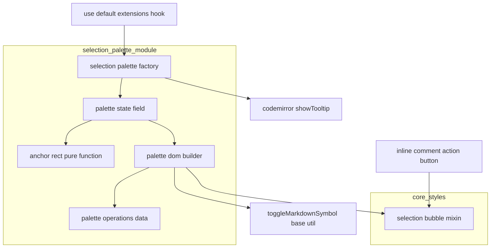
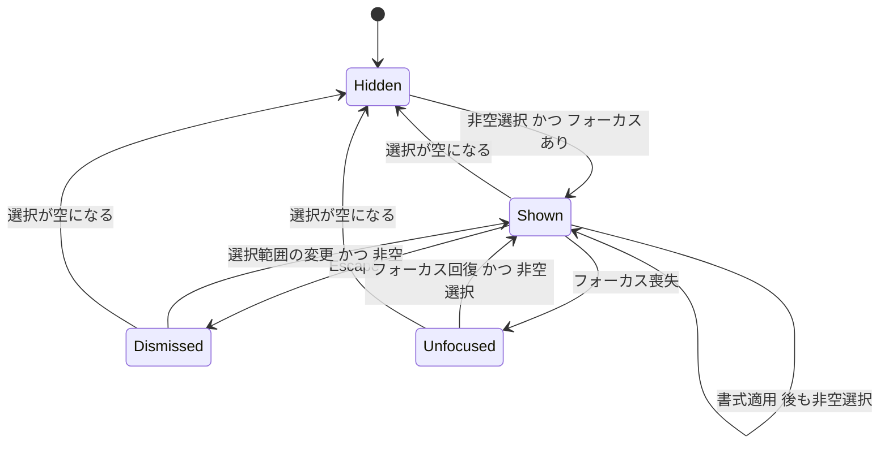

# Technical Design Document

## Overview

**Purpose**: エディタで非空のテキストを選択したときに、選択範囲のカーソル側の端の上へバブルメニューを表示し、基本インライン書式（太字・斜体・取り消し線・インラインコード）を選択範囲に適用/解除できるようにする。バブルメニューの見た目と表示位置は閲覧ページの「Comment」バブル（`inline-comment`）と揃え、アイコンは編集画面下部ツールバーと揃える。

**Users**: エディタで執筆する全ユーザーが、選択 → その場のバブルメニューで書式を当てる、という導線で素早くテキストを装飾する。閲覧画面と同じ「選択 → バブル」の体験を編集画面でも得る。

**Impact**:
- CodeMirror の `showTooltip` 機構で選択駆動のバブルメニューを追加する。
- 書式適用は既存の基底ユーティリティ `toggleMarkdownSymbol` を再利用する。
- 「Comment」バブルのボタン配色の上書きを `@growi/core-styles` の mixin に切り出し、両者で共有する（「Comment」バブルの見た目は変わらない）。
- 既存のツールバー・キーバインド・スラッシュコマンド・絵文字補完の挙動は変更しない。

### Goals
- 非空選択時に、「Comment」バブルと同じ位置合わせ（カーソル側の端の上・中央寄せ・上下反転・左右はみ出し回避・8px 間隔）でバブルメニューを表示する。
- 「Comment」バブルと同じ配色・枠・影・ホバー/押下表現を、単一の情報源（core-styles の mixin）から適用する。
- 4 つの基本書式をトグル適用し、新規依存ライブラリなしで実装する。

### Non-Goals
- リンク化・見出し化（H1–H3）・引用化（将来拡張）。
- 選択範囲への AI 操作、ブロックレベル変換（将来拡張）。
- 編集画面からのインラインコメント投稿。
- 「Comment」バブル・ツールバーの見た目/挙動の変更。
- `/` トリガーのスラッシュコマンド、および基盤 `editor-slash-command` のレジストリへの依存。

## Boundary Commitments

### This Spec Owns
- 選択駆動のバブルメニュー拡張（非空選択の検知 → tooltip 表示 → Escape / フォーカス喪失による開閉ライフサイクル）。
- バブルメニューの配置基準（head 位置を中心とした基準矩形の算出、上側優先、8px 間隔）。
- バブルメニューの操作集合（bold / italic / strikethrough / code）のデータ宣言と、選択範囲へのトグル適用アダプタ。
- バブルメニューの DOM 構築（アイコン・ツールチップ・読み上げ名）とレイアウト用スタイル。
- 選択バブルの共通ボタン配色 mixin（`@growi/core-styles/scss/helpers/_selection-bubble.scss`）の新設。

### Out of Boundary
- 「Comment」バブルの機能・表示ロジック（`inline-comment` の `SelectionCapture` / `SelectionPopover`）。本スペックは同コンポーネントの SCSS を mixin 参照に置き換えるのみで、出力される見た目と挙動を変えない。
- 基底 `toggleMarkdownSymbol` の仕様変更（再利用のみ）。
- 編集画面下部ツールバー（`TextFormatTools`）の変更。
- 基盤 `editor-slash-command` の機構・レジストリ。
- 絵文字補完・既存キーバインド・グローバルホットキー。

### Allowed Dependencies
- `@codemirror/view`（`showTooltip`, `Tooltip`, `TooltipView.getCoords`, `keymap`, `EditorView.focusChangeEffect`）。
- `@codemirror/state`（`StateField`, `StateEffect`, `EditorSelection`）。
- 基底 `toggleMarkdownSymbol`（`services-internal/markdown-utils`、既存）。
- `i18next` の `TFunction` 型と既存 locale キー（`toolbar.bold` / `toolbar.italic` / `toolbar.strikethrough` / `toolbar.code`）。`t` は登録フックで注入する。
- `@growi/core-styles/scss/helpers/selection-bubble`（本スペックで新設する mixin）と、エディタで既に有効な Bootstrap の `btn` / `btn-group` / `shadow-sm`。
- 依存方向（左から右へのみ import 可）:
  `selection-palette-operations / selection-palette-anchor（純粋）` → `selection-palette-dom` → `selection-palette-tooltip` → `selection-palette（factory）` → `use-default-extensions`

### Revalidation Triggers
- 「Comment」バブルの見た目の定義方法が変わる（mixin を使わなくなる、`btn btn-sm shadow-sm` 以外の構成になる）。
- 「Comment」バブルの位置合わせが変わる（`use-popper-position.ts` の placement / modifiers / offset 8px の変更）。本スペックは 8px を定数として複製している。
- ツールバーの書式アイコン（`format_bold` / `format_italic` / `format_strikethrough` / `code`）または `toolbar.*` locale キーの変更/削除。
- `toggleMarkdownSymbol` のシグネチャ・選択の扱いの変更。
- CodeMirror tooltip API（`showTooltip` / `Tooltip` / `getCoords` / 配置アルゴリズム）の変更。

## Architecture

### Existing Architecture Analysis
- エディタの拡張は `useDefaultExtensions`（`packages/editor/src/client/stores/use-default-extensions.ts`）が `appendExtensions` で 1 つの Compartment にまとめて登録する。`t` の変化（言語切替）で再登録される。
- 書式適用は `toggleMarkdownSymbol(view, prefix, suffix)` が「置換 → 変更後テキスト全体を選択 → `view.focus()`」を行う。
- `defaultKeymap`（`Escape → simplifySelection` を含む）は `Prec.lowest` で登録されている。
- 「Comment」バブルは Popper（`top` + `flip` / `preventOverflow` / `offset 8`）でカーソル側の端に配置し、ボタンの `mousedown` で `preventDefault()` して選択を守る。
- エディタは `@growi/core-styles/scss/bootstrap/apply` を読み込み、`.ts` から `*.module.scss` を import する前例がある。

### Architecture Pattern & Boundary Map



**Architecture Integration**:
- **Selected pattern**: CM 標準の選択駆動 tooltip（`StateField` → `showTooltip`）。配置の基準矩形だけを `getCoords` で差し替え、反転・clamp・スクロール追従は CM に任せる。
- **Domain boundaries**: 操作宣言（データ）/ 基準矩形の算出（純粋関数）/ DOM 構築 / 表示状態（field）/ キー・フォーカスの合成（factory）を分離する。見た目の配色は core-styles の mixin が唯一の情報源。
- **Steering compliance**: データ駆動、純粋関数の抽出、barrel の最小公開、`packages/editor` → `apps/app` の逆依存なし。

### Technology Stack

| Layer | Choice / Version | Role in Feature | Notes |
|-------|------------------|-----------------|-------|
| Frontend (editor) | `@codemirror/view ^6.43.13` | `showTooltip` / `getCoords` / `keymap` / `focusChangeEffect` | 浮動 UI・配置・開閉 |
| Frontend (editor) | `@codemirror/state` | `StateField` / `StateEffect` | 表示状態 |
| Frontend (editor) | `toggleMarkdownSymbol`（既存） | 選択範囲への書式トグル | 再利用 |
| Frontend (i18n) | `react-i18next` + 既存 `toolbar.*` | ツールチップ・読み上げ名 | 新規キー不要 |
| Styles | `@growi/core-styles`（既存パッケージ）+ Bootstrap 5 | 配色 mixin・`btn` / `btn-group` | mixin を新設 |

新規依存ライブラリは**なし**。

## File Structure Plan

### Directory Structure
```
packages/core-styles/scss/helpers/
└── _selection-bubble.scss                 # mixin selection-bubble-button: 「Comment」バブルと共有する --bs-btn-* 配色上書き

packages/editor/src/client/services-internal/selection-palette/
├── index.ts                               # barrel: selectionPalette(t) のみ公開
├── selection-palette-operations.ts        # PALETTE_OPERATIONS: id・labelKey・icon・prefix・suffix のデータ宣言
├── selection-palette-anchor.ts            # 純粋関数: head 座標とバブル幅から中央寄せの基準矩形を算出
├── selection-palette-dom.ts               # バブル DOM 構築（btn-group + 4 ボタン）、mousedown 抑止、click → toggleMarkdownSymbol
├── selection-palette.module.scss          # バブル用スタイル: mixin の適用、.cm-tooltip 既定の枠/背景の打ち消し
├── selection-palette-tooltip.ts           # StateField（dismissed / focused）+ StateEffect + Tooltip 供給
├── selection-palette.ts                   # ファクトリ: field + showTooltip + Escape keymap + focusChangeEffect を合成
├── selection-palette-operations.spec.ts
├── selection-palette-anchor.spec.ts
├── selection-palette-dom.spec.ts
├── selection-palette-tooltip.spec.ts
└── selection-palette.spec.ts
```

### Modified Files
- `apps/app/src/features/inline-comment/client/components/SelectionCapture/SelectionActionButton.module.scss` — `--bs-btn-*` 上書きの記述を `@include selection-bubble-button` に置き換える（出力 CSS は同一）。
- `packages/editor/src/client/services-internal/index.ts` — `selection-palette` barrel を追加。
- `packages/editor/src/client/stores/use-default-extensions.ts` — `selectionPalette(t)` を既定の拡張セットに加え、同一 Compartment で登録する（`buildDefaultExtensionsArg` が追加の拡張を受け取れるようにする）。

## System Flows



- **表示条件**: 「非空選択 かつ `dismissed = false` かつ `focused = true`」のときだけ Tooltip を返す（1.1, 1.2, 5.1, 5.4）。
- **dismiss の解除**: 選択範囲が変わったトランザクションで `dismissed` を `false` に戻す（5.3）。
- **Escape**: 表示中のみ dismiss 効果を発行して `true`（消費）を返す。`defaultKeymap` の `simplifySelection` より先に処理されるため選択は維持される（5.2）。非表示時は `false` で既存挙動へ通過する（7.3）。
- **書式適用**: ボタンの `click` で `toggleMarkdownSymbol` を呼ぶ。変更後テキスト全体が選択され非空のままなので、バブルは表示を続ける（4.3, 4.4）。

## Requirements Traceability

| Requirement | Summary | Components | Interfaces | Flows |
|-------------|---------|------------|------------|-------|
| 1.1 | 非空選択で表示 | selection-palette-tooltip | `selectionPaletteField` | 表示条件 |
| 1.2 | 空選択で非表示 | selection-palette-tooltip | `selectionPaletteField` | 表示条件 |
| 1.3 | 4 操作をこの順に表示 | selection-palette-operations, selection-palette-dom | `PALETTE_OPERATIONS` | — |
| 2.1 | カーソル側の端の上・中央 | selection-palette-tooltip, selection-palette-anchor | `pos = head`, `above: true`, `computeAnchorRect` | — |
| 2.2 | 後方向選択は先頭側 | selection-palette-tooltip | `head`（= 先頭）, `coordsAtPos(head, 1)` | — |
| 2.3 | 前方向選択は末尾側 | selection-palette-tooltip | `head`（= 末尾）, `coordsAtPos(head, -1)` | — |
| 2.4 | 上に余白がなければ下 | CM tooltip（標準の反転） | `above: true`, `strictSide` 未指定 | — |
| 2.5 | 左右にはみ出さない | CM tooltip（標準の clamp） | — | — |
| 2.6 | 「Comment」バブルと同じ間隔 | selection-palette-tooltip | `offset.y = BUBBLE_GAP_PX (8)` | — |
| 2.7 | スクロール等で追従 | CM tooltip（標準の再測定） | — | — |
| 3.1 | 「Comment」バブルと同じ見た目 | selection-bubble mixin, selection-palette-dom | `selection-bubble-button`, `btn btn-sm`, `btn-group shadow-sm` | — |
| 3.2 | ホバー/押下の見た目 | selection-bubble mixin | `--bs-btn-hover-*` / `--bs-btn-active-*` | — |
| 3.3 | テーマ/カラーモード追随 | selection-bubble mixin | 全テーマ共通の `--bs-*` 参照 | — |
| 3.4 | ツールバーと同じアイコン | selection-palette-operations | `icon`（material-symbols） | — |
| 4.1 | 書式記号で囲む | selection-palette-dom | `toggleMarkdownSymbol` | 書式適用 |
| 4.2 | 囲まれていれば解除 | selection-palette-dom | `toggleMarkdownSymbol`（トグル） | 書式適用 |
| 4.3 | 変更後全体を選択・フォーカス維持 | toggleMarkdownSymbol（再利用） | 選択設定 + `view.focus()` | 書式適用 |
| 4.4 | 適用後も表示を継続 | selection-palette-tooltip | 表示条件 | Shown → Shown |
| 4.5 | 1 回の undo で戻る | toggleMarkdownSymbol（再利用） | 変更は 1 トランザクション | — |
| 4.6 | 押下で選択を解除しない | selection-palette-dom | `mousedown` の `preventDefault()` | — |
| 5.1 | 選択解除で閉じる | selection-palette-tooltip | 表示条件 | → Hidden |
| 5.2 | Escape で閉じ選択維持 | selection-palette（keymap） | `dismissPaletteEffect` | → Dismissed |
| 5.3 | Escape 後の選択変更で再表示 | selection-palette-tooltip | dismiss 解除 | Dismissed → Shown |
| 5.4 | フォーカス喪失で閉じる | selection-palette（focusChangeEffect） | `paletteFocusEffect` | → Unfocused |
| 6.1 | ツールチップの多言語表示 | selection-palette-dom | `title = t(labelKey)` | — |
| 6.2 | 読み上げ名 | selection-palette-dom | `aria-label = t(labelKey)` | — |
| 6.3 | 既定言語フォールバック | react-i18next（標準） | `fallbackLng` | — |
| 7.1 | slash / 絵文字と共存 | selection-palette（独立拡張） | autocomplete とは別 facet | — |
| 7.2 | キーバインド不変 | selection-palette（keymap） | Escape 以外を追加しない | — |
| 7.3 | 非表示時の Escape 不変 | selection-palette（keymap） | 非表示時は `false` | — |
| 7.4 | 協調編集整合 | toggleMarkdownSymbol（通常トランザクション） | `view.dispatch` | — |
| 7.5 | 「Comment」バブル・ツールバー不変 | selection-bubble mixin | 出力 CSS 同一の置き換え | — |

## Components and Interfaces

| Component | Domain/Layer | Intent | Req Coverage | Key Dependencies (P0/P1) | Contracts |
|-----------|--------------|--------|--------------|--------------------------|-----------|
| selection-bubble mixin | styles（core-styles） | 選択バブルのボタン配色の唯一の定義 | 3.1, 3.2, 3.3, 7.5 | Bootstrap `--bs-*` (P0) | State |
| selection-palette-operations | data | 操作集合の宣言 | 1.3, 3.4, 4.1, 4.2 | — | State |
| selection-palette-anchor | logic（純粋） | 中央寄せの基準矩形を算出 | 2.1 | — | Service |
| selection-palette-dom | UI | バブル DOM 構築と書式トグルの結線 | 1.3, 3.1, 3.4, 4.1, 4.2, 4.6, 6.1, 6.2 | operations (P0), toggleMarkdownSymbol (P0), mixin (P0) | Service |
| selection-palette-tooltip | logic | 表示状態と Tooltip の供給 | 1.1, 1.2, 2.1–2.3, 2.6, 4.4, 5.1, 5.3 | dom (P0), anchor (P0), @codemirror/state (P0) | State |
| selection-palette（factory） | integration | field・showTooltip・Escape・フォーカスの合成 | 2.4, 2.5, 2.7, 5.2, 5.4, 7.1–7.3 | tooltip (P0), @codemirror/view (P0) | Service |
| use-default-extensions（変更） | integration | `selectionPalette(t)` の登録 | 6.1, 7.1 | factory (P0), react-i18next (P1) | Service |
| SelectionActionButton.module.scss（変更） | styles（apps/app） | mixin 参照への置き換え | 3.1, 7.5 | mixin (P0) | — |

### styles

#### selection-bubble mixin
| Field | Detail |
|-------|--------|
| Intent | 「Comment」バブルとバブルメニューのボタン配色を 1 か所で定義する |
| Requirements | 3.1, 3.2, 3.3, 7.5 |

**Contracts**: State [x]

```scss
// @growi/core-styles/scss/helpers/_selection-bubble.scss
@mixin selection-bubble-button {
  // --bs-btn-bg / color / border-color / hover-* / active-* を
  // 全テーマ共通の --bs-body-bg / --bs-body-color / --bs-border-color /
  // --bs-secondary-bg / --bs-tertiary-bg で上書きする
}
```
- **Invariants**: 現 `SelectionActionButton.module.scss` の 9 個の宣言と同一の値を出力する（「Comment」バブルの見た目を変えない）。
- **Consumers**: `SelectionActionButton.module.scss`、`selection-palette.module.scss`。

### data / logic

#### selection-palette-operations
| Field | Detail |
|-------|--------|
| Intent | バブルメニューの操作を表示順に宣言したデータ集合 |
| Requirements | 1.3, 3.4, 4.1, 4.2 |

**Contracts**: State [x]

```typescript
export type PaletteOperationId = 'bold' | 'italic' | 'strikethrough' | 'code';

export interface PaletteOperation {
  readonly id: PaletteOperationId;
  readonly labelKey: `toolbar.${string}`; // 既存 i18n キー（ツールバーと同一）
  readonly icon: string;                  // material-symbols-outlined のグリフ名（ツールバーと同一）
  readonly prefix: string;                // toggleMarkdownSymbol の prefix
  readonly suffix: string;                // toggleMarkdownSymbol の suffix
}

export const PALETTE_OPERATIONS: readonly PaletteOperation[] = [
  { id: 'bold',          labelKey: 'toolbar.bold',          icon: 'format_bold',          prefix: '**', suffix: '**' },
  { id: 'italic',        labelKey: 'toolbar.italic',        icon: 'format_italic',        prefix: '*',  suffix: '*'  },
  { id: 'strikethrough', labelKey: 'toolbar.strikethrough', icon: 'format_strikethrough', prefix: '~~', suffix: '~~' },
  { id: 'code',          labelKey: 'toolbar.code',          icon: 'code',                 prefix: '`',  suffix: '`'  },
];
```
- 取り消し線は GFM 標準かつ Mod+Shift+X ショートカット（`make-text-strikethrough.ts`）と同じ `~~` を用いる（ツールバーは `~`）。アイコンはツールバーと同じ `format_strikethrough`。

#### selection-palette-anchor
| Field | Detail |
|-------|--------|
| Intent | head の座標矩形とバブル幅から、CM tooltip に渡す中央寄せの基準矩形を返す |
| Requirements | 2.1 |

**Contracts**: Service [x]

```typescript
export interface AnchorRect {
  readonly left: number;
  readonly right: number;
  readonly top: number;
  readonly bottom: number;
}

// head 座標の水平中心がバブルの水平中心と一致するよう、left を bubbleWidth / 2 だけ左へずらした矩形を返す
export const computeAnchorRect: (headRect: AnchorRect, bubbleWidth: number) => AnchorRect;
```
- **Preconditions**: `bubbleWidth >= 0`。0 の場合は `headRect` の水平中心を left とする。
- **Postconditions**: `top` / `bottom` は `headRect` と同一（上下判定と間隔は CM に任せる）。

#### selection-palette-dom
| Field | Detail |
|-------|--------|
| Intent | バブルの DOM を構築し、各ボタンを書式トグルに結線する |
| Requirements | 1.3, 3.1, 3.4, 4.1, 4.2, 4.6, 6.1, 6.2 |

**Contracts**: Service [x]

```typescript
import type { EditorView } from '@codemirror/view';
import type { TFunction } from 'i18next';

import type { PaletteOperation } from './selection-palette-operations';

export const createPaletteDom: (
  view: EditorView,
  t: TFunction,
  operations: readonly PaletteOperation[],
) => HTMLElement;
```
- **Structure**: ルートは `btn-group shadow-sm`（「Comment」バブルの外形・影）。各操作は `button.btn.btn-sm` + mixin 適用クラス、子に `span.material-symbols-outlined.fs-6`（「Comment」バブルと同じアイコンサイズ）とグリフ名。
- **Responsibilities**:
  - `title` と `aria-label` に `t(op.labelKey)` を設定する。
  - ルートで `mousedown` の `preventDefault()` を行い、押下でエディタのフォーカスと選択を失わない。
  - `click` で `toggleMarkdownSymbol(view, op.prefix, op.suffix)` を呼ぶ。
  - ルートに `selection-palette.module.scss` のクラスを付け、mixin の適用と `.cm-tooltip` 既定の枠線・背景・パディングの打ち消しを行う。
- **Constraints**: 副作用は `toggleMarkdownSymbol` 経由の dispatch のみ。操作集合は引数で受け取る（executor は work-set を所有しない）。

#### selection-palette-tooltip
| Field | Detail |
|-------|--------|
| Intent | 選択・dismiss・フォーカスから `Tooltip | null` を算出する StateField |
| Requirements | 1.1, 1.2, 2.1–2.3, 2.6, 4.4, 5.1, 5.3 |

**Contracts**: State [x]

```typescript
import type { StateEffectType, StateField } from '@codemirror/state';
import type { Tooltip } from '@codemirror/view';

export const BUBBLE_GAP_PX = 8; // 「Comment」バブルの Popper offset と同値

export const dismissPaletteEffect: StateEffectType<null>;
export const paletteFocusEffect: StateEffectType<boolean>;

export interface PaletteState {
  readonly dismissed: boolean;
  readonly focused: boolean;
  readonly tooltip: Tooltip | null;
}

export const createSelectionPaletteField: (
  createDom: (view: EditorView) => HTMLElement,
) => StateField<PaletteState>;
```
- **State model**:
  - `dismissPaletteEffect` → `dismissed = true`。
  - 選択範囲が変わったトランザクション → `dismissed = false`。
  - `paletteFocusEffect(v)` → `focused = v`。
  - `tooltip` は「`selection.main` が非空 かつ `!dismissed` かつ `focused`」のとき生成し、それ以外は `null`。
- **Tooltip spec**:
  - `pos = selection.main.head`、`above: true`。
  - `create(view)` が返す TooltipView は `dom = createDom(view)`、`offset = { x: 0, y: BUBBLE_GAP_PX }`。
  - `getCoords(pos)` は `view.coordsAtPos(pos, head === from ? 1 : -1)` と `dom` の幅から `computeAnchorRect` を返す。
- **Invariants**: 空選択時は常に `tooltip = null`。

### integration

#### selection-palette（factory）
| Field | Detail |
|-------|--------|
| Intent | StateField・showTooltip・Escape keymap・フォーカス検知を 1 つの Extension に合成する |
| Requirements | 2.4, 2.5, 2.7, 5.2, 5.4, 7.1–7.3 |

**Contracts**: Service [x]

```typescript
import type { Extension } from '@codemirror/state';
import type { TFunction } from 'i18next';

export const selectionPalette: (t: TFunction) => Extension;
```
- **Implementation Notes**:
  - `showTooltip.compute([field], state => state.field(field).tooltip)` で facet に供給する。反転（2.4）・左右 clamp（2.5）・再測定による追従（2.7）は CM 標準の挙動による。
  - Escape keymap は通常優先度で登録する。表示中のみ `dismissPaletteEffect` を dispatch して `true` を返し、非表示時は `false` を返す（`Prec.lowest` の `simplifySelection` に通過）。Escape 以外のキーは追加しない。
  - `EditorView.focusChangeEffect.of((_, focusing) => paletteFocusEffect.of(focusing))` でフォーカス変化を反映する。
  - スタイルには関与しない（`selection-palette.module.scss` とそのクラス付与は selection-palette-dom が所有する）。
  - autocomplete（slash / emoji）とは別 facet のため共存する（7.1）。
  - **Risk**: vim キーマップの visual モードで Escape の処理順を実装時に確認する。

#### use-default-extensions（変更）
- `useTranslation('translation')` の `t` で `selectionPalette(t)` を `useMemo` し、`buildDefaultExtensionsArg` に渡して既存の単一 Compartment に含める（言語切替時は既存どおり再登録で反映）。

#### SelectionActionButton.module.scss（変更・apps/app）
- `.selection-action-button` の `--bs-btn-*` 宣言を `@use '@growi/core-styles/scss/helpers/selection-bubble' as *;` + `@include selection-bubble-button;` に置き換える。全テーマで必ず出力される変数のみを参照する理由のコメントは mixin 側へ移す。

## Error Handling
- 選択が空・dismiss 済み・フォーカスなしのときは tooltip を出さない（副作用なし）。
- `coordsAtPos` が `null`（head が描画範囲外）のとき `getCoords` は CM 既定と同じく非表示扱いになる値を返し、バブルを出さない。
- 書式適用は `toggleMarkdownSymbol` に委譲し、失敗経路は持たない。

## Testing Strategy

### Unit Tests
1. `PALETTE_OPERATIONS`: bold → italic → strikethrough → code の順で、ツールバーと同じアイコン名・`toolbar.*` キー・prefix/suffix を持つ（1.3, 3.4）。
2. `computeAnchorRect`: head 矩形の水平中心とバブル幅の中心が一致し、上下座標は変わらない。幅 0 でも有効な矩形を返す（2.1）。
3. `createSelectionPaletteField`:
   - 非空選択 + フォーカスありで tooltip を返し、空選択で `null`（1.1, 1.2, 5.1）。
   - `pos` が前方向選択では末尾、後方向選択では先頭になる（2.2, 2.3）。
   - `offset.y` が 8（2.6）。
   - `dismissPaletteEffect` で `null`、その後の選択変更で再表示（5.3）。
   - `paletteFocusEffect(false)` で `null`、`true` で再表示（5.4）。
4. `createPaletteDom`:
   - 4 ボタンが `title` / `aria-label` に `t(labelKey)` を持つ（6.1, 6.2）。
   - クリックで選択範囲が `**…**` 等に囲まれ、変更後全体が選択される。囲まれた選択で再クリックすると解除される（4.1, 4.2, 4.3）。
   - 1 回の undo で元に戻る（4.5）。
   - `mousedown` がデフォルト動作を抑止する（4.6）。

### Integration Tests
1. `selectionPalette(t)` を組み込んだ EditorView で、Escape 押下時に表示中なら閉じて選択が維持され、非表示中なら `simplifySelection` が動く（5.2, 7.3）。
2. 書式適用後も選択が非空のためバブルが表示され続ける（4.4）。
3. 絵文字・slash の autocomplete と同時に登録しても、補完の表示とバブルの表示が互いを妨げない（7.1）。
4. Ctrl+B 等の既存キーバインドの結果が変わらない（7.2）。

### E2E/UI Tests（手動スモーク）
1. エディタでテキストを前方向/後方向に選択し、バブルがカーソル側の端の上・中央に出る。エディタ上端付近の行では下側に出る。左右端付近でははみ出さない（2.1–2.5）。
2. 閲覧ページの「Comment」バブルと並べて、ライト/ダークおよび複数テーマで配色・枠・影・ホバー/押下の見た目が一致する。「Comment」バブル自体の見た目が変わっていない（3.1–3.3, 7.5）。
3. 太字をクリック → `**…**`、再クリックで解除、undo で復元（4.1, 4.2, 4.5）。
4. vim キーマップの visual モードで Escape の挙動が変わらない（7.2）。
