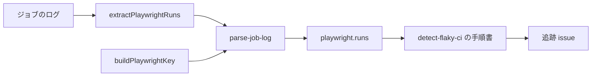
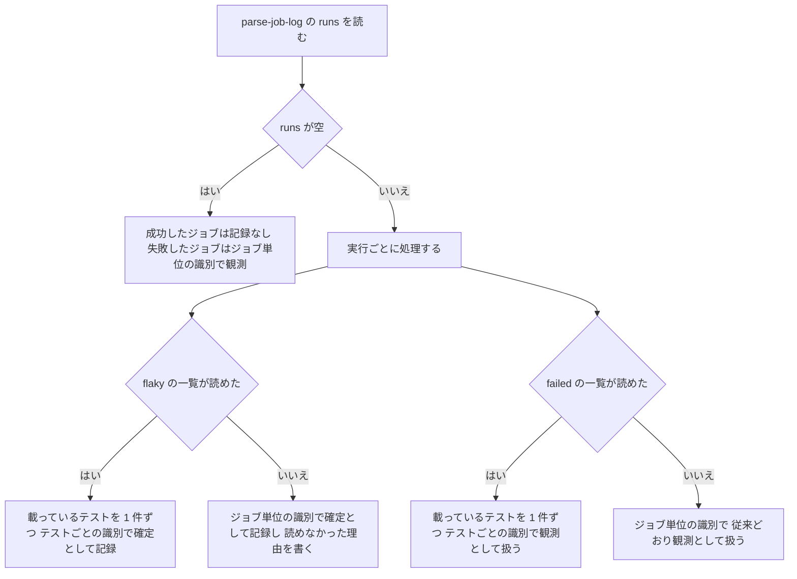

# Design Document

## Overview

**Purpose**: `flaky-ci-routine` が `run-playwright` ジョブのログから不安定な
テストを特定するときの読み取り元を、注釈の行から、Playwright がログ末尾に
出す一覧に替える。

**Users**: flaky test の追跡 issue を読み、修正が効いたかどうかを確かめる
開発者。

**Impact**: `bin/flaky-ci` のログ解析（`parse-job-log`）の出力と、
`detect-flaky-ci` の手順書のうち Playwright のテストを特定する部分が変わる。
追跡 issue の検索・作成・追記・再オープン、確信度の段階、ダッシュボードは
変わらない。

### Amend target

- **対象の仕様**: `ci-flaky-test-detection`
- **変える決まり**: `design.md` の「Playwright の識別と確信度」の節のうち、
  「精密な識別（tier 1）を使える条件」と「ジョブ単位の識別に落とす条件」。
  ブラウザを識別に含める決まりと、確定済みとして数える条件（再実行で通った
  ときだけ）は変えない。
- **変える契約**: `bin/flaky-ci/README.md` の `parse-job-log` の出力。
  `playwright.annotations[]` と `playwright.summary` を削除し、
  `playwright.runs[]` を追加する。
- **Revalidation Triggers への影響**: 既存の項目に、この変更で条件が変わる
  ものは無い。2 項目を追加する（下の「Revalidation Triggers」）。

### Goals

- 再実行で通った Playwright のテストを、注釈がログ上でどの形になっても、
  テストごとの識別で記録する
- 1 つのジョブで 2 件以上のテストが不安定だったときも、それぞれ記録する
- 読めない一覧からは、テストを推測しない
- 集計の件数を、Playwright の実行ごとに読む
- 追跡 issue の題名の形を 1 種類にそろえる

### Non-Goals

- vitest の失敗の検出と識別
- 安価な証拠シグナル（Cheap Suspicion Mining）の中身の変更
- ダッシュボードの変更
- 注釈の行を、どちらの形でも読めるようにすること
- ジョブ単位の issue に記録済みの発生を、テストごとの issue へ移すこと

## Boundary Commitments

### This Spec Owns

- `run-playwright` ジョブのログから、Playwright の実行ごとの集計と、
  再実行で通ったテスト・全試行で失敗したテストの一覧を読む処理
- 一覧の 1 行から、追跡 issue の題名に使う識別の文字列を作る処理
- `detect-flaky-ci` の手順書のうち、Playwright のテストを特定する決まりと、
  特定できなかったときにジョブ単位の識別へ記録する条件
- 古い形の題名を持つ追跡 issue を、いまの形に直す一度きりの作業

### Out of Boundary

- 識別が決まった後の処理（既存 issue の検索、作成、追記、再オープン、
  ラベルの付け替え）
- 確信度の段階と、観測を「疑い」に上げる安価な証拠シグナル
- vitest の失敗ブロックの読み取りと、インフラ起因の失敗の除外
- ログの取得方法

### Allowed Dependencies

- `bin/flaky-ci/lib/ansi.ts` の `strip`
- `bin/flaky-ci/lib/output.ts` の `emit` / `ScriptResult`
- `bin/flaky-ci/lib/identity.ts`（識別の分解。組み立てをここに足す）
- fixture の決まり（`ci-flaky-fixture-freshness`）: fixture には `.meta.md`
  を付け、いずれかのテストから読む

### Revalidation Triggers

- **Playwright の版の更新、または `apps/app/playwright.config.ts` の
  reporter の変更** — 実行の終わりに出る一覧の形（`N flaky` の見出しと、
  その下の `[project] › path:line:col › …` の行）に、読み取りが依存する。
  形が変わると、テストはジョブ単位の識別に記録されるようになる
- **`run-playwright` ジョブでの project 名の付け方の変更** — 識別のブラウザ
  の部分は、project 名の先頭の部分（`firefox/guest-mode` なら `firefox`）
  から作る

## Architecture

### Existing Architecture Analysis

- `bin/flaky-ci/scripts/parse-job-log.ts` は、ジョブのログ 1 件を標準入力
  から読み、事実だけを JSON で返す。どの失敗をどの識別で記録するかの判断は
  `detect-flaky-ci` の手順書に残す、という分担になっている。この分担は
  変えない。
- 読み取りの本体は `bin/flaky-ci/lib/job-log.ts` にある。Playwright 向けには
  `extractPlaywrightAnnotations`（注釈の行）と `extractSummary`（件数の行）が
  ある。この 2 つを 1 つの関数に置き換える。
- 識別の文字列は、いまは手順書の文章に従って AI が組み立てている。これを
  スクリプトに移す。

### Architecture Pattern & Boundary Map



- `extractPlaywrightRuns` は事実を読むだけで、どの識別で記録するかは決め
  ない。
- `buildPlaywrightKey` は、一覧の 1 件から識別の文字列を作る純粋な関数で
  ある。
- 手順書は、返ってきた一覧を見て、テストごとの識別で記録するか、ジョブ単位
  の識別で記録するかを決める。

### Technology Stack

| Layer | Choice / Version | Role in Feature | Notes |
|-------|------------------|-----------------|-------|
| スクリプト | Node.js 24、TypeScript（型を外して直接実行） | ログの解析 | 既存の `bin/flaky-ci` と同じ。依存の追加なし |
| テスト | Vitest | 解析のテスト | 既存の `*.spec.ts` と同じ置き方 |

## File Structure Plan

### Directory Structure

```
bin/flaky-ci/
├── lib/
│   ├── job-log.ts            # extractPlaywrightRuns を追加。注釈と旧集計の読み取りを削除
│   ├── job-log.spec.ts       # 上のテスト
│   ├── identity.ts           # buildPlaywrightKey を追加
│   └── identity.spec.ts      # 上のテスト
├── scripts/
│   ├── parse-job-log.ts      # 出力を playwright.runs[] に変更
│   └── parse-job-log.spec.ts # 上のテスト
├── fixtures/job-logs/        # 実際のログから切り出した見本を追加（各 .meta.md 付き）
└── README.md                 # parse-job-log の契約の行
.claude/skills/detect-flaky-ci/SKILL.md   # Playwright のテストを特定する決まり
```

### Modified Files

- `bin/flaky-ci/lib/job-log.ts` — `extractPlaywrightRuns`、
  `parsePlaywrightTestLine` と、その型を追加する。
  `extractPlaywrightAnnotations`、`extractSummary`、`PlaywrightAnnotation`
  を削除する。ファイル冒頭の説明を合わせる
- `bin/flaky-ci/lib/job-log.spec.ts` — 削除した関数のテストを外し、
  `extractPlaywrightRuns` のテストを足す
- `bin/flaky-ci/lib/identity.ts` — `buildPlaywrightKey` を追加する
- `bin/flaky-ci/lib/identity.spec.ts` — 上のテスト。組み立てた識別を
  `parse` に通すと、元の値に戻ることを確かめる
- `bin/flaky-ci/scripts/parse-job-log.ts` — `playwright` の出力を
  `runs[]` にする。`--help` の説明を合わせる
- `bin/flaky-ci/scripts/parse-job-log.spec.ts` — 出力の形のテストを合わせる
- `bin/flaky-ci/README.md` — 契約表の `parse-job-log` の行と、
  `lib` の一覧の `job-log.ts` の行
- `bin/flaky-ci/fixtures/job-logs/` — 追加する見本（下の Testing Strategy）
  と、注釈に触れている既存の `.meta.md` 3 件（#11903 由来、#11914 由来、
  `constructed-playwright-1-failed-0-flaky`）の説明
- `.claude/skills/detect-flaky-ci/SKILL.md` — Step 2 の出力項目の説明、
  Step 2b の「不安定なテストが無い」の条件、Step 3 の Playwright の節、
  Step 4 の証拠の引用元
- `investigate-flaky-test` の手順書と `flaky-ci-routine.md` は変更しない。
  どちらにも、注釈や集計の読み方を前提にした記述が無いことを検索で確かめた

## System Flows

手順書が、1 つのジョブのログについて行う判断を示す。



- 件数が 0 の一覧は「読めた、0 件」として返るので、E や H で記録するものは
  無い。
- 1 つの実行の中で、flaky の一覧は読めて failed の一覧は読めない、という
  場合は、それぞれ別に扱う。

## Requirements Traceability

| Requirement | Summary | Components | Interfaces | Flows |
|-------------|---------|------------|------------|-------|
| 1.1 | 再実行で通ったテストをテストごとに確定として記録 | `extractPlaywrightRuns`、`buildPlaywrightKey`、手順書 | `runs[].flaky` | E |
| 1.2 | 2 件以上あればそれぞれ記録 | 手順書 | `runs[].flaky.tests[]` | E |
| 1.3 | 注釈の形に左右されない | `extractPlaywrightRuns` | 注釈を読まない | — |
| 1.4 | 重ねて出た一覧を 1 回と数える | `extractPlaywrightRuns` | `##[notice]` で始まる一覧を捨てる | — |
| 1.5 | 既存の issue に追記 | `buildPlaywrightKey` | `identityKey` | E |
| 2.1 | 全試行で失敗したテストは観測 | `extractPlaywrightRuns`、手順書 | `runs[].failed` | H |
| 2.2 | 既存の証拠シグナルを同じ条件で適用 | 手順書 | 変更なし | H |
| 2.3 | 両方あるときは分けて扱う | 手順書 | `runs[].flaky` と `runs[].failed` | E、H |
| 3.1 | 件数と行数が合わない一覧は読まない | `extractPlaywrightRuns` | `kind: 'unreadable'` | — |
| 3.2 | 特定できないときはジョブ単位で記録し、理由を書く | 手順書 | `reason` | F |
| 3.3 | 一覧以外から推測しない | 手順書 | — | — |
| 3.4 | 特定できた分だけテストごとに記録 | 手順書 | 一覧ごとの `kind` | E、F |
| 4.1 | 実行ごとに件数を読む | `extractPlaywrightRuns` | `runs[]` | — |
| 4.2 | 判定には同じ実行の結果だけを使う | 手順書 | `runs[]` の 1 要素 | E、H |
| 4.3 | 件数の行が無ければ不明 | `extractPlaywrightRuns` | `runs` が空 | Z |
| 5.1 | 既存の題名と同じ形 | `buildPlaywrightKey` | `identityKey` | — |
| 5.2 | 同じ発生をジョブ単位にも記録しない | 手順書 | — | E |
| 5.3 | 記録済みの発生を移さない | 該当する作業を作らない | — | — |
| 5.4 | 不要な再オープンをしない | 手順書 | — | F |
| 5.5 | 古い形の題名の issue と分かれない | 題名を直す作業 | — | — |
| 6.1 | 特定の根拠を残す | `extractPlaywrightRuns`、手順書 | `runs[].excerpt` | E、H |
| 6.2 | 特定できなかった理由を残す | 手順書 | `reason` | F、I |

## Components and Interfaces

| Component | Domain/Layer | Intent | Req Coverage | Key Dependencies | Contracts |
|-----------|--------------|--------|--------------|------------------|-----------|
| `extractPlaywrightRuns` | `bin/flaky-ci/lib` | ログから、実行ごとの集計と一覧を読む | 1.3, 1.4, 2.1, 3.1, 4.1, 4.3, 6.1 | `ansi.strip` | Service |
| `buildPlaywrightKey` | `bin/flaky-ci/lib` | 一覧の 1 件から識別の文字列を作る | 1.5, 5.1 | — | Service |
| `parse-job-log` | `bin/flaky-ci/scripts` | 上の 2 つを合わせて JSON で返す | 1.1, 6.1 | 上の 2 つ | Batch |
| 手順書の Playwright の節 | `.claude/skills/detect-flaky-ci` | 返ってきた一覧から、記録の仕方を決める | 1.1, 1.2, 2.1–2.3, 3.2–3.4, 4.2, 5.2, 5.4, 6.1, 6.2 | `parse-job-log` | — |
| 題名を直す作業 | 一度きりの作業 | 古い形の題名をいまの形にそろえる | 5.5 | `buildPlaywrightKey` | — |

### bin/flaky-ci/lib

#### extractPlaywrightRuns

| Field | Detail |
|-------|--------|
| Intent | ジョブのログから、Playwright の実行ごとの集計と一覧を読む |
| Requirements | 1.3, 1.4, 2.1, 3.1, 4.1, 4.3, 6.1 |

**Responsibilities & Constraints**

- 入力は、ジョブのログ全体の文字列である。ANSI の制御文字と、行頭の時刻は
  既存の関数と同じやり方で外してから読む。
- 件数の行（`  1 flaky`、`  119 passed (5.0m)` など）と、その下のテスト名の
  行が続いている範囲を、1 回の実行の集計として読む。件数の行でもテスト名の
  行でもない行が来たら、その範囲は終わる。
- 件数の行として読む語は、`failed`、`flaky`、`interrupted`、`skipped`、
  `did not run`、`passed` である。返す件数は、既存の `Summary` と同じ 4 つ
  （`failed`、`flaky`、`passed`、`skipped`）で、出ていない語は 0 とする。
  `interrupted` と `did not run` は、範囲を途切れさせないためだけに読む。
- 1 行目に `##[notice]` が付いている範囲は、その 1 行目だけでなく、続く
  行も含めた範囲の全体を、読む対象から外す（ランナーが同じ集計を出し直した
  もの）。続く行だけが別の実行として残ることがあってはならない。
- `failed` と `flaky` の見出しのそれぞれについて、直後に続くテスト名の行を
  その一覧とする。行数が見出しの数と一致し、すべての行が
  `[project] › path:line:col › 名前（› 名前…）` の形に合うときだけ、読めた
  ものとする。
- テスト名の行からは、project 名（`[` と `]` の間）、spec のパス
  （`:line:col` を外したもの）、テスト名（残りを ` > ` でつないだもの）を
  取り出す。実際のログでは行の末尾に空白が 1 つ付くので、行の前後の空白を
  外してから読む。外さないと、作った識別が既存の issue の題名と 1 文字
  ずれ、重複した issue が作られる。
- 1 行を分解する処理は、`parsePlaywrightTestLine` として単独でも呼べる
  ようにする（題名を直す作業が、`playwright test --list` の出力の各行に
  使う）。
- 推測はしない。合わない一覧は、読めなかったものとして理由を付けて返す。

**Contracts**: Service [x]

##### Service Interface

```typescript
export type PlaywrightListedTest = {
  /** `[` と `]` の間に出力された project 名。例: `firefox/guest-mode` */
  readonly project: string;
  /** `:line:col` を外した spec のパス。例: `playwright/20-basic-features/x.spec.ts` */
  readonly specPath: string;
  /** グループ名とテスト名を ` > ` でつないだもの */
  readonly testTitle: string;
};

export type PlaywrightTestList =
  | { readonly kind: 'read'; readonly tests: readonly PlaywrightListedTest[] }
  | {
      readonly kind: 'unreadable';
      /** count-mismatch: 見出しの数と行数が合わない。malformed-entry: 形の合わない行がある */
      readonly reason: 'count-mismatch' | 'malformed-entry';
    };

export type PlaywrightRun = {
  readonly counts: Summary;
  readonly flaky: PlaywrightTestList;
  readonly failed: PlaywrightTestList;
  /** この実行の集計として読んだ行。時刻を付けたまま、出力された順 */
  readonly excerpt: string;
};

export const extractPlaywrightRuns: (text: string) => readonly PlaywrightRun[];

/** `[project] › path:line:col › 名前…` の 1 行を分解する。形が合わなければ null */
export const parsePlaywrightTestLine: (
  line: string,
) => PlaywrightListedTest | null;
```

- Preconditions: なし（空の文字列でもよい）
- Postconditions:
  - ログに Playwright の集計が 1 つも無ければ、空の配列を返す
  - `counts.flaky` が 0 のとき、`flaky` は `{ kind: 'read', tests: [] }`
  - `kind: 'read'` のとき、`tests.length` は対応する件数と等しい
- Invariants: 同じ入力には同じ出力を返す。入力を書き換えない

**Implementation Notes**

- Integration: `extractPlaywrightAnnotations` と `extractSummary` を置き
  換える。この 2 つを呼んでいるのは `parse-job-log.ts` とテストだけである。
  古い 2 つの関数の削除は、`parse-job-log.ts` を切り替えるのと同じ作業で
  行う（先に消すと、`parse-job-log.ts` が動かなくなる）。
- Validation: 既存の `SUMMARY_LINE` は行頭に数字が来る行だけに合うので、
  vitest の合計の行（` Test Files  1 failed | 309 passed (310)`）には合わ
  ない。この性質を保つ。
- Risks: 一覧の途中に別の出力（`pw:api` の出力など）が挟まると、範囲が
  途中で切れ、件数と行数が合わなくなる。その一覧は読めなかったものとして
  返る。

#### buildPlaywrightKey

| Field | Detail |
|-------|--------|
| Intent | 一覧の 1 件から、追跡 issue の題名に使う識別の文字列を作る |
| Requirements | 1.5, 5.1 |

**Responsibilities & Constraints**

- 返す形は `playwright:{BROWSER}:{SPEC_PATH}:{TEST_TITLE}` である。
- `{BROWSER}` は、project 名の最初の `/` より前の部分とする
  （`firefox/guest-mode` → `firefox`、`users` → `users`）。
- `{SPEC_PATH}` と `{TEST_TITLE}` は、`PlaywrightListedTest` の値をそのまま
  使う。

**Contracts**: Service [x]

##### Service Interface

```typescript
export const buildPlaywrightKey: (test: PlaywrightListedTest) => string;
```

- Postconditions: 返した文字列を既存の `parse` に渡すと、`shape` が
  `precise`、`browser`・`specPath`・`testTitle` が元の値になる
- Invariants: 純粋な関数である

### bin/flaky-ci/scripts

#### parse-job-log

| Field | Detail |
|-------|--------|
| Intent | ジョブのログ 1 件から、手順書が読む事実を JSON で返す |
| Requirements | 1.1, 6.1 |

**Contracts**: Batch [x]

##### Batch / Job Contract

- Trigger: `node bin/flaky-ci/scripts/parse-job-log.ts < job.log`
- Input / validation: 標準入力のログ。空なら終了コード 2（変更なし）
- Output / destination: 標準出力の JSON。`playwright` の部分を次の形に
  変える。`vitest` と `denylistHits` は変えない。

  ```typescript
  type ParseJobLogPlaywright = {
    readonly runs: readonly {
      readonly counts: Summary;
      readonly flaky: ListWithKeys;
      readonly failed: ListWithKeys;
      readonly excerpt: string;
    }[];
  };

  type ListWithKeys =
    | {
        readonly kind: 'read';
        readonly tests: readonly (PlaywrightListedTest & {
          readonly identityKey: string;
        })[];
      }
    | {
        readonly kind: 'unreadable';
        readonly reason: 'count-mismatch' | 'malformed-entry';
      };
  ```

- Idempotency & recovery: 読むだけで、何も書き換えない

### .claude/skills/detect-flaky-ci

#### 手順書の Playwright の節

| Field | Detail |
|-------|--------|
| Intent | `playwright.runs[]` から、発生をどの識別で、確定と観測のどちらとして記録するかを決める |
| Requirements | 1.1, 1.2, 2.1, 2.2, 2.3, 3.2, 3.3, 3.4, 4.2, 5.2, 5.4, 6.1, 6.2 |

**Responsibilities & Constraints**

手順書に書く決まりは次のとおりである。実行（`runs[]` の 1 要素）ごとに
適用する。

1. `flaky.kind` が `read` のとき、`tests[]` の 1 件ごとに、`identityKey` を
   識別として、確定済みの発生を 1 つ記録する。
2. `flaky.kind` が `unreadable` のとき、ジョブ名のブラウザを使った
   `playwright:{BROWSER}` を識別として、確定済みの発生を 1 つ記録する。
   issue の本文に、テストを特定できなかったことと `reason` を書く。
3. `failed.kind` が `read` のとき、`tests[]` の 1 件ごとに、`identityKey` を
   識別として、観測として扱う。その先（安価な証拠シグナルの適用）は、
   いまの「1 failed / 0 flaky」の扱いと同じである。
4. `failed.kind` が `unreadable` のとき、`playwright:{BROWSER}` を識別と
   して、いまと同じく観測として扱う。理由を本文に書く。
5. `runs` が空のとき（ログに Playwright の集計が 1 つも無いとき）は、
   成功したジョブなら何も記録しない。失敗したジョブなら、
   `playwright:{BROWSER}` を識別として観測として扱い、集計が無かったことを
   本文に書く。これはいまの扱いと同じである。
6. テスト名を、`runs[]` 以外（再試行の出力の並びなど）から読まない。
7. 証拠には、その実行の `excerpt` を引用する。
8. 1 つのジョブのログで同じ識別に 2 回以上当たったとき（`playwright:{BROWSER}`
   に 2 つの一覧や 2 つの実行から当たる、同じ `identityKey` が 2 つの実行の
   一覧に載る）は、その識別の発生を 1 回だけ記録する。当たったもののうち
   1 つでも `flaky` の一覧から来ていれば確定、そうでなければ観測とし、
   元になった実行の `excerpt` をすべて引用する。
9. 上の 3 で観測として扱うテストには、安価な証拠シグナルだけを適用する。
   vitest 向けの、複数の失敗を 1 つの識別にまとめる決まりは適用しない。
   上の 4 と 5 のジョブ単位の観測には、安価な証拠シグナルを適用しない
   （spec のパスが無く、PR の変更ファイルと比べられないため）。
10. `flaky` と `failed` の一覧がどちらも読めて 0 件の実行からは、失敗した
    ジョブであっても何も記録しない。

- 上の 3〜5 の観測は、手順書の Step 4 でも確定として扱わない。確定の
  ラベルを付けるのは、上の 1 と 2 の発生だけである。

- 成功したジョブを調べる Step 2b の「不安定なテストが無い」の条件は、
  「すべての実行で `counts.flaky` が 0」に替える。
- 識別を文章の手順で組み立てる記述（先頭の `[browser] › ` を外す、など）は
  削除し、`identityKey` を使うと書く。
- ジョブ単位の issue が閉じているとき、再オープンするのは、上の 2 か 4 で
  その識別に記録するときだけである。これは既存の「同じ識別がまた失敗した
  ら再オープンする」決まりのままで成り立つので、手順は足さない。

**Implementation Notes**

- Integration: 手順書の Step 4（issue の検索と作成）は、識別を受け取って
  動く。受け取る識別の形は変わらないので、Step 4 は変えない。1 つのジョブ
  から複数の識別が出る場合は、いまも vitest で起きているので、Step 4 は
  対応済みである。
- Risks: 手順書は長いので、注釈に触れている箇所の直し漏れが起きやすい。
  `annotation` で検索して、残った箇所を確かめる。

### 一度きりの作業

#### 古い形の題名を直す作業

| Field | Detail |
|-------|--------|
| Intent | テスト名の末尾だけを持つ題名を、グループ名を含むいまの形に直す |
| Requirements | 5.5 |

**Responsibilities & Constraints**

- 対象は、題名が `flaky: playwright:{BROWSER}:{SPEC_PATH}:{TEST_TITLE}` の
  形で、`{TEST_TITLE}` に ` > ` を含まない issue である。開いているものも
  閉じているものも含む。
- いまのテストの一覧を `pnpm playwright test --list` で取得する。この出力
  には `N flaky` のような見出しが無いので、`extractPlaywrightRuns` では
  読めない。テスト名の各行を `parsePlaywrightTestLine` で分解し、
  `buildPlaywrightKey` で識別に変える。
- 作業の最初に、既知のテスト 1 件について、`--list` の行から作った識別と、
  CI のログの一覧から作った識別が同じ文字列になることを確かめる。
- 題名の `{BROWSER}`・`{SPEC_PATH}` が一致し、テスト名の末尾が題名の
  `{TEST_TITLE}` と一致するテストが、ちょうど 1 つ見つかった issue だけ、
  題名をそのテストの識別に直す。
- 1 つも見つからない issue は直さない。その名前のテストはもう無いので、
  再発が記録されることも無い。
- 2 つ以上見つかった issue は、自動では直さない。そのテストは今もあり、
  放置すると次の発生が新しい issue に分かれるので、候補を並べて人に判断
  してもらう。
- 直す前に、対象と直した後の題名の対応を一覧にして、確認を受ける。対応は
  PR の説明に残す。
- もともとグループの中に無いテスト（題名がすでにいまの形と同じもの）は、
  直す必要が無い。

**Implementation Notes**

- この作業のためのスクリプトは、リポジトリに残さない。
- 題名を直しても、issue 番号、ラベル、コメントは変わらない。

## Error Handling

### Error Strategy

読み取れないものは、読み取れなかったと返す。推測で埋めない。

### Error Categories and Responses

- **一覧の件数と行数が合わない** — その一覧を
  `{ kind: 'unreadable', reason: 'count-mismatch' }` で返す。手順書はジョブ
  単位の識別で記録する。
- **一覧に形の合わない行がある** — `reason: 'malformed-entry'` で返す。
  扱いは上と同じ。
- **ログに集計が無い** — `runs` を空で返す。手順書はいまと同じに扱う。
- **標準入力が空** — 終了コード 2（変更なし）。

### Monitoring

ジョブ単位の issue（`playwright:{BROWSER}`）が新しく開く、または再オープン
されることが、一覧を読めなかった合図になる。issue の本文に `reason` が残る。

## Testing Strategy

### Unit Tests

`bin/flaky-ci/lib/job-log.spec.ts`（`extractPlaywrightRuns`）

1. 再実行で通ったテストが 1 件で、注釈が `##[error]` の形だけのログ
   （run 43419616882 の firefox のジョブから切り出す）で、そのテストが
   `flaky` の一覧に返る — 1.1, 1.3
2. 同じログで、`##[notice]` で始まる 2 回目の一覧が数に入らず、返る実行
   の数が実際の実行の数と一致する — 1.4
3. 同じログで、通常の実行とゲスト用の実行の件数が、別々の要素として返る
   （`119 passed` と `3 passed`）— 4.1
4. 再実行で通ったテストが 2 件のログ（run 39935584265 の firefox のジョブ）
   で、2 件とも返る — 1.2
5. 全試行で失敗したテストがあるログ（run 41984122671 の chromium の
   ジョブ）で、そのテストが `failed` の一覧に返り、`flaky` は 0 件 — 2.1
6. 見出しが `2 flaky` で、下の行が 1 行だけのログ（手で作る）で、`flaky` が
   `count-mismatch` で返る — 3.1
7. 一覧の行に `path:line:col` が無いログ（手で作る）で、`malformed-entry`
   で返る — 3.1
8. 集計の行が 1 つも無いログ（既存の vitest のログ）で、空の配列が返る
   — 4.3
9. 既存の見本のうち #11914 由来のもので、テストが正しく返る — 1.3
10. 既存の見本のうち #11903 由来のもの（`1 flaky` の下にテスト名の行が
    無い）で、`flaky` が `count-mismatch` で返る — 3.1
11. 既存の見本 `constructed-playwright-1-failed-0-flaky` で、テストが
    `failed` の一覧に返る — 2.1
12. 一覧の行の末尾に空白があっても、テスト名の末尾に空白が残らない — 5.1

`bin/flaky-ci/lib/identity.spec.ts`（`buildPlaywrightKey`）

1. #11914 由来の見本の一覧から作った識別が、実際の issue #11914 の題名
   （`flaky: ` を除いた部分）と完全に一致する — 5.1
2. project 名が `chromium/guest-mode` のとき、ブラウザの部分が `chromium`
   になる — 5.1
3. テスト名に `:` を含むとき、組み立てた識別を `parse` に通すと元の値に
   戻る — 1.5

`bin/flaky-ci/scripts/parse-job-log.spec.ts`

1. 出力の `playwright.runs[].flaky.tests[]` の各要素に `identityKey` が付く
   — 1.1
2. `excerpt` に、一覧の見出しとテスト名の行が含まれる — 6.1

### Integration Tests

- 調査で使った実際のログ 8 件それぞれを `parse-job-log` に通し、返った
  テストが、ログ末尾の一覧を目で読んだ結果と一致することを確かめる。結果
  は PR の説明に表で残す（ログそのものはリポジトリに入れない）。

### 手順書の確認

- 直した後の `detect-flaky-ci/SKILL.md` に、注釈を前提にした記述が残って
  いないことを、`annotation` の検索で確かめる。
- 2026-11-13 の run（43419616882）を手順書に沿って読み、作られる識別が、
  題名を直した後の #11779 の題名と一致することを、発生を記録せずに
  確かめる。

## Migration Strategy

1. スクリプトと手順書の変更を 1 つの PR にまとめる。出力の形と、それを読む
   手順書は、同時に変わる必要がある。
2. 古い形の題名を直す作業は、対象と直した後の題名の対応について確認を
   受けたうえで、PR のマージより前に終える。マージの後は、すべての回で
   グループ名を含む識別が作られる。題名が古い形のままだと、そのテストの
   次の発生が新しい issue に分かれる。
3. 変更を `ci-flaky-test-detection` に書き戻し、この仕様のディレクトリを
   削除する。

### `ci-flaky-test-detection` への書き戻し

- `design.md`「Playwright の識別と確信度」の節を、一覧から読む決まりに書き
  換える。Revalidation Triggers に、上の 2 項目を足す。スクリプトの一覧の
  `parse-job-log` の説明を合わせる。
- `requirements.md` に、この仕様の要件を、既存の番号の後ろに足す。既存の
  番号は変えない。この仕様の要件の番号は、書き戻すと変わる。そのため、
  コードのコメントやテストの名前には、この仕様の要件の番号を書かない。
- `roadmap.md` に、この仕様の行は無い（該当なし）。
- `research.md` に、この仕様の `research.md` の内容（調べた事実と、決めた
  理由）を移す。
- `spec.json` の `updated_at` を更新する。`phase` と `approvals` は変えない。
- `.kiro/specs/flaky-playwright-list-attribution/` を削除する。
