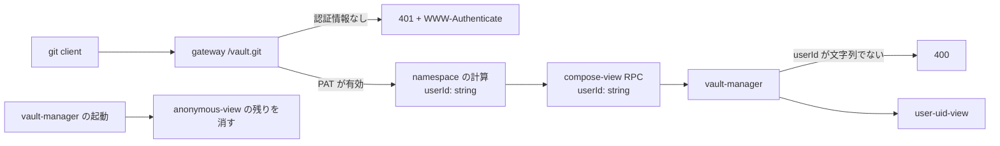
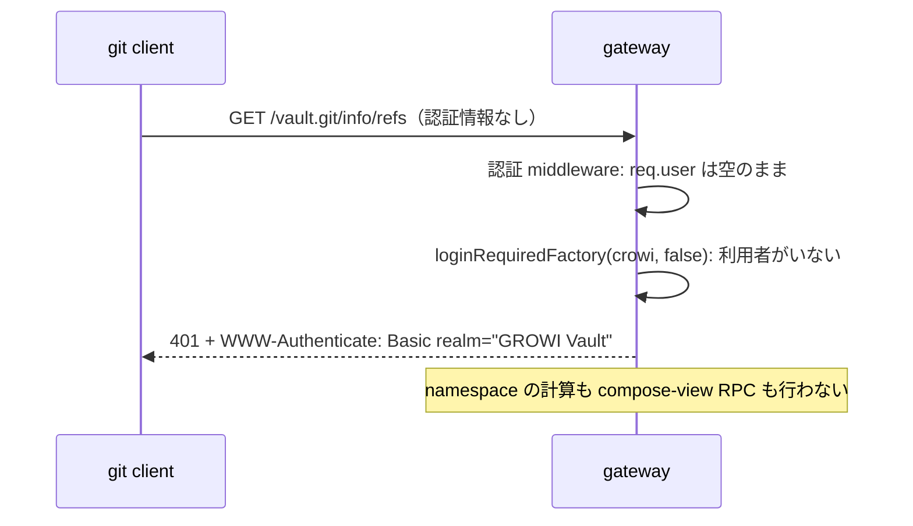
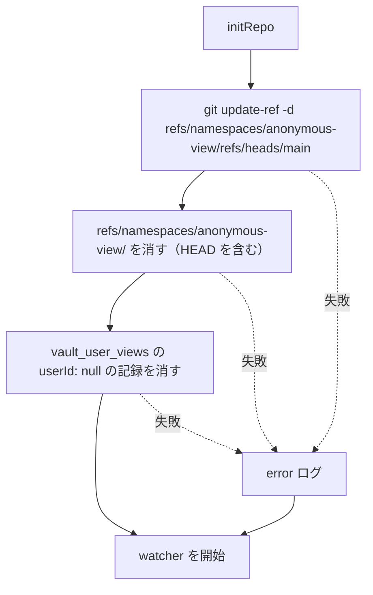

# Design Document: growi-vault-remove-guest-clone

## Overview

**Purpose**: 認証情報のない `git clone` / `git fetch` を廃止し、すべてのゲストが共有していたビュー（`anonymous-view`）を Vault から取り除く。権限を絞ったページや削除したページの過去の内容が、利用者を特定できない相手に渡らないようにする。

**Users**: GROWI 管理者とページの作成者（内容が漏れない）。これまでゲストとしてクローンしていた利用者（PAT を発行すればクローンできる）。

**Impact**: gateway は、ゲスト閲覧の設定によらず、利用者を特定できない要求を 401 で拒否する。vault-manager は、利用者なしのビューの合成を拒否し、起動のたびに `anonymous-view` の残りを消す。

### Goals

- 認証情報のない clone / fetch が、ゲスト閲覧の設定によらず 401 になる
- 「利用者なし」を表す値（`userId: null`）が、gateway から vault-manager までの型から消える
- 更新後の最初の起動で、既存の `anonymous-view` とその記録が消える

### Non-Goals

- ブラウザでのゲスト閲覧の可否を変えること
- ログインユーザーのビューの履歴の持ち方を変えること（ビューの commit を親なしにする、ビューを squash する、など）
- `anonymous-view` からしかたどれない object を object pool からすぐに消すこと（定期 gc の `--prune=2.weeks.ago` に任せる）
- `vault_user_views` の `userId` の索引を作り直すこと

## Amend target

この spec は次の承認済みの契約を変える。実装の後、最後のタスクで下の「書き戻す内容」を各 spec に反映し、この spec を削除する。

| 対象 | 今の契約 | 書き戻す内容 |
|---|---|---|
| growi-vault-gateway 要件 2.4 | 認証ヘッダーなし・ゲスト許可なら `userId: null` として続行する | 認証情報がなければ、ゲスト閲覧の設定によらず 401 + `WWW-Authenticate` を返す |
| growi-vault-gateway 要件 2.4a | 認証ヘッダーなし・ゲスト拒否なら 401 | 2.4 に含まれるので、2.4 を参照する 1 文にする（番号は残す） |
| growi-vault-gateway 要件 3.2 | 匿名の namespace は `['public']` | namespace の計算は、特定された利用者に対してだけ行う（番号は残す） |
| growi-vault-gateway 要件 11.1 / 11.3 | ゲストの可否を `loginRequiredFactory(crowi, isGuestAllowed=true)` に委ねる | `loginRequiredFactory(crowi, isGuestAllowed=false)` を使う。ゲスト閲覧の設定は clone の可否に影響しない |
| growi-vault-gateway design.md | 匿名の分岐（VaultPatAuth・VaultNamespaceMapper・エラー表・セキュリティの節） | 匿名の分岐を消し、「認証情報なしは 401」に書き直す |
| growi-vault 要件 3.4 | 匿名アクセスには public のページだけを返す | 認証情報のないアクセスには何も返さず、認証を求める |
| growi-vault design.md | `anonymous-view` の ref と匿名アクセスの説明 | 削除する |
| growi-vault-manager 要件 4.7 | `userId: null` なら `anonymous-view` を返す | 利用者なしの合成の依頼はエラーにする |
| growi-vault-manager design.md | `userId: string \| null`、`anonymous-view`、`vault_user_views` の匿名の記録 | `userId: string` にし、匿名の記述を消す。起動時に `anonymous-view` の残りを消す処理を書き足す |

**Revalidation Triggers への影響**: growi-vault-gateway の design.md は、`security:restrictGuestMode` / `security:wikiMode` の仕様変更を再検証の条件に挙げている。この amend の後は、clone の可否がこれらの設定に左右されないので、書き戻すときにこの条件を消す。`aclService` / `loginRequired` / `accessTokenParser` のインターフェース変更は、引き続き再検証の条件である。

## Boundary Commitments

### This Spec Owns

- gateway の `/vault.git` で、利用者を特定できない要求を拒否する判定
- gateway から vault-manager へ渡す「ビューの合成の依頼」の型（`ComposeViewRequest.userId`）
- vault-manager の、利用者なしの合成の拒否
- vault-manager の、起動時に `anonymous-view` の残りを消す処理
- 上の変更に伴う、3 つの spec と利用者向け文書の書き直し

### Out of Boundary

- PAT の検証、無効な PAT の拒否、PAT のスコープ（growi-vault-gateway 要件 2.1〜2.3・2.5・2.6 のまま）
- namespace の中身、instruction の処理、squash、gc
- ログインユーザーのビュー（`user-<uid>-view`）の合成の方法
- GROWI のドキュメントサイト（このリポジトリの外）。必要な書き換えは PR の説明文に書く

### Allowed Dependencies

- `loginRequiredFactory`（apps/app 標準の middleware）。gateway は認可をこれに任せる
- `git update-ref`（vault-manager のコンテナにある git。gc と upload-pack ですでに使っている）

### Revalidation Triggers

- `loginRequiredFactory` の第 2 引数（`isGuestAllowed`）の意味が変わったとき
- ビューの名前の付け方（`user-<uid>-view`）が変わったとき（`anonymous-view` という名前を消す処理が、別のビューと衝突しないことを確かめ直す）
- 将来、認証情報のないクローンを再び許す場合。共有されるビューに履歴を持たせない設計を先に決めること

## Architecture

### Existing Architecture Analysis

今の流れは次のとおり。

1. gateway の認証 middleware（`vault-pat-auth.ts`）は、認証情報がなければ `req.user` を空のまま次へ渡す。
2. `loginRequiredFactory(crowi, true, gitFallback)` は、ゲスト閲覧が許可されていれば、`req.user` が空でも通す。
3. ハンドラの `readIdentity` は `userId: null` を返し、`computeAccessibleNamespaces(null)` が `['public']` を返す。
4. vault-manager の `compose(null, ['public'])` は、`anonymous-view` を作る。前回の `anonymous-view` の commit を親にする。

`null` という 1 つの値が、4 つの層（middleware・namespace の計算・RPC・ビューの合成）を通っている。

### Architecture Pattern & Boundary Map



**方針**: 入口（gateway の middleware）で拒否し、その先の型から `null` を消す。型が `string` になれば、利用者なしの経路は、後から誤って足そうとしても型検査で止まる。RPC の受け口（vault-manager の controller）は別プロセスの境界なので、ここでも値を確かめる。

### Technology Stack

| Layer | Choice | Role | Notes |
|---|---|---|---|
| gateway | 既存の `loginRequiredFactory` | ゲストの拒否 | 第 2 引数を `false` にする。新しい依存はない |
| 型 | `@growi/core` の `ComposeViewRequest` | RPC の契約 | `userId: string` に変える。公開パッケージなので changeset を付ける |
| vault-manager | `git update-ref -d` | `anonymous-view` の ref を消す | loose の ref も `packed-refs` の中の ref も消せる |

## File Structure Plan

### Modified Files

**apps/app（gateway）**

- `apps/app/src/features/growi-vault/server/routes/vault-gateway.ts` — `loginRequiredFactory` の第 2 引数を `false` にする。`readIdentity` は、利用者がいなければ `null` を返し、ハンドラは `gitFallback` と同じ 401 を返す（`crowi` を渡さない経路でも通さないため）。匿名に触れているコメントを直す
- `apps/app/src/features/growi-vault/server/middlewares/vault-pat-auth.ts` — コメントの「匿名の候補」を「後段で拒否される」に直す。動作は変えない
- `apps/app/src/features/growi-vault/server/services/vault-namespace-mapper.ts` — `computeAccessibleNamespaces(userId: string, ...)` にし、`null` の分岐を消す
- `apps/app/src/features/growi-vault/server/services/vault-manager-client.ts` — 型が変わるだけ（`ComposeViewRequest` に従う）

**packages/core**

- `packages/core/src/interfaces/vault/vault-compose-view.ts` — `ComposeViewRequest.userId` を `string` にする
- `.changeset/*.md` — `@growi/core` の変更を記録する

**apps/growi-vault-manager**

- `src/controllers/compose-view-controller.ts` — `userId` が空でない文字列でなければ 400 を返す
- `src/services/vault-view-composer.ts` — `compose(userId: string, ...)` にし、`'anonymous-view'` の分岐を消す
- `src/models/vault-user-view.ts` — `userId` の型を `string` にし、匿名の 1 件を消す static（`deleteAnonymous`）を足す。索引はそのまま
- `src/services/vault-repo-storage.ts` — namespace 1 つの ref と HEAD を消す関数（`deleteNamespace`）を足す
- `src/services/vault-legacy-anonymous-view.ts`（新規） — 起動時に `anonymous-view` の残りを消す関数 1 つ
- `src/server-runtime.ts` — `initRepo()` の後、watcher の開始の前に、上の関数を呼ぶ
- `README.md` — クローンには PAT が必要であることを書く（ゲストのクローンの記述は今もないので、追記のみ）

**テスト**（既存のファイルを直す。新規は `vault-legacy-anonymous-view.spec.ts` だけ）

- `apps/app/src/features/growi-vault/server/routes/vault-gateway.spec.ts`、`__tests__/vault-gateway.integ.ts`、`__tests__/clone-e2e.integ.ts`、`server/services/vault-namespace-mapper.spec.ts`、`server/middlewares/vault-pat-auth.spec.ts`
- `apps/growi-vault-manager/src/services/vault-view-composer.spec.ts`、`src/services/vault-repo-storage.spec.ts`、`src/__tests__/compose-view-maintenance.integ.ts`、`src/__tests__/clone-e2e.integ.ts`

## System Flows

### 認証情報のない clone



git クライアントは 401 を受け取ると、利用者に認証情報を尋ねる。PAT を入力すれば、今までどおりクローンできる。

### 起動時の片付け



- 3 つの手順はどれも、対象がなければ何もしない。そのため、毎回の起動で実行してよい。
- 失敗しても起動は続ける。vault-manager を止めると、ログインユーザーのクローンまで止まるため。gateway がゲストを通さないので、ref が残っていても、その内容を受け取れる利用者はいない。次の起動でもう一度消す。
- ref を先に、記録を後に消す。途中で止まった場合に「記録はないが ref がある」状態は次の起動で直るが、逆の順だと、止まっている間だけ記録が ref を指さない状態になる。どちらも害はないので、git の操作を先にまとめた。

## Requirements Traceability

| Requirement | Summary | Components | Flows |
|---|---|---|---|
| 1.1, 1.2 | 認証情報なしは、設定によらず 401 | vault-gateway.ts（`loginRequiredFactory(crowi, false, gitFallback)`） | 認証情報のない clone |
| 1.3 | 拒否の応答に内容を含めない | 既存の `createGitFallback`（本文なし） | 同上 |
| 1.4 | PAT つきは今までどおり | 変更なし（結合テストで確かめる） | — |
| 1.5 | 利用者なしでは namespace の計算も合成の依頼もしない | `readIdentity` の戻り値、`computeAccessibleNamespaces(userId: string)`、`ComposeViewRequest.userId: string` | 同上 |
| 2.1 | 利用者なしの合成の依頼を拒否する | compose-view-controller.ts（400）、`compose(userId: string)` | — |
| 2.2 | 1 本のビューは 1 人に対応する | `viewRef` は常に `user-<uid>-view` | — |
| 3.1, 3.5 | 最初の起動で、操作なしに消す | vault-legacy-anonymous-view.ts、server-runtime.ts | 起動時の片付け |
| 3.2 | 消した後、その履歴の内容をどの利用者にも返さない | ref がないので、要求 object の検査（vault-want-guard）がたどれない | — |
| 3.3 | なければ何もしない | 3 つの手順がどれも冪等 | 起動時の片付け |
| 3.4 | 失敗したら error ログを出し、次の起動でやり直す | vault-legacy-anonymous-view.ts | 同上 |
| 3.6 | ログインユーザーのビューと namespace を変えない | `deleteNamespace('anonymous-view')` は、その 1 ディレクトリだけを消す | 同上 |
| 4.1 | 文書は PAT が必要と示す | apps/growi-vault-manager/README.md | — |
| 4.2 | ログインしていない閲覧者にクローン手順を示さない | 変更なし。クローン手順を示す画面は管理画面だけで、管理者しか開けない | — |
| 4.3 | リリースノート | PR の説明文に「リリースノートに書くこと」を書く | — |

## Components and Interfaces

### gateway

#### vault-gateway.ts

| Field | Detail |
|---|---|
| Intent | 利用者を特定できない要求を、ハンドラに入る前に 401 で拒否する |
| Requirements | 1.1, 1.2, 1.3, 1.5 |

```typescript
// 利用者がいなければ null。ハンドラは null のとき gitFallback と同じ 401 を返して終わる。
function readIdentity(req: Request): {
  userId: string;
  scopes: ReadonlyArray<string> | undefined;
} | null;
```

- middleware の並びは `[maintenanceMode] → credentialAdapter → loginRequiredFactory(crowi, false, gitFallback) → handler`。
- `crowi` を渡さない経路（単体テスト用）では `loginRequiredFactory` が入らない。この経路でも通さないよう、ハンドラ自身が `readIdentity` の `null` を 401 にする。型の上でも、`null` のままでは namespace の計算を呼べない。
- 認可を標準の middleware に任せる方針（growi-vault-gateway 要件 11）は変えない。変わるのは、渡す引数だけである。

#### vault-namespace-mapper.ts

```typescript
computeAccessibleNamespaces(
  userId: string,
  scopes?: ReadonlyArray<string>,
): Promise<ReadonlyArray<Namespace>>;
```

### RPC の契約（@growi/core）

```typescript
export interface ComposeViewRequest {
  readonly userId: string;
  readonly namespaces: ReadonlyArray<Namespace>;
}
```

### vault-manager

#### compose-view-controller.ts

| Field | Detail |
|---|---|
| Intent | 別プロセスから届く依頼を、型を信じる前に確かめる |
| Requirements | 2.1 |

- `userId` が空でない文字列でなければ、`BadRequest`（400）を投げる。ビューも記録も作らない。
- 古い版の gateway が `userId: null` を送ってきた場合も、ここで 400 になる（下の「Migration Strategy」）。

#### vault-legacy-anonymous-view.ts

| Field | Detail |
|---|---|
| Intent | 以前の版が作った `anonymous-view` の ref・HEAD・記録を消す |
| Requirements | 3.1, 3.3, 3.4, 3.5, 3.6 |

```typescript
/** 失敗は error ログに残し、例外は投げない。 */
export function removeLegacyAnonymousView(): Promise<void>;
```

#### vault-repo-storage.ts

```typescript
/**
 * namespace 1 つの ref と HEAD を消す。loose の ref も packed-refs の中の ref も消す。
 * なければ何もしない。
 */
export function deleteNamespace(namespace: string): Promise<void>;
```

- ref は `git --git-dir <repo> update-ref -d refs/namespaces/<ns>/refs/heads/main` で消す。ファイルを直接消す方法だと、過去の gc が ref を `packed-refs` にまとめていた場合に ref が残るため。
- その後、`refs/namespaces/<ns>/` を消す（HEAD のファイルが残るため）。

## Data Models

- `vault_user_views`: `userId: null` の記録を消す。以後、`userId` は必ず文字列。索引（`{ userId: 1 }`、unique・sparse）は変えない。
- bare repo: `refs/namespaces/anonymous-view/` を消す。`anonymous-view` からしかたどれない object は、定期 gc が 2 週間後以降に消す。

## Error Handling

| 場面 | 応答 | 備考 |
|---|---|---|
| 認証情報のない clone / fetch | 401 + `WWW-Authenticate: Basic realm="GROWI Vault"`、本文なし | 監査ログに `VAULT_AUTH_FAILURE` を残す（既存の `gitFallback`） |
| vault-manager が利用者なしの合成の依頼を受けた | 400 | gateway は今までどおり 502 に変換する |
| 起動時の片付けが失敗した | error ログ。起動は続ける | 次の起動でやり直す |

## Testing Strategy

### 単体テスト

- **vault-gateway.spec.ts**: 認証情報のない `info/refs` と `git-upload-pack` が、ゲスト閲覧が許可されていても 401 + `WWW-Authenticate` になり、namespace の計算と compose-view が呼ばれない（1.1, 1.2, 1.5）。`crowi` を渡さない経路でも同じ（1.5）。
- **vault-namespace-mapper.spec.ts**: 匿名の場合のテストを消す。利用者の場合は今までどおり。
- **vault-view-composer.spec.ts**: `anonymous-view` のテストを消す。
- **vault-repo-storage.spec.ts**（実際の bare repo と git を使う）: `deleteNamespace` が、loose の ref・`packed-refs` の中の ref・HEAD を消し、ほかの namespace と `refs/vault/sparse-filters/` を残す。なければ何もしない（3.3, 3.6）。
- **vault-legacy-anonymous-view.spec.ts**: 消す処理が失敗しても例外を投げず、error ログを出す（3.4）。

### 結合テスト

- **apps/app `vault-gateway.integ.ts`**: `security:wikiMode='public'` と `restrictGuestMode='Readonly'` のそれぞれで、認証情報のない要求が 401 になる。同じ設定で、PAT つきの要求は 200 になる（1.2, 1.4）。
- **vault-manager `compose-view-maintenance.integ.ts`**: `userId: null` の compose-view が 400 になり、`anonymous-view` の ref も記録もできない（2.1）。
- **vault-manager（起動の結合テスト）**: bare repo に `anonymous-view` の ref と HEAD を、`vault_user_views` に `userId: null` の記録を置いてから起動する。起動後、どちらもなく、同時に置いた `user-<uid>-view` と `public` は残っている（3.1, 3.6）。
- **vault-manager `clone-e2e.integ.ts`**: `anonymous-view` を使っているテストを、利用者のビューに置き換える。

## Security Considerations

- **塞ぐ経路**: 共有のビューの履歴を通じて、過去に public だった内容が、後からクローンした相手に渡る経路。ビューを共有する相手がいなくなるので、経路そのものがなくなる。
- **残る内容**: `anonymous-view` の履歴にあった object は、gc が消すまで object pool に残る。ただし、clone が受け取れるのは、自分のビューの ref からたどれる object だけである（growi-vault-manager 要件 5.6〜5.8 の検査）。ref を消した時点で、どの利用者もその object を受け取れない。
- **すでにクローンされた内容**: 更新の前にゲストがクローンした内容は、取り消せない。リリースノートに書く。
- **fail-closed**: gateway の middleware、gateway のハンドラ、vault-manager の controller の 3 か所で拒否する。どれか 1 つの設定を誤っても、利用者なしのビューは作られない。

## Migration Strategy

apps/app と vault-manager は別々に更新されうる。

| 組み合わせ | 動作 |
|---|---|
| 新しい apps/app ＋ 古い vault-manager | ゲストは 401。`anonymous-view` は、vault-manager を更新するまで残るが、だれにも配られない |
| 古い apps/app ＋ 新しい vault-manager | ゲストのクローンは、compose-view が 400 になり、gateway が 502 を返す。起動時に `anonymous-view` は消える |
| 両方とも新しい | この設計のとおり |

どの組み合わせでも、ゲストに内容は渡らない。更新の順番は問わない。

起動時の片付けは、すべての環境が更新を終えた後は何もしない処理になる。次のメジャー版で削除してよい。
