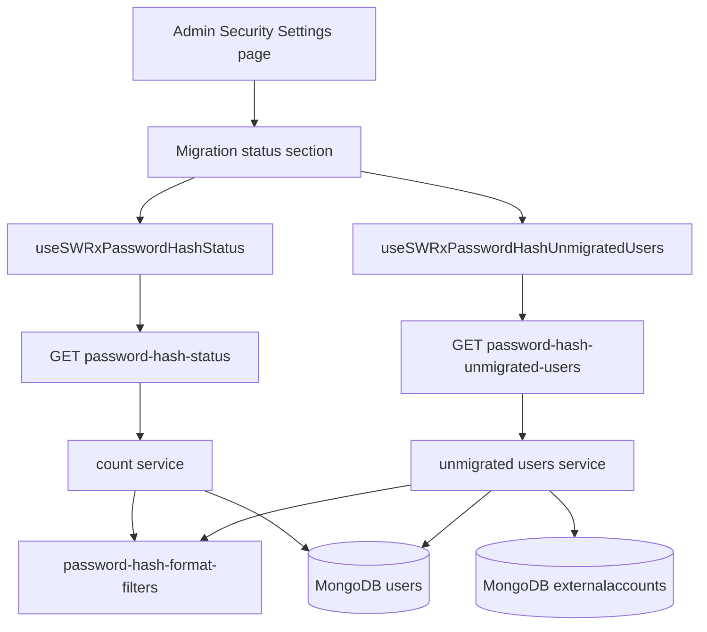
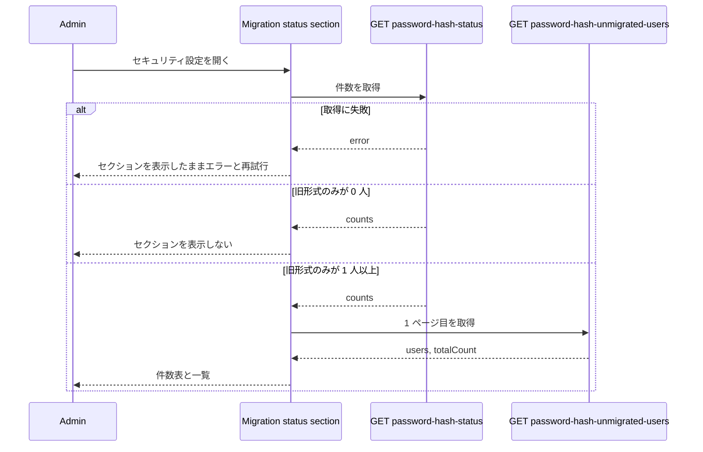

# Design Document: legacy-password-hash-cleanup

## Overview

管理画面のセキュリティ設定に、ローカル認証パスワードの移行状況を見るための**読み取り専用のセクション**を追加する。表示するのは、パスワード形式ごとのユーザー数（3 区分）と、移行を催促すべき未移行ユーザーの一覧の 2 つである。

旧形式パスワードの除去そのものは password-hash-upgrade が担当する。ログイン・パスワード設定・変更・リセットのいずれかで新形式が書かれるとき、同じ保存で旧形式が除去されるため、削除を実行する操作はこの機能に存在しない。残っている旧形式パスワードは未移行ユーザーのもの＝そのユーザーの唯一の資格情報であり、管理者が消せるものではない。

**Users**: サーバーのシェルに入れない GROWI 管理者（GROWI.cloud など）。status 系のスクリプトを実行できないため、移行の進み具合と、誰に声をかければ移行が進むのかを画面から知る必要がある。
**Impact**: 管理画面のセキュリティ設定に読み取り専用のセクションを 1 つ追加する。認証の挙動とユーザーの保存データは変更しない。

### Goals

- 移行状況（3 区分の件数）を管理画面で確認できるようにする
- 催促すれば移行が進むユーザー（外部アカウントと連携していない未移行ユーザー）を特定できるようにする
- 旧形式パスワードが 1 人分も残っていない環境では、このセクションを表示しない

### Non-Goals

- 旧形式パスワードの削除操作（移行時に除去されるため、残るのは未移行ユーザーの唯一の資格情報だけ）
- 催促そのもの（メール・通知の送信）
- パスワードリセットの代行
- PASSWORD_SEED の削除・変更の案内
- 旧バージョンへ戻す際の準備（password-hash-upgrade の Requirement 4 のとおり DB バックアップの復元で行う）

## Boundary Commitments

### This Spec Owns

- 管理画面セキュリティ設定内の「移行状況」セクションの表示・非表示の判断
- 移行状況の件数を返す読み取り専用エンドポイントと、その集計クエリ
- 催促が必要な未移行ユーザーの一覧を返す読み取り専用エンドポイントと、その抽出クエリ・並び順・ページング
- 上記 2 つのエンドポイントの**レスポンスの形**（`~/interfaces/password-hash-status`）。ただし件数の**区分の集合そのものは親 spec が定義**しており、本 spec はそれを写して公開するだけである
- このセクションが追加する表示文言（5 ロケール）

### Out of Boundary

- 旧形式パスワードの除去（password-hash-upgrade の Requirement 1.5 / 2.2 が担当）
- パスワード形式の分類ルールと**区分の集合の定義**（`password-hash-format-filters.ts` と親 spec の Requirement 3.1 が単一の正。本 spec はそれを**利用するだけ**で定義しない）
- status migration が報告する区分の変更（親 spec の成果物であり、親 spec の tasks で扱う）
- ユーザーのステータス定義（`UserStatus`）
- 外部アカウント（`externalaccounts`）のデータモデル
- 認証・ログインの挙動

### Allowed Dependencies

- `~/server/models/user/password-hash-format-filters`（分類フィルタの単一の正）
- `users` / `externalaccounts` コレクション（読み取りのみ）
- 既存の管理者向けミドルウェア連鎖（`accessTokenParser` → `loginRequiredStrictly` → `adminRequired`）
- 既存の apiv3 ルーター（`security-settings`）と `express-validator`
- クライアントの SWR 規約（`~/stores/admin/*`）と既存の管理画面コンポーネント

依存の向き: `interfaces` → `models/user`（フィルタ） → `server/service` → `server/routes` → `stores` → `client/components`。逆向きの import を禁止する。

### Revalidation Triggers

- `password-hash-format-filters.ts` の分類の定義が変わったとき（件数の意味が変わる）
- password-hash-upgrade が「新形式を書くとき旧形式を除去する」挙動をやめたとき（3 区分では表せなくなる）
- 2 つのエンドポイントのレスポンス形が変わったとき
- `UserStatus` の値が増減したとき（アクティブ / アクティブ以外の内訳が変わる）
- `externalaccounts` の `user` 参照の持ち方が変わったとき（一覧の除外条件が変わる）

## Architecture

### Existing Architecture Analysis

- 管理画面のセキュリティ設定は `SecurityManagementContents.jsx` が各設定セクションを並べる構成で、セクション単位での追加・非表示が可能である
- apiv3 の管理者向けルートは `accessTokenParser` → `loginRequiredStrictly` → `adminRequired` の順で固定されている（`security-settings/index.js`）
- 管理画面のサーバーデータ取得は SWR（`~/stores/admin/*`）に集約されている
- パスワード形式の分類は `password-hash-format-filters.ts` に集約済みで、status migration もこれを使う。**件数の定義をここ以外に書かない**ことが、CLI と画面の数字が食い違わない唯一の担保である

### Architecture Pattern & Boundary Map



**Architecture Integration**:
- 選択したパターン: 既存の管理画面セクション + 読み取り専用 apiv3 エンドポイント 2 本。書き込み経路を持たないため、状態遷移も冪等性の考慮も不要になる
- 境界の分け方: 「分類の定義」はモデル層のフィルタ、「集計」はサービス層、「公開」はルート層、「表示」はクライアント。件数の定義はサービス層に複製しない
- 維持する既存パターン: 管理者ミドルウェア連鎖、apiv3 のレスポンス形、SWR のフック命名
- 新規コンポーネントの理由: 集計と抽出はクエリの形が大きく異なる（単一コレクションの集計 / 2 コレクションの結合）ため、サービスを 2 つに分ける

### Technology Stack

| Layer | Choice / Version | Role in Feature | Notes |
|-------|------------------|-----------------|-------|
| Frontend | React 18 + SWR（既存） | セクション表示、件数と一覧の取得 | 新規依存なし |
| Backend / Services | Express + apiv3（既存） | 読み取り専用エンドポイント 2 本 | 新規依存なし |
| Data / Storage | MongoDB（既存） | `users` の集計、`externalaccounts` との結合 | `$facet` と `$lookup` を使用。新規依存なし |

## File Structure Plan

### Directory Structure

```
apps/app/src/
├── interfaces/
│   └── password-hash-status.ts              # 2 つのレスポンス型と件数の型
├── server/
│   ├── service/
│   │   ├── password-hash-status.ts          # 3 区分の件数を 1 回の走査で集計
│   │   └── password-hash-unmigrated-users.ts # 催促対象の抽出・並び順・ページング
│   └── routes/apiv3/security-settings/
│       ├── password-hash-status.ts          # GET /password-hash-status
│       └── password-hash-unmigrated-users.ts # GET /password-hash-unmigrated-users
└── client/
    ├── stores/admin/
    │   ├── password-hash-status.ts          # 件数取得フック
    │   └── password-hash-unmigrated-users.ts # 一覧取得フック（無限スクロール）
    └── components/Admin/Security/
        ├── PasswordHashStatusSetting.tsx     # セクション本体と表示・非表示の判断
        ├── PasswordHashCountTable.tsx        # 件数表
        ├── UnmigratedUserList.tsx            # 一覧と無限スクロール
        └── ErrorWithRetry.tsx                # エラー表示と再試行（件数・一覧で共用）
```

### Modified Files

- `apps/app/src/client/components/Admin/Security/SecurityManagementContents.jsx` — セクションの組み込み先。読み込むコンポーネント名を `PasswordHashStatusSetting` に変更する
- `apps/app/src/server/routes/apiv3/security-settings/index.js` — 読み取り専用の 2 ルートのみを登録する
- `apps/app/public/static/locales/{en_US,ja_JP,fr_FR,ko_KR,zh_CN}/admin.json` — 残る表示文言のみを保持する

### 削除するファイル

削除操作を提供しないため、次のファイルは存在しない状態が正しい。

- `server/routes/apiv3/security-settings/delete-legacy-passwords.ts` と同 `-activity.integ.ts`
- `server/service/legacy-password-cleanup.ts` と同 `.integ.ts`、`routes/.../legacy-password-cleanup.integ.ts`
- `client/components/Admin/Security/useLegacyPasswordDelete.ts`
- `client/components/Admin/Security/LegacyPasswordCleanupSetting.tsx`（`PasswordHashStatusSetting.tsx` が後継）とその spec
- `interfaces/activity.ts` の `ACTION_ADMIN_LEGACY_PASSWORD_DELETE`
- 削除の確認ダイアログ・警告・成功メッセージの翻訳キー（5 ロケール）

## System Flows

### セクションの初期表示



取得中はセクションを出さない（8.3）。件数の取得に失敗したときだけはセクションを隠さずエラーを出す（8.4）。「隠す」と「失敗して分からない」は区別できなければならないため、この 2 つは別扱いにする。

### 一覧の読み込みと再試行

- 末尾までスクロールしたら次ページを読む（7.6）
- 最初の読み込みに失敗したら一覧の代わりにエラーと再試行を出し、件数表には影響させない（7.8）
- 続きの読み込みに失敗したら読み込み済みの行を残し、末尾にエラーと再試行を出す（7.9）
- 画面内の移動で開き直したときは、読み込み済みのページをすべて取り直す（7.10、失敗時は 7.11）

## Requirements Traceability

| Requirement | Summary | Components | Interfaces | Flows |
|-------------|---------|------------|------------|-------|
| 1.1 | 3 区分の件数表示 | 件数サービス、件数表 | `PasswordHashFormatCounts` | 初期表示 |
| 1.2 | 未移行の内訳（アクティブ / それ以外） | 件数サービス、件数表 | `PasswordHashFormatCounts` | 初期表示 |
| 1.6 | 件数の取得失敗時にエラーと再試行 | セクション、`ErrorWithRetry` | — | 初期表示 |
| 1.7 | 画面内移動で件数を取り直す | 件数取得フック | SWR revalidation | 初期表示 |
| 4.1 | 2 つの取得を管理者だけに許可 | 両エンドポイント | ミドルウェア連鎖 | — |
| 4.2 | 非管理者の要求を拒否しデータを返さない | 両エンドポイント | ミドルウェア連鎖 | — |
| 4.4 | ハッシュ値を表示しない | 両サービスの射影 | `PasswordHashUnmigratedUser` | — |
| 6.1 | 5 ロケールの表示文言 | 翻訳リソース | — | — |
| 7.1, 7.2, 7.3 | 催促対象の抽出（ステータスを問わず、外部アカウント連携は除く） | 一覧サービス | `PasswordHashUnmigratedUser` | 一覧の読み込み |
| 7.4 | 各行の項目と未ログインの表示 | 一覧サービス、一覧 | `PasswordHashUnmigratedUser` | 一覧の読み込み |
| 7.5 | 最終ログインの新しい順、未ログインは最後 | 一覧サービス | 並び順 | 一覧の読み込み |
| 7.6 | 続きの読み込み | 一覧取得フック、一覧 | ページング | 一覧の読み込み |
| 7.7 | 0 人のときの表示 | 一覧 | — | 一覧の読み込み |
| 7.8–7.9, 7.11 | 読み込み失敗と再試行 | 一覧、`ErrorWithRetry` | — | 一覧の読み込み |
| 7.10 | 開き直しで取り直す | 一覧取得フック | SWR revalidation | 一覧の読み込み |
| 8.1, 8.3, 8.4 | セクションの表示・非表示 | セクション | — | 初期表示 |

## Components and Interfaces

| Component | Domain/Layer | Intent | Req Coverage | Key Dependencies | Contracts |
|-----------|--------------|--------|--------------|------------------|-----------|
| 件数サービス | Server / Service | 3 区分の件数を 1 回の走査で集計 | 1.1, 1.2, 4.4 | MongoDB (P0)、分類フィルタ (P0) | Service |
| 一覧サービス | Server / Service | 催促対象の抽出・並び順・ページング | 7.1, 7.2, 7.3, 7.4, 7.5, 7.6, 4.4 | MongoDB (P0)、分類フィルタ (P0) | Service |
| 件数エンドポイント | Server / Route | 件数の公開 | 1.1, 1.2, 4.1, 4.2 | 件数サービス (P0) | API |
| 一覧エンドポイント | Server / Route | 一覧の公開 | 7.1, 7.6, 4.1, 4.2 | 一覧サービス (P0) | API |
| 取得フック 2 種 | Client / Store | SWR による取得と再検証 | 1.7, 7.6, 7.10 | 両エンドポイント (P0) | State |
| セクション | Client / UI | 表示・非表示の判断と子の配置 | 1.6, 8.1, 8.3, 8.4 | 件数フック (P0) | — |
| 件数表 / 一覧 / エラー表示 | Client / UI | 表示のみ | 1.1, 1.2, 7.1–7.9 | — | — |

### Server / Service

#### 件数サービス（`password-hash-status.ts`）

| Field | Detail |
|-------|--------|
| Intent | `users` を 1 回走査して 3 区分の件数を返す |
| Requirements | 1.1, 1.2, 4.4 |

**Responsibilities & Constraints**
- 区分の判定は `password-hash-format-filters.ts` の `upgradedOnlyFilter` / `legacyOnlyFilter` / `noPasswordFilter` を使う。条件をこのサービスに書き写さない
- `legacyOnly` のみ `activeUserFilter` / `nonActiveUserFilter` で内訳に割る
- 資格情報のフィールドを**射影に含めない**

**Contracts**: Service [x]

```typescript
export const countPasswordHashFormats = (
  users: Collection<Document>,
) => Promise<PasswordHashFormatCounts>;
```
- Preconditions: MongoDB に接続済みであること
- Postconditions: 書き込みを一切行わない
- Invariants: 3 区分の合計が対象ユーザー総数に一致する（どのユーザーも必ず 1 区分に属する）

**Implementation Notes**
- Integration: 区分ごとに `countDocuments` を呼ぶと走査が区分数ぶん増えるため、`$facet` で 1 回の走査にまとめる
- Validation: 「両形式」の区分は持たない。password-hash-upgrade が同時書き込みを行わないため、その状態は到達不能である
- Risks: フィルタ側の定義が変われば件数の意味が変わる（Revalidation Triggers に記載）

#### 一覧サービス（`password-hash-unmigrated-users.ts`）

| Field | Detail |
|-------|--------|
| Intent | 旧形式のみを持ち、外部アカウントと連携していないユーザーを、最終ログインの新しい順に返す |
| Requirements | 7.1, 7.2, 7.3, 7.4, 7.5, 7.6, 4.4 |

**Responsibilities & Constraints**
- 抽出条件は `legacyOnlyFilter`（ステータスでは絞らない。7.2）
- 外部アカウントを持つユーザーを除外する（7.3）
- 並びは `lastLoginAt` の降順。未ログインを最後に置く（7.5）
- 返す項目はユーザー名・メールアドレス・最終ログイン日時のみ（4.4）。未ログインのユーザーは `lastLoginAt` を `null` で返し、表示側が「ログインしたことがない」旨を出す（7.4）

**Contracts**: Service [x]

```typescript
export const listUnmigratedUsersToNudge = (
  users: Collection<Document>,
  externalAccounts: Collection<Document>,
  options: { readonly page: number; readonly limit: number },
) => Promise<PasswordHashUnmigratedUsersResponse>;
```
- Preconditions: `page >= 1`、`limit` は上限以下であること（ルート層で検証済み）
- Postconditions: 書き込みを一切行わない
- Invariants: 同じ入力に対して行の重複・欠落が起きない

**Implementation Notes**
- Integration: 外部アカウントの除外は `$lookup` + `$match` で行う。**`externalaccounts.distinct('user')` の結果を `$nin` に渡す実装は採用しない** — 連携ユーザー数に比例して配列が大きくなり、16MB の BSON 上限を超えると一覧が 500 になるため
- Integration: 段の順序は `$match`（`legacyOnlyFilter`） → `$sort`（`lastLoginAt` 降順, `_id` 昇順） → `$lookup` → `$match`（連携なし） → `$skip` → `$limit` → `$project` とする。`$sort` を `$lookup` より前に置くのは、部分索引で整列済みの順序をそのまま使い、全件を読み込んでから並べ替える形（ブロッキングソート）を避けるためである
- Integration: `totalCount` は同じ `$match` → `$lookup` → `$match` に `$count` を続けて求める。除外条件を含めずに数えると、一覧に出ない行まで件数に入る
- Validation: 並び順は `lastLoginAt` 降順に `_id` を第 2 キーとして加える。`lastLoginAt` は同値・欠損が起きるため、これがないとページ送りで行が重複・欠落する
- Risks: `lastLoginAt` 降順に使える索引が無いと、ページを読むたびに全件を並べ替える。旧形式保持者だけを対象とする部分索引で走査範囲を限定する（Performance 参照）

### Server / Route

両エンドポイントとも `accessTokenParser` → `loginRequiredStrictly` → `adminRequired` の順で保護する（4.1、4.2）。書き込みを行わないため activity の記録は伴わない。

**Contracts**: API [x]

| Method | Endpoint | Request | Response | Errors |
|--------|----------|---------|----------|--------|
| GET | `/_api/v3/security-settings/password-hash-status` | — | `PasswordHashStatusResponse` | 403, 500 |
| GET | `/_api/v3/security-settings/password-hash-unmigrated-users` | `page`, `limit`（任意） | `PasswordHashUnmigratedUsersResponse` | 400, 403, 500 |

`page` / `limit` は `express-validator` で整数・範囲・上限を検証する。重複クエリが配列として渡る経路があるため、単一値であることも検証する。

### Client

- **セクション**: 件数の取得結果だけで表示・非表示を決める。取得中は出さない（8.3）、失敗時は出してエラーを見せる（8.4）、`legacyOnly` の合計が 0 なら出さない（8.1）
- **件数表・一覧・エラー表示**: 表示のみ。一覧は末尾到達で次ページを読み、失敗時は読み込み済みの行を保持したまま再試行を出す
- 2 つのフックは画面内の移動で再検証する（1.7、7.10）

## Data Models

### Domain Model

ユーザーは資格情報フィールドの有無により、次の 3 区分のいずれか 1 つに属する。

```
upgradedOnly : passwordHash あり / password なし   — 移行済み
legacyOnly   : passwordHash なし / password あり   — 未移行（アクティブ / それ以外に細分）
noPassword   : どちらも なし                        — パスワード未設定
```

「両方あり」は、password-hash-upgrade が新形式を書くときに必ず旧形式を除去するため存在しない。

### Physical Data Model

- 一覧は `legacyOnly` を `lastLoginAt` 降順で読む。全ユーザーを対象とした `lastLoginAt` の索引では、未移行者が走査の最後尾に来るため実質的に全件を読む。**旧形式保持者のみを含む部分索引**を用意し、走査を未移行者の集合に限定する
- 部分索引の条件は `{ password: { $exists: true } }` とする。`partialFilterExpression` は `$exists: false` を受け付けないため「`passwordHash` が無い」を条件に含められないが、両形式を同時に持つユーザーが存在しない以上、「`password` がある」は旧形式保持者と一致する。一覧側のクエリの述語はこの条件の部分集合になるため、索引は選択されうる
- 件数側は `lastLoginAt` を条件に含まないためこの索引は効かない。件数は `$facet` による単一走査で賄う
- **索引の作成は migrate-mongo のマイグレーションで行い、Mongoose スキーマには定義しない。** `.claude/rules/model.md` は「Prisma 移行が完了するまで索引作成は Mongoose が持つ」と記しているが、その趣旨は索引作成を Prisma 側へ早期に移さないことであり、リポジトリには既にマイグレーションで索引を作る前例がある（`20260619120000-add-unique-key-index-to-auditlog-es-sync-collections.js`）。一方で Mongoose スキーマに `partialFilterExpression` を書いた前例は無い。前例のある側に合わせる

## Error Handling

### Error Strategy

| 失敗 | サーバーの応答 | 画面 |
|---|---|---|
| 非管理者による要求 | 403、データを返さない | 管理画面に到達しないため考慮不要 |
| `page` / `limit` が不正 | 400（エラーコード付き） | 一覧のエラー表示 |
| 集計・抽出の失敗 | 500（エラーコード付き）、サーバーログに記録 | 件数はセクションを出したままエラー、一覧は一覧部分のみエラー |

件数と一覧は独立して失敗しうる。一覧の失敗が件数表を巻き込まないことを要件（7.8）が明示しているため、エラー状態を 1 つにまとめない。

### Monitoring

失敗時はエラーコードとともにサーバーログへ出力する。件数・一覧ともに読み取りのみのため、監査ログの記録対象にはしない。

## Testing Strategy

### Unit Tests
- 件数サービス: 3 区分それぞれに属するユーザーを置き、件数と `legacyOnly` の内訳が一致すること
- 件数サービス: `password: ''` のユーザーが `noPassword` に数えられること（空文字は不在として扱う）
- 一覧サービス: 外部アカウントを持つ未移行ユーザーが一覧に出ないこと
- 一覧サービス: `lastLoginAt` が同値のユーザーが複数いても、ページを跨いで重複・欠落しないこと
- 一覧サービス: 未ログインのユーザーが最後に並ぶこと

### Integration Tests
- 管理者による取得が 200 で、レスポンスに資格情報のフィールドが含まれないこと
- 非管理者による取得が拒否され、データが返らないこと（両エンドポイント）
- `page` / `limit` の不正値が 400 になること（配列で渡した場合を含む）
- 一覧のページングが `page` / `limit` を反映すること

### UI Tests
- 未移行が 0 人のときセクションが描画されないこと
- 取得中にセクションが描画されないこと
- 件数の取得に失敗したとき、セクションが描画され、再試行の操作が出ること
- 一覧の初回失敗時に、件数表は残り一覧部分だけがエラーになること
- 続きの読み込みに失敗したとき、読み込み済みの行が残ること

## Security Considerations

- 2 つのエンドポイントは管理者専用であり、ユーザー名・メールアドレス・最終ログイン日時という個人情報を返す。ミドルウェア連鎖の順序（認証 → 管理者判定）を崩さない
- パスワードとハッシュの値は、射影にもレスポンスにも含めない（4.4）
- 件数と一覧は読み取りのみで、ユーザーの保存データを変更しない。したがって取り消し不能な操作は存在しない

## Performance & Scalability

- 件数: 区分ごとの `countDocuments` ではなく `$facet` による単一走査とする。区分数ぶんの走査を避ける
- 一覧: 外部アカウントの除外を `$lookup` で行い、連携ユーザー ID の配列をアプリケーション側に載せない（BSON 16MB 上限による 500 を避ける）
- 一覧: 旧形式保持者のみを含む部分索引により、`lastLoginAt` 降順の走査を未移行者に限定する
- いずれも管理者が開いたときにのみ実行される低頻度の読み取りであり、常時の負荷は生じない
- 実装時に `explain` で、一覧のクエリが部分索引を `IXSCAN` として選び、ブロッキングソートが発生しないことを確認する。確認できない場合は段の順序か索引の条件を見直す
