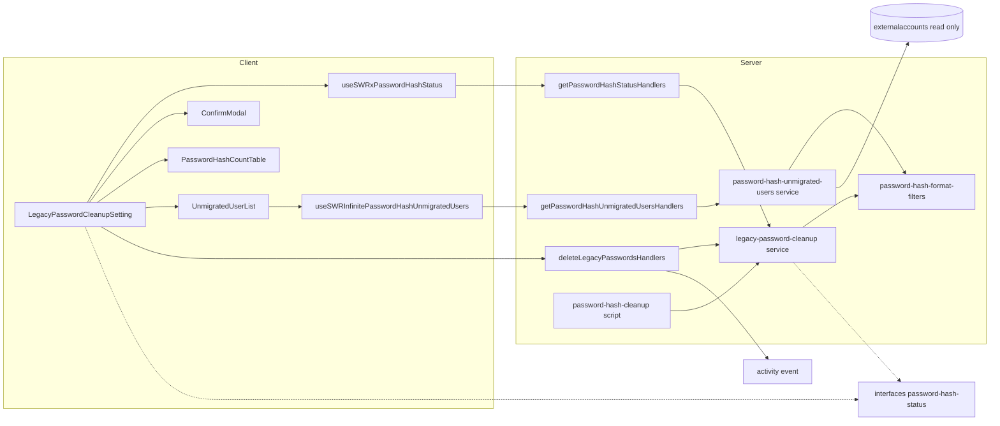
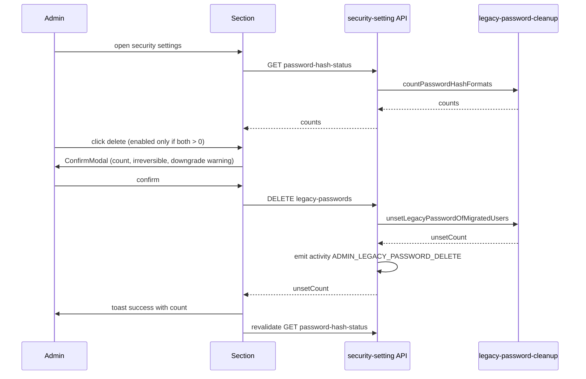

# Design Document: legacy-password-hash-cleanup

## Overview
**Purpose**: サーバーのシェルに入れない GROWI 管理者が、管理画面のセキュリティ設定から次の 2 つを行えるようにする。
- パスワード形式の移行状況を確認する
- 移行済みユーザー（旧形式と新形式の両方を持つユーザー）から旧形式（SHA-256）パスワードを削除する

**Users**: GROWI.cloud などの管理者が、password-hash-upgrade の最終段階（旧形式の後片付け）で使う。

**Impact**: 次の 3 点を変える。
- 既存の cleanup スクリプトから、件数の集計と旧形式の削除を共有サービスに切り出す。スクリプトの挙動は変えない。
- セキュリティ設定 API にエンドポイントを 2 本足す。
- 管理画面にセクションを 1 つ足す。

### Goals
- 4 区分の件数と、未移行ユーザーの ACTIVE 内訳を画面に表示する（1.1–1.5）
- 移行済みユーザーの旧形式パスワードを、中止判定なしで一括削除する（2.1–2.8）
- 確認ダイアログにダウングレード時の影響を警告し、実行を監査ログに残す（3.x, 4.x）
- 削除の基準を、スクリプトと画面で 1 か所の実装として共有する（5.2）
- 催促が必要な未移行ユーザー（外部アカウントと連携していない人）を一覧で示す（7.x）
- 旧形式のパスワードが残っていなければ、セクションを表示しない（8.x）

### Non-Goals
- 催促の実行（メールや通知の送信）。一覧は相手を示すだけ。PASSWORD_SEED の案内
- ダウングレード準備・再アップグレード準備の画面化
- status migration（`20260724000001-password-hash-status.js`）の書き換え
- 監査ログに削除件数を記録すること（snapshot の拡張）。実行者と件数はサーバーログに出す（4.5）
- 監査ログが既定で無効な環境でも記録されるようにすること。action は他の管理者操作と同じく `LargeActionGroup` だけに入れる

## Boundary Commitments

### This Spec Owns
- 共有サービス `legacy-password-cleanup`: 形式ごとの件数の集計と、移行済みユーザーからの旧形式パスワードの除去
- セキュリティ設定 API の 3 エンドポイント: 移行状況の取得、催促が必要なユーザーの一覧の取得、旧形式パスワードの削除。レスポンスの型も含む
- 監査ログの action `ADMIN_LEGACY_PASSWORD_DELETE` と、5 ロケール分のラベル
- 管理画面のセクション `LegacyPasswordCleanupSetting` と、その SWR hook
- `runPasswordHashCleanup` の内部を共有サービス呼び出しに置き換えること（外から見た挙動は変えない）
- 催促が必要なユーザーの一覧: サービス `password-hash-unmigrated-users`、GET エンドポイント、型、SWR hook、一覧のコンポーネント

### Out of Boundary
- 形式分類フィルタ（`password-hash-format-filters.ts`）の定義の変更。この spec は使うだけ
- 未移行の ACTIVE ユーザーがいると中止する判定。これは cleanup スクリプトだけの方針で、共有サービスには入れない
- 認証時のハッシュ検証と遅延移行（password-hash-upgrade が持つ）
- status migration、downgrade-prep、reupgrade-prep スクリプト
- 監査ログの記録ゲートや snapshot の型（activity-log 系 spec が持つ）
- password-hash-upgrade spec の契約の変更。この spec は amend spec ではない（`.claude/rules/spec-lifecycle.md`）。upgrade spec の cleanup スクリプトの要件（Req 3.3 / 3.4）と挙動はそのまま残し、旧 `password` を削除する 2 つ目の入口として画面を追加するだけである。upgrade spec の design.md の Phase 3（全員の移行を確認したあとに cleanup を行う）は、CLI で行う手順として引き続き有効である。画面からはそれより前でも削除できるが、その理由は research.md の Decision「CLI では中止し、画面では中止しない理由」に書いた。Phase 3 に含まれる旧 SHA-256 の検証コードの削除も、この spec では扱わない

### Allowed Dependencies
- `server/models/user/password-hash-format-filters.ts`（分類フィルタ）と `server/models/user/conts.ts`（UserStatus）
- `externalaccounts` コレクション（読み取りだけ。`user` フィールドで外部アカウントと連携しているユーザーを判定する）
- クライアント: `client/components/InfiniteScroll` と `swr/infinite`（一覧の読み足し）
- 既存のミドルウェア: `accessTokenParser`、`loginRequiredStrictly`、`adminRequired`、`generateAddActivityMiddleware`、`crowi.events.activity`
- クライアント: `apiv3-client`、`toastr`、`Admin/App/ConfirmModal`、`swr`
- 依存の向きは次のとおりとし、逆向きの import は禁止する。

  `interfaces` → `models/user`（filters）→ `service/legacy-password-cleanup` → `routes/apiv3/security-settings/*` と `scripts/password-hash-cleanup`

  - クライアントは `interfaces` の型だけを参照し、`server/` は import しない。
  - `scripts/` を `routes/` や `service/` から import してはならない。

### Revalidation Triggers
- `externalaccounts` のスキーマ（`user` フィールド）や、外部認証の連携の持ち方が変わったとき。一覧から外す条件（7.3）に影響する
- 形式分類フィルタの定義が変わったとき（新しい形式の追加や「値なし」の扱いの変更）。件数の区分と削除対象の両方に影響する
- activity-log（記録ゲート）spec で記録対象の action を許可リスト方式にする場合。`ADMIN_LEGACY_PASSWORD_DELETE` を許可リストに入れる必要がある
- `PasswordHashFormatCounts` や API レスポンスの形が変わったとき（クライアントのセクションに影響する）
- password-hash-upgrade で、両形式のユーザーの検証方針（新形式を優先する）が変わったとき（2.8 の前提が崩れる）

## Architecture

### Existing Architecture Analysis
- `runPasswordHashCleanup` は、未移行ユーザーの ACTIVE 内訳を数え、ACTIVE がいれば中止し、いなければ `updateMany(bothFilter, $unset password)` を実行する。この 3 段階が 1 つの関数にまとまっている。
- `security-settings/index.js`（1778 行の JS）は 1 つの `setup(crowi)` に全エンドポイントを持つ。ただし、同じ apiv3 の配下では、エンドポイントごとに TS の handler factory を作って `index` から登録する前例がある（`personal-setting/delete-all-access-tokens.ts` など）。
- 管理画面のセキュリティ設定は unstated container を中心に作られている。一方、新しい管理機能は `stores/admin/*` の SWR hook を使う（`useSWRxExportStatus` など）。

### Architecture Pattern & Boundary Map


- **Selected pattern**: 共有サービスを切り出し、入口を 2 つ（CLI と HTTP）用意する。中止判定は入口側の方針として、スクリプトだけが持つ。
- **New components rationale**:
  - 共有サービス: 5.2 の「同じ基準」をコードとして 1 か所に置くため
  - 3 つの handler ファイル: 1778 行の JS を大きくしないため
  - 型ファイル: クライアントとサーバーの境界をまたいで型を共有するため
- **Steering compliance**:
  - 中核の処理を返り値のある関数にし、入口は薄く保つ（Pure Function Extraction）
  - 中止するかどうかをフラグで切り替えない（Data-Driven Control）
  - クライアントから server を import しない

### Technology Stack
| Layer | Choice / Version | Role in Feature | Notes |
|-------|------------------|-----------------|-------|
| Frontend | React + reactstrap、`swr`（既存） | セクション、確認モーダル、件数の取得と再取得 | 新しい依存はない |
| Backend | Express apiv3（既存） | 3 エンドポイント、権限、監査ログ | 新しい依存はない |
| Data | MongoDB `users` コレクション（mongodb driver の `Collection` 経由。既存スクリプトと同じ） | `countDocuments` と `updateMany($unset)` | スキーマとインデックスは変えない |

## File Structure Plan

### Directory Structure（新規）
```
apps/app/src/
├── interfaces/
│   └── password-hash-status.ts             # PasswordHashFormatCounts と API レスポンスの型（クライアントとサーバーで共有）
├── server/
│   ├── service/
│   │   ├── legacy-password-cleanup.ts       # countPasswordHashFormats / unsetLegacyPasswordOfMigratedUsers
│   │   ├── legacy-password-cleanup.integ.ts
│   │   ├── password-hash-unmigrated-users.ts        # listUnmigratedUsersToNudge（催促が必要なユーザーの一覧）
│   │   └── password-hash-unmigrated-users.integ.ts
│   └── routes/apiv3/security-settings/
│       ├── password-hash-status.ts           # GET handler factory
│       ├── delete-legacy-passwords.ts        # DELETE handler factory（監査ログ付き）
│       ├── password-hash-unmigrated-users.ts # GET handler factory（一覧）
│       ├── password-hash-unmigrated-users.integ.ts
│       ├── delete-legacy-passwords-activity.integ.ts  # activity の確定で実行者が残るかの drift テスト
│       └── legacy-password-cleanup.integ.ts  # 件数と削除の handler の supertest
├── stores/admin/
│   ├── password-hash-status.ts              # useSWRxPasswordHashStatus
│   └── password-hash-unmigrated-users.ts    # useSWRInfinitePasswordHashUnmigratedUsers
└── client/components/Admin/Security/
    ├── LegacyPasswordCleanupSetting.tsx      # セクション（削除ボタン、確認モーダル、一覧の配置、非表示の判定）
    ├── PasswordHashCountTable.tsx            # 件数表（表示だけ。旧形式のみの合計 sumLegacyOnly もここ）
    ├── UnmigratedUserList.tsx                # 催促が必要なユーザーの一覧（枠の中のスクロールで読み足し）
    ├── UnmigratedUserList.spec.tsx
    ├── LegacyPasswordCleanupSetting.spec.tsx
    └── LegacyPasswordCleanupSetting.i18n.spec.ts  # 5 ロケールのキーが揃っているかの検査
```

### Modified Files
- `apps/app/src/server/scripts/password-hash-cleanup.ts`: 未移行ユーザーの内訳は `countPasswordHashFormats` で、削除は `unsetLegacyPasswordOfMigratedUsers` で行うように置き換える。中止の判定、戻り値の型、ログの文言は変えない。
- `apps/app/src/server/routes/apiv3/security-settings/index.js`: 3 つの handler factory（件数、一覧、削除）を import して登録する。
- `apps/app/src/interfaces/activity.ts`: `ACTION_ADMIN_LEGACY_PASSWORD_DELETE` の定数を足し、`SupportedAction` と `LargeActionGroup` に登録する（`ACTION_ADMIN_SECURITY_SETTINGS_UPDATE` と同じ扱い）。
- `apps/app/src/client/components/Admin/Security/SecurityManagementContents.jsx`: `ShareLinkSetting` のセクションの後に `<LegacyPasswordCleanupSetting />` のセクションを足す。
- `apps/app/public/static/locales/{en_US,ja_JP,fr_FR,ko_KR,zh_CN}/admin.json`: `security_settings.legacy_password_cleanup.*` と `audit_log_action.ADMIN_LEGACY_PASSWORD_DELETE` を足す。

## System Flows



- **ボタンを無効にする条件**: 件数の取得中、取得に失敗したとき、`both === 0` のとき（1.5, 2.5）。押したあとの件数の取り直しの間と、削除を確定してから件数の再取得が終わるまでの間（2.9）。
- **サーバー側では中止判定をしない**: 対象が 0 件でも正常に応答し、`unsetCount: 0` を返す（2.3, 2.6）。

## Requirements Traceability

| Requirement | Summary | Components | Interfaces | Flows |
|-------------|---------|------------|------------|-------|
| 1.1 | 4 区分の件数を表示 | Service, GET handler, Section | `PasswordHashFormatCounts` | 表示 |
| 1.2 | 未移行ユーザーの ACTIVE 内訳 | Service, Section | `legacyOnly.active / nonActive` | 表示 |
| 1.3 | 「両形式」を削除対象として示す | Section | `both` | 表示 |
| 1.4 | 削除後に件数を更新 | Section, Hook | SWR `mutate` | 削除 → 再取得 |
| 1.5 | 取得に失敗したらエラーを表示し、削除を受け付けない | Section, Hook | `error` | 表示 |
| 2.1 | ステータスを問わず、移行済みユーザー全員から削除 | Service, DELETE handler | `unsetLegacyPasswordOfMigratedUsers` | 削除 |
| 2.2 | 他の区分は変更しない | Service | `bothFilter` だけを対象にする | 削除 |
| 2.3 | 未移行の ACTIVE ユーザーがいても中止しない | Service, DELETE handler | 中止判定なし | 削除 |
| 2.4 | 削除件数を成功メッセージで表示 | DELETE handler, Section | `DeleteLegacyPasswordsResponse` | 削除 |
| 2.5 | 対象が 0 人ならボタンを無効にする | Section | `both === 0` | 表示 |
| 2.6 | 対象が 0 人でも正常に応答する | Service, DELETE handler | `unsetCount: 0` | 削除 |
| 2.7 | エラー時はエラーを表示し、成功は表示しない | Section, DELETE handler | `ErrorV3` | 削除 |
| 2.8 | 現行バージョンでのログインは変わらない | （既存の検証）Service が `passwordHash` に触れないこと | — | — |
| 2.9 | 削除の実行中は操作を無効にする | Section | 実行中の state | 削除 |
| 3.1 | 実行前に確認ダイアログを出す | Section | `ConfirmModal` | 削除 |
| 3.2 | 件数と、取り消せないことを表示 | Section | `warningMessage` | 削除 |
| 3.3 | ダウングレード時の影響を警告 | Section | `supplymentaryMessage` | 削除 |
| 3.4 | キャンセルしたら何もしない | Section | `onCancel` | 削除 |
| 3.5 | 最新の件数を確認ダイアログに出す | Section | 開くときの `mutate()` | 削除 |
| 4.1 | 管理者だけに許可 | GET/DELETE handler | `adminRequired`、SCOPE | — |
| 4.2 | 管理者以外は拒否し、データを返さない | GET/DELETE handler | `adminRequired` | — |
| 4.3 | 監査ログが有効で記録対象のときに記録 | DELETE handler, activity.ts | `ADMIN_LEGACY_PASSWORD_DELETE`（`LargeActionGroup`） | 削除 |
| 4.4 | ハッシュの値を表示しない | API の型 | 件数だけを返す | — |
| 4.5 | 実行者と件数をサーバーログに出す | DELETE handler | `logger.info` | 削除 |
| 5.1 | スクリプトの挙動を変えない | cleanup script | `PasswordHashCleanupResult`（変更なし） | — |
| 5.2 | 削除の基準を共有する | Service | `unsetLegacyPasswordOfMigratedUsers` | — |
| 5.3 | 件数の区分を status と同じ定義にする | Service | 共有フィルタ | — |
| 6.1 | 5 ロケール対応 | locales, Section, i18n spec | `admin.json` | — |
| 7.1 | 催促が必要なユーザーを一覧で表示 | Unmigrated service, GET handler, UnmigratedUserList | `listUnmigratedUsersToNudge` | 表示 |
| 7.2 | ステータスを問わず含める | Unmigrated service | ステータスで絞らない | — |
| 7.3 | 外部アカウントと連携しているユーザーを含めない | Unmigrated service | `externalaccounts.user` で除外 | — |
| 7.4 | ユーザー名・メール・最終ログインを表示 | API の型, UnmigratedUserList | `PasswordHashUnmigratedUser` | 表示 |
| 7.5 | 最終ログインの新しい順、未ログインは最後 | Unmigrated service | `sort({ lastLoginAt: -1, _id: 1 })` | — |
| 7.6 | スクロールで続きを読み込む | GET handler, hook, UnmigratedUserList | `page` / `limit`、`useSWRInfinite`、`InfiniteScroll` | 表示 |
| 7.7 | 0 人のときはいないことを表示 | UnmigratedUserList | `totalCount === 0` | 表示 |
| 7.8 | 最初の読み込みの失敗時はエラーを表示し、他に影響させない | GET handler, UnmigratedUserList | `ErrorV3`、hook の `error` | 表示 |
| 7.9 | 続きの読み込みの失敗時は行を残し、末尾にエラーと再試行を出す | UnmigratedUserList | `error` と読み込み済みの `data`、`setSize` での再試行 | 表示 |
| 8.1 | 旧形式が残っていなければ非表示 | Section | `both + legacyOnly === 0` | 表示 |
| 8.2 | 削除で 0 人になったら、成功を知らせて非表示 | Section | 成功トースト → `mutate()` | 削除 |
| 8.3 | 取得中は表示しない | Section | `isLoading` | 表示 |
| 8.4 | 取得失敗時は隠さずエラーを表示 | Section | hook の `error` | 表示 |

## Components and Interfaces

| Component | Domain/Layer | Intent | Req Coverage | Key Dependencies | Contracts |
|-----------|--------------|--------|--------------|------------------|-----------|
| PasswordHashStatus types | interfaces | クライアントとサーバーで共有する型 | 1.1, 1.2, 2.4, 4.4 | — | State |
| legacy-password-cleanup | server/service | 件数の集計と旧形式の除去 | 1.1–1.3, 2.1–2.3, 2.6, 2.8, 5.2, 5.3 | format filters (P0) | Service |
| getPasswordHashStatusHandlers | server/routes | 件数の取得 API | 1.1, 1.5, 4.1, 4.2, 4.4 | Service (P0), adminRequired (P0) | API |
| deleteLegacyPasswordsHandlers | server/routes | 削除 API と監査ログ | 2.1, 2.3, 2.4, 2.6, 2.7, 4.1–4.3, 4.5 | Service (P0), activity event (P1) | API |
| password-hash-cleanup script（変更） | server/scripts | 中止判定を含む CLI | 5.1, 5.2 | Service (P0) | Batch |
| useSWRxPasswordHashStatus | stores/admin | 件数の取得と再取得 | 1.1, 1.4, 1.5 | apiv3Get (P0) | State |
| LegacyPasswordCleanupSetting | client UI | 件数表、削除ボタン、確認、一覧の配置、非表示の判定 | 1.x, 2.4, 2.5, 2.7, 3.x, 6.1, 8.x | Hook (P0), ConfirmModal (P1) | — |
| password-hash-unmigrated-users | server/service | 催促が必要なユーザーの一覧 | 7.1–7.5 | format filters (P0), externalaccounts (P0) | Service |
| getPasswordHashUnmigratedUsersHandlers | server/routes | 一覧の取得 API | 4.1, 4.2, 4.4, 7.6, 7.8 | Unmigrated service (P0), adminRequired (P0) | API |
| useSWRInfinitePasswordHashUnmigratedUsers | stores/admin | 一覧の取得 | 7.6, 7.8 | apiv3Get (P0) | State |
| UnmigratedUserList | client UI | 一覧の表と、スクロールでの読み足し | 7.4, 7.6–7.8, 6.1 | Hook (P0), InfiniteScroll (P1) | — |

### interfaces

#### PasswordHashStatus types（`interfaces/password-hash-status.ts`）
```typescript
export interface PasswordHashFormatCounts {
  /** passwordHash only (fully migrated) */
  readonly upgradedOnly: number;
  /** both fields present — the deletion target */
  readonly both: number;
  /** password only (not migrated), split by user status */
  readonly legacyOnly: { readonly active: number; readonly nonActive: number };
  /** neither field */
  readonly noPassword: number;
}

export interface PasswordHashStatusResponse {
  readonly counts: PasswordHashFormatCounts;
}

export interface DeleteLegacyPasswordsResponse {
  readonly unsetCount: number;
}
```
- `legacyOnly.active + legacyOnly.nonActive` は、status migration の `legacyOnly` と一致する（`activeUserFilter` と `nonActiveUserFilter` は互いに補集合なので）。

### server/service

#### legacy-password-cleanup（`server/service/legacy-password-cleanup.ts`）

| Field | Detail |
|-------|--------|
| Intent | 形式ごとの件数を集計し、移行済みユーザーから旧形式パスワードを除去する |
| Requirements | 1.1–1.3, 2.1–2.3, 2.6, 2.8, 5.2, 5.3 |

**Responsibilities & Constraints**
- 分類には `password-hash-format-filters` だけを使い、独自の条件を書かない（5.3）。
- 中止判定やステータスによる絞り込みはしない。除去の対象は `bothFilter` に当てはまるユーザー全員（2.1–2.3）。
- `passwordHash` には触れない（2.8 の前提）。
- ログは出さない。実行者を知っているのは呼び出し側（DELETE handler とスクリプト）なので、件数のログは呼び出し側が出す。

**Dependencies**
- Inbound: GET/DELETE handler（P0）、cleanup script（P0）
- Outbound: `password-hash-format-filters`（P0）

**Contracts**: Service [x]

##### Service Interface
```typescript
import type { Collection, Document, Filter } from 'mongodb';
import type { PasswordHashFormatCounts } from '~/interfaces/password-hash-status';

export function countPasswordHashFormats(
  users: Collection,
  baseFilter?: Filter<Document>,
): Promise<PasswordHashFormatCounts>;

export function unsetLegacyPasswordOfMigratedUsers(
  users: Collection,
  baseFilter?: Filter<Document>,
): Promise<{ readonly unset: number }>;
```
- 事前条件: `users` は `users` コレクション。`baseFilter` の既定値は `{}`（コレクション全体）。integ テストでは、マーカーで絞り込むために使う。
- 事後条件（unset）: 呼び出した時点で `bothFilter` に当てはまっていた文書から、`password` フィールドがなくなる。戻り値は `modifiedCount`。
- 不変条件: 何度呼んでも結果は同じ（2 回目は `unset: 0`）。

### server/routes

#### getPasswordHashStatusHandlers / deleteLegacyPasswordsHandlers
**Contracts**: API [x]

`personal-setting/delete-all-access-tokens.ts` と同じく、`(crowi: Crowi) => RequestHandler[]` を返す factory とし、`security-settings/index.js` から登録する。

- `users` コレクションは、リクエストごとに handler の中で `mongoose.connection.collection('users')` から取得し、サービスに渡す（既存のスクリプトと同じ取得方法）。
- `lint:route-guard`（`tools/lint/route-top-level-guard.cjs`）に従い、モジュールのトップレベルには import、型、`loggerFactory(...)` の初期化と factory の宣言だけを置く。コレクションの取得やミドルウェアの生成は、factory か handler の中で行う。

##### API Contract
| Method | Endpoint | Middleware | Response | Errors |
|--------|----------|------------|----------|--------|
| GET | `/_api/v3/security-setting/password-hash-status` | `accessTokenParser([SCOPE.READ.ADMIN.SECURITY])`, `loginRequiredStrictly`, `adminRequired` | `PasswordHashStatusResponse` | 管理者以外は `/` へ 302 リダイレクト（既存の `adminRequired` の挙動）、500 `password-hash-status-fetch-failed` |
| DELETE | `/_api/v3/security-setting/legacy-passwords` | `accessTokenParser([SCOPE.WRITE.ADMIN.SECURITY])`, `loginRequiredStrictly`, `adminRequired`, `addActivity` | `DeleteLegacyPasswordsResponse` | 管理者以外は `/` へ 302 リダイレクト、500 `legacy-password-delete-failed` |

**Implementation Notes**
- DELETE は成功したときだけ `activityEvent.emit('update', res.locals.activity._id, { action: SupportedAction.ACTION_ADMIN_LEGACY_PASSWORD_DELETE })` を呼ぶ。`unsetCount` が 0 でも呼ぶ（実行したという事実を残す）。snapshot は既定のまま。実際に記録されるかどうかは監査ログの設定で決まる（`AUDIT_LOG_ENABLED=true` かつ `LARGE`、または `AUDIT_LOG_ADDITIONAL_ACTIONS` で個別に追加）（4.3）。
- DELETE は成功したとき、監査ログの設定にかかわらず `logger.info` で実行者（`req.user._id` と `username`）と `unsetCount` を 1 行出す（4.5）。
- emit は `res.apiv3()` より前に行い、その間に `await` を挟まない（`apps/app/.claude/rules/activity-recording.md` Rule 1）。後にすると、activity が実行者なし（`user: null`）で確定してしまう。
- 失敗時は `res.apiv3Err(new ErrorV3(...), 500)` のように、ステータス 500 を明示して渡す。`apiv3Err` は、ステータスを省くと 400 を返す（`routes/apiv3/response.js`）。前例の `delete-all-access-tokens.ts` や `security-settings/index.js` の DELETE はステータスを省いているので、そこに倣わない。GET も同じ。
- レスポンスは件数だけを返し、ユーザーの文書は返さない（4.4）。
- OpenAPI の JSDoc は、既存の security-setting エンドポイントの書き方に合わせる。

### server/scripts（変更）

#### password-hash-cleanup
- `runPasswordHashCleanup` の外から見た契約（引数、`PasswordHashCleanupResult`、中止の条件、ログの文言）は変えない（5.1）。
- 中身だけを次のように置き換える。
  - ① 未移行ユーザーの内訳は `countPasswordHashFormats(...).legacyOnly` から取る
  - ③ の削除は `unsetLegacyPasswordOfMigratedUsers` で行う
  - ② の中止判定はスクリプトに残す
- 既存の `password-hash-cleanup.integ.ts` が、変更せずにそのまま通ること。これを回帰の検出に使う。

### client

#### useSWRxPasswordHashStatus（`stores/admin/password-hash-status.ts`）
```typescript
export const useSWRxPasswordHashStatus: () => SWRResponse<PasswordHashFormatCounts, Error>;
```
- `useSWRxExportStatus` に倣い、`useSWRImmutable('/security-setting/password-hash-status', …)` で取得する。削除が成功したら、呼び出し側が `mutate()` で再取得する（1.4）。

#### LegacyPasswordCleanupSetting（`client/components/Admin/Security/LegacyPasswordCleanupSetting.tsx`）
表示だけのコンポーネントなので、概要だけを書く。
- 見出しは `h2.border-bottom`。件数表は 4 区分で、「旧形式のみ」の行に ACTIVE とそれ以外の内訳を併記する。「両形式」の行には、削除対象であることを示す（1.1–1.3）。
- ボタンは `btn-danger`。取得中、取得エラー、`both === 0` のときは `disabled` にする（1.5, 2.5）。取得エラーのときは、件数表の代わりにエラーメッセージを出す。
- 確認には `ConfirmModal` を使う（3.1–3.4）。
  - `warningMessage`: 対象件数と、取り消せないこと
  - `supplymentaryMessage`: ダウングレード時の影響（ACTIVE ユーザーはパスワードリセットで復旧でき、それ以外は個別に対応が必要）。加えて、ダウングレードから戻した直後で再アップグレード準備スクリプトを実行していない場合は、先に実行すること（実行前に削除すると、現在のパスワードでログインできないユーザーが出る）
  - `confirmButtonTitle`: 削除
  - `onCancel`: モーダルを閉じるだけ
  - `ConfirmModal` には手を加えない。実行ボタンは既存どおり `btn-outline-primary` のままで、処理中もモーダルのボタン自体は無効化しない。二重実行は、セクションの削除ボタンを処理中に無効にすることで防ぐ（2.9。末尾の「レビューを受けた修正」を参照）。
- 確定したら `apiv3Delete('/security-setting/legacy-passwords')` を呼ぶ。成功したら `toastSuccess`（件数を含む）を出して `mutate()` する。失敗したら `toastError` を出し、途中まで削除されている可能性があるので、こちらも `mutate()` で件数を取り直す（2.4, 2.7）。
- `ConfirmModal` は `onConfirm` でモーダルを閉じないので、セクション側で開閉の状態を持ち、確定したときに閉じる。
- hook は、レスポンスに `counts` がない場合（302 のリダイレクトで HTML が返った場合など）をエラーとして扱う（1.5）。
- 文言はすべて `t('admin:security_settings.legacy_password_cleanup.*')` を使う（6.1）。

### 催促が必要なユーザーの一覧（Requirement 7）

#### 型（`interfaces/password-hash-status.ts` に追加）
```typescript
export interface PasswordHashUnmigratedUser {
  readonly _id: string;
  readonly username: string;
  readonly email: string | null;
  /** ISO 8601. null when the user has never logged in */
  readonly lastLoginAt: string | null;
}

export interface PasswordHashUnmigratedUsersResponse {
  readonly users: readonly PasswordHashUnmigratedUser[];
  readonly totalCount: number;
  readonly page: number;
  readonly limit: number;
}
```

#### password-hash-unmigrated-users（`server/service/password-hash-unmigrated-users.ts`）
```typescript
export function listUnmigratedUsersToNudge(
  users: Collection,
  externalAccounts: Collection,
  options: { readonly page: number; readonly limit: number; readonly baseFilter?: Filter<Document> },
): Promise<PasswordHashUnmigratedUsersResponse>;
```
- 対象は `legacyOnlyFilter` に当てはまり、かつ `_id` が `externalAccounts.distinct('user')` に含まれないユーザー。ステータスでは絞らない（7.1–7.3）。
- `{ lastLoginAt: -1, _id: 1 }` で並べ、`skip((page - 1) * limit).limit(limit)` で 1 ページ分を返す。MongoDB は降順で null を最後に置くので、ログインしたことがないユーザーは最後になる（7.5）。`totalCount` は同じ条件の件数。
- projection は `username`、`email`、`lastLoginAt` だけにする。パスワード系のフィールドは読み出さない（4.4）。
- 外部アカウントと連携しているかは、`externalaccounts` に `user` の文書があるかで決める。#12076 はこれを「外部認証でログインしているらしい」という目印にとどめていた。この spec では、ユーザーと相談して一覧から外すことにした（外部認証でログインする人は、ログインしても移行しないので、催促しても意味がない）。
- 件数表の「旧形式のみ」はこれまでどおり外部アカウントの有無を問わずに数えるので、一覧の `totalCount` とは一致しないことがある。

#### getPasswordHashUnmigratedUsersHandlers（`routes/apiv3/security-settings/password-hash-unmigrated-users.ts`）
| Method | Endpoint | Middleware | Response | Errors |
|--------|----------|------------|----------|--------|
| GET | `/_api/v3/security-setting/password-hash-unmigrated-users?page=1&limit=20` | `accessTokenParser([SCOPE.READ.ADMIN.SECURITY])`, `loginRequiredStrictly`, `adminRequired`, `query('page').optional().isInt({ min: 1 })`, `query('limit').optional().isInt({ min: 1, max: 100 })`, `apiV3FormValidator` | `PasswordHashUnmigratedUsersResponse` | 管理者以外は 302、不正な page/limit は 400、取得失敗は 500 `password-hash-unmigrated-users-fetch-failed` |
- `page` の既定値は 1、`limit` の既定値は 20。コレクションは handler の中でリクエストごとに `mongoose.connection.collection('users')` と `('externalaccounts')` から取る（route-guard）。500 は明示して渡す。GET なので activity は記録しない。

#### useSWRInfinitePasswordHashUnmigratedUsers（`stores/admin/password-hash-unmigrated-users.ts`）
```typescript
export const useSWRInfinitePasswordHashUnmigratedUsers: () => SWRInfiniteResponse<PasswordHashUnmigratedUsersResponse, Error>;
```
- `stores/in-app-notification.ts` の `useSWRInfinite` に倣う。`pageIndex` から `page = pageIndex + 1` を作り、キーは `['/security-setting/password-hash-unmigrated-users', page]`。前のページまでで `totalCount` に達していたら `null` を返して、それ以上読まない。1 回に読む件数は 20 件。
- レスポンスに `users` がない場合はエラーとして扱う。削除しても未移行ユーザーは変わらないので、削除後の再取得はしない。
- 最後のページかどうかの判定（`page * limit >= totalCount`）は、hook の中の 1 つの純粋関数にまとめ、`getKey` とコンポーネントの `isReachingEnd` の両方でそれを使う。判定には最後に読んだページの値を使う。読み進めている間にユーザーが移行して総数が減ると、1 ページ目の総数は古くなる。それを使うと、`getKey` は止まっているのにコンポーネントは続きがあると判断し、`InfiniteScroll` が読み足しを繰り返し続けてしまう（7.1 のレビューで再現した）。
- サーバーの `limit` の上限（100）はそのまま残す。画面からは使わない値で、API を直接呼ばれたときに 1 回で返す量を抑えるための歯止めである。

#### UnmigratedUserList（`client/components/Admin/Security/UnmigratedUserList.tsx`）
- 見出し（催促が必要なユーザー）と説明（外部アカウントと連携しているユーザーは含めない）、ユーザー名・メール・最終ログインの表。最終ログインがない行は「ログインしたことがない」と表示する（7.4）。
- 表は高さを決めた枠（`overflow-y: auto`）に入れ、`InfiniteScroll` で包む。枠の末尾までスクロールすると次の 20 件を読み足し、`totalCount` に達したら止める（7.6）。設定画面では一覧の下にも別の設定が続くので、画面全体のスクロールで読み足すと、下の設定へ進むたびに一覧が伸びてしまう。そのため枠の中で読み足す。`IntersectionObserver` は祖先のスクロール枠による切り取りも考えて交差を判定するので、枠の末尾が見えたときだけ読み足しが起きる。
- `totalCount === 0` のときは表の代わりに「催促が必要なユーザーはいません」を表示する（7.7）。取得に失敗したときは表の代わりにエラーメッセージを出す（7.8）。

### セクションの非表示（Requirement 8）
- `LegacyPasswordCleanupSetting` は、件数の取得中は何も描画しない（8.3）。取得に失敗したときは、セクションを表示してエラーを出す（8.4）。
- 件数が取れていて `both === 0` かつ `legacyOnly.active + legacyOnly.nonActive === 0` のときは、セクションごと描画しない（8.1）。新形式のみ・未設定のユーザーは判定に使わない。
- 削除が成功したら、トーストを出してから `mutate()` する。その結果 0 人になれば、そのまま非表示になる（8.2）。
- `UnmigratedUserList` は、セクションが表示されているときだけ描画する（件数表の下、削除ボタンの後）。

## Error Handling
- **件数の取得に失敗**: サーバーは `ErrorV3('…', 'password-hash-status-fetch-failed')` を返し、logger.error を出す。クライアントは、エラーの表示とボタンの無効化を行う。
- **削除に失敗**: サーバーは `ErrorV3('…', 'legacy-password-delete-failed')` を返し、`ADMIN_LEGACY_PASSWORD_DELETE` を emit しない。なお、`addActivity` を通ったリクエストが 400 以上で終わると、既存の fail-safe（`registerFailsafeFinalizer` → `recordFailsafeAttempt`）が `ACTION_UNSETTLED` の試行記録を 1 行残す。これは activity 基盤の既存の挙動で、この spec では変えない。`updateMany` は文書単位でしか原子的でないため、途中で失敗すると一部の文書だけが除去されている可能性がある。ただし操作は冪等なので、再実行すれば残りが除去される。クライアントはエラーをトーストで出し、`mutate()` で実際の件数を表示し直す。
- **同時実行**:
  - 削除の最中に遅延移行で「両形式」になったユーザーは、今回は対象外で、次の実行で除去される。
  - 管理者 2 人が同時に実行しても、冪等なので問題ない。

## Testing Strategy
- **Integration（service: `legacy-password-cleanup.integ.ts`、マーカーを `baseFilter` にする）**
  - 4 区分とステータスを組み合わせたユーザーを用意し、`countPasswordHashFormats` が各区分と ACTIVE 内訳を正しく数えること。空文字や null の `password` は「パスワード未設定」に数えること（1.1, 1.2, 5.3）
  - `unsetLegacyPasswordOfMigratedUsers` が、停止中や招待中を含むすべての「両形式」ユーザーから `password` を除去し、`passwordHash` は残すこと。未移行の ACTIVE ユーザーがいても実行されること（2.1, 2.3）
  - 他の区分（新形式のみ、旧形式のみ、未設定）の文書が変わらないこと（2.2）
  - 2 回目の呼び出しで `unset: 0` になること（2.6）
  - 除去した後も、元のパスワードで `passwordHashService.verify` が成功すること（2.8）
- **Integration（routes: `legacy-password-cleanup.integ.ts`、supertest）**: `file-upload-setting.integ.ts` に倣い、`access-token-parser`、`login-required`、`add-activity` はモックに差し替える。`admin-required` だけは本物を使い、`req.user` に admin が true または false のユーザーを注入する（`vi.mock` はファイル全体に効くので、差し替えると 302 を検証できない）。次の 3 点は前例に倣わない。
  - **レスポンスの拡張は本物を使う**: `file-upload-setting.integ.ts` の自前の `apiv3Err` は既定のステータスが 500 なので、handler が 500 を渡し忘れてもテストが通ってしまう。`routes/apiv3/response.js` の拡張を express に組み込み、既定値 400 の本物の挙動でテストする。エラー時の検証は、handler から `, 500` を消すと落ちることを mutation で確かめる。
  - **サービスは部分モックにする**: 例外の場合を作るために、`vi.mock` で共有サービスを `vi.importActual` の実装に差し替え、例外のテストでだけ `mockRejectedValueOnce` を使う。それ以外のテストは本物のサービスで DB を操作する。
  - **件数は差分で検証する**: handler は `baseFilter` なしでコレクション全体を対象にする。テスト用の DB は worker ごとに分かれている（`growi_test_${VITEST_WORKER_ID}`）が、同じファイル内の他のテストや migration が作ったデータは残りうる。そのため、件数は全体の絶対値ではなく、マーカー付きで用意したユーザーの変化（そのユーザーから `password` が消えたか、件数が用意した数以上増減したか）で検証する。
  - **ログの検証**: handler は `logger` をモジュールのトップレベルで作るので、`passport-local-lazy-migration.integ.ts` に倣い `vi.mock('~/utils/logger')` で差し替えて検証する。この差し替えは本物の `adminRequired` の `logger.warn` にも効くので、呼び出しの回数ではなく、実行者と件数を含む `info` の呼び出しがあることを確かめる。

  検証すること:
  - GET のレスポンスが `counts` の数値だけで、ハッシュのフィールドを含まないこと（1.1, 4.4）
  - DELETE が `unsetCount` を返し、マーカー付きの両形式ユーザーから `password` が消え、`ADMIN_LEGACY_PASSWORD_DELETE` で activity を emit すること（2.4, 4.3）
  - DELETE が成功したとき、実行者と件数を含むログを出すこと（4.5）
  - 管理者でないユーザーで呼んだとき（本物の `adminRequired` に `admin: false` のユーザーを与える）、302 になり、件数を返さず、マーカー付きのユーザーの文書も変わらないこと（4.1, 4.2）
  - GET でサービスが例外を投げたとき、500 とエラーコードを返すこと（1.5）
  - DELETE でサービスが例外を投げたとき、500 とエラーコードを返し、`ADMIN_LEGACY_PASSWORD_DELETE` を emit しないこと（2.7）。fail-safe が残す `ACTION_UNSETTLED` の行は activity 基盤の責任なので、ここでは検証しない
- **Integration（drift: `delete-legacy-passwords-activity.integ.ts`）**: `activity-recording.md` の Rule 1 が求める drift テスト。`page/create-page.integ.ts` に倣い、本物の `addActivity`、ActivityService の listener、activity の確定処理、Prisma を使う。偽の `res` は `apiv3()` の中で同期的に `finish` を発火させる。この状態でも、確定した `ADMIN_LEGACY_PASSWORD_DELETE` の行に実行者（`user`）が残ることを確かめる。監査ログを有効にし、記録範囲を LARGE に設定してから実行する（4.3）。上の route の integ テストは `add-activity` をモックし、emit をスパイにしているので、この順序の不具合は検出できない。本物の handler は worker の DB 全体を対象に削除するが、このテストが確かめるのは activity の行だけなので問題ない
- **Regression**: 既存の `password-hash-cleanup.integ.ts` を変更せずに通すこと（5.1, 5.2）。
- **Component（`LegacyPasswordCleanupSetting.spec.tsx`、RTL）**
  - 件数と ACTIVE 内訳を表示すること（1.1–1.3）
  - `both === 0` のとき、取得エラーのとき、またはレスポンスに `counts` がないとき、ボタンが無効になること（1.5, 2.5）
  - 確認モーダルに件数とダウングレードの警告が出ること。キャンセルしたら API が呼ばれないこと。確定したらモーダルが閉じること（3.1–3.4）
  - 確定して成功したら件数入りのトーストが出て再取得されること。失敗したらエラーのトーストが出て、成功のトーストは出ず、件数は再取得されること（1.4, 2.4, 2.7）
- **Integration（service: `password-hash-unmigrated-users.integ.ts`、マーカーを `baseFilter` にする）**
  - 旧形式のみのユーザーのうち、外部アカウントと連携していない人だけが返ること。ステータス（停止中・招待中を含む）にかかわらず含まれること。両形式・新形式のみ・未設定のユーザーは含まれないこと（7.1–7.3）
  - 最終ログインの新しい順で、ログインしたことがない人が最後になること。`page` / `limit` で正しく切り出され、`totalCount` が条件に合う人数であること（7.5, 7.6）
  - 返す項目が `_id`、`username`、`email`、`lastLoginAt` だけであること（4.4）
- **Integration（routes: `password-hash-unmigrated-users.integ.ts`）**: 件数・削除の route テストと同じ土台（本物の `response.js` と `adminRequired`、サービスの部分モック）
  - 管理者は 200 で一覧が返り、管理者以外は 302 になること（4.1, 4.2）
  - 不正な `page` / `limit` は 400 になること
  - サービスが失敗したら、500 とエラーコードが返ること。500 の指定を消すとテストが落ちること（7.8）
- **Component（`UnmigratedUserList.spec.tsx`、RTL）**
  - ユーザー名・メール・最終ログインが表示され、ログインしたことがない人にはその表示が出ること（7.4）
  - 末尾の読み込み位置が見えると次のページを取得して行が追加され、`totalCount` に達したらそれ以上取得しないこと（7.6。`IntersectionObserver` をテスト用に差し替えて交差を起こす）
  - 0 人のときと取得失敗のときに、それぞれのメッセージが出ること（7.7, 7.8）
- **Component（`LegacyPasswordCleanupSetting.spec.tsx` に追加）**
  - 両形式と旧形式のみがどちらも 0 人なら、セクションが描画されないこと。どちらかが 1 人以上なら描画されること（8.1）
  - 取得中は描画されず、取得に失敗したらエラーが表示されること（8.3, 8.4）
  - 削除の成功で 0 人になったら、成功のトーストが出て、セクションが消えること（8.2）
- **i18n（`LegacyPasswordCleanupSetting.i18n.spec.ts`）**: `features/growi-vault/client/i18n-reconcile.spec.ts` に倣い、追加したすべてのキー（`security_settings.legacy_password_cleanup.*`（一覧用のキーを含む）と `audit_log_action.ADMIN_LEGACY_PASSWORD_DELETE`）が 5 ロケールすべての `admin.json` に空でない文字列として存在することを確かめる。このブランチには i18n キーを検査する lint スクリプトがないので、この spec を 6.1 の検証とする。

## Security Considerations
- 権限: 既存のセキュリティ設定と同じ `adminRequired` と SCOPE（`READ/WRITE.ADMIN.SECURITY`）を使う。アクセストークンで呼ぶ場合も、同じスコープが必要。
- 情報を漏らさない: 件数の API は件数だけを返す。一覧の API はユーザー名・メール・最終ログインだけを返し、パスワード系のフィールドは読み出さない。メールアドレスを返すのは、管理者だけが見られる既存の「ユーザー管理」画面と同じ範囲である。
- 取り消せないこと: 確認モーダルで明示する。実行者と件数は、監査ログの設定にかかわらずサーバーログで追える。監査ログが有効で LARGE の環境では、監査ログにも実行者が残る。

## レビュー（code-review high）を受けた修正（2026-10-26）
- **件数の集計を 1 回の走査にする（7）**: `countPasswordHashFormats` は、`$match: baseFilter` のあとに `$facet` を置き、区分ごとに既存のフィルタで `$match` して `$count` する集計 1 回で数える。区分の定義には既存のフィルタをそのまま使い、集計式（`$cond`）に書き直さない（5.3: 判定の定義を 1 か所に保つ）。戻り値の型と CLI の挙動は変えない。
- **一覧 API の `page` に上限を付ける（5）**: `query('page').optional().isInt({ min: 1, max: 100000 })`。巨大な値は 500 ではなく 400 になる。
- **`NO_SCOPE` の重複をなくす（9）**: 既定の `baseFilter` は引数の既定値 `{}` で書き、定数は持たない。
- **確認ダイアログの件数を最新にする（4 → 3.5）**: 削除ボタンを押したら、件数の `mutate()` を待ってから確認ダイアログを開き、最新の `both` を表示する。最新の件数が 0 なら、ダイアログを開かない。
- **削除の実行中はボタンを無効にする（3 → 2.9）**: 実行中の state を持ち、確定から削除後の件数の再取得までの間、削除ボタンを無効にする。
- **続きの読み込みの失敗で行を消さない（2 → 7.9）**: 最初のページで失敗したときだけ一覧の代わりにエラーを出す。2 ページ目以降で失敗したときは、読み込み済みの行を残したまま末尾にエラーと再試行のボタンを出し、ボタンで `setSize` を呼び直す。エラーの間は `InfiniteScroll` の自動の読み足しを止める（終端の判定とは別に、エラー中は読み足さない）。
- **セクションを分割する（8）**: 件数表を `PasswordHashCountTable`（同じディレクトリ、表示だけのコンポーネント）に切り出し、旧形式のみの合計は 1 か所で計算する。
- **drift テストの `req` を型安全にする（10）**: `req` は `mock<Request>()` で作る。`res` は `finish` を同期で発火させる本物の振る舞いが要るので、今の書き方のまま残す。

## 2 回目の code-review（high）を受けた修正（2026-10-27）
- **最初の読み込みの失敗にも再試行を出す（4 → 7.8）**: 続きの読み込みの失敗と同じ再試行ボタンを、最初の読み込みの失敗にも出す。押したら一覧を取り直す。
- **削除失敗のトーストの文言（5）**: 「件数を再取得しました」という断定をやめ、「一部が削除されている可能性がある」ことだけを伝える。件数の再取得の結果は、件数表の表示（またはその取得エラー）で示す。
- **集計の前に必要なフィールドだけに絞る（6）**: `countPasswordHashFormats` で、`$match` の直後に `$project: { password: 1, passwordHash: 1, status: 1 }` を置いてから `$facet` に渡す。
- **数値の変換は express-validator に任せる（7）**: 一覧 API の `page` / `limit` は、検証の連鎖で `.toInt()` して使う。自前の変換関数はやめる。同じパラメータが複数あるときは、検証で 400 にする。
- **同じ表示条件をまとめる（8）**: 件数表とヒントの表示条件を 1 か所にまとめる。
- **今回も見送ったもの**: オフセット方式（1）、`distinct` と `$nin`（2）は前回と同じ理由で見送る。配置（9: `features/` ではなく既存のセキュリティ設定の近く）は、既存のセキュリティ設定の構成に揃えた設計どおりとする。drift テストの `res`（10）は、本物の振る舞いが要るので許容する。「ACTIVE 以外のユーザーは移行できない」という指摘（3）は、前提が誤っている（ログインはステータスを見ずに検証して移行する）ので採らない。

## 3 回目の code-review（high）を受けた修正（2026-10-27）
- **確定の連打で削除を 2 回送らない（1 → 2.9）**: 確認ダイアログは閉じるアニメーションの間も確定ボタンを押せる。`onConfirm` の先頭で、削除の実行中かどうかを ref で確かめ、実行中なら何もしない。state ではなく ref を使うのは、同じ描画のうちに 2 回呼ばれても確実に弾くため。
- **画面に戻ったら取り直す（2, 3 → 1.7, 7.10）**: 件数の hook は `useSWRImmutable` のまま、`revalidateOnMount: true` を渡し、マウントのたびに取り直す。フォーカス時や再接続時の再取得は、これまでどおり行わない。一覧の hook も `revalidateOnMount: true` を渡し、マウント時に読み込み済みのページを取り直す（`revalidateFirstPage: false` は変えない）。
- **件数の取得失敗に再試行を出す（4 → 1.6）**: 一覧の再試行の表示（`ErrorWithRetry`）を同じディレクトリの独立したコンポーネントに切り出し、件数の取得失敗にも使う。ボタンを押すと件数の `mutate()` で取り直し、取り直している間はボタンを無効にする。ボタンの文言は両方で共有するので、キーを `legacy_password_cleanup.retry` に移す（5 ロケール）。
- **削除の成功を監査ログの失敗で覆さない（5 → 2.10）**: 削除のハンドラーで、unset とサーバーログの出力だけを、500 を返す try に入れる。activity の emit は別の try に入れ、失敗したらサーバーログにエラーを出したうえで、削除件数を 200 で返す。emit は引き続き `res.apiv3()` より前に置く。
- **catch でエラーを記録する（9）**: 画面の catch（件数の取り直し、削除）で、トーストに加えて `logger.error` にエラーを渡す。
- **今回も見送ったもの**: オフセット方式（6）、`distinct` と `$nin`（7）、配置（10）は前回と同じ理由で見送る。HTML の応答を弾く処理が 3 か所にある点（8）は、原因が `adminRequired` のリダイレクトにあり、この機能の範囲外とする。

## 4 回目の code-review（high）を受けた修正（2026-10-27）
- **一覧の再試行で全ページを取り直す（7.11）**: 10.3 でマウント時に取り直すようにしたため、失敗したのが読み込み済みのページの取り直しのこともある。`setSize(size)` はデータのないページしか取りに行かないので、この場合は通信せずにエラーだけが消え、古い行が残る。再試行は引数なしの `mutate()` に変え、読み込み済みのページをすべて取り直す（失敗したページも含む）。
- **一覧のエラーの文言を 1 つにする**: 行を残したまま出すエラーは、続きの読み込みの失敗と取り直しの失敗のどちらもありうるので、「続きの読み込みに失敗した」と言い切らず、最初の読み込みの失敗と同じ `unmigrated_list.fetch_error` を使う。`unmigrated_list.load_more_error` は削除する（5 ロケール）。
- **削除の流れを hook に切り出す**: セクションのコンポーネントが約 125 行あり、coding-style の「関数は 50 行未満」を超えていた。確認ダイアログの開閉、実行中の状態、件数の取り直し、削除、トーストとログを `useLegacyPasswordDelete`（同じディレクトリ。`useAuditLogExport` などと同じ置き方）に移し、コンポーネントは表示だけにする。件数の `mutate` は引数で受け取る（hook の中で件数の hook をもう一度呼ぶと、マウント時の取得が重なるため）。挙動は変えない。
- **今回も見送ったもの**: オフセット方式、`distinct` と `$nin`、HTML の応答を弾く処理の重複、`features/` の配置は前回までと同じ理由で見送る。`distinct` と `$nin` は、外部アカウントと連携したユーザーが約 90 万人を超えると、クエリが BSON の 16MB の上限を超えて 500 になる。監査ログに削除件数を残す指摘は、件数はサーバーログに残すと決めた（Requirement 4.5）ので採らない。最新の件数が 0 のときの通知、drift テストの `res` の型は、今回は扱わない。


## master を取り込んだあとの調整（2026-10-27）
- **件数入りの文言を複数形のキーにする（6.1）**: master で入った i18n の監査（`lint:i18n`）は、`t(key, { count })` で呼ぶキーに、言語ごとの複数形のキーがあることを求める。`confirm.warning` と `success` は、en_US と fr_FR では `_one` / `_other`、ja_JP・ko_KR・zh_CN では `_other` で持つ（`translation.json` の `sources` と同じ持ち方）。en_US と fr_FR は、単数と複数で文言を分ける。
