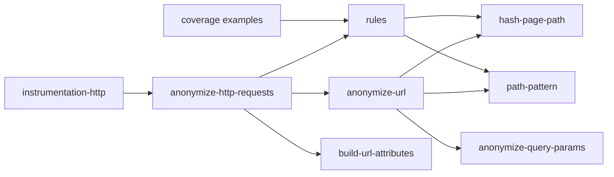
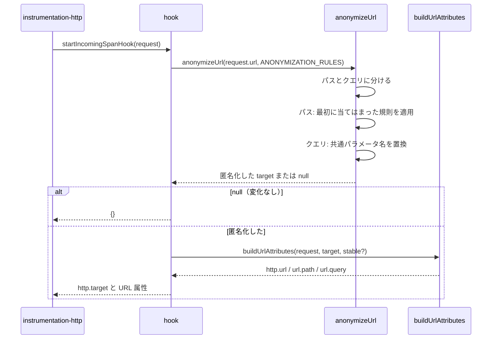

# Design Document

## Overview

**Purpose**: `otel:anonymizeInBestEffort` が有効なとき、GROWI サーバーが受け取る HTTP リクエストのトレースの URL 属性から、利用者データ（ページパス・検索キーワード・タグ名・ユーザー名）と秘密の値（共有リンク ID・トークン）を取り除く。どの URL をどう扱うかを一覧表とコードの宣言で 1 対 1 に持ち、ずれを自動テストで検出する。

**Users**: 外部の監視基盤へトレースを送る運用者、プライバシ保護担当者、ルートを追加・改名する GROWI 開発者。

**Impact**: `features/opentelemetry/server/anonymization/` の 4 つの handler と `AnonymizationModule` インターフェースを、宣言的な規則と 1 つの実行関数に置き換える。`opentelemetry` spec の要件 6 と Layer 4 は本 spec に移る。

### Goals

- 調査で見つかったすべての経路（検索・タグ・ユーザー名・ページパス・秘密の値）で、URL 属性に平文を残さない。
- 一覧表の各行に対応する宣言とテストがあり、挙動・実在するルートとのずれでテストが失敗する。
- 変更前に匿名化されていた URL の置換後の値を変えない。

### Non-Goals

- リクエストボディ・ヘッダ・ログ、GROWI から外へ出るリクエスト、HTTP 以外の instrumentation の属性。
- ページパスのハッシュの強化（辞書攻撃への耐性）。既存の 16 桁ハッシュの形式を維持する。
- 受信側（監視基盤）のダッシュボードの変更。

## Boundary Commitments

### This Spec Owns

- `startIncomingSpanHook` の実装（`httpInstrumentationConfig`）と、そこから先の匿名化処理すべて。
- 匿名化の規則の宣言（パスの規則、全 URL 共通で匿名化するクエリパラメータ名）と、その実行関数。
- 匿名化した値を URL 属性（`http.target`、`http.url`、`url.path`、`url.query`）へ反映する処理（PR #12151 で導入済みのもの）。
- 匿名化対象の一覧表（`requirements.md`「匿名化対象一覧」）と、一覧表・宣言・テスト・実在するルートの突き合わせ。
- `semconv.ts` への匿名化用の属性名の定数の追加。

### Out of Boundary

- NodeSDK の初期化、`otel:anonymizeInBestEffort` を読んで HTTP instrumentation に `httpInstrumentationConfig` を渡すかどうかの判断（`opentelemetry` spec。要件 1.2 はこの既存の振る舞いに依存する）。
- `@growi/core` のページパス関連の関数（`isCreatablePage`、`isPermalink`、`isUserPage`、`getUsernameByPath`）と `AllLang` の仕様。
- GROWI サーバーのルート定義そのもの。本 spec は照合するだけで、ルートを変えない。
- `tools/snapshot-route-middleware.ts` の出力形式（ルート列挙の処理を共有するだけ）。

### Allowed Dependencies

- `@opentelemetry/api`（`diag`）、`@opentelemetry/instrumentation-http`（型と hook の呼び出し規約）、`@opentelemetry/semantic-conventions`（stable な属性名のみ）。
- `@growi/core/dist/utils/page-path-utils`、`@growi/core` の `AllLang`。
- Node.js 標準モジュール `node:crypto`、`node:http`、`node:tls`。
- テストのみ: `vitest`、`vitest-mock-extended`、`test/setup/crowi.ts`、`src/test-utils/express-route-walker.ts`。
- 新しい npm 依存は追加しない。

### Revalidation Triggers

- 利用者データ・秘密の値を**パスの区切り**に含むルートを追加・改名する → パスの規則と一覧表の行を追加する。
- 利用者データを**新しい名前のクエリパラメータ**で受け取るエンドポイントを追加する → 全 URL 共通のパラメータ名に追加する（追加しないと漏れ、照合テストでも検出できない）。
- 静的ファイルの配信元（`public/` 直下、`express.static` のマウント先）を追加する。
- Next.js のメジャー更新、または i18n・basePath・trailingSlash の設定変更 → データ URL の形が変わる。
- `@growi/core` の `isCreatablePage` の禁止パターン、`isPermalink`、`AllLang` の変更。
- `@opentelemetry/instrumentation-http` が URL を記録する属性の変更（semconv の更新）。
- Express 5 への移行 → ルート列挙の処理（`app._router`）が動かなくなる。
- Mongoose instrumentation に `dbStatementSerializer` を設定する、または MongoDB instrumentation の `enhancedDatabaseReporting` を有効にする → DB の span に値が記録されるため、本 spec の範囲外で別途の対策が要る。

## Architecture

### Existing Architecture Analysis

- `startIncomingSpanHook` が `anonymizationModules`（search / page-listing / page API / page access の順）を評価し、`canHandle` が真の module の `handle()` の結果を `Object.assign` で重ねる。後の結果が前の結果を上書きする。
- 各 handler は URL 文字列の部分一致・`URL` パーサ・正規表現で判定しており、3 つの URL が実在しないルートを指していた。
- PR #12151 で、`http.target` を書き換えたときに `http.url`（と新しい形式の `url.path`・`url.query`）も作り直す `buildUrlAttributes` が加わった。本 spec はこれを引き継ぐ。

### Architecture Pattern & Boundary Map



- **パターン**: 規則の宣言（何を匿名化するか）と実行関数（どう適用するか）を分ける。実行関数は規則を引数で受け取り、規則のモジュールを import しない（`.claude/rules/coding-style.md`「Executors Take Their Work-Set as Input」）。
- **依存の向き**: `rules/types` → `utils/*` → `rules/*` → `anonymize-url`（実行関数。`rules/types` と `utils` だけを使う）→ `anonymize-http-requests`（hook。規則と実行関数を組み合わせる）。逆向きの import は不可。
- **パスとクエリの分離**: 実行関数は URL をパスとクエリに分け、パスには最初に当てはまった規則を 1 つだけ適用し、クエリには全 URL 共通のパラメータ名の置換を適用し、最後につなぐ。どちらの変換も相手の出力を読み直さないため、結果が打ち消し合わない（要件 8）。

### Technology Stack

| Layer | Choice / Version | Role in Feature | Notes |
|-------|------------------|-----------------|-------|
| Backend | `@opentelemetry/instrumentation-http` 0.217.0 | `startIncomingSpanHook` を呼び、戻り値で URL 属性を上書きする | 既存 |
| Backend | `@growi/core` | ページパスの判定、`AllLang` | 既存 |
| Test | Vitest、`vitest-mock-extended`、Express 4.21（`app._router.stack`） | 規則の網羅テスト、ルート照合テスト | 既存 |

## File Structure Plan

### Directory Structure

```
apps/app/src/features/opentelemetry/server/anonymization/
├── index.ts                         # Barrel: httpInstrumentationConfig のみ公開（変更なし）
├── anonymize-http-requests.ts       # Hook 本体: URL を実行関数に渡し、結果を URL 属性に反映する（変更）
├── anonymize-url.ts                 # 実行関数: 規則を受け取り、URL を匿名化した文字列（または null）を返す（新規）
├── anonymize-url.spec.ts            # 実行関数の単体テスト（小さな規則の fixture で）（新規）
├── coverage.spec.ts                 # 一覧表の網羅テスト: 全 coverage example を hook に通す／requirements.md と ID を突き合わせる（新規）
├── coverage-routes.integ.ts         # ルート照合テスト: example の route が実在するルートか（新規）
├── anonymize-http-requests.spec.ts  # Hook の URL 属性反映のテスト（#12151 のものを維持し、handler 前提の部分を整理）（変更）
├── rules/
│   ├── types.ts                     # PathRule / PathAction / AnonymizationRules / CoverageExample の型（新規）
│   ├── path-rules.ts                # パスの規則の宣言（順序付き）（新規）
│   ├── sensitive-query-params.ts    # 全 URL 共通で匿名化するクエリパラメータ名（新規）
│   ├── coverage-examples.ts         # 一覧表の各行に対応する例（行 ID・URL・期待値・ルートの型）（新規）
│   └── index.ts                     # ANONYMIZATION_RULES を組み立てて公開（新規）
└── utils/
    ├── hash-page-path.ts            # ページパスのハッシュ化・デコード・ページとして扱えるかの判定（新規。page-access-handler から移す）
    ├── hash-page-path.spec.ts       # 上記の単体テスト（page-access-handler.spec の該当ケースを移す）（新規）
    ├── path-pattern.ts              # `/a/:id/b` 形式の型と URL パスの照合、区切りの置換（新規）
    ├── path-pattern.spec.ts         # （新規）
    ├── anonymize-query-params.ts    # 対象パラメータの値だけを置き換え、ほかの区切りは元のまま残す（変更）
    ├── anonymize-query-params.spec.ts # （変更）
    ├── build-url-attributes.ts      # PR #12151 で導入（変更なし）
    └── build-url-attributes.spec.ts # PR #12151 で導入（変更なし）

apps/app/src/test-utils/
└── express-route-walker.ts          # app._router.stack を辿り (method, 完全なルートの型) を列挙する（新規。tools から移す）
```

### Modified Files

- `apps/app/tools/snapshot-route-middleware.ts` — `listRegisteredRoutes` を `src/test-utils/express-route-walker.ts` から import する。出力（`tools/authz-matrix/baselines/route-middleware.json`）は変えない。
- `apps/app/src/features/opentelemetry/server/semconv.ts` — 変更なし（`ATTR_HTTP_URL` は #12151 で追加済み）。

### Deleted Files

- `anonymization/handlers/`（`index.ts`、4 つの handler とその spec）
- `anonymization/interfaces/anonymization-module.ts`

### Spec Files（最終タスク）

- `.kiro/specs/opentelemetry/requirements.md` — 要件 6 を削除し、Boundary（Out of scope）に本 spec への参照を加える。要件 10.2（新規 Anonymization Handler の追加）を本 spec への参照に置き換える。
- `.kiro/specs/opentelemetry/design.md` — Layer 4、Extension Templates「新規 Anonymization Handler の追加」、Revalidation Triggers「新規 anonymization 対象パス／パラメータ追加要望」、File Structure の `anonymization/` 部分を、本 spec への参照に置き換える。
- `.kiro/specs/opentelemetry/research.md` — 「Anonymization Handler の登録順とパターン」「Decision: Anonymization は best-effort, module-based, opt-in」を本 spec の research.md への参照に置き換える（内容は本 spec の research.md に移し、誤った記述を正す）。
- `.kiro/specs/opentelemetry/brief.md` — Layer 4 の記述を本 spec への参照に置き換える。
- `.kiro/specs/opentelemetry/spec.json` — `updated_at` を更新する（`phase` / `approvals` は変えない）。

## System Flows



- 画面内遷移用データ URL の規則は、中のページパスを取り出して**同じパスの規則の一覧**に再び通し、外側を付け直す（再帰は 1 段だけ。中のパスがさらにデータ URL であることは無い）。
- 実行関数の中で想定外の例外が起きた場合は、`/[ANONYMIZATION_FAILED]` を返し、警告を記録する。

## Requirements Traceability

| Requirement | Summary | Components | Interfaces | Flows |
|-------------|---------|------------|------------|-------|
| 1.1 | 有効時に一覧表に基づいて匿名化 | HttpAnonymizationHook, AnonymizeUrl, AnonymizationRules | `startIncomingSpanHook`, `anonymizeUrl` | System Flows |
| 1.2 | 無効時は書き換えない | （`opentelemetry` spec の NodeSdkConfiguration が hook を渡さない） | — | — |
| 1.3, 1.4 | `http.url`・`url.path`・`url.query` への反映 | UrlAttributeBuilder（#12151） | `buildUrlAttributes` | System Flows |
| 1.5 | 当てはまらない URL は書き換えない | AnonymizeUrl | `anonymizeUrl` が null を返す | System Flows |
| 2.1–2.3 | 一覧表の記載 | AnonymizationCoverageTable（requirements.md）, CoverageExamples | `CoverageExample` | — |
| 2.4, 2.5 | 一覧表どおりに匿名化する／残す | AnonymizationRules, AnonymizeUrl | `PathRule`, `anonymizeUrl` | — |
| 3.1, 3.2 | 一覧表の各行のテスト、ずれで失敗 | CoverageSpec | `CoverageExample` | — |
| 3.3 | 実在しないルートで失敗 | CoverageRoutesSpec, ExpressRouteWalker | `listRegisteredRoutes` | — |
| 4.1–4.4 | 検索キーワード・タグ名 | SensitiveQueryParams, PathRules（next-data） | `SENSITIVE_QUERY_PARAMS` | — |
| 5.1, 5.2 | ユーザー名（クエリ・パス） | SensitiveQueryParams, PathRules（api-path-segments） | `SENSITIVE_QUERY_PARAMS`, `PathAction` | — |
| 5.3 | ユーザーページ | PathRules（page-view, next-data）, HashPagePath | `hashPagePath` | — |
| 6.1–6.3 | ページ表示・データ URL・同じハッシュ | PathRules（page-view, trash-page, next-data）, HashPagePath | `hashPagePath` | — |
| 6.4 | API のページパス | SensitiveQueryParams | `SENSITIVE_QUERY_PARAMS` | — |
| 6.5 | `.md` | PathRules（page-markdown） | `PathAction` | — |
| 6.6 | パーマリンク・トップ・`/user`・静的ファイル | PathRules（static-files, kept-pages） | `PathAction` | — |
| 7.1–7.4 | 秘密の値 | PathRules（secret-path-segments, next-data）, SensitiveQueryParams | `PathAction` | — |
| 8.1, 8.2 | 複数の扱いに当てはまる URL | AnonymizeUrl（パスとクエリの分離） | `anonymizeUrl` | System Flows |
| 9.1, 9.2 | 置換形式と既存ハッシュ値の維持 | HashPagePath, AnonymizeQueryParams, CoverageExamples（回帰の固定値） | `hashPagePath`, `anonymizeQueryParams` | — |

## Components and Interfaces

| Component | Domain/Layer | Intent | Req Coverage | Key Dependencies (P0/P1) | Contracts |
|-----------|--------------|--------|--------------|--------------------------|-----------|
| HttpAnonymizationHook | Adapter | instrumentation-http から呼ばれ、実行関数と URL 属性の組み立てをつなぐ | 1.1, 1.3–1.5 | AnonymizeUrl (P0), UrlAttributeBuilder (P0) | Service |
| AnonymizeUrl | Executor | 規則を受け取り、URL を匿名化する | 1.1, 1.5, 2.4, 2.5, 8.1, 8.2 | HashPagePath, PathPattern, AnonymizeQueryParams (P0) | Service |
| AnonymizationRules | Declaration | パスの規則と共通パラメータ名を宣言する | 2.4, 2.5, 4–7 | PathPattern, HashPagePath (P0) | State |
| CoverageExamples | Declaration | 一覧表の各行を、テストできる例として宣言する | 2.1–2.3, 3.1, 9.2 | — | State |
| HashPagePath | Utility | ページパスのデコード・判定・ハッシュ化 | 5.3, 6.1–6.3, 9.1, 9.2 | `@growi/core` (P0) | Service |
| PathPattern | Utility | `:name` 形式の型と URL パスの照合・置換 | 5.2, 7.1, 7.2 | — | Service |
| AnonymizeQueryParams | Utility | 対象パラメータの値だけを置き換える | 4.1–4.4, 5.1, 6.4, 7.1, 9.1 | — | Service |
| UrlAttributeBuilder | Utility | 匿名化した値から URL 属性を作る（#12151） | 1.3, 1.4 | — | Service |
| ExpressRouteWalker | Test util | 登録済みのルートを列挙する | 3.3 | Express 4 (P1) | Service |
| CoverageSpec / CoverageRoutesSpec | Test | 網羅とずれの検出 | 3.1–3.3 | CoverageExamples (P0) | — |

### Executor / Adapter

#### AnonymizeUrl

| Field | Detail |
|-------|--------|
| Intent | 規則を受け取り、リクエストの URL（パス＋クエリ）を匿名化する |
| Requirements | 1.1, 1.5, 2.4, 2.5, 8.1, 8.2 |

**Responsibilities & Constraints**
- URL を最初の `?` でパスとクエリに分ける。`#` 以降はリクエストに含まれないため扱わない。
- パスはデコード前とデコード後（`decodePathname`。壊れたエンコードは元のまま）の両方を持つ `RequestPath` として規則に渡す。規則は先頭から順に調べ、最初に当てはまった 1 つだけを適用する。
- クエリには `AnonymizationRules.sensitiveQueryParams` の置換を適用する。
- パスとクエリのどちらも変化しなければ `null` を返す。
- 規則のモジュールを import しない。

**Contracts**: Service [x]

##### Service Interface

```typescript
export const anonymizeUrl = (
  url: string,
  rules: AnonymizationRules,
): string | null;
```

- Preconditions: `url` は `IncomingMessage.url`（`/` で始まるパス＋任意のクエリ）。
- Postconditions: 戻り値が `null` でなければ、`rules` に従って匿名化された `http.target` の値。想定外の例外時は `'/[ANONYMIZATION_FAILED]'`。

#### HttpAnonymizationHook（`anonymize-http-requests.ts`）

- `startIncomingSpanHook(request)` は `anonymizeUrl(request.url ?? '', ANONYMIZATION_RULES)` を呼び、`null` なら `{}` を返す。そうでなければ `{ 'http.target': target, ...buildUrlAttributes(request, target, isStableHttpSemconvEnabled(process.env.OTEL_SEMCONV_STABILITY_OPT_IN)) }` を返す。
- 公開面は `httpInstrumentationConfig` のみ（`index.ts` は変えない）。

### Declaration

#### AnonymizationRules（`rules/`）

**Contracts**: State [x]

```typescript
export type PathRuleId =
  | 'next-data'
  | 'static-files'
  | 'secret-path-segments'
  | 'api-path-segments'
  | 'kept-pages'
  | 'page-markdown'
  | 'trash-page'
  | 'page-view';

export type PathAction =
  | { readonly kind: 'keep' }
  | { readonly kind: 'unwrap-next-data' }
  | { readonly kind: 'redact-pattern-params'; readonly patterns: readonly RedactPattern[] }
  | { readonly kind: 'hash-page-path' }
  | { readonly kind: 'hash-page-path-with-suffix'; readonly suffix: string }
  | { readonly kind: 'hash-page-path-under-prefix'; readonly prefix: string };

export type RedactPattern = {
  readonly pattern: string; // e.g. '/share/:linkId'
  readonly params: readonly string[]; // e.g. ['linkId']
};

export type RequestPath = {
  readonly raw: string; // as received (percent-encoded)
  readonly decoded: string; // decodePathname(raw)
};

export type PathRule = {
  readonly id: PathRuleId;
  readonly matches: (path: RequestPath) => boolean;
  readonly action: PathAction;
};

export type AnonymizationRules = {
  readonly pathRules: readonly PathRule[];
  readonly sensitiveQueryParams: readonly string[];
};
```

パスの規則（この順に調べる）:

| Rule ID | 当てはまるパス | 動作 |
|---|---|---|
| `next-data` | `/_next/data/<buildId>/...json` | `<buildId>` の後の区切りが `AllLang` のいずれかなら locale として残し、その後ろ（`.json` を除く）を中のパスとして同じ規則の一覧に通し、外側を付け直す。中のパスの `RequestPath` は、**デコード前**の外側のパスから切り出した文字列を `raw` とし、`decoded = decodePathname(raw)` とする（デコード済みの文字列から切り出さない）。中のパスが空（トップページ）なら変えない |
| `static-files` | `/_next/`、`/_drawio-assets/`、`/uploads/`、`/vault.git/` で始まる。`/vault.git`・`/favicon.ico`・`/favicon.svg`（`/vault.git` は Express の `app.use` のマウント先で、それ自身とその下だけを受けるため、`/vault.gitignore` のようなページ名は含めない）。`/static/`・`/images/` で始まり、最後の区切りが静的ファイルの拡張子（`png`・`jpg`・`jpeg`・`gif`・`svg`・`ico`・`webp`・`css`・`js`・`mjs`・`map`・`json`・`woff`・`woff2`・`ttf`・`otf`・`eot`）で終わる | 変えない（それ以外の `/static/`・`/images/` は、静的ファイルが無ければページ表示になるため、この規則に当てはめず `page-view` に任せる。`/images/v1.2` のような `.` を含むページ名もハッシュ化される） |
| `secret-path-segments` | `/share/:linkId`、`/forgot-password/:token`、`/user-activation/:token` | 該当の区切りを `[ANONYMIZED]` にする |
| `api-path-segments` | `/_api/v3/share-links/:id`、`/_api/v3/user-groups/:id/users/:username` | `id`（共有リンク）・`username` の区切りを `[ANONYMIZED]` にする。ユーザーグループの `:id` は ObjectId なので残す |
| `kept-pages` | `/`、`/user`、パーマリンク（`/<24 桁の 16 進数>`）、パーマリンクの `.md` | 変えない |
| `page-markdown` | `.md` で終わり、`.md` を除いた部分がユーザーページ（`isUserPage`）またはページとして扱えるパス（`isPageRoute`） | `.md` を除いた部分を `hash-page-path` と同じ値にし、`.md` を付け直す |
| `trash-page` | `/trash/` で始まり、残りが空でないパス | `/trash` を残し、残りを `/` から始まるページパスとして `hash-page-path` と同じ値にする |
| `page-view` | ユーザーページ（`isUserPage`）、またはページとして扱えるパス（`isPageRoute`） | `hash-page-path`（ユーザーページはユーザー名と配下を別々に、それ以外はパス全体をハッシュ化） |
| （どれにも当てはまらない） | `/_api/...`、`/admin`、`/me`、`/login` などのシステムページ | 変えない |

全 URL 共通で匿名化するクエリパラメータ（`SENSITIVE_QUERY_PARAMS`）: `q`、`nq`、`path`、`paths`、`fromPath`、`toPath`、`searchText`、`searchWord`、`username`、`shareLinkId`、`searchFilter`、`access_token`。

- `isPageRoute` は既存の判定（`@growi/core` の `isCreatablePage` を、ページ名に使えない 1 文字の禁止文字を置き換えてから呼ぶ）を引き継ぐ。`.` による除外は行わない。
- `secret-path-segments`・`api-path-segments` は、**デコード前**のパスを `/` で区切ってから型と照合し、置き換える（区切りの中の `%2F` を区切りとみなさないため。外部認証のユーザー名には文字の制約が無い）。それ以外の規則の判定とハッシュ化はデコード後のパスで行う。
- どの規則もパスを変えなかった場合、出力のパスはデコード前の元の文字列のままにする（クエリだけが変わった場合も同じ）。

#### CoverageExamples（`rules/coverage-examples.ts`）

```typescript
export type CoverageExample = {
  readonly id: string; // requirements.md の一覧表の行 ID（例: 'T01'）
  readonly ruleIds: readonly (PathRuleId | 'sensitive-query-params')[];
  readonly url: string;
  readonly expectedTarget: string | null; // null = 書き換えない
  readonly route?: string; // Express のルートの型（API とページ表示のルート）。照合テストで使う
  readonly method?: string; // route の HTTP メソッド。省略時は GET
};
```

- 一覧表の 1 行に 1 つ以上の例を持つ。変更前の handler のテストにあったハッシュ値（`22ca1a8b9f281349`、`7aa6a8f4468baa96`、`2f4a824f8eacbc70`、`96d9632f363564cc` など）は例の期待値として固定する（要件 9.2）。

### Utility

#### HashPagePath（`utils/hash-page-path.ts`）

```typescript
export const decodePathname: (pathname: string) => string;
export const isPageRoute: (decodedPath: string) => boolean;
export const hashPagePath: (decodedPath: string) => string;
```

- `hashPagePath` は既存の `anonymizeUrlPath` の動作を変えずに移す（ユーザーページ・先頭と末尾の `/` の保持・SHA-256 の先頭 16 桁）。

#### PathPattern（`utils/path-pattern.ts`）

```typescript
export const matchPathPattern: (pattern: string, path: string) => Readonly<Record<string, string>> | null;
export const redactPathParams: (pattern: string, path: string, params: readonly string[]) => string;
```

- 型は `/` 区切りで、`:name` は空でない 1 区切りに一致する。区切りの数が違えば一致しない。

#### AnonymizeQueryParams（`utils/anonymize-query-params.ts`）

```typescript
export const anonymizeQueryParams: (search: string, paramNames: readonly string[]) => string;
```

- 既存の `anonymizeQueryParams(target, paramNames)` は handler が使っている間は残し、新しい関数は別名で追加する。handler を削除する時点で古い関数を消し、新しい関数をこの名前にする。
- `search` は `?` を含まないクエリ文字列。`&` で区切り、名前（デコード後の、最初の `[` より前の部分。`name[]`・`name[0]`・`name[a][0]` はどれも `name` として比べる）が `paramNames` に含まれる区切りの値だけを `%5BANONYMIZED%5D`（値が JSON 配列なら `%5B%22%5BANONYMIZED%5D%22%5D`）に置き換える。ほかの区切りは元の文字列のまま。

#### ExpressRouteWalker（`src/test-utils/express-route-walker.ts`）

```typescript
export type RegisteredRoute = {
  readonly method: string;
  readonly path: string; // mount prefix + route path
  readonly middlewareNames: readonly string[];
};
export const listRegisteredRoutes: (app: { _router: unknown }) => readonly RegisteredRoute[];
```

- `tools/snapshot-route-middleware.ts` の `walkStack` / `extractMountPrefix` を移したもの。マウント先の型とルートの型をつないだ完全なルートの型と、ミドルウェア名を、**すべてのルートについて**返す。`/_api/v3` への絞り込みと、無名ミドルウェアの検査はツール側に残す。
- マウント先の下に `'/'` で登録されたルートは末尾に `/` が付いて出ることがあるため、照合テストは末尾の `/` を取り除いて比べる。

## Error Handling

- `anonymizeUrl` は想定外の例外を捕まえ、`/[ANONYMIZATION_FAILED]` を返して `diag` の警告を記録する（平文を送らない）。
- `decodePathname` は壊れたパーセントエンコードを例外にせず、元の文字列を返す。

## Testing Strategy

- **網羅テスト（`coverage.spec.ts`）**:
  - 全 `CoverageExample` を `startIncomingSpanHook` に通し、`http.target`（と `http.url`）が `expectedTarget` と一致すること（2.4、2.5、4〜9 の受け入れ条件、3.1）。
  - `requirements.md` の「匿名化対象一覧」の行 ID の集合と、`CoverageExample` の ID の集合が一致すること（3.2）。ファイルの場所は 1 つの定数にまとめる。
  - すべてのパスの規則と `sensitive-query-params` が、少なくとも 1 つの例から参照されていること（3.2）。
- **ルート照合テスト（`coverage-routes.integ.ts`）**: `route` を持つすべての例について、その `(method, route)` が登録済みのルートに等しさで含まれること（3.3）。実装前に、架空のルートを例に加えて失敗することを確かめ、元に戻す。
- **実行関数の単体テスト（`anonymize-url.spec.ts`）**: 小さな規則の fixture で、規則の順序（最初に当てはまったものだけ）、パスとクエリの独立（8.1、8.2）、変化なしで `null`（1.5）、データ URL の中のパスへの再適用、例外時の固定値。
- **ユーティリティの単体テスト**: `hash-page-path`（変更前のハッシュ値の固定、ユーザーページ、壊れたエンコード）、`path-pattern`、`anonymize-query-params`（同じ名前の繰り返し、`name[]`・`name[0]`（エンコードされた `name%5B0%5D` を含む）、JSON 配列、ほかの区切りが変わらないこと）。
- **変更前との比較（実装のタスク内、コミットしない）**: 変更前の handler と新しい規則に 70 件以上の URL を流し、「変更前に匿名化されていて変更後に平文」が 0 件、ASCII のページパスのハッシュ値が同じであることを確かめ、結果を PR に記載する。

## Security Considerations

- 秘密の値はハッシュにせず固定の文字列に置き換える（7.3）。
- 匿名化の失敗時に平文を残さない（Error Handling）。
- ページパスの 16 桁ハッシュは、推測しやすいページ名なら辞書で割り出せる。これは既存の形式の制約で、本 spec では変えない（Non-Goals）。

## Performance & Scalability

- すべてのリクエストで実行される。規則は 8 つ、パターンは起動時に組み立てて使い回し、リクエストごとに正規表現を作らない。ページパスのハッシュ（SHA-256）は 1 リクエストにつき最大 1 回。

## Migration Strategy

- 本 spec の実装は PR #12151 のマージ後、その上で行う（`build-url-attributes.ts` を前提にする）。
- 受信側への影響: 変更前に匿名化されていた URL の値は変わらない。新たに匿名化される URL（データ URL、API のページパス、`.` を含むページ名など）は、受信側では値が `[HASHED:...]` / `[ANONYMIZED]` に変わる。API の URL で置き換え対象でないクエリは、再エンコードされずに元の形で記録されるようになる。PR の説明に記載する。
