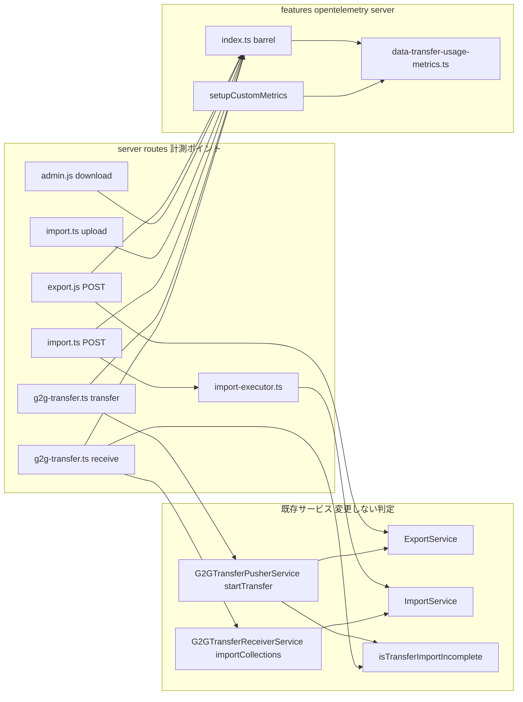
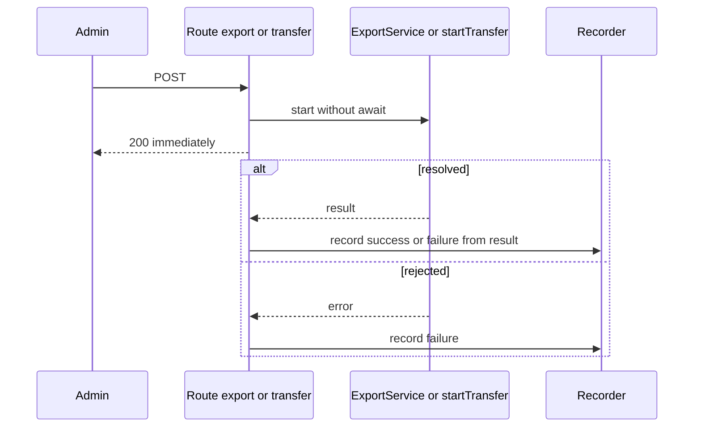
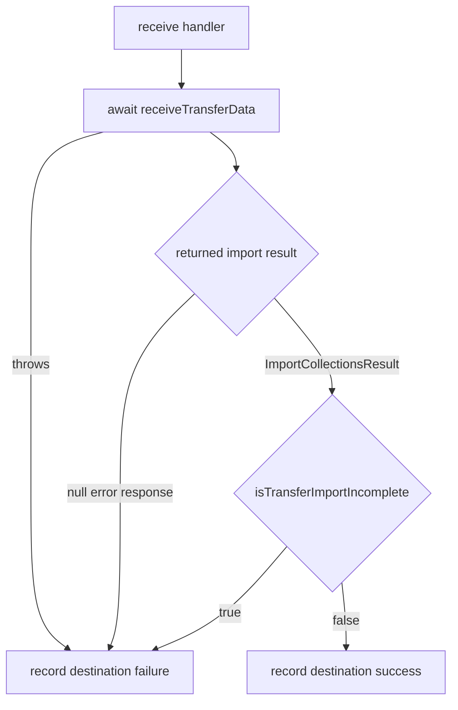

# Technical Design — opentelemetry-data-transfer-usage-metrics

## Overview

**Purpose**: 管理画面のデータアーカイブ（作成・ダウンロード・アップロード・インポート）とお引越し（G2G 転送の送信側・受信側）の利用回数を、既存の OpenTelemetry メトリクス送信に載せる。WESEEK は受信側でインスタンスごとの増加分を集計し、利用の有無・利用インスタンスの割合・利用頻度を把握する。

**Users**: 集計するのは WESEEK の GROWI 開発チーム。計測対象の操作を行うのは各インスタンスの管理者だが、管理者から見た挙動は一切変わらない。

**Impact**: `features/opentelemetry` に初めて「イベント発生時に加算する」メトリクス（Counter）と、他機能のコードから呼ばれる記録 API を導入する。データアーカイブとお引越しの各ルート／executor に、成否確定点での記録呼び出しを追加する。

> **Amend target**: 本 spec は実装完了済みの `opentelemetry` spec の契約を変更する amend spec である（`.claude/rules/spec-lifecycle.md`）。
>
> | Target | 変更される契約 |
> |---|---|
> | `opentelemetry` design.md「Boundary Commitments > Layer 3: Custom Metric」 | Observation 実装規約に Counter 型と外部からの記録 API を追加。所有メトリクス一覧に `growi.archive.operations` / `growi.g2g_transfer.operations` を追加 |
> | `opentelemetry` design.md「Extension Templates」 | Counter 型メトリクスの追加手順を追加 |
> | `opentelemetry` design.md「Allowed Dependencies」「Revalidation Triggers」 | 業務コードから記録 API への依存方向と、その再確認条件を追加 |
> | `opentelemetry` requirements.md | Counter 型メトリクスの要件を末尾に追加（既存 ID は振り直さない） |
>
> 既存の Revalidation Trigger「受信側ダッシュボード／クエリの参照更新が未完了の状態でメトリクス／ラベル変更を行う」に該当するため、リリース前に受信側担当へ新メトリクス名と属性を共有する。

### Goals

- データアーカイブ 4 操作とお引越し 2 役割の試行回数を、結果（成功／失敗）付きで送信する（1.1–1.11, 2.1–2.8）
- 監査ログ設定に依存せず、`OPENTELEMETRY_ENABLED` だけに従う（1.8, 3.1, 3.2）
- 送信する属性を固定の列挙値に限定し、計測の失敗が業務処理に影響しない（4.1–4.3）
- `opentelemetry` spec に Counter 型の規約と追加手順を残す（5.1–5.3）

### Non-Goals

- ページの一括エクスポート、アーカイブの削除・破棄、お引越しの preflight／転送キー発行の計測
- 受信側（コレクター・ダッシュボード）の設定、リセット判定の実装
- 監査ログの記録対象・アクショングループの変更
- 再起動をまたいだ回数の永続化（3.5 は累積値のリセットを受信側が判別できればよい）

## Boundary Commitments

### This Spec Owns

- **記録モジュール** `custom-metrics/data-transfer-usage-metrics.ts`:
  - メトリクス名 `growi.archive.operations` / `growi.g2g_transfer.operations` と、その属性キー・値の語彙（唯一の定義元）
  - Counter の生成タイミング（SDK 開始後の `setupCustomMetrics()` 内）
  - 記録関数 `recordArchiveOperation()` / `recordG2GTransfer()` の契約（未初期化時は何もしない、例外を外に出さない）
- **計測ポイント**（成否確定点での記録呼び出しのみ。業務ロジックの判定は変えない）:
  - アーカイブ作成: `routes/apiv3/export.js` の POST `/`
  - ダウンロード: `routes/admin.js` の `api.download`
  - アップロード: `routes/apiv3/import.ts` の POST `/upload`
  - インポート: `routes/apiv3/import.ts` の POST `/`（受付後のバックグラウンド処理で 1 回だけ記録）。`routes/apiv3/import-executor.ts` は記録せず、結果を返すだけ
  - お引越し送信側: `routes/apiv3/g2g-transfer.ts` の POST `/transfer`
  - お引越し受信側: `routes/apiv3/g2g-transfer.ts` の POST `/`（receive）
- **取り込み完了判定の共通化**: お引越しの「取り込みが不完全か」を判定する純関数 `isTransferImportIncomplete()`（送信側の既存判定を抽出し、受信側でも使う）
- **`startTransfer()` の戻り値**: `Promise<void>` から、取り込みが不完全だったかを返す `Promise<G2GTransferResult>` に変える
- **`executeImport()` の戻り値**: `Promise<void>` から、インポートの結果を返す `Promise<OperationResult>` に変える

### Out of Boundary

- `ExportService` / `ImportService` / `G2GTransferReceiverService.importCollections()` の内部。お引越しがこれらを再利用するため、ここで数えると二重計上になる
- 既存の成否判定・管理画面への通知・HTTP 応答・監査ログの挙動
- OTel SDK の起動・停止・有効化制御、送信周期、エクスポーター（`opentelemetry` spec Layer 1）
- Resource Attribute（インスタンス識別）の追加・変更（`opentelemetry` spec Layer 2）
- 受信側の集計・ダッシュボード

### Allowed Dependencies

- 記録モジュール → `@opentelemetry/api`（`metrics`, `diag`, `Counter`, `Meter` の public API のみ）、`~/utils/logger`
- 計測ポイント（`server/routes/**`）→ `~/features/opentelemetry/server` の barrel から `recordArchiveOperation` / `recordG2GTransfer` と型のみ。`custom-metrics/` の内部ファイルを直接 import しない
- `routes/apiv3/g2g-transfer.ts` → `service/g2g-transfer.ts` の `isTransferImportIncomplete` と `G2GTransferResult` 型
- 新規 npm 依存は追加しない（`@opentelemetry/sdk-metrics` はテストの `InMemoryMetricExporter` 用に既存依存を使う）

### Revalidation Triggers

- メトリクス名・属性キー・属性値の変更 → 受信側のクエリ／ダッシュボードの更新を先に行う
- `@opentelemetry/api` の metrics API にプロキシ（後から SDK に差し替わる Meter）が入った場合 → `setupCustomMetrics()` 内で生成する制約を緩めてよいか再確認
- お引越しの取り込み結果（`ImportCollectionsResult`）に失敗を表すフィールドが追加された場合 → `isTransferImportIncomplete()` に反映
- `ExportService.export()` / `startTransfer()` / `executeImport()` の呼び出し形（await の有無、戻り値）の変更 → 計測ポイントの成否確定点を再確認
- 計測対象の操作の追加（例: ページ一括エクスポートを含める）→ 属性値の語彙を追加し、受信側へ共有

## Architecture

### Existing Architecture Analysis

- 既存の独自メトリクスはすべて ObservableGauge で、送信周期のコールバック内で完結する。他機能から呼ばれる API はない（research.md 1.1）。
- GROWI は `growi.start()`（ルート・サービス構築）の**後**に `startOpenTelemetry()` を呼ぶ。`@opentelemetry/api` 1.9 の metrics API には Proxy がなく、SDK 登録前に取得した Meter / Counter は Noop のまま固定される（research.md 1.1）。
- お引越しは送信側で `ExportService.export()`、受信側で `ImportService.import()` を再利用している（research.md 1.3）。
- 「一部失敗＝失敗」の判定は、通常インポートでは `executeImport()`、送信側では `startTransfer()` 内の `isImportIncomplete` にすでに存在する。

### Architecture Pattern & Boundary Map



**Architecture Integration**:
- **Selected pattern**: 記録 API の集約 ＋ オーケストレーション層からの呼び出し（research.md Option C）。メトリクス名・語彙・Counter の生成・例外の吸収を 1 ファイルに閉じ込め、呼び出しは「どの機能の操作か」を知っている層に限定する。
- **二重計上の回避**: サービス層では数えない。お引越しの export/import は `/transfer` と receive の計測ポイントでのみ数えられ、アーカイブの計測ポイントを通らない（1.9, 2.6）。
- **Existing patterns preserved**: `addXxxMetrics()` を `setupCustomMetrics()` から呼ぶ構成、Meter 命名 `growi-<scope>-metrics` / `'1.0.0'`、diag ロガーでの例外吸収。
- **New components rationale**: 記録モジュールは Counter の生成タイミングと語彙の単一定義元として必要。`isTransferImportIncomplete()` は送信側と受信側で同じ判定（2.7）を保証するために必要。

### Technology Stack

| Layer | Choice / Version | Role in Feature | Notes |
|-------|------------------|-----------------|-------|
| Telemetry API | `@opentelemetry/api` ^1.9.0（既存） | `Meter.createCounter()` と `Counter.add()` | 新規依存なし |
| Telemetry SDK | `@opentelemetry/sdk-metrics` ^2.0.1（既存） | 本番は既存の PeriodicExportingMetricReader（5 分）。テストで `InMemoryMetricExporter` を使用 | OTLP は既定で累積値（start time 付き）を送るため、再起動による数え直しは受信側で判別可能（3.5） |
| Backend | Express ルート（既存） | 計測ポイント | `export.js` / `admin.js` は JS のまま |

## File Structure Plan

### Directory Structure

```
apps/app/src/features/opentelemetry/server/
├── index.ts                                   # barrel: recordArchiveOperation / recordG2GTransfer と型を追加 export
└── custom-metrics/
    ├── index.ts                               # setupCustomMetrics() に addDataTransferUsageMetrics() を追加
    ├── data-transfer-usage-metrics.ts         # 新規: Counter 2 種の生成・記録関数・語彙の型
    └── data-transfer-usage-metrics.spec.ts    # 新規: InMemoryMetricExporter で送信内容を検証
```

### Modified Files

- `apps/app/src/features/opentelemetry/server/index.ts` — 記録関数と型（`ArchiveOperation` / `OperationResult` / `G2GTransferRole`）を re-export。`custom-metrics` の他のシンボルは出さない
- `apps/app/src/features/opentelemetry/server/custom-metrics/index.ts` — `setupCustomMetrics()` で `addDataTransferUsageMetrics()` を dynamic import して呼ぶ。barrel の re-export にも追加（既存の `addXxxMetrics` と同じ扱い）
- `apps/app/src/server/routes/apiv3/export.js` — `exportService.export()` の Promise に完了・失敗ハンドラを付けて `create` を記録。応答は従来どおり即時
- `apps/app/src/server/routes/admin.js` — `api.download` で `getFile()` 成功時に `download` を記録
- `apps/app/src/server/routes/apiv3/import.ts` — `/upload` で、受け取ったファイルの検証通過を成功、解析失敗・バージョン不一致を失敗として `upload` を記録（ファイル無しの 400 は受付前の拒否として数えない）。POST `/` の受付後バックグラウンド処理で結果変数を 1 つ持ち（初期値 `'failure'`）、`executeImport()` の戻り値で上書きし、`finally` で `import` を **1 回だけ** 記録する。`executeImport()` に至る前に `onErrorForImport` を emit して return する 3 経路は初期値のまま失敗になる
- `apps/app/src/server/routes/apiv3/import-executor.ts` — `executeImport()` の戻り値を `Promise<OperationResult>` に変更。成功分岐（`activityId == null` の return を含む）で `'success'`、部分失敗・例外の分岐で `'failure'` を返す。記録関数は呼ばない
- `apps/app/src/server/service/g2g-transfer.ts` — `isTransferImportIncomplete()` を抽出して export し、`startTransfer()` 内の既存判定をこれに置き換える。`startTransfer()` の戻り値を `Promise<G2GTransferResult>` に変更（`IG2GTransferPusherService` の型も更新）
- `apps/app/src/server/routes/apiv3/g2g-transfer.ts` — `/transfer` で `startTransfer()` の Promise に完了・失敗ハンドラを付けて `source` を記録。receive の handler で成否を判定して `destination` を記録
- 各ファイルの既存 spec / integ — 計測呼び出しの検証を追加（Testing Strategy）

## System Flows

### アーカイブ作成とお引越し送信側（バックグラウンド処理の成否確定）



- 応答タイミングは変えない。ハンドラは Promise の後ろに付けるだけで、rejection はハンドラが受け止める（既存は未処理 rejection としてグローバルハンドラがログ出力していた。サービス内で既に `logger.error` している経路はそのまま、していない経路はハンドラで `logger.error` する）。
- アーカイブ作成: resolve かつ `ZipFileStat` が非 null → 成功、null または reject → 失敗。
- 送信側: resolve かつ `importIncomplete === false` → 成功、`true` または reject → 失敗。転送開始前の確認（`askGROWIInfo` / `getTransferability`）で返る応答は `startTransfer()` 呼び出し前なので数えない（2.5）。

### お引越し受信側



- `receiveTransferData()` は 9 種のエラー応答（解析失敗・保護コレクション・競合など）と 1 種の成功応答を持つ。エラー応答はいずれも送信側で転送失敗として扱われるため、受信側でも失敗として数える。
- 成功応答（200）でも取り込みが不完全な場合があるため、`receiveTransferData()` が返す取り込み結果に `isTransferImportIncomplete()` を適用する。`receiveTransferData()` の戻り値を `Promise<ImportCollectionsResult | null>`（エラー応答時は `null`）に変える。各エラー分岐は `res.apiv3Err(...)` を呼んだ後 `return null` とする（`apiv3Err` の戻り値は `any` のため、それをそのまま返すと戻り値の型が崩れる）。成否は戻り値だけで判定し、`res.statusCode` は見ない。

## Requirements Traceability

| Requirement | Summary | Components | Interfaces | Flows |
|---|---|---|---|---|
| 1.1, 1.2 | 作成の成功・失敗 | export.js, Recorder | `recordArchiveOperation('create', …)` | アーカイブ作成 |
| 1.3 | ダウンロード | admin.js, Recorder | `recordArchiveOperation('download', 'success')` | — |
| 1.4, 1.5 | アップロードの成功・失敗 | import.ts `/upload`, Recorder | `recordArchiveOperation('upload', …)` | — |
| 1.6, 1.7, 1.10 | インポートの成功・失敗・部分失敗 | import.ts POST `/`（記録）, import-executor.ts（結果を返す）, Recorder | `executeImport(): Promise<OperationResult>`, `recordArchiveOperation('import', …)` | — |
| 1.8 | 監査ログ設定に非依存 | Recorder, 全計測ポイント | 記録呼び出しは監査ログの分岐の外に置く | — |
| 1.9 | 重複加算しない | 計測ポイントの配置 | サービス層では数えない | Boundary Map |
| 1.11, 2.8 | やり直しは別の 1 回 | 全計測ポイント | 試行ごとに 1 回呼ぶ（状態を持たない） | — |
| 2.1, 2.2, 2.7 | 送信側の成功・失敗・部分失敗 | g2g-transfer.ts `/transfer`, `startTransfer()`, `isTransferImportIncomplete()` | `recordG2GTransfer('source', …)`, `G2GTransferResult` | 送信側 |
| 2.3, 2.4, 2.7 | 受信側の成功・失敗・部分失敗 | g2g-transfer.ts receive, `isTransferImportIncomplete()` | `recordG2GTransfer('destination', …)` | 受信側 |
| 2.5 | 開始前の中止は数えない | g2g-transfer.ts `/transfer` | `startTransfer()` 呼び出し前の return では記録しない | 送信側 |
| 2.6 | アーカイブと区別 | Recorder | 別メトリクス名 | — |
| 3.1, 3.2 | 有効時のみ送信 | Recorder, `setupCustomMetrics()` | SDK 開始後に Counter を生成。無効時は未生成で記録は no-op | — |
| 3.3, 3.5 | 期間の増加分を算出可能・再起動の判別 | Recorder | 単調増加 Counter（累積値・start time 付き） | — |
| 3.4 | 種別・役割・結果の区別 | Recorder | 属性 `operation` / `role` / `result` | — |
| 4.1 | 属性の限定 | Recorder | 引数を列挙型に限定し、自由文字列を受け付けない | — |
| 4.2 | 記録失敗が業務に影響しない | Recorder | 記録関数は例外を投げない | — |
| 4.3 | 利用者が認識できる差を生じない | 全計測ポイント | 応答前に待ち合わせを追加しない | アーカイブ作成, 送信側 |
| 5.1–5.3 | opentelemetry spec の規約整備 | （spec 文書） | 最終タスクで反映 | — |

## Components and Interfaces

| Component | Layer | Intent | Req Coverage | Key Dependencies | Contracts |
|---|---|---|---|---|---|
| DataTransferUsageMetrics（Recorder） | features/opentelemetry custom-metrics | Counter 2 種の生成と記録 | 1.8, 2.6, 3.1–3.5, 4.1, 4.2 | `@opentelemetry/api` (P0) | Service |
| isTransferImportIncomplete | server/service g2g-transfer | 取り込みが不完全かの判定 | 2.7 | なし（純関数） | Service |
| 計測ポイント群 | server/routes | 成否確定点で記録を呼ぶ | 1.1–1.7, 1.9–1.11, 2.1–2.5, 2.8, 4.3 | Recorder (P0), 既存サービス (P0) | — |

### features/opentelemetry

#### DataTransferUsageMetrics

| Field | Detail |
|---|---|
| Intent | データアーカイブとお引越しの試行回数 Counter を所有し、型付きの記録関数を提供する |
| Requirements | 1.8, 2.6, 3.1, 3.2, 3.3, 3.4, 3.5, 4.1, 4.2 |

**Responsibilities & Constraints**
- `addDataTransferUsageMetrics()` は `setupCustomMetrics()`（SDK 開始後）からのみ呼ばれ、Meter `growi-data-transfer-usage-metrics` / `'1.0.0'` で Counter 2 種を生成してモジュール内に保持する。
- 記録関数は、Counter が未生成（SDK 無効・起動前・テスト）なら何もしない。
- 記録関数は例外を外に出さない。`Counter.add()` の例外は diag ロガーに記録して吸収する。
- メトリクス名・属性キー・属性値はこのファイルだけが定義する。

**Contracts**: Service [x]

##### Service Interface

```typescript
export type ArchiveOperation = 'create' | 'download' | 'upload' | 'import';
export type G2GTransferRole = 'source' | 'destination';
export type OperationResult = 'success' | 'failure';

/** Called once from setupCustomMetrics() after the SDK has started. */
export function addDataTransferUsageMetrics(): void;

export function recordArchiveOperation(
  operation: ArchiveOperation,
  result: OperationResult,
): void;

export function recordG2GTransfer(
  role: G2GTransferRole,
  result: OperationResult,
): void;
```

| メトリクス | 種類 | 単位 | 属性 |
|---|---|---|---|
| `growi.archive.operations` | Counter（単調増加） | `{operation}` | `operation`: `create` / `download` / `upload` / `import`、`result`: `success` / `failure` |
| `growi.g2g_transfer.operations` | Counter（単調増加） | `{transfer}` | `role`: `source` / `destination`、`result`: `success` / `failure` |

- Preconditions: なし（いつ呼んでもよい）
- Postconditions: Counter 生成済みなら、指定属性の系列が 1 増える。未生成なら状態は変わらない。
- Invariants: 属性は上表の値のみ。インスタンス識別は Resource Attribute に任せ、ここでは付けない。

**Implementation Notes**
- Risks: モジュール読み込み時に Counter を作ると Noop に固定される。単体テストで Meter をモックするとこの不具合を検出できないため、テストは実 `MeterProvider` + `InMemoryMetricExporter` で行い、`addDataTransferUsageMetrics()` 前の記録が送信されないことも確認する。

### server/service

#### isTransferImportIncomplete

| Field | Detail |
|---|---|
| Intent | お引越しの取り込み結果が「不完全（管理画面でエラー表示される状態）」かを判定する |
| Requirements | 2.7 |

```typescript
export interface TransferImportOutcome {
  readonly failedCollections: readonly string[];
  readonly importAborted: boolean;
  readonly rescue: AdminRescueOutcome | null;
  readonly rescueApplied: boolean;
  readonly postProcessFailures: readonly string[];
}

export function isTransferImportIncomplete(outcome: TransferImportOutcome): boolean;

export interface G2GTransferResult {
  /** True when the destination reported an incomplete import (the admin screen shows an error). */
  readonly importIncomplete: boolean;
}
```

- 判定は既存の `startTransfer()` 内の式（`failedCollections.length > 0 || importAborted || (rescue != null && !rescueApplied) || postProcessFailures.length > 0`）をそのまま移す。送信側はレスポンスから読んだ値、受信側は `ImportCollectionsResult` を渡す（`ImportCollectionsResult` は `TransferImportOutcome` を構造的に満たす）。
- `startTransfer()` は最後に `{ importIncomplete }` を返す。添付ファイル転送の失敗など既存の throw 経路は変えない。

### server/routes（計測ポイント）

| 操作 | 記録位置 | 成功 | 失敗 | 数えない |
|---|---|---|---|---|
| 作成 | `export.js` POST `/`：`exportService.export()` の Promise | resolve かつ ZipFileStat 非 null | null / reject（実行中の重複要求による reject を含む） | バリデーションで 4xx を返した要求 |
| ダウンロード | `admin.js` `api.download`：`getFile()` 成功後 | 常に `success` | — | パス不正（422）、`getFile()` 失敗 |
| アップロード | `import.ts` `/upload` | `validate()` 通過 | `parseZipFile()` 失敗・`validate()` 失敗 | ファイル無し（400） |
| インポート | `import.ts` POST `/` の受付（`res.apiv3()`）後のバックグラウンド処理。`finally` で 1 回だけ記録 | `executeImport()` が `'success'` を返した（`ADMIN_GROWI_DATA_IMPORTED` を emit する分岐と、`activityId == null` で return する分岐） | 受付後に `onErrorForImport` を emit して終わる全経路（route の 3 経路は結果変数の初期値 `'failure'`、executor の部分失敗・例外は `'failure'` を返す） | 受付前に 4xx/5xx を返した要求 |
| 送信側 | `g2g-transfer.ts` `/transfer`：`startTransfer()` の Promise | `importIncomplete === false` | `true` / reject | `startTransfer()` 呼び出し前の return（2.5） |
| 受信側 | `g2g-transfer.ts` receive handler | 200 かつ不完全でない | エラー応答・不完全・例外 | `validateTransferKey` / `requireImportJob` で弾かれた要求 |

- 「受付前の拒否は数えない」を全操作で統一する。管理画面で操作が始まる前に弾かれたものは「利用」ではなく入力不備として扱う（2.5 と同じ考え方）。
- 記録呼び出しは監査ログの `activityEvent.emit()` / `createActivity()` の条件分岐とは独立に置く（1.8）。

## Error Handling

### Error Strategy

- 記録関数は例外を投げない（4.2）。呼び出し側に try/catch は不要。
- バックグラウンド処理に付ける rejection ハンドラは、記録の後に再 throw しない。サービス内でログ済みでない経路（`ExportService.export()` の reject）はハンドラで `logger.error` し、従来グローバルの `unhandledRejection` ハンドラが出していたログ相当を保つ。
- `startTransfer()` 内のエラーは既に `logger.error` と管理画面への通知を済ませてから throw しているため、ハンドラは記録のみ行う。

### Monitoring

- 記録の失敗は diag ロガー（`growi:custom-metrics:data-transfer-usage`）経由で pino に出る。

## Testing Strategy

`essential-test-design` / `essential-test-patterns` に従い、観測可能な契約（送信されるメトリクス系列）を検証する。

### Unit Tests

- `data-transfer-usage-metrics.spec.ts`（実 `MeterProvider` + `InMemoryMetricExporter`）:
  1. `addDataTransferUsageMetrics()` 後に `recordArchiveOperation('create', 'success')` を 2 回、`('create', 'failure')` を 1 回呼ぶと、`growi.archive.operations` に `{operation: create, result: success}` = 2、`{…failure}` = 1 の系列が出る（1.1, 1.2, 3.3, 3.4）
  2. `recordG2GTransfer('source', …)` と `('destination', …)` が `growi.g2g_transfer.operations` の別系列になり、`growi.archive.operations` には現れない（2.6）
  3. `addDataTransferUsageMetrics()` 前の記録は送信されず、例外も出ない（3.2、Noop 固定の回帰防止）
  4. 送信される属性キーが `operation` / `role` / `result` のみである（4.1）
  5. Counter の `add` が例外を投げても記録関数は例外を投げない（4.2）
- `isTransferImportIncomplete`（`g2g-transfer.spec.ts` に追加）: 各フィールドが単独で不完全判定になること、全て正常なら false、`rescue == null` かつ `rescueApplied: false` は不完全でないこと（2.7）

### Integration Tests

計測ポイントは `~/features/opentelemetry/server` の記録関数を `vi.mock` し、呼ばれた引数を検証する（記録関数自体の送信内容は Unit で担保済み）。

1. `import-executor.spec.ts` / `.integ.ts`: 成功で `'success'`、`failedCollections` ありで `'failure'`、例外で `'failure'` を返す（戻り値の検証。記録関数のモックは不要）（1.6, 1.7, 1.10）
2. `import.ts` POST `/`: `executeImport()` の結果どおりに `('import', …)` が 1 回だけ記録されること、`executeImport()` 前に `onErrorForImport` で終わる経路でも `('import','failure')` が 1 回だけ記録されること（1.7, 1.9, 1.10）
3. `export.js` POST `/`: `export()` resolve(非 null) → `('create','success')`、resolve(null) / reject → `('create','failure')`。応答は `export()` の完了を待たずに返る（1.1, 1.2, 4.3）
4. `/upload`: 成功・解析失敗・バージョン不一致で記録され、ファイル無し（400）では記録されないこと（1.4, 1.5）
5. `/transfer`: `startTransfer()` が `{importIncomplete:false}` → `('source','success')`、`true` / reject → `('source','failure')`、transferability で拒否 → 記録なし（2.1, 2.2, 2.5, 2.7）
6. receive: エラー応答・不完全・成功のそれぞれで `('destination', …)` が 1 回（2.3, 2.4, 2.7）
7. お引越し 1 回の実行で `recordArchiveOperation` が呼ばれないこと（1.9, 2.6）

### Manual Verification（devコンテナ）

- ローカルの OTel コレクター（opentelemetry-collector-dev-setup）に接続し、`OPENTELEMETRY_ENABLED=true` で起動。アーカイブ作成・インポート・お引越し（2 インスタンス間）を実行し、コレクターに 2 メトリクスが期待どおりの属性で届くことを確認する（3.1、Noop 固定が起きていないことの最終確認）。
- `OPENTELEMETRY_ENABLED=false` で同操作を行い、何も送られず操作結果も変わらないこと（3.2, 4.3）。

## Security Considerations

- 属性値は型で列挙値に限定され、ページパス・ユーザー・ファイル名・コレクション名・転送先 URL を渡す経路がない（4.1）。
- 送信先・有効化は既存の OTel 設定に従い、新しい外部通信は生じない。
