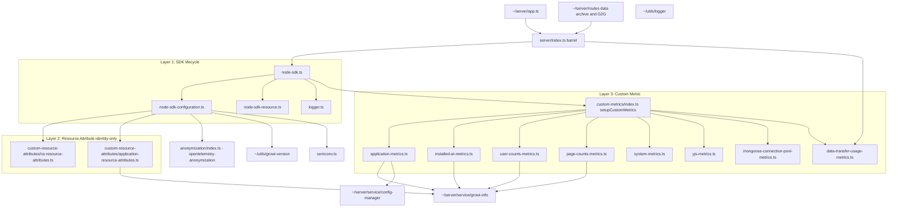
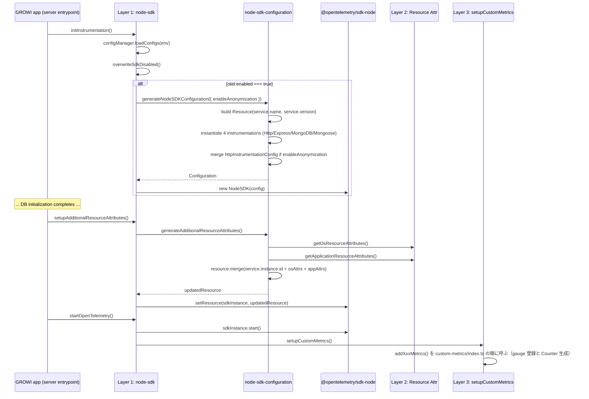

# Technical Design — opentelemetry

## Overview

**Purpose**: GROWI の OpenTelemetry 統合 (`apps/app/src/features/opentelemetry/`) を、SDK ライフサイクル / Resource Attribute / Custom Metric の各レイヤに分けて責務境界を明文化する大局的なメンテナンス spec（HTTP の匿名化は `opentelemetry-anonymization` が担う）。

**Users**:
- GROWI 開発者（メトリクス追加・SDK バージョンアップを行う）。
- OpenTelemetry 受信側インフラ管理者（Prometheus / Grafana / Collector を運用する）。

**Impact**: 既に稼働している実装の現状をスナップショットとして固定化する。新規実装はゼロで、コード変更は伴わない。将来の機能追加・変更は本 spec の Boundary Commitments に従って境界の中で行われる。

### Goals

- 各レイヤ（匿名化を除く）の責務・境界・依存関係を明文化する。
- Resource Attribute は identity 専用、設定値は `growi.configs` ラベル、観測値は `growi.*` / `system.*` / `process.*` メトリクスへ、というレイヤ分離を維持する。
- 新規 Custom Metric（状態値型・発生回数型）の追加手順を「テンプレート化」して、追加時のレビュー差分を最小化する。
- Resource Attribute / Metric / Span Attribute の責務分離（identity / 設定値 / 観測値 / span attribute）を Design Decisions として固定する。

### Non-Goals

- 既存メトリクス / Resource Attribute の名称変更・再構成。
- OpenTelemetry Log Signal の利用開始。
- ブラウザサイドからの telemetry 出力。
- `@opentelemetry/host-metrics` 等への置き換え。
- `service.instance.id` の自動生成（現状は `otel:serviceInstanceId` か `app:serviceInstanceId` の config 値を passthrough する）。

## Boundary Commitments

### This Spec Owns

#### Layer 1: SDK ライフサイクル

- `node-sdk.ts` の `initInstrumentation()` / `setupAdditionalResourceAttributes()` / `startOpenTelemetry()` の 3 関数。
- `overwriteSdkDisabled()` による `OTEL_SDK_DISABLED` と `otel:enabled` の整合化。
- `node-sdk-configuration.ts` の `generateNodeSDKConfiguration(opts)` および `generateAdditionalResourceAttributes(opts)`。
- `node-sdk-resource.ts` の `getResource()` / `setResource()`（NodeSDK private `_resource` への reflective アクセサ）。
- `logger.ts` の `DiagLoggerPinoAdapter` と `initLogger()`。
- 同一プロセス内の SDK インスタンス二重生成防止（`sdkInstance` モジュール変数）。
- `otel:anonymizeInBestEffort` が `true` のときのみ、`opentelemetry-anonymization` の `httpInstrumentationConfig` を HTTP instrumentation の constructor 引数に渡す判断。

#### Layer 2: Resource Attribute（identity 専用）

- `custom-resource-attributes/os-resource-attributes.ts` の `getOsResourceAttributes(): Attributes`。
- `custom-resource-attributes/application-resource-attributes.ts` の `getApplicationResourceAttributes(): Promise<Attributes>`。
- `custom-resource-attributes/index.ts` のバレル。
- emit する identity 属性: `os.type`, `os.platform`, `os.arch`, `growi.service.type`, `growi.deployment.type`。
- 2 段階初期化（DB 非依存の OS info → DB 初期化後の `service.instance.id` および application info）の責務。

#### Layer 3: Custom Metric

- `custom-metrics/index.ts` の barrel と `setupCustomMetrics(): Promise<void>`。
- `custom-metrics/application-metrics.ts` の `addApplicationMetrics()`（`growi.configs` info gauge + 5 ラベル）。
- `custom-metrics/installed-at-metrics.ts` の `addInstalledAtMetrics()`（`growi.installed_at.timestamp.seconds` / `growi.installed_at.by_oldest_user.timestamp.seconds`）。
- `custom-metrics/user-counts-metrics.ts` の `addUserCountsMetrics()`（`growi.users.total` / `growi.users.active`）。
- `custom-metrics/page-counts-metrics.ts` の `addPageCountsMetrics()`（`growi.pages.total`）。
- `custom-metrics/system-metrics.ts` の `addSystemMetrics()`（`system.memory.limit` / `system.host.memory.total` / `process.memory.usage` / `process.runtime.v8.heap.{used,total,external}`）。
- `custom-metrics/yjs-metrics.ts` の `addYjsMetrics()`（`growi.yjs.docs.count`）。
- `custom-metrics/mongoose-connection-pool-metrics.ts` の `addMongooseConnectionPoolMetrics()`（`growi.mongoose.pool.{size,checked_out,available}`）。
- `custom-metrics/data-transfer-usage-metrics.ts` の `addDataTransferUsageMetrics()`、記録関数 `recordArchiveOperation()` / `recordG2GTransfer()`、属性語彙の型 `ArchiveOperation` / `G2GTransferRole` / `OperationResult`。発生回数型 Counter `growi.archive.operations`（単位 `{operation}`、属性 `operation`: `create` / `download` / `upload` / `import`、`result`: `success` / `failure`）と `growi.g2g_transfer.operations`（単位 `{transfer}`、属性 `role`: `source` / `destination`、`result`: `success` / `failure`）のメトリクス名・属性キー・属性値の唯一の定義元。
- 外部記録 API: `features/opentelemetry/server/index.ts` の barrel が `recordArchiveOperation` / `recordG2GTransfer` と型 `ArchiveOperation` / `G2GTransferRole` / `OperationResult` のみを re-export する。`addDataTransferUsageMetrics` を含む `custom-metrics/` の他のシンボルは barrel から公開しない。
- データアーカイブ・お引越しの計測点: 記録呼び出しの位置と、成否との対応（Components「DataTransferUsageMetrics」の計測点表）。成否の判定そのもの（`executeImport()` の戻り値、`isTransferImportIncomplete()`）は業務コード側が持ち、本 spec は入力として使うのみ。
- Meter 命名規約: `growi-<scope>-metrics`, version `'1.0.0'`。
- Observation 実装規約（状態値型）: `ObservableGauge` + `addBatchObservableCallback` + try/catch + `diag.createComponentLogger` で例外吸収。
- Recording 実装規約（発生回数型）: `Counter` はモジュール変数に保持し、`addXxxMetrics()` 内（SDK 開始後に `setupCustomMetrics()` から呼ばれる）で生成する。モジュール読み込み時には生成しない（research.md「Decision: 記録 API は SDK 開始後に生成した Counter を保持する（呼び出しのたびに getMeter しない）」参照）。記録関数は列挙型の引数のみを受け付け、Counter 未生成のあいだは何もしない。`Counter.add()` は try/catch で囲み、例外は `diag.createComponentLogger` に記録して呼び出し元へ投げない。

#### Layer 4: HTTP Anonymization

HTTP の匿名化（`anonymization/`）は `opentelemetry-anonymization` が担う。本 spec は Layer 1 で `httpInstrumentationConfig` を渡すかどうかの判断のみを持つ。

#### Layer 5: SemConv ローカルコピー

- `semconv.ts` の `ATTR_SERVICE_INSTANCE_ID` / `ATTR_HTTP_TARGET` 定義。
- incubating semconv の文字列定数化と上流 minor リリース変更からの隔離。

### Out of Boundary

- `~/server/service/growi-info`（`growiInfoService`） — consumer として利用するのみ。`getGrowiInfo(opts)` の API 仕様は本 spec では定義しない。
- `~/server/service/config-manager` — `otel:*` config 4 種を読み取るのみ。config 定義の追加・改名は config-manager 側の責務。
- `~/utils/growi-version` — `service.version` の供給元。
- `~/utils/logger` — pino logger ファクトリ。
- 各 `@opentelemetry/*` パッケージの内部実装。Auto-instrumentation の挙動チューニング（HTTP / Express / Mongoose 等の挙動は instrumentation の責務）。
- Trace span への独自 attribute 付与（HTTP の匿名化は `opentelemetry-anonymization`）。
- OpenTelemetry Log Signal、ブラウザ telemetry。
- OTLP wire 仕様および受信側ダッシュボード／アラート。発生回数の集計（期間内の増加分の算出、再起動による累積値リセットの判別）も受信側の責務。
- データアーカイブ・お引越しの業務処理（`ExportService` / `ImportService` / `G2GTransferPusherService` / `G2GTransferReceiverService` の内部、成否判定、管理画面への通知、HTTP 応答、監査ログ）。本 spec はそれらの計測点に置く記録呼び出しのみを持ち、サービス層では記録しない。

### Allowed Dependencies

- Node.js 標準モジュール: `node:os`, `node:v8`, `node:process`, `node:crypto`, `node:http`。
- `@opentelemetry/api`: `metrics`, `diag`, `Attributes`, `Meter`, `ObservableGauge`, `Counter` 等の public API のみ。
- `@opentelemetry/sdk-node`, `@opentelemetry/sdk-metrics`, `@opentelemetry/sdk-trace-node`, `@opentelemetry/resources`: SDK 初期化用。`@opentelemetry/sdk-metrics` の `MeterProvider` / `InMemoryMetricExporter` は発生回数型メトリクスのテストにも使う。
- 業務コード（`features/opentelemetry` の外）→ `~/features/opentelemetry/server` の barrel から記録関数と型のみを import する。`custom-metrics/` 配下の内部ファイルを直接 import しない。
- `server/routes/apiv3/import-executor.ts` → barrel の型 `OperationResult` のみを type-only import で参照する。記録関数は呼ばず、結果を戻り値で返す（記録は `import.ts` が行う）。
- `@opentelemetry/exporter-trace-otlp-grpc`, `@opentelemetry/exporter-metrics-otlp-grpc`: OTLP gRPC エクスポート。
- `@opentelemetry/instrumentation-http`, `@opentelemetry/instrumentation-express`, `@opentelemetry/instrumentation-mongodb`, `@opentelemetry/instrumentation-mongoose`: 4 instrumentation を direct import。`@opentelemetry/auto-instrumentations-node` は採用しない（Design Decisions 参照）。
- `@opentelemetry/instrumentation`（type-only import）: `Instrumentation` 型の取得用。
- `@opentelemetry/semantic-conventions`: stable attribute のみ（`ATTR_SERVICE_NAME` / `ATTR_SERVICE_VERSION`）。incubating は import しない。
- 上記以外の新規 npm dependency 追加は不可。追加する場合は `apps/app/.next/node_modules/` 残留有無の確認と `dependencies` 分類が必要（`.claude/rules/package-dependencies.md` 参照）。

### Revalidation Triggers

- `@opentelemetry/api` または `@opentelemetry/sdk-*` のメジャー更新 → Meter / ObservableGauge / Counter / NodeSDK API シグネチャの再確認、特に `node-sdk-resource.ts` の `_resource` private アクセスが public 化されていないか確認。
- `growiInfoService.getGrowiInfo()` の API 変更（追加フラグ削除、返り値型変更）→ 該当する `application-metrics.ts` / `user-counts-metrics.ts` / `page-counts-metrics.ts` / `application-resource-attributes.ts` の参照を再確認。
- `@opentelemetry/semantic-conventions` の `service.instance.id` / `http.target` の stable 化 → `semconv.ts` のローカル定数を撤去し、stable import に切り替える。
- Node.js ランタイム要件のダウングレード（`engines.node` が `^24` 未満）→ `process.constrainedMemory()` / `v8.getHeapStatistics()` の互換性再確認。
- 新規 anonymization 対象パス／パラメータ追加要望 → `opentelemetry-anonymization` を参照する。
- 受信側ダッシュボード／クエリの参照更新が未完了の状態でメトリクス／ラベル変更を行う → ロールアウト順序の再調整。発生回数型メトリクスの属性値の追加（計測対象の操作の追加など）も含め、新しいメトリクス名・属性は受信側担当へ先に共有する。
- `@opentelemetry/api` の metrics API に、SDK 登録前に取得した Meter を後から SDK の Meter に差し替える仕組み（プロキシ）が入った場合 → Counter を `setupCustomMetrics()` 内で生成する制約を緩めてよいか再確認。
- お引越しの取り込み結果（`ImportCollectionsResult`）に失敗を表すフィールドが追加された場合 → `isTransferImportIncomplete()` への反映と、送信側・受信側の成否の対応を再確認。
- `ExportService.export()` / `startTransfer()` / `executeImport()` / `receiveTransferData()` の呼び出し形（await の有無、戻り値）の変更 → 計測点の成否確定位置を再確認。
- 4 instrumentation（HTTP / Express / MongoDB / Mongoose）に新たな instrumentation を追加・削除する場合 → `generateNodeSDKConfiguration` の `instrumentations` 配列と `apps/app/package.json` の `dependencies` を同時に更新し、Turbopack bundling および `.next/server/chunks/` 配下への取り込みを `pnpm run build` 後に検証する。
- `@opentelemetry/auto-instrumentations-node` への切り戻し提案が出た場合 → research.md の "Decision: 4 instrumentation の direct import 採用" の rationale（`enabled: false` でも 31 instrumentation 全件が instantiate される仕様 / ≈ 11 MB の RSS オーバーヘッド）を再確認し、isolated benchmark での再計測が無い限り採用しない。

## Architecture

### Existing Architecture Analysis

`features/opentelemetry/server/` は以下のレイヤを下流方向の単方向依存で構成する:

1. **SDK ライフサイクル** — `node-sdk.ts` が `node-sdk-configuration.ts` / `node-sdk-resource.ts` / `logger.ts` および `custom-metrics/index.ts` を統括する。起動関数は `server/index.ts` の barrel 経由で `server/app.ts` から呼ばれる。
2. **Resource Attribute** — `custom-resource-attributes/` を `node-sdk-configuration.ts` の 2 段階目（`generateAdditionalResourceAttributes`）が consumer として呼ぶ。
3. **Custom Metric** — `custom-metrics/index.ts` の `setupCustomMetrics()` が SDK 開始後に各モジュールを順次登録。状態値型のモジュールは `growiInfoService`・Node.js stdlib・y-websocket の `docs`・mongoose の接続を観測元として参照する。発生回数型の `data-transfer-usage-metrics.ts` は、データアーカイブ・お引越しのルート（`server/routes/**`）から `server/index.ts` の barrel 経由で記録関数を呼ばれる。
4. **HTTP Anonymization** — `opentelemetry-anonymization` が担う。`node-sdk-configuration.ts` が `otel:anonymizeInBestEffort` に応じて、その `httpInstrumentationConfig` を auto-instrumentation 構築時に注入する。
5. **SemConv** — `semconv.ts` は Layer 1, 2 から参照される葉ノード。

各レイヤは独立に拡張可能で、レイヤ間の横断的な相互依存は存在しない。`features/opentelemetry` の外からの依存は、Layer 1 の起動関数と Layer 3 の記録関数の 2 種のみで、いずれも `server/index.ts` の barrel を経由する。

### Architecture Pattern & Boundary Map



### Bootstrap Sequence



### Technology Stack

| Layer | Choice / Version | Role in Feature | Notes |
|-------|------------------|-----------------|-------|
| Runtime | Node.js `^24` | `process.constrainedMemory()` / `v8.getHeapStatistics()` 等 stdlib API | `apps/app/package.json` の `engines` ではなくリポジトリルートの `engines` で指定 |
| Telemetry SDK | `@opentelemetry/api ^1.9.0`, `@opentelemetry/sdk-node ^0.217.0`, `@opentelemetry/sdk-metrics ^2.0.1`, `@opentelemetry/sdk-trace-node ^2.0.1`, `@opentelemetry/resources ^2.0.1` | NodeSDK / Meter / Resource | 既存導入済み |
| Exporter | `@opentelemetry/exporter-trace-otlp-grpc`, `@opentelemetry/exporter-metrics-otlp-grpc ^0.202.0` | OTLP gRPC エクスポート | 引数なしで生成し endpoint は OTel 標準 env var で解決 |
| Instrumentation (direct import) | `@opentelemetry/instrumentation-http ^0.217.0`, `@opentelemetry/instrumentation-express ^0.65.0`, `@opentelemetry/instrumentation-mongodb ^0.70.0`, `@opentelemetry/instrumentation-mongoose ^0.63.0` | HTTP / Express / MongoDB / Mongoose の計測（4 instrumentation を `generateNodeSDKConfiguration` 内で直接 `new`） | `@opentelemetry/auto-instrumentations-node` は不採用（Design Decisions 参照）。Turbopack によって chunk bundle 側に取り込まれるため、`.next/node_modules/` 配下に symlink は生成されない |
| SemConv | `@opentelemetry/semantic-conventions ^1.34.0` | stable attribute のみ import | incubating は `semconv.ts` にローカルコピー |
| Logger | pino（`~/utils/logger`） + `diag` アダプタ | dev 環境のみ DiagLogger を pino に差し替え | production は OpenTelemetry の default diag |
| Test | Vitest + `vitest-mock-extended`, `@opentelemetry/sdk-metrics`（`MeterProvider` / `InMemoryMetricExporter`） | 状態値型は `vi.mock('node:os'/'node:v8')`, `mock<Meter>()` パターン。発生回数型は実 MeterProvider で送信内容を検証 | 既存テスト基盤 |

## File Structure Plan

### Directory Structure

```
apps/app/src/features/opentelemetry/server/
├── index.ts                              # public export: `export * from './node-sdk'` + 発生回数の記録関数と語彙の型
├── node-sdk.ts                           # Layer 1: SDK lifecycle entrypoints
├── node-sdk-configuration.ts             # Layer 1: NodeSDKConfiguration + Resource builders
├── node-sdk-resource.ts                  # Layer 1: NodeSDK._resource reflective accessor
├── logger.ts                             # Layer 1: DiagLoggerPinoAdapter
├── semconv.ts                            # Layer 5: incubating attribute local copy
├── custom-resource-attributes/
│   ├── index.ts                          # Layer 2: barrel
│   ├── os-resource-attributes.ts         # Layer 2: OS identity (stage-1)
│   ├── os-resource-attributes.spec.ts
│   ├── application-resource-attributes.ts # Layer 2: GROWI service identity (stage-2)
│   └── application-resource-attributes.spec.ts
├── custom-metrics/
│   ├── index.ts                          # Layer 3: barrel + setupCustomMetrics()
│   ├── setup-custom-metrics.spec.ts
│   ├── application-metrics.ts            # Layer 3: growi.configs info gauge
│   ├── application-metrics.spec.ts
│   ├── installed-at-metrics.ts           # Layer 3: growi.installed_at.*
│   ├── installed-at-metrics.spec.ts
│   ├── user-counts-metrics.ts            # Layer 3: growi.users.{total,active}
│   ├── user-counts-metrics.spec.ts
│   ├── page-counts-metrics.ts            # Layer 3: growi.pages.total
│   ├── page-counts-metrics.spec.ts
│   ├── system-metrics.ts                 # Layer 3: system.* / process.* memory metrics
│   ├── system-metrics.spec.ts
│   ├── yjs-metrics.ts                    # Layer 3: growi.yjs.docs.count
│   ├── yjs-metrics.spec.ts
│   ├── mongoose-connection-pool-metrics.ts # Layer 3: growi.mongoose.pool.*
│   ├── mongoose-connection-pool-metrics.spec.ts
│   ├── data-transfer-usage-metrics.ts    # Layer 3: Counter growi.archive.operations / growi.g2g_transfer.operations + 記録関数
│   ├── data-transfer-usage-metrics.spec.ts
│   └── data-transfer-usage-wiring.spec.ts # setupCustomMetrics() 経由の Counter 生成と有効・無効の確認
└── anonymization/                        # Layer 4: `opentelemetry-anonymization` が所有
```

### Extension Templates

#### 新規 状態値型（ObservableGauge）メトリクスの追加

1. `custom-metrics/<scope>-metrics.ts` を新規作成し、`addXxxMetrics(): void` を export する。
2. ファイル冒頭で `loggerFactory('growi:opentelemetry:custom-metrics:<scope>')` と `diag.createComponentLogger({ namespace: 'growi:custom-metrics:<scope>' })` を初期化する。
3. `metrics.getMeter('growi-<scope>-metrics', '1.0.0')` で Meter 取得。
4. `meter.createObservableGauge(name, { description, unit })` で gauge 群を作成。
5. `meter.addBatchObservableCallback(async (result) => { try { ... } catch (e) { loggerDiag.error(...) } }, [...gauges])` を 1 つ登録。
6. `custom-metrics/index.ts` の barrel に `export { addXxxMetrics } from './<scope>-metrics';` を追加し、`setupCustomMetrics()` 内で dynamic import + 呼び出し。
7. `*.spec.ts` を co-locate し、`vi.mock('@opentelemetry/api')` + `mock<Meter>()` パターンで unit test を書く。

#### 新規 発生回数型（Counter）メトリクスの追加

1. `custom-metrics/<scope>-metrics.ts` を新規作成し、`addXxxMetrics(): void` と記録関数 `recordXxx(...): void` を export する。
2. ファイル冒頭で `loggerFactory('growi:opentelemetry:custom-metrics:<scope>')` と `diag.createComponentLogger({ namespace: 'growi:custom-metrics:<scope>' })` を初期化する。
3. 属性値の語彙を文字列リテラルの union 型で定義し、記録関数の引数をその型に限定する（自由文字列・ID・パス・名前を受け付けない）。メトリクス名・属性キー・属性値はこのファイルだけで定義する。
4. Counter はモジュール変数（`let xxxCounter: Counter | undefined`）に保持し、`addXxxMetrics()` 内で `metrics.getMeter('growi-<scope>-metrics', '1.0.0').createCounter(name, { description, unit })` により生成する。モジュール読み込み時や記録関数内では `getMeter()` しない。
5. 記録関数は `try { xxxCounter?.add(1, attributes) } catch (error) { loggerDiag.error(...) }` の形にし、Counter 未生成なら何もせず、例外を呼び出し元へ投げない。
6. `custom-metrics/index.ts` の barrel に `addXxxMetrics` を追加し、`setupCustomMetrics()` 内で dynamic import + 呼び出し（状態値型の手順 6 と同じ）。
7. `features/opentelemetry/server/index.ts` の barrel から記録関数と語彙の型だけを re-export する。`addXxxMetrics` は公開しない。
8. 計測点（業務コード）は barrel から記録関数を import し、成否が確定する 1 か所で 1 操作につき 1 回だけ呼ぶ。バックグラウンドで進む処理は応答を待たせず、Promise に 2 引数の `.then(onFulfilled, onRejected)` でハンドラを付けて記録する（成功側の例外で二重記録しないため）。受付前に拒否した要求は記録しない。複数機能から再利用されるサービス層では記録しない（Components「DataTransferUsageMetrics」の計測点ルール参照）。
9. 記録モジュールの `*.spec.ts` は `@opentelemetry/api` をモックせず、実 `MeterProvider` + `InMemoryMetricExporter` を `metrics.setGlobalMeterProvider()` で登録して検証する（属性別の系列値、`addXxxMetrics()` 前の記録が送信されないこと、属性キーの限定、`add()` の例外が外に出ないこと）。計測点のテストは barrel の記録関数を `vi.mock` し、呼ばれた引数と回数を検証する。
10. 新しいメトリクス名・属性を受信側担当へ共有してからリリースする（Revalidation Triggers）。

## Requirements Traceability

| Requirement | Summary | Components | Interfaces |
|-------------|---------|------------|------------|
| 1.1–1.5 | SDK ライフサイクルと有効化制御 | NodeSdkLifecycle, OverwriteSdkDisabled | `initInstrumentation()`, `setupAdditionalResourceAttributes()`, `startOpenTelemetry()` |
| 2.1–2.4 | identity 専用 Resource Attribute | OsResourceAttributes, ApplicationResourceAttributes, NodeSdkConfiguration | `getOsResourceAttributes()`, `getApplicationResourceAttributes()`, `generateAdditionalResourceAttributes()` |
| 3.1–3.5 | GROWI 設定情報の info-gauge ラベル統合 | ApplicationMetrics | `addApplicationMetrics()` の observe ラベル |
| 4.1–4.4 | 業務カウントメトリクス | UserCountsMetrics, PageCountsMetrics | `addUserCountsMetrics()`, `addPageCountsMetrics()` |
| 5.1–5.5 | コンテナ運用に対応したメモリ系メトリクス | SystemMetrics | `addSystemMetrics()` |
| 6.x | （欠番）HTTP の匿名化 | — | `opentelemetry-anonymization` を参照 |
| 7.1–7.3 | Diag Logger と pino の統合 | DiagLoggerPinoAdapter | `initLogger()` |
| 8.1–8.3 | メトリクスエクスポートと SDK 設定 | NodeSdkConfiguration | `generateNodeSDKConfiguration()` の reader / exporter / instrumentation 設定 |
| 9.1–9.2 | SemConv の不安定 attribute のローカルコピー | SemConv | `semconv.ts` の文字列定数 |
| 10.1–10.3 | 拡張・追加時の境界遵守 | CustomMetricsIndex | 拡張テンプレート（File Structure Plan 参照） |
| 10.4 | 外部からの記録は barrel 経由のみ | DataTransferUsageMetrics, `server/index.ts` barrel | Allowed Dependencies、発生回数型の拡張テンプレート手順 7・8 |
| 11.1, 11.2 | アーカイブ・お引越しの Counter と属性語彙 | DataTransferUsageMetrics | `recordArchiveOperation()`, `recordG2GTransfer()` |
| 11.3 | 部分失敗は失敗 | DataTransferUsageMetrics の計測点 | `executeImport(): Promise<OperationResult>`, `isTransferImportIncomplete()` |
| 11.4, 11.5 | 1 操作 1 回・二重計上なし・受付前の拒否は数えない | DataTransferUsageMetrics の計測点 | 計測点表（サービス層では記録しない） |
| 11.6 | 監査ログ設定に非依存 | DataTransferUsageMetrics の計測点 | 記録呼び出しを監査ログの分岐の外に置く |
| 11.7, 11.8 | 有効時のみ累積値で送信・開始前は no-op | DataTransferUsageMetrics, CustomMetricsIndex | `addDataTransferUsageMetrics()`（SDK 開始後に Counter 生成） |
| 11.9 | 属性の限定 | DataTransferUsageMetrics | 列挙型の引数 |
| 11.10 | 記録失敗が業務に影響しない | DataTransferUsageMetrics | 記録関数は例外を投げない |
| 11.11 | 利用者が認識できる差を生じない | DataTransferUsageMetrics の計測点 | 応答前に待ち合わせを追加しない |

## Components and Interfaces

### Layer 1: SDK ライフサイクル

#### NodeSdkLifecycle

| Field | Detail |
|-------|--------|
| Intent | OpenTelemetry SDK のプロセス内ライフサイクル管理 |
| Requirements | 1.1, 1.2, 1.3, 1.4, 8.1, 8.2, 8.3 |

**Responsibilities & Constraints**
- 同一プロセス内で 1 つの `NodeSDK` インスタンスのみを保持する。
- `otel:enabled` が `false` のときは SDK を構築しない。
- `OTEL_SDK_DISABLED` env var と `otel:enabled` の食い違いを warn で報告し上書きする。
- Resource 注入は 2 段階（SDK 構築時 / DB 初期化後）に分け、`setResource()` の private API 経由で 2 段階目を反映する。
- `start()` 直後に `setupCustomMetrics()` を呼び出して Custom Metric の登録を行う。

**Dependencies**
- Inbound: `apps/app/src/server/app.ts` 系の起動シーケンス（実体は本 spec の外）。
- Outbound: `@opentelemetry/sdk-node` (`NodeSDK`), `configManager`, `./node-sdk-configuration`, `./node-sdk-resource`, `./logger`, `./custom-metrics`.

##### Service Interface
```typescript
export const initInstrumentation: () => Promise<void>;
export const setupAdditionalResourceAttributes: () => Promise<void>;
export const startOpenTelemetry: () => void;
// テスト専用
export const __testing__: { getSdkInstance, reset };
```

**Implementation Notes**
- 二重 init 防止: モジュールスコープの `let sdkInstance: NodeSDK | undefined;` を見て、設定済みなら warn のみで return。
- `start()` 前後で `instrumentationEnabled` を再確認する（dev 時に env を切り替える運用への配慮）。
- `setResource()` は `NodeSDK._resource` を直接書き換える。OpenTelemetry SDK が public な resource 上書き API を提供したら撤去する候補（Revalidation Trigger）。

#### NodeSdkConfiguration

| Field | Detail |
|-------|--------|
| Intent | `NodeSDKConfiguration` オブジェクトと Resource の構築 |
| Requirements | 2.1, 2.2, 2.3, 6.1, 6.5, 8.1, 8.2, 8.3 |

**Responsibilities & Constraints**
- 1 段階目 Resource: `{ service.name: 'growi', service.version: <growi-version> }`。
- 2 段階目 Resource: `{ service.instance.id?, ...osAttrs, ...appAttrs }` を merge。
- Trace exporter: `OTLPTraceExporter()`（引数なし）。
- Metric reader: `PeriodicExportingMetricReader({ exporter: new OTLPMetricExporter(), exportIntervalMillis: 300000 })`。
- Instrumentation: `HttpInstrumentation` / `ExpressInstrumentation` / `MongoDBInstrumentation` / `MongooseInstrumentation` の 4 class を直接 `new` し、`instrumentations` 配列に inline 構築。`@opentelemetry/auto-instrumentations-node` および `OTEL_AUTO_INSTRUMENTATION_PROFILE` 環境変数は一切参照しない。
- `enableAnonymization` が `true` のときのみ `HttpInstrumentation` の constructor 第 1 引数に `httpInstrumentationConfigForAnonymize` を渡し、falsy / 未指定のときは引数なしで呼び出す。
- 戻り値 `Configuration` の `instrumentations` 配列は常に長さ 4。

**Dependencies**
- Outbound: `@opentelemetry/sdk-node`, `@opentelemetry/sdk-metrics`, `@opentelemetry/exporter-*-otlp-grpc`, `@opentelemetry/instrumentation-http`, `@opentelemetry/instrumentation-express`, `@opentelemetry/instrumentation-mongodb`, `@opentelemetry/instrumentation-mongoose`, `@opentelemetry/resources`, `@opentelemetry/semantic-conventions` (stable), `./semconv`, `./anonymization`, `./custom-resource-attributes`, `~/server/service/config-manager`, `~/utils/growi-version`.

##### Service Interface
```typescript
type Option = { enableAnonymization?: boolean };
type Configuration = Partial<NodeSDKConfiguration> & { resource: Resource };
export const generateNodeSDKConfiguration: (opts?: Option) => Configuration;
export const generateAdditionalResourceAttributes: (opts?: Option) => Promise<Resource>;
```

**Implementation Notes**
- `configuration` と `resource` をモジュールスコープで保持し、二重生成を防止する。
- `service.instance.id` の値は `otel:serviceInstanceId` を優先し、フォールバックで `app:serviceInstanceId`。

#### NodeSdkResource

| Field | Detail |
|-------|--------|
| Intent | NodeSDK の private `_resource` プロパティへの reflective アクセス |
| Requirements | 1.3 |

**Responsibilities & Constraints**
- `getResource(sdk)`: `_resource` の存在を検証し返す。失敗時は throw。
- `setResource(sdk, resource)`: `getResource` で生存確認した上で `_resource` を上書き。

**Implementation Notes**
- `as any` キャストでアクセスする。SDK のメジャー更新時に public API が出たら即座に撤去すべき箇所（Revalidation Trigger）。

#### DiagLoggerPinoAdapter

| Field | Detail |
|-------|--------|
| Intent | `@opentelemetry/api` の `DiagLogger` を pino logger にアダプトする |
| Requirements | 7.1, 7.2, 7.3 |

**Responsibilities & Constraints**
- 開発環境（`NODE_ENV === 'development'`）でのみ `initLogger()` を `node-sdk.ts` から呼び出す。
- `parseMessage(message, args)` で JSON 文字列を構造化 data に変換し、`logger.error(data, msg)` の pino 引数規約に整合する。
- `error` / `warn` / `info` / `debug` / `verbose` の 5 メソッドを実装。`verbose` は pino の `trace` レベルにマップ。

### Layer 2: Resource Attribute

#### OsResourceAttributes

| Field | Detail |
|-------|--------|
| Intent | OS identity を OTel Resource Attribute として返す |
| Requirements | 2.1, 2.3 |

**Responsibilities & Constraints**
- `os.type` / `os.platform` / `os.arch` を返す。
- 測定値（`os.totalmem` 等）は返さない（System Metric 側の責務）。

**Dependencies**
- External: `node:os` (`type()`, `platform()`, `arch()`).

##### Service Interface
```typescript
export function getOsResourceAttributes(): Attributes;
// 戻り値: { 'os.type': string, 'os.platform': string, 'os.arch': string }
```

#### ApplicationResourceAttributes

| Field | Detail |
|-------|--------|
| Intent | GROWI service identity を OTel Resource Attribute として返す |
| Requirements | 2.1, 2.3, 2.4 |

**Responsibilities & Constraints**
- `growi.service.type` / `growi.deployment.type` を返す。
- サブシステム設定値（`growi.attachment.type` 等）は返さない（`growi.configs` ラベル側の責務）。
- try/catch で `growiInfoService` の失敗を吸収し、空 attributes を返す。

**Dependencies**
- Outbound: `~/server/service/growi-info` の `growiInfoService.getGrowiInfo({})`（dynamic import で循環依存を回避）。

##### Service Interface
```typescript
export async function getApplicationResourceAttributes(): Promise<Attributes>;
// 戻り値: { 'growi.service.type': string, 'growi.deployment.type': string }
```

### Layer 3: Custom Metric

#### ApplicationMetrics

| Field | Detail |
|-------|--------|
| Intent | GROWI 設定情報を info-gauge `growi.configs` のラベルに集約 |
| Requirements | 3.1, 3.2, 3.3, 3.4, 3.5 |

**Responsibilities & Constraints**
- `growi.configs` ObservableGauge（unit `'1'`、値は常に 1）を 1 個 emit する。
- ラベル: `site_url`, `site_url_hashed?`, `wiki_type`, `external_auth_types`, `attachment_type`。
- `otel:isAppSiteUrlHashed === true` のとき `site_url = '[hashed]'`、`site_url_hashed = SHA-256(appSiteUrl)`。`false` のとき生 URL + `site_url_hashed = undefined`。
- `external_auth_types` / `attachment_type` の値が未取得時は空文字 `''`。

**Dependencies**
- Outbound: `growiInfoService.getGrowiInfo({ includeAttachmentInfo: true })`, `configManager.getConfig('otel:isAppSiteUrlHashed')`.

##### Service Interface
```typescript
export function addApplicationMetrics(): void;
```

##### Label Schema: `growi.configs`
| Label | Source | Notes |
|-------|--------|-------|
| `site_url` | `isAppSiteUrlHashed ? '[hashed]' : growiInfo.appSiteUrl` | required |
| `site_url_hashed` | `isAppSiteUrlHashed ? sha256(appSiteUrl) : undefined` | hashed 時のみ付与 |
| `wiki_type` | `growiInfo.wikiType` | required |
| `external_auth_types` | `additionalInfo?.activeExternalAccountTypes?.join(',') \|\| ''` | required（カンマ区切り） |
| `attachment_type` | `additionalInfo?.attachmentType ?? ''` | required |

#### UserCountsMetrics

| Field | Detail |
|-------|--------|
| Intent | GROWI 上のユーザー数とアクティブユーザー数の継続観測 |
| Requirements | 4.1, 4.2, 4.4 |

**Responsibilities & Constraints**
- `growi.users.total` / `growi.users.active` の 2 つの ObservableGauge（unit `'users'`）。
- `growiInfoService.getGrowiInfo({ includeUserCountInfo: true })` を呼び、`additionalInfo.currentUsersCount` / `currentActiveUsersCount` をそれぞれ observe。未取得時は 0。

##### Service Interface
```typescript
export function addUserCountsMetrics(): void;
```

#### PageCountsMetrics

| Field | Detail |
|-------|--------|
| Intent | GROWI 上の総ページ数の継続観測 |
| Requirements | 4.3, 4.4 |

**Responsibilities & Constraints**
- `growi.pages.total`（unit `'pages'`）の ObservableGauge 1 つ。
- `growiInfoService.getGrowiInfo({ includePageCountInfo: true })` の `additionalInfo.currentPagesCount` を observe。未取得時は 0。

##### Service Interface
```typescript
export function addPageCountsMetrics(): void;
```

#### SystemMetrics

| Field | Detail |
|-------|--------|
| Intent | コンテナ / ホスト / プロセス / V8 ヒープのメモリ系統計を ObservableGauge で出力 |
| Requirements | 5.1, 5.2, 5.3, 5.4, 5.5 |

**Responsibilities & Constraints**
- 単一 Meter `growi-system-metrics`（version `'1.0.0'`）で 6 つの ObservableGauge を作成。すべて単位 `'By'`。
- 1 つの `addBatchObservableCallback` で `process.constrainedMemory()` / `os.totalmem()` / `process.memoryUsage()` / `v8.getHeapStatistics()` を 1 回ずつ呼び、ローカル変数経由で 6 個の gauge に観測値を割り振る。
- `process.constrainedMemory()` が `> 0` のときのみ `system.memory.limit` を観測、`0` または falsy のときは当該 gauge のみスキップし他 5 個は観測する。
- コールバック全体を try/catch で囲み、例外時は `loggerDiag.error('Failed to collect system metrics', { error })` を呼んで `result.observe` を一切呼ばずに return。

##### Metric Schema
| Metric Name | Unit | Source | Skip Condition |
|-------------|------|--------|----------------|
| `system.memory.limit` | `By` | `process.constrainedMemory()` | 値が `0` または falsy |
| `system.host.memory.total` | `By` | `os.totalmem()` | — |
| `process.memory.usage` | `By` | `process.memoryUsage().rss` | — |
| `process.runtime.v8.heap.used` | `By` | `v8.getHeapStatistics().used_heap_size` | — |
| `process.runtime.v8.heap.total` | `By` | `v8.getHeapStatistics().total_heap_size` | — |
| `process.runtime.v8.heap.external` | `By` | `process.memoryUsage().external` | — |

##### Service Interface
```typescript
export function addSystemMetrics(): void;
```

**Implementation Notes**
- `process.constrainedMemory()` は Node.js 19.6 で導入 / 20.12 で stable。`apps/app` の `engines.node` は `^24` のためサポートされるが、防御的に `(process as NodeJS.Process & { constrainedMemory?(): number }).constrainedMemory?.() ?? 0` でアクセスする。
- API 呼び出しの重複を避けるため、各 stdlib API は callback 内で 1 回ずつのみ呼ぶ。

#### DataTransferUsageMetrics

| Field | Detail |
|-------|--------|
| Intent | データアーカイブとお引越しの試行回数 Counter を所有し、`features/opentelemetry` の外の計測点に型付きの記録関数を提供する |
| Requirements | 10.4, 11.1, 11.2, 11.3, 11.4, 11.5, 11.6, 11.7, 11.8, 11.9, 11.10, 11.11 |

**Responsibilities & Constraints**
- `addDataTransferUsageMetrics()` は `setupCustomMetrics()`（SDK 開始後）からのみ呼ばれ、Meter `growi-data-transfer-usage-metrics` / `'1.0.0'` で Counter 2 種を生成してモジュール変数に保持する。
- 記録関数は、Counter が未生成（`otel:enabled` が `false`・SDK 開始前・テスト）なら何もしない。
- 記録関数は例外を外に出さない。`Counter.add()` の例外は diag ロガーに記録して吸収する。
- メトリクス名・属性キー・属性値はこのファイルだけが定義する。インスタンスの識別は Resource Attribute に任せ、属性には含めない。
- 2 つのメトリクスに分ける理由は research.md「Decision: Counter を 2 つに分ける（アーカイブ用とお引越し用）」参照。

##### Service Interface
```typescript
export type ArchiveOperation = 'create' | 'download' | 'upload' | 'import';
export type G2GTransferRole = 'source' | 'destination';
export type OperationResult = 'success' | 'failure';

export function addDataTransferUsageMetrics(): void;
export function recordArchiveOperation(operation: ArchiveOperation, result: OperationResult): void;
export function recordG2GTransfer(role: G2GTransferRole, result: OperationResult): void;
// server/index.ts の barrel は record* と 3 つの型のみを re-export する
```

##### Metric Schema
| Metric Name | Instrument | Unit | Attributes |
|-------------|------------|------|------------|
| `growi.archive.operations` | Counter（単調増加） | `{operation}` | `operation`: `create` / `download` / `upload` / `import`、`result`: `success` / `failure` |
| `growi.g2g_transfer.operations` | Counter（単調増加） | `{transfer}` | `role`: `source` / `destination`、`result`: `success` / `failure` |

OTLP では累積値（start time 付き）として送られるため、受信側は期間内の増加分と再起動による数え直しを判別できる。

##### 計測点

| 操作 | 記録位置 | `success` | `failure` | 記録しない |
|------|----------|-----------|-----------|------------|
| アーカイブ作成 | `server/routes/apiv3/export.js` POST `/`：await しない `exportService.export()` の Promise に `.then(onFulfilled, onRejected)` | resolve かつ `ZipFileStat` が非 null | resolve(null)、reject（実行中の重複要求による reject を含む。reject はハンドラで `logger.error`） | バリデーションで弾かれた要求 |
| ダウンロード | `server/routes/admin.js` `actions.export.download`：`exportService.getFile()` 成功直後 | 常に `success` | — | パス不正（422）、`getFile()` の失敗 |
| アップロード | `server/routes/apiv3/import.ts` POST `/upload` | `importService.validate()` 通過 | `growiBridgeService.parseZipFile()` の失敗、`validate()` の失敗（バージョン不一致） | ファイル未添付（400） |
| インポート | `server/routes/apiv3/import.ts` POST `/`：応答後のバックグラウンド処理の `finally` で 1 回だけ | `executeImport()` が `'success'` を返した | 結果変数の初期値 `'failure'` のまま終わる経路（`executeImport()` 前に `onErrorForImport` を emit して return）、`executeImport()` が `'failure'` を返した（部分失敗・例外） | 応答前に 4xx/5xx を返した要求 |
| お引越し送信側 | `server/routes/apiv3/g2g-transfer.ts` POST `/transfer`：await しない `startTransfer()` の Promise に `.then(onFulfilled, onRejected)` | `G2GTransferResult.importIncomplete === false` | `importIncomplete === true`、reject（添付ファイル転送の失敗を含む） | `startTransfer()` 呼び出し前の確認（接続確認・転送可否判定）で返した要求 |
| お引越し受信側 | `server/routes/apiv3/g2g-transfer.ts` POST `/`（receive）：`finally` で 1 回だけ | `receiveTransferData()` が取り込み結果を返し、`isTransferImportIncomplete()` が `false` | `receiveTransferData()` が `null` を返した（エラー応答）、取り込み不完全、予期しない例外 | `validateTransferKey` / `requireImportJob` で弾かれた要求 |

- 受付前の拒否は全操作で数えない（research.md「Decision: 受付前に拒否された要求は数えない（全操作共通）」参照）。
- サービス層（`ExportService` / `ImportService` / `G2GTransferReceiverService.importCollections()`）では記録しない。お引越しはこれらを再利用するため、そこで数えるとデータアーカイブの回数に二重計上される（research.md「Decision: 計測はサービス層ではなく、操作の入口を知る層で行う」参照）。
- 部分失敗を `failure` とする判定は業務コード側にある: 通常インポートは `executeImport()` の戻り値、お引越しは送信側・受信側とも `server/service/g2g-transfer.ts` の `isTransferImportIncomplete()`（research.md「Decision: 失敗は失敗として数え、部分失敗も失敗に含める」参照）。
- 添付ファイルの転送だけが失敗した場合、送信側は `failure`、受信側は `success` になる。各側の管理画面の表示と一致する（research.md の「Decision: 添付ファイルのみ失敗した転送は送信側=失敗・受信側=成功とする」参照）。
- 記録呼び出しは監査ログの `activityEvent.emit()` / `createActivity()` の条件分岐とは独立に置く。
- 記録のために応答前の待ち合わせを追加しない。

**Implementation Notes**
- テストは実 `MeterProvider` + `InMemoryMetricExporter` で行い、`addDataTransferUsageMetrics()` 前の記録が送信されないことを確認する（research.md「Decision: 記録 API は SDK 開始後に生成した Counter を保持する（呼び出しのたびに getMeter しない）」参照）。

#### CustomMetricsIndex

| Field | Detail |
|-------|--------|
| Intent | Custom Metric モジュール群の起動合成点 |
| Requirements | 4.1–4.4, 10.1, 11.7, 11.8 |

**Responsibilities & Constraints**
- SDK 開始後に呼ばれ、各モジュールを dynamic import して `addApplicationMetrics()` / `addInstalledAtMetrics()` / `addUserCountsMetrics()` / `addPageCountsMetrics()` / `addSystemMetrics()` / `addYjsMetrics()` / `addMongooseConnectionPoolMetrics()` / `addDataTransferUsageMetrics()` を順次呼ぶ。発生回数型の Counter はここで生成される。
- 新規モジュール追加時はこの順序の末尾に append する（既存ダッシュボードに影響しない）。

##### Service Interface
```typescript
export const setupCustomMetrics: () => Promise<void>;
export {
  addApplicationMetrics, addDataTransferUsageMetrics, addInstalledAtMetrics,
  addMongooseConnectionPoolMetrics, addPageCountsMetrics, addSystemMetrics,
  addUserCountsMetrics, addYjsMetrics,
};
```

### Layer 4: HTTP Anonymization

`opentelemetry-anonymization` を参照。

### Layer 5: SemConv ローカルコピー

#### SemConv

| Field | Detail |
|-------|--------|
| Intent | OpenTelemetry incubating semconv を文字列定数として固定化 |
| Requirements | 9.1, 9.2 |

##### Definitions
```typescript
export const ATTR_SERVICE_INSTANCE_ID = 'service.instance.id';
export const ATTR_HTTP_TARGET = 'http.target';
```

**Implementation Notes**
- 上流の incubating entry-point は import 禁止。stable 化されたら本ファイルから削除し、stable 定数の import に切り替える（Revalidation Trigger）。

## Error Handling

### Error Strategy

各レイヤで発生する例外は **その場で吸収し、上位レイヤや他メトリクスを巻き込まない** ことを基本方針とする。

- **Layer 1（SDK lifecycle）**: SDK 構築失敗時のみ throw を許容（起動を継続できないため）。Resource 取得失敗は warn ログでスキップ。
- **Layer 2（Resource Attribute）**: `growiInfoService` 失敗時は try/catch で空 `Attributes` を返す（SDK 起動は継続可能）。
- **Layer 3（Custom Metric・状態値型）**: 各 `addBatchObservableCallback` 内で try/catch。例外時は `diag.createComponentLogger(...).error(...)` を呼び、その collection cycle では observe を 1 回も呼ばない。次の cycle で再試行。
- **Layer 3（Custom Metric・発生回数型）**: 記録関数内で `Counter.add()` を try/catch し、例外は `diag.createComponentLogger(...).error(...)` に記録して吸収する。記録関数は例外を投げないため、計測点に try/catch は不要。バックグラウンド処理に付けた rejection ハンドラは記録後に再 throw しない。サービス内でログ済みでない reject（`ExportService.export()`）はハンドラで `logger.error({ err }, ...)` し、`startTransfer()` はログと管理画面への通知を済ませてから reject するためハンドラは記録のみ行う。

### Error Categories and Responses

| Category | 例 | 振る舞い |
|----------|-----|---------|
| 起動時 SDK 構築失敗 | `OTLPTraceExporter()` のコンストラクタ例外 | プロセス起動継続不可。throw を上位に伝播。 |
| Resource 取得失敗 | `growiInfoService.getGrowiInfo()` 例外 | `logger.error` で記録し空 `Attributes` 返却。 |
| Metric collection 例外 | `growiInfoService` 失敗、stdlib 失敗（理論上発生しない） | `loggerDiag.error` で記録、当該 cycle の observe をスキップ。 |
| `process.constrainedMemory()` の戻り値が 0 | 非コンテナ環境 | `system.memory.limit` のみスキップ。他 5 メトリクスは observe。 |
| 発生回数の記録失敗 | `Counter.add()` の例外 | `loggerDiag.error` で記録。呼び出し元の処理・応答・結果は変えない。 |
| 記録時に Counter 未生成 | `otel:enabled` が `false`、SDK 開始前 | 何もしない（エラーにしない）。 |

### Monitoring

- Diag ログ namespace 規約:
  - `growi:custom-metrics:application`
  - `growi:custom-metrics:installed-at`
  - `growi:custom-metrics:user-counts`
  - `growi:custom-metrics:page-counts`
  - `growi:custom-metrics:system`
  - `growi:custom-metrics:yjs`
  - `growi:custom-metrics:mongoose-connection-pool`
  - `growi:custom-metrics:data-transfer-usage`
- アプリケーションログ（pino）: `loggerFactory('growi:opentelemetry:<sub-namespace>')` で起動完了メッセージを info ログ出力。

## Testing Strategy

### Unit Tests

各モジュールに `*.spec.ts` を co-locate する。テスト設計の指針:

- **Layer 2 spec**（`os-resource-attributes.spec.ts`, `application-resource-attributes.spec.ts`）: `vi.mock('node:os')` で stdlib を、`vi.mock` で `growiInfoService` をモックし、戻り値 attributes のキー集合を assert。
- **Layer 3 spec（状態値型）**: `vi.mock('@opentelemetry/api')` で `metrics`, `diag` をモック、`vitest-mock-extended` の `mock<Meter>()` / `mock<ObservableGauge>()` で gauge を取得し、`meter.addBatchObservableCallback.mock.calls[0][0]` でコールバックを取り出して直接実行する。`result.observe` のモックを assert する。
- **SystemMetrics spec**: `vi.mock('node:os')`, `vi.mock('node:v8')`, `vi.spyOn(process, 'constrainedMemory')`, `vi.spyOn(process, 'memoryUsage')` を組み合わせる。
- **Layer 3 spec（発生回数型）**（`data-transfer-usage-metrics.spec.ts`）: `@opentelemetry/api` をモックせず、実 `MeterProvider` + `PeriodicExportingMetricReader` + `InMemoryMetricExporter` を `metrics.setGlobalMeterProvider()` で登録し、`forceFlush()` 後に送信内容を検証する。属性別の系列値、2 メトリクスが混ざらないこと、`addXxxMetrics()` 前の記録が送信されないこと（Noop 固定の回帰防止）、属性キーが列挙どおりに限られること、`Counter.add()` の例外が記録関数の外に出ないことを確認する。
- **計測点の spec / integ**（`server/routes/**`）: `~/features/opentelemetry/server` の記録関数を `vi.mock` し、各分岐で呼ばれた引数と回数（1 回だけ・記録しない）を検証する。送信内容は上記の記録モジュールの spec が担保する。`executeImport()` は戻り値（`'success'` / `'failure'`）で検証する。

### Integration Tests

- `node-sdk.spec.ts` が SDK 構築・初期化シーケンスを統合的に検証。
- `data-transfer-usage-wiring.spec.ts` が、`setupCustomMetrics()` 経由で Counter が生成されて記録が送信対象になること、未呼び出しなら記録が no-op になることを検証する。
- `g2g-transfer-no-archive-double-count.integ.ts` が、お引越し 1 回（送信側・受信側）で `recordArchiveOperation` が呼ばれないことを検証する。
- `node-sdk.testing.ts` がテストヘルパとして共通利用される。

### Manual / E2E Verification

- 開発 devcontainer で `OTEL_EXPORTER_OTLP_ENDPOINT` を `http://localhost:4317` 等に向け、Collector の receiver ログで以下を確認:
  - Resource Attribute が identity セット 8 種のみであること。
  - `growi.configs` の `attachment_type` ラベルが期待値（`aws` / `gcs` / `gridfs` / `local` / `mongodb` / `azure` 等）または空文字であること。
  - `system.host.memory.total` / `process.memory.usage` / `process.runtime.v8.heap.*` が約 5 分間隔で届くこと。
  - Docker container で `--memory=512m` を指定した場合に `system.memory.limit` が約 `536870912`、未指定時は emit されないこと。
- 発生回数型メトリクス（`growi.archive.operations` / `growi.g2g_transfer.operations`）の確認手順:
  1. devcontainer で公式 `otelcol` バイナリを、OTLP gRPC receiver（`localhost:4317`）と `debug` exporter（`verbosity: detailed`）の構成で起動する。
  2. `OPENTELEMETRY_ENABLED=true OTEL_EXPORTER_OTLP_ENDPOINT=http://localhost:4317 pnpm run dev` で GROWI を起動する。
  3. 管理画面でアーカイブの作成・ダウンロード・アップロード（成功と失敗）・インポートを行い、送信間隔（5 分）の経過後、`otelcol` のログに `growi.archive.operations` が操作どおりの `operation` / `result` の系列と回数で届き、既存メトリクスも変わらず届くことを確認する。お引越しは 2 インスタンス間で実行し、`growi.g2g_transfer.operations` の `role` / `result` を確認する。
  4. `OPENTELEMETRY_ENABLED=false` で同じ操作を行い、何も送信されず操作結果も変わらないことを確認する。
- 匿名化の確認手順は `opentelemetry-anonymization` を参照。
