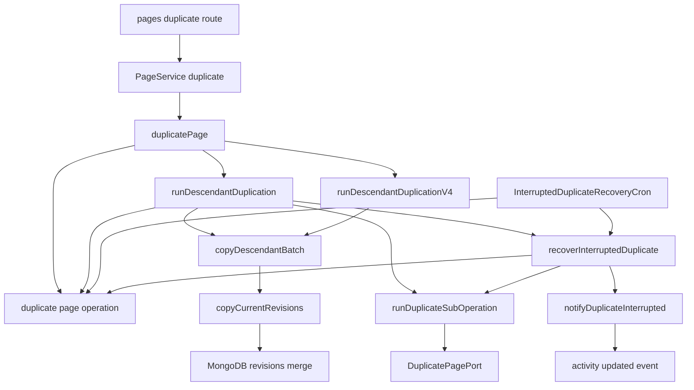
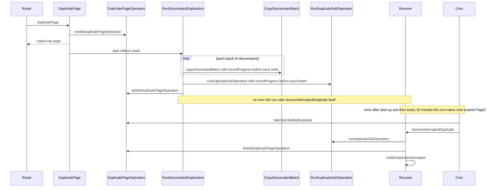
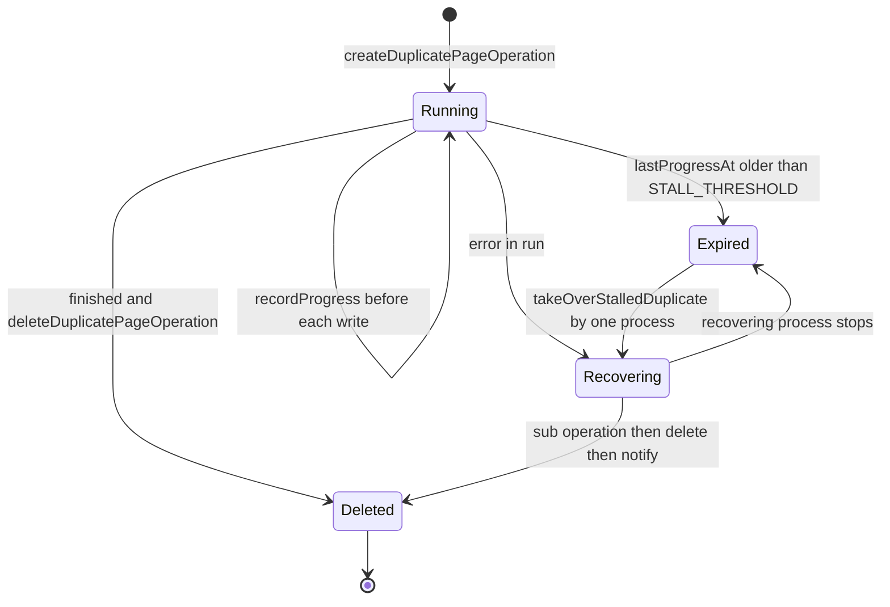

# Design Document

## Overview

**Purpose**: 配下を含むページの複製を、ツリーの大きさや本文の大きさに左右されずに完了させる。途中で止まった場合も、同じ範囲の操作が使えなくなる状態を数分で解く。

**Users**: 大きなツリーを複製する利用者、同じ範囲で移動・改名・複製をする他の利用者、問い合わせを受ける運用者。

**Impact**: 今は、配下の複製が各ページの全 revision の本文をアプリに読み込み、メモリが大きく増える。途中で止まると PageOperation が残り、再起動まで同じ範囲の操作が拒否される。作りかけの写しはページツリーから見えず、誰にも知らされない。この設計では、次のように変える。

- 複製されたページの revision を MongoDB の中で作る。
- PageOperation に `lastProgressAt` と `ownerToken`（担当プロセスの ID）を持たせる。
- `lastProgressAt` により期限切れと判定された PageOperation を、定期処理が回復し、本人に通知する。
- 複製の処理を `PageService` から `service/page/duplicate/` に切り出す。

### 用語

| 用語 | 意味 |
|---|---|
| PageOperation | `actionType: Duplicate` の PageOperation ドキュメント。配下を含む複製のたびに1件作られ、配下の複製とサブオペレーションが終わると削除される |
| `lastProgressAt` を更新する | 配下の複製が1段進むたび（正確には、各書き込みの直前）に、PageOperation の `lastProgressAt` に今の時刻を書き込む |
| `lastProgressAt` により期限切れと判定された PageOperation | `lastProgressAt` が `STALL_THRESHOLD_MS`（2分）以上前の PageOperation。止まった複製を表す |
| `ownerToken`（担当プロセスの ID） | その複製を担当しているプロセスを表す、実行ごとの乱数。`lastProgressAt` の更新と PageOperation の削除は、`ownerToken` が自分の値のときだけ成功する |
| 回復を引き受ける | 期限切れと判定された PageOperation の `ownerToken` を、自分の値に条件付きで書き換える。成功した1プロセスだけが回復する |
| PageOperation を削除する | `ownerToken` が自分の値のときだけ削除する |
| 複製処理に伴うサブオペレーション | 複製されたページをページツリーにつなぐ処理。親の付け直し、配下ページ数の数え直し、祖先の配下ページ数の更新、全文検索への通知を行う |
| 複製されたページの revision | 写しのページに付ける revision。元ページが指す最新の revision の本文を写して作る（1ページにつき1つ。過去の revision は写さない） |

### Goals

- 複製されたページの revision の本文を、元ページの最新の revision にそろえる（1.1〜1.3）。
- 複製中の GROWI のプロセスのメモリ増加を、本文の大きさ・revision の数・ページ数によらない量にする（2.1〜2.4）。
- 止まった複製を、プロセスが再起動した場合は再起動から5分以内に、それ以外は15分以内に回復し、作りかけの写しをページツリーにつなぎ、本人に通知する（3.1〜3.3、4.1〜4.7、5.1〜5.6）。
- 受け付け方、応答、写る範囲、公開範囲、タグの扱いを変えない（6.1〜6.4）。

### Non-Goals

- 移動・削除・元に戻す操作の、拒否・失敗・回復の扱い。
- 止まった複製の続きのやり直し、作りかけの写しの自動削除。
- 管理者向けの一覧画面。
- 複製の権限の規則の変更。
- 正常終了時の通知。
- `canOperate`（重なりの判定）の変更。
- どのページからも参照されない revision（下記の書き込み順序で、まれに残る）の掃除。

## Boundary Commitments

### This Spec Owns

- 複製の要求を受けてから、配下の複製とサブオペレーションを終えるまでのすべての処理（v5 と v4 の両方）。`service/page/duplicate/` に置く。
- 複製の PageOperation の作成、`lastProgressAt` の更新、回復の引き受け、削除。
- 複製されたページの revision を MongoDB の中で作る処理と、その出力項目の決まり。
- 止まった複製を回復する定期処理と、その設定（実行間隔）。
- 「複製が途中で止まった」通知の種類（`PAGE_DUPLICATE_INTERRUPTED`）、その付帯情報の形、画面の補足文、5言語の文言。
- 配下ページを読み出す部品（`PageCursorsForDescendantsFactory`）の置き場所の移動（中身は変えない）。
- サブオペレーションで呼ぶ既存の4つの処理（下記）の2点の変更。進捗を知らせる関数を受け取れるようにすること。1回分の処理の中の例外を呼び出し元へ返すようにすること。

### Out of Boundary

- `canOperate` の判定規則。複製以外の操作の PageOperation（作成・更新・改名・削除・元に戻す・正規化）。
- 起動時の掃除（`init()`）のうち、複製以外の種類の扱い。
- 親の付け直しと配下ページ数の数え直しの規則（どのページの親をどう決めるか、どう数えるか）。この spec が変えるのは、上記の2点だけ。
- 全文検索の再索引のメモリと負荷。本文の切り詰め（`ELASTICSEARCH_MAX_BODY_LENGTH_TO_INDEX`）と送信件数（`ELASTICSEARCH_REINDEX_BULK_SIZE`）で上限が決まり、全文検索の機能が持つ。
- Vault など、ページのイベントを受け取る側の処理。
- 複製の経路（`POST /_api/v3/pages/duplicate`）の検証と応答。PR #12284 で導入した拒否の応答（`grant_not_assignable` / `operation_in_progress`）をそのまま使う。

### Allowed Dependencies

- `IPageService` のうち、`create`、`getParentAndFillAncestorsByUser`、`normalizeParentRecursively`、`updateDescendantCountOfSelfAndDescendants`、`updateDescendantCountOfPagesWithPaths`、`updateDescendantCountOfAncestors`。`duplicate/` からは、引数で受け取った窓口（`DuplicatePagePort`）経由で使い、`PageService` のクラスを import しない。
- `IPageGrantService`（公開範囲の判定）、`PageOperationService.canOperate`。
- `PageOperation` モデル、`Page` モデル（Mongoose）、`User` モデル（回復時に複製した本人が存在し、削除されていないかの確認だけ）、`prisma.revisions.aggregateRaw`、`prisma.pagetagrelations`。
- `ActivityService.createActivity`、`crowi.events.activity`（アプリ内通知の発行）。
- `CronService`（node-cron）、`configManager`。
- 依存の向き: 純粋な関数（パイプラインの組み立て、付帯情報の組み立て、`shouldNormalizeParent`）→ DB を扱う関数（PageOperation、revision の複製、1回分の複製、サブオペレーション）→ 流れを組む関数（配下の複製の実行、回復）→ 入口（`PageService` の委譲、定期処理）。逆向きの import は誤りとして扱う。

### Revalidation Triggers

- revision のドキュメントの項目（`schema.prisma` の `revisions`）が増減した場合。複製されたページの revision の出力項目を見直す。
- PageOperation のスキーマ、または `init()` の削除対象が変わった場合。
- `canOperate` が期限を見るように変わった場合（回復の前提が変わる）。
- `normalizeParentRecursively` の複製用の呼び出しの挙動が変わった場合。
- アプリ内通知の発行の仕組み（`activityEvent 'updated'` の引数、`generateSnapshot`）が変わった場合。
- GROWI の対応する MongoDB の最低版が 4.4 未満に下がる場合（`$merge` の前提）。

## Architecture

### Existing Architecture Analysis

- 複製は `PageService`（約5900行）の中にあり、要求時の処理（`duplicate`）と、応答後に待たずに走る配下の処理（`duplicateRecursivelyMainOperation` 以下）が同じクラスに混在している。
- 配下は100件ずつ「ページの挿入 → revision の作成 → タグ」の順で書き、1回分の例外は握りつぶす。写しは親を持たずに挿入され、最後のサブオペレーションでページツリーにつながる。
- PageOperation の期限（`unprocessableExpiryDate`）を延ばすのは改名の後半だけで、しかも5秒ごとのタイマーなので、処理が固まっても延び続ける。
- サブオペレーションで呼ぶ既存の処理は、Node.js の書き込み用ストリーム（Writable）の `async write` の中で1回分を処理している。Writable は `write` が返す Promise を見ないので、中で投げた例外は伝わらず、`callback` が呼ばれないまま処理全体が終わらなくなる。
- 定期処理は全プロセスで動き、正しさは条件付きの原子的な書き換えで保つのが、このリポジトリの慣習（WIP の掃除、変更提案の適用）。

### Architecture Pattern & Boundary Map



**Architecture Integration**:

- 採用する形: 協力する部品を引数で受け取る関数群（`delete-completely-operation.ts` と同じ形）。`PageService.duplicate` は `duplicatePage` へ委譲するだけになる。
- 成功時と回復時で、サブオペレーション（`runDuplicateSubOperation`）を共有する。例外による失敗と、定期処理が見つけた停止は、同じ回復処理（`recoverInterruptedDuplicate`）を通る。
- 守る既存の形: 待たない非同期処理（応答を先に返す）、`canOperate` による重なりの拒否、`CronService` と `start…CronIfEnabled` の起動の仕方、一括エクスポートの失敗通知と同じ通知の発行の仕方。
- steering との整合: 実行する部品は対象の集合を引数で受け取る。モード名で分岐しない（v5 と v4 の違いは、読み出し方とサブオペレーションの有無で表す）。内部用の値を利用者の入力と同じ項目に混ぜない（通知の付帯情報は専用の型で組み立てる）。

### 書き込みの規則（担当プロセスが守る不変条件）

`lastProgressAt` の更新が成功すると、その PageOperation は `STALL_THRESHOLD_MS`（2分）のあいだ、他のプロセスから期限切れと判定されない。この2分を、担当プロセスだけが安全に書き込める時間として使う。そのため、次の2つを常に守る。

1. **各書き込みの直前に `lastProgressAt` を更新する。** revision の複製（`$merge` 1回）、ページの挿入、タグの複製、サブオペレーションの1回分の処理の、それぞれの直前で行う。配下の読み出しの1回分（100件）の開始時にも行う（利用者が閲覧できないページだけの回など、何も書かない回が続いても、止まったと判定されないため）。更新は「`ownerToken` が自分の値なら」という条件付きで行う。失敗したら `OwnershipLostError` を投げ、書かずにやめる。
2. **1回の書き込みは、2分より十分短い量にする。** revision の複製は `REVISION_MERGE_CHUNK_SIZE`（10件）ずつの `$merge` に分け、最悪でも約160MB にする。各 `$merge` には `MERGE_MAX_TIME_MS`（60秒）の `maxTimeMS`（DB 側でその処理を打ち切る時間制限）を付け、2分を超えて書き込まないようにする。ページの挿入（本文を含まない最大100件）とタグの複製は小さいので、分けない。

この2つにより、回復を引き受けたプロセスと元の担当プロセスが、同じ写しに同時に書き込むことはない。残る危険は、ページの挿入またはタグの複製の DB の呼び出しが固まり、2分以上たってから完了する場合だけになる。この場合は書き込みが重なりうる。この危険は受け入れる（`maxTimeMS` を付けられない書き込みで、量が小さく、固まる原因は DB 側の障害に限られるため）。

### Technology Stack

| Layer | Choice / Version | Role in Feature | Notes |
|-------|------------------|-----------------|-------|
| Backend / Services | Express 4、TypeScript（strip-only） | 複製の要求処理と裏の処理 | 変更なし |
| Data / Storage | MongoDB 6.0 以上（`$merge`）、Prisma 6.19（`aggregateRaw`）、Mongoose 6.13 | 複製されたページの revision を DB の中で作る。ページと PageOperation の書き込み | `$merge` は GROWI で初めて使う |
| Messaging / Events | `crowi.events.activity`（`'updated'`） | アプリ内通知の発行 | 引数を1つ追加（任意） |
| Infrastructure / Runtime | node-cron（`CronService`） | 止まった複製の回復の定期処理 | 新しい設定キー1つ |
| Frontend | React（`InAppNotification`） | 通知の補足文の表示 | 5言語の文言を追加 |

## File Structure Plan

### Directory Structure

```
apps/app/src/server/service/page/
├── duplicate/
│   ├── index.ts                                   # 外部に公開する入口: duplicatePage, DuplicatedPage（型）, DuplicateDeps（型）, startInterruptedDuplicateRecoveryCronIfEnabled
│   ├── duplicate-page-port.ts                     # DuplicatePagePort と DuplicateDeps（複製の部品が受け取る協力者の型）
│   ├── duplicate-page.ts                          # 要求時の処理（検証・先頭ページの作成・タグ・裏の処理の開始）
│   ├── run-descendant-duplication.ts              # v5 の裏の処理（読み出し・1回分ずつの複製・サブオペレーション・失敗時の回復）
│   ├── run-descendant-duplication-v4.ts           # v4 の裏の処理（読み出しと複製だけ。PageOperation とサブオペレーションはない）
│   ├── copy-descendant-batch.ts                   # 1回分の複製（ID の決定 → revision の複製 → ページの挿入 → タグ）
│   ├── copy-current-revisions.ts                  # 複製されたページの revision を DB の中で作る集計の組み立て（純粋な関数）と実行
│   ├── run-duplicate-sub-operation.ts             # 複製処理に伴うサブオペレーション
│   ├── duplicate-page-operation.ts                # 複製の PageOperation の作成・lastProgressAt の更新・回復の引き受け・削除、OwnershipLostError と関連の定数
│   ├── recover-interrupted-duplicate.ts           # 止まった複製の回復（サブオペレーション → PageOperation の削除 → 通知）
│   ├── interrupted-duplicate-recovery-cron.ts     # 回復の定期処理（CronService の派生）と起動関数、開始のずらしの定数
│   ├── notify-duplicate-interrupted.ts            # 本人だけに届く通知の発行
│   └── *.spec.ts / *.integ.ts                     # 各ファイルの隣に置く
├── should-normalize-parent.ts                     # 親を付け直すかどうかの規則（純粋な関数。複製の run・回復と、PageService の元に戻す処理が使うので、複製のモジュールの外に置く）
└── page-cursors-for-descendants.ts                # PageCursorsForDescendantsFactory を index.ts から移す（中身は変えない）

apps/app/src/models/serializers/in-app-notification-snapshot/
└── page-duplicate-interrupted.ts                  # pageDuplicateInterruptedSnapshot: 通知の付帯情報の型・組み立て・読み取り（サーバーと画面で共有）

apps/app/src/client/components/InAppNotification/ModelNotification/
└── PageDuplicateInterruptedSubMsg.tsx             # 通知の補足文（件数・取りうる対処）
```

型と定数は、種類ごとの入れ物（`types.ts`・`consts.ts`）に集めず、それを持つファイルに置く。

### Modified Files

- `apps/app/src/server/service/page/index.ts`
  - 複製の処理（`duplicate` から `duplicateDescendantsV4`、`duplicateTags` まで）を削除し、`duplicate` を `duplicatePage` への委譲にする。
  - `shouldNormalizeParent` を削除し、`service/page/should-normalize-parent.ts` の関数を使う。
  - `PageCursorsForDescendantsFactory` を新しいファイルから import する。
  - サブオペレーションで呼ぶ4つの処理（`normalizeParentRecursively`（中で再帰する `_normalizeParentRecursively` を含む）、`updateDescendantCountOfSelfAndDescendants`、`updateDescendantCountOfPagesWithPaths`、`recountAndUpdateDescendantCountOfPages`）に、任意の引数 `onBatchStart?: () => Promise<void>` を加える。1回分の処理を始める前に呼ぶ。
  - 同じ4つの処理の Writable の `write` の中身を try で包み、例外を `callback(err)` で返す。これで、例外が `pipeline` を通って呼び出し元へ返る。既存の呼び出し元にとっては、今は固まっていた例外が、例外として返るようになる（挙動の変更）。
- `apps/app/src/server/service/page/page-service.ts` — `IPageService` から `duplicateRecursivelyMainOperation` を削除する（呼び出し元がない）。`normalizeParentRecursively` と `updateDescendantCountOfSelfAndDescendants` を追加する（`duplicate/` が窓口経由で使うため）。`duplicate` の型を `DuplicatedPage` を返すものにし、`duplicateDeps(): DuplicateDeps` を追加する（`crowi/index.ts` が定期処理へ渡すため。`activityService` が未設定なら明示的に例外を投げる）。
- `apps/app/src/server/models/page-operation.ts` — 任意項目 `lastProgressAt`（日時）と `ownerToken`（文字列）を追加する。
- `apps/app/src/server/service/page-operation.ts` — `init()` の削除対象から `Duplicate` を外す。
- `apps/app/src/server/crowi/index.ts` — `setupCron` で `startInterruptedDuplicateRecoveryCronIfEnabled({ duplicateDeps: this.pageService.duplicateDeps(), appService: this.appService })` を動的 import して呼ぶ（引数は `{ duplicateDeps, appService, waitBeforeRun? }`。`waitBeforeRun` はテストで開始のずらしを差し替えるためだけに使う）。
- `apps/app/src/server/service/config-manager/config-definition.ts` — `app:interruptedDuplicateRecoveryCronSchedule` を追加する。
- `apps/app/src/interfaces/activity.ts` — `ACTION_PAGE_DUPLICATE_INTERRUPTED` を追加し、`SupportedAction` と `EssentialActionGroup` に入れる。
- `apps/app/src/server/service/in-app-notification.ts` — `'updated'` の受け取りで、任意の第4引数（組み立て済みの付帯情報）を受け取り、渡されたときは `generateSnapshot` の代わりに使う。
- `apps/app/src/client/components/InAppNotification/ModelNotification/useActionAndMsg.ts` — 新しい種類の主文（英語の固定文、既存と同じ扱い）を追加する。
- `apps/app/src/client/components/InAppNotification/ModelNotification/PageModelNotification.tsx` — 新しい種類のときに補足文を表示する。
- `apps/app/public/static/locales/{en_US,ja_JP,zh_CN,fr_FR,ko_KR}/commons.json` の `in_app_notification.page_duplicate_interrupted.{summary,advice}` — 補足文の文言を追加する。

## System Flows

### 配下の複製（v5）と停止時の回復



- `recordProgress` は、`ownerToken` が自分の値であることを条件に `lastProgressAt` を更新する関数。失敗したら `OwnershipLostError` を投げる。
- 配下の複製でもサブオペレーションでも、「書き込みの規則」に従い、各書き込みの直前に `recordProgress` を呼ぶ。時間で `lastProgressAt` を更新する仕組みは使わない（処理が固まっても更新が続いてしまうため）。
- `OwnershipLostError` を受けた担当プロセスは、書かずにやめる。PageOperation の削除と通知は、回復を引き受けた側が行う。
- DB の接続には時間切れの設定がない（ドライバの既定）。1回分の処理の中の DB の呼び出しが返らなくなっても、`lastProgressAt` は更新されないので、止まったと判定できる（4.2）。

### PageOperation の状態



- 「Running」「Expired」「Recovering」の間も PageOperation は残っているので、`canOperate` は重なる操作を拒否し続ける（3.1）。PageOperation が削除された時点で受け付けに戻る（3.2、3.3）。
- 回復中のプロセスが止まった場合は、期限切れに戻り、別のプロセス（または再起動後）がもう一度回復を引き受ける。回復を引き受けるときに `ownerToken` が書き換わるので、止まった回復処理が後から動き出しても、次の `recordProgress` で `OwnershipLostError` になり、書き込まない。

## Requirements Traceability

| Requirement | Summary | Components | Interfaces | Flows |
|-------------|---------|------------|------------|-------|
| 1.1 | 写しの本文は最新の revision | copyDescendantBatch, copyCurrentRevisions, duplicatePage | `RevisionCopyEntry` | 配下の複製 |
| 1.2 | 過去の revision から取らない | copyCurrentRevisions | `copyCurrentRevisions` | 配下の複製 |
| 1.3 | v4 でも同じ | runDescendantDuplicationV4, copyDescendantBatch | `copyDescendantBatch` | — |
| 2.1 | メモリが本文・revision・件数によらない | copyCurrentRevisions, copyDescendantBatch | `copyCurrentRevisions` | 配下の複製 |
| 2.2 | 約16MB の本文でも成り立つ | copyCurrentRevisions | `copyCurrentRevisions` | — |
| 2.3 | 計測して記録する | 性能の検証（Testing Strategy、計測結果） | — | — |
| 2.4 | v4 でも同じ | runDescendantDuplicationV4 | `copyDescendantBatch` | — |
| 3.1 | 進行中は重なる操作を拒否 | duplicatePageOperation（PageOperation を残す）, 既存の canOperate | `createDuplicatePageOperation` | PageOperation の状態 |
| 3.2 | 完了で受け付けに戻る | runDescendantDuplication, duplicatePageOperation | `deleteDuplicatePageOperation` | PageOperation の状態 |
| 3.3 | 回復で受け付けに戻る | recoverInterruptedDuplicate | `deleteDuplicatePageOperation` | PageOperation の状態 |
| 4.1 | 例外の失敗で PageOperation を削除し写しを残す | runDescendantDuplication, recoverInterruptedDuplicate | `recoverInterruptedDuplicate` | 配下の複製 |
| 4.2 | 停止・終了から15分以内に回復 | InterruptedDuplicateRecoveryCron, duplicatePageOperation | `takeOverStalledDuplicate` | PageOperation の状態 |
| 4.3 | 再起動から5分以内に回復 | InterruptedDuplicateRecoveryCron, PageOperationService.init | `takeOverStalledDuplicate` | PageOperation の状態 |
| 4.4 | 進んでいる複製を止まったとみなさない | runDescendantDuplication, runDuplicateSubOperation, duplicatePageOperation | `recordProgress`, `onBatchStart` | 書き込みの規則 |
| 4.5 | 写しをツリーにつなぎ件数を合わせる | runDuplicateSubOperation | `runDuplicateSubOperation` | 配下の複製 |
| 4.6 | 続きをやり直さない | recoverInterruptedDuplicate | `recoverInterruptedDuplicate` | — |
| 4.7 | 回復は1回だけ | duplicatePageOperation, recoverInterruptedDuplicate | `takeOverStalledDuplicate`, `deleteDuplicatePageOperation` | PageOperation の状態 |
| 5.1 | 本人に通知 | notifyDuplicateInterrupted | `notifyDuplicateInterrupted` | 配下の複製 |
| 5.2 | パスと件数を含める | pageDuplicateInterruptedSnapshot | `PageDuplicateInterruptedSnapshot` | — |
| 5.3 | 写しへ移動できる | PageModelNotification（既存の移動） | — | — |
| 5.4 | 不完全であることと対処を伝える | PageDuplicateInterruptedSubMsg | — | — |
| 5.5 | 本人以外に送らない | notifyDuplicateInterrupted | `PreNotify`（本人だけ） | — |
| 5.6 | 全言語の文言 | locales | — | — |
| 6.1 | 待たずに応答する方式を維持 | duplicatePage | `duplicatePage` | 配下の複製 |
| 6.2 | 受け付け方と応答を変えない | duplicatePage, 既存の経路 | `duplicatePage` | — |
| 6.3 | 範囲・公開範囲・タグ・作成者を変えない | duplicatePage, copyDescendantBatch | `DescendantBatchInput` | — |
| 6.4 | 「リンクを知っている人のみ」は写さない | PageCursorsForDescendantsFactory（既存の性質） | — | — |

## Components and Interfaces

| Component | Domain/Layer | Intent | Req Coverage | Key Dependencies (P0/P1) | Contracts |
|-----------|--------------|--------|--------------|--------------------------|-----------|
| duplicatePage | 流れを組む | 要求時の処理と裏の処理の開始 | 1.1, 3.1, 6.1–6.3 | DuplicatePagePort (P0), duplicatePageOperation (P0) | Service |
| runDescendantDuplication | 流れを組む | v5 の配下の複製と、失敗時の回復 | 3.2, 4.1, 4.4 | copyDescendantBatch (P0), duplicatePageOperation (P0), runDuplicateSubOperation (P0) | Service |
| runDescendantDuplicationV4 | 流れを組む | v4 の配下の複製 | 1.3, 2.4 | copyDescendantBatch (P0) | Service |
| recoverInterruptedDuplicate | 流れを組む | 止まった複製の回復 | 3.3, 4.1, 4.2, 4.6, 4.7 | runDuplicateSubOperation (P0), notifyDuplicateInterrupted (P1) | Service |
| copyDescendantBatch | DB を扱う | 1回分の複製 | 1.1, 2.1, 6.3 | copyCurrentRevisions (P0), Page モデル (P0), IPageGrantService (P0) | Service |
| copyCurrentRevisions | DB を扱う | 複製されたページの revision を DB の中で作る | 1.1, 1.2, 2.1, 2.2 | prisma.revisions.aggregateRaw (P0) | Service |
| runDuplicateSubOperation | DB を扱う | 複製処理に伴うサブオペレーション | 4.5 | DuplicatePagePort (P0) | Service |
| duplicatePageOperation | DB を扱う | 複製の PageOperation の担当と進捗の管理 | 3.1–3.3, 4.2–4.4, 4.7 | PageOperation モデル (P0) | Service, State |
| shouldNormalizeParent | 純粋な関数 | 親を付け直すかどうかの規則 | 4.5, 6.3 | なし | Service |
| InterruptedDuplicateRecoveryCron | 入口 | 期限切れと判定された PageOperation の定期的な回復 | 4.2, 4.3 | CronService (P0), duplicatePageOperation (P0) | Batch |
| notifyDuplicateInterrupted | DB を扱う | 本人だけへの通知の発行 | 5.1, 5.2, 5.5 | ActivityService (P0), activity event (P0) | Event |
| pageDuplicateInterruptedSnapshot | 純粋な関数 | 通知の付帯情報の型と組み立て・読み取り | 5.2 | なし | Service |
| PageDuplicateInterruptedSubMsg | 画面 | 補足文の表示 | 5.4, 5.6 | next-i18next (P0) | — |
| PageCursorsForDescendantsFactory | DB を扱う | 配下の読み出し（移動のみ） | 6.4 | Page モデル (P0) | — |

### 協力者の型（`duplicate-page-port.ts`）

```typescript
import type { EventEmitter } from 'node:events';
import type { IPageGrantService } from '~/server/service/page-grant';
import type { IPageOperationService } from '~/server/service/page-operation';
import type { IPageService } from '../page-service';

/** The narrow view of PageService that the duplicate module may call. */
export type DuplicatePagePort = Pick<
  IPageService,
  | 'create'
  | 'getParentAndFillAncestorsByUser'
  | 'normalizeParentRecursively'
  | 'updateDescendantCountOfSelfAndDescendants'
  | 'updateDescendantCountOfPagesWithPaths'
  | 'updateDescendantCountOfAncestors'
>;

export interface DuplicateDeps {
  readonly pageService: DuplicatePagePort;
  readonly pageGrantService: IPageGrantService;
  readonly pageOperationService: Pick<IPageOperationService, 'canOperate'>;
  readonly activityService: Pick<ActivityService, 'createActivity'>;
  readonly pageEvent: EventEmitter;
  readonly tagEvent: EventEmitter;
  readonly activityEvent: EventEmitter;
}
```

`ActivityService` は既存の型をそのまま参照する。

### 流れを組む部品

#### duplicatePage

| Field | Detail |
|-------|--------|
| Intent | 複製の要求を処理し、先頭ページの写しを返し、配下の複製を待たずに始める |
| Requirements | 1.1, 3.1, 6.1, 6.2, 6.3 |

**Responsibilities & Constraints**

- 今の `PageService.duplicate` の検証（空ページの扱い、v4 の判定、`canOperate`、公開範囲の判定）と、先頭ページの作成、タグの複製を、そのままの順序と例外の種類（`PageOperationRefusedError` を含む）で行う。
- 先頭ページの本文は、今どおり `page.revision` の本文を使う（先頭ページは1件なのでアプリに読み込んでよい）。
- 配下を含む v5 の複製では、先頭ページを作った後に `createDuplicatePageOperation` で PageOperation を作り、`runDescendantDuplication` を待たずに始める。
- v4 の複製では、PageOperation を作らずに `runDescendantDuplicationV4` を待たずに始める（今と同じ）。

**Contracts**: Service [x]

##### Service Interface

```typescript
export interface DuplicateRequest {
  readonly page: HydratedDocument<PageDocument>;
  readonly newPagePath: string;
  readonly user: IUserHasId;
  readonly isRecursively: boolean;
  readonly onlyDuplicateUserRelatedResources: boolean;
}

export function duplicatePage(
  deps: DuplicateDeps,
  request: DuplicateRequest,
): Promise<ReturnType<typeof serializePageSecurely> & { tags: string[] }>;
```

- Preconditions: 経路側の検証（パスの形式、複製先の非存在、閲覧権限）を通っている。
- Postconditions: 先頭ページの写しがページツリーにつながって存在する。配下を含む v5 の複製では、PageOperation が「Running」の状態で存在する。
- Invariants: 戻り値の形と、投げる例外の種類は今と同じ（6.2）。

#### runDescendantDuplication

| Field | Detail |
|-------|--------|
| Intent | v5 の配下を1回分ずつ複製し、最後にサブオペレーションを行う。失敗したら自分で回復する |
| Requirements | 3.2, 4.1, 4.4 |

**Responsibilities & Constraints**

- `PageCursorsForDescendantsFactory`（空ページを含む）で配下を読み、`BULK_REINDEX_SIZE` 件ずつ `copyDescendantBatch` に渡す。繰り返しは Writable ではなく `for await` で書き、例外がそのまま伝わる形にする。
- `copyDescendantBatch` には、`recordProgress(operation)` を渡す（各書き込みの直前に呼ばれる）。
- 挿入できたページ数（`insertedPageCount` の合計）を数えておく。
- すべて終えたら、`runDuplicateSubOperation` を `ancestorUpdate: { kind: 'increment', insertedPageCount }` と `onBatchStart: recordProgress(operation)` で呼び、`deleteDuplicatePageOperation` で PageOperation を削除する。
- 例外が出たら、その場で `recoverInterruptedDuplicate` を `cause: { kind: 'error' }` で呼ぶ。今のように1回分の例外を握りつぶして次の回へ進むことはしない。`OwnershipLostError` の場合は、回復を引き受けた側に任せて、何もせずに終わる。
- 例外を、誰も待たない Promise に再送出しない（ログに出して終わる）。

**Contracts**: Service [x]

##### Service Interface

```typescript
export interface DescendantDuplicationInput {
  readonly operation: OwnedDuplicatePageOperation;
  readonly sourcePage: PageDocument;
  readonly newPagePath: string;
  readonly user: IUserHasId;
  readonly onlyDuplicateUserRelatedResources: boolean;
}

export function runDescendantDuplication(
  deps: DuplicateDeps,
  input: DescendantDuplicationInput,
): Promise<void>; // never rejects; failures are handed to recoverInterruptedDuplicate
```

- Postconditions（成功時）: 写しがすべてページツリーにつながり、配下ページ数が正しく、PageOperation が削除されている。

#### runDescendantDuplicationV4

| Field | Detail |
|-------|--------|
| Intent | v4 の配下を1回分ずつ複製する |
| Requirements | 1.3, 2.4 |

- 読み出しは今と同じ（`parent: null` かつ配下、編集できる人で絞り込む）。
- 1回分の複製は `copyDescendantBatch` を使う。`recordProgress` には何もしない関数を渡す（PageOperation がないため）。今の v4 は `onlyDuplicateUserRelatedResources` を無視しているので、その挙動を保つため、v4 からは常に `false` を渡す（6.3）。
- PageOperation・サブオペレーション・回復は持たない（v4 の写しはもともとページツリーの外にある。要件4・5の対象外）。例外はログに出して終わる。ただし全文検索への通知（`pageEvent 'syncDescendantsUpdate'`、引数は `{ path: newPagePath }` と本人）だけは、今の v4 と同じく、成功でも失敗でも最後に1回発行する（`finally`。発行の失敗はログに出すだけ）。

#### recoverInterruptedDuplicate

| Field | Detail |
|-------|--------|
| Intent | 止まった複製の写しをページツリーにつなぎ、PageOperation を削除し、本人に知らせる |
| Requirements | 3.3, 4.1, 4.2, 4.6, 4.7 |

**Responsibilities & Constraints**

- PageOperation から読んだ値（`StalledDuplicatePageOperation` または実行中の値）から、回復の材料（`InterruptedDuplicate`）を組み立てる。親を付け直すかどうかは `shouldNormalizeParent(page.grant)` で決める。
- 手順は「サブオペレーション → PageOperation の削除 → 通知」の順に固定する。
- サブオペレーションは `ancestorUpdate: { kind: 'recount' }` と `onBatchStart: recordProgress(operation)` で呼ぶ。`OwnershipLostError` になったら（他のプロセスに回復を引き受けられたら）、削除と通知をせずに終わる。
- 祖先の配下ページ数は数え直す。止まった複製では、祖先をどこまで増やしたか分からず、回復処理自体が途中で止まって再び回復される場合もあるため。
- `deleteDuplicatePageOperation` が `OwnershipLostError` になったら、通知しない。これで、1つの止まった複製について通知が1回を超えない（4.7）。
- PageOperation の削除の後、通知の前にプロセスが止まった場合は、通知が届かない。重複より欠落を選ぶ（4.7 を優先）。
- 写しの先頭ページが存在しない場合（削除された等）は、サブオペレーションと通知をせずに PageOperation だけ削除する。複製した本人が存在しない（削除された）場合は、サブオペレーションと削除は行い、通知はしない。どちらもログに出す。
- 続きの複製はしない（4.6）。作りかけの写しは消さない（4.1、4.2）。

**Contracts**: Service [x]

##### Service Interface

```typescript
export type InterruptionCause =
  | { readonly kind: 'error'; readonly error: unknown }
  | { readonly kind: 'stalled' };

export interface InterruptedDuplicate {
  readonly operation: OwnedDuplicatePageOperation;
  readonly fromPath: string;
  readonly toPath: string;
  /** PageOperation stores only the user's id, so recovery works from the id alone. */
  readonly userId: string;
  readonly shouldNormalizeParent: boolean;
  /** descendantCount of the source at the start, plus the top page itself when it is not empty */
  readonly sourcePageCount: number;
  readonly cause: InterruptionCause;
}

export type RecoveryOutcome =
  | { readonly status: 'recovered'; readonly copiedPageCount: number }
  | { readonly status: 'ownership-lost' }
  | { readonly status: 'copy-missing' };

export function recoverInterruptedDuplicate(
  deps: DuplicateDeps,
  target: InterruptedDuplicate,
): Promise<RecoveryOutcome>;

/** Builds the recovery input from a PageOperation taken over by the cron. */
export function toInterruptedDuplicate(
  stalled: StalledDuplicatePageOperation,
): InterruptedDuplicate;
```

### DB を扱う部品

#### copyDescendantBatch

| Field | Detail |
|-------|--------|
| Intent | 1回分（最大 `BULK_REINDEX_SIZE` 件）の配下ページを複製する |
| Requirements | 1.1, 2.1, 6.3 |

**Responsibilities & Constraints**

- 複製する対象は、今と同じく「空でない」かつ（`onlyDuplicateUserRelatedResources` が真なら）本人が閲覧できるページ。閲覧できるかの判定と閲覧グループの絞り込みには `pageGrantService` を使う。公開範囲、作成者・最終更新者（本人）、パスの置き換えは今と同じ（6.3）。
- 手順:
  1. 対象の各ページについて、写しのページ ID と revision の ID をアプリで決める。
  2. `copyCurrentRevisions` で、各ページが指す revision（`page.revision`）だけを複製する。
  3. `recordProgress` を呼んでから、複製された revision があるページだけを `Page.insertMany` で挿入する（`revision` に新しい revision の ID を入れる）。revision を複製できなかったページは挿入せず、件数をログに出す。
  4. `recordProgress` を呼んでから、タグを複製する（今の `duplicateTags` と同じ）。
- 書き込み順を「revision → ページ → タグ」にする。2と3の間で止まった場合に残るのは、どのページからも参照されない revision だけで、存在しない revision を指すページは残らない。
- 本文をアプリに読み込まない。アプリが持つのはページのドキュメント（本文を含まない）と ID の対応表だけ（2.1）。

**Contracts**: Service [x]

##### Service Interface

```typescript
export interface DescendantBatchInput {
  readonly pages: readonly PageDocument[]; // lean documents from the cursor
  readonly oldPathPrefix: RegExp; // in-process only; never sent to MongoDB
  readonly newPathPrefix: string;
  readonly user: IUserHasId;
  readonly onlyDuplicateUserRelatedResources: boolean;
  /** Called right before each write; throws OwnershipLostError to stop. */
  readonly recordProgress: () => Promise<void>;
}

export function copyDescendantBatch(
  deps: Pick<DuplicateDeps, 'pageGrantService'>,
  input: DescendantBatchInput,
): Promise<{ readonly insertedPageCount: number }>;
```

#### copyCurrentRevisions

| Field | Detail |
|-------|--------|
| Intent | 各ページの最新の revision を、本文をアプリへ運ばずに DB の中で複製する |
| Requirements | 1.1, 1.2, 2.1, 2.2 |

**Responsibilities & Constraints**

- 集計の組み立ては、ファイル内の純粋な関数（公開しない）にする。実行（`copyCurrentRevisions`）は `prisma.revisions.aggregateRaw` で行い、トランザクションの外で呼ぶ（`$merge` はトランザクションの中で使えない）。
- 対応表を `REVISION_MERGE_CHUNK_SIZE`（10件）ずつに分け、1つずつ `$merge` を実行する。各実行の直前に `recordProgress` を呼ぶ。各実行には `maxTimeMS: MERGE_MAX_TIME_MS`（60秒）を付ける。
- 集計の内容:
  - `$match`: `_id` が対応表の「元の revision の ID」の一覧に含まれるもの。ページ ID では照合しない（1.2）。
  - `$project`: 出力を次の7項目に固定する。`_id`（新しい revision の ID）、`pageId`（新しいページ ID）、`body`（元の本文）、`format`（元の値。なければ `'markdown'`）、`author`（複製した本人）、`createdAt`（`$$NOW`）、`__v`（0。`$toLong` で64ビット整数にする。Prisma で作った revision と同じ型）。`origin`・`hasDiffToPrev`・`proposalId`・`proposalOperationKey` は持ち込まない。
  - `$merge`: `into: 'revisions'`、`on: '_id'`、`whenMatched: 'fail'`、`whenNotMatched: 'insert'`。
- 新しい ID は、照合に使った「元の revision の ID」の並びと同じ並びの配列から、`$indexOfArray` と `$arrayElemAt` で引く。照合と対応表を同じ並びから作るので、見つからない（-1 が返る）ことはない。
- ObjectId と日時は拡張 JSON（`toRawObjectId`）で渡す。生の文字列で渡すと、文字列として保存され、照合も黙って外れる。
- すべての実行の後、新しい revision の ID の一覧で `_id` だけを読み直し、実際に複製できた ID の集合を返す（本文は読まない）。
- 集計の結果は返さない（カーソルは空）。本文は DB の外に出ない（2.1、2.2）。

**Contracts**: Service [x]

##### Service Interface

```typescript
export interface RevisionCopyEntry {
  readonly sourceRevisionId: string;
  readonly newRevisionId: string;
  readonly newPageId: string;
}

export function copyCurrentRevisions(
  entries: readonly RevisionCopyEntry[],
  authorId: string,
  recordProgress: () => Promise<void>,
): Promise<{ readonly copiedRevisionIds: ReadonlySet<string> }>;
```

- Preconditions: `entries` が空でない。`sourceRevisionId` に重複がない。
- Postconditions: `copiedRevisionIds` に含まれる ID の revision が存在し、その本文は元の revision と同じ。途中で失敗した場合も、それまでに複製した revision は残る（`$merge` は取り消されない）。

#### runDuplicateSubOperation

| Field | Detail |
|-------|--------|
| Intent | 複製されたページをページツリーにつなぎ、配下ページ数を実際と合わせる |
| Requirements | 4.5 |

**Responsibilities & Constraints**

- 成功時と回復時の両方で使う。順番に何度行っても同じ結果になる。同時に2つ走らないことは、`ownerToken` と「書き込みの規則」で保証する（各回の直前の `onBatchStart` が `OwnershipLostError` を投げる）。
- 手順:
  1. `shouldNormalizeParent` が真なら、`normalizeParentRecursively([toPath], user, true)` で写しの親を付け直す。足りない途中の階層のページは空ページとして作られる。
  2. `updateDescendantCountOfSelfAndDescendants(toPath)` で、写しの先頭から下の配下ページ数を数え直す。
  3. 祖先の配下ページ数を、`ancestorUpdate` に従って直す。
     - `increment`（成功時）: 写しの先頭ページから祖先へ、実際に挿入したページ数だけ `updateDescendantCountOfAncestors` で増やす。今と同じ増分の書き込みなので、並行する他の操作の増分を消さない。今の「読み出した件数」ではなく「挿入できた件数」を使うので、数え過ぎもなくなる。
     - `recount`（回復時）: `toPath` の祖先のパスについて `updateDescendantCountOfPagesWithPaths` で数え直す。
  4. 写しの先頭ページで `pageEvent 'syncDescendantsUpdate'` を発行し、全文検索に写しを反映する（今と同じイベント）。
  5. `toPath` 以下の空でないページ数を数えて返す（通知の件数に使う）。
- 1、2、3（`recount`）の各処理に `onBatchStart` を渡し、1回分の処理を始める前に `lastProgressAt` を更新する。3 の `increment` は1回の書き込みだが、「書き込みの規則」に従い、その書き込みの直前にも `onBatchStart` を呼ぶ。

**Contracts**: Service [x]

##### Service Interface

```typescript
export type AncestorUpdate =
  | { readonly kind: 'increment'; readonly insertedPageCount: number }
  | { readonly kind: 'recount' };

export interface SubOperationInput {
  readonly toPath: string;
  /** normalizeParentRecursively in duplicate mode skips only the grant filter; it still reads user._id, so the caller passes { _id: ObjectId(userId) }, not the bare string. */
  readonly userId: string;
  readonly shouldNormalizeParent: boolean;
  readonly ancestorUpdate: AncestorUpdate;
  /** Called before each batch; throwing (e.g. OwnershipLostError) aborts the sub operation. */
  readonly onBatchStart: () => Promise<void>;
}

export function runDuplicateSubOperation(
  deps: Pick<DuplicateDeps, 'pageService' | 'pageEvent'>,
  input: SubOperationInput,
): Promise<{ readonly copiedPageCount: number }>;
```

#### shouldNormalizeParent

```typescript
/** Restricted and specified-users pages are not on the page tree, so their copies are not attached. */
export function shouldNormalizeParent(grant: PageGrant): boolean;
```

- 今の `PageService.shouldNormalizeParent`（grant が「リンクを知っている人のみ」「特定のユーザー」以外なら真）を移したもの。run と回復の両方がこの1つを使う。

#### duplicatePageOperation（`duplicate-page-operation.ts`）

| Field | Detail |
|-------|--------|
| Intent | 複製の PageOperation の担当（`ownerToken`）と進捗（`lastProgressAt`）を管理する |
| Requirements | 3.1, 3.2, 3.3, 4.2, 4.3, 4.4, 4.7 |

**Contracts**: Service [x] / State [x]

##### Service Interface

```typescript
export const STALL_THRESHOLD_MS = 2 * 60 * 1000;
export const LEGACY_RECORD_MIN_AGE_MS = 15 * 60 * 1000;

/** Thrown when this process is no longer the owner of the PageOperation. */
export class OwnershipLostError extends Error {}

/** A duplicate PageOperation together with the ownerToken this process holds. */
export interface OwnedDuplicatePageOperation {
  readonly operationId: string;
  readonly ownerToken: string;
}

/** The stored values of a PageOperation taken over by the cron, as-is. */
export interface StalledDuplicatePageOperation {
  readonly operation: OwnedDuplicatePageOperation;
  readonly fromPath: string;
  readonly toPath: string;
  readonly userId: string;
  readonly sourceGrant: PageGrant;
  readonly sourceDescendantCount: number;
  /** page.isEmpty of the source top page; an empty page is not counted in descendantCount or in sourcePageCount */
  readonly sourceIsEmpty: boolean;
}

export function createDuplicatePageOperation(input: {
  readonly page: PageDocument;
  readonly userId: string;
  readonly fromPath: string;
  readonly toPath: string;
}): Promise<OwnedDuplicatePageOperation>;

/** Returns a callback that updates lastProgressAt; it throws OwnershipLostError when not the owner. */
export function recordProgress(
  operation: OwnedDuplicatePageOperation,
): () => Promise<void>;

/** Atomically takes over one PageOperation judged expired by lastProgressAt. */
export function takeOverStalledDuplicate(
  now: Date,
): Promise<StalledDuplicatePageOperation | null>;

/** Deletes the PageOperation only if this process is the owner; throws OwnershipLostError otherwise. */
export function deleteDuplicatePageOperation(
  operation: OwnedDuplicatePageOperation,
): Promise<void>;
```

- 担当を外れたことの知らせ方は、`OwnershipLostError` の1通りにする（戻り値で知らせる経路は持たない）。

##### State Management

- 作成: `ownerToken = 新しい乱数`、`lastProgressAt = 今`。
- `lastProgressAt` の更新: `updateOne({ _id, ownerToken }, { lastProgressAt: 今 })`。一致しなければ `OwnershipLostError`。
- 回復の引き受け: `findOneAndUpdate(条件, { ownerToken: 新しい乱数, lastProgressAt: 今 })`。1件ずつ引き受け、書き換えに成功した1プロセスだけが回復する（4.7）。条件は次のどちらか。
  - `ownerToken` を持つ PageOperation: `actionType: Duplicate` かつ `lastProgressAt < 今 − STALL_THRESHOLD_MS`。
  - `ownerToken` を持たない PageOperation（この変更より前のバージョンが作ったもの）: `actionType: Duplicate` かつ `_id` の作成時刻が `今 − LEGACY_RECORD_MIN_AGE_MS`（15分）より前。前のバージョンは `lastProgressAt` を更新しないので、それでは判断できない。段階的に入れ替える更新（古いプロセスと新しいプロセスが同時に動く間）に、古いプロセスが実行中の複製を誤って回復しないようにする。
- 削除: `deleteOne({ _id, ownerToken })`。消せなければ `OwnershipLostError`。
- 引き受けた記録の保存値が欠けている（`toPath`・`page.grant`・`page.descendantCount` のどれか）場合は、回復の材料にならないので、引き受けのときに書いた新しい `ownerToken` を条件にその記録を削除し、欠けた項目をログに出して、次の期限切れの記録を探す。残すと、2〜3分ごとに引き受け直されては失敗し、その範囲の複製・移動・改名を拒否し続けるため。複数の記録があるときは、`_id` の古い順に引き受ける。
- 回復に必要な値（複製元・複製先のパス、本人の ID、元ページの配下ページ数と公開範囲）は、今の PageOperation の項目（`fromPath`、`toPath`、`user._id`、`page.descendantCount`、`page.grant`）から取れる。新しく保存する値は `lastProgressAt` と `ownerToken` だけ。
- 既存の `unprocessableExpiryDate` は変えない。改名の再開判定が使う項目で、複製の判定には使わない。

### 入口

#### InterruptedDuplicateRecoveryCron

| Field | Detail |
|-------|--------|
| Intent | `lastProgressAt` により期限切れと判定された PageOperation を見つけて回復する |
| Requirements | 4.2, 4.3 |

**Contracts**: Batch [x]

##### Batch / Job Contract

- Trigger: 起動の `BOOT_RUN_DELAY_MS`（`STALL_THRESHOLD_MS` と同じ2分）後に1回、その後は `app:interruptedDuplicateRecoveryCronSchedule`（既定 `*/10 * * * *`、10分ごと）。空にすると、定期処理も起動後の1回も止まる（WIP の掃除と同じ扱い）。不正な式はログに出して起動を続け、起動後の1回も行わない。
- 起動後の1回を2分後にするのは、直前に終了したプロセスの PageOperation が、最後の進捗の `STALL_THRESHOLD_MS` 後に初めて期限切れと判定されるため。それより早く動いても何も見つからない。起動後の1回のタイマーは `unref` し、プロセスの終了を妨げない。
- 定期処理の間隔を長くするのは、まれにしか起きない回復のために、すべてのプロセスが頻繁に MongoDB へ問い合わせないため。1回の問い合わせは、ほぼ空の PageOperation のコレクションへの `findOneAndUpdate` 1回だけだが、テナントが多い構成（GROWI.cloud など）でも負荷を増やさないことを優先する。
- 開始時に最大 `RECOVERY_JITTER_MS`（30秒）の待ちを入れ、複数のプロセスが同時に動かないようにする。保守モードの間は何もしない。
- 「前回の実行が終わっていなければ今回は何もしない」印（プロセス内の実行中の印）は持たない。回復を1回に限ることは、`takeOverStalledDuplicate` の条件付きの書き換えと、`ownerToken` を条件にした削除が保証する。回復が固まっても、その PageOperation は `lastProgressAt` が古くなれば次の回に引き受け直され、他の止まった複製の回復も止まらない。
- 1回の実行で、`takeOverStalledDuplicate` が `null` を返すまで、引き受けと回復を繰り返す。引き受けた値は `toInterruptedDuplicate` で回復の材料に変える。
- 起動時の掃除（`init()`）は複製の PageOperation を削除しなくなるので、再起動後は、起動後の1回が期限切れの PageOperation を回復する（4.3）。
- 時間の見積もり: プロセスが再起動した場合は、起動処理が定期処理の登録（`setupCron`）まで進んだ時点から、`BOOT_RUN_DELAY_MS`（2分）と開始のずらし（最大30秒）で回復を始め、そこまでが2分半以内なら、起動から5分以内に終わる（4.3）。再起動されない場合（処理が固まったプロセス、別のプロセスが残る構成）は、止まってから判定まで最大 `STALL_THRESHOLD_MS`（2分）、定期処理の実行間隔（10分）、開始のずらし（30秒）で、最大12.5分で回復を始める。サブオペレーションの所要時間は写しのページ数に比例するので、15分以内に収まることを性能の検証で確かめる（4.2）。

#### PageService.duplicate（委譲）

- `duplicatePage(this.duplicateDeps(), request)` を呼んで返すだけにする。経路と、テストの差し込み口（`vi.spyOn(crowi.pageService, 'duplicate')`）は変わらない。

### 通知

#### notifyDuplicateInterrupted

| Field | Detail |
|-------|--------|
| Intent | 複製を実行した本人だけに、止まったことと結果を知らせる |
| Requirements | 5.1, 5.2, 5.5 |

**Responsibilities & Constraints**

- 一括エクスポートの失敗通知と同じ流れにする: `createActivity`（種類 `PAGE_DUPLICATE_INTERRUPTED`、対象は写しの先頭ページ）→ 本人の ID だけを通知先に加える `PreNotify` → `activityEvent.emit('updated', activity, targetPage, preNotify, snapshot)`。
- 既定の通知先の決め方（`generatePreNotify`）は、対象ページの購読者にも送るので使わない（5.5）。
- 付帯情報（snapshot）は `pageDuplicateInterruptedSnapshot.stringify` で組み立てて渡す。

**Contracts**: Event [x]

##### Event Contract

- Published: `activity 'updated'`。引数は `(activity, target, preNotify, snapshot?)`。第4引数は新しく追加する任意の引数で、渡されたときは `generateSnapshot` の代わりに使う。既存の発行元は渡さないので、挙動は変わらない。
- Delivery: 既存のアプリ内通知の仕組み（7日以内の同じ対象・種類・付帯情報の通知はまとめられる。複製ごとに対象が違うので、まとめられることはない）。

#### pageDuplicateInterruptedSnapshot

```typescript
export interface PageDuplicateInterruptedSnapshot {
  readonly path: string; // the copy's top page path; PagePathLabel shows it
  readonly fromPath: string;
  readonly toPath: string;
  readonly copiedPageCount: number;
  readonly sourcePageCount: number;
}

export const pageDuplicateInterruptedSnapshot: {
  stringify(snapshot: PageDuplicateInterruptedSnapshot): string;
  parse(snapshot: string): PageDuplicateInterruptedSnapshot | undefined;
};
```

- `parse` は形が合わなければ `undefined` を返す（画面は補足文を出さない）。

#### PageDuplicateInterruptedSubMsg（画面）

- 主文は既存の通知と同じく英語の固定文（`useActionAndMsg.ts` に追加）。多言語の文言は補足文で出す（5.6）。
- 補足文に、複製元・複製先のパス、複製できたページ数と元のページ数、「写しは不完全で、消すか別の名前で複製し直せる」旨を表示する（5.2、5.4）。
- 通知をクリックすると、既存の `PageModelNotification` の動作で写しの先頭ページへ移動する（5.3）。
- 文言のキー: `in_app_notification.page_duplicate_interrupted.summary` と `…advice`。5言語すべてに入れる（`lint:i18n` を通す）。

## Data Models

### Logical Data Model

**PageOperation（複製の PageOperation だけに関わる変更）**

| 項目 | 型 | 変更 | 意味 |
|---|---|---|---|
| `lastProgressAt` | Date（任意） | 追加 | 担当プロセスが最後に `lastProgressAt` を更新した時刻 |
| `ownerToken` | string（任意） | 追加 | 担当プロセスの ID（実行ごとの乱数） |
| `unprocessableExpiryDate` | Date | 変えない | 改名の再開判定が使う。複製の判定には使わない |

- 索引は追加しない。複製の PageOperation は同時に数件しか存在せず、回復の引き受けの問い合わせは全件を読んでも小さい。
- 既存の PageOperation との互換: `ownerToken` がない複製の PageOperation は、作成から15分を過ぎたら回復の引き受けの対象になる。

**revisions（複製されたページの revision）**

- 出力項目は `_id`、`pageId`（ObjectId）、`body`、`format`、`author`（ObjectId）、`createdAt`（日時）、`__v: 0`（64ビット整数）の7項目。今の配下の複製が作る revision と同じ項目・同じ型にする。
- 本文は保存されている値をそのまま写す（今は Prisma 経由で読んだときの改行の正規化を経て書いている）。読むときに同じ正規化がかかるので、表示は変わらない。

**pages（写しのページ）**

- 項目は今と同じ（`_id, path, creator, lastUpdateUser, grant, grantedGroups, grantedUsers, revision`）。挿入時は親を持たず、サブオペレーションでページツリーにつながる。

### Consistency & Integrity

- 1回分の複製は、トランザクションを使わない（`$merge` はトランザクションの中で使えない）。途中で止まった場合の状態は、書き込み順で次のどれかに限る。
  - revision の一部だけ複製された: どのページからも参照されない revision が残る（見えない）。
  - revision は複製され、ページの一部だけ挿入された: 挿入されたページは、サブオペレーションでページツリーにつながる。
  - ページまで挿入され、タグの一部が欠けた: そのページはタグが欠けた写しとして残る（作りかけの写しの一部）。

## Error Handling

### Error Strategy

| 状況 | 扱い |
|---|---|
| 要求時の拒否（公開範囲が合わない、別の操作が進行中） | 今と同じ例外を投げ、経路が409を返す（PR #12284） |
| 先頭ページの作成の失敗 | 今と同じく例外を投げ、経路が500を返す。PageOperation はまだ作られていない |
| 1回分の複製の例外 | 配下の複製をやめ、同じプロセスで回復処理（サブオペレーション → PageOperation の削除 → 通知）を行う |
| `OwnershipLostError` | 書き込みをやめる。PageOperation の削除と通知は、回復を引き受けた側が行う |
| revision の一部を複製できない（元の revision が存在しない） | そのページは挿入せず、件数をログに出して続ける（停止の扱いにはしない） |
| `$merge` が `maxTimeMS` で打ち切られた | 1回分の複製の例外として扱う |
| 回復処理の中の例外 | ログに出す。PageOperation は残るので、`lastProgressAt` が古くなった後に再び回復される。同じ理由で毎回失敗する場合は、2〜3分ごとにやり直し続け、その範囲の操作を拒否し続ける。これは受け入れる危険である。運用者は、ログに出る PageOperation の ID の記録を手で削除する |
| 引き受けた PageOperation の保存値が欠けている | 引き受けのときに新しい `ownerToken` を条件にその記録を削除し、ログに出して、次の記録へ進む |
| v4 の一意索引（`pages.path_1`）で、写し先のパスがすでに使われている | そのページは挿入せず、ほかのページの複製を続ける。そのページ用に先に写した revision は、参照されないまま残る |
| 回復時に写しの先頭ページがない | サブオペレーションと通知をせず、PageOperation だけ削除する |
| 回復時に複製した本人がいない | サブオペレーションと削除は行い、通知はしない |
| 定期処理の式が不正 | ログに出し、起動を続ける |

### Monitoring

- 回復のたびに、PageOperation の ID、複製元・複製先、原因（`error` / `stalled`）、複製できたページ数をログに出す。
- `OwnershipLostError` が担当プロセスで起きたときは、警告としてログに出す（止まったと判定されたが実際には進んでいた、の兆候）。

## Testing Strategy

### Unit Tests

- `shouldNormalizeParent`: grant ごとの真偽が今の規則と同じであること。
- `pageDuplicateInterruptedSnapshot`: 組み立てと読み取りが往復すること。形の合わない文字列で `undefined` を返すこと（5.2）。
- `PageDuplicateInterruptedSubMsg`: 件数・パス・対処の文言が出ること（5.4）。

### Integration Tests

- `copyCurrentRevisions`（結合テストで、保存された revision を調べる）: 照合が revision の ID で行われ、ページ ID では行われないこと。保存される項目と型が、Prisma で作った revision と同じであること（`createdAt` は元の revision の時刻でなく、複製した時刻）。同じ新しい ID の revision が既にあると、上書きせずに失敗すること。本文を DB の外へ読み出さないこと（DB 側のプロファイラで、revisions への読み出しが ID だけであることを確かめる）（1.2、2.1）。
- 複製されたページの revision の項目と型: Prisma で作った revision と、`copyCurrentRevisions` で複製した revision で、項目の集合と `pageId`・`author`・`createdAt` の BSON の型が一致すること（1.1。Prisma の拡張 JSON の変換の確認を兼ねる。実装の最初に行う）。
- 最新の revision だけ: revision を複数持つページを配下ごと複製し、写しの本文が最新の revision と一致し、複製されたページの revision が1件だけであること（1.1、1.2）。v4 のページでも同じ（1.3）。
- 1回分の例外: `copyCurrentRevisions` を途中で失敗させ、作りかけの写しがページツリーからたどれ、配下ページ数が実際と一致し、PageOperation が削除され、本人にだけ通知が届くこと（4.1、4.5、5.1、5.5）。
- 停止の回復: `lastProgressAt` が古い PageOperation を作り、`takeOverStalledDuplicate` → `recoverInterruptedDuplicate` で、写しがつながり、PageOperation が削除され、通知が1件届くこと（4.2、4.5、5.1）。
- 1回だけ: 同じ期限切れの PageOperation に対して回復を並行に2つ走らせ、通知が1件だけであること（4.7）。
- 担当の交代: 回復を引き受けられた後に元の担当プロセスが `recordProgress` を呼ぶと `OwnershipLostError` になり、以降の書き込みをしないこと（4.4）。
- 書き込みの直前の更新: `copyDescendantBatch` が、revision の複製（10件ごと）、ページの挿入、タグの複製のそれぞれの直前に `recordProgress` を呼ぶこと。`recordProgress` が投げたら、その書き込みが行われないこと（4.4）。
- 既存の4つの処理の例外の伝わり方: `onBatchStart` が例外を投げると、`normalizeParentRecursively`・`updateDescendantCountOfSelfAndDescendants`・`updateDescendantCountOfPagesWithPaths` の呼び出しが、その例外で失敗すること（固まらないこと）。1回分の処理の中の DB の例外でも同じ（4.2）。
- 定期処理: 1つの回復が固まっても、次の回の定期処理が他の期限切れの PageOperation を回復すること（4.2）。起動の `BOOT_RUN_DELAY_MS` 後に1回だけ動き、空の設定・不正な式では動かないこと（4.3）。
- 起動時の掃除: `init()` が複製の PageOperation を削除せず、他の種類は今どおり削除すること（4.3）。既存の `service/page-operation.integ.ts`（84〜101行付近）は「複製の PageOperation も削除する」ことを確かめているので、この期待を書き換える。
- 前のバージョンの PageOperation: `ownerToken` を持たない PageOperation は、作成から15分たつまで回復を引き受けられず、たった後に引き受けられること。
- 祖先の配下ページ数: 成功時は挿入できたページ数だけ増え、`onlyDuplicateUserRelatedResources` で除外したページを数えないこと。回復時は数え直しで実際の数と一致すること（4.5）。
- 写しの先頭ページがない・本人がいない場合の回復: PageOperation が削除され、通知が送られないこと。
- 重なる操作: 実行中は重なる複製・移動・改名が `operation_in_progress` で拒否され、完了後と回復後は受け付けられること（3.1〜3.3）。
- 既存の挙動: 既存の複製のテスト（`v5.public-page.integ.ts`、`v5.non-public-page.integ.ts`、`routes/apiv3/pages/duplicate.integ.ts`）が変更なしで通ること（6.1〜6.4）。`service/page-operation.integ.ts` だけは上記のとおり期待を書き換える。

### Performance

- 本文の大きさによらないこと（2.1、2.2）: 本文が約15MB の revision を持つページを1回分の件数いっぱい（100件）配下に置き、複製中の `VmHWM`（OS が記録するプロセスのメモリのピーク）の増加が、本文1KB の場合と同じ水準であることを確かめる。CI では重いので、手元で実行する検証用のスクリプトとして用意する。
- 1回の書き込みの所要時間（4.4）: 同じ構成で、`$merge` 1回（10件、最大約160MB）が `STALL_THRESHOLD_MS` の半分（1分）以内に終わることを確かめる。
- 今回の規模での計測（2.3）: 配下83ページ・1505版の構成を合成データで再現し、変更前（約300MB）と変更後の増加量を測る。あわせて、回復時のサブオペレーションの所要時間を測り、回復の開始（最大12.5分、再起動した場合は約2.5分）と合わせて、15分以内（再起動した場合は5分以内）に収まることを確かめる（4.2、4.3）。
- 結果は、実装の完了時にこの設計書の「計測結果」に記録する（要件 2.3）。

### 計測結果

本番データを使った再現計測（この spec の作成前）では、変更前の複製中の増加が約300MB（うち全 revision の読み込みだけで約305MB）、最新の revision だけを読む方式なら約20MB だった。以下は、合成データでの計測の結果である。

**結果**

| 計測 | 変更前 / 変更後 | プロセスのメモリのピークの増加 | 所要時間 |
|------|-----------------|------------------------------|----------|
| (A) 配下100ページ、本文 1,024 バイト × 各1版 | 変更後 | 2.6 / 3.2 / 3.0 / 3.3 / 4.5 MiB | 複製全体 0.35〜0.37 秒 |
| (A) 配下100ページ、本文 15,000,000 バイト × 各1版 | 変更後 | 3.4 / 3.4 / 2.6 / 2.4 MiB | 複製全体 3.06〜3.17 秒 |
| (B) revision の複製1回（10件 × 15,000,000 バイト） | 変更後 | — | 2回×10回の計20回で、最小 262 ms、中央値 274〜275 ms、最大 335 ms |
| (C) 配下83ページ・1505版（本文 38,000 バイト、合計約57MB） | 変更前 | 225.7 / 222.4 / 225.1 / 187.2 MiB | 複製全体 0.52〜0.56 秒 |
| (C) 同上 | 変更後 | 3.3 / 3.5 / 2.9 / 3.3 MiB | 複製全体 0.41〜0.46 秒 |
| (C) 回復の定期処理1回（83ページの写し） | 変更後 | — | 2回×5回の計10回で、最小 113 ms、中央値 150 ms、最大 158 ms |
| (C) サブオペレーションだけを別に測った値（83ページの写し） | 変更後 | — | 計10回で、最小 94 ms、最大 135 ms |
| （参考）回復の定期処理1回（1,000ページの写し） | 変更後 | — | 3回で 749〜790 ms |
| （参考）回復の定期処理1回（10,000ページの写し） | 変更後 | — | 3回で 6,982〜7,115 ms |

- 「/」で区切った値は、別々のプロセスで行った各回の値。
- (A) 本文が約15,000倍になっても、増加は 1KB の場合と同じ 2〜5 MiB に収まった（2.1、2.2）。V8 のヒープ上のオブジェクトの増加（`heapUsed` のピーク）は 1KB で 35.7 MiB、15MB で 41.0〜41.2 MiB、Buffer の増加（`external`）は 0.7 MiB と 0.9 MiB だった。どちらも、本文の合計（約1.5GB）とは桁が違う。15MB の場合、mongod のメモリは計測前の約3.3GB から最大約6.2GB まで増えた。本文の複製の負荷は DB 側が受け持っている。
- (B) 1回の `$merge` は最大でも 335 ms で、`MERGE_MAX_TIME_MS`（60秒）にも、`STALL_THRESHOLD_MS` の半分（1分）にも、十分収まる（4.4）。
- (C) 変更前は 187〜226 MiB 増え、変更後は約3 MiB だった（2.3）。V8 のヒープ上のオブジェクトの増加（`heapUsed` のピーク）でも、変更前は 144.9〜150.3 MiB、変更後は 7.4〜32.3 MiB だった。本番の約300MB より小さいのは、本文の大きさの分布が本番と違うためと考えられる（本番の分布は分からないので、全版を同じ大きさにした）。
- (D) 回復が終わるまでの最悪の時間は、止まったと判定されるまでの2分、定期処理の実行間隔の10分、開始のずらしの30秒、測った定期処理1回の最大 158 ms の合計で、**12分30.2秒**になり、15分以内に収まる（4.2）。再起動した場合は、定期処理の登録までの時間、起動後の1回までの2分、開始のずらしの30秒、158 ms の合計で、登録までが2分半以内なら、起動から5分以内に収まる（4.3）。
  - 1ページあたりの時間は、83ページで約1.9 ms（158 ms ÷ 83）、10,000ページで約0.71 ms（7,115 ms ÷ 10,000）だった。10,000ページでも 12分37.1秒で収まる（実測の 7,115 ms を使った計算）。
  - 15分までの残りの約150秒に収まるページ数を、1ページあたりの時間から直線で見積もると、83ページの値（遅い方）で約78,000ページ、10,000ページの値で約210,000ページになる。これは**見積もり（外挿）**で、測っていない。同じくらいの深さのツリーを前提にしている。

**計測の方法**

- スクリプト: `apps/app/tools/page-duplicate-perf/`（`duplicate-memory.perf.ts`、`duplicate-timing.perf.ts`、共通の部品 `perf-fixtures.ts`、専用の設定 `vitest.config.mts`）。ファイル名が `*.perf.ts` なので、CI の通常のテストは拾わない。
- 実行のしかた（`apps/app` で。`MONGO_URI` を外して、結合テストと同じ MongoMemoryServer の replica set を使う）:
  - `env -u MONGO_URI PERF_SCENARIO=<名前> ../../node_modules/.bin/vitest run --config tools/page-duplicate-perf/vitest.config.mts duplicate-memory`（名前は `flat-1kb`・`flat-15mb`・`prod-shape`）
  - `env -u MONGO_URI PERF_SCENARIO=<名前> ../../node_modules/.bin/vitest run --config tools/page-duplicate-perf/vitest.config.mts duplicate-timing`（名前は `merge-chunk`・`recovery`。`recovery` のページ数は `PERF_DESCENDANTS` などで変えられる）
  - 結果は `PERF_RESULT ` で始まる1行の JSON で出る。1回の実行で1つの計測だけを行う（前の計測の影響を残さないため）。
- 複製は、本物の `crowi.pageService.duplicate`（配下を含む）を呼び、PageOperation が消えるまで待つ。GROWI のプロセスは vitest の作業プロセスで、結合テストと同じ準備（`test/setup/crowi.ts`）で組み立てる。
- メモリ: 合成データを入れた後、GC（`--expose-gc`）を2回行い、`/proc/self/clear_refs` に `5` を書いて `VmHWM`（OS が記録するプロセスのメモリのピーク）を今の値に戻してから、`VmRSS` を基準として読む。複製が終わった後の `VmHWM` から基準を引いた値を、ピークの増加とする。20 ms ごとに `process.memoryUsage()` も読み、内訳（`heapUsed` など）の参考にした。本体の計測の前に、3ページの小さな複製を1回行って捨てた（遅延読み込みと JIT の分を除くため）。
- 合成データ: 本文は ASCII の文字の繰り返し。大きな本文は、小さな本文を1件入れた後、MongoDB の中で倍にして作り、さらに MongoDB の中で複製した（本文をこのプロセスに通さないので、基準に影響しない）。先頭ページの本文はどの計測でも 1,024 バイト（先頭ページの本文は、変更の前後どちらでもアプリに読み込まれるため）。15MB の計測では、16MB の上限に収めるため 15,000,000 バイト（約14.3MiB）にした。83ページの計測は、子8ページ・孫75ページの2段のツリーで、1505版を「各18版、11ページだけ19版」に分け、最後の版を最新版にした。本文の大きさは、全版の合計約57MB（要件 2.3）を1505で割った値（38,000 バイト）にそろえた。
- 毎回、写しのページ数、写しの revision の数（各ページ1件）、写しの本文の長さ（DB の中で `$strLenBytes` で数える）、写しがページツリーにつながっていること、配下ページ数を確かめた。失敗した複製は増加が小さく見えるので、これを確かめないと計測が成り立たない。
- (B) は、`copyCurrentRevisions` に10件ずつ渡して直接呼び、1回の時間を測った（実際の複製の中の1回とは別に測っている）。実際の複製でも、100件（10回分）を含む複製全体が約3.1秒で終わっている。
- (C) の回復は、正常に終えた写しを「配下のすべてのページの親を外し、配下ページ数を0にする」ことで、全ページを写した直後に止まった状態にして、`lastProgressAt` を2分以上前にした PageOperation を作り、回復の定期処理（`InterruptedDuplicateRecoveryCronService.executeJob`。開始のずらしの待ちは省いた）の1回の時間を測った。引き受け、サブオペレーション、PageOperation の削除、通知の作成を含む。各回、新しく複製した写しを使った。
- 変更前は、分岐元の master のコミット `8d00c578ee` を別の worktree に取り出し、同じスクリプト（`duplicate-memory.perf.ts` と `perf-fixtures.ts` は変更前の API だけを使う）と同じ合成データで測った。

**計測した環境**（2026-11-20）

- CPU 16コア、メモリ 31,874MB（計測中の空き 約19.2〜19.5GB）。スワップは他の作業で 8GB 中 約7.7GB が使われていた。
- Node.js v24.22.2、MongoDB 8.0.13（MongoMemoryServer、1ノードの replica set、WiredTiger）、Linux 6.8。
- mongod は同じマシンで動いている。

**注意点**

- 全文検索の再索引は含まない（テスト用の組み立てでは全文検索のサービスを動かさない。research.md のとおり、この spec の範囲外）。
- DB が同じマシンにあるので、ネットワークの遅れがない。本番の DB では、(B) と回復の時間は長くなりうる。ただし (B) は上限の60秒まで約180倍、回復は15分まで約150秒の余裕がある（再起動した場合の5分までの余裕も、再起動の時間を除いて約150秒）。
- 変更前の増加は、計測ごとに 187〜226 MiB と幅がある（基準の値が低かった1回で小さかった）。
- 本番のツリーの深さと本文の大きさの分布は分からない。
- プロセスのメモリ（RSS）の増加は、実際に使ったメモリより小さく出ることがある。変更後の計測では、`heapUsed` が最大 41 MiB 増えても RSS は約3 MiB しか増えておらず、すでに確保済みのヒープの中で使われたと考えられる。15MB と 1KB の比較は、両方が同じ条件なので影響を受けないが、「本番でも増加は約3 MiB」とは読まないこと。
- 12分30.2秒は、止まった複製が1つで、ほとんど空の wiki での値である。定期処理は止まった複製を1つずつ順に回復するので、同時に複数止まっていると時間は足し合わさる。また、ここでの祖先（`/` を含む）は子が少ないが、大きな wiki では祖先の数え直しで読む子ページが増える。どちらも約150秒の余裕に比べて小さいと考えられるが、測っていない。

## Security Considerations

- 通知は本人にだけ送る（5.5）。付帯情報に含めるのは、本人が複製を実行したときに入力・閲覧したパスと件数だけで、閲覧権限のないページのパスは含めない。
- 生の集計に渡す値は、アプリで生成した ID と本人の ID だけで、利用者の入力をそのまま集計に入れない。パスの置き換えはアプリ内の正規表現で行い、DB に送らない。

## Migration Strategy

- データの移行は不要。`lastProgressAt` と `ownerToken` は任意項目で、既存の複製の PageOperation は作成から15分を過ぎたら回復の対象になり、その後の10分ごとの定期処理で回復される（更新の直前に始まった複製では、最悪で作成から約25.5分）。
- 更新した直後の起動では、以前のバージョンが残した複製の PageOperation（途中で止まって残ったもの）も、定期処理が回復し、複製した本人に通知が届く。何週間も前の複製について通知が届く場合がある。作りかけの写しが残っていることを本人が知る機会になるので、そのまま通知する。
- 段階的に入れ替える間に、古いバージョンのプロセスが再起動すると、古い `init()` は新しい形式の複製の PageOperation も削除する。そのとき動いていた新しいプロセスは、担当を外れたと判断して書き込みをやめ、回復も行われない。親のない写しが通知なしで残る。入れ替えの短い間だけの危険であり、受け入れる。
