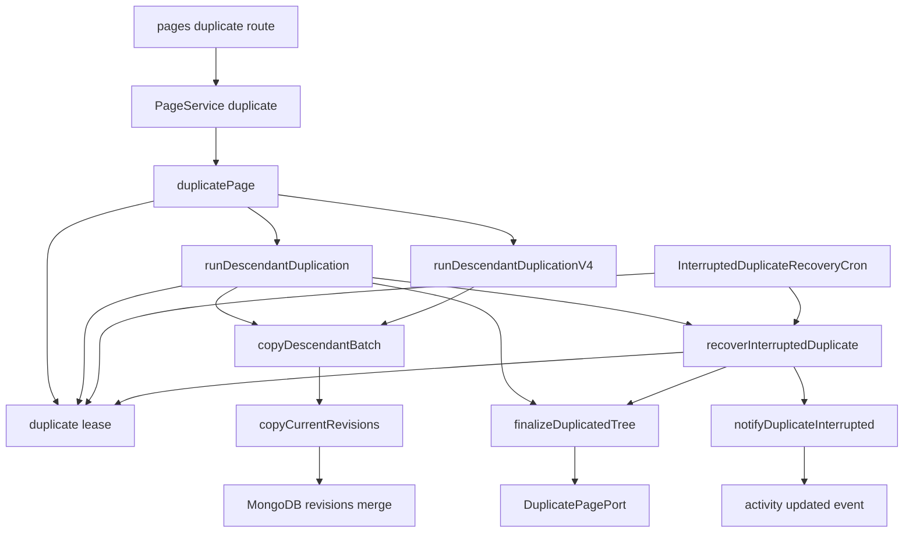
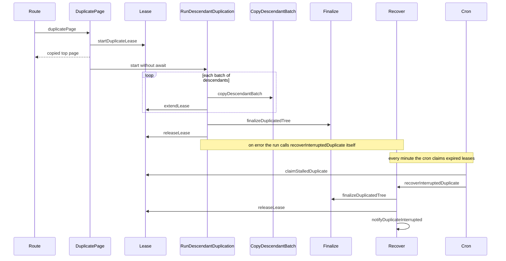
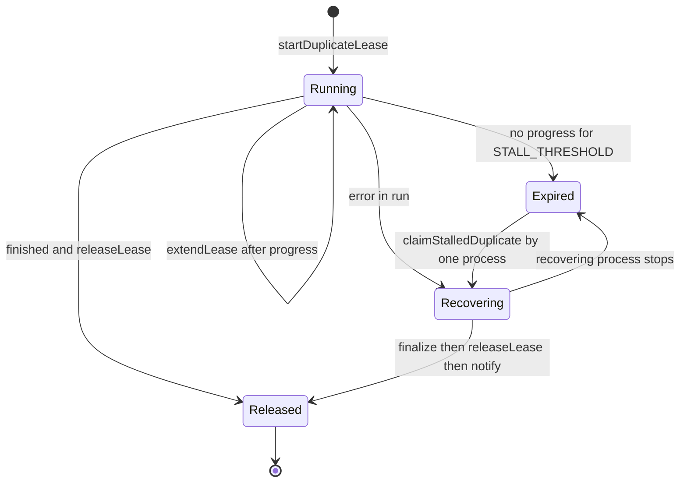

# Design Document

## Overview

**Purpose**: 配下を含むページの複製を、ツリーの大きさや本文の大きさに左右されずに完了させ、途中で止まった場合でも同じ範囲の操作が使えなくなる状態を数分で解く。

**Users**: 大きなツリーを複製する利用者、同じ範囲で移動・改名・複製をする他の利用者、問い合わせを受ける運用者。

**Impact**: 今は、配下の複製が各ページの全版の本文をアプリに読み込み、メモリが大きく増える。途中で止まると操作記録が残り、再起動まで同じ範囲の操作が拒否される。作りかけの写しはツリーから見えず、誰にも知らされない。この設計では、版の本文を MongoDB の中で写し、操作記録に「持ち主の印」と「進捗で延ばす期限」を持たせ、止まった複製を定期処理が回復して本人に通知する。複製の処理は `PageService` から `service/page/duplicate/` に切り出す。

### Goals

- 写しの本文を元ページの最新版にそろえる（1.1〜1.3）。
- 複製中の GROWI のプロセスのメモリ増加を、本文の大きさ・版の数・ページ数によらない量にする（2.1〜2.4）。
- 止まった複製を 5 分以内に回復し、作りかけの写しをツリーにつなぎ、本人に通知する（3.1〜3.3、4.1〜4.7、5.1〜5.6）。
- 受け付け方、応答、写る範囲、公開範囲、タグの扱いを変えない（6.1〜6.4）。

### Non-Goals

- 移動・削除・元に戻す操作の、拒否・失敗・回復の扱い。
- 止まった複製の続きのやり直し、作りかけの写しの自動削除。
- 管理者向けの一覧画面。
- 複製の権限の規則の変更。
- 正常終了時の通知。
- `canOperate`（重なりの判定）の変更。
- どのページからも参照されない版（下記の書き込み順序で、まれに残る）の掃除。

## Boundary Commitments

### This Spec Owns

- 複製の要求を受けてから、配下の複製と整え処理を終えるまでのすべての処理（v5 と v4 の両方）。`service/page/duplicate/` に置く。
- 複製の操作記録（`actionType: Duplicate`）の作成、期限の延長、確保、片付け。
- 版の本文を DB の中で写す処理と、その出力項目の決まり。
- 止まった複製を回復する定期処理と、その設定（実行間隔）。
- 「複製が途中で止まった」通知の種類（`PAGE_DUPLICATE_INTERRUPTED`）、その付帯情報の形、画面の補足文、5 言語の文言。
- 配下ページを読み出す部品（`PageCursorsForDescendantsFactory`）の置き場所の移動（中身は変えない）。

### Out of Boundary

- `canOperate` の判定規則。複製以外の操作の操作記録（作成・更新・改名・削除・元に戻す・正規化）。
- 起動時の掃除（`init()`）のうち、複製以外の種類の扱い。
- 親の付け直し（`normalizeParentRecursively`）と配下ページ数の数え直し（`updateDescendantCountOfSelfAndDescendants` / `updateDescendantCountOfPagesWithPaths`）の中身。この spec は呼び出すだけ。
- 全文検索の再索引のメモリと負荷。本文の切り詰め（`ELASTICSEARCH_MAX_BODY_LENGTH_TO_INDEX`）と送信件数（`ELASTICSEARCH_REINDEX_BULK_SIZE`）で上限が決まり、全文検索の機能が持つ。
- Vault など、ページのイベントを受け取る側の処理。
- 複製の経路（`POST /_api/v3/pages/duplicate`）の検証と応答。PR #12284 で導入した拒否の応答（`grant_not_assignable` / `operation_in_progress`）をそのまま使う。

### Allowed Dependencies

- `IPageService` のうち、`create`、`getParentAndFillAncestorsByUser`、`normalizeParentRecursively`、`updateDescendantCountOfSelfAndDescendants`、`updateDescendantCountOfPagesWithPaths`。`duplicate/` からは引数で受け取った窓口（`DuplicatePagePort`）経由で使い、`PageService` のクラスを import しない。
- `IPageGrantService`（公開範囲の判定）、`PageOperationService.canOperate`。
- `PageOperation` モデル、`Page` モデル（Mongoose）、`prisma.revisions.aggregateRaw`、`prisma.pagetagrelations`。
- `ActivityService.createActivity`、`crowi.events.activity`（アプリ内通知の発行）。
- `CronService`（node-cron）、`configManager`。
- 依存の向き: `types` → 純粋な関数（パイプラインの組み立て、付帯情報の組み立て）→ DB を扱う関数（期限、写し、整え）→ 流れを組む関数（実行、回復）→ 入口（`PageService` の委譲、定期処理）。逆向きの import は誤りとして扱う。

### Revalidation Triggers

- 版のドキュメントの項目（`schema.prisma` の `revisions`）が増減した場合。写しの出力項目を見直す。
- 操作記録のスキーマ、または `init()` の削除対象が変わった場合。
- `canOperate` が期限を見るように変わった場合（回復の前提が変わる）。
- `normalizeParentRecursively` の複製用の呼び出しの挙動が変わった場合。
- アプリ内通知の発行の仕組み（`activityEvent 'updated'` の引数、`generateSnapshot`）が変わった場合。
- GROWI の対応する MongoDB の最低版が 4.4 未満に下がる場合（`$merge` の前提）。

## Architecture

### Existing Architecture Analysis

- 複製は `PageService`（約 5900 行）の中にあり、要求時の処理（`duplicate`）と、応答後に待たずに走る配下の処理（`duplicateRecursivelyMainOperation` 以下）が同じクラスに混在している。
- 配下は 100 件ずつ「ページの挿入 → 版の作成 → タグ」の順で書き、1 回分の例外は握りつぶす。写しは親を持たずに挿入され、最後の整え処理でツリーにつながる。
- 操作記録の期限を延ばすのは改名の後半だけで、しかも時間による延長なので、処理が固まっても延び続ける。
- 定期処理は全プロセスで動き、正しさは条件付きの原子的な確保で保つのが、このリポジトリの慣習（WIP の掃除、変更提案の適用）。

### Architecture Pattern & Boundary Map



**Architecture Integration**:

- 採用する形: 協力する部品を引数で受け取る関数群（`delete-completely-operation.ts` と同じ形）。`PageService.duplicate` は `duplicatePage` へ委譲するだけになる。
- 成功時と回復時で、整え処理（`finalizeDuplicatedTree`）を共有する。例外による失敗と、定期処理が見つけた停止は、同じ回復処理（`recoverInterruptedDuplicate`）を通る。
- 守る既存の形: 待たない非同期処理（応答を先に返す）、`canOperate` による重なりの拒否、`CronService` と `start…CronIfEnabled` の起動の仕方、一括エクスポートの失敗通知と同じ通知の発行の仕方。
- steering との整合: 実行する部品は対象の集合を引数で受け取る。モード名で分岐しない（v5 と v4 の違いは、読み出し方と整え処理の有無を引数で渡す）。内部用の値を利用者の入力と同じ項目に混ぜない（通知の付帯情報は専用の型で組み立てる）。

### Technology Stack

| Layer | Choice / Version | Role in Feature | Notes |
|-------|------------------|-----------------|-------|
| Backend / Services | Express 4、TypeScript（strip-only） | 複製の要求処理と裏の処理 | 変更なし |
| Data / Storage | MongoDB 6.0 以上（`$merge`）、Prisma 6.19（`aggregateRaw`）、Mongoose 6.13 | 版を DB の中で写す。ページと操作記録の書き込み | `$merge` は GROWI で初めて使う |
| Messaging / Events | `crowi.events.activity`（`'updated'`） | アプリ内通知の発行 | 引数を1つ追加（任意） |
| Infrastructure / Runtime | node-cron（`CronService`） | 止まった複製の回復の定期処理 | 新しい設定キー1つ |
| Frontend | React（`InAppNotification`） | 通知の補足文の表示 | 5 言語の文言を追加 |

## File Structure Plan

### Directory Structure

```
apps/app/src/server/service/page/
├── duplicate/
│   ├── index.ts                                   # 外部に公開する入口: duplicatePage, startInterruptedDuplicateRecoveryCronIfEnabled
│   ├── types.ts                                   # DuplicatePagePort, DuplicateDeps, DuplicateLease, 結果の型
│   ├── consts.ts                                  # 期限・間隔の定数（STALL_THRESHOLD_MS など）
│   ├── duplicate-page.ts                          # 要求時の処理（検証・先頭ページの作成・タグ・裏の処理の開始）
│   ├── run-descendant-duplication.ts              # v5 の裏の処理（読み出し・1回分ずつの写し・期限の延長・整え・失敗時の回復）
│   ├── run-descendant-duplication-v4.ts           # v4 の裏の処理（読み出しと写しだけ。操作記録と整え処理はない）
│   ├── copy-descendant-batch.ts                   # 1回分の写し（ID の決定 → 版の写し → ページの挿入 → タグ）
│   ├── copy-current-revisions.ts                  # 版を DB の中で写す集計の組み立て（純粋な関数）と実行
│   ├── finalize-duplicated-tree.ts                # 写しのツリーの整え（親の付け直し・配下ページ数の数え直し・検索への同期）
│   ├── duplicate-lease.ts                         # 操作記録の作成・期限の延長・確保・片付け
│   ├── recover-interrupted-duplicate.ts           # 止まった複製の回復（整え → 片付け → 通知）
│   ├── interrupted-duplicate-recovery-cron.ts     # 回復の定期処理（CronService の派生）と起動関数
│   ├── notify-duplicate-interrupted.ts            # 本人だけに届く通知の発行
│   └── *.spec.ts / *.integ.ts                     # 各ファイルの隣に置く
└── page-cursors-for-descendants.ts                # PageCursorsForDescendantsFactory を index.ts から移す（中身は変えない）

apps/app/src/models/serializers/in-app-notification-snapshot/
└── page-duplicate-interrupted.ts                  # pageDuplicateInterruptedSnapshot: 通知の付帯情報の型・組み立て・読み取り（サーバーと画面で共有）

apps/app/src/client/components/InAppNotification/ModelNotification/
└── PageDuplicateInterruptedSubMsg.tsx             # 通知の補足文（件数・取りうる対処）
```

### Modified Files

- `apps/app/src/server/service/page/index.ts` — 複製の処理（`duplicate` から `duplicateDescendantsV4`、`duplicateTags` まで）を削除し、`duplicate` を `duplicatePage` への委譲にする。`PageCursorsForDescendantsFactory` を新しいファイルから import する。
- `apps/app/src/server/service/page/page-service.ts` — `IPageService` から `duplicateRecursivelyMainOperation` を削除する（呼び出し元がない）。`normalizeParentRecursively` と `updateDescendantCountOfSelfAndDescendants` を追加する（`duplicate/` が窓口経由で使うため）。
- `apps/app/src/server/models/page-operation.ts` — 任意項目 `leaseOwner`（文字列）を追加する。
- `apps/app/src/server/service/page-operation.ts` — `init()` の削除対象から `Duplicate` を外す。
- `apps/app/src/server/crowi/index.ts` — `setupCron` で `startInterruptedDuplicateRecoveryCronIfEnabled` を動的 import して呼ぶ。
- `apps/app/src/server/service/config-manager/config-definition.ts` — `app:interruptedDuplicateRecoveryCronSchedule` を追加する。
- `apps/app/src/interfaces/activity.ts` — `ACTION_PAGE_DUPLICATE_INTERRUPTED` を追加し、`SupportedAction` と `EssentialActionGroup` に入れる。
- `apps/app/src/server/service/in-app-notification.ts` — `'updated'` の受け取りで、任意の第 4 引数（組み立て済みの付帯情報）を受け取り、渡されたときは `generateSnapshot` の代わりに使う。
- `apps/app/src/client/components/InAppNotification/ModelNotification/useActionAndMsg.ts` — 新しい種類の主文（英語の固定文、既存と同じ扱い）を追加する。
- `apps/app/src/client/components/InAppNotification/ModelNotification/PageModelNotification.tsx` — 新しい種類のときに補足文を表示する。
- `apps/app/public/static/locales/{en_US,ja_JP,zh_CN,fr_FR,ko_KR}/translation.json` — 補足文の文言を追加する。

## System Flows

### 配下の複製（v5）と停止時の回復



- 期限は 1 回分の処理を終えるたびに延ばす。延長に失敗した（持ち主の印が変わっていた）ら、その時点で処理をやめる。
- 整え処理の間は、進捗の合図を差し込めないので、一定間隔（`LEASE_KEEPALIVE_INTERVAL_MS`）で期限を延ばす。延長に失敗したら整え処理の完了を待ってから、片付けをせずに終わる（回復側が片付けと通知を行う）。

### 操作記録の状態



- 「Running」「Expired」「Recovering」の間も、記録は残っているので、`canOperate` は重なる操作を拒否し続ける（3.1）。記録が消えた時点で受け付けに戻る（3.2、3.3）。
- 回復中のプロセスが止まった場合は、期限切れに戻り、別のプロセス（または再起動後）がもう一度回復する。整え処理は何度行っても同じ結果になる。

## Requirements Traceability

| Requirement | Summary | Components | Interfaces | Flows |
|-------------|---------|------------|------------|-------|
| 1.1 | 写しの本文は最新版 | copyDescendantBatch, copyCurrentRevisions, duplicatePage | `RevisionCopyEntry` | 配下の複製 |
| 1.2 | 過去の版から取らない | copyCurrentRevisions | `buildCopyCurrentRevisionsPipeline` | 配下の複製 |
| 1.3 | v4 でも同じ | runDescendantDuplicationV4, copyDescendantBatch | `copyDescendantBatch` | — |
| 2.1 | メモリが本文・版・件数によらない | copyCurrentRevisions, copyDescendantBatch | `copyCurrentRevisions` | 配下の複製 |
| 2.2 | 約16MB の本文でも成り立つ | copyCurrentRevisions | `copyCurrentRevisions` | — |
| 2.3 | 計測して記録する | 性能の検証（Testing Strategy） | — | — |
| 2.4 | v4 でも同じ | runDescendantDuplicationV4 | `copyDescendantBatch` | — |
| 3.1 | 進行中は重なる操作を拒否 | duplicateLease（記録を残す）, 既存の canOperate | `startDuplicateLease` | 操作記録の状態 |
| 3.2 | 完了で受け付けに戻る | runDescendantDuplication, duplicateLease | `releaseLease` | 操作記録の状態 |
| 3.3 | 回復で受け付けに戻る | recoverInterruptedDuplicate | `releaseLease` | 操作記録の状態 |
| 4.1 | 例外の失敗で記録を片付け写しを残す | runDescendantDuplication, recoverInterruptedDuplicate | `recoverInterruptedDuplicate` | 配下の複製 |
| 4.2 | 停止・終了から 5 分以内に回復 | InterruptedDuplicateRecoveryCron, duplicateLease | `claimStalledDuplicate` | 操作記録の状態 |
| 4.3 | 再起動から 5 分以内に回復 | InterruptedDuplicateRecoveryCron, PageOperationService.init | `claimStalledDuplicate` | 操作記録の状態 |
| 4.4 | 進んでいる複製を止まったとみなさない | runDescendantDuplication, duplicateLease | `extendLease`, `keepLeaseAliveWhile` | 配下の複製 |
| 4.5 | 写しをツリーにつなぎ件数を合わせる | finalizeDuplicatedTree | `finalizeDuplicatedTree` | 配下の複製 |
| 4.6 | 続きをやり直さない | recoverInterruptedDuplicate | `recoverInterruptedDuplicate` | — |
| 4.7 | 回復は1回だけ | duplicateLease, recoverInterruptedDuplicate | `claimStalledDuplicate`, `releaseLease` | 操作記録の状態 |
| 5.1 | 本人に通知 | notifyDuplicateInterrupted | `notifyDuplicateInterrupted` | 配下の複製 |
| 5.2 | パスと件数を含める | pageDuplicateInterruptedSnapshot | `PageDuplicateInterruptedSnapshot` | — |
| 5.3 | 写しへ移動できる | PageModelNotification（既存の移動） | — | — |
| 5.4 | 不完全であることと対処を伝える | PageDuplicateInterruptedSubMsg | — | — |
| 5.5 | 本人以外に送らない | notifyDuplicateInterrupted | `PreNotify`（本人だけ） | — |
| 5.6 | 全言語の文言 | locales | — | — |
| 6.1 | 待たずに応答する方式を維持 | duplicatePage | `duplicatePage` | 配下の複製 |
| 6.2 | 受け付け方と応答を変えない | duplicatePage, 既存の経路 | `duplicatePage` | — |
| 6.3 | 範囲・公開範囲・タグ・作成者を変えない | duplicatePage, copyDescendantBatch | `DescendantBatchInput` | — |
| 6.4 | 「リンクを知っている人のみ」は写さない | PageCursorsForDescendantsFactory（既存の性質） | — | — |

## Components and Interfaces

| Component | Domain/Layer | Intent | Req Coverage | Key Dependencies (P0/P1) | Contracts |
|-----------|--------------|--------|--------------|--------------------------|-----------|
| duplicatePage | 流れを組む | 要求時の処理と裏の処理の開始 | 1.1, 3.1, 6.1–6.3 | DuplicatePagePort (P0), duplicateLease (P0) | Service |
| runDescendantDuplication | 流れを組む | v5 の配下の複製と、失敗時の回復 | 3.2, 4.1, 4.4 | copyDescendantBatch (P0), duplicateLease (P0), finalizeDuplicatedTree (P0) | Service |
| runDescendantDuplicationV4 | 流れを組む | v4 の配下の複製 | 1.3, 2.4 | copyDescendantBatch (P0) | Service |
| copyDescendantBatch | DB を扱う | 1 回分の写し | 1.1, 2.1, 6.3 | copyCurrentRevisions (P0), Page モデル (P0) | Service |
| copyCurrentRevisions | DB を扱う | 版を DB の中で写す | 1.1, 1.2, 2.1, 2.2 | prisma.revisions.aggregateRaw (P0) | Service |
| finalizeDuplicatedTree | DB を扱う | 写しのツリーの整え | 4.5 | DuplicatePagePort (P0) | Service |
| duplicateLease | DB を扱う | 操作記録の持ち主と期限 | 3.1–3.3, 4.2–4.4, 4.7 | PageOperation モデル (P0) | Service, State |
| recoverInterruptedDuplicate | 流れを組む | 止まった複製の回復 | 3.3, 4.1, 4.2, 4.6, 4.7 | finalizeDuplicatedTree (P0), notifyDuplicateInterrupted (P1) | Service |
| InterruptedDuplicateRecoveryCron | 入口 | 期限切れの記録の定期的な回復 | 4.2, 4.3 | CronService (P0), duplicateLease (P0) | Batch |
| notifyDuplicateInterrupted | DB を扱う | 本人だけへの通知の発行 | 5.1, 5.2, 5.5 | ActivityService (P0), activity event (P0) | Event |
| pageDuplicateInterruptedSnapshot | 純粋な関数 | 通知の付帯情報の型と組み立て・読み取り | 5.2 | なし | Service |
| PageDuplicateInterruptedSubMsg | 画面 | 補足文の表示 | 5.4, 5.6 | next-i18next (P0) | — |
| PageCursorsForDescendantsFactory | DB を扱う | 配下の読み出し（移動のみ） | 6.4 | Page モデル (P0) | — |

### 共通の型

```typescript
import type { IGrantedGroup, IUserHasId, PageGrant } from '@growi/core';
import type { EventEmitter } from 'node:events';
import type { HydratedDocument } from 'mongoose';
import type { IOptionsForCreate } from '~/interfaces/page';
import type { PageDocument } from '~/server/models/page';
import type { IPageGrantService } from '~/server/service/page-grant';
import type { IPageOperationService } from '~/server/service/page-operation';
import type { IPageService } from '../page-service';

/** The narrow view of PageService that the duplicate module may call. */
export type DuplicatePagePort = Pick<
  IPageService,
  | 'create'
  | 'getParentAndFillAncestorsByUser'
  | 'normalizeParentRecursively'
  | 'updateDescendantCountOfSelfAndDescendants'
  | 'updateDescendantCountOfPagesWithPaths'
>;

export interface DuplicateDeps {
  readonly pageService: DuplicatePagePort;
  readonly pageGrantService: IPageGrantService;
  readonly pageOperationService: Pick<IPageOperationService, 'canOperate'>;
  readonly activityService: { createActivity: ActivityCreator };
  readonly pageEvent: EventEmitter;
  readonly tagEvent: EventEmitter;
  readonly activityEvent: EventEmitter;
}

export interface DuplicateRequest {
  readonly page: HydratedDocument<PageDocument>;
  readonly newPagePath: string;
  readonly user: IUserHasId;
  readonly isRecursively: boolean;
  readonly onlyDuplicateUserRelatedResources: boolean;
}

/** Ownership of one Duplicate PageOperation by one running process. */
export interface DuplicateLease {
  readonly operationId: string;
  readonly ownerToken: string;
}

export type LeaseUpdateResult = 'extended' | 'lost';
```

`ActivityCreator` は `ActivityService.createActivity` の型をそのまま参照する（新しく定義しない）。

### 流れを組む部品

#### duplicatePage

| Field | Detail |
|-------|--------|
| Intent | 複製の要求を処理し、先頭ページの写しを返し、配下の複製を待たずに始める |
| Requirements | 1.1, 3.1, 6.1, 6.2, 6.3 |

**Responsibilities & Constraints**

- 今の `PageService.duplicate` の検証（空ページの扱い、v4 の判定、`canOperate`、公開範囲の判定）と、先頭ページの作成、タグの複製を、そのままの順序と例外の種類（`PageOperationRefusedError` を含む）で行う。
- 先頭ページの本文は、今どおり `page.revision` の本文を使う（先頭ページは 1 件なのでアプリに読み込んでよい）。
- 配下を含む v5 の複製では、先頭ページを作った後に `startDuplicateLease` で操作記録を作り、`runDescendantDuplication` を待たずに始める。
- v4 の複製では、操作記録を作らずに `runDescendantDuplicationV4` を待たずに始める（今と同じ）。

**Dependencies**

- Inbound: `PageService.duplicate` — 委譲（P0）
- Outbound: `DuplicatePagePort.create` / `getParentAndFillAncestorsByUser`、`duplicateLease`、`runDescendantDuplication`、`runDescendantDuplicationV4`（P0）

**Contracts**: Service [x]

##### Service Interface

```typescript
export function duplicatePage(
  deps: DuplicateDeps,
  request: DuplicateRequest,
): Promise<ReturnType<typeof serializePageSecurely> & { tags: string[] }>;
```

- Preconditions: 経路側の検証（パスの形式、複製先の非存在、閲覧権限）を通っている。
- Postconditions: 先頭ページの写しがツリーにつながって存在する。配下を含む v5 の複製では、操作記録が `Running` の状態で存在する。
- Invariants: 戻り値の形と、投げる例外の種類は今と同じ（6.2）。

#### runDescendantDuplication

| Field | Detail |
|-------|--------|
| Intent | v5 の配下を 1 回分ずつ写し、期限を延ばし、最後に整える。失敗したら自分で回復する |
| Requirements | 3.2, 4.1, 4.4 |

**Responsibilities & Constraints**

- `PageCursorsForDescendantsFactory`（空ページを含む）で配下を読み、`BULK_REINDEX_SIZE` 件ずつ `copyDescendantBatch` に渡す。
- 1 回分を終えるたびに `extendLease` を呼ぶ。`'lost'` が返ったら、それ以上書かずに終わる（他のプロセスが回復を始めている）。
- すべて終えたら、`keepLeaseAliveWhile` の中で `finalizeDuplicatedTree` を行い、`releaseLease` で記録を片付ける。
- 1 回分の処理、整え処理のどこかで例外が出たら、その場で `recoverInterruptedDuplicate` を `cause: { kind: 'error' }` で呼ぶ。今のように例外を握りつぶして次の回へ進むことはしない。
- 例外を、誰も待たない Promise に再送出しない（ログに出して終わる）。

**Contracts**: Service [x]

##### Service Interface

```typescript
export interface DescendantDuplicationInput {
  readonly lease: DuplicateLease;
  readonly sourcePage: PageDocument;
  readonly newPagePath: string;
  readonly user: IUserHasId;
  readonly onlyDuplicateUserRelatedResources: boolean;
}

export function runDescendantDuplication(
  deps: DuplicateDeps,
  input: DescendantDuplicationInput,
): Promise<void>; // never rejects; failures are handed to recoverInterruptedDuplicate
```

- Postconditions（成功時）: 写しがすべてツリーにつながり、配下ページ数が数え直され、操作記録が消えている。

#### runDescendantDuplicationV4

| Field | Detail |
|-------|--------|
| Intent | v4 の配下を 1 回分ずつ写す |
| Requirements | 1.3, 2.4 |

- 読み出しは今と同じ（`parent: null` かつ配下、編集できる人で絞り込む）。
- 1 回分の写しは `copyDescendantBatch` を使う。今の v4 は `onlyDuplicateUserRelatedResources` を無視しているので、その挙動を保つため、v4 からは常に `false` を渡す（6.3）。
- 操作記録・期限・整え処理・回復は持たない（v4 の写しはもともとツリーの外にある。要件4・5 の対象外）。例外はログに出して終わる。

#### recoverInterruptedDuplicate

| Field | Detail |
|-------|--------|
| Intent | 止まった複製の写しを整え、記録を片付け、本人に知らせる |
| Requirements | 3.3, 4.1, 4.2, 4.6, 4.7 |

**Responsibilities & Constraints**

- 手順は「整え → 片付け → 通知」の順に固定する。
- 整え処理（`finalizeDuplicatedTree`）は `keepLeaseAliveWhile` の中で行う。期限を延ばせなくなった（他のプロセスに確保された）ら、片付けと通知をせずに終わる。
- 片付け（`releaseLease`）が `'lost'` を返したら、通知しない。これで、1 つの止まった複製について通知が 1 回を超えない（4.7）。
- 片付けの後、通知の前にプロセスが止まった場合は、通知が届かない。重複より欠落を選ぶ（4.7 を優先）。
- 続きの複製はしない（4.6）。作りかけの写しは消さない（4.1、4.2）。

**Contracts**: Service [x]

##### Service Interface

```typescript
export type InterruptionCause =
  | { readonly kind: 'error'; readonly error: unknown }
  | { readonly kind: 'stalled' };

export interface InterruptedDuplicate {
  readonly lease: DuplicateLease;
  readonly fromPath: string;
  readonly toPath: string;
  /** PageOperation stores only the user's id, so recovery works from the id alone. */
  readonly user: Pick<IUserHasId, '_id'>;
  readonly shouldNormalizeParent: boolean;
  /** descendantCount of the source at the start, plus the top page itself */
  readonly sourcePageCount: number;
  readonly cause: InterruptionCause;
}

export type RecoveryOutcome =
  | { readonly status: 'recovered'; readonly copiedPageCount: number }
  | { readonly status: 'lost-ownership' };

export function recoverInterruptedDuplicate(
  deps: DuplicateDeps,
  target: InterruptedDuplicate,
): Promise<RecoveryOutcome>;
```

### DB を扱う部品

#### copyDescendantBatch

| Field | Detail |
|-------|--------|
| Intent | 1 回分（最大 `BULK_REINDEX_SIZE` 件）の配下ページを写す |
| Requirements | 1.1, 2.1, 6.3 |

**Responsibilities & Constraints**

- 写す対象は、今と同じく「空でない」かつ（`onlyDuplicateUserRelatedResources` が真なら）本人が閲覧できるページ。公開範囲、閲覧グループの絞り込み、作成者・最終更新者（本人）、パスの置き換えは今と同じ（6.3）。
- 手順:
  1. 対象の各ページについて、写しのページ ID と版 ID をアプリで決める。
  2. `copyCurrentRevisions` で、各ページが指す版（`page.revision`）だけを写す。
  3. 写せた版に対応するページだけを `Page.insertMany` で挿入する（`revision` に新しい版 ID を入れる）。版を写せなかったページは挿入せず、件数を戻り値で返す。
  4. タグを写す（今の `duplicateTags` と同じ）。
- 書き込み順を「版 → ページ → タグ」にする。2 と 3 の間で止まった場合に残るのは、どのページからも参照されない版だけで、存在しない版を指すページは残らない。
- 本文をアプリに読み込まない。アプリが持つのはページのドキュメント（本文を含まない）と ID の対応表だけ（2.1）。

**Contracts**: Service [x]

##### Service Interface

```typescript
export interface DescendantBatchInput {
  readonly pages: readonly PageDocument[]; // lean documents from the cursor
  readonly oldPathPrefix: RegExp; // in-process only; never sent to MongoDB
  readonly newPathPrefix: string;
  readonly user: IUserHasId;
  readonly onlyDuplicateUserRelatedResources: boolean;
}

export interface DescendantBatchResult {
  readonly insertedPageCount: number;
  readonly skippedForMissingRevisionCount: number;
}

export function copyDescendantBatch(
  input: DescendantBatchInput,
): Promise<DescendantBatchResult>;
```

#### copyCurrentRevisions

| Field | Detail |
|-------|--------|
| Intent | 各ページの最新版を、本文をアプリへ運ばずに DB の中で写す |
| Requirements | 1.1, 1.2, 2.1, 2.2 |

**Responsibilities & Constraints**

- 集計の組み立て（`buildCopyCurrentRevisionsPipeline`）は純粋な関数にする。実行（`copyCurrentRevisions`）は `prisma.revisions.aggregateRaw` で行い、トランザクションの外で呼ぶ（`$merge` はトランザクションの中で使えない）。
- 集計の内容:
  - `$match`: `_id` が対応表の「元の版 ID」の一覧に含まれるもの。ページ ID では照合しない（1.2）。
  - `$project`: 出力を次の 7 項目に固定する。`_id`（新しい版 ID）、`pageId`（新しいページ ID）、`body`（元の本文）、`format`（元の値、なければ `'markdown'`）、`author`（複製した本人）、`createdAt`（`$$NOW`）、`__v`（0）。`origin`・`hasDiffToPrev`・`proposalId`・`proposalOperationKey` は持ち込まない。
  - `$merge`: `into: 'revisions'`、`on: '_id'`、`whenMatched: 'fail'`、`whenNotMatched: 'insert'`。
- 新しい ID は、照合に使った「元の版 ID」の並びと同じ並びの配列から、`$indexOfArray` と `$arrayElemAt` で引く。照合と対応表を同じ並びから作るので、見つからない（-1 が返る）ことはない。
- ObjectId と日時は拡張 JSON（`toRawObjectId`）で渡す。生の文字列で渡すと、文字列として保存され、照合も黙って外れる。
- 実行後、新しい版 ID の一覧で `_id` だけを読み直し、実際に写せた ID の集合を返す（本文は読まない）。
- 集計の結果は返さない（カーソルは空）。本文は DB の外に出ない（2.1、2.2）。

**Contracts**: Service [x]

##### Service Interface

```typescript
export interface RevisionCopyEntry {
  readonly sourceRevisionId: string;
  readonly newRevisionId: string;
  readonly newPageId: string;
}

/** Pure: builds the aggregation pipeline. Exported for unit tests. */
export function buildCopyCurrentRevisionsPipeline(
  entries: readonly RevisionCopyEntry[],
  authorId: string,
): readonly RawPipelineStage[];

export function copyCurrentRevisions(
  entries: readonly RevisionCopyEntry[],
  authorId: string,
): Promise<{ readonly copiedRevisionIds: ReadonlySet<string> }>;
```

- `RawPipelineStage` は `Prisma.InputJsonObject` の別名とする（`aggregateRaw` の引数の型）。
- Preconditions: `entries` が空でない。`sourceRevisionId` に重複がない。
- Postconditions: `copiedRevisionIds` に含まれる ID の版が存在し、その本文は元の版と同じ。途中で失敗した場合も、それまでに写した版は残る（`$merge` は取り消されない）。

#### finalizeDuplicatedTree

| Field | Detail |
|-------|--------|
| Intent | 写しを親からたどれる状態にし、配下ページ数を実際と合わせる |
| Requirements | 4.5 |

**Responsibilities & Constraints**

- 成功時と回復時の両方で使う。何度行っても同じ結果になる。
- 手順:
  1. 元ページの公開範囲が「リンクを知っている人のみ」「特定のユーザー」以外なら（今の `shouldNormalizeParent` と同じ条件）、`normalizeParentRecursively([toPath], user, true)` で写しの親を付け直す。足りない中間のページは空ページとして作られる。
  2. `updateDescendantCountOfSelfAndDescendants(toPath)` で、写しの先頭から下の配下ページ数を数え直す。
  3. `toPath` の祖先のパスについて `updateDescendantCountOfPagesWithPaths` で数え直す。今の「数えた件数だけ増やす」方式はやめる（件数が実際より多くなりうるため）。
  4. 写しの先頭ページで `pageEvent 'syncDescendantsUpdate'` を発行し、全文検索に写しを反映する（今と同じイベント）。
  5. `toPath` 以下の空でないページ数を数えて返す（通知の件数に使う）。

**Contracts**: Service [x]

##### Service Interface

```typescript
export interface FinalizeInput {
  readonly toPath: string;
  /** normalizeParentRecursively in duplicate mode applies no grant filter, so the id suffices. */
  readonly user: Pick<IUserHasId, '_id'>;
  readonly shouldNormalizeParent: boolean;
}

export function finalizeDuplicatedTree(
  deps: Pick<DuplicateDeps, 'pageService' | 'pageEvent'>,
  input: FinalizeInput,
): Promise<{ readonly copiedPageCount: number }>;
```

#### duplicateLease

| Field | Detail |
|-------|--------|
| Intent | 複製の操作記録の持ち主と期限を管理する |
| Requirements | 3.1, 3.2, 3.3, 4.2, 4.3, 4.4, 4.7 |

**Contracts**: Service [x] / State [x]

##### Service Interface

```typescript
export interface StartLeaseInput {
  readonly page: PageDocument;
  readonly user: IUserHasId;
  readonly fromPath: string;
  readonly toPath: string;
}

export function startDuplicateLease(input: StartLeaseInput): Promise<DuplicateLease>;

/** Conditional on ownerToken; 'lost' when another process has claimed it. */
export function extendLease(lease: DuplicateLease): Promise<LeaseUpdateResult>;

/** Runs task while extending the lease every LEASE_KEEPALIVE_INTERVAL_MS. */
export function keepLeaseAliveWhile<T>(
  lease: DuplicateLease,
  task: () => Promise<T>,
): Promise<{ readonly result: T; readonly lease: LeaseUpdateResult }>;

/** Atomically takes over one Duplicate operation whose lease has expired. */
export function claimStalledDuplicate(
  now: Date,
): Promise<InterruptedDuplicate | null>;

/** Deletes the operation only if this lease still owns it. */
export function releaseLease(lease: DuplicateLease): Promise<'released' | 'lost'>;
```

##### State Management

- 期限には既存の `unprocessableExpiryDate` を使う。複製の記録について、この値は「この時刻を過ぎても延長がなければ止まったとみなす」意味になる。改名の再開判定（`isProcessable`）は改名の記録しか見ないので、意味が衝突しない。
- `leaseOwner` に、記録を持つプロセスの印（実行ごとの乱数）を入れる。
- 作成時: `leaseOwner = 新しい印`、`unprocessableExpiryDate = 今 + STALL_THRESHOLD_MS`。
- 延長: `updateOne({ _id, leaseOwner }, { unprocessableExpiryDate: 今 + STALL_THRESHOLD_MS })`。一致しなければ `'lost'`。
- 確保: `findOneAndUpdate({ actionType: Duplicate, unprocessableExpiryDate: { $lt: 今 } }, { leaseOwner: 新しい印, unprocessableExpiryDate: 今 + STALL_THRESHOLD_MS })`。1 件ずつ確保し、確保したプロセスだけが回復する（4.7）。
- 片付け: `deleteOne({ _id, leaseOwner })`。消せなければ `'lost'`。
- `leaseOwner` を持たない複製の記録（この変更より前のバージョンが作ったもの）は、作成時の期限（10 秒後）を過ぎているので、確保の対象になる。
- 回復に必要な値（複製元・複製先のパス、本人の ID、元ページの配下ページ数と公開範囲）は、今の記録の項目（`fromPath`、`toPath`、`user._id`、`page.descendantCount`、`page.grant`）から取れる。新しく保存する値は `leaseOwner` だけ。

### 入口

#### InterruptedDuplicateRecoveryCron

| Field | Detail |
|-------|--------|
| Intent | 期限切れの複製の記録を見つけて回復する |
| Requirements | 4.2, 4.3 |

**Contracts**: Batch [x]

##### Batch / Job Contract

- Trigger: `app:interruptedDuplicateRecoveryCronSchedule`（既定 `* * * * *`、毎分）。空にすると止まる（WIP の掃除と同じ扱い）。不正な式はログに出して起動を続ける。
- 開始時に最大 `RECOVERY_JITTER_MS`（30 秒）の待ちを入れ、複数のプロセスが同時に動かないようにする。
- 保守モードの間は何もしない。前回の実行が終わっていなければ、今回は何もしない（プロセス内の実行中の印）。
- 1 回の実行で、`claimStalledDuplicate` が `null` を返すまで確保と回復を繰り返す。
- 起動時の掃除（`init()`）は複製の記録を消さなくなるので、再起動後は、この定期処理が期限切れの記録を回復する（4.3）。
- 時間の見積もり: 停止から検知まで最大 `STALL_THRESHOLD_MS`（2 分）+ 実行間隔（1 分）+ 待ち（30 秒）= 3.5 分。整え処理を含めて 5 分以内に収める（4.2）。

#### PageService.duplicate（委譲）

- `duplicatePage(this.duplicateDeps(), request)` を呼んで返すだけにする。経路と、テストの差し込み口（`vi.spyOn(crowi.pageService, 'duplicate')`）は変わらない。

### 通知

#### notifyDuplicateInterrupted

| Field | Detail |
|-------|--------|
| Intent | 複製を実行した本人だけに、止まったことと結果を知らせる |
| Requirements | 5.1, 5.2, 5.5 |

**Responsibilities & Constraints**

- 一括エクスポートの失敗通知と同じ流れにする: `createActivity`（種類 `PAGE_DUPLICATE_INTERRUPTED`、対象は写しの先頭ページ）→ 本人の ID だけを通知先に加える `PreNotify` → `activityEvent.emit('updated', activity, targetPage, preNotify, snapshot)`。
- 既定の通知先の決め方（`generatePreNotify`）は、対象ページの購読者にも送るので使わない（5.5）。
- 付帯情報（snapshot）は `pageDuplicateInterruptedSnapshot.stringify` で組み立てて渡す。

**Contracts**: Event [x]

##### Event Contract

- Published: `activity 'updated'`。引数は `(activity, target, preNotify, snapshot?)`。第 4 引数は新しく追加する任意の引数で、渡されたときは `generateSnapshot` の代わりに使う。既存の発行元は渡さないので、挙動は変わらない。
- Delivery: 既存のアプリ内通知の仕組み（7 日以内の同じ対象・種類・付帯情報の通知はまとめられる。複製ごとに対象が違うので、まとめられることはない）。

#### pageDuplicateInterruptedSnapshot

```typescript
export interface PageDuplicateInterruptedSnapshot {
  readonly path: string; // the copy's top page path; PagePathLabel shows it
  readonly fromPath: string;
  readonly toPath: string;
  readonly copiedPageCount: number;
  readonly sourcePageCount: number;
}

export const pageDuplicateInterruptedSnapshot: {
  stringify(snapshot: PageDuplicateInterruptedSnapshot): string;
  parse(snapshot: string): PageDuplicateInterruptedSnapshot | undefined;
};
```

- `parse` は形が合わなければ `undefined` を返す（画面は補足文を出さない）。

#### PageDuplicateInterruptedSubMsg（画面）

- 主文は既存の通知と同じく英語の固定文（`useActionAndMsg.ts` に追加）。多言語の文言は補足文で出す（5.6）。
- 補足文に、複製元・複製先のパス、写せたページ数と元のページ数、「写しは不完全で、消すか別の名前で複製し直せる」旨を表示する（5.2、5.4）。
- 通知をクリックすると、既存の `PageModelNotification` の動作で写しの先頭ページへ移動する（5.3）。
- 文言のキー: `in_app_notification.page_duplicate_interrupted.summary` と `…advice`。5 言語すべてに入れる（`lint:i18n` を通す）。

## Data Models

### Logical Data Model

**PageOperation（複製の記録だけに関わる変更）**

| 項目 | 型 | 変更 | 意味 |
|---|---|---|---|
| `leaseOwner` | string（任意） | 追加 | 記録を持つプロセスの印 |
| `unprocessableExpiryDate` | Date | 意味を定める | 複製の記録では「延長がなければ止まったとみなす時刻」 |

- 索引は追加しない。複製の記録は同時に数件しか存在せず、確保の問い合わせは全件を読んでも小さい。
- 既存の記録との互換: `leaseOwner` がない記録は、期限切れとして確保の対象になる。

**revisions（写しの版）**

- 出力項目は `_id`、`pageId`（ObjectId）、`body`、`format`、`author`（ObjectId）、`createdAt`（日時）、`__v: 0` の 7 項目。今の配下の複製が作る版と同じ項目・同じ型にする。
- 本文は保存されている値をそのまま写す（今は Prisma 経由で読んだときの改行の正規化を経て書いている）。読むときに同じ正規化がかかるので、表示は変わらない。

**pages（写しのページ）**

- 項目は今と同じ（`_id, path, creator, lastUpdateUser, grant, grantedGroups, grantedUsers, revision`）。挿入時は親を持たず、整え処理でつながる。

### Consistency & Integrity

- 1 回分の写しは、トランザクションを使わない（`$merge` はトランザクションの中で使えない）。途中で止まった場合の状態は、書き込み順で次のどれかに限る。
  - 版の一部だけ写った: どのページからも参照されない版が残る（見えない）。
  - 版は写り、ページの一部だけ挿入された: 挿入されたページは、整え処理でツリーにつながる。
  - ページまで挿入され、タグの一部が欠けた: そのページはタグが欠けた写しとして残る（作りかけの写しの一部）。

## Error Handling

### Error Strategy

| 状況 | 扱い |
|---|---|
| 要求時の拒否（公開範囲が合わない、別の操作が進行中） | 今と同じ例外を投げ、経路が 409 を返す（PR #12284） |
| 先頭ページの作成の失敗 | 今と同じく例外を投げ、経路が 500 を返す。操作記録はまだ作られていない |
| 1 回分の写しの例外 | 配下の複製をやめ、同じプロセスで回復処理（整え → 片付け → 通知）を行う |
| 期限の延長が `'lost'` | 書き込みをやめる。片付けと通知は回復した側が行う |
| 版の一部を写せない（元の版が存在しない） | そのページは挿入せず、件数を数えて続ける（停止の扱いにはしない） |
| 回復処理の中の例外 | ログに出す。記録は残るので、期限切れになった後に再び回復される |
| 定期処理の式が不正 | ログに出し、起動を続ける |

### Monitoring

- 回復のたびに、操作記録の ID、複製元・複製先、原因（`error` / `stalled`）、写せたページ数をログに出す。
- 期限の延長が `'lost'` になったときは警告としてログに出す（止まったとみなされたが実際には進んでいた、の兆候）。

## Testing Strategy

### Unit Tests

- `buildCopyCurrentRevisionsPipeline`: `$match` が版 ID で照合し、ページ ID で照合しないこと。出力項目が 7 項目に固定されていること。ObjectId が拡張 JSON になっていること（1.2、2.1）。
- `pageDuplicateInterruptedSnapshot`: 組み立てと読み取りが往復すること、形の合わない文字列で `undefined` を返すこと（5.2）。
- `PageDuplicateInterruptedSubMsg`: 件数・パス・対処の文言が出ること（5.4）。

### Integration Tests

- 写しの版の項目と型: Prisma で作った版と、`copyCurrentRevisions` で写した版で、項目の集合と `pageId`・`author`・`createdAt` の BSON の型が一致すること（1.1、Prisma の拡張 JSON の変換の確認を兼ねる）。
- 最新版だけ: 版を複数持つページを配下ごと複製し、写しの本文が最新版と一致し、写しの版が 1 件だけであること（1.1、1.2）。v4 のページでも同じ（1.3）。
- 1 回分の例外: `copyCurrentRevisions` を途中で失敗させ、作りかけの写しがツリーからたどれ、配下ページ数が実際と一致し、記録が消え、本人にだけ通知が届くこと（4.1、4.5、5.1、5.5）。
- 停止の回復: 期限切れの記録を作り、`claimStalledDuplicate` → `recoverInterruptedDuplicate` で、写しがつながり、記録が消え、通知が 1 件届くこと（4.2、4.5、5.1）。
- 1 回だけ: 同じ期限切れの記録に対して回復を並行に 2 つ走らせ、通知が 1 件だけであること（4.7）。
- 持ち主の交代: 確保された後に元の実行が `extendLease` を呼ぶと `'lost'` になり、以降の書き込みをしないこと（4.4）。
- 起動時の掃除: `init()` が複製の記録を消さず、他の種類は今どおり消すこと（4.3）。
- 重なる操作: 実行中は重なる複製・移動・改名が `operation_in_progress` で拒否され、完了後と回復後は受け付けられること（3.1〜3.3）。
- 既存の挙動: 既存の複製のテスト（`v5.public-page.integ.ts`、`v5.non-public-page.integ.ts`、`routes/apiv3/pages/duplicate.integ.ts`）が変更なしで通ること（6.1〜6.4）。

### Performance

- 本文の大きさによらないこと（2.1、2.2）: 本文が約 15MB の版を持つページを 1 回分の件数いっぱい（100 件）配下に置き、複製中の `VmHWM`（OS が記録するプロセスのメモリのピーク）の増加が、本文 1KB の場合と同じ水準であることを確かめる。CI では重いので、手元で実行する検証用のスクリプトとして用意し、結果を `research.md` に記録する。
- 今回の規模での計測（2.3）: 配下 83 ページ・1505 版の構成を合成データで再現し、変更前（約 300MB）と変更後の増加量を `research.md` に記録する。

## Security Considerations

- 通知は本人にだけ送る（5.5）。付帯情報に含めるのは、本人が複製を実行したときに入力・閲覧したパスと件数だけで、閲覧権限のないページのパスは含めない。
- 生の集計に渡す値は、アプリで生成した ID と本人の ID だけで、利用者の入力をそのまま集計に入れない。パスの置き換えはアプリ内の正規表現で行い、DB に送らない。

## Migration Strategy

- データの移行は不要。`leaseOwner` は任意項目で、既存の記録は期限切れとして回復の対象になる。
- 更新した直後の起動では、以前のバージョンが残した複製の記録（途中で止まって残った記録）も、定期処理が回復し、複製した本人に通知が届く。何週間も前の複製について通知が届く場合がある。これは、作りかけの写しが残っていることを本人が知る機会になるので、そのまま通知する。
