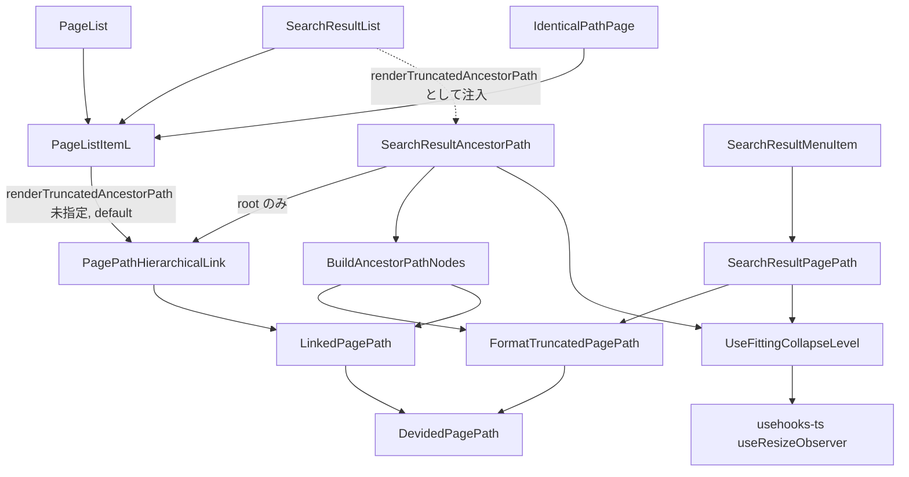
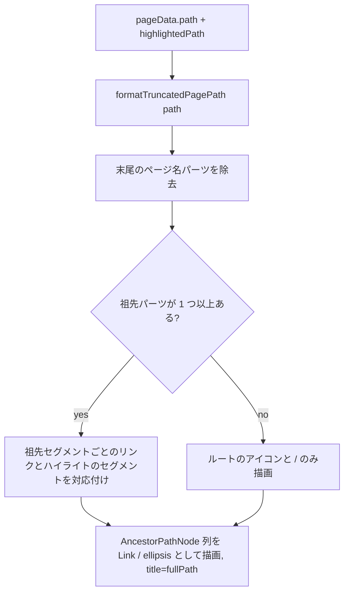
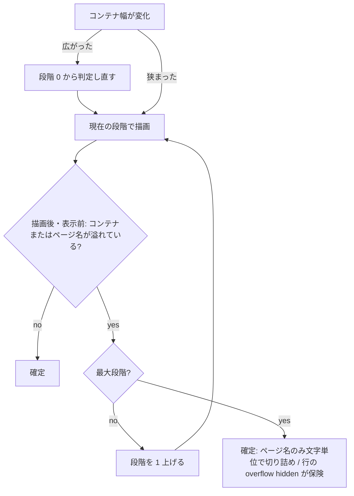

# 技術設計書 — page-path-truncation

## Overview

**Purpose**: 全文検索結果ページ（`/_search`）の各結果行に表示される祖先パスを、検索モーダル（`search-modal-path-truncation`、実装済み）と同じ Notion 風の中間省略表示にし、階層が深い・セグメント名が長い場合でも一覧のレイアウトが崩れないようにする。

**Users**: GROWI 利用者が全文検索結果一覧を閲覧する際、各行のパスを 1 行で見渡して目的ページを素早く判別できるようになる。省略時もホバーでフルパスを確認でき、表示されているセグメントは従来通りクリック遷移・検索キーワードのハイライトが機能する。

**Impact**: 現状、`PageListItemL`（`/_search` を含む 3 画面で共有されるページ一覧行コンポーネント）は祖先パスを `PagePathHierarchicalLink` で全セグション個別リンク描画し、`text-break` による折り返しのみでオーバーフローに対処している。本設計では `PageListItemL` にオプトイン prop を追加し、`/_search`（`SearchResultList`）からのみ新規コンポーネントに切り替える。`PagePathHierarchicalLink` 自体・他の 2 消費者（`PageList.tsx`、`IdenticalPathPage.tsx`）は無変更のまま現行の全表示を維持する。

**幅が足りないとき**: 収まるかどうかを実際の描画結果で判定し、祖先セグメントを先頭側から段階的に省略記号へ畳む。祖先は縮めず、文字単位で縮むのはページ名（検索モーダルのみ）に限る。判断ロジック・段階の選び方・1 行表示の CSS は検索モーダルと検索結果一覧で共有し、検索モーダルのパス表示（`SearchResultPagePath`）にも同じ規則を適用する。

### Goals
- 祖先パス＋ページ名の表示単位数が 4 以上のとき、祖先パス部分を「先頭セグメント＋…＋親セグメント」に中間省略する。
- 祖先パス部分を常に 1 行に収め、階層の深さ・セグメント長（CJK 含む）に関わらず一覧の内容幅を超えない。
- 幅が足りないときは祖先セグメントを先頭側から段階的に省略記号へ畳み、省略表記を検索モーダル・検索結果一覧の両方で「セグメント単位の …」1 種類に揃える。
- 省略された行はホバーで（ページ名を含む）フルパスを確認できる。
- 表示されている祖先セグメントは現行通り個別クリック可能なリンクとして機能し、検索キーワードのハイライトも維持する。
- ページ名の決定規則（末尾日付の束ね、`evalDatePath`）を検索モーダルと統一する。
- `/_search` 以外の `PageListItemL` 消費画面（子ページ一覧、パス重複選択画面）の表示・挙動を変更しない。

### Non-Goals
- `PagePathNav`・`PagePathHeader`・`PagePathNavSticky`・`RecentChangesSubstance` など他の `PagePathHierarchicalLink` 消費箇所への適用。
- 検索クエリ挙動・検索結果データの取得方法の変更。
- 省略記号自体をクリック・ホバーして隠れたセグメントを個別表示する機能。
- ページ名（`PageListItemL` の H5 タイトル行、`UserPicture`・`Clamp` を含む行）の構造変更。日付束ねによる表示テキストの変化は許容するが、行構成・マークアップは変更しない。祖先パス行（row1）とページ名行（row2）を2行のまま維持する方針は `/kiro-validate-design` で確認済み（research.md「Row 1 vs Row 2 の scope」参照）。

## Boundary Commitments

### This Spec Owns
- `/_search` の検索結果一覧の各行における**祖先パス部分**の表示形式（中間省略の判定・生存セグメントのリンク／ハイライト描画・1 行制御・ホバーでのフルパス提示）。
- `formatTruncatedPagePath` の共有配置への移設（`features/search` → `client/util/`、振る舞い変更なし）。
- 祖先パスの中間省略判定結果と `LinkedPagePath`（リンク・ハイライト）を橋渡しする新規の純粋関数 `buildAncestorPathNodes`。**この関数も `client/util/` に配置する**（検索結果一覧固有ではなく、「truncation判定 ⇔ `LinkedPagePath` の橋渡し」という骨格自体は将来の他サーフェス — [roadmap.md](./roadmap.md) 参照 — でも同型で必要になるため。ハイライト対応は本specの検索結果一覧固有の関心事だが、`highlightedPath` を省略可能な引数にすることでインターフェース自体は汎用に保つ）。
- `PageListItemL` への新規オプトイン prop（`renderTruncatedAncestorPath`）と、それに伴う `evalDatePath` 統一。
- ES ハイライト markup とプレーンパスのセグメント対応付け（`alignHighlightedPathSegments`、`client/util/`）。
- 検索モーダルと検索結果一覧で共有する 1 行表示の CSS（祖先・区切り・省略記号は縮めず、ページ名だけを縮める）。
- 畳み込み段階（`collapseLevel`）の定義と、実際の描画幅から段階を選ぶフック `useFittingCollapseLevel`。検索モーダル（`SearchResultPagePath`）と検索結果一覧（`SearchResultAncestorPath`）の両方への適用と、共通 1 行 CSS レシピの組み替え（祖先は縮めない）。

### Out of Boundary
- `LinkedPagePath`・`DevidedPagePath` の実装変更（利用のみ）。
- `PagePathHierarchicalLink` の振る舞い変更。変更は、href 生成を `buildAncestorPathNodes` と共有する `buildLinkedPagePathHref`（`~/utils/`）の呼び出しに置き換えることのみ。
- `PageList.tsx`・`IdenticalPathPage.tsx` の呼び出し内容（prop を渡さないことで現状維持。ファイル自体への変更もなし）。
- `PageListItemL` のページ名表示行（H5 タイトル、`UserPicture`、`PageListMeta`、`PageItemControl`）の構造・マークアップ。
- 検索結果のデータ取得・追加ネットワークリクエスト。
- `search-modal-path-truncation` の成果物のうち `SearchResultPagePath` 以外（`SearchResultMenuItem` 等）。`SearchResultPagePath` は段階的な畳み込みの適用に限り本 spec の対象とする（リンク・ハイライトは持たせない）。
- 検索モーダル・検索結果一覧以外のパス表示（パンくず等）への段階的な畳み込みの適用。

### Allowed Dependencies
- `@growi/core/dist/models` の `DevidedPagePath`（`evalDatePath` によるページ名決定・former/latter 分割に利用のみ）。
- `@growi/core/dist/utils` の `normalizePath`・`pagePathUtils.isTrashPage` / `isTrashTopPage`。
- `~/models/linked-page-path` の `LinkedPagePath`（各祖先の href 導出に利用のみ）。
- 移設後の `~/client/util/format-truncated-page-path`（`formatTruncatedPagePath`）。
- 既存の検索結果データ `pageData.path` / `elasticSearchResult.highlightedPath`（追加取得なし）。
- `usehooks-ts`（既存依存, 2.16）の `useResizeObserver` / `useIsomorphicLayoutEffect`。ResizeObserver の無い環境（jsdom・SSR）では何もしないため、テストや初回描画で例外にならない。

### Revalidation Triggers
- `formatTruncatedPagePath` の戻り値（`TruncatedPagePath.parts` の形状・順序）が変わる場合。
- `DevidedPagePath` の former/latter 分割規則・`evalDatePath` の日付判定パターンが変わる場合。
- Elasticsearch のハイライト markup 形式（`<em>` 以外への変更、セグメント境界を跨ぐハイライト等）が変わる場合。
- `PageListItemL` の新規 prop 以外の方法で `/_search` 以外の消費者が祖先パス表示のカスタマイズを必要とする場合（現状は「prop を渡さなければ現行維持」という前提に依存）。
- `collapseLevel` の意味（先頭側から畳む・省略記号は高々 1 個）を変える場合。`buildAncestorPathNodes` の対応付けがこの不変条件に依存する。
- パス表示の行に、パス以外の縮む要素が加わる場合。「収まらない」の判定が、コンテナとページ名の 2 か所の溢れだけを見ている前提が崩れる。
- 共通 mixin `_truncated-path-row.scss` の `row` から `flex: 1 1 0` を外す場合、またはパス表示を flex の行・block 要素以外（`inline-block` の要素や、幅を中身で決める包み要素の中など）に置く場合。パス表示の要素の幅が中身の長さで決まるようになり、`collapseLevel` を上げた後にウィンドウを広げても `useFittingCollapseLevel` が幅の変化を検知できず、祖先セグメントが `…` に置き換えられたままになる。

## Architecture

### Existing Architecture Analysis

現状のレンダリングチェーンは `SearchResultList.tsx` → `PageListItemL.tsx` → `PagePathHierarchicalLink`（祖先パス、全セグメント個別リンク・`text-break` 折り返しのみ）+ 独立した `<Clamp lines={1}>` ページ名行、という構成である。`PagePathHierarchicalLink` はプレーン用とハイライト用の 2 本の `LinkedPagePath` を並行に再帰的に辿り、ハイライト側があれば `dangerouslySetInnerHTML` で描画する仕組みを既に持つ（本設計の新規描画ではこの仕組みを使わず、ハイライトはテキスト照合でセグメントに対応付ける。対象コンポーネント自体は変更しない）。

`search-modal-path-truncation` で実装済みの `formatTruncatedPagePath`（プレーン文字列 → 中間省略済み表示パーツ列を返す純粋関数）が判断ロジックの土台であり、本設計はこれを移設・再利用する。

### Architecture Pattern & Boundary Map



**Architecture Integration**:
- 選択パターン: Hybrid（`PageListItemL` 側の呼び出し切り替え + former 部分専用の新規コンポーネント）。research.md の Architecture Pattern Evaluation で比較検討済み。
- ドメイン境界: 「中間省略の判定 + `LinkedPagePath` への橋渡し」（`formatTruncatedPagePath` / `buildAncestorPathNodes`、いずれも共有 `client/util/`）と「リンク・ハイライト付き描画」（`SearchResultAncestorPath`、`features/search` 内の画面固有コンポーネント）を分離。
- 依存方向: 共有の `PageListItemL` は `features/search` を import しない。`SearchResultList` が `SearchResultAncestorPath` を render prop で注入する。
- 既存の再利用: ルートのアイコンと `/` は `PagePathHierarchicalLink` に root ノードを渡して描画させる（複製しない）。
- ハイライトの対応付けは、ハイライト文字列に `DevidedPagePath` をかけ直す方式を採らない。`</em>` の `/` を日付束ねの正規表現が区切りとして拾い、プレーン側と分割がずれるため。
- 新規コンポーネントの理由: モーダル用 `SearchResultPagePath`（リンクなし・ハイライトなし）とは表現したいものが異なるため、要件どおり別コンポーネントとする。
- 段階的な畳み込み: 「どの段階ならどう見えるか」は純粋関数（`formatTruncatedPagePath` / `buildAncestorPathNodes` の `collapseLevel` 引数）、「どの段階を選ぶか」は描画結果を測るフック（`useFittingCollapseLevel`）に分ける。2 つの描画コンポーネントは同じフックと同じ段階の定義を使うので、同じパス・同じ幅なら同じ畳み方になる（3.9）。
- Steering 準拠: サーバー/クライアント境界を跨がない。`client/util/` への配置は steering の既存方針（`structure.md`）に合致。

### Technology Stack

| Layer | Choice / Version | Role in Feature | Notes |
|-------|------------------|------------------|-------|
| Frontend | React 18 / Next.js（既存, `next/link`） | 祖先パスのリンク描画 | 新規ライブラリ追加なし |
| Frontend | `url-join`（既存依存） | href の正規化結合 | `PagePathHierarchicalLink` と同じ利用パターン |
| Styling | CSS Modules（既存, Biome/Stylelint 対象） | 1 行固定（祖先・区切り・省略記号は縮めず、ページ名だけを縮める） | 共通 mixin `_truncated-path-row.scss` を両コンポーネントの module から `@use` する |
| Frontend | `usehooks-ts` 2.16（既存依存） | パス表示の幅の変化を検知する（`useResizeObserver`） | 新規ライブラリ追加なし |

## File Structure Plan

### Directory Structure
```
apps/app/src/
├── client/
│   ├── util/
│   │   ├── format-truncated-page-path.ts        # 移設: features/search から（振る舞い変更なし）
│   │   ├── format-truncated-page-path.spec.ts   # 移設（既存テストのまま）
│   │   ├── build-ancestor-path-nodes.ts         # 新規: 中間省略判定と LinkedPagePath の橋渡し（純粋関数）。将来の他サーフェスからも再利用できるようここに配置
│   │   ├── build-ancestor-path-nodes.spec.ts    # 新規
│   │   └── align-highlighted-path-segments.ts   # 新規: ハイライトとプレーンパスのセグメント対応付け（祖先行・ページ名行で共用）
│   └── components/PageList/
│       ├── PageListItemL.tsx                    # 変更: オプトイン prop 追加
│       └── PageListItemL.spec.tsx               # 新規: prop 配線の統合テスト
├── utils/
│   ├── build-linked-page-path-href.ts           # 新規: LinkedPagePath から表示用 href を組み立てる（PagePathHierarchicalLink と buildAncestorPathNodes で共用）。PagePathHierarchicalLink（components/）から import するため、client/ ではなく汎用の utils/ に置く
│   └── build-linked-page-path-href.spec.ts      # 新規
├── components/Common/PagePathHierarchicalLink/
│   └── PagePathHierarchicalLink.tsx             # 変更: href 生成を buildLinkedPagePathHref に置換（振る舞い変更なし）
└── features/search/client/
    ├── components/
    │   ├── _truncated-path-row.scss              # 新規: 1 行表示レシピのうち Bootstrap に相当ユーティリティがない部分（min-width）の共通 mixin
    │   ├── truncated-path-row-classes.ts         # 新規: 同レシピの Bootstrap ユーティリティ部分（d-flex・text-truncate 等）のクラス名定数。SCSS 側と対で 2 つの描画コンポーネントに共有
    │   ├── SearchResultPagePath.tsx              # 変更: import 元のみ更新（移設追随）
    │   ├── SearchResultAncestorPath.tsx           # 新規: 検索結果一覧専用の祖先パス描画コンポーネント
    │   ├── SearchResultAncestorPath.module.scss   # 新規: 1 行固定 CSS
    │   ├── SearchResultAncestorPath.spec.tsx      # 新規
    │   └── SearchPage/
    │       └── SearchResultList.tsx               # 変更: `renderTruncatedAncestorPath` で `SearchResultAncestorPath` を注入
```

### Modified Files
- `apps/app/src/client/components/PageList/PageListItemL.tsx` — `renderTruncatedAncestorPath?`（既定 未指定）を追加。指定時は祖先パス描画をその戻り値に切り替え、ページ名を `evalDatePath` 有効で決定する。
- `apps/app/src/features/search/client/components/SearchPage/SearchResultList.tsx` — `renderTruncatedAncestorPath` に `SearchResultAncestorPath` を渡す。
- `apps/app/src/features/search/client/components/SearchResultPagePath.tsx` — `formatTruncatedPagePath` の import パスを `~/client/util/format-truncated-page-path` に更新し、1 行省略レシピを共通 mixin・クラス名定数から適用する（表示は変更なし）。
- `apps/app/src/components/Common/PagePathHierarchicalLink/PagePathHierarchicalLink.tsx` — href 生成を `buildLinkedPagePathHref` の呼び出しに置き換える（生成される href は変更なし）。

### Removed Files
- `apps/app/src/features/search/client/utils/format-truncated-page-path.ts`
- `apps/app/src/features/search/client/utils/format-truncated-page-path.spec.ts`

### 畳み込み段階のために変更・追加するファイル
```
apps/app/src/
├── client/util/
│   ├── format-truncated-page-path.ts       # 変更: collapseLevel 引数と maxCollapseLevel を追加（既定 0 = 現行の基本形）
│   ├── format-truncated-page-path.spec.ts  # 変更: 段階ごとの形を追加検証
│   ├── build-ancestor-path-nodes.ts        # 変更: collapseLevel を受け取り formatTruncatedPagePath に渡す。祖先を接頭辞ごとに組む
│   ├── build-ancestor-path-nodes.spec.ts   # 変更: 畳んだ段階でもリンク・ハイライトが正しい祖先に対応することを検証
│   ├── align-highlighted-path-segments.ts  # 変更: HTML として埋め込むフォールバックのページ名をエスケープ
│   └── align-highlighted-path-segments.spec.ts
└── features/search/client/
    ├── hooks/
    │   ├── layout-test-utils.ts                # 新規: テスト用に要素の幅と ResizeObserver を与えるヘルパー（両コンポーネントのテストで共用）
    │   ├── use-fitting-collapse-level.ts       # 新規: 描画結果の溢れを見て段階を選ぶフック（段階の意味は持たない）
    │   ├── use-path-collapse-level.ts          # 新規: パスから最大段階を求めて上記を呼ぶ。両描画コンポーネントで共有
    │   └── use-fitting-collapse-level.spec.tsx # 新規
    └── components/
        ├── _truncated-path-row.scss            # 変更: 祖先は縮めない／ページ名だけ縮む、に組み替え
        ├── truncated-path-row-classes.ts       # 変更: 文字単位の省略クラスをページ名専用にする
        ├── SearchResultPagePath.tsx            # 変更: フックで選んだ段階で描画。ページ名に溢れ判定用の ref を付ける
        ├── SearchResultPagePath.module.scss    # 変更: 祖先・ページ名の縮み方を新レシピに合わせる
        ├── SearchResultPagePath.spec.tsx       # 変更: 溢れ時の畳み込みと `//` が出ないことを検証
        ├── SearchResultAncestorPath.tsx        # 変更: フックで選んだ段階で描画
        ├── SearchResultAncestorPath.module.scss # 変更: 祖先は縮めない
        └── SearchResultAncestorPath.spec.tsx   # 変更: 溢れ時の畳み込みとリンク・ハイライトの維持を検証
```
- フックは `features/search/client/hooks/` に置く。現時点の消費者は `features/search` 内の 2 コンポーネントのみで、将来のパンくず（roadmap Phase 2）で必要になった時点で共有の場所へ移す（先取りしない）。

### 配置方針の補足
`buildAncestorPathNodes` の本 spec における唯一の消費者は検索結果一覧だが、内部でやっていること（truncation 判定の出力を祖先ごとのリンクにマッピングし直す）は、将来 `PagePathNav` 等でも同型で必要になる見込みが高い（[roadmap.md](./roadmap.md) 参照）。そのため `features/search/` ではなく `client/util/` に置き、`highlightedPath` を省略可能な引数にしてハイライト非対応の消費者からも呼べるインターフェースにする。呼び出し元（実際にこの関数を使う画面）は本 spec のスコープ内（検索結果一覧のみ）にとどめ、他サーフェスへの適用自体は行わない。

## System Flows

祖先パス 1 行が描画されるまでの判定・変換の流れ（`renderTruncatedAncestorPath` 指定時）:



- 生存する祖先の位置は、省略記号より前は先頭から、後は末尾から数えて決まる（省略の形に依存しない）。
- ハイライトは、テキストが一致することを確かめられたセグメントにだけ付ける。確かめられないセグメント（`<em>` が `/` を跨ぐ等）はプレーンテキストで表示する。

### 畳み込み段階の選択

段階 0 が基本形（要件 1・2）。段階を 1 つ上げるごとに、残っている祖先セグメントを先頭側から 1 つ畳む。親は最後に畳まれ、畳まれた祖先は常に 1 つの省略記号にまとまる。

| パス | 段階 0（基本形） | 段階 1 | 段階 2（最大） |
|---|---|---|---|
| `/a/b/c/d/leaf`（4 単位以上） | `/a/…/d/leaf` | `/…/d/leaf` | `/…/leaf` |
| `/a/b/leaf`（3 単位） | `/a/b/leaf` | `/…/b/leaf` | `/…/leaf` |
| `/a/leaf`（2 単位） | `/a/leaf` | `/…/leaf`（最大） | — |

検索結果一覧はページ名を別行に表示するため、同じ段階の祖先部分だけを描画する（例: 段階 1 の `/a/b/c/d/leaf` は `🏠/…/d`）。



- 判定は描画後・画面表示前に行い、途中の段階は表示しない（方式の選定理由は research.md「収まるかの判定」）。幅・パスが変わったときの扱いは `useFittingCollapseLevel` を参照。
- 「収まらない」は、コンテナの溢れ（`scrollWidth > clientWidth`。整数への丸めで 1px 溢れて見えるだけの場合は収まっているとみなす）と、ページ名の文字単位の切り詰め（ページ名要素の溢れ）のどちらかで判定する。祖先は縮まないので、祖先が収まらなければ必ずどちらかが溢れる。

## Requirements Traceability

| Requirement | Summary | Components | Interfaces | Flows |
|-------------|---------|------------|------------|-------|
| 1.1–1.2 | 4 単位以上の基本形（中間省略） | `formatTruncatedPagePath`（段階 0） | `TruncatedPagePath` | System Flows: Format |
| 1.3 | 省略記号は区切りで囲まれた独立要素 | `SearchResultPagePath`, `SearchResultAncestorPath` | `PagePathPart` / `AncestorPathNode` の `ellipsis` | — |
| 2.1–2.2 | 3 単位以下は全表示が基本形、ルートは現行表現 | `formatTruncatedPagePath`, `buildAncestorPathNodes`, `PagePathHierarchicalLink`（root） | `AncestorPathPlan.nodes` | System Flows: HasAncestors |
| 3.1 | 1 行固定 | 共通 1 行 CSS レシピ（`_truncated-path-row.scss`, `truncated-path-row-classes.ts`） | — | — |
| 3.2–3.3 | 先頭側から段階的に畳む・省略記号は 1 つ | `formatTruncatedPagePath`（`collapseLevel`）, `useFittingCollapseLevel` | `collapseLevel` / `maxCollapseLevel` | 畳み込み段階の選択 |
| 3.4–3.5 | 祖先を文字単位で切らない・`//` を出さない | 共通 1 行 CSS レシピ（祖先は縮めない） | — | — |
| 3.6 | ページ名のみ文字単位で切り詰め（モーダル） | `SearchResultPagePath`, `SearchResultPagePath.module.scss` | — | 畳み込み段階の選択: Last |
| 3.7 | 幅の変化で判定し直す | `useFittingCollapseLevel`（`useResizeObserver`） | — | 畳み込み段階の選択: Resize |
| 3.8 | 横幅を超えない | `useFittingCollapseLevel`, 共通 1 行 CSS レシピ（行の `overflow: hidden`） | — | — |
| 3.9 | 両画面で同一の規則 | `formatTruncatedPagePath`, `useFittingCollapseLevel`（両コンポーネントで共有） | — | — |
| 4.1 | 省略時のフルパスホバー | `SearchResultPagePath`, `SearchResultAncestorPath` | `fullPath` → `title` 属性 | System Flows: Render |
| 5.1–5.2 | 生存セグメントのリンク維持・省略記号は非リンク | `buildAncestorPathNodes`, `SearchResultAncestorPath` | `AncestorPathNode`（`link` / `ellipsis` の判別） | System Flows: BuildChains |
| 6.1–6.2 | 検索ハイライトの維持 | `alignHighlightedPathSegments`, `buildAncestorPathNodes` | `AncestorPathNode.highlightedHtml` | System Flows: BuildChains |
| 7.1–7.2 | ページ名決定規則の統一（`evalDatePath`） | `PageListItemL`（`evalDatePath` 統一）, `formatTruncatedPagePath` | — | — |
| 8.1 | 適用範囲の限定（オプトイン） | `PageListItemL`（既定 未指定）, `PageList.tsx`, `IdenticalPathPage.tsx`（無変更） | `Props.renderTruncatedAncestorPath` | — |
| 9.1–9.2 | 既存挙動の非破壊・追加通信なし | `PageListItemL`（変更範囲を祖先パス描画に限定） | — | — |

## Components and Interfaces

| Component | Domain/Layer | Intent | Req Coverage | Key Dependencies (P0/P1) | Contracts |
|-----------|--------------|--------|---------------|---------------------------|-----------|
| `formatTruncatedPagePath` | Shared util | プレーンパス文字列から、指定された畳み込み段階の表示パーツ列と祖先部分を決定する | 1, 2, 3, 7 | `DevidedPagePath`（P0） | Service |
| `alignHighlightedPathSegments` | Shared util（`client/util/`） | ハイライト markup をプレーンパスのセグメントに対応付ける（祖先行・ページ名行で共用） | 6, 7 | `normalizePath`（P0） | Service |
| `buildAncestorPathNodes` | Shared util（`client/util/`） | 中間省略判定と `LinkedPagePath`・ハイライトを橋渡しし、React 非依存のレンダリング計画を返す | 2, 5, 6 | `formatTruncatedPagePath`（P0）, `LinkedPagePath`（P0）, `alignHighlightedPathSegments`（P0） | Service |
| `useFittingCollapseLevel` | `features/search` hook | 描画結果の溢れと幅の変化から、収まる最小の畳み込み段階を選ぶ | 3 | `useResizeObserver`（P0） | State |
| `SearchResultAncestorPath` | `features/search` component | 検索結果一覧の祖先パス部分を 1 行・リンク付き・ハイライト付きで描画する | 1, 2, 3, 4, 5, 6 | `buildAncestorPathNodes`（P0）, `usePathCollapseLevel`（P0） | State |
| `SearchResultPagePath` | `features/search` component | 検索モーダルのパスを、選ばれた段階で 1 行描画する | 1, 2, 3, 4 | `formatTruncatedPagePath`（P0）, `usePathCollapseLevel`（P0） | State |
| `PageListItemL` | `client/components/PageList` | オプトイン prop に応じて祖先パス描画先を切り替え、`evalDatePath` を統一する | 7, 8, 9 | `alignHighlightedPathSegments`（P0）, `PagePathHierarchicalLink`（P0, 既存） | State |

### Shared Util

#### `formatTruncatedPagePath`（移設、戻り値に `ancestorPath` を追加）

| Field | Detail |
|-------|--------|
| Intent | プレーンパス文字列 1 本から、中間省略済みの表示パーツ列と完全パスを算出する |
| Requirements | 1.1, 1.2, 2.1, 2.2, 3.2, 3.3, 3.9, 7.1, 7.2 |

**Responsibilities & Constraints**
- 純粋関数。React・DOM・ネットワークに依存しない。
- `evalDatePath` は常に有効（既存実装のまま）— これにより Requirement 7 のページ名決定規則統一は、この関数を呼ぶ側（`PageListItemL`）が今まで通っていなかった `evalDatePath=true` の経路に乗ること自体で満たされる。

**Contracts**: Service [x]

##### Service Interface
```typescript
export type PagePathPart =
  | { readonly type: 'segment'; readonly text: string; readonly isPageName: boolean }
  | { readonly type: 'ellipsis' };

export interface TruncatedPagePath {
  readonly isRoot: boolean;
  readonly parts: readonly PagePathPart[];
  readonly fullPath: string;
  /** 日付束ね後の祖先部分（DevidedPagePath.former）。buildAncestorPathNodes が同じパスを再分割せずに祖先を組むために使う */
  readonly ancestorPath: string;
  /** このパスで取りうる最大の畳み込み段階。基本形で見えている祖先セグメントの数に等しい（0〜2） */
  readonly maxCollapseLevel: number;
}

export const formatTruncatedPagePath: (
  path: string,
  collapseLevel?: number, // 既定 0 = 基本形。0〜maxCollapseLevel に丸める
) => TruncatedPagePath;
```
- Preconditions: `path` は正規化前後を問わない任意のページパス文字列。
- Postconditions: 段階 0 の `parts` は「全祖先＋ページ名」または「先頭祖先＋省略記号＋直近祖先＋ページ名」のいずれか。段階を上げるごとに、残っている祖先を先頭側から 1 つ省略記号に畳む。最後の `segment` が常に `isPageName: true`。
- Invariants: どの段階でも省略記号は高々 1 個で、省略記号より後ろの祖先は元の並びの末尾と一致する（`buildAncestorPathNodes` の対応付けがこれに依存する）。
- Invariants: 副作用なし。同一入力に対し常に同一出力。

#### `buildAncestorPathNodes`（新規、`client/util/` 配置）

| Field | Detail |
|-------|--------|
| Intent | `formatTruncatedPagePath` の判定結果からページ名パーツを除いた「祖先のみ」の表示計画を、`LinkedPagePath` によるリンク／ハイライト情報と結合して返す |
| Requirements | 2.1, 2.2, 3.2, 3.3, 5.1, 5.2, 6.1, 6.2 |

**Responsibilities & Constraints**
- 純粋関数。React 要素は生成しない。
- 祖先は `/` で区切ったセグメントごとに、そのパス接頭辞から `LinkedPagePath` を作って href を導く。`LinkedPagePath` は `</em>` を守るため `</` で分割しないので、1 本のチェーンを辿ると `/a</b` のような素のパスでセグメント数とずれる。
- ハイライトは `alignHighlightedPathSegments` がセグメントごとにテキスト照合で検証する。位置が偶然一致しているだけのセグメントに誤ってハイライトを付けないため、検証できたセグメントにのみ `highlightedHtml` を付ける。
- 本 spec の呼び出し元は検索結果一覧のみだが、`highlightedPath` を省略可能な引数とすることで、ハイライト非対応の将来消費者(roadmap.md 参照)からも同じ関数をそのまま呼べるインターフェースにする。実装や呼び出し元を先取りして増やすことはしない。

**Dependencies**
- Outbound: `formatTruncatedPagePath`（P0） — 中間省略の判定
- Outbound: `LinkedPagePath`（P0） — 各祖先の href 導出

**Contracts**: Service [x]

##### Service Interface
```typescript
export type AncestorPathNode =
  | {
      readonly type: 'link';
      readonly href: string;
      readonly text: string;
      readonly highlightedHtml?: string; // 対応するハイライトノードが取得できた場合のみ
    }
  | { readonly type: 'ellipsis' };

export interface AncestorPathPlan {
  readonly nodes: readonly AncestorPathNode[];
  readonly fullPath: string; // ページ名を含む完全パス。ホバー用
}

export const buildAncestorPathNodes: (
  path: string,
  highlightedPath?: string | null,
  collapseLevel?: number, // formatTruncatedPagePath にそのまま渡す。既定 0
) => AncestorPathPlan;
```
- 最大段階は計画には含めない。段階を決める前に必要なので、両画面とも `usePathCollapseLevel` が `formatTruncatedPagePath(path).maxCollapseLevel` から求める。
- Preconditions: `path` は対象ページの完全パス。`highlightedPath` は Elasticsearch のハイライト markup を含む文字列、または未取得時は `null`/`undefined`。
- Postconditions: `nodes` の `link` 要素の順序は root→leaf。`ellipsis` は高々 1 件、リンクを持たない。
- Invariants: `path` と `collapseLevel` が変わらない限り `nodes` の件数・順序は不変（ハイライトの有無は `highlightedHtml` の有無にのみ影響する）。

### `features/search` Domain

#### `useFittingCollapseLevel`（新規）

| Field | Detail |
|-------|--------|
| Intent | パス表示の描画結果が 1 行に収まる最小の畳み込み段階を選ぶ |
| Requirements | 3.2, 3.3, 3.6, 3.7, 3.8, 3.9 |

**Responsibilities & Constraints**
- 描画後・表示前に溢れを確認し、溢れていれば段階を 1 つ上げて描画し直す（System Flows「畳み込み段階の選択」）。
- コンテナの幅の変化を `useResizeObserver` で検知する。広がったら段階 0 から、狭まったら現在の段階から判定し直す。`resetKey` が変わったら段階 0 に戻す。
- 段階の意味（何をどう畳むか）は持たない。両画面は `usePathCollapseLevel(path, highlightedPath?)` 経由で使い、これが最大段階を求め、パスとハイライトを `resetKey` にする（ハイライトは太字で幅が変わるため、同じページでもハイライトが変われば基本形から判定し直す）。
- ResizeObserver の無い環境では幅の変化を検知しないだけで、初回の判定は行う。
- 幅の変化は「段階を決めたときのコンテナ幅」と比べて判断する。同じ幅の通知（監視開始直後の通知を含む）は無視し、全行が判定をやり直さないようにする。段階を決めてから監視が始まるまでの間に幅が変わっていても取りこぼさない。
- **幅の前提**: `containerRef` を付ける要素の幅は、中身の長さで決まってはいけない。中身の長さで決まると、`collapseLevel` を上げた後に幅が広がっても検知できず、祖先セグメントが `…` に置き換えられたままになる。この前提は呼び出し側ではなく、パス表示の要素自身が満たす。共通 mixin `row` の `flex: 1 1 0` と `min-width: 0` により、flex の行に直接置けば残りの幅いっぱいになり、block 要素の中に置けば親の幅いっぱいになる。そのため、呼び出し側（`SearchResultMenuItem`・`PageListItemL`）はパス表示を包む要素を挟まずに、行へ直接置く。`SearchResultPagePath` は、呼び出し側が余白を指定するための `className` を受け取る。

**Contracts**: State [x]

```typescript
export interface FittingCollapseLevel {
  /** パス表示のコンテナ（1 行の flex 行）に付ける */
  readonly containerRef: RefObject<HTMLElement>;
  /** 文字単位で縮む要素（モーダルのページ名）に付ける。検索結果一覧では使わない */
  readonly shrinkableRef: RefObject<HTMLElement>;
  readonly collapseLevel: number;
}

export const useFittingCollapseLevel: (
  maxCollapseLevel: number,
  resetKey: string, // 描画内容の幅が変わりうるもの（パス・ハイライト）から作る
) => FittingCollapseLevel;
```

**Implementation Notes**
- Web フォントの読み込みが段階を決めた後に終わると、コンテナ幅は変わらず文字幅だけが変わる。`document.fonts` の `loadingdone` で段階 0 から判定し直す（判断の理由は research.md「Web フォントの読み込み」）。

#### `SearchResultAncestorPath`（新規）

| Field | Detail |
|-------|--------|
| Intent | 検索結果一覧 1 行の祖先パス部分を、1 行固定・ホバーツールチップ付きで描画するプレゼンテーショナルコンポーネント |
| Requirements | 1.1, 1.2, 1.3, 3.1–3.9, 4.1, 5.1, 5.2, 6.1, 6.2 |

**Responsibilities & Constraints**
- `buildAncestorPathNodes` の結果を JSX にマッピングするのみ。判定ロジックを持たない。
- 先頭のホーム/ゴミ箱アイコンと `/` は、`PagePathHierarchicalLink` に root ノードを渡して描画する（現行と同じ表現を複製なしで保つ。research.md「Root-icon duplication vs. extraction」参照）。
- コンテナに `title={fullPath}` を常時付与する（Requirement 4.1）。
- `useFittingCollapseLevel` が選んだ段階を `buildAncestorPathNodes` に渡して描画する。祖先リンクは縮めず、文字単位でも切り詰めない（3.4, 3.5）。ページ名は別行のため `shrinkableRef` は使わない。

**Implementation Notes**
- Integration: `SearchResultList` が `PageListItemL` の `renderTruncatedAncestorPath` として渡し、`(path, highlightedPath)` を受け取る。
- Validation: なし（表示専用、入力はページデータ由来で信頼境界外の値ではない）。
- Risks: 最大 200 行での ResizeObserver と描画し直しのコスト（判断は research.md「幅の監視」）。実機で体感を確認する。

#### `SearchResultPagePath`（変更）

| Field | Detail |
|-------|--------|
| Intent | 検索モーダル 1 行のページパスを、選ばれた段階で 1 行描画する |
| Requirements | 1.3, 3.1–3.9, 4.1 |

**Responsibilities & Constraints**
- `useFittingCollapseLevel` が選んだ段階を `formatTruncatedPagePath` に渡して描画する。リンク・ハイライトは持たない。
- 祖先セグメントは縮めず、ページ名だけが文字単位で縮む。ページ名に `shrinkableRef` を付け、ページ名が切り詰められていることを「収まらない」として扱う。最大段階でもページ名が収まらない場合だけ、切り詰めたまま確定する（3.6）。
- コンテナに `title={fullPath}` を常時付与する（4.1）。

### `client/components/PageList` Domain

#### `PageListItemL`（変更）

| Field | Detail |
|-------|--------|
| Intent | ページ一覧 1 行を描画する共有コンポーネント。オプトイン prop で祖先パス描画先を切り替える |
| Requirements | 7.1, 7.2, 8.1, 9.1, 9.2 |

**Responsibilities & Constraints**
- 新規 prop `renderTruncatedAncestorPath?: (path, highlightedPath) => ReactNode`（既定 未指定）。`PageList.tsx`・`IdenticalPathPage.tsx` は本 prop を渡さないため無変更のまま現行の全表示を維持する（Requirement 8.1）。フラグではなく描画関数を受け取るのは、共有コンポーネントが `features/search` に依存しないようにするため。
- 指定時: 祖先パス描画をその戻り値に切り替え、ページ名を `evalDatePath` 有効で決定する（Requirement 7.1）。ページ名のハイライトも祖先行と同じ対応付けで決める。
- 未指定（既定）のとき: 現行のまま `PagePathHierarchicalLink` ＋ `evalDatePath=false` を使用し、挙動を一切変えない。
- パス表示以外（チェックボックス、クリック遷移、`PageListMeta`、`PageItemControl`）のマークアップ・ロジックには触れない（Requirement 9.1）。
- 新たなデータ取得は追加しない（Requirement 9.2）。両分岐とも既存の `pageData` / `elasticSearchResult` から計算する。

**Contracts**: State [x]

##### State Management
- 追加の React state は不要。既存 props（`page`）から派生する純粋な描画分岐。

## Error Handling

パス文字列は常にサーバーから取得済みのページデータに由来し、ユーザー入力の直接検証は不要。唯一のフォールバックは、ハイライトとプレーンパスの対応が検証できないセグメントをプレーンテキストで表示することであり、例外を投げず表示劣化のみで継続する。

ページ名行はハイライトがあるとき HTML として埋め込まれるため、`buildHighlightedPageName` はハイライトがあれば、ハイライトを含まない部分（フォールバックのページ名や、`<em>` を含まないセグメント）を HTML エスケープして返し、無ければプレーンテキストとして返す（呼び出し側の HTML / テキストの切り替え条件と一致させる）。プレーンパスはサーバー側のハイライトと違ってサニタイズされておらず、取り込み済みの古いページなどは `<` を含みうる。エスケープしないと XSS になる。

## Testing Strategy

- **Unit Tests**
  - `format-truncated-page-path.spec.ts`: 移設後も既存テストがそのまま緑であることを確認する（挙動無変更の証跡）。
  - `build-ancestor-path-nodes.spec.ts`: ルート／0 祖先（`nodes` が空）、3 単位以下（全祖先が `link` ノード）、4 単位以上（先頭＋省略記号＋直近祖先のみ）、ハイライト付き（`highlightedHtml` が対応する祖先にのみ設定される）、対応が検証できないセグメントのフォールバックを検証する。
  - `align-highlighted-path-segments.spec.ts`: ES が実際に返す markup を入力に、セグメント対応付けとページ名のハイライトを検証する。
- **Component Tests**
  - `SearchResultAncestorPath.spec.tsx`: コンテナの `title` がページ名を含む完全パスであること（4.1）、省略記号がリンクを持たない独立ノードとして描画されること（5.2）、生存セグメントが `<a>`/`Link` として正しい `href` を持つこと（5.1）、ハイライト markup が `dangerouslySetInnerHTML` で生存セグメントにのみ反映されること（6.1, 6.2）、ルートのアイコンと `/` が現行と同じ表現で描画されること（2.2）。
  - `PageListItemL.spec.tsx`（新規）: `renderTruncatedAncestorPath` 未指定のとき現行どおり祖先パスとページ名が描画されチェックボックス・クリック遷移など他要素が変わらないこと（8.1, 9.1）、指定時は注入した描画結果が表示され、ページ名行の `evalDatePath` が有効になること（7.1, 7.2）。
- **畳み込み段階**
  - `format-truncated-page-path.spec.ts`: 4 単位以上・3 単位・2 単位・1 単位それぞれで、段階ごとの形（「畳み込み段階の選択」の表）と `maxCollapseLevel`、範囲外の段階が丸められることを検証する（3.2, 3.3）。
  - `build-ancestor-path-nodes.spec.ts`: 畳んだ段階でも、残った祖先が正しい href・ハイライトに対応することを検証する（5.1, 6.1）。
  - `use-fitting-collapse-level.spec.tsx`: jsdom にはレイアウトが無いため、`scrollWidth` / `clientWidth` をテスト側で与えて「溢れていれば最大段階まで上がる」「溢れなければ段階 0 のまま」「最大段階で止まる」「パスが変わると段階 0 に戻る」を検証する（3.2, 3.6, 3.8）。幅の変化（3.7）は ResizeObserver をスタブして検証する。
  - `SearchResultPagePath.spec.tsx` / `SearchResultAncestorPath.spec.tsx`: 溢れる状態を与えたとき、畳んだ形で描画され、祖先が空のまま区切りだけ並ぶ形（`//`）にならず、省略記号が 1 つだけであることを検証する（3.3, 3.5）。検索結果一覧では畳んだ後もリンク・ハイライトが残ることを確認する（5.1, 6.1）。
  - 実機確認: 検索モーダルと `/_search` で、モーダル・ウィンドウ幅を変えながら、表記が `/…/` だけに揃うこと、`//` が出ないこと、親が最後まで残ること、両画面で同じ畳み方になること（3.9）、200 件表示時の体感を確認する。
- **E2E / Runtime Smoke**
  - `/_search` で階層の深い実データを検索し、1 行表示・ホバーツールチップ・生存セグメントのクリック遷移・検索キーワードハイライトを目視確認する（`search-modal-path-truncation` の task 4 で行った手順に準拠）。
  - 実装時点では「curl 等の HTTP-only ツールでは `/_search` のクライアントサイドレンダリング結果を検証できず、ブラウザが必須」という制約があったが、`npx playwright install chromium` は本 devcontainer で実際に成功した（tasks.md Implementation Notes 参照）。将来この検証を自動化したい場合、headless Chromium 経由のスクリプトは技術的に可能 — 未実施なのは「試していないから」であり「環境上不可能だから」ではない。
