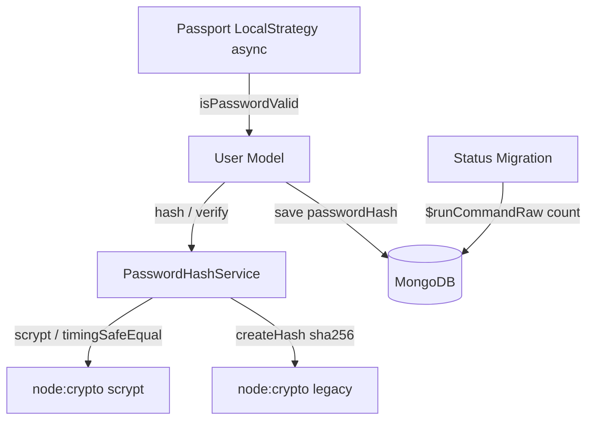
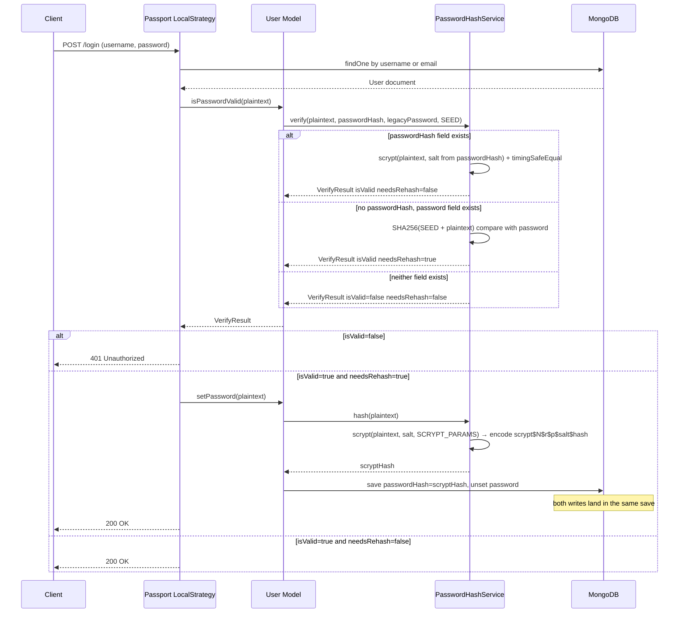
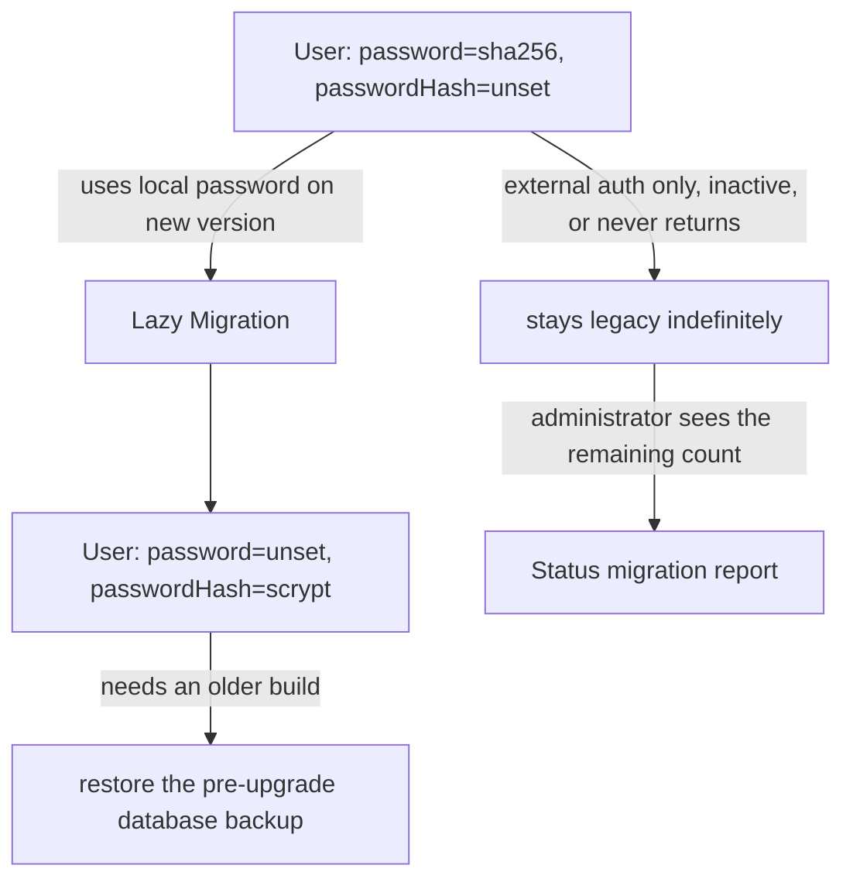
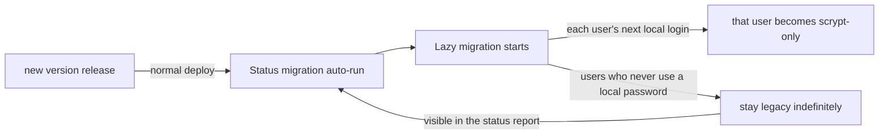

# Design Document: password-hash-upgrade

## Overview

Migrate the password hashing in GROWI's local authentication system from SHA-256 (global `PASSWORD_SEED` pepper, no per-user salt) to **scrypt** from `node:crypto` (a memory-hard KDF with a per-user random salt). This resolves the CodeQL `js/insufficient-password-hash` (CWE-916) alert. scrypt is built into Node.js (OpenSSL), requires no new dependency, and has no native-build issues on Alpine/musl.

The migration is implemented as a **lazy migration**. Existing users are automatically re-hashed to a scrypt hash on their next login, so the migration is seamless and requires no password reset. The two credential fields (`password` = the legacy SHA-256 hash, `passwordHash` = the scrypt self-describing string) are **never both populated on one user**: whenever a scrypt hash is written — by the lazy migration, by a password change or reset, or at user creation — the legacy hash is removed in the same save. A user is therefore always in exactly one of three states (legacy only, scrypt only, no password), and the weak hash leaves the database as each user is migrated.

Returning to a build that cannot verify scrypt is handled by restoring the database backup taken before the upgrade, not by keeping a second credential alive in the database. Keeping the legacy hash to support a program-only rollback would mean keeping the SHA-256 hash of a password that may since have been replaced, which is a credential-revocation hole, and it would require a set of lifecycle scripts to manage and later remove those hashes.

**Users**: GROWI administrators (managing the migration lifecycle) and end users (transparent migration).  
**Impact**: Adds a `passwordHash` field to the User model, makes password verification async throughout the entire stack, and adds one read-only migrate-mongo migration that reports migration progress.

### Goals

- Resolve the CodeQL `js/insufficient-password-hash` (CWE-916) alert
- Apply scrypt (at or above OWASP-recommended parameters, with a per-user salt) for new passwords and password changes
- Allow existing SHA-256 users to continue logging in seamlessly without a password reset
- Remove each user's legacy SHA-256 hash as soon as their scrypt hash is written, so that no user ever holds two credentials
- Let an administrator see how far the migration has progressed

### Non-Goals

- External authentication providers such as LDAP, OAuth, SAML, Passkey
- Improving the hashing of the `apiToken` field
- Immediate deprecation of the `PASSWORD_SEED` environment variable
- Bulk forced migration of all users (batch rehash)
- Supporting a rollback that keeps the upgraded database and reverts only the program (the supported procedure is restoring the pre-upgrade backup)
- Special handling of password length (not needed, since scrypt has no 72-byte truncation limit like bcrypt)

---

## Boundary Commitments

### This Spec Owns

- `PasswordHashService` (`src/server/service/password-hash.ts`): scrypt hash generation, verification, and legacy detection
- The User model's password-related methods (`isPasswordValid`, `setPassword`, `updatePassword`, `isPasswordSet`) — making them async and adding the `passwordHash` field
- Making **all 5 methods** in the User model that call `setPassword` use `await` (`updatePassword`, `activateInvitedUser`, `resetPasswordByRandomString`, `createUserByEmail`, `createUserByEmailAndPasswordAndStatus`)
- Clearing both credential fields in `statusDelete()` (`password` and `passwordHash` are both set to `undefined`/unset, so a deleted user does not retain a valid credential hash)
- Deleting `findUserByEmailAndPassword` (dead code; since no call sites exist, delete it rather than refactoring it into a fetch-then-compare)
- Making the Passport LocalStrategy async and triggering the lazy migration
- **Making all call sites of `isPasswordValid` async**: the 2 locations `passport.ts` (LocalStrategy) and `personal-setting/index.js` (old-password verification on password change)
- **Replacing password-set detection based on the `password == null` proxy with `isPasswordSet()`**: the 3 locations `login.js`, `personal-setting/index.js`, and `user-activation.ts` (to prevent misjudging passwordHash-only users)
- **Preventing `passwordHash` leakage in API responses**: add `passwordHash` to `omitInsecureAttributes()` in `@growi/core`, and add `passwordHash?: string` to the `IUser` interface
- One read-only migrate-mongo migration that reports the user count per credential format
- **The shared password-reset mail flow** (`src/server/service/password-reset/`): extracting `createAndSendPasswordResetOrder` and `sendPasswordResetTemplateEmail` out of `forgot-password.js`. The reset flow is the recovery path this feature's users depend on — a user whose credential cannot be verified after a rollback recovers only through it (Req 4.1) — so this spec owns the extraction even though a single route consumes it
- **The login endpoint's rate-limit key** (`features/rate-limiter/config/index.ts`): correcting it to the fully-mounted path. The key matched nothing before, which only became load-bearing once each unauthenticated attempt costs a ~128MiB / ~100ms scrypt on the libuv pool
- Self-describing encoding of the scrypt hash (`scrypt$N$r$p$salt$hash`) and parameter management (no new dependency; scrypt is built into `node:crypto`)

### Out of Boundary

- Password handling for external authentication providers (LDAP, OAuth, SAML, Passkey)
- Hashing of the `apiToken` field
- The `PasswordResetOrder` model and the mail service themselves (this spec wraps them; it does not change how they work)
- Forced migration of all users (lazy migration only; users who never log in remain on SHA-256)
- **The upgrade guide that Requirement 4.1 calls for**: it is documentation delivered outside this change, so no task in this spec produces it. This spec only guarantees that the behaviour the guide describes is what the code does
- Deprecation of the `PASSWORD_SEED` environment variable. It must stay set for as long as any user still holds a legacy hash, which — because a hash is only removed when that user next uses their local password — may be indefinitely

### Allowed Dependencies

- `node:crypto` (built-in): scrypt (new hash generation and verification) + the SHA-256 legacy verification path + `timingSafeEqual`. **No new dependency is added**
- `crypto.randomBytes` (built-in): generation of the per-user salt
- `migrate-mongo` (the existing migration infrastructure, for the status migration only)
- The existing `PasswordResetOrder` model and mail service, reached only through the shared password-reset module above
- `features/rate-limiter`'s existing config shape (a key correction only; no change to the limiter's mechanism)

### Revalidation Triggers

- Changes to the `password` / `passwordHash` field definitions in the User model
- Changes to the `verify()` / `hash()` interface of `PasswordHashService`
- Changes to the callback signature of the Passport LocalStrategy
- Migrating `user/index.js` to TypeScript (the type definitions would need to be updated)
- Remounting the login endpoint (the rate-limit key matches `req.path` exactly, so a move silently disables the limit)

---

## Architecture

### Existing Architecture Analysis

```
generatePassword(password)          // private function, SHA-256(SEED + plain) → hex
  ↓ called by
User.isPasswordValid(password)     // sync, string compare
User.setPassword(password)         // sync, sets this.password
User.updatePassword(password)      // async, calls setPassword + save
User.findUserByEmailAndPassword()  // queries DB by { email, password: hash } ← problem
User.createUserByEmailAndPasswordAndStatus()

Passport LocalStrategy callback    // sync, calls user.isPasswordValid inline
```

**Why changes are needed**:
1. SHA-256 is a fast hash (CWE-916)
2. `findUserByEmailAndPassword` queries the DB by password hash, so it will no longer work after the scrypt migration (scrypt is non-deterministic because of the salt)
3. All password methods are synchronous, so they cannot accommodate scrypt (the asynchronous `crypto.scrypt`)

### Architecture Pattern & Boundary Map



**New architecture**:
- `PasswordHashService`: a thin service layer supporting both scrypt and legacy. The User model and Passport do not depend on crypto directly
- User model: adds the `passwordHash` field and makes all password methods async
- Passport LocalStrategy: async callback. Receives `needsRehash` from the verify result and triggers the lazy migration
- Status migration: one read-only script on the existing `migrate-mongo` infrastructure

### Technology Stack

| Layer | Choice / Version | Role | Notes |
|-------|-----------------|------|-------|
| Backend / Auth | `node:crypto` scrypt (built-in) | scrypt hash generation and verification | **No new dependency** (bundled with OpenSSL). Memory-hard for GPU resistance. No native build needed on Alpine/musl |
| Backend / Auth | `node:crypto` (built-in) | Legacy SHA-256 verification + `timingSafeEqual` | Same API as the existing code. Used only during the migration period |
| Backend / Model | Mongoose (existing) | User schema + adding the `passwordHash` field | — |
| Backend / Auth | Passport.js (existing) | Making LocalStrategy async | — |
| Infrastructure | `migrate-mongo` (existing) | Running the status migration | — |

---

## File Structure Plan

### New Files

```
apps/app/src/server/models/user/
└── password-hash-format-filters.ts            # shared credential-format filters (null/''-aware):
                                                # upgradedOnly / legacyOnly / noPassword — the single source of
                                                # truth for classifying a user document

apps/app/src/server/service/
├── password-hash.ts                           # PasswordHashService (scrypt + legacy verify, hash)
└── password-reset/                            # shared password-reset mail flow used by the apiv3
    ├── index.ts                               # forgot-password route: createAndSendPasswordResetOrder
    └── send-password-reset-email.ts           # (PasswordResetOrder creation + mail) and
                                                # sendPasswordResetTemplateEmail (template allowlist +
                                                # subject + template vars)

apps/app/src/migrations/
└── 20260724000001-password-hash-status.js     # Req 3.1, 3.2: hash format count report (read-only, migrate-mongo)
                                                # v8: timestamp MUST be later than the latest existing migration (20260721103639)
```

> **Why the status report is a migrate-mongo migration**: it only reads, so running it automatically cannot break a deployment, and it needs no Crowi bootstrap. No standalone administrative script is required by this spec.

### Modified Files

```
apps/app/src/server/models/user/index.js
  — Add passwordHash: String to Mongoose schema
  — Update isPasswordSet() to check either field
  — Make isPasswordValid(password) async → delegates to PasswordHashService.verify()
  — Make setPassword(password) async → writes passwordHash via PasswordHashService.hash()
    and ALWAYS removes the legacy `password` (SHA-256) in the same save, so a user never
    holds two credentials and a replaced password cannot authenticate anywhere
  — await ALL 5 setPassword call sites: updatePassword, activateInvitedUser,
    resetPasswordByRandomString, createUserByEmail, createUserByEmailAndPasswordAndStatus
  — statusDelete(): unset BOTH credential fields on user deletion — set
    password=undefined AND passwordHash=undefined (previously password was scrubbed to
    '' and passwordHash was left, so deleted users would retain a valid credential hash).
    Unset (not '') so verify() and the shared filters treat both as noPassword, not a
    malformed/legacy field (avoids a spurious Req 2.4 WARNING and mis-counting as legacyOnly)
  — DELETE findUserByEmailAndPassword() (dead code: no call sites exist)

apps/app/src/server/models/user/index.prisma.ts
  — serializeSecurely (the Prisma-side counterpart of @growi/core's omitInsecureAttributes)
    must select and then strip passwordHash. Selecting it is required: an omitted field
    cannot be stripped, and the raw scrypt hash otherwise reaches API responses that read
    users through Prisma (e.g. /bookmarks/info)

apps/app/src/server/routes/apiv3/forgot-password.js
  — Both mail sends delegate to the shared password-reset service
    (createAndSendPasswordResetOrder for the request flow, sendPasswordResetTemplateEmail
    for the "reset succeeded" mail)

apps/app/src/features/rate-limiter/config/index.ts
  — Correct the login rate-limit key to the fully-mounted path '/_api/v3/login'.
    The middleware matches req.path EXACTLY, so the old '/login' key (a legacy route that
    no longer exists) matched nothing and login ran at the permissive default —
    unacceptable now that each attempt costs a ~128MiB / ~100ms scrypt on the libuv pool

apps/app/src/server/service/passport.ts
  — Make LocalStrategy callback async
  — Update isPasswordValid call site (line ~285) to await + read VerifyResult.isValid
  — Trigger lazy migration (await user.setPassword(pw) + save) when needsRehash is true;
    the same save removes the legacy hash

apps/app/src/server/routes/apiv3/personal-setting/index.js
  — isPasswordValid call site (line ~432): await user.isPasswordValid(oldPassword)
    → change to !(await user.isPasswordValid(oldPassword)).isValid
    (CRITICAL: !Promise is always false → old-password check would be bypassed)
  — password == null check (line ~702): replace with !user.isPasswordSet()
    (avoid wrongly blocking LDAP account detach for passwordHash-only users)

apps/app/src/server/routes/login.js
  — userData.password == null check (line ~145): replace with !userData.isPasswordSet()
    (avoid redirecting every passwordHash-only user to /me#password_settings)

apps/app/src/server/routes/apiv3/user-activation.ts
  — userData.password != null check (line ~278): replace with userData.isPasswordSet()
    (avoid mis-deciding redirect target for passwordHash-only users)

packages/core/src/models/serializers/user-serializer.ts
  — Add passwordHash to omitInsecureAttributes() omit list (prevent API response leak)

packages/core/src/interfaces/user.ts
  — Add passwordHash?: string to IUser interface

apps/app/package.json
  — No dependency and no script is added (scrypt is built into node:crypto; bcryptjs /
    @types/bcryptjs are unnecessary, and the status report runs through the existing
    migrate-mongo entry point)

(Changes to @growi/core's serializer/IUser require a changeset because it is a published package — see above)
```

---

## System Flows

### Login-time Lazy Migration Flow



### Migration Lifecycle Flow



> A user moves from legacy to scrypt in one step; there is no intermediate state holding both credentials, and therefore no cleanup phase. Users who never use their local password keep their legacy hash, which is what the status report makes visible.

---

## Requirements Traceability

| Requirement | Summary | Components | Interfaces | Flows |
|-------------|---------|------------|------------|-------|
| 1.1 | New passwords use scrypt (OWASP-recommended parameters) + per-user salt | PasswordHashService | `hash()` | setPassword flow |
| 1.2 | Self-describing format (`scrypt$N$r$p$salt$hash`) | PasswordHashService | `hash()` | — |
| 1.3 | Do not use SHA-256+SEED for new passwords | PasswordHashService, User model | `hash()`, `setPassword()` | — |
| 1.4 | Same plaintext → different hash (per-user salt) | PasswordHashService | `hash()` | — |
| 1.5 | Setting / changing / resetting a password removes the legacy hash | User model | `setPassword()` | setPassword flow |
| 2.1 | Legacy SHA-256 users continue to log in | PasswordHashService, Passport | `verify()` | Login flow |
| 2.2 | Automatic rehash on successful legacy login, legacy hash removed in the same transaction | Passport, User model | Lazy migration trigger | Login flow |
| 2.3 | Transparent handling of both formats | PasswordHashService | `verify()` | Login flow |
| 2.4 | Field content does not match any known format (error case) → reject + WARNING log | PasswordHashService | `verify()` | Login flow |
| 2.5 | Password not set (neither field = normal case) → reject, no WARNING output | PasswordHashService | `verify()` | Login flow |
| 3.1 | Status migration: report user count by format (read-only) | Status migration script | Batch | — |
| 3.2 | Status migration: output the counts to standard output | Status migration script | Batch | — |
| 4.1 | Backup restore is the supported way back to a pre-scrypt build | Upgrade documentation (delivered outside this change) | — | — |

---

## Components and Interfaces

| Component | Domain/Layer | Intent | Req Coverage | Key Dependencies | Contracts |
|-----------|-------------|--------|--------------|------------------|-----------|
| PasswordHashService | Server / Auth | scrypt hash generation, verification, and legacy detection | 1.1–1.4, 2.1–2.5 | node:crypto scrypt (P0) | Service |
| User model (password methods) | Server / Model | async password operations, `passwordHash` field, retiring the legacy hash, fixing call sites (isPasswordValid/isPasswordSet) | 1.1, 1.3, 1.5, 2.1, 2.2, 2.3 | PasswordHashService (P0) | Service |
| Passport LocalStrategy | Server / Auth | async verification, lazy migration orchestration | 2.1–2.3 | User model (P0) | Service |
| Status migration script | Infrastructure | tally user count by format (read-only) | 3.1, 3.2 | MongoDB (P0) | Batch |

---

### Server / Auth Layer

#### PasswordHashService

| Field | Detail |
|-------|--------|
| Intent | The single-responsibility boundary for scrypt hash generation and verification of both formats (scrypt / legacy SHA-256) |
| Requirements | 1.1, 1.2, 1.3, 1.4, 2.1, 2.2, 2.3, 2.4, 2.5 |

**Responsibilities & Constraints**

- `hash(plaintext)`: generate a salt with `crypto.randomBytes(16)` → `crypto.scrypt(plaintext, salt, keylen, {N, r, p, maxmem})` → encode and return in the form `scrypt$N$r$p$<salt(base64)>$<hash(base64)>`. SEED is not used
- `verify(plaintext, scryptHash, legacyHash, passwordSeed, context?)`:
  - `scryptHash` exists → parse `scrypt$…` to extract N/r/p/salt, recompute with `crypto.scrypt`, compare with `crypto.timingSafeEqual` → `{ isValid, needsRehash: false }`
    - **(Optional extension) automatic rehash on parameter update**: if the stored parameters (N/r/p) are weaker than the current defaults, return `needsRehash: true` and rehash at login time with the current parameters. Since verify already parses the stored N/r/p for verification, adding a single comparison against the current defaults costs almost nothing. This lets existing users automatically follow along when scrypt parameters are raised in the future (an optional extension to keep Req 1.1's "at or above OWASP-recommended parameters" satisfied even after migration; not required)
  - `scryptHash` does not exist and `legacyHash` exists → compare `SHA256(SEED + plaintext)` with `legacyHash` via `timingSafeEqual` → `{ isValid, needsRehash: true }`
  - Neither field exists (password not set = `noPassword`) → `{ isValid: false, needsRehash: false }`. **This is the normal state for external-auth-only or not-yet-activated users, and no WARNING log is output** (Req 2.5)
  - A field exists but its content does not match a known format (`scrypt$…` prefix / SHA-256 hex) (an error case such as data corruption) → return `{ isValid: false, needsRehash: false }` and output a WARNING log including the user identifier (Req 2.4)
    - **Deliberately no fallback to the legacy path**: when `passwordHash` is present but unparsable, verification is rejected outright — it does NOT retry against the SHA-256 `password` even for a `both` user who still holds a valid one. Which field is present is what decides the format, so an unparsable `passwordHash` is data corruption, not a format hint; silently falling back would both hide the corruption this WARNING exists to surface and let a forged/damaged envelope steer verification onto the weaker scheme. The cost is that such a user cannot log in until the corruption is fixed (password reset remains available), which is accepted: corruption is an abnormal state, and `both` is transient to the migration window
- `SCRYPT_PARAMS`: N/r/p are adjustable via environment variables (defaults **N=131072 (2^17), r=8, p=1 = the OWASP minimum recommendation**; keylen=64). Because it consumes about 128MB per call, `maxmem` must be explicitly set to ≥192MB (if unset, `crypto.scrypt` throws when it exceeds Node's default `maxmem=32MB`)
- scrypt generation and verification use `node:crypto` only. `node:crypto`'s SHA-256 is for the legacy path only

**Dependencies**

- External: `node:crypto` (built-in) — scrypt generation and verification, legacy SHA-256 verification, `randomBytes`, `timingSafeEqual` (P0)
- Inbound: User model, Passport strategy (P0)

**Contracts**: Service [x]

```typescript
// apps/app/src/server/service/password-hash.ts

export interface VerifyResult {
  isValid: boolean;
  needsRehash: boolean;
}

// Optional identity threaded into verify() so the Req 2.4 anomaly WARNING carries a
// user identifier. Optional and backward-compatible — existing 4-arg callers are unaffected.
export interface VerifyLogContext {
  userId?: string;
  username?: string;
}

export interface IPasswordHashService {
  hash(plaintext: string): Promise<string>;
  verify(
    plaintext: string,
    scryptHash: string | undefined,
    legacyHash: string | undefined,
    passwordSeed: string,
    context?: VerifyLogContext,
  ): Promise<VerifyResult>;
}
```

- **Preconditions**: `plaintext` is a non-empty string. The scrypt parameters are at or above the OWASP minimum recommendation (N≥2^17=131072, r=8, p=1). `maxmem` is set to a value (≥192MB) exceeding the consumed memory (≈128MB)
- **Postconditions**: `hash()` returns a self-describing string with the `scrypt$` prefix. `verify()` always returns a `VerifyResult` (does not throw)
- **Invariants**: `needsRehash: true` only when `isValid: true`

**Implementation Notes**

- The scrypt parameters (N/r/p) default to **N=131072 (2^17), r=8, p=1** (the OWASP minimum recommendation), keylen=64. They are adjustable via environment variables, but **a setting below the lower bound (N=2^17) emits a WARNING at startup and is clamped to the lower bound** (to guarantee the security baseline)
- **Managing the memory ceiling**: scrypt consumes about `128 * N * r` bytes per call (**about 128MB** at the default N=2^17). Explicitly set `maxmem` for `crypto.scrypt` to **≥192MB** (**if unset, it exceeds Node's default of 32MB and throws**). Also clamp the parameter upper bound (to prevent memory exhaustion / DoS with an extreme N). Because the asynchronous `crypto.scrypt` runs on the libuv thread pool, the number of concurrent computations is naturally capped by `UV_THREADPOOL_SIZE` (default 4), so the peak memory stays roughly within "number of threads × 128MB ≒ 512MB" (see Security Considerations for details)
- Password not set (neither field = `noPassword`) returns `isValid: false` but outputs no WARNING log (the normal state for external-auth-only / not-yet-activated users; Req 2.5). WARNING is limited to the error case "a field exists but its content does not match a known format," and is output including the user ID (Req 2.4)
- Since scrypt is built into `node:crypto`, no new dependency needs to be added (no consideration of Turbopack externalization is needed either)

---

#### User Model (password methods)

| Field | Detail |
|-------|--------|
| Intent | Delegation to `PasswordHashService` + management of the `passwordHash` field + making call sites async / replacing their detection logic |
| Requirements | 1.1, 1.3, 2.1, 2.2, 2.3 |

**Responsibilities & Constraints**

- Add a `passwordHash: String` field to the schema
- `isPasswordSet()`: check both fields with `!!(this.passwordHash || this.password)`
- `isPasswordValid(password)`: async. Calls `PasswordHashService.verify(password, this.passwordHash, this.password, SEED)`
- `setPassword(password)`: async. Sets `passwordHash = await PasswordHashService.hash(password)` **and always removes the legacy `password` (SHA-256) field** (`this.password = undefined` → `$unset` on save, consistent with `statusDelete()`). There is no option to keep it: every caller — password change, admin reset, user creation, invitation acceptance, and the lazy migration on login — leaves the user `upgradedOnly` (Req 1.5, 2.2). Keeping it would leave the SHA-256 hash of a possibly replaced password able to authenticate on an older build, and would create a second credential nothing ever removes
- Make **all 5 methods** that call `setPassword` use `await` (leaving `save()` without awaiting would save without setting passwordHash, making login impossible):
  - `updatePassword`, `activateInvitedUser`, `resetPasswordByRandomString`, `createUserByEmail`, `createUserByEmailAndPasswordAndStatus`
- `findUserByEmailAndPassword(email, password)`: **delete it** (dead code; no call site exists anywhere in the repository). This method queries the DB by password hash and will no longer work after the scrypt migration, but since there is no call site, deletion (not refactoring) is the appropriate action

**Dependencies**

- Outbound: PasswordHashService — hash / verify (P0)
- External: MongoDB via Mongoose — persistence of the `passwordHash` field (P0)

**Contracts**: Service [x]

```typescript
// Methods added to the User Mongoose document (added to the existing .js file)

isPasswordSet(): boolean
isPasswordValid(password: string): Promise<VerifyResult>
setPassword(password: string): Promise<this>
updatePassword(password: string): Promise<UserDocument>
```

**Implementation Notes**

- `findUserByEmailAndPassword` is dead code with no call sites, so delete it (confirmed with `grep -rn findUserByEmailAndPassword`)
- The 5 methods that call `setPassword` (`updatePassword`, `activateInvitedUser`, `resetPasswordByRandomString`, `createUserByEmail`, `createUserByEmailAndPasswordAndStatus`) are all changed to `await setPassword()`
- The external call sites of `isPasswordValid` are the 2 locations `passport.ts` and `personal-setting/index.js`. Update both to `await` + reading `VerifyResult.isValid` (in particular, `personal-setting`'s `!user.isPasswordValid(...)` is essential because `!Promise` is always false and would bypass the old-password verification)
- The password-set detection based on `password == null` exists in the 3 locations `login.js`, `personal-setting/index.js`, and `user-activation.ts`, and misjudges passwordHash-only users (`password` unset), so replace it with `isPasswordSet()`

---

#### Passport LocalStrategy

| Field | Detail |
|-------|--------|
| Intent | async verification + triggering the lazy migration when needsRehash |
| Requirements | 2.1, 2.2, 2.3 |

**Responsibilities & Constraints**

- Make the LocalStrategy callback async (guarantee done(err) with try/catch)
- Receive the `VerifyResult` of `isPasswordValid(password)`:
  - `isValid=false` → return `done(null, false)`
  - `isValid=true, needsRehash=true` → return `done(null, user)` after `await user.setPassword(password); await user.save()` (that one save writes the scrypt hash and removes the legacy SHA-256 hash together)
  - `isValid=true, needsRehash=false` → return `done(null, user)` as-is

**Dependencies**

- Outbound: User model — `findOne`, `isPasswordValid`, `setPassword`, `save` (P0)

**Contracts**: Service [x]

```typescript
passport.use(
  new LocalStrategy(
    { usernameField, passwordField },
    async (username: string, password: string, done: StrategyCallback): Promise<void> => { ... }
  )
);
```

**Implementation Notes**

- Either change `findUserByUsernameOrEmail` to be Promise-based, or use an async/await wrapper
- Even if the lazy migration `save()` fails, still let the login itself succeed (log the rehash failure; it can be retried on the next login)

---

### Infrastructure Layer (Migration Scripts)

#### Status Migration Script

| Field | Detail |
|-------|--------|
| Intent | Tally and report the user count by format, read-only |
| Requirements | 3.1, 3.2 |

**Contracts**: Batch [x]

```
Trigger: pnpm run migrate:migrate-mongo (the normal migration run at startup)
Input: MongoDB Users collection (read-only)
Output: counts output to standard output (logger.info)
Idempotency: always read-only; safe to run any number of times
```

**Count targets** — the three shared filters from `password-hash-format-filters.ts` (the single source of truth for classifying a user document). A field counts as PRESENT only when it exists **and** is non-empty (`{ $exists: true, $nin: [null, ''] }`); a `null`/`''` value reads as ABSENT — so a `password: ''` scrubbed-deleted user classifies as `noPassword`, **not** `legacyOnly`:
- `upgradedOnlyFilter`: `passwordHash` present, `password` absent — migrated
- `legacyOnlyFilter`: `passwordHash` absent, `password` present — not migrated
- `noPasswordFilter`: both absent — password not set

> There is deliberately no "both present" filter: `setPassword` removes the legacy hash in the same save that writes the scrypt hash, so that state is unreachable.

---

## Data Models

### Domain Model

```
User aggregate:
  password: String | undefined        — legacy SHA-256 hash (removed once the user migrates)
  passwordHash: String | undefined  — scrypt self-describing hash (new field)

Migration state (derived from field existence):
  - legacyOnly:  password=set,   passwordHash=unset  → not migrated
  - upgradedOnly:  password=unset, passwordHash=set    → migrated
  - noPassword:  password=unset, passwordHash=unset  → password not set
```

### Logical Data Model

**Schema change (Mongoose)**:

```javascript
// Added to apps/app/src/server/models/user/index.js
passwordHash: { type: String },  // scrypt self-describing hash (scrypt$N$r$p$salt$hash)
// Existing field:
// password: String  — SHA-256 hash, removed when the user's scrypt hash is written
```

**Index**: No index is needed on the `passwordHash` field (password verification is fetch-then-compare, so it is not used in a DB query)

---

## Error Handling

### Error Strategy

- `PasswordHashService.verify()`: never throws to the caller; it always returns a `VerifyResult`, returning `{ isValid: false, needsRehash: false }` on any internal error. Internal verify() errors and malformed-field anomalies (a stored credential field present but matching no known format) are logged at **WARNING** (Req 2.4), not ERROR
  - **Note on `timingSafeEqual`**: if the stored hash is corrupted and its length differs from the computed result, `crypto.timingSafeEqual` throws. Wrap it in try/catch inside verify and reduce it to a format mismatch (the Req 2.4 error case) as `{ isValid: false }` + WARNING (this path preserves the "verify never throws" invariant)
- Passport LocalStrategy: pass all errors to `done(err)` with try/catch
- Lazy migration failure: log a failure to save the rehash, but let the login itself succeed (it can be retried on the next login)

### Error Categories

| Scenario | Classification | Response |
|---------|------|------|
| Invalid credentials | 401 | `done(null, false)` — same as the existing behavior |
| Unknown-format password field | authentication rejected + WARNING log | Req 2.4 |
| scrypt computation error (maxmem exceeded, etc.) | 500 → `done(err)` | log the error |
| Lazy migration save failure | log only | continue with a successful login |

### Monitoring

- `PasswordHashService.verify()` does **not** emit a per-call INFO when `needsRehash: true`. Emitting one on every legacy verification would spam the log on each legacy login; the migration-progress signal is logged instead at the point migration actually happens (see below)
- Passport LocalStrategy: log successful lazy migration at INFO (the migration-progress signal — one line per user actually rehashed). A lazy-migration save failure is logged, but the login still succeeds and the rehash is retried on the next login
- Migration scripts: output each count to logger at INFO

---

## Testing Strategy

### Unit Tests

1. `PasswordHashService.hash()`: the return value is a `scrypt$`-prefixed self-describing string (NOT a 64-character SHA-256 hex); returns different hashes for the same plaintext (Req 1.1, 1.4)
2. `PasswordHashService.verify()`: cases for the scrypt path (`needsRehash=false`), the SHA-256 path (`needsRehash=true`), invalid credentials, neither field (`isValid=false`, no WARNING), and format mismatch (`isValid=false`, with WARNING) (Req 2.1–2.5)
3. `User.isPasswordValid()`: correctly delegates the verify result
4. `User.setPassword()`: confirm that it sets `passwordHash` **and clears the legacy `password` field on every call** (credential revocation), with no option to retain it

### Integration Tests

1. Passport LocalStrategy: successful login of a legacy SHA-256 user → confirm that `passwordHash` was written (Req 2.1, 2.2)
2. Passport LocalStrategy: successful login of an existing scrypt user → confirm that no rehash occurs (Req 2.3)
3. Passport LocalStrategy: invalid credentials → confirm 401
4. **Password-change authentication-bypass regression (most important)**: confirm that a password change in `personal-setting` succeeds only when the old password is correct, and is rejected when it is wrong/unspecified (regression prevention for the `!Promise` bypass; Req 2.1, 2.2)
5. **passwordHash-only user mis-redirect regression**: confirm that a user with `password` unset and `passwordHash` set is not mis-redirected to `/me#password_settings` after login, and that LDAP detach is not wrongly blocked (regression prevention for the `isPasswordSet()` replacement; Req 2.2, 2.3)
6. **Credential scrubbing for deleted users**: confirm that after `statusDelete()` the `passwordHash` is unset and a deleted user does not retain valid credentials (Req 1.1, 2.2)
7. Status migration script: the user counts per field pattern are tallied correctly
8. **Lazy migration leaves no second credential**: after a legacy-path login succeeds, the stored document has `passwordHash` set **and** `password` unset, in one save — a regression here would recreate the two-credential state the design forbids (Req 2.2)

### Security Tests

1. `PasswordHashService.hash()` does not return a SHA-256 hash (confirm the `scrypt$` prefix and that it is not a 64-character hex string)
2. env-derived scrypt params below the OWASP floor (N=2^17, r=8, p=1) are clamped **up** with a startup WARNING (verified via the exported `resolveScryptParamsFromEnv`; env params above the DoS upper bound are likewise clamped **down** with a WARNING)
3. A stored scrypt envelope whose N/r/p exceed the upper bound — or whose salt/hash byte length is out of range — is **rejected at parse time, before `crypto.scrypt` is invoked** → `{ isValid: false }` + WARNING. So `verify()` never drives an extreme-memory scrypt call and never throws (DoS / memory-exhaustion resistance)

---

## Security Considerations

- **CWE-916 resolution**: `PasswordHashService.hash()` uses only `crypto.scrypt` (a memory-hard KDF) and does not use `crypto.createHash('sha256')` for hash generation (storage)
- **Approach to confirming CodeQL alert (#541) resolution (important)**: for backward compatibility, the legacy path of `verify()` keeps computing `SHA256(SEED + plaintext)` during the migration period (essential for verifying existing users; Req 2.1). Since CodeQL `js/insufficient-password-hash` detects "places where a password flows into a weak hash," **the legacy verification code may be re-flagged even though it is not used for storage**. Therefore, confirm and address alert resolution with the following steps:
  1. After implementation, **re-scan** with CodeQL and confirm whether the alert is actually resolved (assuming the case where it is resolved because the storage path is now scrypt-based)
  2. If the legacy verification path is re-flagged, apply a **justified dismissal** to that location ("legacy hash verification limited to the migration period; not used for new storage"). SHA-256 remains solely for verification, and as long as it satisfies backward compatibility (Req 2), the computation itself cannot be removed (removal = a forced reset for all users, violating the requirement)
  3. **Full green status requires removing the legacy verification code**, which is only possible once no user holds a legacy hash. Nothing in this feature forces that point to arrive — a user who never uses their local password keeps theirs indefinitely — so the dismissal in step 2 stands until an operator confirms, via the status report, that the legacy count has reached zero and a later release deletes the verification path
  - Note that **the security objective (not storing new/changed passwords with weak SHA-256) is reliably achieved at implementation time**. The above concerns the handling of the alert display (the tool-side state)
- **Preventing `passwordHash` leakage in API responses**: the existing `omitInsecureAttributes()` (`@growi/core`) excludes only `password`/`apiToken`/`email` and does not exclude `passwordHash`. In line with adding the new field, add `passwordHash` to the omit list and add `passwordHash?: string` to `IUser` as well. Because `@growi/core` is a published package, `npx changeset` is required when changing it
- **Credential scrubbing for deleted users**: `statusDelete()` unsets both credential fields (`password = undefined` and `passwordHash = undefined`). Previously it scrubbed the legacy credential via `password = ''`; unless `passwordHash` is unset at the same time, a deleted user's scrypt hash (a credential) persists in the DB even after anonymization. To prevent post-migration regression, `statusDelete()` unsets both fields — using `undefined` rather than `''` so the shared filters classify the user as `noPassword`, not `legacyOnly`
- **Per-user salt**: generate a salt per user with `crypto.randomBytes(16)`, embed it in the self-describing string (`scrypt$N$r$p$salt$hash`), and store it (unlike bcrypt, it is not embedded automatically, so generation, encoding, and parsing are implemented ourselves)
- **GPU resistance via memory-hardness**: scrypt requires a large amount of memory, so it is more resistant to GPU/ASIC brute force than SHA-256/bcrypt (OWASP also ranks it above bcrypt)
- **Memory consumption and DoS (operational consideration)**: at the OWASP minimum recommendation (N=2^17, r=8), scrypt consumes **about 128MB** per call. Because the asynchronous `crypto.scrypt` runs on the libuv thread pool (default 4), the number of concurrent computations is naturally capped, and the peak memory stays roughly within "number of threads × 128MB ≒ **512MB**" (it does not become number-of-requests × 128MB). This temporary allocation of around 512MB must be factored into the container's memory budget (check it against GROWI's recommended memory; if it is tight, consider narrowing `UV_THREADPOOL_SIZE`, or the OWASP alternative N=2^16, r=8, p=2 ≒ 64MB/call). As a countermeasure against high-frequency logins (credential stuffing), **rate limiting on the password-verifying endpoints was corrected in this scope** (see the dedicated item below). `maxmem` (≥192MB) and clamping the parameter upper bound also prevent memory exhaustion from extreme settings
- **Rate limiting on the login endpoint (fixed in this scope)**: `features/rate-limiter` matches its endpoint keys against `req.path` **exactly** (`middleware/factory.ts`), so a key that is not the fully-mounted path silently matches nothing and the endpoint falls back to the permissive default (`DEFAULT_MAX_REQUESTS` 500 × `usersPerIpProspection` 5 = 2500 req/min/IP). `/login` was in that state: the legacy `POST /login` route was removed and the live endpoint is `apiV3AuthRouter`'s, mounted at `/_api/v3`, so the key is now **`/_api/v3/login`**. This was latent before — it only became load-bearing once verification cost ~128MiB / ~100ms of scrypt on a libuv thread per unauthenticated attempt. `config/index.spec.ts` pins the mounted path and the effective per-IP ceiling so a remount or a loosened value fails the test
- **Remaining exposure (accepted, not closed here)**: the limiter is keyed per IP (and per user), so a *distributed* credential-stuffing campaign still spends one scrypt per source IP and can saturate the libuv pool — there is no global concurrency cap on password verification. Separately, **only the login key was corrected**: other `defaultConfig` keys are stale in the same way (`/invited`, `/register`, `/user-activation/register`, `/installer`, `/_api/check_username` are all pre-mount, and `POST/PUT /_api/v3/forgot-password` has no key at all while its PUT runs `updatePassword` → scrypt). Several of those are unauthenticated and password-hashing, so they carry the same DoS surface — but they are pre-existing defects unrelated to the hash algorithm, and auditing and correcting them belongs to a separate rate-limiter task, deliberately out of this spec's boundary
- **Limiting the role of PASSWORD_SEED**: after migration, `PASSWORD_SEED` is used only to verify legacy SHA-256 hashes. New hashes do not depend on `PASSWORD_SEED`
- **PASSWORD_SEED has no scheduled end**: it stays required for as long as one user still holds a legacy hash. Because a hash is only removed when that user next uses their local password, external-authentication-only, inactive and departed users keep theirs indefinitely, and the status report is the only way to see how many remain. The existing exported `meta.json` issue is out of scope
- **No password length limit**: scrypt has no 72-byte truncation like bcrypt, so long passwords can also be hashed safely as-is
- **User-enumeration timing attack (known limitation)**: with the introduction of scrypt, a "nonexistent user" returns immediately while an "existing user" takes tens to hundreds of ms, so user existence can be inferred from the time difference. This can be mitigated with a dummy scrypt comparison, which is **not** implemented here. Rate limiting on the login endpoint was checked in this scope and found to be misconfigured (the key did not match the mounted path) — that is now fixed (see the rate-limiting item above), which bounds how fast the timing oracle can be sampled from one IP but does not eliminate it. A dummy scrypt comparison for nonexistent users remains a separate, optional task
- **Constant-time comparison on the legacy path**: the legacy SHA-256 check uses `crypto.timingSafeEqual` (on equal-length buffers, guaranteed by the 64-char hex format check), not `===`. Hash-against-hash comparison made the risk low either way, but both verification paths are now constant-time
- **A replaced password is genuinely revoked**: `setPassword` clears the legacy `password` (SHA-256) field on every call, with no opt-out. Keeping it would mean that an older build could still authenticate the OLD hash — **the credential the user thought they had retired becomes valid again while the new one does not** — which is unacceptable when the reset was motivated by a leak. The trade-off is deliberate and is the reason a program-only rollback is unsupported: losing access is recoverable through a password reset; a revived leaked password is not
- **No process removes a user's only credential**: the legacy hash is only ever removed in the same operation that writes a scrypt hash, so a user is never left with neither. `statusDelete()` is the sole deliberate exception, and it clears both fields because a deleted account must retain no credential at all

---

## Migration Strategy



- **Phase 1** (immediately after the new version release): the status migration auto-runs and lazy migration starts. `PASSWORD_SEED` is still needed. Re-scan with CodeQL and confirm the alert status (if it is not resolved by making the storage path scrypt-based, apply a justified dismissal to the legacy verification lines)
- **Phase 2** (ongoing): users migrate as they use their local password. Check progress with the status migration. There is no phase that removes the remaining legacy hashes in bulk: an administrator who wants the count to reach zero has to get the remaining users to log in or to reset their password
- **Removing the legacy verification path** (a later release, optional): only once the status report shows no legacy hashes left. That release also makes `PASSWORD_SEED` unnecessary and takes the CodeQL alert fully green without a dismissal

**Rollback**: restoring the database backup taken before the upgrade is the supported procedure (Req 4.1); everything written after the upgrade is lost. Reverting the program while keeping the upgraded database is **not** supported — every user who has used their local password since the upgrade is scrypt-only and the older build cannot verify them. Those users are not permanently stranded: they are ACTIVE with no verifiable credential, which is exactly the state `/forgot-password` serves, so recovery is a password reset per affected user.
