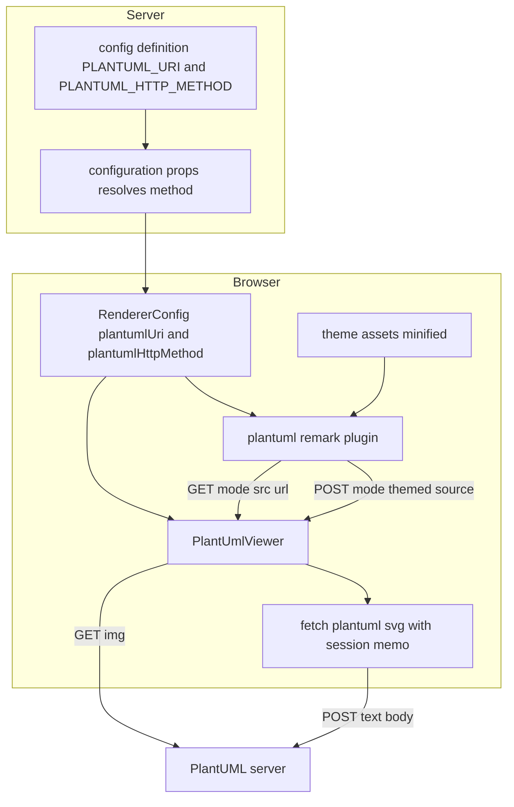
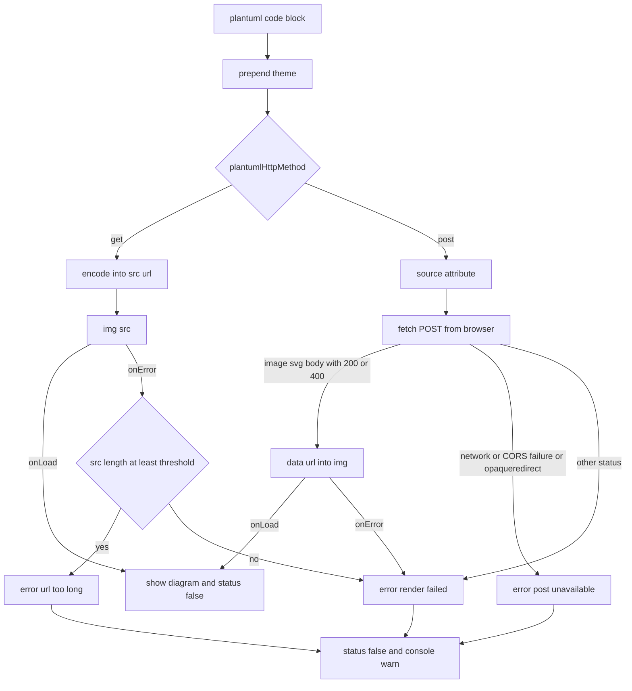

# Technical Design — plantuml

## Overview
**Purpose**: PlantUML 図を、送信先に合った方式（公開 plantuml.com には GET、自前サーバーには POST）で描画し、大きい図も描けるようにする。描けない図は、空のままにせず理由の分かるエラーを図ごとに表示する。
**Users**: GROWI の閲覧者と、PlantUML サーバーの送信先を設定する管理者。
**Impact**: 変更は `features/plantuml` と、設定を画面へ渡す既存の経路に1項目足すだけに収まる。GROWI サーバーには新しい API を作らない。描画のリクエストは今の GET と同じく、閲覧者のブラウザから PlantUML サーバーへ直接送る。

### Goals
- 送信方式を送信先で自動的に選び、管理者は GET を明示指定できる。
- POST では URL 長の上限を受けずに大きい図を描画する。
- どちらの方式でも、すべての図にライト・ダークに応じた GROWI のテーマを付ける（スタイルの洗練とダークモード対応のため）。
- テーマを見た目を変えずに軽量化し、GET で描ける図を増やす（問い合わせの図は GET のままで描けるようにする）。
- GET／POST のどちらでも、描画失敗を図ごとのエラー表示とコンソール警告にする。

### Non-Goals
- GROWI サーバーによる PlantUML サーバーへの中継（キャッシュ・認証・SSRF 対策を含む）。
- PlantUML サーバーや手前のリバースプロキシの上限設定。
- SSR・印刷・PDF 一括エクスポートでの図の描画。現状は GET でも描画していない（SSR 用レンダラは plantuml プラグインを登録しておらず、`page-bulk-export` は plantuml をコードブロックのまま出力する）。本 spec はここを変えない。
- 図の種類ごとのテーマ切り替え、テーマの完全撤去、管理画面の設定 UI。

## Boundary Commitments

### This Spec Owns
- 送信方式の設定 `app:plantumlHttpMethod`（環境変数 `PLANTUML_HTTP_METHOD`）と、送信先から方式を決める判定関数。
- remark プラグイン `plantuml.ts` の GET／POST 分岐と、`<plantuml>` 要素の属性。
- `PlantUmlViewer` の描画（GET は ``、POST はブラウザから取得した SVG を `` で表示）、失敗の検知、エラー表示、コンソール警告、描画中ステータスの遷移。
- ブラウザから PlantUML サーバーへ POST する取得処理と、閲覧中だけ使う取得結果のメモ。
- すべての図へのテーマの付与（ライト・ダーク）と、テーマ資産 `themes/carbon-gray-{common,light,dark}.puml.ts` の軽量化。
- エラーメッセージの i18n キー（5ロケール）。

### Out of Boundary
- GET 用のエンコード処理（`@akebifiky/remark-simple-plantuml`）の中身。
- GROWI サーバーの API・ミドルウェア（本 spec では追加しない）。
- PlantUML サーバーの構築・運用、送信先のネットワーク到達性。

### Allowed Dependencies
- 設定を画面へ渡す既存の経路: `config-definition` → `configuration-props`（通常ページと共有リンクページの両方がここを通る）→ `RendererConfig` → `rendererConfigAtom` / `useRendererConfig()` → `renderer.tsx`。
- `url-join`、`loggerFactory`、`next-i18next` の `useTranslation`、`GROWI_IS_CONTENT_RENDERING_ATTR`。
- ブラウザ標準の `fetch`（SVG の表示に `URL.createObjectURL` は使わない。理由は research.md「SVG は blob URL でなく data URL で表示する」）。GROWI 独自の HTTP クライアント（apiv3 クライアント等）は使わない。独自ヘッダが付くと CORS の事前確認（OPTIONS）が発生するため。

### Revalidation Triggers
- `RendererConfig` の形（`plantumlHttpMethod` の追加）→ `RendererConfig` を作るテストやモック（例: `PageContentRenderer.spec.tsx`）。
- `<plantuml>` 要素の属性の追加・変更 → `sanitizeOption`（rehype-sanitize の許可リスト）。
- テーマ資産の内容 → ライト／ダークの見た目の回帰確認。
- `PLANTUML_URI` の意味や既定値の変更 → 送信方式の判定。

## Architecture

### Existing Architecture Analysis
- `plantuml.ts` の remark プラグインが、`plantuml` コードブロックの先頭にテーマ（ライトかダーク）を付ける。その後 `@akebifiky/remark-simple-plantuml` が `<baseUrl>/svg/<deflate+base64>` の画像ノードにし、プラグインがそれを `<plantuml src>` 要素に置き換える。`plantumlUri` が空なら要素を作らない。
- `PlantUmlViewer` は `` を描くだけで、`onLoad`／`onError` のどちらでも描画中ステータス（`GROWI_IS_CONTENT_RENDERING_ATTR`）を `'false'` にする。成功と失敗を区別していない。
- プラグインと Viewer を登録しているのは `renderer.tsx` の `generateViewOptions`／`generateSimpleViewOptions`／`generatePreviewOptions` の3か所。いずれも `RendererConfig` を受け取っている。
- テーマ資産は文字列を default export するだけの TS モジュールで、特別なローダは無い。

### Architecture Pattern & Boundary Map


**Architecture Integration**
- 方式: 既存の拡張。GROWI サーバー側に新しい API は作らない。
- **送る主体は GET と同じブラウザ**: POST も閲覧者のブラウザから PlantUML サーバーへ直接送る。理由は research.md「中継しない」を参照。
- **方式の決定は1か所**: サーバー側の `configuration-props` が判定関数で `'get' | 'post'` を決めて `RendererConfig` に入れる。ブラウザ側は決まった方式に従うだけで、方式を自分で判定しない。
- **テーマはライト・ダークとも必ず付ける**: GET でも POST でも、すべての図にライトモードならライト用、ダークモードならダーク用のテーマを付ける。テーマは図の見た目を洗練させ、ダークモードで図が浮かないようにするためのもので、URL を縮めるために外すことはしない（検討の経緯は research.md「ライト・ダークともにテーマを付ける（撤廃しない）」）。URL を縮める手段は、見た目を変えないミニファイに限る。
- **テーマはどちらの方式でもブラウザ側で付ける**: 今と同じく remark プラグインが付ける。POST でもサーバー側には何も持たせない。
- **表示はどちらの方式でも ``**: GET は URL、POST は取得した SVG を `data:image/svg+xml;base64,…` にした data URL を `src` にする（blob URL は使わない。理由は research.md「SVG は blob URL でなく data URL で表示する」）。

### 依存の向き
`interfaces`（方式の型・判定関数・定数）→ `services`（remark プラグイン、取得処理）→ `components`（Viewer）。判定関数は副作用のない関数で、サーバーとブラウザの両方から import できる。

### Technology Stack
| Layer | Choice | Role | Notes |
|---|---|---|---|
| Frontend | React（既存） | Viewer の描画・失敗検知・エラー表示 | 新規依存なし |
| HTTP | ブラウザ標準 `fetch` | POST 送信 | `redirect: 'manual'`、`credentials: 'omit'`、ヘッダは `Content-Type: text/plain; charset=UTF-8` のみ |
| Config | 既存 config-manager | `PLANTUML_HTTP_METHOD` | 既定は未設定（＝自動選択） |
| i18n | next-i18next（既存） | エラーメッセージ | 5ロケール |
| Logging | loggerFactory（既存） | コンソール警告 | MermaidViewer と同じ使い方 |

## File Structure Plan

### 新規ファイル
```
apps/app/src/features/plantuml/
├── interfaces/
│   └── http-method.ts          # PlantumlHttpMethod 型、resolvePlantumlHttpMethod()、GET の URL 長の目安値の定数
└── client/services/
    └── fetch-plantuml-svg.ts   # ブラウザから PlantUML サーバーへ POST して結果を返す。閲覧中だけ使う上限付きメモを持つ
```

### 変更ファイル
- `server/service/config-manager/config-definition.ts` — `app:plantumlHttpMethod`（`envVarName: 'PLANTUML_HTTP_METHOD'`、既定値なし）を追加する。
- `interfaces/services/renderer.ts` — `RendererConfig` に `plantumlHttpMethod: PlantumlHttpMethod` を追加する。
- `pages/general-page/configuration-props.ts` — `resolvePlantumlHttpMethod(plantumlUri, 設定値)` の結果を `rendererConfig.plantumlHttpMethod` に入れる。共有リンクページは同じ `rendererConfig` を引き継ぐので追加の変更は要らない。
- `states/server-configurations/server-configurations.ts` — `rendererConfigAtom` の既定値に `plantumlHttpMethod: 'get'` を追加する。
- `client/services/renderer/renderer.tsx` — プラグイン登録3か所に `plantumlHttpMethod` を渡す。
- `features/plantuml/services/plantuml.ts` — 方式で分岐する。GET は今のまま。POST はテーマを付けたソースを `<plantuml>` 要素の属性に入れ、`src` は付けない。`sanitizeOption` に新しい属性を足す。
- `features/plantuml/components/PlantUmlViewer.tsx` — GET／POST の描画、失敗の検知、エラー表示、コンソール警告、描画中ステータスの遷移。
- `features/plantuml/themes/carbon-gray-{common,light,dark}.puml.ts` — ミニファイ（後述）。
- `apps/app/public/static/locales/{en_US,ja_JP,fr_FR,ko_KR,zh_CN}/translation.json` — `plantuml` 名前空間にエラーメッセージ3件を追加する。

## System Flows

### 描画の流れ


**決定事項**
- **方式は送信先で決める**: `resolvePlantumlHttpMethod` は次の順で判定する。(1) 設定値が `get`（大文字・小文字は区別しない）なら `'get'`。(2) 送信先 URL を解析できない、または空なら `'get'`（空のときはプラグインがそもそも要素を作らない）。(3) ホスト名が `plantuml.com` か `*.plantuml.com` なら `'get'`。(4) それ以外は `'post'`。ホスト名は完全一致か `.plantuml.com` で終わるかで比べ、`plantuml.com.example.org` のような部分一致を誤判定しない。
- **POST の応答の扱い**:
  - `Content-Type` が `image/svg+xml` の応答は、ステータスが 200 でも 400 でも「図」として表示する。PlantUML は構文エラーのとき、400 と一緒にエラーを描いた SVG を返すため。
  - `fetch` が例外になった場合（接続できない、CORS の許可が無い、混在コンテンツで止められた）と、`res.type === 'opaqueredirect'`（サーバーがリダイレクトを返した＝POST を受け付けない。公開 plantuml.com はこの挙動）は、「POST が使えない」失敗とする。
  - それ以外の応答（5xx、手前のプロキシの 413 など）は、一般的な描画失敗とする。
- **`redirect: 'manual'` を使う**: `'follow'` のままだと、POST 非対応のサーバーが返す見本の図（例: plantuml.com の「Bob -> Alice : hello」）が黙って表示される。`'error'` だと、接続失敗と同じ例外になり区別できない。
- **GET の失敗は onError で検知する**: ブラウザは `` の HTTP ステータスを読めない。URL が上限を超えたときは、サーバーが画像でない応答（Tomcat の HTML の 400）を返すので onError になる。メッセージを選ぶときだけ、`src.length` が目安値以上かどうかで「URL 長の上限を超えた可能性が高い」を選ぶ。目安値でリクエストを止めることはしない（止めると、上限を上げた自前サーバーで描ける図まで消えるため）。
- **描画中ステータスは、成功・失敗・取得失敗のどの終わり方でも `'false'` にする**: 取得失敗のときは `` が作られず onLoad／onError が起きないので、明示的に切り替える。

## Requirements Traceability
| Requirement | Summary | Components | Flows |
|---|---|---|---|
| 1.1–1.4 | 送信先による方式の自動選択 | http-method（判定関数）, configuration-props, plantuml.ts | 方式判定 |
| 2.1–2.3 | GET の明示指定 | config-definition, http-method | 方式判定 |
| 3.1–3.5 | POST での描画 | plantuml.ts, fetch-plantuml-svg, PlantUmlViewer | POST 経路 |
| 4.1 | SVG の安全な表示 | PlantUmlViewer | `` 表示 |
| 5.1–5.5 | ライト・ダークのテーマ付与（スタイルの洗練・ダークモード） | plantuml.ts, theme assets | テーマ付加 |
| 5.6 | テーマの軽量化 | theme assets | テーマ付加 |
| 5.7 | 軽量化効果の実測 | theme assets（実測スクリプト） | — |
| 6.1–6.7 | エラー表示・警告・i18n | PlantUmlViewer, fetch-plantuml-svg, locales | 失敗分岐 |
| 7.1–7.2 | 自動スクロールとの連携 | PlantUmlViewer | ステータス遷移 |
| 8.1–8.2 | 重複送信の抑制 | fetch-plantuml-svg（メモ） | POST 経路 |
| 9.1–9.2 | GET 環境の互換性 | http-method, plantuml.ts, PlantUmlViewer | GET 経路 |

## Components and Interfaces

| Component | Layer | Intent | Req | Contracts |
|---|---|---|---|---|
| http-method | Shared | 方式の型・判定関数・目安値の定数 | 1, 2, 6.2, 9 | Service |
| plantumlHttpMethod config | Config | 設定と画面への受け渡し | 1, 2 | State |
| plantuml.ts（remark） | Client/transform | 方式で `<plantuml>` 要素の形を変える | 1.4, 3.1, 5, 9 | State |
| fetch-plantuml-svg | Client/service | POST 送信、応答の分類、閲覧中のメモ | 3, 6.3, 6.4, 8 | Service |
| PlantUmlViewer | Client/UI | 描画・失敗検知・エラー表示・ステータス遷移 | 3.4, 3.5, 4, 6, 7 | State |
| theme assets | Client/asset | ライト・ダークのテーマと、その軽量化（ミニファイ） | 5 | State |
| locales | Client/i18n | エラーメッセージ3件 × 5ロケール | 6.7 | State |

### http-method — 新規
```typescript
// features/plantuml/interfaces/http-method.ts
export type PlantumlHttpMethod = 'get' | 'post';

// configured: value of PLANTUML_HTTP_METHOD (undefined when unset)
export function resolvePlantumlHttpMethod(
  plantumlUri: string,
  configured: string | undefined,
): PlantumlHttpMethod;

// Used only to choose the error message after a GET failure; never blocks a request.
export const PLANTUML_GET_URL_LIKELY_TOO_LONG: number;
```
- 判定の順序は「System Flows / 決定事項」のとおり。
- 目安値は 6800 とする（タスク 1.2 の実測。根拠は research.md）。公開 plantuml.com へブラウザ相当のヘッダで送ると、`src.length`（URL 全体の長さ）が約 7,026 から失敗する。上限の正体は Tomcat の `maxHttpHeaderSize` 既定値 8192（リクエスト行とヘッダの合計）で、途中の Cloudflare などがヘッダを足すため、URL だけで測ると 8192 より短い値で失敗する。

### plantumlHttpMethod config — 新規
- `config-definition.ts` に `'app:plantumlHttpMethod': defineConfig<string | undefined>({ envVarName: 'PLANTUML_HTTP_METHOD', defaultValue: undefined })` を追加する。
- `configuration-props.ts` で `resolvePlantumlHttpMethod(getConfig('app:plantumlUri'), getConfig('app:plantumlHttpMethod'))` を呼び、結果を `rendererConfig.plantumlHttpMethod` に入れる。

### plantuml.ts（remark プラグイン）— 変更
```typescript
type PlantUMLPluginParams = {
  plantumlUri: string;
  plantumlHttpMethod: PlantumlHttpMethod;
  isDarkMode?: boolean;
};
```
- どちらの方式でも、コードブロックの先頭にテーマを付ける（今と同じ）。
- **GET**: 今のまま。`<plantuml src="<url>" data-growi-is-content-rendering="true">`。
- **POST**: テーマを付けたソースを、図のソースを持つ属性（例 `source`。名前は実装で決める）に入れた `<plantuml>` 要素を作る。`src` は付けない。GET 用のエンコードは行わない。
- `plantumlUri` が空のときは、どちらの方式でも要素を作らない（今と同じ）。
- `sanitizeOption` の `plantuml` 属性の許可リストに、ソース用の属性を追加する。

### fetch-plantuml-svg — 新規
```typescript
type PlantumlSvgResult =
  | { ok: true; dataUrl: string }
  | { ok: false; reason: 'post-unavailable' | 'render-failed'; status?: number };

// POST the themed source from the browser to `${plantumlUri}/svg`.
export function fetchPlantumlSvg(
  plantumlUri: string,
  themedSource: string,
): Promise<PlantumlSvgResult>;
```
- 送信: `fetch(urljoin(plantumlUri, '/svg'), { method: 'POST', body: themedSource, headers: { 'Content-Type': 'text/plain; charset=UTF-8' }, redirect: 'manual', credentials: 'omit' })`。
  - `charset=UTF-8` は必ず付ける。plantuml-server の `doPost` は文字コードを決めていないので、付けないと ISO-8859-1 として読まれ、日本語が文字化けする。
  - ヘッダはこれだけにする。`Content-Type` が `text/plain` なら、ブラウザは事前確認（OPTIONS）を送らない。
- 応答の分類は「System Flows / 決定事項」のとおり。
- **閲覧中のメモ**: キーはテーマ付きソース（テーマにライト／ダークの違いが含まれる）。値は取得中の Promise。同じ図を同時に表示しても送信は1回にまとめる。件数に上限（目安 50件）を設け、超えたら古いものから捨てる（`Map` の挿入順を使い、新しい依存は足さない）。失敗した結果は残さず、次に表示したときは送り直す。
- 成功の結果は、`data:image/svg+xml;base64,` で始まる data URL の文字列にして返し、メモにもその文字列を持つ。応答の Content-Type が SVG であることは確認済みなので、接頭辞は取得処理が固定で付ける。Viewer は blob URL を作らない（解放の処理も要らない）。

### PlantUmlViewer — 変更
```typescript
type PlantUmlViewerProps = {
  src?: string;     // GET mode
  source?: string;  // POST mode: themed diagram source
};
```
- **送信先は `useRendererConfig().plantumlUri` から取る**。要素の属性からは取らない。`plantuml` タグと属性は rehype-sanitize で許可されているので、ページの作者も書けてしまうため。`useRendererConfig` は通常ページ・共有リンクページ・エディタのプレビューのどれでも、レンダラを作るときに使われている。
- **GET**（`src` がある）: ``。`onLoad` で成功。`onError` で失敗とし、`src.length >= PLANTUML_GET_URL_LIKELY_TOO_LONG` なら理由を `url-too-long`、そうでなければ `render-failed` にする。
- **方式の選び方**: `useRendererConfig()` の `plantumlHttpMethod` が `'post'`、かつ `plantumlUri` が空でなく、かつ `source` があるときだけ POST にする。それ以外は、`src` があれば GET、どちらも無ければ何も描かない（外側の描画中ステータスの要素も作らない）。`source` は rehype-sanitize の許可リストを通るので、ページの作者が手書きでき、プラグインが作った要素と区別できない。そのため、`source` の有無だけで方式を決めない（GET の環境で POST が飛ぶ、送信先が空のときにページ相対のパスへ POST が飛ぶ、のを防ぐ）。
- **POST**（上の条件を満たす）: 表示時に `fetchPlantumlSvg` を呼ぶ。成功なら、受け取った data URL を `` に入れる。取得中は、直前に成功した図があればそれを表示し続ける（エディタのプレビューで、ソースが変わるたびに図が消えて下の本文がずれるのを防ぐ。GET は新しい画像が届くまで古い画像を表示し続けるのと同じ）。古いソースの結果が後から返ってきたら捨てる。失敗なら、結果の理由（`post-unavailable` か `render-failed`）でエラーにする。`` の `onError` は `render-failed`。
- **エラー表示**: 画像の代わりに、`t('plantuml.<理由>')` のメッセージを図の位置に出す。他の図や本文には影響しない。
- **コンソール警告**: `loggerFactory('growi:features:plantuml:PlantUmlViewer')` で、理由・方式・大きさ（GET は `src.length`、POST はソースの長さ、POST の場合は応答ステータスも）を `warn` で出す。
- **描画中ステータス**: 成功・失敗・取得失敗のどの場合も `GROWI_IS_CONTENT_RENDERING_ATTR` を `'false'` にする。

### theme assets — 変更
- **役割**: すべての図に付ける GROWI のテーマ。ライト用とダーク用があり、共通部分を common にまとめている。図の見た目を洗練させ、ダークモードでは背景・文字・線をダーク向けの配色にする。本 spec はこの役割を変えず、中身を小さくするだけにする。
- **ミニファイが主な手段**: 行頭が `'`／`''` の PlantUML コメント行、行頭の空白、空行を取り除く。`!$VAR = '...'` のように `'` が行頭にない行は文字列リテラルなので残す。配色・skinparam・`<style>` の定義は1つも消さないので、ライト／ダークとも全図種の見た目は変わらない。
- **理由を書いたコメントは消す前に移す**: 回避策の理由を記録したコメントがある。代表は `ParticipantPadding`／`Padding` を skinparam で書かない理由（書くと全図に "Please use CSS style instead of skinparam" 警告が描き込まれる #11258、汎用 `Padding` に効く CSS が無い plantuml/plantuml#2622）と、`sequenceDiagram` の `Padding`／`Margin` の注記。これらは、テンプレートリテラルの外（ファイル先頭の TSDoc）へ移す。何をしているかを繰り返すだけのコメント（`' Colors` など）は消してよい。
- **追加で削る手段は、実測で足りない場合だけ**: 非 UML 図種の `<style>` 定義（board/gantt/json/mindmap/salt/wbs/wire/yaml）を消すと、その図種のダーク配色が失われる（`<style>` が唯一の色付け手段で、全体の既定文字色は無く背景は透明）。採用するのは、ミニファイだけでは問い合わせの図が上限に収まらないと分かった場合に限る。その場合も、ダーク用の既定色を補う対策と組にする。`sequenceDiagram` と `timingDiagram` は UML 図なので常に残す。

### locales — 変更
`plantuml` 名前空間に3件を追加する（キー名は実装で確定してよい）。
- `url-too-long`: 図が大きすぎて PlantUML サーバーの URL 長の上限を超えた可能性が高い。図を分割するか簡略化する。
- `post-unavailable`: PlantUML サーバーが POST に対応していないか、ブラウザから接続できない可能性がある。管理者は `PLANTUML_HTTP_METHOD=get` で GET 方式に戻せる。
- `render-failed`: PlantUML サーバーで図を描画できなかった（サーバーに接続できない、またはサーバーのエラー）。

## Error Handling
| 状況 | 検知方法 | 理由 | 表示 |
|---|---|---|---|
| GET で URL が上限超過 | `` onError ＋ `src.length` が目安値以上 | `url-too-long` | 分割・簡略化を案内 |
| GET でその他の失敗 | `` onError（目安値未満） | `render-failed` | 一般的な失敗 |
| 構文エラー（GET／POST とも） | 400 ＋ `image/svg+xml` | — | PlantUML が描いたエラー画像を図として表示 |
| POST で接続できない／CORS の許可が無い／混在コンテンツ | `fetch` の例外 | `post-unavailable` | GET 明示指定を案内 |
| POST でサーバーがリダイレクト | `res.type === 'opaqueredirect'` | `post-unavailable` | GET 明示指定を案内 |
| POST でその他の応答（5xx、413 など） | SVG 以外の応答 | `render-failed` | 一般的な失敗 |

GET で構文エラーの SVG（ステータス 400）を `` が表示するのか、onError になるのかは、まだ実ブラウザで確かめていない（タスク 4.2 で実測する）。onError になる場合も、目安値未満なら `render-failed` になるので、誤って「URL 長超過」とは表示しない。

## Testing Strategy

### Unit
- `http-method.spec.ts`: `resolvePlantumlHttpMethod` を `it.each` で検証する。
  - 設定値 `get`／`GET` → `'get'`
  - 未設定で、`https://www.plantuml.com/plantuml` と `https://plantuml.com/plantuml` → `'get'`
  - `http://localhost:8080/plantuml` と `https://plantuml.example.com` → `'post'`
  - `https://plantuml.com.example.org` → `'post'`（部分一致で誤判定しない）
  - 空文字、解析できない文字列 → `'get'`
  - 設定値 `post` や `foo` → 無視して自動選択
- `plantuml.spec.ts`:
  - GET では、今と同じテーマ付き＋エンコード済みの `src` を持つ要素になる。
  - POST では `src` が無く、テーマ付きソースの属性を持つ要素になる。
  - `sanitizeOption` がその属性を許可している。
  - `plantumlUri` が空ならどちらの方式でも要素を作らない。
  - ミニファイ後のテーマでは、コメント行と空行が消え、配色定義（非 UML の `<style>` を含む）が残り、テーマ付きソースが短くなっている（ライト／ダークで `it.each`）。
  - `skinparam ParticipantPadding`／`skinparam Padding` がテーマに戻っていない。
- `fetch-plantuml-svg.spec.ts`（`fetch` をモック）:
  - 200＋SVG → ok。400＋SVG → ok。
  - opaqueredirect → `post-unavailable`。`fetch` の例外 → `post-unavailable`。500 → `render-failed`。
  - 送信内容が `redirect: 'manual'`、`credentials: 'omit'`、ヘッダは `Content-Type: text/plain; charset=UTF-8` だけになっている。
  - 同じソースの2回目は送信しない。同時の2回の表示でも送信は1回。
  - 上限を超えると古いものが捨てられる。失敗はメモに残らない。

### Component
- `PlantUmlViewer.spec.tsx`:
  - GET の load で画像を表示する。
  - GET の error で、`src` が長ければ `url-too-long`、短ければ `render-failed` を表示する。
  - POST の成功で data URL の `` を表示する。`URL.createObjectURL` を呼ばない。
  - POST の `post-unavailable`／`render-failed` でそれぞれのメッセージを表示する。
  - どの分岐でも描画中ステータスが `'false'` になる。
  - `logger.warn` が呼ばれる。
  - 複数の Viewer のうち1つが失敗しても、他は表示される。
  - 送信先は `useRendererConfig` の値を使い、要素の属性は使わない。
  - 方式が GET の設定で `source` だけの要素 → 送信せず何も描かない。送信先が空で `source` がある → 送信せず何も描かない。
  - POST でソースが変わったとき、新しい結果が届くまで古い図を表示し続け、古いソースの結果が後から届いても捨てる。
- `PageContentRenderer.spec.tsx` ほか `RendererConfig` のモックに `plantumlHttpMethod` を追加する。`config-definition` のキー一覧のテストを更新する。

### 実測・手動確認
- 軽量化の効果（タスク 1.2）: 問い合わせの図の GET 用 URL の長さを、軽量化の前後で測る。公開 plantuml.com で 200 になることを、失敗し始める長さとあわせて確かめる。
- 実ブラウザでの確認（タスク 4.2）:
  - 公開 plantuml.com: GET で描画される。大きすぎる図はエラー表示になる。構文エラー（400＋SVG）が `` でどう見えるかを確かめる。
  - 自前の plantuml-server（`plantuml/plantuml-server:jetty` を docker で起動）:
    - 未設定で POST になり、GET では URL が長すぎる図が描画される。
    - 日本語が文字化けしない。
    - 構文エラーのときにエラー画像が出る。
    - `PLANTUML_HTTP_METHOD=get` で GET に戻る。
- ライト／ダークの見た目の回帰（主要な図種と、非 UML 図種）。

## Security Considerations
- **送信先は設定値だけ**: 送信先は `PLANTUML_URI` だけから決め、ページ本文の属性からは取らない（Req 3.4）。GROWI サーバーは PlantUML へ送らないので、SSRF の新しい経路はできない。
- **XSS**: SVG は `` でだけ表示する。画像として表示した SVG の中のスクリプトは実行されない。インライン SVG にはしない。さらに SVG は blob URL でなく data URL で表示する。blob URL は GROWI と同じ生成元になり、「画像を新しいタブで開く」で開かれると SVG 内のスクリプトが GROWI の権限で動くため。data URL の文書は生成元がどのサイトにも属さないので、新しいタブで開かれても GROWI の権限は使えない（主なブラウザは、さらにページとしての表示そのものを止める）。
- **Cookie を送らない**: `credentials: 'omit'` で PlantUML サーバーへ Cookie を送らない。図のソースが送信先に渡るのは、今の GET と同じ。
- **CORS**: plantuml-server は図の応答に `Access-Control-Allow-Origin: *` を付ける。ブラウザは Cookie の無い応答を読める。

## Performance & Scalability
- GROWI サーバーの負荷は増えない（PlantUML へのリクエストを中継しない）。
- POST の応答はブラウザの HTTP キャッシュに入らない。閲覧中のメモで同じ図の送り直しを防ぐ。ページを開き直すと送り直すので、自前の PlantUML サーバーへのリクエストは GET より増えることがある。
- エディタのプレビューでは、入力のたびにソースが変わって送信が起きる。GET でも入力のたびに `` の URL が変わって取得が起きるので、送信の回数は同じ程度。メモは件数に上限があるので、入力途中のソースが溜まり続けることはない。
- テーマの軽量化で、GET の URL とページの転送量が全図で減る。
