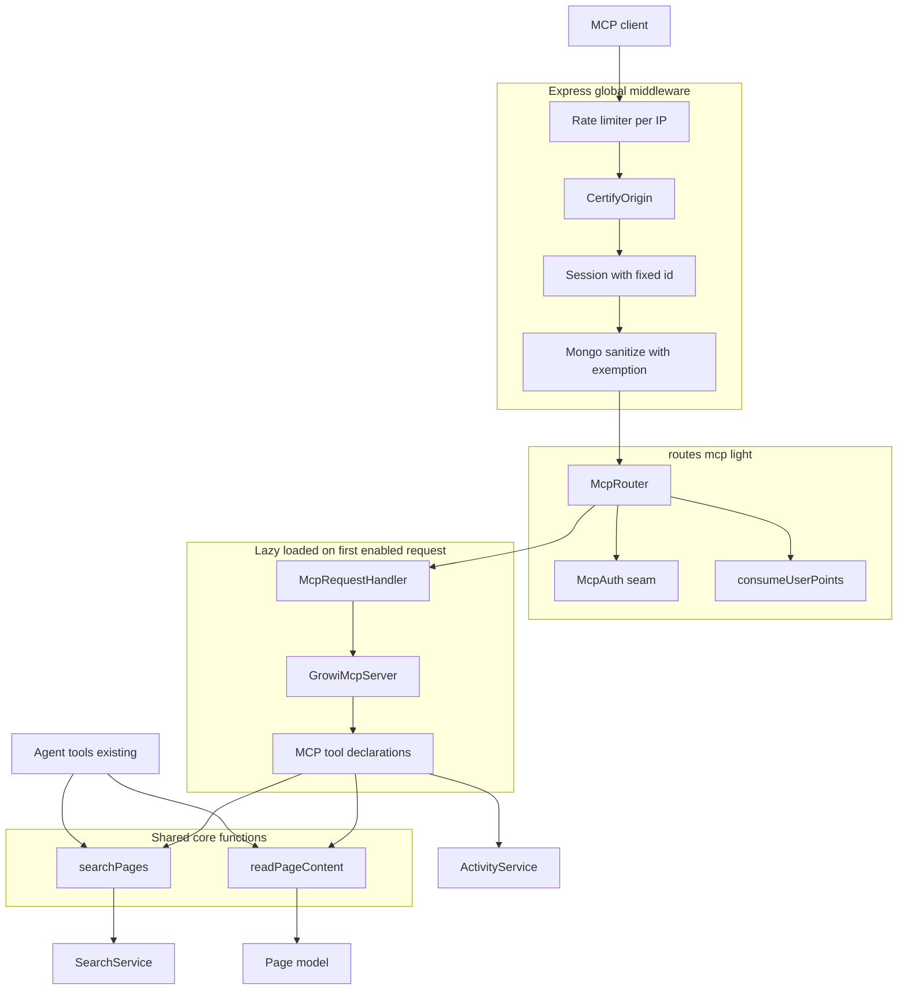
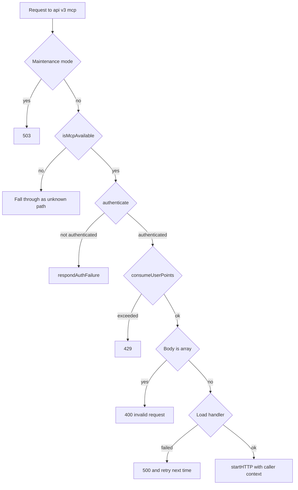
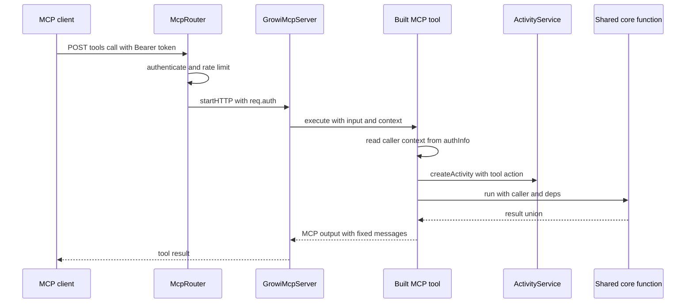

# Design Document: remote-mcp-server-route

## Overview

**Purpose**: GROWI 本体に MCP エンドポイント `/_api/v3/mcp` を追加し、MCP クライアントが、トークンの持ち主の閲覧権限の範囲で wiki を全文検索し、ページの本文を読めるようにする。

**Users**: 管理者は、AI 連携の管理ページで MCP 連携を切り替える。開発者・検証者は、アクセストークンを MCP クライアントに設定して接続する。この spec は単独ではリリースしない。リリース時の認証は `remote-mcp-server-oauth` が差し替える。

**Impact**: `features/mastra` に、MCP のルート・MCP 用のツール定義・管理 API・管理画面の節を足す。既存の全文検索ツールとページ本文取得ツールから処理の中身を関数として取り出し、エージェント用のツールと MCP 用のツールが同じ関数を呼ぶ形にする。全リクエストに関わる変更は 3 つある: `mongoSanitize` の除外パス、固定のセッション ID のパス、回数制限の既定の設定。どれも対象を `/_api/v3/mcp` の 1 パスに限る。

### Goals

- MCP 連携が有効なとき、`/_api/v3/mcp` が MCP の Streamable HTTP として、2026-07-28 版と 2025 年の各版のクライアントに応答する。
- 利用者の特定（認証）を 1 つの差し込み口に閉じ込め、`remote-mcp-server-oauth` が、ツール・回数制限・Activity を変えずに中身を差し替えられるようにする。
- ページの閲覧権限の判定を、エージェント用のツールと MCP 用のツールで 1 か所に保つ。
- MCP 連携を一度も有効にしていない GROWI では、`@mastra/mcp` を読み込まない。

### Non-Goals

- 認可サーバーの案内（`/.well-known/*`、401 の `WWW-Authenticate`）、トークンの発行・失効（`remote-mcp-server-oauth`）。
- 書き込みを伴うツール、エージェントの公開。
- `/_api/v3/mcp` だけ本文サイズの上限を下げること。本文は、ルートに届く前にグローバルの `bodyParser.json`（上限 50 MB）が読み終えている。ルートで上限を見ても、メモリの消費は防げない。上限を下げるなら全 API に関わる変更になるので、この spec では扱わない。
- ブラウザの中から直接つなぐ MCP クライアントへの対応（CORS の応答ヘッダー）。

## Boundary Commitments

### This Spec Owns

- `/_api/v3/mcp` のリクエストの処理の流れ: MCP 連携が動く状態かどうかの判定（`isMcpAvailable`）、認証の呼び出し、利用者単位の回数制限、バッチの拒否、`MCPServer` への受け渡し。
- **認証の差し込み口の型**（`McpAuth`）と、その暫定の中身（アクセストークンでの認証、チャレンジなしの 401）。
- MCP 用のツール定義（名前・説明・annotation・出力の形）と、ツール呼び出しの Activity の記録。
- 既存の 2 ツールから取り出した共有関数 `searchPages` と `readPageContent`。
- 設定キー `app:mcpEnabled`、管理 API `/_api/v3/mcp-settings`、AI 連携の管理ページの MCP の節。
- 要求するスコープの宣言（`MCP_REQUIRED_SCOPES`）と、エンドポイントのパスの宣言（`MCP_ENDPOINT_PATH`）。
- Activity のアクション 3 つと、監査ログのカテゴリ `Mcp`。

### Out of Boundary

- 認可サーバーが発行するトークンの検証、401 への認可サーバーの案内の追加、well-known（`remote-mcp-server-oauth`）。
- アクセストークンの発行・失効・一覧、`accessTokenParser` の約束。この spec は `accessTokenParser` を変更しない。MCP エンドポイント（`/_api/v3/mcp`）の認証では使わない。管理 API（`/_api/v3/mcp-settings`）は、他の管理 API と同じく `accessTokenParser` を使う。
- 全文検索とページ閲覧の権限判定そのもの（`SearchService`、`Page.findByIdAndViewer` / `findByPathAndViewer`）。
- エージェント用のツール（`fullTextSearchTool`、`getPageContentTool`、`limitedSearchTool`）の入出力の約束。取り出しの前後で変えない。
- 監査ログの記録対象を決める仕組み（グループ、追加・除外の設定）。

### Allowed Dependencies

- `@mastra/mcp` 2.8.x（新規。`~2.8.0` で固定）、`@mastra/core/tools` の `createTool`。どちらも遅延ロードの内側でだけ読み込む。
- `AccessToken` モデルと `extractBearerToken`（暫定の認証の中身だけが使う）。
- `features/rate-limiter` の公開の口（この spec が `consumeUserPoints` を足す）。
- `crowi.searchService`、`crowi.activityService.createActivity`、`configManager`、`Page` モデル。
- 依存の向き: `interfaces` → `server/services/mastra-modules/tools`（共有関数）→ `server/services/mcp` → `server/routes/mcp`。逆向きの import はしない。`server/services/mcp` は Express に依存しない。

### Revalidation Triggers

次の変更は、`remote-mcp-server-oauth` の再確認を要する。

- `McpAuth` の型（`authenticate` の戻り値、`McpAuthFailureReason` の種類、`respondAuthFailure` の引数）の変更。
- `MCP_ENDPOINT_PATH` または `MCP_REQUIRED_SCOPES` の値の変更。認可サーバーのメタデータ・同意画面・トークンの宛先が同じ値を使う。
- `app:mcpEnabled` の意味の変更（「MCP 連携全体」を 1 つで切り替える前提）。
- `isMcpAvailable` の条件の変更（有効で、かつサイト URL が設定済み）。認可サーバーのエンドポイントも、同じ関数で応答するかどうかを決める。
- ルートの処理の順序の変更（認証より前に利用者単位の処理を置く、など）。

次の変更は、`ai-agentic-search` と `change-proposal-ai-agent` の再確認を要する。

- `searchPages` / `readPageContent` の結果の型の変更。エージェント用のツールが、この結果を既存の出力へ写している。

## Architecture

### Existing Architecture Analysis

- **`features/mastra` のルーター**（`/_api/v3/mastra`）は、全体に `aiReadyGuard` をかけ、最初のリクエストでハンドラ群を動的に読み込む。MCP は LLM の設定を必要としないので（1.8）、このルーターの下には置かない。遅延ロードの形（Promise を保持し、失敗したら捨てる）は同じものを使う。
- **`features/mastra` の中のコードを別の URL にマウントする前例**は `routes/admin-ai-settings`（`/_api/v3/ai-settings`）にある。管理 API はこれに倣う。
- **`/_api` 配下の共通処理**: `/_api/v3/mcp` は、ルートに届く前に次を通る。
  - グローバルの回数制限（IP 単位。認証前なので利用者は分からない）
  - `CertifyOrigin`: `Origin` ヘッダーが GROWI のオリジンと違う JSON の POST を拒否する。`Origin` を送らないリクエストは通す。
  - セッション、csurf、passport: csurf と passport はセッションがあることを前提にしており、セッションを通さないとエラーになる。そのため `avoid-session-routes` は使えない。
  - `mongoSanitize`: 本文から、`.` を含むキーと `$` で始まるキーを削除する。2026-07-28 版のリクエストは `params._meta` に `.` を含むキーを必ず持つので、そのままでは全件が拒否される。
- **既存の 2 ツール**は、モジュールの読み込み時に作られる定数で、`searchService` を requestContext から読む。`MCPServer` 経由の requestContext には `searchService` が入らない。また 2 ツールとも、例外の文面（`err.message`）をそのまま結果に入れる。

### Architecture Pattern & Boundary Map



**Architecture Integration**:

- **Selected pattern**: 軽いルーター（起動時に読み込まれる）と、重いハンドラ（最初の有効なリクエストで読み込まれる）の 2 層。認証は、型で定めた差し込み口に置く。
- **Domain boundaries**: 「誰のリクエストか」を決めるのは `McpAuth` だけである。それより後ろ（回数制限、ツール、Activity）は、渡された利用者だけを見る。`req.user` は見ない。
- **Existing patterns preserved**: 遅延ロードと再試行の形、管理 API のミドルウェアの並び（`activity-recording` のルール）、フレームワークの包みから中身を関数として取り出す規約、実行役は対象の一覧を引数で受け取る規約。
- **New components rationale**: 下の Components 表を参照。
- **Steering compliance**: `server-boot-imports`（遅延ロードと drift spec）、`activity-recording`、`package-dependencies` に従う。

### Technology Stack

| Layer | Choice / Version | Role in Feature | Notes |
|-------|------------------|-----------------|-------|
| Backend | `@mastra/mcp` `~2.8.0` | `MCPServer`（Streamable HTTP、`legacy: 'stateless'`） | 新規の依存。2.9 以降は `@mastra/core` 1.83 以上を要求するので 2.8 系に固定する |
| Backend | `@mastra/core` 1.80.x（既存） | `createTool` | 変更なし |
| Backend | Express（既存） | ルーター、ミドルウェア | `express-init.js` に 1 か所の変更 |
| Data | MongoDB（既存） | 設定値、回数制限の計数（`RateLimiterMongo`）、Activity | 新しいコレクションは無い |
| Frontend | React、SWR、reactstrap（既存） | 管理画面の MCP の節 | 既存の AI 連携ページに足す |

## File Structure Plan

パスは `apps/app/src` からの相対。

### Directory Structure

```
features/mastra/
├── interfaces/
│   └── mcp-settings.ts                  # MCP_ENDPOINT_PATH、管理 API の入出力の型（サーバーとクライアントで共有）
├── server/
│   ├── routes/
│   │   ├── mcp/                         # 軽い層。@mastra/* を静的に読み込まない
│   │   │   ├── index.ts                 # McpRouter: 処理の流れを組み立てるファクトリ
│   │   │   ├── auth/
│   │   │   │   ├── index.ts             # mcpAuth（差し込み口の現在の中身）を公開する
│   │   │   │   ├── types.ts             # McpAuth、McpAuthResult、McpAuthFailureReason
│   │   │   │   ├── access-token-authenticator.ts   # 暫定: Bearer のアクセストークンから利用者を得る
│   │   │   │   └── auth-failure-response.ts        # 暫定: 理由によらず、チャレンジなしの 401
│   │   │   ├── json-rpc-error-response.ts          # 401 / 429 / 400 / 500 の固定の応答を書く
│   │   │   ├── is-batch-request.ts                 # 本文が配列かどうかの判定（純粋な関数）
│   │   │   └── mcp-request-handler.ts              # 重い層の入口。@mastra/mcp を読み込み、startHTTP を呼ぶ
│   │   └── admin-mcp-settings/
│   │       ├── index.ts                 # /_api/v3/mcp-settings のルーター
│   │       ├── get-mcp-settings.ts
│   │       └── put-mcp-settings.ts
│   └── services/
│       ├── mcp/                         # Express に依存しない
│       │   ├── is-mcp-available.ts      # isMcpAvailable（有効で、かつサイト URL が設定済み）
│       │   ├── required-scopes.ts       # MCP_REQUIRED_SCOPES（1 か所の宣言）
│       │   ├── caller-context.ts        # McpCallerContext と、AuthInfo との相互変換
│       │   ├── mcp-tools/
│       │   │   ├── index.ts             # MCP_TOOL_DECLARATIONS（公開するツールの一覧）
│       │   │   ├── types.ts             # McpToolDeclaration、McpToolDeps
│       │   │   ├── search-pages-tool.ts
│       │   │   └── get-page-content-tool.ts
│       │   ├── build-mcp-tools.ts       # 宣言の一覧から createTool のツール群を作る（Activity、例外の封じ込め）
│       │   └── mcp-server.ts            # createGrowiMcpServer
│       └── mastra-modules/tools/
│           ├── search-pages.ts          # 新規: 全文検索の中身（入力スキーマを含む）
│           └── read-page-content.ts     # 新規: ページ本文取得の中身（入力スキーマを含む）
└── client/admin/
    ├── McpSettings.tsx                  # MCP の節（スイッチ、URL の表示）
    └── use-mcp-settings.ts              # SWR のフック

server/middlewares/
└── mongo-sanitize-with-exemptions.ts    # 除外パスの一覧を受け取る mongoSanitize の包み
```

テストは各ファイルの隣に置く（`*.spec.ts` / `*.integ.ts` / `*.spec.tsx`）。

### Modified Files

- `features/mastra/server/services/mastra-modules/tools/full-text-search-tool.ts` — 中身を `searchPages` の呼び出しに置き換える。出力は変えない。
- `features/mastra/server/services/mastra-modules/tools/get-page-content-tool.ts` — 中身を `readPageContent` の呼び出しに置き換える。出力は変えない。
- `features/mastra/server/no-eager-ai-imports.spec.ts` — MCP のルートの入口と管理 API の入口を起点とする検査を足す。
- `features/mastra/client/admin/index.ts` — `McpSettings` を公開する。
- `pages/admin/ai.page.tsx` — `AiSettings` の下に `McpSettings` を並べる。
- `server/routes/index.js` — `/_api/v3/mcp` を、`/_api/v3` の本体のルーターの直前にマウントする。
- `server/routes/apiv3/index.js` — `routerForAdmin` に `/mcp-settings` をマウントする。
- `server/crowi/express-init.js` — `mongoSanitize()` を、除外パスつきの包みに置き換える。
- `server/crowi/session-id.ts` — `FIXED_SESSION_ID_PATHS` に `MCP_ENDPOINT_PATH` を足す。
- `server/service/config-manager/config-definition.ts` — `app:mcpEnabled` を足す。
- `features/rate-limiter/config/index.ts` — `defaultConfig` に `/_api/v3/mcp` を足す。
- `features/rate-limiter/middleware/` と `features/rate-limiter/index.ts` — 設定の解決を関数に取り出し、`consumeUserPoints` を公開する。
- `interfaces/activity.ts` — アクション 3 つ、カテゴリ `Mcp`、`McpActions` を足す。
- `client/components/Admin/AuditLog/SelectActionDropdown.tsx` — カテゴリ `Mcp` を足す。
- `public/static/locales/{en_US,ja_JP,zh_CN,ko_KR,fr_FR}/admin.json` — MCP の節の文言、アクションとカテゴリの表示名。
- `apps/app/package.json` — `@mastra/mcp` を足す（`dependencies` か `devDependencies` かは、ビルドして `package-dependencies` のルールで決める）。
- `.kiro/specs/ai-agentic-search/design.md` — 2 ツールのファイル構成の記述を、取り出し後の事実に合わせる。ツールの約束は変わらないので、amend spec は作らない。

## System Flows

### リクエストの処理の流れ



- 認証は、利用者単位の回数制限より前に置く。未認証のリクエストは、グローバルの IP 単位の制限だけが数える（6.4）。
- バッチの拒否は、回数制限の後に置く。拒否されるリクエストも 1 回として数える。
- GET と DELETE は、認証済みなら `startHTTP` が 405 を返す（3.6）。未認証なら 401 になる。
- `startHTTP` は応答を自分で書いて終える。呼んだ後は、応答を書かず、`next()` も呼ばない。例外が出て、ヘッダーをまだ送っていないときだけ 500 を返す。

### ツール呼び出しの流れ



- Activity は、ツールの中身を実行する前に記録する。記録の失敗は、ツールの実行を止めない。
- ツールは例外を外へ出さない。予期しない例外は、ツールごとに宣言した固定の出力に置き換える（4.8、5.8）。

## Requirements Traceability

| Requirement | Summary | Components | Interfaces | Flows |
|-------------|---------|------------|------------|-------|
| 1.1 | 既定で無効 | McpConfig | `app:mcpEnabled` の既定値 | — |
| 1.2, 1.3 | 再起動なしで切り替え | McpRouter、AdminMcpSettingsApi | リクエストごとに `configManager.getConfig` | 処理の流れ |
| 1.4 | 無効のときは存在しないパスと同じ応答 | McpRouter、isMcpAvailable | 動く状態でなければ `next()` で素通し | 処理の流れ |
| 1.5, 1.6 | URL の表示、サイト URL 未設定の案内 | McpSettingsSection | `useSiteUrl()` と `MCP_ENDPOINT_PATH` | — |
| 1.7 | 管理者だけ | AdminMcpSettingsApi | `adminRequired`、管理用スコープ | — |
| 1.8 | AI の設定に左右されない | McpRouter、AdminMcpSettingsApi | `aiReadyGuard` の外にマウント | — |
| 1.9 | AI が未設定でも操作できる | McpSettingsSection | `AiSettings` と独立した節 | — |
| 1.10, 1.11 | サイト URL が未設定のあいだは応答しない、設定されたら再起動なしで応答 | McpRouter、isMcpAvailable | リクエストごとに `app:siteUrl` を読む | 処理の流れ |
| 1.12 | サイト URL が未設定でも切り替えを受け付ける | AdminMcpSettingsApi、McpSettingsSection | PUT はサイト URL を条件にしない | — |
| 2.1 | Bearer のアクセストークン | AccessTokenAuthenticator | `McpAuthenticator` | 処理の流れ |
| 2.2, 2.3, 2.4 | Bearer 以外は 401 | AccessTokenAuthenticator | `extractBearerToken` だけを見る | 処理の流れ |
| 2.5 | 無効なトークンは 401 | AccessTokenAuthenticator | `AccessToken.findUserIdByToken` | 処理の流れ |
| 2.6 | 旧形式の API トークンは 401 | AccessTokenAuthenticator | API トークンの経路を持たない | — |
| 2.7, 2.8 | セッションだけ・ゲストは 401 | McpRouter、AccessTokenAuthenticator | `req.user` を見ない | 処理の流れ |
| 2.9, 2.10 | リダイレクトしない、理由を区別しない | AuthFailureResponse | 理由によらず固定の 401 | — |
| 2.11 | 認証を差し替えても同じ利用者を基準にする | McpAuth、McpCallerContext | `McpAuth` の型 | 両方の流れ |
| 3.1, 3.2 | 接続確認、ツールの一覧 | GrowiMcpServer、McpToolDeclarations | `MCPServer` | — |
| 3.3 | 2026-07-28 版と 2025 年の各版 | GrowiMcpServer、MongoSanitizeWithExemptions | `legacy: 'stateless'`、除外パス | — |
| 3.4, 3.5 | 状態に頼らない、複数インスタンス | GrowiMcpServer、McpRouter | プロセス内に利用者ごとの状態を持たない | — |
| 3.6 | GET / DELETE は非対応 | McpRequestHandler | `startHTTP` の 405 | 処理の流れ |
| 3.7, 3.8 | 読み取り専用の表示、説明 | McpToolDeclarations | annotation、description | — |
| 3.9 | 一覧は設定によらず同じ | McpToolDeclarations | 一覧は静的な宣言 | — |
| 3.10 | メンテナンス中は 503 | McpRouter のマウント | `unavailableWhenMaintenanceModeForApi` | 処理の流れ |
| 3.11 | バッチは実行せずに拒否 | McpRouter、isBatchRequest | 400 の JSON-RPC エラー | 処理の流れ |
| 4.1, 4.9 | 閲覧できるページだけ、画面と同じ範囲 | searchPages | `SearchService.searchKeyword` と `formatSearchResult` | ツール呼び出し |
| 4.2, 4.3 | ID・パス・抜粋、総件数 | SearchPagesMcpTool | 出力スキーマ | — |
| 4.4, 4.5 | 件数の上限、並び順 | searchPages | 入力スキーマ | — |
| 4.6 | 0 件は正常な結果 | searchPages、SearchPagesMcpTool | `kind: 'ok'` で `hits` が空 | — |
| 4.7 | 検索が使えない | searchPages、SearchPagesMcpTool | `kind: 'search_unavailable'` | — |
| 4.8 | 失敗の詳細を含めない | SearchPagesMcpTool、buildMcpTools | 固定の文言 | ツール呼び出し |
| 5.1, 5.2 | ID またはパスで取得 | readPageContent | `Page.findByIdAndViewer` / `findByPathAndViewer` | ツール呼び出し |
| 5.3, 5.4, 5.5 | ID・パス・総行数、見出し、行の範囲 | readPageContent | 既存の outline / content の動作 | — |
| 5.6, 5.9 | 存在しない・権限なしを同じ結果に | readPageContent、GetPageContentMcpTool | `not_found_or_forbidden` の固定の出力 | — |
| 5.7 | 入力が足りない | readPageContent、GetPageContentMcpTool | `missing_input` | — |
| 5.8 | エラーの詳細を含めない | GetPageContentMcpTool、buildMcpTools | 失敗も `not_found_or_forbidden` の固定の出力 | — |
| 6.1, 6.2, 6.3 | 利用者ごとに数える、429 | McpRouter、RateLimiterUserPoints | `consumeUserPoints` | 処理の流れ |
| 6.4 | 未認証は送信元単位 | RateLimiterConfig | 既存のグローバルの制限 | — |
| 6.5 | 上限の変更 | RateLimiterConfig | `API_RATE_LIMIT_*` の env | — |
| 6.6 | 全インスタンスの合計 | RateLimiterUserPoints | `RateLimiterMongo` | — |
| 6.7 | 1 リクエストで多くとも 1 回 | McpRouter、isBatchRequest | バッチの拒否 | 処理の流れ |
| 7.1, 7.2 | ツール呼び出しの記録、区別できる形 | buildMcpTools、ActivityActions | ツールごとのアクション | ツール呼び出し |
| 7.3 | 接続確認・一覧は記録しない | buildMcpTools | 記録はツールの `execute` の中だけ | — |
| 7.4 | 認証の失敗は記録しない | McpRouter | 認証は記録より前 | 処理の流れ |
| 7.5 | 設定変更の記録 | AdminMcpSettingsApi | `addActivity` と `activityEvent.emit` | — |
| 7.6 | トークンの値を記録しない | McpCallerContext | 呼び出し元の情報にトークンを含めない | — |
| 7.7 | 種類を指定して絞り込める | ActivityActions、SelectActionDropdown | カテゴリ `Mcp` と `Admin` | — |
| 7.8 | 既定の設定では記録しない | ActivityActions | どのグループにも入れない | — |
| 8.1, 8.2 | AI チャットと suggest-path の結果を保つ | 既存の 2 ツール、searchPages、readPageContent | 既存の出力への写し | — |
| 8.3 | 起動時に読み込まない | McpRouter、drift spec | 動的な `import()` | 処理の流れ |
| 8.4 | 既存 API のトークンの受け付け方を保つ | AccessTokenAuthenticator | `accessTokenParser` を変更しない | — |
| 8.5, 8.6 | 読み込みの失敗 | McpRouter | 失敗した Promise を捨てる、500 | 処理の流れ |

## Components and Interfaces

| Component | Layer | Intent | Req Coverage | Key Dependencies | Contracts |
|-----------|-------|--------|--------------|------------------|-----------|
| McpRouter | Route（軽い層） | 処理の流れを組み立てる | 1.2, 1.3, 1.4, 1.8, 1.10, 1.11, 2.7, 2.8, 3.4, 3.5, 3.10, 3.11, 6.1, 6.2, 6.3, 6.7, 7.4, 8.3, 8.5, 8.6 | McpAuth (P0)、consumeUserPoints (P0)、McpRequestHandler (P0) | API |
| McpAuth | Route（軽い層） | 認証の差し込み口 | 2.1〜2.11, 8.4 | AccessToken モデル (P0) | Service |
| McpRequestHandler | Route（重い層） | `MCPServer` への受け渡し | 3.6 | GrowiMcpServer (P0) | Service |
| GrowiMcpServer | Service | `MCPServer` の組み立て | 3.1, 3.2, 3.3, 3.4, 3.5 | `@mastra/mcp` (P0)、buildMcpTools (P0) | Service |
| McpToolDeclarations / buildMcpTools | Service | 公開するツールの宣言と、実行役 | 3.7, 3.8, 3.9, 4.2, 4.3, 4.6, 4.7, 4.8, 5.6, 5.7, 5.8, 5.9, 7.1, 7.2, 7.3 | searchPages (P0)、readPageContent (P0)、ActivityService (P1) | Service |
| searchPages / readPageContent | Shared core | ツールの中身 | 4.1, 4.4, 4.5, 4.6, 4.7, 4.9, 5.1〜5.7, 8.1, 8.2 | SearchService (P0)、Page モデル (P0) | Service |
| RateLimiterUserPoints / RateLimiterConfig | Infra | 利用者単位の計数、既定の設定 | 6.1〜6.6 | `rate-limiter-flexible` (P0) | Service |
| MongoSanitizeWithExemptions | Infra | 除外パスつきの sanitize | 3.3 | `express-mongo-sanitize` (P0) | Service |
| ActivityActions | Infra | アクションとカテゴリの定義 | 7.2, 7.7, 7.8 | — | State |
| AdminMcpSettingsApi | Route | 設定の読み書き | 1.2, 1.3, 1.7, 1.8, 7.5 | configManager (P0) | API |
| McpSettingsSection | UI | 管理画面の MCP の節 | 1.5, 1.6, 1.9, 1.12 | AdminMcpSettingsApi (P0) | State |
| McpConfig | Config | 設定キー | 1.1 | — | State |

### Route layer

#### McpRouter

| Field | Detail |
|-------|--------|
| Intent | `/_api/v3/mcp` のリクエストを、決まった順序で処理する |
| Requirements | 1.2, 1.3, 1.4, 1.8, 1.10, 1.11, 2.7, 2.8, 3.4, 3.5, 3.10, 3.11, 6.1, 6.2, 6.3, 6.7, 7.4, 8.3, 8.5, 8.6 |

**Responsibilities & Constraints**

- 処理の順序（System Flows の図）を持つ。個々の判定は、他の部品に任せる。
- `req.user` を読まない。利用者は、`McpAuth.authenticate` の戻り値だけから得る。固定のセッション ID を使うので、ブラウザのセッションを持つリクエストでは `req.user` が入った状態で届く。それを信用すると 2.7 に反する。
- `@mastra/*` を静的に読み込まない。`mcp-request-handler.ts` は、有効で認証済みのリクエストが最初に届いたときに、動的な `import()` で読み込む。読み込みに失敗したら、保持していた Promise を捨てて 500 を返す。次のリクエストでやり直す。
- プロセス内に、利用者や接続ごとの状態を持たない。保持するのは、読み込んだハンドラの Promise だけである。

**Dependencies**

- Inbound: `server/routes/index.js` — マウント (P0)
- Outbound: `mcpAuth` — 認証 (P0)、`consumeUserPoints` — 利用者単位の計数 (P0)、`mcp-request-handler` — 受け渡し (P0)、`isMcpAvailable` — 動く状態かどうかの判定 (P0)

**Contracts**: API [x]

```typescript
export const factory: (crowi: Crowi) => express.Router;
```

##### API Contract

| Method | Endpoint | Request | Response | Errors |
|--------|----------|---------|----------|--------|
| POST | `/_api/v3/mcp` | JSON-RPC 2.0 のメッセージ 1 件。`Authorization: Bearer <token>` | MCP の応答（2025 年の各版は SSE、2026-07-28 版は JSON） | 400（バッチ）、401、429、500、503 |
| GET / DELETE | `/_api/v3/mcp` | — | — | 401（未認証）、405（認証済み） |

- マウント: `app.use(MCP_ENDPOINT_PATH, unavailableWhenMaintenanceModeForApi, mcpRouteFactory(crowi))` を、`/_api/v3` の本体のルーターの直前に置く。ルーターは `/` だけを受ける。`/_api/v3/mcp/xxx` は素通しする。
- `isMcpAvailable()` が偽のときは `next()` を呼ぶ。後続のルーターに一致する経路が無いので、存在しない `/_api/v3/*` のパスと同じ応答になる（1.4、1.10）。判定はリクエストごとに行うので、設定の変更は再起動なしで効く（1.2、1.3、1.11）。
- 401・429・400・500 の本文は、`json-rpc-error-response.ts` が書く固定の JSON-RPC エラーである（`id` は `null`）。内部の情報を含めない。

**Implementation Notes**

- Integration: 429 の判定は、既存のグローバルの制限と同じく、`consumeUserPoints` が拒否したら 429 とする。
- Validation: 処理の順序を、ルーターの結合テストで固定する（Testing Strategy）。
- Risks: `CertifyOrigin` が、`Origin` を送る MCP クライアントを拒否する。claude.ai が `Origin` を送るかは未確認（Verification Checkpoints）。

#### McpAuth（認証の差し込み口）

| Field | Detail |
|-------|--------|
| Intent | リクエストから利用者を得る処理と、認証に失敗したときの応答を、1 つの型に閉じ込める |
| Requirements | 2.1, 2.2, 2.3, 2.4, 2.5, 2.6, 2.7, 2.8, 2.9, 2.10, 2.11, 8.4 |

**Responsibilities & Constraints**

- `routes/mcp/auth/index.ts` が公開する `mcpAuth` が、差し込み口の現在の中身である。`remote-mcp-server-oauth` は、このオブジェクトの 2 つの関数を差し替える。ルーターとツールは変更しない。
- 暫定の `authenticate`（`access-token-authenticator.ts`）:
  - `Authorization` ヘッダーの Bearer トークンだけを見る。`X-GROWI-ACCESS-TOKEN`、クエリ、本文は見ない。
  - `AccessToken.findUserIdByToken(token, MCP_REQUIRED_SCOPES)` で検証する。存在しない・期限切れ・スコープ不足は、1 回の検索で区別できないので、どれも `invalid_token` として返す。Bearer が無いときは `missing_token` を返す。`insufficient_scope` は、暫定の認証では返さない。
  - 閲覧専用の利用者のトークンは受け付けない（既存の `accessTokenParser` と同じ扱い）。
  - 戻す利用者は `serializeUserSecurely` を通す。
- 暫定の `respondAuthFailure`（`auth-failure-response.ts`）: 理由によらず、固定の本文の 401 を返す。`WWW-Authenticate` を付けない。リダイレクトしない（2.5、2.9、2.10）。
- **失敗の理由を型で運ぶ理由**: MCP の認可の仕様は、無効なトークンに 401（`error="invalid_token"`）、スコープ不足に 403（`error="insufficient_scope"`）、トークンなしに案内だけの 401 を求める。`remote-mcp-server-oauth` がこれらを出し分けるとき、理由が型に無いと `McpAuth` の型を変えることになり、ルーターにも変更が及ぶ。理由を先に型に入れておけば、差し替えは 2 つの関数の中身だけで済む。
- 理由は、応答を選ぶためにだけ使う。Activity には記録しない。応答の本文に、トークンが拒否された理由（存在しない・期限切れ）を区別して書かないことは、差し替えた後も保つ（2.10）。
- `accessTokenParser` を使わない理由: parser は、トークンが無い・不正なときにセッションの `req.user` を残す。また `X-GROWI-ACCESS-TOKEN`・クエリ・本文も読む。parser を変えずに 2.2〜2.4 と 2.7 を満たすには、parser の前後に打ち消しの処理を重ねることになる。暫定の認証は `remote-mcp-server-oauth` が置き換えるので、消しやすい独立したファイルにする。引き換えに、「閲覧専用の利用者を拒否する」判定が parser と 2 か所になる。この判定は、境界のテストで固定する。

**Dependencies**

- Inbound: McpRouter (P0)
- Outbound: `AccessToken` モデル (P0)、`extractBearerToken` (P0)、`MCP_REQUIRED_SCOPES` (P0)

**Contracts**: Service [x]

##### Service Interface

```typescript
import type { IUserHasId } from '@growi/core';
import type { Request, Response } from 'express';

// missing_token:      Authorization: Bearer が無い
// invalid_token:      トークンが存在しない・期限切れ・失効済み、または持ち主が利用できない
// insufficient_scope: トークンは有効だが、MCP_REQUIRED_SCOPES を満たさない
export type McpAuthFailureReason =
  | 'missing_token'
  | 'invalid_token'
  | 'insufficient_scope';

export type McpAuthResult =
  | { readonly authenticated: true; readonly user: IUserHasId }
  | { readonly authenticated: false; readonly reason: McpAuthFailureReason };

export type McpAuthenticator = (req: Request) => Promise<McpAuthResult>;

// 認証に失敗したリクエストに、理由に応じた応答を書いて終える
export type McpAuthFailureResponder = (
  req: Request,
  res: Response,
  reason: McpAuthFailureReason,
) => void;

export type McpAuth = {
  readonly authenticate: McpAuthenticator;
  readonly respondAuthFailure: McpAuthFailureResponder;
};

export const mcpAuth: McpAuth;
```

- Preconditions: なし。`req.user` の有無に依存しない。
- Postconditions: `authenticated: true` のとき、`user` は有効な利用者である。`authenticated: false` は、失敗の理由を 3 種類のどれかで運ぶ。存在しないトークンと期限切れのトークンは、同じ `invalid_token` であり、区別しない（2.10）。
- Invariants: `authenticate` は例外を投げない。検証中の例外は、ログに残して `invalid_token` の失敗にする。

#### McpRequestHandler

| Field | Detail |
|-------|--------|
| Intent | 重い層の入口。認証済みのリクエストを `MCPServer` に渡す |
| Requirements | 3.6 |

**Contracts**: Service [x]

```typescript
export type McpRequestHandler = (
  req: Request,
  res: Response,
  caller: McpCallerContext,
) => Promise<void>;

export const createMcpRequestHandler: (crowi: Crowi) => McpRequestHandler;
```

- `createMcpRequestHandler` は、`createGrowiMcpServer` を 1 回だけ呼んでサーバーを保持する。
- ハンドラは、`req.auth` に `toAuthInfo(caller)` を入れ、`startHTTP({ url, httpPath: MCP_ENDPOINT_PATH, req, res })` を呼ぶ。`url` は `req.originalUrl` から作る。
- このファイルと、ここから静的に読み込まれるファイルだけが、`@mastra/mcp` と `@mastra/core/tools` を読み込む。

### MCP services

#### McpCallerContext

ツールが必要とする呼び出し元の情報を、1 つの型で運ぶ。

```typescript
export type McpCallerContext = {
  readonly user: IUserHasId;
  readonly ip: string | undefined;
  readonly endpoint: string;
};

// AuthInfo は MCP SDK の型。extra に McpCallerContext を入れて運ぶ。
export const toAuthInfo: (caller: McpCallerContext) => AuthInfo;

// ツールの実行コンテキストから取り出す。入っていなければ null。
export const readCallerContext: (
  toolExecutionContext: unknown,
) => McpCallerContext | null;
```

- `AuthInfo.token` には、トークンの値を入れない（固定の文字列を入れる）。下流はトークンを使わないので、値を運ばなければ、記録やログに漏れる経路が無くなる（7.6）。
- `readCallerContext` は、型ガードで形を確かめてから返す。型アサーションでは取り出さない。
- `mapAuthInfoToUser` と requestContext は使わない。利用者・IP・エンドポイントを同じ 1 か所から取り出すためである。

#### McpToolDeclarations / buildMcpTools

| Field | Detail |
|-------|--------|
| Intent | 公開するツールを宣言の一覧として持ち、実行役が同じ手順で `createTool` のツールにする |
| Requirements | 3.7, 3.8, 3.9, 4.2, 4.3, 4.6, 4.7, 4.8, 5.6, 5.7, 5.8, 5.9, 7.1, 7.2, 7.3 |

**Responsibilities & Constraints**

- `MCP_TOOL_DECLARATIONS` が、公開するツールの唯一の一覧である。ツールを足すときは、宣言を 1 つ足す。実行役は変えない。
- `buildMcpTools(declarations, deps)` が、宣言ごとに次の手順のツールを作る。
  1. `readCallerContext` で呼び出し元を取り出す。取り出せなければ、宣言の `fallbackOutput` を返す。
  2. `deps.recordActivity(caller, declaration.action)` を待つ。失敗しても続ける。
  3. `declaration.run(caller, input, deps)` を呼ぶ。例外が出たら、ログに残して `fallbackOutput` を返す。
- ツールの名前は、`MCPServer` に渡すオブジェクトのキーで決まる。`buildMcpTools` は、宣言の `name` をキーにする。
- 一覧は静的な宣言なので、GROWI の全文検索の設定によって変わらない（3.9）。

**Contracts**: Service [x]

##### Service Interface

```typescript
export type McpToolDeps = {
  readonly searchService: SearchService;
  readonly recordActivity: (
    caller: McpCallerContext,
    action: SupportedActionType,
  ) => Promise<void>;
};

export type McpToolDeclaration<TInput, TOutput> = {
  readonly name: string;
  readonly title: string;
  readonly description: string;
  readonly action: SupportedActionType;
  readonly inputSchema: z.ZodType<TInput>;
  readonly outputSchema: z.ZodType<TOutput>;
  readonly run: (
    caller: McpCallerContext,
    input: TInput,
    deps: McpToolDeps,
  ) => Promise<TOutput>;
  // run が例外を投げたとき、または呼び出し元を取り出せないときに返す、固定の出力
  readonly fallbackOutput: TOutput;
};

export const buildMcpTools: (
  declarations: readonly AnyMcpToolDeclaration[],
  deps: McpToolDeps,
) => Record<string, MastraTool>;
```

##### 公開するツール

| name | title | action | annotation | 入力 | 中身 |
|------|-------|--------|------------|------|------|
| `search_pages` | Search GROWI pages | `MCP_TOOL_SEARCH_PAGES` | `readOnlyHint: true`、`openWorldHint: false` | `searchPagesInputSchema`（`query`、`limit` 最大 20、`sort`、`order`） | `searchPages` |
| `get_page_content` | Get GROWI page content | `MCP_TOOL_GET_PAGE_CONTENT` | `readOnlyHint: true`、`openWorldHint: false` | `readPageContentInputSchema`（`pageId`、`pagePath`、`offset`、`limit` 最大 500） | `readPageContent` |

- 入力スキーマは、共有関数のファイルが公開するものを参照で使う。エージェント用のツールと、入力の約束が同じになる。
- description は MCP 向けに書く。もう一方のツールは、MCP での名前（`search_pages`、`get_page_content`）で名指しする。

##### 出力の形

```typescript
type SearchPagesMcpOutput =
  | {
      readonly result: 'ok';
      readonly hits: readonly {
        readonly pageId: string;
        readonly pagePath: string;
        readonly snippet?: string;
      }[];
      readonly totalCount: number;
    }
  | {
      readonly result: 'search_unavailable' | 'search_failed';
      readonly message: string;
    };

type GetPageContentMcpOutput =
  | { readonly result: 'ok'; readonly page: PageContent }
  | {
      readonly result: 'not_found_or_forbidden' | 'missing_input';
      readonly message: string;
    };
```

- `message` は、`result` ごとに決まった固定の文言である。例外の文面や内部の値を入れない。
- `get_page_content` は、共有関数の `failed` を `not_found_or_forbidden` と同じ出力に写す。`fallbackOutput` も同じ出力にする。エラーの有無で、ページが存在するかどうかを推測できない（5.6、5.8、5.9）。
- `search_pages` は、共有関数の `failed` を `search_failed` に写す。`fallbackOutput` も `search_failed` にする。
- 入力が `inputSchema` に合わないとき（`pageId` も `pagePath` も無い、など）は、`MCPServer` が入力のエラーを返す。スキーマを通り抜けた場合は、共有関数が `missing_input` を返す。どちらの経路でも、入力が足りないことが結果として伝わる（5.7）。

**Implementation Notes**

- Integration: `recordActivity` の中身は、`createGrowiMcpServer` が `crowi.activityService.createActivity` を包んで渡す。パラメータは `{ ip, endpoint, action, user: user._id, snapshot: { username } }` とする。
- Validation: 宣言の一覧について、名前が重複しないことと、すべてに `readOnlyHint: true` が付くことを、単体テストで確かめる。
- Risks: `activities` の一意の索引（`user, target, action, createdAt`）により、同じ利用者が同じミリ秒に同じツールを呼ぶと、2 件目の記録が欠ける。バッチを拒否するので、起きにくい。`createActivity` は失敗を握りつぶすので、ツールの実行は止まらない。

#### GrowiMcpServer

```typescript
export type GrowiMcpServerDeps = {
  readonly searchService: SearchService;
  readonly activityService: Pick<ActivityService, 'createActivity'>;
  readonly version: string;
};

export const createGrowiMcpServer: (deps: GrowiMcpServerDeps) => MCPServer;
```

- `MCPServer` に、`buildMcpTools(MCP_TOOL_DECLARATIONS, ...)` の結果と、`legacy: 'stateless'` を渡す（3.3）。
- `suspend()` を使うツールは公開しない。そのため `requestState.key` は指定しない。インスタンスをまたいで共有する状態が無い（3.5）。
- エージェント、ワークフロー、リソース、プロンプトは渡さない。

### Shared core functions

#### searchPages / readPageContent

| Field | Detail |
|-------|--------|
| Intent | 既存の 2 ツールの中身を、依存を引数で受け取る関数にする |
| Requirements | 4.1, 4.4, 4.5, 4.6, 4.7, 4.9, 5.1, 5.2, 5.3, 5.4, 5.5, 5.6, 5.7, 8.1, 8.2 |

**Responsibilities & Constraints**

- 処理の内容は、既存の `execute` の中身をそのまま移す。閲覧権限の判定（ユーザーグループの解決、`formatSearchResult`、`findByIdAndViewer` / `findByPathAndViewer`）は変えない。
- 例外は、`kind: 'failed'` の値にして返す。文面をどう扱うかは、呼び出す側が決める。
- 「全文検索が使えない」の判定は、既存のツールと同じ `searchService.isElasticsearchEnabled === false` とする。接続先が落ちている場合は例外になり、`failed` として返る。MCP では、前者が「使えない」、後者が「失敗した」と伝わる。
- `@mastra/*` を読み込まない。

**Contracts**: Service [x]

##### Service Interface

```typescript
// search-pages.ts
export const searchPagesInputSchema: z.ZodType<SearchPagesInput>;

export type SearchPagesResult =
  | {
      readonly kind: 'ok';
      readonly hits: readonly SearchPageHit[];
      readonly totalCount: number;
    }
  | { readonly kind: 'search_unavailable' }
  | { readonly kind: 'failed'; readonly cause: unknown };

export const searchPages: (
  deps: { readonly user: IUserHasId; readonly searchService: SearchService },
  input: SearchPagesInput,
) => Promise<SearchPagesResult>;

// read-page-content.ts
export const readPageContentInputSchema: z.ZodType<ReadPageContentInput>;

export type ReadPageContentResult =
  | { readonly kind: 'ok'; readonly page: PageContent }
  | { readonly kind: 'not_found_or_forbidden' }
  | { readonly kind: 'missing_input' }
  | { readonly kind: 'failed'; readonly cause: unknown };

export const readPageContent: (
  deps: { readonly user: IUserHasId },
  input: ReadPageContentInput,
) => Promise<ReadPageContentResult>;
```

- Invariants: どちらの関数も例外を投げない。

**エージェント用のツールの写し方（出力を変えない）**

| 共有関数の結果 | `fullTextSearchTool` の出力 | `getPageContentTool` の出力 |
|---|---|---|
| `ok` | `{ result: 'ok', hits, totalCount }` | `{ result: 'ok', page }` |
| `search_unavailable` | `{ result: 'error', reason: 'elasticsearch_not_configured' }` | — |
| `not_found_or_forbidden` | — | `{ result: 'not_found_or_forbidden', reason: 'page not found or viewer is not permitted' }` |
| `missing_input` | — | `{ result: 'missing_input', reason: 'pageId or pagePath required' }` |
| `failed` | `{ result: 'error', reason: cause の message、無ければ 'search_failed' }` | `{ result: 'not_found_or_forbidden', reason: cause の message、無ければ 'fetch_failed' }` |

- requestContext に `user` や `searchService` が無いときの `context_error` は、エージェント用のツールに残す。
- エージェント用のツールが `reason` に例外の文面を入れる動作は、この spec では変えない。渡る先は GROWI の中の LLM だけで、変えると 8.1 に触れる。
- `limitedSearchTool` は、`fullTextSearchTool.inputSchema` と `execute` を使い続ける。変更しない。

### Infrastructure changes

#### RateLimiterUserPoints / RateLimiterConfig

| Field | Detail |
|-------|--------|
| Intent | 認証の後に、利用者単位の回数を数える手段を公開する |
| Requirements | 6.1, 6.2, 6.3, 6.4, 6.5, 6.6 |

**Responsibilities & Constraints**

- 既存のグローバルの制限は、「利用者 1 人あたり `maxRequests`」「IP 1 つあたり `maxRequests × usersPerIpProspection`」の 2 つを数える。前者は、`req.user` が分かっているときだけ動く。MCP では認証がルートの中なので、前者をルートから呼べるようにする。
- エンドポイントの設定の解決（`defaultConfig` と env の合成、完全一致での検索）を、`middleware/factory.ts` から関数として取り出す。グローバルの制限と `consumeUserPoints` が、同じ関数で設定を得る。
- 既定の設定に `/_api/v3/mcp` を足す。

  | 項目 | 値 | 意味 |
  |---|---|---|
  | `method` | `ALL` | GET や DELETE も数える |
  | `maxRequests` | 120 | 利用者 1 人あたり、1 分に 120 回 |
  | `usersPerIpProspection` | 100 | IP 1 つあたり、1 分に 12,000 回 |

  claude.ai の通信は、利用者が誰でも Anthropic の送信元アドレスから届く。IP 単位の枠を利用者 100 人ぶんにして、1 人の使いすぎが他の利用者を巻き込まないようにする（6.3）。未認証の大量のリクエストは、IP 単位の枠が止める（6.4）。
- 運用者は、既存の env で上限を変えられる（6.5）。`API_RATE_LIMIT_<名前>_ENDPOINT=/_api/v3/mcp` と、`_METHODS`、`_MAX_REQUESTS`、`_USERS_PER_IP` を指定する。`_USERS_PER_IP` を省くと IP 単位の枠が正しく計算されないので、3 つとも指定する（既存の仕組みの動作）。

**Contracts**: Service [x]

```typescript
// features/rate-limiter/index.ts に足す
export type RateLimitTarget = {
  readonly endpoint: string;
  readonly method: string;
};

// 上限を超えたときは reject する（既存の consumePoints と同じ）
export const consumeUserPoints: (
  userId: string,
  target: RateLimitTarget,
) => Promise<void>;
```

- 計数のキーは、グローバルの制限が使う利用者単位のキー（`userId`・エンドポイント・メソッドの md5）とは別の形式にする（接頭辞を付けて名前空間を分ける）。上限の値は、同じエンドポイントの設定（`maxRequests`）を使う。
  - 同じ形式にすると、同じ枠を 2 回消費する場合がある。グローバルの制限は、`req.user` が入っていれば、ルートに届く前に利用者単位の枠を消費する。ブラウザのログインセッションの Cookie と Bearer トークンの両方を送るリクエストでは、セッションの利用者とトークンの持ち主が同じなら 1 リクエストで 2 回減り、実効の上限が半分になる。
  - 別の形式にすれば、`consumeUserPoints` が数えるのは「認証の差し込み口が特定した利用者の、このエンドポイントへのリクエスト」だけになる。Cookie の有無で上限が変わらない。

#### MongoSanitizeWithExemptions

```typescript
export const createMongoSanitizeMiddleware: (
  exemptPaths: readonly string[],
) => RequestHandler;
```

- `req.path` が `exemptPaths` のどれかと完全に一致するとき、何もせずに `next()` を呼ぶ。それ以外は、既存の `mongoSanitize()` と同じ動作をする。
- `express-init.js` は、`createMongoSanitizeMiddleware([MCP_ENDPOINT_PATH])` を使う。
- 除外してよい理由: `/_api/v3/mcp` の本文は、MongoDB のクエリに直接渡らない。ツールの入力は zod のスキーマで検証され、文字列と数値だけが共有関数に渡る。

#### 固定のセッション ID

- `FIXED_SESSION_ID_PATHS` に `MCP_ENDPOINT_PATH` を足す。Cookie を持たないリクエストが、リクエストごとに新しいセッションの記録を作るのを防ぐ。
- セッションを通さない方法（`avoid-session-routes`）は使わない。csurf と passport が、セッションの無いリクエストでエラーになる。

#### ActivityActions

| アクション | 値 | カテゴリ | グループ |
|---|---|---|---|
| `ACTION_MCP_TOOL_SEARCH_PAGES` | `MCP_TOOL_SEARCH_PAGES` | `Mcp`（新設） | なし |
| `ACTION_MCP_TOOL_GET_PAGE_CONTENT` | `MCP_TOOL_GET_PAGE_CONTENT` | `Mcp`（新設） | なし |
| `ACTION_ADMIN_MCP_SETTING_UPDATE` | `ADMIN_MCP_SETTING_UPDATE` | `Admin`（既存） | なし |

- ツールごとにアクションを分ける。アクションがツールの名前を表し、画面での検索（`SEARCH_PAGE`）やページ閲覧（`PAGE_VIEW`）と区別できる（7.1、7.2）。
- 監査ログのカテゴリは、アクション名の接頭辞で決まる。`MCP_` に合うカテゴリが無いので、`SupportedActionCategory.MCP` と `McpActions` を足し、`SelectActionDropdown` に並べる（7.7）。
- どのグループ（Essential / Small / Medium / Large）にも入れない。監査ログが有効で、管理者が追加の設定（`app:auditLogAdditionalActions`）でアクションを記録対象にしたときだけ残る（7.8）。

### Admin

#### AdminMcpSettingsApi

| Field | Detail |
|-------|--------|
| Intent | MCP 連携の設定を、管理者が読み書きする |
| Requirements | 1.2, 1.3, 1.7, 1.8, 7.5 |

**Contracts**: API [x]

| Method | Endpoint | Request | Response | Errors |
|--------|----------|---------|----------|--------|
| GET | `/_api/v3/mcp-settings` | — | `McpSettingsResponse` | 401、403 |
| PUT | `/_api/v3/mcp-settings` | `McpSettingsUpdateRequest` | `McpSettingsResponse` | 400、401、403、500 |

```typescript
// features/mastra/interfaces/mcp-settings.ts
export const MCP_ENDPOINT_PATH = '/_api/v3/mcp';

export type McpSettingsResponse = { readonly mcpEnabled: boolean };
export type McpSettingsUpdateRequest = { readonly mcpEnabled: boolean };
```

- ミドルウェアの並びは、`admin-ai-settings` と `activity-recording` のルールに従う。
  - GET: `accessTokenParser([SCOPE.READ.ADMIN.AI], { acceptLegacy: true })` → `loginRequiredStrictly` → `adminRequired` → ハンドラ
  - PUT: `accessTokenParser([SCOPE.WRITE.ADMIN.AI], { acceptLegacy: true })` → `loginRequiredStrictly` → `adminRequired` → `addActivity` → 入力の検証 → ハンドラ
- 管理用スコープは、AI 連携の設定と同じものを使う。同じ管理ページの設定で、新しいスコープは作らない。
- PUT のハンドラは、`configManager.updateConfigs({ 'app:mcpEnabled': ... })` で保存し、`res.apiv3()` の前に `activityEvent.emit('update', ..., { action: ACTION_ADMIN_MCP_SETTING_UPDATE })` を呼ぶ。
- `aiReadyGuard` を付けない（1.8）。`@mastra/*` を静的に読み込まない。
- 他のインスタンスへの反映は、`configManager` の既存の仕組みに従う。

#### McpSettingsSection

- `pages/admin/ai.page.tsx` が、`AiSettings` の下に `McpSettings` を並べる。`McpSettings` は `AiSettings` のフォームに属さず、自分の SWR のフック（`use-mcp-settings.ts`）と保存のボタンを持つ。AI の設定が未読み込み・未設定・env だけで設定する方式のどれであっても、操作できる（1.9）。
- 表示するもの:
  - MCP 連携のスイッチと、更新のボタン。
  - 保存済みの値が有効のとき: MCP エンドポイントの URL（`useSiteUrl()` の値と `MCP_ENDPOINT_PATH` をつなぐ）と、コピーのボタン（1.5）。
  - サイト URL が未設定のとき: URL の代わりに、サイト URL を設定するまで MCP 連携が動かないことの警告と、アプリ設定ページへのリンク（1.6）。スイッチの有効・無効にかかわらず出す。外部認証の設定画面（OIDC など）が、サイト URL が未設定のときに出す警告と同じ形にする。
  - スイッチと更新のボタンは、サイト URL が未設定でも操作できる（1.12）。
- 保存に成功したらトーストを出して再取得する。失敗したら、入力を保ったままトーストを出す。

#### McpConfig

- `'app:mcpEnabled': defineConfig<boolean>({ envVarName: 'MCP_ENABLED', defaultValue: false })`（1.1）。
- 「MCP 連携全体」を表すキーである。`remote-mcp-server-oauth` が足す認可サーバーも、同じキーで切り替える前提にする。

#### isMcpAvailable

```typescript
// features/mastra/server/services/mcp/is-mcp-available.ts
export const isMcpAvailable: () => boolean;
```

- `app:mcpEnabled` が真で、かつ `app:siteUrl` が設定されている（空でない）ときだけ真を返す（1.10）。
- 「MCP 連携が動いている」の唯一の判定である。McpRouter が使い、`remote-mcp-server-oauth` の認可サーバーのエンドポイントも同じ関数を使う。スイッチ（`app:mcpEnabled`）は管理者の意思を表し、この関数は実際に応答するかどうかを表す。
- `@mastra/*` を読み込まない。

## Error Handling

### Error Strategy

HTTP の層のエラーと、ツールの結果としてのエラーを分ける。前者は、ルーターが固定の応答を返す。後者は、ツールが正常な応答の中で `result` として返す。

### Error Categories and Responses

| 状況 | 応答 | 書く場所 |
|---|---|---|
| メンテナンスモード | 503 `{ error: 'GROWI is under maintenance.' }` | 既存のミドルウェア |
| MCP 連携が無効 | 存在しないパスと同じ | McpRouter（素通し） |
| `Origin` の検査に失敗 | apiv3 のエラー形式 | 既存の `CertifyOrigin` |
| 認証に失敗（理由によらず） | 401、固定の JSON-RPC エラー、`WWW-Authenticate` なし | `mcpAuth.respondAuthFailure` |
| 利用者単位の上限を超過 | 429、固定の JSON-RPC エラー | McpRouter |
| IP 単位の上限を超過 | 429（本文なし） | 既存のグローバルの制限 |
| バッチのリクエスト | 400、JSON-RPC の Invalid Request（-32600） | McpRouter |
| ハンドラの読み込みに失敗、`startHTTP` の例外 | 500、固定の JSON-RPC エラー | McpRouter |
| GET / DELETE（認証済み） | 405 | `MCPServer` |
| プロトコルの不正、未知のメソッド、入力がスキーマに合わない | JSON-RPC エラー | `MCPServer` |
| 検索が使えない、検索に失敗、ページが見つからない・権限がない、入力が足りない | 200 の中のツールの結果（`result` と固定の `message`） | MCP 用のツール |

### Monitoring

- ルーターとツールは、拒否と失敗をロガー（`growi:features:mastra:mcp:*`）に残す。トークンの値は残さない。
- 例外の詳細は、サーバーのログにだけ残す。

## Testing Strategy

テストを書く前に、`essential-test-design` と `essential-test-patterns` のスキルを読む。

### Unit Tests

- `isBatchRequest`: 配列・オブジェクト・`undefined` の判定。
- `searchPages` / `readPageContent`: 既存のツールのテストが見ている動作（ユーザーグループの解決、抜粋、outline と content の切り替え、行の範囲）を、関数に対して確かめる。例外が `failed` になり、投げられないこと。
- `fullTextSearchTool` / `getPageContentTool`: 既存の spec を変えずに通す。取り出しの前後で出力が同じであることの検査になる（8.1、8.2）。
- `buildMcpTools`: 呼び出し元が取り出せないとき、`run` が例外を投げたときに、`fallbackOutput` を返し、例外の文面を含めないこと（4.8、5.8）。`recordActivity` が失敗しても `run` を呼ぶこと。`run` より前に `recordActivity` を呼ぶこと。
- MCP 用のツール: `failed` と `not_found_or_forbidden` が、同じ出力になること（5.6、5.9）。
- `MCP_TOOL_DECLARATIONS`: 名前が重複しないこと。すべてに `readOnlyHint: true` が付くこと（3.7）。
- `createMongoSanitizeMiddleware`: 除外パスでは本文を変えないこと。それ以外では、`.` を含むキーを削除すること。
- `McpSettings`: 有効で URL が表示される、無効で URL が出ない、サイト URL が未設定のときは有効・無効のどちらでも警告が出てスイッチは操作できる（1.5、1.6、1.12）。
- `isMcpAvailable`: 有効とサイト URL の 4 通りの組み合わせ（1.10）。

### Integration Tests

- **認証の境界**（`access-token-authenticator.integ.ts`、MongoDB を使う）: 有効なトークン、期限切れ、スコープ不足、存在しないトークン、閲覧専用の利用者、`X-GROWI-ACCESS-TOKEN` だけ、クエリだけ、本文だけ、旧形式の API トークン（2.1〜2.6）。
- **ルーターの処理の順序**（`routes/mcp/index.integ.ts`、`McpRequestHandler` は差し替える）:
  - 無効のとき、存在しないパスと同じ応答になる（1.4）。有効でもサイト URL が未設定なら、同じ応答になる（1.10）。
  - `req.user` が入っていても、Bearer が無ければ 401 になる（2.7）。401 に `WWW-Authenticate` と `Location` が無い（2.9）。
  - 401 の応答が、失敗の理由（`missing_token`、`invalid_token`）によらず同じである（2.10）。
  - 利用者単位の上限を超えると 429 になり、別の利用者は通る（6.2、6.3）。
  - ログインセッションの Cookie と Bearer トークンを両方送るリクエストでも、利用者単位の枠は 1 リクエストにつき 1 回だけ減る（6.1）。
  - 配列の本文は 400 になり、ハンドラが呼ばれない（3.11、6.7）。
  - ハンドラの読み込みに失敗すると 500 になり、次のリクエストで読み込みをやり直す（8.5）。
- **`MCPServer` を通した結合**（`mcp-request-handler.integ.ts`、実物の `@mastra/mcp` を使う）:
  - `initialize`（2025 年の版）と `server/discover`（2026-07-28 版）に応答する（3.1、3.3）。
  - `tools/list` が 2 つのツールを、annotation つきで返す（3.2、3.7）。
  - `initialize` を経ていない `tools/call` に応答する（3.4）。
  - `tools/call` で Activity が 1 件、ツールのアクションで記録される。`tools/list` では記録されない（7.1、7.3）。
  - GET に 405 を返す（3.6）。
- **管理 API**（`put-mcp-settings.integ.ts`）: 管理者でない利用者は拒否される（1.7）。保存すると `app:mcpEnabled` が変わる。応答がすぐ終わっても、Activity に操作した管理者が残る（`activity-recording` の drift test）。

### Guard / Drift Specs

- `no-eager-ai-imports.spec.ts`: `features/mastra/server/routes/mcp/index.ts` と `features/mastra/server/routes/admin-mcp-settings/index.ts` を起点にして、`@mastra/*` への静的な import の連鎖が無いことを確かめる（8.3）。起点のファイルが存在することの検査も足す。コミットの前に、禁止の import をわざと足して、失敗することを確かめる。

### 実機での確認

- 開発環境を HTTPS で公開し、Claude Code または MCP Inspector に `Authorization: Bearer` を設定して接続する。接続確認、ツールの一覧、2 つのツールの呼び出しを確かめる。
- claude.ai のカスタムコネクタ（「サインインなし」とリクエストヘッダー。ベータで、一部の組織に限られる）で接続できる場合は、同じ確認を行う。

## Verification Checkpoints

設計の前提のうち、コードを読んだだけで、動かして確かめていないものがある。実装の最初のタスクで確かめ、結果が違えば設計を直す。

| # | 確かめること | 前提が崩れたとき |
|---|---|---|
| 1 | `mongoSanitize` が `_meta` の `.` を含むキーを削除し、除外すると 2026-07-28 版のリクエストが通る | 除外の方法を見直す |
| 2 | `legacy: 'stateless'` で、`initialize` を経ていない `tools/call` に応答する | 設計の前提（3.4）を見直す |
| 3 | `req.auth.extra` に入れた値が、ツールの実行コンテキストの `authInfo.extra` に、そのまま届く | `mapAuthInfoToUser` と requestContext で運ぶ |
| 4 | `AuthInfo.token` に固定の文字列を入れても、`MCPServer` が受け付ける | トークンの値を入れ、ログに出ないことをテストで固定する |
| 5 | `compression()` の下で、2025 年の版の SSE の応答が遅れずに届く | `/_api/v3/mcp` を圧縮の対象から外す |
| 6 | `@mastra/mcp` を読み込んだときのメモリの増加量 | 数値を research.md に記録する（8.3 の根拠） |
| 7 | ビルド後に、`@mastra/mcp` と `@modelcontextprotocol/*` が `.next/node_modules/` に現れるか | `dependencies` に置く |
| 8 | claude.ai が送るプロトコルの版、`Origin` ヘッダーの有無、バッチの有無 | `Origin` を送るなら `CertifyOrigin` の扱いを、バッチを送るなら 3.11 を、利用者と相談する |

## Security Considerations

- **利用者の特定**: 利用者は Bearer トークンからだけ決まる。固定のセッション ID を共有するので、セッション由来の `req.user` は信用しない。この前提を、ルーターの結合テストで固定する。
- **情報の漏れ**: 401 は拒否の理由を区別しない。ツールは、例外の文面を結果に入れない。ページが存在しないことと、権限が無いことを、同じ出力にする。
- **`mongoSanitize` の除外**: 除外は 1 パスに限る。ツールの入力は zod で検証し、MongoDB には文字列の ID とパスだけが渡る。
- **トークンの値**: 呼び出し元の情報（`McpCallerContext`）に、トークンを含めない。Activity とログに出る経路が無い。
- **`Origin`**: 既存の `CertifyOrigin` が、別のオリジンからのブラウザのリクエストを拒否する。MCP の仕様が求める `Origin` の検証と、向きが合う。
- **無効のときの露出**: 無効な GROWI と、サイト URL が未設定の GROWI は、MCP の入口があることを応答で示さない。

## Performance & Scalability

- **起動時のメモリ**: `@mastra/mcp` は、有効で認証済みのリクエストが最初に届くまで読み込まない。無効な GROWI と、未認証のリクエストしか届かない GROWI では、読み込まれない。
- **複数インスタンス**: プロセス内に利用者ごとの状態を持たない。回数は MongoDB で数える。設定の反映は `configManager` に従う。
- **認証のコスト**: リクエストごとに、トークンのハッシュでの検索が 1 回と、利用者の取得が 1 回かかる。未認証のリクエストは、IP 単位の制限が先に止める。
