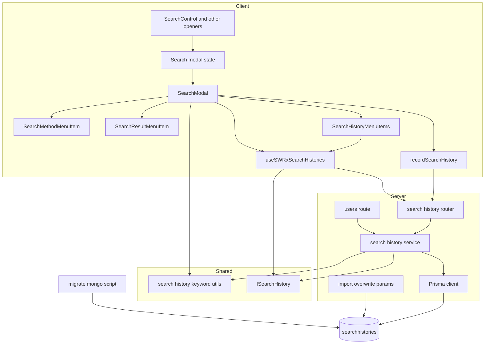
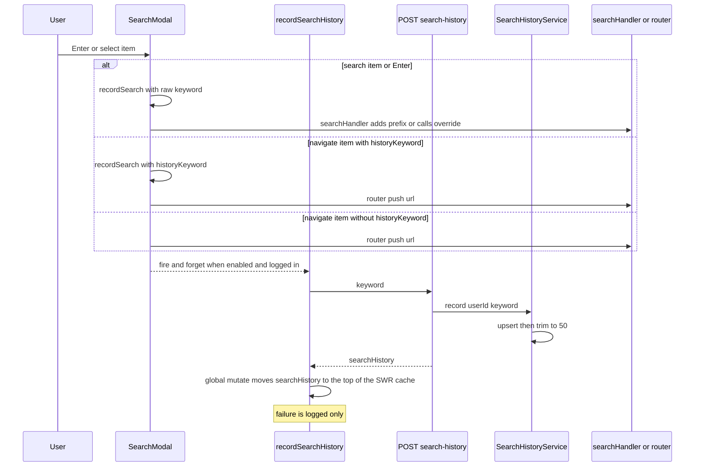
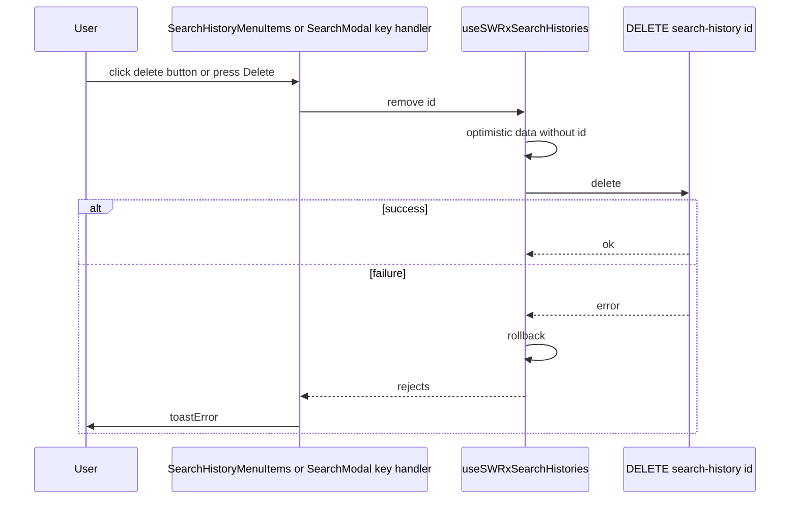

# Design Document: search-history

## Overview

**Purpose**: ログインユーザーが検索モーダルから実行した検索のキーワードを、本人の検索履歴としてサーバに保存する。検索モーダルを空入力で開いたときに履歴を並べ、選ぶだけで再検索でき、不要な履歴はその場で 1 件ずつ削除できる。

**Users**: GROWI にログインして検索モーダルを使うすべてのユーザー。管理者は、ユーザー削除・エクスポート／インポート・g2g を通じて間接的に関わる。

**Impact**: Prisma だけで扱うコレクション `searchhistories` と、apiv3 `/_api/v3/search-history` を新設する。検索モーダルについては、Downshift の項目型を「URL 遷移」と「検索の実行」の union に拡張し、記録点・履歴セクション・削除操作を組み込む。インポート（overwrite-params）、g2g のリスト、管理画面のユーザー削除にも、検索履歴の処理を 1 か所ずつ追加する。

### Goals
- 検索モーダルからの検索の実行（Enter・検索方法項目・履歴からの再検索）を、漏れなく、かつそれ以外の操作では記録しない
- 記録・一覧・削除を、本人の履歴に限って安全に行う。他人の履歴の有無は推測できないようにする
- 既存の検索モーダルの項目の並び、キーボード操作、検索の速度・結果を変えない

### Non-Goals
- ゲストの履歴、一括削除・全消去、削除の取り消し
- 入力中の文字列による履歴の絞り込み、サジェスト
- 検索 API・検索演算子の解釈・`/_search` のフィルタ／ソートの変更
- `/_private-legacy-pages`、タグのクリック、検索結果のページへの直接移動での記録

## Boundary Commitments

### This Spec Owns
- `searchhistories` コレクションのデータ契約（1 件の形・同一キーワードの判定・保持の上限 50 件・並び順）と、そのインデックス
- 保存するキーワードの正規化規則（前後の空白の除去・空の除外・200 コードポイントの上限・完全一致の引用符）
- `/_api/v3/search-history` の `GET /`・`POST /`・`DELETE /:id` と、その認可
- 検索モーダルにおける「検索の実行」の判定（記録点）と、`isSearchHistoryEnabled` フラグ
- 検索モーダルの履歴セクション（表示・選択・削除）と、Downshift の項目型
- ユーザー削除時・インポート時・g2g における検索履歴の扱い

### Out of Boundary
- 検索の実行そのもの（`useSetSearchKeyword`、`onSearchOverride` の中身、`/_search` での結果の取得）。本 spec は呼び出す側に立つだけで、挙動は変えない
- 検索演算子（`prefix:` / `tag:` など）の解釈。履歴は文字列として保存し、そのまま再投入する
- エクスポート（何もしないことで対象に含まれる。`IGNORED_COLLECTION_NAMES` は変更しない）
- activity（監査ログ）への記録。検索 API が `ACTION_SEARCH_PAGE` を既に記録しているため、`addActivity` は付けない
- インポートで一意制約に違反した行の扱い（既存のインポートの仕組みに従う）

### Allowed Dependencies
- サーバ: `~/utils/prisma`（Prisma クライアント）、`loginRequiredFactory`、`accessTokenParser`、`apiV3FormValidator`、`express-validator`、`@growi/core`（`SCOPE`、`ErrorV3`）、`~/utils/logger`
- クライアント: `downshift`、`swr`、`@growi/core/dist/swr`、`~/client/util/apiv3-client`、`~/client/util/toastr`、`~/states/global`（`useCurrentUser`）、`next-i18next`
- 依存の向き: `features/search/interfaces` と `features/search/utils` → `features/search/server` / `features/search/client`。サーバとクライアントは互いに import しない。`server/routes/apiv3/users.js` と `server/service/import/` は、`features/search/server/services/search-history` だけを import する

### Revalidation Triggers
- 1 件の形（`ISearchHistory`）や API の応答キー（`searchHistories` / `searchHistory`）が変わるとき
- 保持の上限（50）を大きく引き上げるとき（一覧と切り詰め用のインデックスの追加が必要になる）
- Mongo 上のフィールド名（`user` / `keyword` / `lastSearchedAt`）やインデックス名（`user_1_keyword_1`）が変わるとき（migration・overwrite-params・`schema.prisma` の 3 か所を揃える必要がある）
- `SearchMethodMenuItem` の空入力時の項目数が変わるとき（履歴の起点 index が変わる）
- `open()` の引数の形が変わるとき（`isSearchHistoryEnabled` の受け渡しに影響する）

## Architecture

### Existing Architecture Analysis
- 検索の入力は `SearchModal`（Downshift）に集約されている。Enter は `searchHandler` に、項目の選択は `onSelect` → `router.push(item.url)` に流れる。
- `/_search` と `/_private-legacy-pages` は、どちらも `SearchControl` → `SearchModalTriggerinput` → `open(keyword, onSearchOverride)` でモーダルを開く。
- `features/search/` には `client/` と `utils/` しかない。本 spec で `interfaces/` と `server/` を新設する。
- Prisma だけのコレクションの前例として `auditlog_es_sync_status` がある（関数のモジュール、migrate-mongo でインデックスを作成）。

### Architecture Pattern & Boundary Map



**Architecture Integration**:
- 採用パターン: feature 単位の構成（`features/search/{interfaces,utils,server,client}`）。サーバは「ルート（認可・入力検証）→ サービス（データの規則）→ Prisma」の 3 層にする。
- 境界: 記録の可否を決めるのは `SearchModal` の `recordSearch` だけ。データの規則（重複・上限・本人限定）を持つのはサービスだけ。
- 既存パターンの踏襲: apiv3 のハンドラファクトリ（`RequestHandler[]` を返す）、`res.apiv3({ <名前>: ... })`、SWR の `withUtils`、migrate-mongo の migration。
- Steering: サーバとクライアントの分離（`structure.md`）、データ駆動の制御・純粋関数の抽出（coding-style）。

### Technology Stack

| Layer | Choice / Version | Role in Feature | Notes |
|-------|------------------|-----------------|-------|
| Frontend | React / Next.js Pages Router、downshift ^8.2.3、swr、jotai | 検索モーダルの項目・履歴の取得・モーダルの状態 | 新しい依存は無い |
| Backend | Express（apiv3）、express-validator | 記録・一覧・削除 API | `loginRequiredFactory(crowi, false)` でゲストを拒否 |
| Data | MongoDB、Prisma 6.19（`@prisma/client`） | `searchhistories` の読み書き | Mongoose のモデルは作らない |
| Infrastructure | migrate-mongo | 一意インデックス `user_1_keyword_1` の作成 | 本番では起動前に実行される |

## File Structure Plan

PR の単位（保存・再検索・削除）が分かるよう、ファイルごとに担当するグループを付記する。

### Directory Structure
```
apps/app/src/features/search/
├── interfaces/
│   └── search-history.ts              # [保存] ISearchHistory と API の要求・応答の型
├── utils/
│   ├── search-history-keyword.ts      # [保存] toSearchHistoryKeyword / toExactMatchKeyword / 上限の定数
│   └── search-history-keyword.spec.ts
├── server/
│   ├── services/
│   │   ├── search-history.ts          # [保存・削除] list / record / remove / removeAllByUser（Prisma）
│   │   └── search-history.integ.ts
│   └── routes/
│       └── search-history/
│           ├── index.ts               # [保存] createSearchHistoryRouter(crowi)：3 ハンドラを登録
│           ├── list.ts                # [保存] GET /
│           ├── record.ts              # [保存] POST /
│           ├── delete.ts              # [削除] DELETE /:id
│           └── search-history.integ.ts
└── client/
    ├── interfaces/downshift.ts        # [保存] 変更: DownshiftItem を union に（下記 Modified Files）
    ├── services/
    │   ├── record-search-history.ts   # [保存] 記録 API を投げっぱなしで呼び、失敗はログに残す
    │   └── record-search-history.spec.ts
    ├── stores/
    │   ├── search-history.ts          # [再検索・削除] useSWRxSearchHistories（一覧、remove の楽観的更新）
    │   └── search-history.spec.tsx
    ├── utils/
    │   ├── search-menu-index.ts       # [再検索] getSearchMethodMenuItemCount / 履歴のハイライト解決 / 削除後のハイライト
    │   └── search-menu-index.spec.ts
    └── components/
        ├── SearchHistoryMenuItems.tsx # [再検索・削除] 履歴セクション（項目と削除ボタン）
        ├── SearchHistoryMenuItems.spec.tsx
        └── SearchModal.spec.tsx       # [保存・再検索・削除] 記録点・表示・Delete キーのテスト

apps/app/src/migrations/
└── 20261021120000-add-unique-index-to-searchhistories.js   # [保存] user_1_keyword_1 の作成
    20261021120000-add-unique-index-to-searchhistories.integ.ts

apps/app/src/server/service/import/overwrite-params/
├── searchhistories.ts                 # [保存] user を ObjectId に戻す
└── searchhistories.spec.ts

apps/app/src/server/service/import/
└── import-search-histories.integ.ts   # [保存] インポートの往復（user の ObjectId 化・再記録で重複しないこと）
```

### Modified Files
- `apps/app/prisma/schema.prisma` — [保存] `model searchhistories` を追加する（Data Models を参照）。
- `apps/app/src/server/routes/apiv3/index.js` — [保存] `router.use('/search-history', createSearchHistoryRouter(crowi))` を 1 行追加する。
- `apps/app/src/server/routes/apiv3/users.js` — [保存] `statusDelete()` と `externalaccounts.deleteMany` の直後で、`removeAllSearchHistoriesOfUser(user._id.toString())` を呼ぶ。
- `apps/app/src/server/service/import/overwrite-params/index.ts` — [保存] `case 'searchhistories'` を追加する。
- `apps/app/src/server/service/import/non-transferable-collections.ts` — [保存] `TRANSFERABLE_COLLECTIONS` に `'searchhistories'` を追加する。
- `apps/app/src/client/components/Admin/ExportArchiveData/SelectCollectionsModal.tsx` — [保存] `GROUPS_USER` に `'searchhistories'` を追加する。これがないと「その他」に分類され、ユーザーデータ向けの警告（パスワードシードの注意）が出ない。
- `apps/app/src/features/search/client/interfaces/downshift.ts` — [保存] `DownshiftItem` を `NavigateItem | SearchItem` の union にする。
- `apps/app/src/features/search/client/components/SearchMenuItem.tsx` — [保存] `url` の代わりに `item: DownshiftItem` を受け取る。
- `apps/app/src/features/search/client/components/SearchMethodMenuItem.tsx` — [保存] 各項目に `historyKeyword` を付ける。
- `apps/app/src/features/search/client/components/SearchResultMenuItem.tsx` — [保存] `{ type: 'navigate', url }` の項目を渡す（`historyKeyword` は付けない）。[再検索] 起点 index を `getSearchMethodMenuItemCount()` で求める。
- `apps/app/src/features/search/client/components/SearchModal.tsx` — [保存] `recordSearch` と、項目の種類による選択の振り分け。[再検索] 履歴セクションの配置。[削除] Delete キーの処理。
- `apps/app/src/features/search/client/components/SearchForm.tsx` — [削除] 親から `onKeyDown` を受け取り、既存の Home/End の処理の後に呼ぶ。
- `apps/app/src/features/search/client/states/modal/search.ts` — [保存] `open()` の第 3 引数 `options` と `SearchModalStatus.isSearchHistoryEnabled` を追加する。
- `apps/app/src/features/search/client/components/SearchPage/SearchModalTriggerinput.tsx` — [保存] `isSearchHistoryEnabled` prop を `open()` に渡す。
- `apps/app/src/features/search/client/components/SearchPage/SearchControl.tsx` — [保存] `isSearchHistoryEnabled?: boolean` prop を `SearchModalTriggerinput` に渡す。
- `apps/app/src/features/search/client/components/PrivateLegacyPages.tsx` — [保存] `SearchControl` に `isSearchHistoryEnabled={false}` を渡す。
- `apps/app/public/static/locales/{en_US,ja_JP,zh_CN,ko_KR,fr_FR}/commons.json` — [再検索・削除] `search_history` 名前空間のキーを追加する。

## System Flows

### 記録（Enter・検索方法項目・履歴の選択）



- `recordSearch(keyword)` は、`currentUser == null` または `isSearchHistoryEnabled === false` のとき何もしない。`toSearchHistoryKeyword(keyword)` が `null`（空、または 200 コードポイント超）のときも何もしない。
- `searchHandler` の中では、`onSearchOverride` の分岐と `prefix:` の付与の **前** に `recordSearch` を呼ぶ。そのため、`/_search` 上での Enter も記録され（1.2）、`prefix:` は保存されない（2.3）。
- 記録の Promise は待たない（6.1）。

### 削除



## Requirements Traceability

| Requirement | Summary | Components | Interfaces | Flows |
|-------------|---------|------------|------------|-------|
| 1.1 | Enter で記録 | SearchModal | `recordSearch` | 記録 |
| 1.2 | `/_search` から開いたモーダルの Enter で記録 | SearchModal | `recordSearch`（override の分岐より前） | 記録 |
| 1.3 | 検索方法項目の選択で記録 | SearchMethodMenuItem, SearchModal | `NavigateItem.historyKeyword` | 記録 |
| 1.4 | フィルタ・ソート・ページ送りでは記録しない | SearchModal（記録点を限定） | 記録点は `recordSearch` だけ | — |
| 1.5 | ページ候補の選択では記録しない | SearchResultMenuItem | `historyKeyword` を付けない | 記録 |
| 1.6 | モーダルを経由しない `/_search` では記録しない | SearchModal（記録点を限定） | — | — |
| 1.7 | タグのクリックでは記録しない | SearchModal（記録点を限定） | — | — |
| 1.8 | `/_private-legacy-pages` では記録しない | PrivateLegacyPages, SearchControl, modal state | `isSearchHistoryEnabled` | 記録 |
| 1.9 | 再検索にも同じ規則を適用する | SearchModal | `SearchItem` → `searchHandler` | 記録 |
| 2.1 | 前後の空白を除く | search-history-keyword, Service | `toSearchHistoryKeyword` | — |
| 2.2 | 演算子トークンを書き換えない | search-history-keyword | 正規化は trim だけ | — |
| 2.3 | 自動付与の `prefix:` を含めない | SearchModal | `recordSearch` を付与の前に呼ぶ | 記録 |
| 2.4 | 「子ページを検索」でも `prefix:` を含めない | SearchMethodMenuItem | `historyKeyword` = 入力のみ | — |
| 2.5 | 完全一致は引用符付き | SearchMethodMenuItem, search-history-keyword | `toExactMatchKeyword` | — |
| 2.6 | 空のキーワードは記録しない | search-history-keyword, SearchModal, Service | `null` を返す／400 | — |
| 2.7 | 200 文字超は記録しないが検索は実行する | search-history-keyword, SearchModal, Service | `SEARCH_HISTORY_KEYWORD_MAX_LENGTH` | 記録 |
| 3.1 | 同一キーワードは繰り上げる | Service | `record` の upsert | 記録 |
| 3.2 | 完全一致のときだけ同一とみなす | Service, Data Model | 一意キー (user, keyword) | — |
| 3.3 | 繰り上げても識別子を変えない | Service | upsert の update 側 | — |
| 3.4 | 最大 50 件に保つ | Service | `SEARCH_HISTORY_RETENTION_LIMIT` | 記録 |
| 3.5 | 古いものから削除する | Service | 切り詰め | 記録 |
| 4.1 | 本人の履歴を新しい順に返す | Service, list route | `GET /` | — |
| 4.2 | 識別子・キーワード・最終検索日時を返す | Service | `ISearchHistory` | — |
| 4.3 | 記録の応答は一覧の 1 件と同じ形 | record route, recordSearchHistory | `POST /` → `searchHistory`（クライアントは SWR のキャッシュの先頭へ反映） | 記録 |
| 4.4 | 0 件なら空の一覧を返す | list route | `searchHistories: []` | — |
| 5.1 | 記録・一覧は本人だけ | list / record route | `req.user._id` だけを使う | — |
| 5.2 | 他人を指定する手段を出さない | list / record route | 要求に userId を含めない | — |
| 5.3 | 未ログインでは拒否する | list / record route | `loginRequiredFactory(crowi, false)` | — |
| 5.4 | ゲストでは記録せず、エラーも出さない | SearchModal | `recordSearch` のゲスト判定 | 記録 |
| 5.5 | トークンのスコープ | list / record route | `SCOPE.READ/WRITE.FEATURES.PAGE` | — |
| 6.1 | 記録を待たずに遷移する | SearchModal, recordSearchHistory | 投げっぱなし | 記録 |
| 6.2 | 記録の失敗をユーザーに見せない | recordSearchHistory | `catch` してログに残す | 記録 |
| 6.3 | 記録の失敗をログに残す | recordSearchHistory, record route | `logger.error` | 記録 |
| 6.4 | 検索結果を変えない | （検索 API に触れない） | — | — |
| 7.1 | ユーザー削除で履歴を消す | users route, Service | `removeAllByUser` | — |
| 7.2 | 一時停止では消さない | users route | 削除の分岐だけに追加 | — |
| 7.3 | エクスポートの対象 | （`IGNORED_COLLECTION_NAMES` に入れない）, SelectCollectionsModal | `GROUPS_USER` に `searchhistories` を追加 | — |
| 7.4 | インポートで元のユーザーに戻す | overwrite-params/searchhistories | `user` → ObjectId | — |
| 7.5 | g2g の対象 | non-transferable-collections, overwrite-params | `TRANSFERABLE_COLLECTIONS` | — |
| 8.1 | 空入力時に新しい順で最大 10 件 | SearchHistoryMenuItems, Store | `SEARCH_HISTORY_DISPLAY_LIMIT` | — |
| 8.2 | 検索方法の下に置き、起点を変えない | SearchModal, search-menu-index | `getSearchMethodMenuItemCount` | — |
| 8.3 | 開いた時点の最新を出す | Store, recordSearchHistory | マウントのたびに再検証。再検証の完了前も、記録の応答でキャッシュの先頭を更新済み | 記録 |
| 8.4 | 入力があれば出さない | SearchModal | 空入力のときだけ描画 | — |
| 8.5 | 0 件なら出さない | SearchHistoryMenuItems | 空なら何も描画しない | — |
| 8.6 | ゲストには出さない | Store | SWR のキーを `null` | — |
| 8.7 | `/_private-legacy-pages` では出さない | Store, modal state | `isSearchHistoryEnabled` | — |
| 8.8 | 取得に失敗しても妨げない | SearchHistoryMenuItems | `error` のときは何も描画しない | — |
| 9.1 | マウスでもキーボードでも選べる | SearchHistoryMenuItems | `SearchMenuItem` + `getItemProps` | — |
| 9.2 | 選ぶと検索を実行する | SearchModal, recordSearchHistory | `SearchItem` → `onSearch`。直前の検索が先頭に来るよう、キャッシュを記録の応答で更新 | 記録 |
| 9.3 | Enter と同じ扱い | SearchModal | `searchHandler` を共有 | 記録 |
| 9.4 | 保存時の形のまま記録し、繰り上げる | SearchModal, Service | `SearchItem.keyword` をそのまま記録 | 記録 |
| 10.1 | 削除ボタンとアクセシブルなラベル | SearchHistoryMenuItems | `aria-label`（i18n） | — |
| 10.2 | 確認なしで削除 | SearchHistoryMenuItems, Store | `remove(id)` | 削除 |
| 10.3 | Delete キーで削除し、文字を入力しない | SearchModal, SearchForm, search-menu-index | `onKeyDown`, `preventDownshiftDefault` | 削除 |
| 10.4 | 再検索せず、モーダルを開いたままにする | SearchHistoryMenuItems, SearchModal | `stopPropagation`, `preventDefault` | 削除 |
| 10.5 | 応答を待たずに消し、以後も含めない | Store, Service | `optimisticData`, `DELETE /:id` | 削除 |
| 10.6 | 失敗したら戻して知らせる | Store, SearchModal | `rollbackOnError`, `toastError` | 削除 |
| 10.7 | 0 件になったら出さない | SearchHistoryMenuItems | 空なら何も描画しない | 削除 |
| 11.1 | 削除は本人の履歴だけ | delete route, Service | `deleteMany({ id, userId })` | — |
| 11.2 | 存在しない ID と他人の ID を同じ応答にする | delete route | 404 `search-history-not-found` | — |
| 11.3 | 未ログインの削除は拒否する | delete route | `loginRequiredFactory(crowi, false)` | — |
| 11.4 | 削除はページの書き込みスコープ | delete route | `SCOPE.WRITE.FEATURES.PAGE` | — |

## Components and Interfaces

| Component | Domain/Layer | Intent | Req Coverage | Key Dependencies | Contracts |
|-----------|--------------|--------|--------------|------------------|-----------|
| search-history-keyword | Shared utils | 保存する文字列の正規化と上限 | 2.1, 2.2, 2.5, 2.6, 2.7 | — | Service |
| ISearchHistory / DTO | Shared interfaces | 1 件の形と API の型 | 4.2, 4.3 | — | — |
| SearchHistoryService | Server | データの規則（重複・上限・本人限定） | 3.1–3.5, 4.1, 4.2, 7.1, 10.5, 11.1, 11.2 | Prisma (P0) | Service |
| search-history router | Server | 認可・入力検証・応答 | 4.1–4.4, 5.1–5.3, 5.5, 11.1–11.4 | SearchHistoryService (P0), loginRequired (P0), accessTokenParser (P0) | API |
| searchhistories migration | Infra | 一意インデックスの作成 | 3.2 | migrate-mongo (P0) | Batch |
| overwrite-params/searchhistories | Server import | インポート時の `user` の型を戻す | 7.4, 7.5 | import service (P0) | Service |
| users route（変更） | Server | ユーザー削除時に履歴を消す | 7.1, 7.2 | SearchHistoryService (P0) | — |
| Search modal state（変更） | Client state | `isSearchHistoryEnabled` を持つ | 1.8, 8.7 | jotai (P0) | State |
| DownshiftItem（変更） | Client interfaces | 項目の種類を表す | 1.3, 1.5, 9.2 | downshift (P0) | — |
| SearchModal（変更） | Client UI | 記録点・選択の振り分け・Delete キー | 1.1–1.9, 2.3, 5.4, 6.1, 8.2, 8.4, 9.2–9.4, 10.3, 10.4, 10.6 | recordSearchHistory (P0), Store (P0) | State |
| recordSearchHistory | Client service | 記録 API を投げっぱなしで呼ぶ | 6.1–6.3 | apiv3-client (P0) | Service |
| useSWRxSearchHistories | Client store | 一覧の取得と楽観的な削除 | 8.1, 8.3, 8.6, 8.7, 10.5, 10.6 | swr (P0) | State |
| search-menu-index | Client utils | index の計算（起点・ハイライト・削除後） | 8.2, 10.3 | — | Service |
| SearchHistoryMenuItems | Client UI | 履歴セクションと削除ボタン | 8.1, 8.5, 8.8, 9.1, 10.1, 10.2, 10.4, 10.7 | SearchMenuItem (P0) | — |
| SearchMethodMenuItem / SearchResultMenuItem / SearchMenuItem / SearchForm（変更） | Client UI | 項目データの付与・キー入力の受け渡し | 1.3, 1.5, 2.4, 2.5, 10.3 | — | — |

### Shared

#### search-history-keyword（`features/search/utils/search-history-keyword.ts`）

| Field | Detail |
|-------|--------|
| Intent | 保存する文字列の決定規則を、クライアントとサーバで共有する |
| Requirements | 2.1, 2.2, 2.5, 2.6, 2.7 |

**Contracts**: Service [x]

```typescript
export const SEARCH_HISTORY_KEYWORD_MAX_LENGTH = 200;

/** Trimmed keyword, or null when it must not be saved (empty, or longer than the max in code points). */
export const toSearchHistoryKeyword: (input: string) => string | null;

/** `"<trimmed input>"`; used for the exact-match method item. Returns '' for a blank input. */
export const toExactMatchKeyword: (input: string) => string;
```
- 前後の空白だけを除き、内部の空白・大文字小文字・演算子トークンは変えない（2.2）。
- 長さは `Array.from(text).length`（コードポイント数）で数える。
- `toExactMatchKeyword` の結果も `toSearchHistoryKeyword` に通して、引用符込みの長さで判定する（2.7）。

#### ISearchHistory と DTO（`features/search/interfaces/search-history.ts`）

```typescript
export type ISearchHistory = {
  _id: string;
  keyword: string;
  lastSearchedAt: Date; // the shared apiv3 axios client revives ISO strings into Date; the client relies on server-side ordering only
};

export type RecordSearchHistoryRequestBody = { keyword: string };
export type ListSearchHistoriesResponseBody = { searchHistories: ISearchHistory[] };
export type RecordSearchHistoryResponseBody = { searchHistory: ISearchHistory };
```
- `userId` は応答に含めない。

### Server

#### SearchHistoryService（`features/search/server/services/search-history.ts`）

| Field | Detail |
|-------|--------|
| Intent | 検索履歴のデータの規則を 1 か所で持つ |
| Requirements | 3.1, 3.2, 3.3, 3.4, 3.5, 4.1, 4.2, 7.1, 10.5, 11.1, 11.2 |

**Responsibilities & Constraints**
- すべての操作は `userId` で絞り込む。`userId` を条件に含まない読み書きの関数は作らない（`removeAllByUser` も `userId` で絞る）。
- 保持の上限 50 件は、記録のたびに切り詰めて維持する。
- `auditlog-es-sync` の前例に合わせ、`~/utils/prisma` の `prisma` を直接使う関数のモジュールにする。

**Dependencies**
- Outbound: Prisma `searchhistories` — 読み書き（P0）
- Inbound: search-history router（P0）、`users.js`（P0）

**Contracts**: Service [x]

```typescript
export const SEARCH_HISTORY_RETENTION_LIMIT = 50;

export const listSearchHistories: (userId: string) => Promise<ISearchHistory[]>;

/** Throws InvalidSearchHistoryKeywordError when toSearchHistoryKeyword(keyword) is null. */
export const recordSearchHistory: (userId: string, keyword: string) => Promise<ISearchHistory>;

/** Returns false when no document matched both id and userId. */
export const removeSearchHistory: (userId: string, id: string) => Promise<boolean>;

export const removeAllSearchHistoriesOfUser: (userId: string) => Promise<void>;

export class InvalidSearchHistoryKeywordError extends Error {}
```
- `listSearchHistories`: `where: { userId }`、`orderBy: [{ lastSearchedAt: 'desc' }, { id: 'desc' }]`。結果は最大 50 件。`_id`・`keyword`・`lastSearchedAt` だけを返す。
- `recordSearchHistory`:
  1. `toSearchHistoryKeyword` で正規化する。`null` なら `InvalidSearchHistoryKeywordError` を投げる。
  2. 一意キー `userId_keyword` で upsert する（update は `lastSearchedAt: now` だけ、create は `{ userId, keyword, lastSearchedAt: now }`）。既存の識別子は変わらない（3.3）。
  3. P2002（同時の upsert による一意制約違反）のときは、1 回だけ upsert をやり直す。
  4. 同じ並び順で `skip: 50` の `id` と `lastSearchedAt` を取得する。空でなければ、その中で最も新しい `lastSearchedAt` を境界 `cutoff` とし、`deleteMany({ where: { userId, id: { in }, lastSearchedAt: { lte: cutoff } } })` で切り詰める（3.5）。`cutoff` の条件により、読み取りから削除までの間に別の記録で繰り上がった履歴は消さない。
  5. 手順 2 の結果を `ISearchHistory` にして返す。
- `removeSearchHistory`: `deleteMany({ where: { id, userId } })` の `count > 0` を返す。存在しない ID と他人の ID は、どちらも `false` になる（11.2）。
- Invariants: 1 ユーザーの件数は、記録が終わった時点で 50 件以下。(userId, keyword) は一意。

**Implementation Notes**
- 切り詰めはトランザクションの外で行う。同時に走っても「新しい 50 件以外を消す」という結果は変わらず、`cutoff` の条件で、直前に繰り上がった履歴を誤って消すこともない。
- Risks: 保持の上限を大きく引き上げる場合は、(user, lastSearchedAt) のインデックスを足す（Revalidation Triggers）。

#### search-history router（`features/search/server/routes/search-history/`）

| Field | Detail |
|-------|--------|
| Intent | `/_api/v3/search-history` の認可・入力検証・応答 |
| Requirements | 4.1, 4.3, 4.4, 5.1, 5.2, 5.3, 5.5, 11.1, 11.2, 11.3, 11.4 |

**Responsibilities & Constraints**
- 各ハンドラファクトリは、`(crowi: Crowi) => RequestHandler[]` を明示の戻り値型付きで export する（ESM の rule）。`index.ts` の `createSearchHistoryRouter(crowi): Router` が 3 つをまとめ、`apiv3/index.js` に 1 行で登録する。
- ミドルウェアの順序: `accessTokenParser([scope], { acceptLegacy: true })` → `loginRequiredFactory(crowi, false)` → validator → `apiV3FormValidator` → handler。
- `addActivity` は付けない（Boundary を参照）。POST と DELETE のハンドラには、その理由を指す 1 行のコメント（検索 API が `ACTION_SEARCH_PAGE` を記録済みで、詳細は本 spec の design.md）を置き、`activity-recording.md` に照らしたレビューで付け忘れと誤解されないようにする。読み取り専用ユーザーを除外するミドルウェアも付けない（ページの内容を変えない操作のため）。
- 対象のユーザーは、常に `req.user._id` から決める。要求には userId を受け取る項目を設けない（5.2）。

**Contracts**: API [x]

| Method | Endpoint | Scope | Request | Response | Errors |
|--------|----------|-------|---------|----------|--------|
| GET | `/_api/v3/search-history` | `SCOPE.READ.FEATURES.PAGE` | — | 200 `ListSearchHistoriesResponseBody` | 未ログイン（`loginRequired` による拒否） |
| POST | `/_api/v3/search-history` | `SCOPE.WRITE.FEATURES.PAGE` | `RecordSearchHistoryRequestBody`（`keyword`: string） | 200 `RecordSearchHistoryResponseBody` | 400 `validation_failed`、未ログイン、500 |
| DELETE | `/_api/v3/search-history/:id` | `SCOPE.WRITE.FEATURES.PAGE` | `:id`: MongoId | 200 `{}` | 400（`:id` の形式が不正）、404 `search-history-not-found`、未ログイン |

- 404 は、存在しない ID と他人の ID で、メッセージ・コード・ステータスを完全に同じにする（11.2）。
- 400（`:id` の形式が不正）は、要求そのものの形だけで決まり、他人のデータの有無とは関係しないため、区別して返してよい。
- POST の 400 は、クライアントが空・長すぎるキーワードを送らないので、通常は起きない（防御のための検証）。

### Infrastructure / Import

#### searchhistories migration（`src/migrations/20261021120000-add-unique-index-to-searchhistories.js`）

**Contracts**: Batch [x]
- Trigger: 本番では起動前（`preserver` → `pnpm run migrate`）、統合テストではテンプレート DB の作成時。
- `up`: `mongoose.connection.collection('searchhistories')` に対して、(user, keyword) で重複するドキュメントを `lastSearchedAt` の新しい 1 件だけ残して消し、`createIndex({ user: 1, keyword: 1 }, { unique: true, name: 'user_1_keyword_1' })` を実行する。
- `down`: コレクションとインデックスがあるときだけ、`user_1_keyword_1` を消す。
- 冪等: `createIndex` は、同じインデックスが既にあれば何もしない。

#### overwrite-params/searchhistories

```typescript
export const overwriteParams: OverwriteParams; // { user: (value) => new ObjectId(value) }
```
- `generateOverwriteParams` の switch に `case 'searchhistories'` を追加する。`_id` と日付は、既存の仕組みで変換される。

#### users route（変更）
- ユーザー削除 API で `statusDelete()`・`prisma.externalaccounts.deleteMany` の直後に、`removeAllSearchHistoriesOfUser(user._id.toString())` を呼ぶ（7.1）。一時停止などほかの状態遷移には追加しない（7.2）。
- 履歴の削除が失敗した場合は、`externalaccounts` の削除と同じく、既存の `catch` が `logger.error` に残して 500 を返す。ユーザーは削除済みの状態になっているため、履歴が残ったことを運用者がログから追えるようにする。履歴は画面から参照できないので、この失敗はユーザーに影響しない。

### Client

#### Search modal state（変更、`states/modal/search.ts`）

**Contracts**: State [x]

```typescript
export type OpenSearchModalOptions = { isSearchHistoryEnabled?: boolean };

export type SearchModalStatus = {
  isOpened: boolean;
  searchKeyword?: string;
  onSearchOverride?: OnSearch;
  isSearchHistoryEnabled: boolean; // defaults to true
};

type OpenSearchModal = (
  keywordOnInit?: string,
  onSearchOverride?: OnSearch,
  options?: OpenSearchModalOptions,
) => void;
```
- `open` は `options?.isSearchHistoryEnabled ?? true` を持たせる。`close` は `true` に戻す。
- `SearchControl`（`isSearchHistoryEnabled?: boolean`、既定 true）→ `SearchModalTriggerinput` → `open(..., { isSearchHistoryEnabled })` と受け渡す。`PrivateLegacyPages` だけが `false` を渡す（1.8, 8.7）。

#### DownshiftItem（変更、`client/interfaces/downshift.ts`）

```typescript
export type NavigateItem = {
  type: 'navigate';
  url: string;
  /** Keyword to record when selected; absent for items that are not a search execution (page results). */
  historyKeyword?: string;
};
export type SearchItem = { type: 'search'; keyword: string };
export type DownshiftItem = NavigateItem | SearchItem;
```

#### SearchModal（変更）

| Field | Detail |
|-------|--------|
| Intent | 記録点の判定、選択の振り分け、履歴セクションの配置、Delete キー |
| Requirements | 1.1–1.9, 2.3, 5.4, 6.1, 8.2, 8.4, 9.2, 9.3, 9.4, 10.3, 10.4, 10.6 |

**Responsibilities & Constraints**
- `recordSearch(keyword: string): void` — `currentUser != null && isSearchHistoryEnabled` で、かつ `toSearchHistoryKeyword(keyword) != null` のときだけ、`recordSearchHistory(normalized)` を呼ぶ。待たない。外側の `SearchModal` で 1 つだけ `useCallback` で作り、`searchHandler` から直接呼ぶ。`SearchModalSubstance`（`onSelect` を持つ側）には `onRecordSearch` prop として渡し、記録の判定が 2 か所に複製されないようにする。
- `searchHandler(keyword)` — 先頭で `recordSearch(keyword)` を呼んでから、既存の処理（`onSearchOverride` の呼び出し、または `prefix:` を付けて `setSearchKeyword`）を行う。
- `onSelect(item)`:
  - `type === 'search'` → `onSearch(item.keyword)`（= `searchHandler`）を呼び、モーダルを閉じる（9.2〜9.4）。
  - `type === 'navigate'` → `historyKeyword` があれば `recordSearch(historyKeyword)` を呼び、`router.push(url)` の後でモーダルを閉じる（既存どおり）。
- 履歴セクション: `searchInput.trim() === ''` のときだけ、`SearchMethodMenuItem` と `SearchResultMenuItem` の間に `SearchHistoryMenuItems` を置き、`startIndex = getSearchMethodMenuItemCount('')`（= 1）を渡す（8.2, 8.4）。空入力のときは `SearchResultMenuItem` が何も描画しないので、既存項目の index は変わらない。
- `handleDelete(history)`: 削除ボタンと Delete キーの両方が使う、ただ 1 つの削除処理。`remove(history._id)` を呼び、同時に `nextHighlightedIndexAfterDelete(...)` の結果を Downshift の `setHighlightedIndex` に渡す（キーボードでハイライト中にボタンで消した場合も、ハイライトが範囲外に残らない）。`remove` の reject は `toastError(t('search_history.delete_failed'))` で知らせる（10.6）。モーダルは閉じない（10.4）。
- Delete キー: `SearchForm` に `onKeyDown` を渡す。`e.key === 'Delete'` で、`resolveHighlightedHistory(highlightedIndex, startIndex, visibleHistories)` が項目を返すときだけ、`e.nativeEvent.preventDownshiftDefault = true` と `e.preventDefault()` を実行し、`handleDelete` を呼ぶ（10.3）。

#### recordSearchHistory（`client/services/record-search-history.ts`）

**Contracts**: Service [x]

```typescript
/** Fire-and-forget: never rejects; failures are logged. */
export const recordSearchHistory: (keyword: string) => void;
```
- `apiv3Post('/search-history', { keyword })` を呼び、`catch` で `logger.error` に残す。トーストは出さない（6.2, 6.3）。
- 成功したら、応答の `searchHistory` を使って SWR のグローバル `mutate` で `/search-history` のキャッシュを更新する（`revalidate: false`）。キャッシュ内の同じ `_id` の項目を取り除いたうえで、その項目を先頭に置く。キャッシュが未取得（`undefined`）のときは何もしない。サービスはフックではないので、フック経由の `mutate` ではなくグローバルの `mutate` を使う。
- これにより、モーダルを開き直した直後に SWR が前回のキャッシュを表示しても、直前の検索が先頭に来る。再検証が終わる前に「↓ + Enter」で再検索しても、別の履歴を選ばない（8.3, 9.2）。キャッシュの更新に失敗しても、`catch` でログに残すだけで検索は妨げない（6.2）。

#### useSWRxSearchHistories（`client/stores/search-history.ts`）

**Contracts**: State [x]

```typescript
export const SEARCH_HISTORY_DISPLAY_LIMIT = 10;

type SearchHistoriesUtils = {
  /** Optimistically removes the item; rolls back and rejects on failure. */
  remove(id: string): Promise<void>;
};

export const useSWRxSearchHistories: (
  isEnabled: boolean,
) => SWRResponseWithUtils<SearchHistoriesUtils, ISearchHistory[], Error>;
```
- キーは `isEnabled ? '/search-history' : null`。`isEnabled = currentUser != null && isSearchHistoryEnabled`（8.6, 8.7）。
- `SearchModalSubstance` はモーダルを開くたびにマウントされる。SWR のオプションに `revalidateOnMount: true` を明示し、グローバルの SWR 設定に左右されずに、開いた時点の最新を取得する（8.3）。
- `remove(id)` は `mutate(deleteFn, { optimisticData: (current) => (current ?? []).filter((h) => h._id !== id), rollbackOnError: true, populateCache: false, revalidate: false })` を使う（10.5, 10.6）。`optimisticData` は関数の形にし、呼び出し時点のキャッシュを基準にする（続けて削除したときに、前の削除が巻き戻らないように）。

#### search-menu-index（`client/utils/search-menu-index.ts`）

**Contracts**: Service [x]

```typescript
/** Number of SearchMethodMenuItem entries rendered for the given input (1 when blank, 3 otherwise). */
export const getSearchMethodMenuItemCount: (searchKeyword: string) => number;

export const resolveHighlightedHistory: (
  highlightedIndex: number | null,
  startIndex: number,
  histories: readonly ISearchHistory[],
) => ISearchHistory | null;

/**
 * Keeps the same index, clamps to the last remaining history, or null when none remain.
 * `remainingCount` is the number of histories visible after the deletion,
 * i.e. `min(total - 1, SEARCH_HISTORY_DISPLAY_LIMIT)` (the 11th history moves up into view).
 */
export const nextHighlightedIndexAfterDelete: (
  highlightedIndex: number,
  startIndex: number,
  remainingCount: number,
) => number | null;
```
- `SearchResultMenuItem` の起点 index も `getSearchMethodMenuItemCount(searchKeyword)` で求め、検索方法項目の数を 1 か所で持つ。

#### SearchHistoryMenuItems（`client/components/SearchHistoryMenuItems.tsx`）

```typescript
type Props = {
  histories: readonly ISearchHistory[]; // already sliced to SEARCH_HISTORY_DISPLAY_LIMIT
  startIndex: number;
  activeIndex: number | null;
  getItemProps: GetItemProps;
  onDelete: (history: ISearchHistory) => void;
};
```
- `histories` が空なら何も描画しない（8.5, 8.8, 10.7）。`SearchModal` は、取得に失敗したとき（`error`）や読み込み中は空配列を渡す。
- 各項目は `SearchMenuItem` に `{ type: 'search', keyword }` を渡して描画する（9.1）。アイコンは `history`（Material Symbols）にする。
- 削除ボタン: `type="button"`、`tabIndex={-1}`、`aria-label={t('search_history.delete_aria_label', { keyword })}`。`onMouseDown` で `preventDefault`（入力欄のフォーカスを保つ）、`onClick` で `stopPropagation` してから `onDelete(history)` を呼ぶ。これにより、Downshift の項目選択は起きない（10.1, 10.2, 10.4）。
- セクションの見出しは `t('search_history.title')`。

#### 既存 UI の変更（要約）
- `SearchMenuItem`: `url: string` の prop を `item: DownshiftItem` に変え、`getItemProps({ index, item, ... })` に渡す。
- `SearchMethodMenuItem`: 「全体を検索」は `historyKeyword: searchKeyword`、「子ページを検索」は `historyKeyword: searchKeyword`（`prefix:` を含めない、2.4）、「完全一致」は `historyKeyword: toExactMatchKeyword(searchKeyword)`（2.5）を付ける。URL は変えない。
- `SearchResultMenuItem`: `{ type: 'navigate', url: item.data._id }` を渡し、`historyKeyword` は付けない（1.5）。
- `SearchForm`: `onKeyDown?: (e: React.KeyboardEvent<HTMLInputElement>) => void` を受け取り、既存の Home/End の処理の後で呼ぶ。

## Data Models

### Domain Model
- 集約: 検索履歴 1 件（ユーザー × キーワード）。ユーザーの履歴全体に、保持の上限 50 件という不変条件がある。
- 不変条件: (user, keyword) は一意。`keyword` は前後の空白を除いた、1〜200 コードポイントの文字列。

### Physical Data Model（MongoDB コレクション `searchhistories`）

```prisma
model searchhistories {
  id             String   @id @default(auto()) @map("_id") @db.ObjectId
  userId         String   @map("user") @db.ObjectId
  keyword        String
  lastSearchedAt DateTime

  @@unique([userId, keyword], map: "user_1_keyword_1")
}
```

| Mongo field | Prisma field | Type | Notes |
|-------------|--------------|------|-------|
| `_id` | `id` | ObjectId | 識別子。繰り上げても変わらない |
| `user` | `userId` | ObjectId | 持ち主。インポート時は overwrite-params で ObjectId に戻す |
| `keyword` | `keyword` | string | 保存時の形（完全一致なら引用符を含む） |
| `lastSearchedAt` | `lastSearchedAt` | Date | 最終検索日時。並び順の基準 |

- インデックス: `user_1_keyword_1`（一意）だけ。名前は、migration の `createIndex({ name })` と `@@unique(map:)` で一致させる。
- `users` へのリレーションは宣言しない（`users` 側に逆参照のフィールドが必要になるうえ、使い道が無い）。
- `__v` は持たない（Mongoose を持たないコレクションの前例 `auditlog_es_sync_status` に合わせる）。
- フィールド名 `user` は、`schema.prisma` の `@map`、migration のインデックスのキー、overwrite-params のキーの 3 か所で同じにする。

## Error Handling

### Error Strategy
- 記録: クライアントは失敗を握りつぶしてログに残すだけで、検索を止めない（6.1〜6.3）。サーバは、想定外の例外を `logger.error` に残して 500 を返す。
- 一覧: 取得に失敗したら履歴セクションを出さない（8.8）。トーストは出さない。
- 削除: 楽観的に消した後、失敗したら SWR が巻き戻し、`toastError` で知らせる（10.6）。

### Error Categories and Responses
- 400: POST の `keyword` が文字列でない、空、または 200 コードポイントを超える（`validation_failed`。共通の `apiV3FormValidator` が返す。サービスが防御的に投げる `InvalidSearchHistoryKeywordError` は `invalid-search-history-keyword` の 400 に変換するが、validator が先に弾くため通常は到達しない）。DELETE の `:id` が MongoId の形式でない。
- 未ログイン: `loginRequiredFactory(crowi, false)` の既存の拒否応答に従う（5.3, 11.3）。
- 404: DELETE で、ID とユーザーの両方に合うものが無い（`search-history-not-found`。存在しない ID と他人の ID を区別しない）。
- 500: Prisma の想定外の失敗（P2002 の再試行にも失敗した場合を含む）。

### Monitoring
- サーバ: `loggerFactory('growi:features:search:search-history')` で、記録・削除の想定外の失敗を記録する。
- クライアント: 記録の失敗を `logger.error` に残す。

## Testing Strategy

### Unit Tests
- `search-history-keyword.spec.ts`: 前後の空白の除去と内部の空白の保持、演算子トークンの保持、空白のみ → `null`、200 コードポイントちょうどは保存し 201 は `null`（サロゲートペアを 1 文字と数える）、完全一致の引用符込みでの長さ判定（2.1, 2.2, 2.5〜2.7）。
- `search-menu-index.spec.ts`: 空入力で 1・入力ありで 3、ハイライトが履歴の範囲外なら `null`、削除後は同じ index を保ち・末尾なら 1 つ前へ・0 件なら `null`（8.2, 10.3）。
- `overwrite-params/searchhistories.spec.ts`: 文字列の `user` が ObjectId に変換される（7.4）。
- `record-search-history.spec.ts`（追加）: 記録の成功で、SWR のキャッシュの先頭にその項目が置かれ、同じ `_id` の既存項目は重複しない。キャッシュが未取得のときは何もしない（8.3, 9.2）。
- `record-search-history.spec.ts`: API の失敗で reject せず、ログに残す（6.2, 6.3）。

### Integration Tests（実 MongoDB）
- `search-history.integ.ts`（サービス）: 同一キーワードの再記録で件数が増えず、`_id` が変わらず、先頭に来る。大文字小文字の違いは別の項目になる。51 件目の記録で最も古い 1 件が消える。他人の ID を指定した `remove` は `false` を返し、相手の履歴は残る。`removeAllSearchHistoriesOfUser` は本人の分だけを消す（3.1〜3.5, 7.1, 11.1, 11.2）。
- `routes/search-history/search-history.integ.ts`: 未ログインでは 3 操作とも拒否される。GET は本人の分だけを新しい順で返し、0 件なら `[]` を返す。POST の応答は一覧の 1 件と同じ形。DELETE で存在しない ID と他人の ID の応答（ステータス・本文）が完全に一致する。読み取りスコープだけのトークンでは POST と DELETE が拒否される（4.1〜4.4, 5.1〜5.3, 5.5, 11.1〜11.4）。
- `20261021120000-add-unique-index-to-searchhistories.integ.ts`: `up` の後に `user_1_keyword_1` が一意インデックスとして存在し、名前が `schema.prisma` の `map` と一致する。`down` で消える。
- 既存の `non-transferable-collections.integ.ts`: `searchhistories` が `TRANSFERABLE_COLLECTIONS` に入っていることで通る（7.5）。
- インポートの往復（`import-search-histories.integ.ts`）: `searchhistories` は Mongoose のモデルを持たない初めての移行対象なので、実際のインポートの処理を通して確かめる。文字列の `user` と ISO 形式の `lastSearchedAt` を持つ、エクスポート形式の JSON をインポートし、次の 3 点を確かめる（3.1, 7.4, 7.5）。
  - `user` が ObjectId で保存され、`listSearchHistories(userId)` がその行を返す。`lastSearchedAt` は Date になっている。
  - 同じキーワードで `recordSearchHistory(userId, keyword)` を呼ぶと、新しい行は増えず、その行の `lastSearchedAt` が更新され、`_id` は変わらない。`user` が文字列のまま保存されると、`@db.ObjectId` の条件に合わず、一意インデックスも重複を防げないため、この確認が必要。
  - インポートした履歴が 50 件を超えて繰り上がり・切り詰めの対象になる（新しい記録で最も古い 1 件が消える）。
- ユーザー削除 API の統合テスト: 削除済みにしたユーザーの履歴が消え、ほかのユーザーの履歴は残る（7.1）。

### Component Tests（RTL）
- `SearchModal.spec.tsx`:
  - Enter で入力どおり（前後の空白を除いた形）が記録される。「子ページのみ検索」が有効でも `prefix:` を含まない（1.1, 2.3）。
  - `onSearchOverride` がある場合も記録される。`isSearchHistoryEnabled: false` では記録されず、履歴も出ない（1.2, 1.8, 8.7）。
  - 検索方法の 3 項目でそれぞれ、入力・入力・`"入力"` が記録される。ページ候補では記録されない（1.3, 1.5, 2.4, 2.5）。
  - ゲストでは記録も表示もされない（5.4, 8.6）。
  - 記録の Promise が未解決でも遷移が進む（6.1）。
  - 空入力で履歴が検索方法項目の下に出て、入力すると消える。既存項目の index は変わらない（8.1, 8.2, 8.4）。
  - 履歴を Enter で選ぶと `searchHandler` を通り、保存時の形のまま記録される（9.2〜9.4）。
  - Delete キーで、ハイライト中の履歴が消える。入力欄は空のまま、モーダルも開いたまま（10.3, 10.4）。
- `SearchHistoryMenuItems.spec.tsx`: 削除ボタンのクリックで `onDelete` が呼ばれ、項目の選択は起きない。`aria-label` にキーワードが含まれる。空配列では何も描画しない（10.1, 10.2, 10.4, 8.5, 10.7）。
- `stores/search-history.spec.tsx`: `remove` で即座に一覧から消える。API が失敗すると元に戻り、reject される（10.5, 10.6）。

## Security Considerations
- 認可は「ログイン必須」と「`req.user` の ID で必ず絞る」の 2 点で行う。データの規則（サービス）の側でも、`userId` を条件に含まない操作は作らない。
- 他人の履歴の有無が分からないよう、DELETE の 404 は存在しない ID と他人の ID で区別しない（11.2）。
- 応答に `userId` を含めない。
- キーワードは React のテキストとして描画するので、エスケープは既存の仕組みに任せる。

## Performance & Scalability
- 記録はクライアントが待たないので、検索の体感速度に影響しない（6.1）。
- 1 ユーザーの件数は 51 件以内に収まるため、一覧と切り詰めは (user, keyword) インデックスの先頭キーで絞り込み、メモリ上で並べ替える。追加のインデックスは要らない。
- 一覧の応答は最大でも 50 件で、数 KB に収まる。
