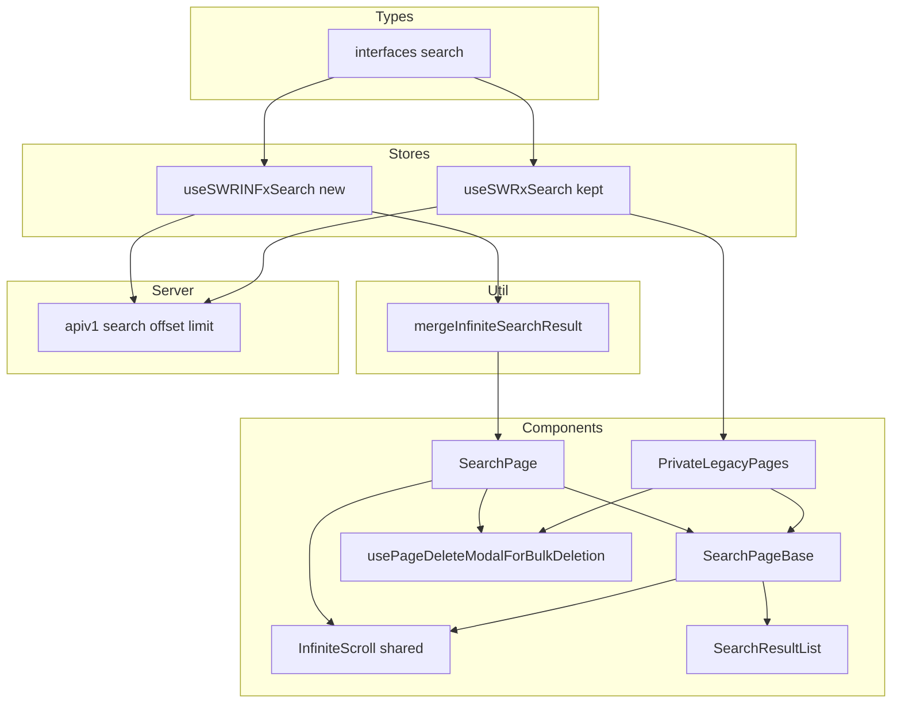
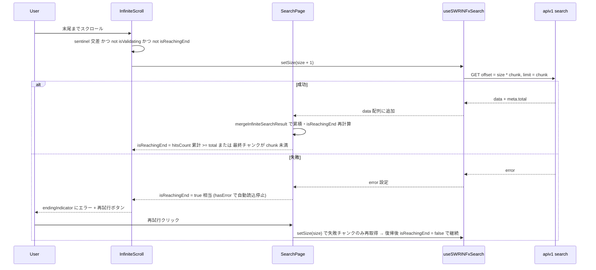
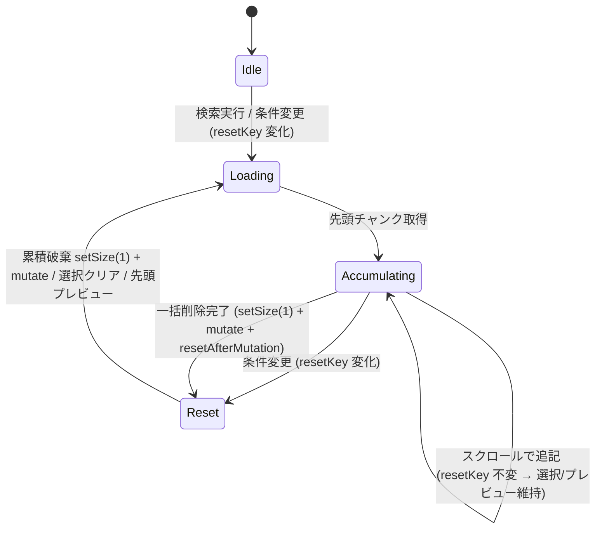

# 技術設計書 — search-result-infinite-scroll

## Overview

**Purpose**: 検索を行うユーザーに対し、フルページ検索結果（`/_search`）の一覧を、ページ番号操作なしにスクロールだけで連続閲覧できる infinite scroll 体験を提供する。

**Users**: GROWI のウィキ利用者（検索結果を閲覧するユーザー）と、検索結果からページを一括管理するページ管理権限ユーザー。

**Impact**: 現在の offset/limit ベースのページ番号ページネーション（`PaginationWrapper`）による「1ページ分だけ表示」方式を、`useSWRInfinite` + 既存 `InfiniteScroll` コンポーネントによる「累積表示」方式へ置き換える。これに伴い、共有コンポーネント `SearchPageBase` の選択・右ペインプレビュー・一括削除ロジックを「累積した結果」を前提として再設計する。検索クエリ・スコアリング・サーバ側の検索ロジックは変更しない。

**Impact（追補 #190441）**: 累積した結果をすべて DOM に置く方式を、`SearchResultList` 内で `@tanstack/react-virtual` により「表示領域とその前後だけを描画する」方式へ変える。あわせて `PageListItemL` の `memo` が効くよう、行に渡す props を安定させる。

### Goals
- 検索結果一覧をスクロールで連続読み込みできるようにする（番号ページャの廃止）
- 累積前提で選択・全選択・一括削除・右ペインプレビューが正しく動作する
- 共有資産（`useSWRxSearch`、`SearchPageBase`、`PrivateLegacyPages`）を回帰させない
- 既存の GROWI infinite scroll パターン（`RecentChanges` / `PageTimeline`）を踏襲する
- 数千件まで読み込んでも、同時に描画する行数を表示領域に応じた一定数に保つ（要件 8）
- 画面外に出た行の選択・プレビュー状態を失わない（要件 9）
- プレビュー切り替え・チェックボックス操作で、関係のない行を再描画しない（要件 10）

### Non-Goals
- Elasticsearch の検索クエリ・スコアリング・検索ロジックの変更
- 並び替え・フィルタ（絞り込み）UI 自体の仕様変更
- 「検索ヒット全件（未読み込み分を含む `total` 全件）」の一括選択（Gmail 式全件選択バナー）
- infinite scroll と番号ページャの切替式提供
- 検索モーダル・タイプアヘッド・AI アシスタント検索の表示方式（`useSWRxSearch` 消費者）の変更
- **追加読み込み時の、表示中の行の再描画抑制**: 追記のたびに付随情報（P2-2）を取り直すため、表示中の行は再描画される。仮想化により対象は表示中の数十行に限られるので、それ以上は抑えない（要件 10 の範囲外）
- **描画範囲外の行を、ブラウザのページ内検索やフォーカス移動の対象にすること**（仮想化に伴う既知の制約。スクリーンリーダー向けに `aria-setsize` / `aria-posinset` だけ付ける）
- **付随情報取得の差分化（既知の制約 / 後続対応）**: 各行のスニペット/ブックマーク数等は `useSWRxPageInfoForList(pageIds)` が GET クエリで取得する。infinite scroll では `pages` が append で伸びるため、追記のたびに「累積 ID 全件」を再取得し（差分ではない）、スクロール全体で O(n²) の転送・DB 参照になる。ID を数百件溜めるとクエリ長が 8KB を超え 414/431 で失敗し得る。差分取得（新規追加分の ID のみ問い合わせ）への変更は本スペックでは行わず、後続タスク/issue とする（P2-2）。

## Boundary Commitments

### This Spec Owns
- フルページ検索結果ページ（`SearchPage`）の一覧表示方式（infinite scroll 化）
- infinite scroll 用の検索取得フック `useSWRINFxSearch`（新規）
- 累積結果の合成ユーティリティ（flatten・件数集計・`isReachingEnd` 判定）
- `SearchPageBase` の累積対応拡張（`resetKey` によるリセット制御、infinite scroll 描画スロット）
- `usePageDeleteModalForBulkDeletion` の累積リスト対応化
- `SearchResultList` の描画仮想化と、行（`PageListItemL`）へ渡す props の安定化
- `PageListItemL` への任意 props の追加（仮想化の計測用 ref・位置、チェック状態の初期値）

### Out of Boundary
- `useSWRxSearch`（通常 `useSWR`）の内部実装 — **温存**する。infinite scroll 用は別フックを新設
- `PrivateLegacyPages` の番号ページャ・表示件数セレクタ — 現状の挙動を**維持**（本スペックは非回帰のみ担保）
- サーバ側検索 API（apiv1 `/search`）の実装 — offset/limit 契約を**そのまま利用**
- `InfiniteScroll` コンポーネント内部 — 既存契約のまま利用（改変しない）
- `PageListItemL` の既存のふるまい — `PageList` / `IdenticalPathPage` は新しい props を渡さず、従来どおり動く
- 付随情報取得（`useSWRxPageInfoForList`）の差分化 — P2-2 として後続対応

### Allowed Dependencies
- 既存 apiv1 `/search`（`apiGet`）: `q`/`nq`/`limit`/`offset`/`sort`/`order` を受け、`{ data, meta: { total, hitsCount, took } }` を返す
- 既存 `InfiniteScroll`（`src/client/components/InfiniteScroll.tsx`）: `SWRInfiniteResponse` を受けて IntersectionObserver で `setSize` を駆動
- `swr/infinite` の `useSWRInfinite`
- `@tanstack/react-virtual` の `useVirtualizer`（既存依存。`ItemsTree` と同じ使い方）
- 検索フィルタ機能（#11597）: URL の `?q=` を検索条件の唯一の情報源とし、フィルタは `author:` 等の演算子として `?q=` に入る。フィルタ UI・`?q=` の組み立て・履歴の扱いはこの機能に従い、本スペックでは変更しない
- `SearchResultContent` / `OperateAllControl`（既存、変更なし）
- `SearchResultList`（既存。行ごとのリネーム/削除を親へ伝える `onItemMutated` と、プレビュー中の行削除を伝える `onPreviewedPageDeleted` の任意 props を追加。追補 #190441 で描画を仮想化）
- `PageListItemL`（既存。追補 #190441 で任意 props のみ追加）
- 依存方向: `interfaces/search`（型）→ `stores/search`（フック）→ `features/search/.../util`（合成）→ `SearchPageBase` → `SearchPage`。左のレイヤーのみ import する。

### Revalidation Triggers
- `IFormattedSearchResult` の shape 変更（`meta.total` / `data` の意味変更）→ 合成ユーティリティ・`isReachingEnd` 判定の再検証
- `SearchPageBase` の props 契約変更（`resetKey` / `infiniteScroll` / `pages` の意味）→ `PrivateLegacyPages` の再検証
- `usePageDeleteModalForBulkDeletion` の引数型変更 → 両消費者（`SearchPage` / `PrivateLegacyPages`）の再検証
- apiv1 `/search` の offset/limit・meta 契約変更 → `useSWRINFxSearch` の再検証
- `SearchPageBase` のスクロールコンテナ構造（`overflow-y-scroll` の要素、一覧上部のヘッダ）の変更 → 仮想化の描画範囲計算（スクロール要素・`scrollMargin`）の再検証
- `PageListItemL` の props 追加・変更 → 行の `memo` が効くか（要件 10）の再検証

## Architecture

### Existing Architecture Analysis
- **共有フック `useSWRxSearch`（`src/stores/search.tsx`）**: 6 消費者（検索モーダル `SearchResultMenuItem`、`SearchTypeahead`、AI 検索、`PrivateLegacyPages`、`SearchPage`、内部）。単一ページ取得前提のため **useSWRInfinite への直接変換は不可** → 新フックを併設する。
- **共有コンポーネント `SearchPageBase` / `usePageDeleteModalForBulkDeletion`**: `SearchPage` と `PrivateLegacyPages` が共有。`PrivateLegacyPages` は番号ページャを意図的に維持 → `SearchPageBase` の既存挙動を非回帰に保つ。
- **リセット衝突点**: `SearchPageBase` は現在 `useEffect([pages])` で（a）選択 Set のクリア、（b）右ペインを `pages[0]` に設定、を行う。累積方式では `pages` が append のたびに変化するため、この 2 つが「新規検索でのみ発火」するよう **`resetKey` 依存へ切り替える**。
- **既存 infinite scroll パターン**: `RecentChanges` は `useSWRInfinite` + `data.flatMap(...)` + `InfiniteScroll` + 消費側 `isReachingEnd` 計算。検索結果は `meta.total` を持つため `累積件数 >= total` で明快に判定できる。

### Architecture Pattern & Boundary Map



**Architecture Integration**:
- **Selected pattern**: 既存の `useSWRInfinite` + `InfiniteScroll` パターンを踏襲（`RecentChanges` に整合）。新フックは併設し、共有コンポーネントはデータ駆動プロップで拡張。
- **Domain/feature boundaries**: 取得（stores）／合成（util）／表示・選択（components）を分離。infinite scroll 固有の状態は `SearchPage` が保持し、`SearchPageBase` は「累積 `pages` と `resetKey` を受け取る純粋な表示・選択レイヤー」に留める。
- **Existing patterns preserved**: 番号ページャ経路（`PrivateLegacyPages`）、`useSWRxSearch`、`InfiniteScroll` 内部、`SearchResultContent` はそのまま（`SearchResultList` は行操作通知用の任意 props 追加と、追補 #190441 の描画仮想化）。
- **New components rationale**: `useSWRINFxSearch`（共有フックを壊さず infinite 取得を提供）、`mergeInfiniteSearchResult`（累積合成を純粋関数化しテスト可能に）。
- **Steering compliance**: モード名ハードコードを避け `resetKey`（データ駆動）で制御。フレームワーク wrapper から純粋ロジック（getKey/合成）を抽出（coding-style 準拠）。

### Technology Stack

| Layer | Choice / Version | Role in Feature | Notes |
|-------|------------------|-----------------|-------|
| Frontend | React 18 / Next.js Pages Router | 検索結果ページ UI | 既存 |
| Data fetching | SWR `useSWRInfinite`（`swr/infinite`） | 累積取得・`setSize` 駆動 | 既存依存、新規利用箇所 |
| UI infra | 既存 `InfiniteScroll`（IntersectionObserver） | センチネル交差で追加読込 | 改変せず利用 |
| UI infra | `@tanstack/react-virtual` ^3.13（既存依存） | 一覧の描画仮想化（可変高さの実測） | `ItemsTree` で採用済み。比較は `research.md` |
| Backend | apiv1 `/search`（Elasticsearch delegator） | offset/limit 検索取得 | **変更なし** |

新規外部依存なし（`swr`・`@tanstack/react-virtual` は既存）。

## File Structure Plan

### New Files
```
apps/app/src/features/search/client/util/
├── infinite-search-result.ts          # 累積合成の純粋関数: flatten + 終端判定(isReachingEnd/isEmpty)
├── infinite-search-result.spec.ts     # 上記のユニットテスト
├── apply-search-item-mutation.ts      # 行単位リネーム/削除を 1 チャンクへ適用する純粋関数（SearchItemMutation）
└── apply-search-item-mutation.spec.ts # 上記のユニットテスト
apps/app/src/features/search/client/components/SearchPage/test-utils/
└── virtual-list-layout-stub.ts        # （追補 #190441）happy-dom で仮想化を検証するためのスクロール要素・行サイズのスタブ
apps/app/src/stores/
└── search.infinite-cache.spec.tsx     # mutateSearchInfiniteChunks が結合/チャンク別キャッシュ双方を書き換えることの検証
```

### Modified Files
- `apps/app/src/stores/search.tsx` — `useSWRINFxSearch`（新規フック）と `getSearchInfiniteKey`（純粋な getKey、テスト用に export）、`mutateSearchInfiniteChunks`（読込済みチャンクのキャッシュ直接書き換え）を追加。`useSWRxSearch` は**変更しない**。チャンクサイズ定数 `DEFAULT_SEARCH_CHUNK_SIZE` を共有化。
- `apps/app/src/stores/search.spec.ts` — `getSearchInfiniteKey` のユニットテスト。
- `apps/app/src/features/search/client/components/SearchPage/SearchPage.tsx` — `useSWRINFxSearch` に切替。`searchPager`/`PaginationWrapper` を廃止し `InfiniteScroll` を配線。累積 `pages` と `resetKey` を `SearchPageBase` へ渡す。追加読込失敗時の `hasError`/`onRetry`（`setSize(size)`）、削除完了時の `setSize(1)+mutate`+選択クリア、行単位リネーム/削除のキャッシュ直接更新（`onItemMutated`）、Elasticsearch `max_result_window` 手前での追加読込停止（P2-4）を実装。一括削除エリアに選択件数と読み込み済み件数を表示する（4.7）。
- `apps/app/src/features/search/client/components/SearchPage/SearchPageBase.tsx` — props に `resetKey`（必須）と `infiniteScroll`（任意）を追加。リセット系 `useEffect` の依存を `[pages]` から `resetKey` へ変更。同一検索内の変更後リセット用に `resetAfterMutation()`（`IResettableAfterMutation`）を公開。`onItemMutated` を `SearchResultList` へ中継し、プレビュー中の行が削除されたらプレビューをクリアする。`infiniteScroll` 指定時は `SearchResultList` を `InfiniteScroll` でラップ、未指定時は従来どおり `searchPager` を描画。`usePageDeleteModalForBulkDeletion` の第1引数を `IPageWithSearchMeta[] | undefined`（累積リスト）へ一般化。
- `apps/app/src/features/search/client/components/PrivateLegacyPages.tsx` — `SearchPageBase` の新 props に追随（`resetKey = keyword|offset|limit` を渡す — レガシーは並び替え/フィルタを無効化しているため sort/order は含めない／削除フックへ `data?.data` を渡す／一括削除完了時・変換完了時は `resetAfterMutation()` で選択とプレビューをクリア）。番号ページャ挙動は維持。
- `apps/app/src/features/search/client/components/SearchPage/SearchResultList.tsx` — 行単位リネーム/削除時に `onItemMutated`（`SearchItemMutation`）を、プレビュー中の行が削除されたとき `onPreviewedPageDeleted` を呼ぶ任意 props を追加。**（追補 #190441）** `useVirtualizer` で表示領域とその前後だけを描画する。`injectedPages` を `useMemo` 化し、行 ref を `pageId` ごとの安定したコールバックに、`deletedHandler` の `pages`/`selectedPageId` 参照を最新値 ref 経由にして、行へ渡す props を安定させる。
- `apps/app/src/client/components/PageList/PageListItemL.tsx` — **（追補 #190441）** 任意 props（`isInitiallyChecked`、`listItemRef`、`listItemIndex`、`listSize`）を追加。未指定時は従来と同じ DOM を出力する。
- `apps/app/src/features/search/client/components/SearchPage/SearchPageBase.tsx`（追補 #190441）— スクロールコンテナ要素を state で保持して `SearchResultList` へ渡す。`onPageSelected` に `setSelectedPageWithMeta` をそのまま渡し、`checkboxChangedHandler` / `onPreviewedPageDeleted` を `useCallback` で安定させる。選択 `Set` を `SearchResultList` へ渡す。`pages` から消えた ID を選択 `Set` から除く（11.6）。
- `apps/app/public/static/locales/*/translation.json`（5 言語）— 追加読込失敗の文言（`search_result.failed_to_load_more`）と、選択件数・読み込み済み件数の表示文言（`search_result.selected_count_of_loaded`）、スクリーンリーダー向けに選択件数だけを読み上げる文言（`search_result.selected_count`）を追加。
- `apps/app/src/features/search/client/components/SearchPage/SearchPage.spec.tsx` / `SearchPageBase.spec.tsx` / `SearchResultList.spec.tsx` — 主要ふるまいのコンポーネントテスト。
- `apps/app/src/client/components/PageList/PageListItemL.spec.tsx`（追補 #190441、新規）— 追加した任意 props のテスト。
- `apps/app/src/features/search/client/components/SearchPage/SearchPageBase.rerender.spec.tsx`（追補 #190441、新規）— `SearchPageBase` と実際の `SearchResultList` を組み合わせた再描画抑制の検証（`SearchPageBase.spec.tsx` は `SearchResultList` をファイル単位でモックしているため別ファイルにする）。

> `SearchResultContent` / `OperateAllControl` / `InfiniteScroll` は変更しない。

## System Flows

### 追加読み込みとエラー時停止



**Key Decisions**:
- `isReachingEnd` に `hasError` を OR することで、エラー時の `setSize` 連続再発火（タイトなリトライループ）を防ぐ（RN1 の解決）。
- 再試行は `endingIndicator` 内の明示ボタン→`setSize(size)`（失敗チャンクのみ再取得。引数なし `mutate()` は読込済み全チャンクを再取得するため使わない、A-4）。復帰後は通常のスクロール追加読込が再開する（要件 1.6 の「再試行できる状態を維持」を満たす）。

### 検索条件変更・削除後のリセット



## Requirements Traceability

| Requirement | Summary | Components | Interfaces | Flows |
|-------------|---------|------------|------------|-------|
| 1.1 | 検索実行で先頭チャンク表示 | useSWRINFxSearch, SearchPage | getSearchInfiniteKey | 追加読込 |
| 1.2 | 末尾スクロールで次チャンク追記 | InfiniteScroll, SearchPage | setSize | 追加読込 |
| 1.3 | 読込中インジケータ | InfiniteScroll | loadingIndicator | 追加読込 |
| 1.4 | total 到達で停止 | mergeInfiniteSearchResult | isReachingEnd | 追加読込 |
| 1.5 | 0件表示・追加読込しない | SearchResultListHead, merge | isEmpty | 追加読込 |
| 1.6 | 失敗時エラー通知・再試行維持 | SearchPage, InfiniteScroll | hasError, onRetry, setSize | 追加読込(失敗) |
| 2.1 | 番号ページャ非表示 | SearchPage, SearchPageBase | infiniteScroll slot | — |
| 2.2 | 超過分はスクロール提供 | InfiniteScroll | setSize | 追加読込 |
| 3.1 | 1回 showPageLimitationL 件（config 既定50、防御的既定20） | useSWRINFxSearch, SearchPage | chunkSize = showPageLimitationL > 0 ? showPageLimitationL : DEFAULT_SEARCH_CHUNK_SIZE(20) | 追加読込 |
| 3.2 | 件数セレクタ非提供 | SearchPage | （SearchResultListHead のセレクタ復活させない） | — |
| 3.3 | 同一検索中はチャンクサイズ一定 | SearchPage, useSWRINFxSearch | chunkSize を key に含め、検索中は変えない | 追加読込 |
| 4.1 | 全選択=読込済み全件 | SearchPageBase | selectAll over accumulated pages | リセット |
| 4.2 | 全解除 | SearchPageBase | deselectAll | リセット |
| 4.3 | 追記分は未選択・既存維持 | SearchPageBase | resetKey 依存化 | 追加読込 |
| 4.4 | 選択件数更新（checkbox 変更時＋append 時） | SearchPageBase, SearchPage | onSelectedPagesByCheckboxesChanged | 追加読込 |
| 4.5 | 一部選択で indeterminate（append 追従） | SearchPageBase, SearchPage, OperateAllControl | loaded 件数変化で再通知 → setIndeterminate | 追加読込 |
| 4.6 | 全選択で checked（append 追従） | SearchPageBase, SearchPage, OperateAllControl | loaded 件数変化で再通知 → select | 追加読込 |
| 4.7 | 選択件数を読み込み済み件数と並べて表示 | SearchPage | selectedCount / 累積 pages の件数 | 追加読込 |
| 5.1 | 選択済み読込分のみ削除対象 | usePageDeleteModalForBulkDeletion | pages 引数一般化 | リセット |
| 5.2 | 0件時は削除無効 | SearchPage | disabled=selectedCount===0 | — |
| 5.3 | 削除後は先頭から再取得 | SearchPage | setSize(1)+mutate | リセット |
| 6.1 | 新規検索で先頭プレビュー | SearchPageBase | 2段構成: resetKey 変化でクリア＋初回データ到着で先頭選択 | リセット |
| 6.2 | 選択結果をプレビュー | SearchPageBase | onPageSelected | — |
| 6.3 | 追記でプレビュー維持 | SearchPageBase | 適用済み resetKey 記録で再選択を抑止 | 追加読込 |
| 7.1 | 条件変更で累積破棄・先頭再読込 | SearchPage | setSize(1) + mutate | リセット |
| 7.2 | 条件変更で選択クリア | SearchPageBase | resetKey 変化で選択リセット | リセット |
| 8.1 | 表示領域＋前後のみ描画 | SearchResultList | useVirtualizer（overscan） | 仮想化 |
| 8.2 | 描画行数を一定に保つ | SearchResultList | getVirtualItems | 仮想化 |
| 8.3 | 可変高さでも重なり・隙間なし | SearchResultList, PageListItemL | measureElement + listItemRef/listItemIndex | 仮想化 |
| 8.4 | スクロール範囲は全件分 | SearchResultList | getTotalSize で入れ物の高さを確保 | 仮想化 |
| 8.5 | 追加読込・再試行を維持 | SearchPageBase, InfiniteScroll | 入れ物の直後にセンチネル（変更なし） | 追加読込 |
| 9.1 | 再表示でチェック状態を復元 | SearchResultList, PageListItemL | isInitiallyChecked（選択 Set から） | 仮想化 |
| 9.2 | 全選択/解除は画面外も対象 | SearchPageBase, SearchResultList | 選択 Set 更新＋マウント中の行を命令的に更新 | 仮想化 |
| 9.3 | 画面外の選択も件数・一括削除に含む | SearchPageBase, usePageDeleteModalForBulkDeletion | 選択 Set から導出（変更なし） | — |
| 9.4 | 再表示でプレビュー強調を復元 | SearchResultList | isSelected = pageId 一致（描画時に算出） | 仮想化 |
| 10.1 | プレビュー切替で 2 行のみ再描画 | SearchPageBase, SearchResultList, PageListItemL | 安定した行 props + memo | — |
| 10.2 | チェック変更で他行を再描画しない | SearchPageBase, SearchResultList, PageListItemL | 安定した行 props + memo | — |
| 11.1 | 複製は既存行を変えない | SearchResultList | duplicatedHandler | — |
| 11.2 | リネームを新パスで表示 | SearchResultList, SearchPage | onItemMutated → applySearchItemMutation | — |
| 11.3 | 削除行（と配下）を除去 | SearchResultList, SearchPage | onItemMutated → applySearchItemMutation | — |
| 11.4 | プレビュー中の削除でプレビュークリア | SearchResultList, SearchPageBase | onPreviewedPageDeleted | — |
| 11.5 | 先頭から取り直さない | SearchPage | mutateSearchInfiniteChunks（revalidate: false） | — |
| 11.6 | 削除した選択済みの行を選択件数から除く | SearchPageBase | pages 変化時に Set を pages に揃えてから再通知 | — |

## Components and Interfaces

| Component | Domain/Layer | Intent | Req Coverage | Key Dependencies (P0/P1) | Contracts |
|-----------|--------------|--------|--------------|--------------------------|-----------|
| useSWRINFxSearch | Stores | infinite 検索取得 | 1.1, 1.2, 3.1 | apiv1 search (P0), useSWRInfinite (P0) | State |
| getSearchInfiniteKey | Stores(pure) | ページごとの SWR key/停止判定 | 1.1, 1.4 | — | Service |
| mergeInfiniteSearchResult | Util(pure) | 累積合成・件数・停止判定 | 1.4, 1.5 | interfaces/search (P1) | Service |
| SearchPageBase | Components | 表示・選択・プレビュー（累積対応） | 4.x, 6.x, 2.1 | InfiniteScroll (P0), SearchResultList (P0) | State |
| usePageDeleteModalForBulkDeletion | Components | 累積リストからの一括削除 | 5.1 | page-delete modal (P0) | Service |
| SearchPage | Components | infinite 状態統括・配線 | 1.x, 2.x, 5.x, 7.x | 上記全て (P0) | State |

### Stores（取得層）

#### useSWRINFxSearch / getSearchInfiniteKey

| Field | Detail |
|-------|--------|
| Intent | 共有 `useSWRxSearch` を温存したまま、infinite scroll 用の累積取得を提供する |
| Requirements | 1.1, 1.2, 1.4, 3.1 |

**Responsibilities & Constraints**
- `useSWRInfinite` で apiv1 `/search`（offset/limit）を呼び、`IFormattedSearchResult` のページ配列を返す
- SWR key の名前空間を `useSWRxSearch`（`'/search'`）と衝突させないため `'/search/infinite'` を用いる
- チャンクサイズは `showPageLimitationL > 0 ? showPageLimitationL : DEFAULT_SEARCH_CHUNK_SIZE(20)` の固定値（`SearchPage` で算出し、フック側も `limit > 0 ? limit : 20` で防御）（セッション内一定・ユーザー変更手段なし）。`showPageLimitationL` の atom は `number` 非 nullable・config 既定 **50** のため、admin 未設定でも実効チャンクは 50。`DEFAULT_SEARCH_CHUNK_SIZE(20)` は `limit <= 0` に対する防御的既定で、現行 config では未到達。定数は `stores/search.tsx` に集約し SearchPage と共有（R-1）
- SWR key には `limit`（チャンクサイズ）と `nqName` を含める（fetcher が参照する値はすべて key に入れ、異なる値がキャッシュを共有しないようにする。`offset` はページごとに導出するため除外）
- `SearchPage` は構造化フィルタ（`filters`）に空を渡す（フィルタは `?q=` に入っているため、渡すと同じ条件が二重に付く）
- offset は `pageIndex * chunkSize`。前ページの `meta.hitsCount`（ES が返した件数。MongoDB 側で欠落したページを除外する前の件数）が `chunkSize` 未満なら以降の key を `null` にして過剰取得を止める（`data.length` は除外後の件数なので途中で `chunkSize` を下回り得るため使わない）

**Contracts**: State [x] / Service [x]（pure key 関数）

##### Service Interface
```typescript
// getKey は純粋関数として抽出（テスト可能）
export const getSearchInfiniteKey = (
  pageIndex: number,
  previousPageData: IFormattedSearchResult | null,
  keyword: string | null,
  // limit(=chunkSize) と nqName を含む。fetcher が参照する値はすべて key に入れる
  configurations: Omit<ISearchConfigurationsFixed, 'offset'> & { nqName: string | null },
): readonly ['/search/infinite', string, number, typeof configurations] | null;
// 返り値 null の条件:
//  - keyword が空
//  - previousPageData != null かつ previousPageData.meta.hitsCount < configurations.limit (末尾到達)

// 読込済みチャンクを再取得せずに書き換える（結合キャッシュとチャンク別キャッシュの双方、revalidate: false）
export const mutateSearchInfiniteChunks = (
  infiniteMutate: SWRInfiniteResponse<IFormattedSearchResult, Error>['mutate'],
  updater: (chunk: IFormattedSearchResult) => IFormattedSearchResult,
): Promise<void>;

export const useSWRINFxSearch = (
  keyword: string | null,
  nqName: string | null,
  configurations: Omit<ISearchConfigurations, 'offset'>,
): SWRInfiniteResponse<IFormattedSearchResult, Error>;
```
- Preconditions: `keyword` が null/空なら、`filters` の有無にかかわらず SWR は無効（fetch しない）。フィルタは `?q=` に入れて渡す前提
- Postconditions: `data` は取得済みページの配列（各要素が 1 チャンク分の `IFormattedSearchResult`）
- Invariants: `data[0].meta.total` は全ページで一貫（検索条件が同じ間）

**Implementation Notes**
- Integration: fetcher は既存 `useSWRxSearch` と同じ `apiGet('/search', { q, nq, limit, offset, sort, order })` を用いる（`createSearchQuery` も共用）
- Validation: `revalidateFirstPage: false` で append 時に先頭を無駄に再検証しない（`RecentChanges` に整合）。`revalidateOnFocus: false` でフォーカス復帰時の全チャンク再取得を避ける
- Risks: key 名前空間の衝突（→ `'/search/infinite'` で回避）

### Util（合成層）

#### mergeInfiniteSearchResult

| Field | Detail |
|-------|--------|
| Intent | SWRInfinite の `data` 配列から、描画用の累積リストと停止判定を純粋に導出する |
| Requirements | 1.4, 1.5 |

**Contracts**: Service [x]（pure）

##### Service Interface
```typescript
export type MergedSearchResult = {
  pages: IPageWithSearchMeta[];   // 累積 flatten 済み
  total: number;                  // meta.total（先頭ページ由来）
  took?: number;
  isEmpty: boolean;               // data 取得済み かつ total === 0
  // data 取得済み かつ (meta.hitsCount の累計 >= total || 最終チャンクの meta.hitsCount < chunkSize)
  isReachingEnd: boolean;
};

export const mergeInfiniteSearchResult = (
  data: IFormattedSearchResult[] | undefined,
  chunkSize: number,
): MergedSearchResult;
```
- Postconditions: `data == null`（ローディング前）なら `pages: []`, `isEmpty: false`, `isReachingEnd: false`
- 終端判定は post-filter の `pages.length` ではなく pre-filter の `meta.hitsCount` 累計で行う（ES インデックスと MongoDB がずれていると `pages.length` が `total` に永遠に届かずローダーが回り続けるため、A-6）。最終チャンクが `chunkSize` 未満なら `total` に関係なく終端とし、`getSearchInfiniteKey` の停止条件と一致させる
- Invariants: `pages` は `data.flatMap(r => r.data)`（`data?.flat()` ではない）を、ページ ID で重複除去したもの（先に出た方を残す）。offset 方式のページ送りでは、読み込みの合間に結果の順序が変わると（更新日時順でのページ編集など）同じページが 2 つのチャンクに入る。一覧の行は pageId をキーにしているため、重複があると行が消えたりずれたりする。終端判定は `hitsCount` 累計なので重複除去の影響を受けない。既知の制約: 同じずれで、2 つのチャンクの境目を越えて前へ移ったページは読み込まれずに抜け落ちる（offset 方式の限界。重複除去では防げない）

### Components（表示・選択層）

#### SearchPageBase（拡張）

| Field | Detail |
|-------|--------|
| Intent | 累積 `pages` と `resetKey` を受け、選択・全選択・右ペインプレビューを提供。infinite/legacy 両経路をデータ駆動で描き分ける |
| Requirements | 2.1, 4.1–4.6, 6.1–6.3, 7.2, 11.6 |

**Responsibilities & Constraints**
- **選択クリア effect**（現 L157-172）の依存を `[pages]` → **`[resetKey]`** に変更する。選択クリアはデータ非依存（空 Set 化＋件数0通知）なので resetKey 一本で足りる。append（`resetKey` 不変）では発火せず選択を維持（4.3）、新規検索/条件変更（`resetKey` 変化）でのみクリア（7.2）。
- **プレビュー初期選択 effect**（現 L147-154）は `pages[0]` を読む**データ依存**処理のため、`[resetKey]` 単純付け替えは不可（resetKey 変化時点で新 `pages` は未到着）。**2段構成**にする: (a) `resetKey` 変化で即座にプレビューをクリア、(b) 「当該 `resetKey` に対する最初のデータ到着時に一度だけ」`pages[0]` を選択する。実装は直近適用済み `resetKey` を `ref` で記録し、未適用かつ `pages.length > 0` のとき先頭を選択して ref を更新する。これにより新規検索で先頭表示（6.1）、append でプレビュー維持（6.3）を両立する。
- **全選択ヘッダ状態の append 追従**: select-all の checked/indeterminate は現状 checkbox 変更時にのみ `onSelectedPagesByCheckboxesChanged` 経由で再計算される。append では checkbox イベントが発火しないため、全件選択済み状態でスクロール追記すると実態は「一部選択」でもヘッダが checked のまま残る。これを防ぐため、**累積件数（`pages.length`）変化を契機に、現在の選択件数と累積件数を親へ再通知する effect を追加**する（`resetKey` 不変でも loaded 件数変化時は再計算）。これにより 4.5（一部選択→indeterminate）/4.6（全選択→checked）を append 後も満たす。
- この再通知の前に、`pages` から消えた ID を選択 Set から除く。行メニューの削除（配下を含む）で一覧から消えた結果が、選択件数に残らないようにするため（11.6）
- `infiniteScroll` prop が渡された場合は `SearchResultList` を `InfiniteScroll` でラップして描画（`searchPager` は描画しない）。渡されない場合は従来どおり `searchPager`（番号ページャ）を描画（legacy 非回帰）
- `selectAll` は与えられた `pages`（infinite では累積）を走査するため、実装変更なしで「読み込み済み全件」を選択する
- pages が空/未取得の場合のプレビュークリアは維持

**Contracts**: State [x]

##### State Management
```typescript
// 追加・変更する props（デルタ）
type SearchPageBaseInfiniteProps = {
  swrInfiniteResponse: SWRInfiniteResponse<IFormattedSearchResult, Error>;
  isReachingEnd: boolean;   // センチネルの停止条件: hasLoadedAll || hasError
  hasLoadedAll: boolean;    // これ以上読み込まない: merged.isReachingEnd || reachedResultWindowLimit（読み込み失敗中は false）
  hasError: boolean;
  onRetry: () => void;      // endingIndicator の再試行ボタン
};

type Props = {
  // 既存
  className?: string;
  pages?: IPageWithSearchMeta[];           // infinite では累積リスト
  searchingKeyword?: string;
  forceHideMenuItems?: ForceHideMenuItems;
  onSelectedPagesByCheckboxesChanged?: (selectedCount: number, totalCount: number) => void;
  searchControl: React.ReactNode;
  searchResultListHead: JSX.Element;
  // 変更・追加
  resetKey: string;                        // NEW(必須): 変化で選択/プレビューをリセット
  infiniteScroll?: SearchPageBaseInfiniteProps; // NEW(任意): 指定時は InfiniteScroll 経路
  searchPager?: React.ReactNode;           // legacy 経路のみ使用
  onItemMutated?: (mutation: SearchItemMutation) => void; // NEW(任意): 行単位リネーム/削除の通知（A-1）
};
```
- State model: `selectedPageIdsByCheckboxes`（`ReadonlySet`、変更のたびに新しい Set に置き換える）、`selectedPageWithMeta`（プレビュー対象）。リセット契機のみ変更
- Concurrency strategy: 追加読込中も選択状態は保持（`resetKey` 不変のため effect が発火しない）

**Implementation Notes**
- Integration: `InfiniteScroll` へ `swrInifiniteResponse`/`isReachingEnd`/`endingIndicator`（`hasError` 時は再試行 UI）を渡す。センチネルは既存 `overflow-y-scroll` コンテナ内に入る
- Validation: `resetKey` は同一検索中に安定し、条件変更で必ず変化すること（`SearchPage` 側で保証）
- Risks: IntersectionObserver の root はビューポート（`InfiniteScroll` 既定）。2ペイン+内部スクロール構成での交差は実機確認（RN4）

**追補（#190441）— 仮想化と再描画抑制のための変更**（要件 8.5, 9.2, 9.3, 10.1, 10.2）
- スクロールコンテナ（`div.overflow-y-scroll`）を callback ref で state に保持し、`SearchResultList` の `scrollElement` へ渡す。一覧の開始位置（`scrollMargin`）を `offsetTop` で測れるよう、このコンテナに Bootstrap の `position-relative` を付ける
- 行へ届くハンドラを安定させる: `onPageSelected` には `setSelectedPageWithMeta`（React が同一性を保証）をそのまま渡し、`checkboxChangedHandler` / `onPreviewedPageDeleted` は `useCallback` にする。`checkboxChangedHandler` の依存は `pages` のみ（チェック操作では変わらない）
- 行の `aria-setsize` 用に `listSize` を算出して `SearchResultList` へ渡す: infinite scroll で `hasLoadedAll` が false の間（続きがある・追加読み込みに失敗している）は `-1`、それ以外（全件読み込み済み・legacy の 1 ページ表示）は `pages.length`。`isReachingEnd` はエラーでもセンチネルを止めるため true になり、全件数が分かったかどうかとは意味が違うので使わない
- 選択 `Set`（`selectedPageIdsByCheckboxes`）は書き換えず、変更のたびに新しい Set を state に入れて `SearchResultList` の `selectedPageIds` へ渡す。一覧はその再描画で最新の選択を受け取り、画面外の行は再マウント時にそこから初期値を得る（9.2）。全選択/解除は Set を置き換えたうえで、マウント中の行だけを命令的に更新する
- 同じ Set を ref にも持つ。`selectAll()` の直後に `getSelectedPageIds()` を読む呼び出し元（`SearchPage` の件数更新）が、再描画前でも最新の選択を得るため。`checkboxChangedHandler` は ref から読むので、選択が変わってもハンドラの同一性は変わらない（10.2）。チェックを変えた行自身は `isInitiallyChecked` が変わるので再描画されるが、他の行は再描画されない
- 選択件数・一括削除は今までどおり Set から導出するので、画面外の選択も含まれる（9.3、変更なし）
- `InfiniteScroll` のラップは変更しない。仮想化した一覧は全件分の高さを持つため、センチネルは今と同じく一覧の末尾付近で交差する（8.5）

#### SearchResultList（追補 #190441: 描画仮想化）

| Field | Detail |
|-------|--------|
| Intent | 累積 `pages` のうち、表示領域とその前後だけを描画する。行へ渡す props を安定させ、`PageListItemL` の `memo` を効かせる |
| Requirements | 8.1–8.4, 9.1, 9.2, 9.4, 10.1, 10.2, 11.1–11.4 |

**Responsibilities & Constraints**
- `useVirtualizer`（`count = pages.length`、`getItemKey = pageId`、推定行高＋`measureElement` による実測、`overscan`、`scrollMargin`）で描画範囲を決める（8.1, 8.2）。`getItemKey` を `pageId` にするのは、行の削除で index がずれても実測済みの高さを取り違えないため
- DOM は「全件分の高さを持つ入れ物（`position-relative`）＞ 描画範囲の先頭位置まで `translateY` した `<ul>`（`position-absolute top-0 start-0 w-100`）＞ `<li>`」とする。`<ul>/<li>` の構造と `page-list-ul list-group list-group-flush` のスタイルはそのまま残る。インライン style は動的な値（入れ物の高さ・`translateY`）だけ（8.3, 8.4）
- `scrollMargin` は一覧の入れ物の `offsetTop`（スクロールコンテナからの位置）を layout effect で測り、変化したときだけ更新する（上部ヘッダの高さを描画範囲の計算に反映する）
- 行ごとの ref は `pageId` をキーにした登録簿（Map）で持ち、`pageId` ごとに一度だけ作ったコールバックを渡す。index ベースの配列＋インライン関数は、仮想化で index がずれるうえ memo を毎回無効にするため使わない。`selectAll` / `deselectAll` はこの登録簿（＝マウント中の行）を走査する
- `isInitiallyChecked = selectedPageIds.has(pageId)` を行に渡し、再マウント時のチェック状態を復元する（9.1）。`isSelected` は描画時に `pageId === selectedPageId` で算出するので、再表示時も強調表示される（9.4）
- `injectedPages` は `useMemo([pages, idToPageInfo])` にし、プレビュー切替やチェック操作では行の `page` の同一性が変わらないようにする（10.1, 10.2）
- `deletedHandler` が参照する `pages` / `selectedPageId` は最新値 ref から読む。依存に入れるとプレビュー切替のたびに全行へ新しい関数が渡るため（10.1）。行操作の通知（`onItemMutated` / `onPreviewedPageDeleted`）は従来どおり（11.1–11.4）
- 仮想化は infinite / legacy の両経路で同じように行う（分岐を作らない）

**Contracts**: State [x]

##### Props（デルタ）
```typescript
type Props = {
  // 既存: pages, selectedPageId, forceHideMenuItems, onPageSelected,
  //       onCheckboxChanged, onItemMutated, onPreviewedPageDeleted
  scrollElement: HTMLElement | null;        // NEW: 仮想化のスクロール要素（SearchPageBase のコンテナ）
  selectedPageIds: ReadonlySet<string>;     // NEW(必須): 再マウント時のチェック初期値の参照元。渡し忘れるとチェック状態の復元が黙って壊れるため必須
  listSize?: number;                        // NEW: 行の aria-setsize。未指定時は pages.length
};
```

**Implementation Notes**
- Integration: `ItemsTree`（ページツリー）と同じ `useVirtualizer` の使い方に合わせる
- Risks: 推定行高と実測の差が大きいと初回スクロールで位置が跳ねる → 行の CSS の最低の高さ（`packages/ui/scss/molecules/_page_list.scss` の `.list-group-item` の `min-height: 136px`）を推定値にし、`measureElement`（ResizeObserver）で補正する。推定値が最低の高さより小さいと、未描画の行を実測するたびに必ず補正が入り、全体の高さも伸び続ける。`Clamp` がマウント後に高さを変えても ResizeObserver が拾う
- Validation: happy-dom では要素サイズが 0 のため、テストではスクロール要素と行の大きさをスタブして描画範囲を決定的にする。スクロール要素が未取得（`null`、初回描画直後）の間は行を描画せず、ref が付いた後の再描画で描画する
- 旧形式ページ一覧は `forceHideMenuItems` をインラインの配列で渡すため、その経路では行の memo が効かない。要件 10 は検索結果ページが対象で、旧形式の一覧は最大 1 ページ分なので許容する

#### PageListItemL（追補 #190441: 任意 props の追加）

| Field | Detail |
|-------|--------|
| Intent | 仮想化された一覧から使えるよう、計測用 ref・位置・チェック初期値を任意で受け取る |
| Requirements | 8.3, 9.1 |

##### Props（デルタ）
```typescript
type Props = {
  // 既存 props は変更しない
  isInitiallyChecked?: boolean;             // NEW: チェックボックスの初期値（defaultChecked）
  listItemRef?: Ref<HTMLLIElement>;         // NEW: <li> の実測用（virtualizer.measureElement）
  listItemIndex?: number;                   // NEW: data-index と aria-posinset(=index+1)
  listSize?: number;                        // NEW: aria-setsize（全件数。未確定なら -1）
};
```
- 未指定時は従来と同じ DOM を出力し、`PageList` / `IdenticalPathPage` のふるまいは変わらない
- 行へ渡す props はすべてプリミティブか同一性の安定した値にする（`memo` を効かせるため。オブジェクトを都度作って渡さない）
- `listSize` は、まだ続きを読み込める間は `-1`（全件数が未確定であることを示す WAI-ARIA の値）とし、終端に届いたら読み込み済み件数にする。読み込み済み件数を渡すと、続きがあるのにスクリーンリーダーへ少ない件数を伝えてしまうため。値が変わるのは終端到達時の 1 回だけなので、追加読み込みのたびに表示中の行を再描画する原因にもならない

#### usePageDeleteModalForBulkDeletion（一般化）

| Field | Detail |
|-------|--------|
| Intent | 単一 `IFormattedSearchResult` 前提を、累積リスト `IPageWithSearchMeta[]` 前提へ一般化 |
| Requirements | 5.1 |

**Contracts**: Service [x]

##### Service Interface
```typescript
export const usePageDeleteModalForBulkDeletion: (
  pages: IPageWithSearchMeta[] | undefined,   // was: IFormattedSearchResult | undefined
  ref: React.MutableRefObject<(ISelectableAll & IReturnSelectedPageIds) | null>,
  onDeleted?: OnDeletedFunction,
) => () => void;
// 内部: pages.filter(p => selectedIds.has(p.data._id)) を削除対象に渡す
```
- 両消費者の適合: `SearchPage` は累積 `merged.pages`、`PrivateLegacyPages` は `data?.data` を渡す

#### SearchPage（統括）

| Field | Detail |
|-------|--------|
| Intent | infinite scroll 状態（`useSWRINFxSearch` の `size`/`error`）を統括し、`SearchPageBase` へ配線する |
| Requirements | 1.1–1.6, 2.1–2.2, 3.2, 4.7, 5.2–5.3, 7.1 |

**Responsibilities & Constraints**
- `useSWRINFxSearch` を用い、`mergeInfiniteSearchResult(data)` で累積 `pages`/`isReachingEnd`/`isEmpty` を導出
- `resetKey` を検索アイデンティティ（`?q=` そのままの `keyword` + 並び替え等の条件）から生成（offset を含めない＝append で不変）。フィルタも `?q=` に含まれるため、フィルタだけの変更でもリセットされる（7.1/7.2）
- 一覧のハイライトには演算子を除いたキーワードを渡す（演算子をハイライトしないため）
- `PaginationWrapper`/`searchPager` を撤去し、`infiniteScroll` prop（`isReachingEnd = merged.isReachingEnd || hasError || reachedResultWindowLimit`）を渡す。`reachedResultWindowLimit` は次チャンクの `(読込済みチャンク数 + 1) * chunkSize` が Elasticsearch の `max_result_window`（既定 10000、`ES_MAX_RESULT_WINDOW`）を超えるときに true とし、上限到達後に毎回失敗する追加読込を防ぐ（P2-4）
- 検索実行/条件変更時: `setSize(1)` + `mutate()`（累積破棄・先頭再読込。同じ条件での再検索でも取り直す）
- 一括削除完了時: `setSize(1)` + `mutate()` + `resetAfterMutation()`（選択クリア**かつ右ペインプレビューのクリア**）
- 削除ボタンは `selectedCount === 0` で無効
- 一括削除エリアに、選択件数と読み込み済み件数を並べて表示する。「全選択」が読み込み済みの結果だけを対象にすることを示すため（4.7）。スクリーンリーダー向けの `role="status"` は、表示とは別の visually-hidden 要素に選択件数だけを入れる。読み込み済み件数を含めると、追加読み込みのたびに読み上げられ、選択の変化が埋もれるため。この要素は一括削除パネル（`SearchControl` の Collapse）の外に置く。パネルが閉じている間は `display:none` になり、読み上げられないため
- 行単位のリネーム/削除（`SearchResultList` 経由）は `mutateSearching()` に加え、`onItemMutated` で変更内容（`SearchItemMutation`）を受け取り、**再取得せず**読込済みチャンクのキャッシュを直接書き換える（`mutateSearchInfiniteChunks` + `applySearchItemMutation`、`revalidate: false`）。`mutateSearching()` のフィルタ付き `mutate` は `$inf$` 接頭辞キーを対象外とするため単独では効かず、引数なし `mutate()` での再検証は読込済み全チャンクを再取得してしまう（A-1）
  - 削除: 該当行を除去。再帰削除では子孫（`path + '/'` 前方一致）も除去
  - リネーム: 該当行と子孫の `path` を新パスへ置換し、旧パス由来の `highlightedPath` を破棄（新パスは `OnRenamedFunction` の第 2 引数で受け取る）
  - 複製: 既存行は変わらないため何もしない
  - `useSWRInfinite` は結合キャッシュとは別にチャンクごとのキャッシュを持つ。結合側だけを書き換えると次回の追加読込で差分のあるチャンクが再取得されるため、両方を同じ内容に書き換える
  - `meta`（`total`/`hitsCount`）は書き換えない（`hitsCount` は終端判定に使うため ES の返却数を保つ）。削除後はサーバ側の offset が詰まるため、以降の追加読込で境界の結果が 1 件ずつ読み飛ばされうる（全件再取得を避けるためのトレードオフとして許容）

**Contracts**: State [x]

**Implementation Notes**
- Integration: 既存の `OperateAllControl`（全選択/indeterminate）配線は `totalCount = 累積 pages.length` で不変のまま機能
- Validation: `SearchResultListHead` の 0 件表示（`total === 0`）を維持。コメントアウト済み表示件数セレクタは**復活させない**（3.2）
- Risks: 削除後 `setSize(1)` と `mutate` の順序（先に size を戻してから再検証）。`resetKey` は削除・変換完了では変化しないため、`SearchPageBase` の `resetKey` 変化 effect には頼れず、`resetAfterMutation()`（`IResettableAfterMutation`）を明示的に呼ぶ必要がある — さもないと右ペインプレビューが削除済みページを指したまま残る

## Error Handling

### Error Strategy
- **追加読込失敗（システムエラー 5xx/ネットワーク）**: `swrInfiniteResponse.error` を検知し `hasError` を立てる。`isReachingEnd` に OR して自動 `setSize` を停止（リトライループ防止）。`endingIndicator` にエラーメッセージ＋「再試行」ボタンを表示。再試行は現在と同じ size での `setSize(size)` とし、キャッシュを持たない失敗チャンクのみを再取得する（引数なし `mutate()` は読込済み全チャンクを再取得するため使わない、A-4）。成功後はスクロール追加読込が再開する。
- **検索サービス未設定/到達不能**: 既存 `SearchPageBase` の案内表示（`isSearchServiceConfigured` / `isSearchServiceReachable`）をそのまま維持。
- **0 件**: エラーではなく `isEmpty` として 0 件表示（既存 `SearchResultListHead`）。

### Monitoring
- 既存の SWR エラーおよびクライアントロガーに委譲。本フィーチャー固有の新規監視は追加しない。

## Testing Strategy

### Unit Tests
- `getSearchInfiniteKey`: (1) `keyword` 空で `null`、(2) `previousPageData.meta.hitsCount < chunkSize` で `null`（末尾到達＝1.4。`data.length` が小さくても `hitsCount` が満たされていれば継続）、(3) `pageIndex * chunkSize` が offset に反映（1.1/1.2）、(4) key 先頭が `'/search/infinite'`（名前空間分離）。
- `mergeInfiniteSearchResult`: (1) 複数ページを `flatMap` で平坦化し `pages.length` が一致、(2) 終端判定は post-filter の `pages.length` ではなく pre-filter の `meta.hitsCount` 累計（`fetchedCount`）で行う — MongoDB 側で欠落したページ分だけ `pages.length` が `hitsCount` 未満になっても正しく終端検知できることを確認（1.4）、(3) `total===0` で `isEmpty=true` かつ `isReachingEnd=true`（1.5）、(4) `data==null` で空・非停止。

### Component Tests (RTL)
- `SearchPageBase`: `resetKey` 不変のまま `pages` を追加 → 選択状態・プレビュー選択が維持される（4.3/6.3）。`resetKey` 変更 → 選択クリア・先頭プレビュー（7.2/6.1）。`selectAll` で累積全件が選択される（4.1）。
- `SearchPageBase` プレビュー2段構成: `resetKey` 変化直後（新 `pages` 未到着）はプレビューがクリアされ、その後の初回データ到着で `pages[0]` が選択される。append（同一 `resetKey`）では再選択されない（6.1/6.3）。
- `SearchPageBase` 全選択 append 追従: 全件選択済み（checked）状態で未選択の `pages` を追記 → select-all が indeterminate に遷移する（4.5）。追記分も選択済みなら checked を維持（4.6）。
- `SearchPage`: (1) 番号ページャ（`PaginationWrapper`）が描画されない（2.1）、(2) 追加読込エラー時にエラー＋再試行が表示され自動読込が止まる、再試行で `setSize(size)` 呼出・`mutate` 非呼出（1.6）、(3) 一括削除は選択済み読込分のみをモーダルに渡し、`selectedCount===0` で削除ボタン無効（5.1/5.2）、(4) 削除完了で `setSize(1)`＋`resetAfterMutation()`（選択クリア**および右ペインプレビューのクリア**、5.3/7.2）、(5) `onItemMutated` で受けた行単位のリネーム/削除を、自身の `swr.mutate` を対象に再検証なしでキャッシュへ適用することを確認。
- IntersectionObserver をモックし、センチネル交差で `setSize(size+1)` が呼ばれる（1.2）。
- **（追補 #190441）`SearchResultList` 仮想化**（スクロール要素と行の大きさをスタブ）: (1) 数百件を渡しても描画される行数が表示領域＋overscan 分に収まり、件数を増やしても増えない（8.1/8.2）、(2) 入れ物の高さが全件分になる（8.4）、(3) `selectedPageIds` に含まれる行はマウント時にチェック済み、含まれない行は未チェック（9.1）、(4) スクロールで範囲外に出して戻した行が、チェック状態とプレビューの強調表示を保つ（9.1/9.4）、(5) 全選択後にスクロールで新たに描画された行もチェック済みになる（9.2）。
- **（追補 #190441）再描画抑制**（`SearchPageBase` ＋ 実 `SearchResultList`、行は `memo` 付きで描画回数を数えるテスト用部品に差し替え）: プレビュー切替で描画されるのは切替前後の 2 行だけ（10.1）、チェック変更で他の行は描画されない（10.2）。
- 選択件数の表示: 選択の変化・追加読み込みのあとで、表示される選択件数と読み込み済み件数が実際と一致する（4.4/4.7）。選択済みの行が一覧から消えると（配下を含む削除）、選択件数と一括削除の対象から除かれる（11.6）。
- **（追補 #190441）`PageListItemL`**: `isInitiallyChecked` でチェックボックスの初期値が決まる。新しい props を渡さない場合は従来と同じ出力（`data-index` / `aria-*` を付けない）になる。

### 非回帰（Regression）
- `PrivateLegacyPages`: `SearchPageBase` の新 props（`resetKey`/`infiniteScroll` 未指定）で番号ページャが従来どおり描画・機能する（ページ遷移で選択リセット）。仮想化後も、ページ遷移時の選択リセット・変換・一括削除が従来どおり動く。
- 行ごとの複製・リネーム・削除（11.1–11.4）は既存の `SearchResultList.spec` / `SearchPage.spec` がそのまま通ること。

### 実機確認（Validation Hook）
- devcontainer 実機でフルページ検索を行い、スクロールで追加読込が発火すること（RN4: IntersectionObserver × 2ペイン内部スクロールの交差）を目視確認する。
- （追補 #190441）数百件以上までスクロールし、DevTools で `li` の数がおおむね一定であること、スクロール中に行の重なり・隙間・跳ねがないこと、上へ戻したときにチェックとプレビューの強調表示が保たれていることを確認する（8.1–8.3, 9.1, 9.4）。
