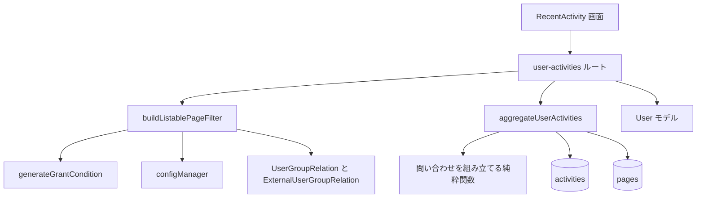
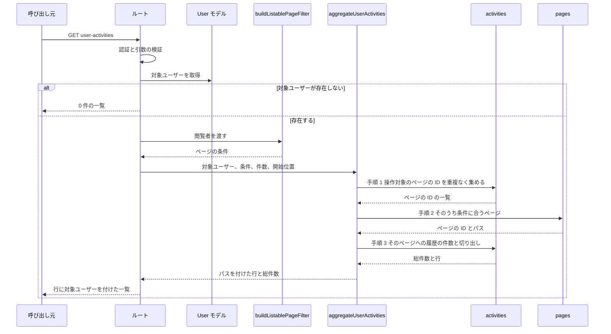

# Design Document

## Write / Don't-Write Test

このドキュメントを将来編集するときの判定基準。**読者がコードとテストファイルを読めば再現できる内容は書かない**。

| 書く | 書かない |
|---|---|
| 調査して初めてわかった事実（コードをざっと読んだだけでは自明でない挙動、外部ライブラリの隠れた振る舞い） | 関数シグネチャ・ファイル配置図・「どのファイルに何があるか」 |
| 異例な設計を選んだ理由（**特に、試して却下した案とその理由**） | 素直な実装の素直な説明 |
| 自動テストが**カバーできない**残差 | どのテストが何をカバーしているかの一覧（spec/test ファイルを読めばわかる。書くと陳腐化する） |
| コードから再現できない手動検証の手順（再現環境の作り方、確認する観点、合否を分ける基準値） | 差分の有無・実装時期などの時点情報 |

迷ったら書かない。

## Overview

**Purpose**: ユーザーページの「最近の活動」が使う `GET /_api/v3/user-activities`（以下 User Activities API）の応答を定める。この API は、既存の一覧（検索、ページ一覧）が同じ閲覧者に見せるページへの操作履歴だけを返す。

**Users**: ユーザーページを見る GROWI の利用者、この API を変更する開発者、この API を直接呼ぶ利用者。

**Impact**: 何を返してよいかはサーバーが決め、画面は応答の行をそのまま表示する。対象ユーザーが操作したページを重複なく集め、そのうち既存の一覧が閲覧者に見せるページを pages に問い合わせ、そのページへの履歴だけを対象に件数とページ送りを計算する（問い合わせは 3 回）。返すページの項目は ID とパスだけである。

### Goals

- 既存の一覧が見せないページについての情報を、サーバー側で応答から除く。
- 総件数を、返す履歴の件数と一致させる。
- 応答の項目を定め、型と API の文書を実際の応答に合わせる。
- 権限ごとの応答を確認するテストを持つ。

### Non-Goals

- contribution graph の API、管理者向けの監査ログの API の変更。
- 何を記録するか、保存期間の変更（`activity-log` が担当）。
- 閲覧権限の規則そのものの変更。
- 認証の手段を増やすこと。
- 「最近の活動」画面の見た目の刷新。

## Boundary Commitments

### This Spec Owns

- User Activities API の応答の内容（取得できる相手、含める履歴、返す項目、総件数、ページ送り）。
- この API がデータベースに出す問い合わせ（3 回）の組み立てと実行、ページの条件の組み立て。
- 応答の型（`apps/app/src/interfaces/activity.ts` のうち、この API の応答を表す型）。
- 「最近の活動」画面が応答を受け取って表示する部分。
- この API の OpenAPI の記述。

### Out of Boundary

- 閲覧権限の条件の中身。`generateGrantCondition` を呼ぶだけで、書き換えない。
- 一覧向けの管理設定（`security:list-policy:*`）の定義と既定値。
- 履歴の記録（`addActivity`、記録対象の判定）。
- activities と pages のスキーマと索引。新しい索引は作らない。

### Allowed Dependencies

- `generateGrantCondition`（`apps/app/src/server/models/page.ts`）
- `UserGroupRelation` と `ExternalUserGroupRelation` の `findAllUserGroupIdsRelatedToUser`
- `configManager`（設定の読み取り）
- Prisma の `aggregateRaw`（activities）と `findRaw`（pages。読み取りだけ）、`apps/app/src/server/util/prisma-raw-normalize.ts`
- User モデル（対象ユーザーの取得）
- `loginRequiredStrictly`、`apiV3FormValidator`（既存の middleware）

サービス層のファイルは `Crowi` クラスを import しない。

### Revalidation Triggers

次の変更があったときは、この spec の要件とテストを見直す。

- `generateGrantCondition` の引数や、公開範囲の種類が変わる。
- 一覧向けの管理設定が増える・減る、または既存の一覧が使う閲覧範囲が変わる。
- 「最近の活動」の対象となる操作（`ActivityLogActions`）が変わる。
- 操作対象がページでない履歴を、この API の対象に加える。
- 保存期間の既定値が大きく伸びる（1 人が持つ履歴の件数と、操作するページの数の見込みが変わる）。
- この API に、セッション以外の認証の手段を足す。

## Architecture



- **採る形**: ルートが組み立て役になる。ページの条件を作る関数を呼び、その条件を、履歴を取得する関数に渡す。履歴を取得する関数は、問い合わせを 3 回、順に実行する（System Flows）。
- **責任の分け方**:
  - ページの条件を作る関数だけが、閲覧者・設定・グループを知る。
  - 問い合わせを組み立てる関数は、条件や ID の一覧を引数で受け取る純粋関数である。閲覧者も設定もデータベースも知らない。
  - 履歴を取得する関数は、3 回の問い合わせを順に実行し、前の結果を次の問い合わせに渡し、結果の形を整える。問い合わせの中身は、組み立てる関数から受け取る。
- **依存の向き**: 画面 → ルート → サービス → モデルと設定。逆向きの import をしない。
- 閲覧権限の規則は新しく書かない。

## System Flows



問い合わせは次の 3 回である。この分け方が、要件 2.3 と 4.2 を満たす根拠になる。履歴にページを結合する 1 回の集計を採らなかった理由は research.md の Design Decisions にある。

1. **操作対象のページを集める（activities）**: 対象ユーザーの、対象となる操作の履歴から、操作対象のページの ID を重複なく集める。1 件も無ければ、ここで 0 件の一覧を返す。
2. **見せてよいページを得る（pages）**: 手順 1 の ID のうち、ページの条件に合うページの ID とパスだけを取得する。存在しないページも、条件に合わないページも、結果に含まれない点で同じである（要件 2.3）。1 件も無ければ、ここで 0 件の一覧を返す。
3. **履歴を絞って件数とページ送りを計算する（activities）**: 対象ユーザーの、対象となる操作の履歴のうち、操作対象が手順 2 の ID のどれかであるものに絞る。その結果の件数を数え、同じ結果を、操作の日時の新しい順（同じ日時は ID の大きい順）に並べ、開始位置と件数で切り出す。件数と切り出しは 1 回の問い合わせの中で同じ絞り込みに対して行う（要件 4.2）。取り出す項目は、履歴の ID・操作の種類・操作の日時・操作対象のページの ID だけである。

最後に、手順 3 の各行に、手順 2 で得たパスをアプリ側で付ける。ページの文書は、手順 2 で ID とパスを読むだけで、並べ替えや件数の計算には持ち込まない。

手順 2 と手順 3 は別の問い合わせなので、その間にページの公開範囲が変わると、手順 2 の時点の判定で行が返る。応答に載るページの情報は、手順 2 で条件に合ったページの ID とパスだけである。

## Components and Interfaces

### buildListablePageFilter（閲覧者に見せてよいページの条件）

- 管理設定 `security:list-policy:hideRestrictedByOwner` と `security:list-policy:hideRestrictedByGroup` を読む。
- 閲覧者が属するグループを、`UserGroupRelation` と `ExternalUserGroupRelation` の両方から集める。
- `generateGrantCondition` を呼ぶ。リンク限定のページは含めない。他人の「自分のみ」とグループ限定を含めるかどうかは、上の設定の否定で決める。
- ごみ箱のページ、WIP のページ、空ページ（子ページを置くためだけに存在する、本文の無いページ。`isEmpty` が真）を除外する条件を足す。内容は `PageQueryBuilder` の `addConditionToExcludeTrashed`、`addConditionToExcludeWipPage`、および `PageQueryBuilder` が空ページを含めない指定のときに足す条件と同じにする。
- 閲覧者が管理者かどうか、閲覧者が対象ユーザー本人かどうかで、条件を変えない。
- 返す条件は、Prisma の `findRaw` と `aggregateRaw` が受け付ける形にする（ObjectId は `{ $oid: string }`）。この変換には落とし穴がある（research.md の「条件を `aggregateRaw` と `findRaw` に渡す形」）。
- 公開範囲の規則を、このファイルに書かない。
- Postconditions: 返る条件は、既存の一覧が同じ閲覧者に見せるページ（ごみ箱、WIP、空ページを除く）にだけ一致する。同じ閲覧者・同じ設定・同じグループなら、同じ条件を返す。

### 問い合わせの組み立て（純粋関数）

- System Flows の手順ごとに 1 つ、合わせて 3 つの関数を持つ。どれも、閲覧者・設定・データベースを参照しない。
- 手順 1 と手順 3 は、対象ユーザーと対象となる操作について、同じ絞り込みを使う。絞り込みを 2 か所に書き写さない。対象となる操作は `ActivityLogActions` から得て、一覧を書き写さない。
- 手順 2 は、「ID が手順 1 の ID のどれかである」ことと、ページの条件の両方を満たすページを求める。取り出す項目は ID とパスだけにする。
- 手順 3 は、件数の計算と行の切り出しを、同じ絞り込みの結果に対して行う。操作したユーザーも、ページも、問い合わせの中で結合しない。
- ID は、関数の境界では文字列で受け取り、Prisma が受け付ける形への変換は組み立ての中で行う。
- Preconditions: `limit` は 1 以上 100 以下、`offset` は 0 以上の整数である。ID の一覧は空でない（空のときは、呼び出す側が問い合わせを実行しない）。
- Postconditions: 手順 3 の総件数は、`offset` を 0 から進めてすべて取得したときに返る行の数に等しい。

### aggregateUserActivities（3 回の問い合わせの実行）

- 手順 1（activities）、手順 2（pages）、手順 3（activities）の順に実行する。pages への問い合わせは読み取りだけである。
- 手順 1 の結果が 0 件のとき、手順 2 の結果が 0 件のときは、以降の問い合わせを実行せずに 0 件を返す。
- 手順 3 の各行に、手順 2 で得たページの ID とパスを付ける。手順 2 の結果に無いページの情報を、行に付けない。
- 閲覧権限の条件を自分で作らない。受け取ったページの条件を、そのまま手順 2 に渡す。
- Postconditions: 返る行はどれも、受け取ったページの条件に合うページへの履歴である。

### user-activities ルート

- middleware の順序は、`loginRequiredStrictly` → 引数の検証 → `apiV3FormValidator` → ハンドラである。ハンドラに届くリクエストには、必ずログイン済みの利用者がいる。
- 対象ユーザーを 1 回だけ取得する。見つからなければ、履歴の問い合わせを実行せずに 0 件の一覧を返す（ユーザーが存在するかどうかで、エラーの有無を変えない）。操作したユーザーの情報を履歴の問い合わせの中で結合しない理由は、research.md の Design Decisions にある。
- 対象ユーザーから、ID・ユーザー名・表示名・アイコン画像の場所の 4 項目だけを取り出し、各行に付ける。
- 型の言い換え（`as unknown as` など）で応答の型を合わせない。応答はここで定める型のとおりに組み立てる。

#### API Contract

| Method | Endpoint | Request | Response | Errors |
|--------|----------|---------|----------|--------|
| GET | `/_api/v3/user-activities` | query: `limit`、`offset`、`targetUserId` | `{ serializedPaginationResult: PaginateResult<IUserActivity> }` | 400（引数の誤り）、403（未ログイン。既存の `loginRequiredStrictly` の応答）、500 |

- `limit`: 省略できる整数。100 以下。省略時は設定 `customize:showPageLimitationS` の値、無ければ 10。
- `offset`: 省略できる 0 以上の整数。省略時は 0。
- `targetUserId`: 省略できるユーザー ID。省略時は呼び出した利用者自身。
- 認証の手段はセッションだけである。OpenAPI の記述には、これだけを書く。
- OpenAPI の記述は、パスを `/user-activities` とし、引数は上の 3 つだけを書き、応答は Data Models の型のとおりに書く。
- `totalDocs` は `aggregateUserActivities` が返す総件数である。`totalPages` などのページ送りの値は、`totalDocs`・`limit`・`offset` から計算する。

### RecentActivity と ActivityListItem（画面）

- `RecentActivity` は、応答の `docs` をそのまま 1 件 1 行で表示する。画面側で行を間引かない。ページ送りの総ページ数は、応答の `totalDocs` から決める。
- `ActivityListItem` は、操作の種類、操作からの経過時間、ページのパス（そのページへのリンク）を表示する。公開範囲や状態を見て表示を変える判定を持たない。何を表示してよいかは、サーバーが決める。
- 新しい文言を追加しない。

## Data Models

この spec は、保存するデータの形を変えない。応答の型だけを定める。

```typescript
export type IUserActivityTargetPage = {
  _id: string;
  path: string;
};

export type IUserActivityUser = {
  _id: string;
  username: string;
  name: string;
  imageUrlCached?: string;
};

export type IUserActivity = {
  _id: string;
  action: SupportedActivityActionType;
  createdAt: string;
  user: IUserActivityUser;
  target: IUserActivityTargetPage;
};

export type UserActivitiesResult = {
  serializedPaginationResult: PaginateResult<IUserActivity>;
};
```

- `createdAt` は ISO 8601 形式の文字列である。JSON の応答に乗る値そのままの型にして、サーバーが返す値と画面が受け取る値で型を分けない。サーバーは `Date` を文字列に変換してから返す。
- `imageUrlCached` は、アイコン画像の場所がまだ作られていないユーザー（一度もログインしていないユーザーなど）では保存されていない。その場合は応答に含めない。
- 応答に含めない項目: ページの公開範囲・状態・許可されたユーザーやグループ・ページを見たユーザーの一覧・いいねしたユーザーの一覧、ユーザーのメールアドレスや認証に関わる情報、履歴の接続元の情報（IP アドレス、呼び出し先）、履歴の記録時の写し。

### 一覧に出ない履歴

次の履歴は、一覧にも総件数にも含まれない。

- 既存の一覧が閲覧者に見せないページへの履歴。
- 操作対象のページがすでに存在しない履歴（完全削除されたページへの履歴を含む）。
- 操作対象のページがごみ箱にある履歴（削除の履歴を含む）。ページを復元すると、そのページへの履歴は再び一覧に出る。
- 操作対象のページが WIP である履歴。
- 操作対象のページが空ページである履歴。
- 操作対象のページがリンク限定である履歴。

このため、削除と完全削除の履歴は、要件 1.6 の対象の操作に含まれるが、通常は一覧に出ない。

## Error Handling

| 場合 | 応答 |
|------|------|
| 未ログイン | 既存の `loginRequiredStrictly` のエラー（履歴を返さない） |
| `targetUserId` が ID の形式でない、`limit` が 100 を超える、`limit`・`offset` が整数でない | 400。`apiV3FormValidator` のエラー |
| 対象ユーザーが存在しない | 200。0 件の一覧 |
| 閲覧できる履歴が無い | 200。0 件の一覧 |
| 問い合わせの失敗（3 回のどれか） | 500。原因を記録し、応答には内部の情報を含めない |

閲覧できないページがあることを示すエラーや項目は、どの場合にも返さない。

## Testing Strategy

テストは、応答として観察できる結果を確認する。問い合わせの段の並びそのものは確認しない。閲覧範囲と件数の正しさは、実際のデータベースに対する結合テストで確かめる。

### 手作業で行う性能の確認

自動テストには入れていない。問い合わせの形を変えたときは、次の条件で測り直す。

- 測定専用の使い捨てデータベースを作り、測定の後に削除する（開発用のデータベースを使わない）。
- データの条件は research.md の「ページを重複なく調べる形の実測」と同じにする。1 人の履歴が 3,000 件、すべてのページにページを見たユーザーの一覧を 5,000 件持たせる。
- Prisma を通した実際のコード（`buildListablePageFilter` と `aggregateUserActivities`）で、3 回の問い合わせの合計時間を測る。
- 合否の基準: 合計の中央値が 100 ms 以内。前回の値は research.md の同じ節にある。

## Security Considerations

- 何を返してよいかの判断は、すべてサーバー側で行う。画面側の表示の判定に頼らない。
- 閲覧権限の規則は `generateGrantCondition` だけが持つ。この API のために規則を書き写さない。
- 応答は、存在しないページへの履歴と、見せないページへの履歴を区別しない。規約 `apps/app/.claude/rules/page-write-action-403-404.md` の方針（ページの存在を伝えない）と同じ考え方である。
- 既定の管理設定では、閲覧者が開けない制限付きページのパスが、既存の一覧と同じように返る。これは要件の Adjacent expectations に定めた動きである。

## Performance & Scalability

- 応答時間は、対象ユーザーが保存期間内に持つ履歴の件数と、操作したページの数で決まる。MongoDB のドライバを直接使った実測では、3 回の問い合わせの合計が、1 人の履歴が 3,000 件のとき 11〜41 ms、100,000 件のとき 141〜688 ms だった（中央値の幅。条件は research.md）。
- ページの文書の大きさには、ほとんど左右されない。ページを見たユーザーの一覧が 20 件・2,000 件・5,000 件のどの条件でも、上の幅に収まった。ページの文書を読むのは、操作したページ 1 つにつき 1 回で、取り出すのは ID とパスだけだからである。
- 操作したページの数が多いほど、手順 2 に渡す ID の一覧と、手順 3 に渡す ID の一覧が大きくなる。実測したのは 20,000 ページまでである。
- 基準: 1 人の履歴が 3,000 件のとき、ページを見たユーザーの一覧が 5,000 件のページでも、3 回の問い合わせの合計が 100 ms 以内に終わること。
- 基準: ページの文書の大きさと開始位置によらず、問い合わせがメモリ上限のエラーにならないこと。
- 測っていないこと: 同時に多数の呼び出しがある場合、操作したページが 20,000 を超える場合、開始位置が履歴の 4 分の 1 より深い場合（詳細は research.md）。
- 新しい索引は作らない。

## Supporting References

- 実測の条件と数値、方式の比較、各判断の理由: `research.md`
