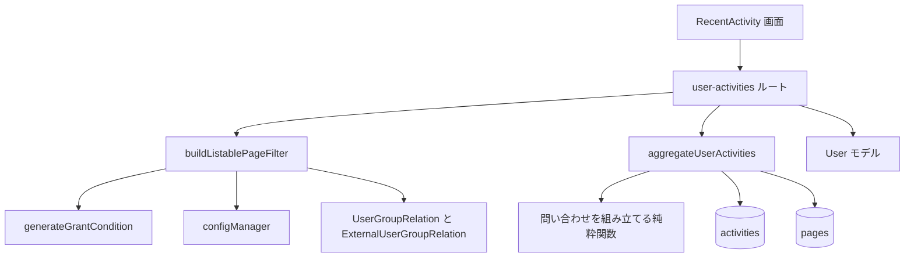
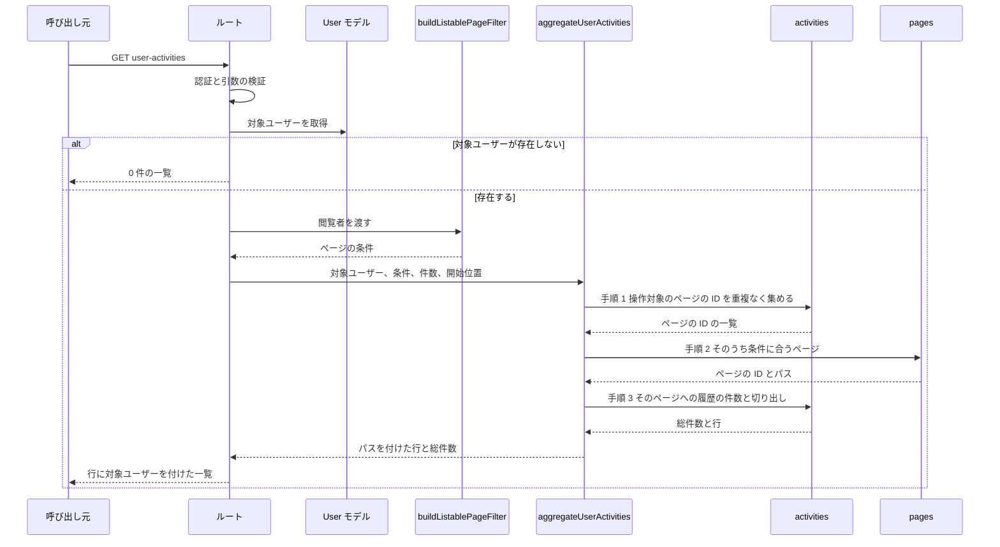

# Design Document

## Overview

**Purpose**: ユーザーページの「最近の活動」が使う `GET /_api/v3/user-activities`（以下 User Activities API）の応答を定める。この API は、既存の一覧（検索、ページ一覧）が同じ閲覧者に見せるページへの操作履歴だけを返す。

**Users**: ユーザーページを見る GROWI の利用者、この API を変更する開発者、この API を直接呼ぶ利用者。

**Impact**: 対象ユーザーが操作したページを重複なく集め、そのうち既存の一覧が閲覧者に見せるページを pages に問い合わせ、そのページへの履歴だけを対象に件数とページ送りを計算する形に変える（問い合わせは 3 回）。返すページの項目を ID とパスに絞る。画面側で行っていた表示の判定を削除する。

### Goals

- 既存の一覧が見せないページについての情報を、サーバー側で応答から除く。
- 総件数を、返す履歴の件数と一致させる。
- 応答の項目を定め、型と API の文書を実際の応答に合わせる。
- 権限ごとの応答を確認するテストを持つ。

### Non-Goals

- contribution graph の API、管理者向けの監査ログの API の変更。
- 何を記録するか、保存期間の変更（`activity-log` が担当）。
- 閲覧権限の規則そのものの変更。
- 認証の手段を増やすこと。
- 「最近の活動」画面の見た目の刷新。

## Boundary Commitments

### This Spec Owns

- User Activities API の応答の内容（取得できる相手、含める履歴、返す項目、総件数、ページ送り）。
- この API がデータベースに出す問い合わせ（3 回）の組み立てと実行、ページの条件の組み立て。
- 応答の型（`apps/app/src/interfaces/activity.ts` のうち、この API の応答を表す型）。
- 「最近の活動」画面が応答を受け取って表示する部分。
- この API の OpenAPI の記述。

### Out of Boundary

- 閲覧権限の条件の中身。`generateGrantCondition` を呼ぶだけで、書き換えない。
- 一覧向けの管理設定（`security:list-policy:*`）の定義と既定値。
- 履歴の記録（`addActivity`、記録対象の判定）。
- activities と pages のスキーマと索引。新しい索引は作らない。

### Allowed Dependencies

- `generateGrantCondition`（`apps/app/src/server/models/page.ts`）
- `UserGroupRelation` と `ExternalUserGroupRelation` の `findAllUserGroupIdsRelatedToUser`
- `configManager`（設定の読み取り）
- Prisma の `aggregateRaw`（activities）と `findRaw`（pages。読み取りだけ）、`apps/app/src/server/util/prisma-raw-normalize.ts`
- User モデル（対象ユーザーの取得）
- `loginRequiredStrictly`、`apiV3FormValidator`（既存の middleware）

サービス層のファイルは `Crowi` クラスを import しない。

### Revalidation Triggers

次の変更があったときは、この spec の要件とテストを見直す。

- `generateGrantCondition` の引数や、公開範囲の種類が変わる。
- 一覧向けの管理設定が増える・減る、または既存の一覧が使う閲覧範囲が変わる。
- 「最近の活動」の対象となる操作（`ActivityLogActions`）が変わる。
- 操作対象がページでない履歴を、この API の対象に加える。
- 保存期間の既定値が大きく伸びる（1 人が持つ履歴の件数と、操作するページの数の見込みが変わる）。
- この API に、セッション以外の認証の手段を足す。

## Architecture

### Existing Architecture Analysis

- ルート `apps/app/src/server/routes/apiv3/user-activities.ts` が、引数の検証、集計の組み立て、応答の整形を担う。集計の実行は `apps/app/src/server/service/activity/aggregate-user-activities.ts` が担う。集計は 1 回で、ページ送りの後にページを結合する。
- 画面は `RecentActivity` と `ActivityListItem`、SWR の hook `useSWRxRecentActivity` で構成される。
- 閲覧権限の条件は `generateGrantCondition` が 1 か所で作る。一覧向けの経路は、管理設定と閲覧者のグループを読んでこの関数に渡す。

### Architecture Pattern & Boundary Map



- **採る形**: ルートが組み立て役になる。ページの条件を作る関数を呼び、その条件を、履歴を取得する関数に渡す。履歴を取得する関数は、問い合わせを 3 回、順に実行する（System Flows）。
- **責任の分け方**:
  - ページの条件を作る関数だけが、閲覧者・設定・グループを知る。
  - 問い合わせを組み立てる関数は、条件や ID の一覧を引数で受け取る純粋関数である。閲覧者も設定もデータベースも知らない。
  - 履歴を取得する関数は、3 回の問い合わせを順に実行し、前の結果を次の問い合わせに渡し、結果の形を整える。問い合わせの中身は、組み立てる関数から受け取る。
- **依存の向き**: 画面 → ルート → サービス → モデルと設定。逆向きの import をしない。
- **既存の形との関係**: 問い合わせの組み立てを、ルートから `service/activity/` へ移す。閲覧権限の規則は新しく書かない。

### Technology Stack

| Layer | Choice / Version | Role in Feature | Notes |
|-------|------------------|-----------------|-------|
| Frontend | React 18、SWR | 「最近の活動」画面 | 新しい依存は無い |
| Backend | Express、express-validator | ルートと引数の検証 | 既存の middleware を使う |
| Data | MongoDB、Prisma `aggregateRaw` と `findRaw` | 問い合わせの実行 | 新しい索引は無い |

## File Structure Plan

### Directory Structure

```
apps/app/src/
├── server/
│   ├── routes/apiv3/
│   │   ├── user-activities.ts            # 引数の検証、組み立て、応答の整形、OpenAPI の記述
│   │   └── user-activities.spec.ts       # 引数と応答の形のテスト
│   ├── service/activity/
│   │   ├── build-listable-page-filter.ts        # 新規: 閲覧者に見せてよいページの条件を作る
│   │   ├── build-listable-page-filter.integ.ts  # 新規
│   │   ├── build-user-activity-queries.ts       # 新規: 3 回の問い合わせを組み立てる純粋関数
│   │   ├── build-user-activity-queries.spec.ts  # 新規
│   │   ├── aggregate-user-activities.ts         # 3 回の問い合わせを順に実行し、行と総件数を返す
│   │   ├── aggregate-user-activities.spec.ts
│   │   └── aggregate-user-activities.integ.ts   # 権限ごとの応答の結合テスト
│   └── util/
│       └── prisma-raw-normalize.ts       # 条件と ID の一覧に含まれる ObjectId の変換（必要な場合だけ追加）
├── interfaces/
│   └── activity.ts                       # 応答の型
└── client/components/RecentActivity/
    ├── RecentActivity.tsx                # 応答の行をそのまま表示する
    └── ActivityListItem.tsx              # 1 行の表示
```

### Modified Files

- `apps/app/src/server/routes/apiv3/user-activities.ts` — 問い合わせの組み立てを外へ出す。対象ユーザーを取得する。ページの条件を作って、履歴を取得する関数に渡す。使っていない引数 `searchFilter` を検証から外す。OpenAPI の記述を直す。
- `apps/app/src/server/service/activity/aggregate-user-activities.ts` — 引数を、組み立て済みの集計から、対象ユーザー・ページの条件・件数・開始位置に変える。3 回の問い合わせを順に実行する。戻り値を、この API の行の型にする。
- `apps/app/src/server/service/activity/index.ts` — 新しい関数のうち、ルートが使うものだけを公開する。
- `apps/app/src/interfaces/activity.ts` — ページの型を ID とパスに、ユーザーの型を 4 項目に絞る。
- `apps/app/src/client/components/RecentActivity/RecentActivity.tsx` — ページの情報を持つ行だけに絞る処理を削除する。
- `apps/app/src/client/components/RecentActivity/ActivityListItem.tsx` — パスを表示するかどうかの判定と、そのための型を削除する。
- `apps/app/src/stores/recent-activity.ts` — 型の変更に合わせる（必要な場合だけ）。

## System Flows



問い合わせは次の 3 回である。この分け方が、要件 2.3 と 4.2 を満たす根拠になる。

1. **操作対象のページを集める（activities）**: 対象ユーザーの、対象となる操作の履歴から、操作対象のページの ID を重複なく集める。1 件も無ければ、ここで 0 件の一覧を返す。
2. **見せてよいページを得る（pages）**: 手順 1 の ID のうち、ページの条件に合うページの ID とパスだけを取得する。存在しないページも、条件に合わないページも、結果に含まれない点で同じである（要件 2.3）。1 件も無ければ、ここで 0 件の一覧を返す。
3. **履歴を絞って件数とページ送りを計算する（activities）**: 対象ユーザーの、対象となる操作の履歴のうち、操作対象が手順 2 の ID のどれかであるものに絞る。その結果の件数を数え、同じ結果を、操作の日時の新しい順（同じ日時は ID の大きい順）に並べ、開始位置と件数で切り出す。件数と切り出しは 1 回の問い合わせの中で同じ絞り込みに対して行う（要件 4.2）。取り出す項目は、履歴の ID・操作の種類・操作の日時・操作対象のページの ID だけである。

最後に、手順 3 の各行に、手順 2 で得たパスをアプリ側で付ける。ページの文書は、手順 2 で ID とパスを読むだけで、並べ替えや件数の計算には持ち込まない。

手順 2 と手順 3 は別の問い合わせなので、その間にページの公開範囲が変わると、手順 2 の時点の判定で行が返る。応答に載るページの情報は、手順 2 で条件に合ったページの ID とパスだけである。

## Requirements Traceability

| Requirement | Summary | Components | Interfaces | Flows |
|-------------|---------|------------|------------|-------|
| 1.1 | 未ログインにはエラー | ルート | `loginRequiredStrictly` | 認証 |
| 1.2 | 指定なしは本人の履歴 | ルート | API Contract | — |
| 1.3 | 指定したユーザーの履歴 | ルート、問い合わせの組み立て | API Contract | 手順 1、3 |
| 1.4 | ID の形式でなければエラー | ルート | 引数の検証 | — |
| 1.5 | 存在しないユーザーは 0 件 | ルート | API Contract | 対象ユーザーの取得 |
| 1.6 | 対象となる操作だけ | 問い合わせの組み立て | Service Interface | 手順 1、3 |
| 2.1 | 一覧が見せないページの情報を含めない | buildListablePageFilter、問い合わせの組み立て、aggregateUserActivities | Service Interface | 手順 2、3 |
| 2.2 | 閲覧範囲を既存の一覧と一致させる | buildListablePageFilter | Service Interface | — |
| 2.3 | 存在しないページと区別できない | 問い合わせの組み立て | Service Interface | 手順 2 |
| 2.4 | 管理者に例外を設けない | buildListablePageFilter | Service Interface | — |
| 2.5 | 本人にも一覧と同じ範囲 | buildListablePageFilter | Service Interface | — |
| 2.6 | 直接の呼び出しでも同じ応答 | ルート、問い合わせの組み立て | API Contract | 手順 2 |
| 3.1 | 各履歴の項目 | 問い合わせの組み立て、aggregateUserActivities、ルート | Data Models | 手順 2、3 |
| 3.2 | ページは画面に必要な項目だけ | 問い合わせの組み立て | Data Models | 手順 2 |
| 3.3 | 許可されたユーザーなどを返さない | 問い合わせの組み立て | Data Models | 手順 2 |
| 3.4 | ユーザーは 4 項目だけ | ルート | Data Models | — |
| 3.5 | 接続元の情報を返さない | 問い合わせの組み立て | Data Models | 手順 3 |
| 4.1 | 新しい順 | 問い合わせの組み立て | Service Interface | 手順 3 |
| 4.2 | 総件数は返る履歴の件数 | 問い合わせの組み立て、aggregateUserActivities | Service Interface | 手順 3 |
| 4.3 | 開始位置と件数 | 問い合わせの組み立て | Service Interface | 手順 3 |
| 4.4 | 重複も欠けも無い | 問い合わせの組み立て | Service Interface | 手順 3 |
| 4.5 | 100 を超える件数はエラー | ルート | 引数の検証 | — |
| 4.6 | 既定の件数 | ルート | API Contract | — |
| 5.1 | 応答の履歴をすべて表示 | RecentActivity | — | — |
| 5.2 | 操作の種類と経過時間 | ActivityListItem | — | — |
| 5.3 | パスをリンクとして表示 | ActivityListItem | — | — |
| 5.4 | ページの情報を持たない行の表示 | 該当なし（行ごと返さない方式を採るため、そのような行は応答に含まれない） | — | — |
| 5.5 | 総ページ数は総件数から | RecentActivity | — | — |
| 5.6 | 新しい文言の翻訳 | 該当なし（新しい文言を追加しない） | — | — |
| 6.1 | 文書のパス | ルートの OpenAPI の記述 | API Contract | — |
| 6.2 | 文書の引数 | ルートの OpenAPI の記述 | API Contract | — |
| 6.3 | 文書の応答の形 | ルートの OpenAPI の記述 | API Contract | — |
| 6.4 | 文書の認証の手段 | ルートの OpenAPI の記述 | API Contract | — |

## Components and Interfaces

| Component | Domain/Layer | Intent | Req Coverage | Key Dependencies (P0/P1) | Contracts |
|-----------|--------------|--------|--------------|--------------------------|-----------|
| user-activities ルート | Server / Route | 検証、サービスの呼び出し、応答の整形 | 1.1〜1.5、2.6、3.1、3.4、4.5、4.6、6.1〜6.4 | buildListablePageFilter (P0)、aggregateUserActivities (P0)、User モデル (P0) | API |
| buildListablePageFilter | Server / Service | 閲覧者に見せてよいページの条件を作る | 2.1、2.2、2.4、2.5 | generateGrantCondition (P0)、configManager (P0)、グループの取得 (P0) | Service |
| 問い合わせの組み立て（`build-user-activity-queries.ts`） | Server / Service | 3 回の問い合わせを組み立てる | 1.3、1.6、2.1、2.3、2.6、3.1〜3.3、3.5、4.1〜4.4 | なし（純粋関数） | Service |
| aggregateUserActivities | Server / Service | 3 回の問い合わせを順に実行し、行にパスを付ける | 2.1、3.1、4.2 | 問い合わせの組み立て (P0)、Prisma (P0) | Service |
| RecentActivity | Client / Component | 一覧とページ送りの表示 | 5.1、5.5 | useSWRxRecentActivity (P0) | State |
| ActivityListItem | Client / Component | 1 行の表示 | 5.2、5.3 | — | — |

### Server / Service

#### buildListablePageFilter

| Field | Detail |
|-------|--------|
| Intent | 既存の一覧が閲覧者に見せるページの範囲を、pages への問い合わせに渡せる条件として返す |
| Requirements | 2.1, 2.2, 2.4, 2.5 |

**Responsibilities & Constraints**

- 管理設定 `security:list-policy:hideRestrictedByOwner` と `security:list-policy:hideRestrictedByGroup` を読む。
- 閲覧者が属するグループを、`UserGroupRelation` と `ExternalUserGroupRelation` の両方から集める。
- `generateGrantCondition` を呼ぶ。リンク限定のページは含めない。他人の「自分のみ」とグループ限定を含めるかどうかは、上の設定の否定で決める。
- ごみ箱のページと WIP のページを除外する条件を足す。内容は `PageQueryBuilder` の `addConditionToExcludeTrashed` と `addConditionToExcludeWipPage` と同じにする。
- 閲覧者が管理者かどうか、閲覧者が対象ユーザー本人かどうかで、条件を変えない。
- 返す条件は、Prisma の `findRaw` と `aggregateRaw` が受け付ける形にする（ObjectId は `{ $oid: string }`）。変換の方法は research.md の「条件を `aggregateRaw` と `findRaw` に渡す形」に従う。
- 公開範囲の規則を、このファイルに書かない。

**Dependencies**

- Outbound: `generateGrantCondition` — 閲覧権限の条件 (P0)
- Outbound: `configManager` — 一覧向けの管理設定 (P0)
- Outbound: `UserGroupRelation`、`ExternalUserGroupRelation` — 閲覧者のグループ (P0)
- Outbound: `prisma-raw-normalize` — ObjectId の変換 (P1)

**Contracts**: Service [x]

##### Service Interface

```typescript
// A MongoDB filter over a page document, already in the form findRaw / aggregateRaw accept.
export type RawPageFilter = Record<string, unknown>;

export const buildListablePageFilter: (
  viewer: IUserHasId,
) => Promise<RawPageFilter>;
```

- Preconditions: `viewer` はログイン済みの利用者である。
- Postconditions: 返る条件は、既存の一覧が同じ閲覧者に見せるページ（ごみ箱と WIP を除く）にだけ一致する。
- Invariants: 同じ閲覧者・同じ設定・同じグループなら、同じ条件を返す。

#### 問い合わせの組み立て（`build-user-activity-queries.ts`）

| Field | Detail |
|-------|--------|
| Intent | System Flows の手順 1〜3 の問い合わせを、それぞれ組み立てる |
| Requirements | 1.3, 1.6, 2.1, 2.3, 2.6, 3.1, 3.2, 3.3, 3.5, 4.1, 4.2, 4.3, 4.4 |

**Responsibilities & Constraints**

- 手順ごとに 1 つ、合わせて 3 つの関数を持つ。どれも、閲覧者・設定・データベースを参照しない純粋関数にする。
- 手順 1 と手順 3 は、対象ユーザーと対象となる操作について、同じ絞り込みを使う。絞り込みを 2 か所に書き写さない。
- 手順 2 は、「ID が手順 1 の ID のどれかである」ことと、ページの条件の両方を満たすページを求める。取り出す項目は ID とパスだけにする。
- 手順 3 は、件数の計算と行の切り出しを、同じ絞り込みの結果に対して行う。並べ替えは、操作の日時の新しい順、同じ日時は履歴の ID の大きい順にする。
- 手順 3 で取り出す項目は、履歴の ID・操作の種類・操作の日時・操作対象のページの ID だけである。操作したユーザーも、ページも、問い合わせの中で結合しない。
- ID は、関数の境界では文字列で受け取る。Prisma の `aggregateRaw` と `findRaw` が受け付ける形（`{ $oid: string }`）への変換は、この組み立ての中で行う。

**Dependencies**

- Inbound: aggregateUserActivities — 問い合わせの組み立て (P0)
- Outbound: `prisma-raw-normalize` — ObjectId の変換 (P1)

**Contracts**: Service [x]

##### Service Interface

```typescript
// Step 1: distinct target page ids of the user's activities.
export const buildTargetPageIdsPipeline: (
  targetUserId: string,
) => Record<string, unknown>[];

// Step 2: pages among the given ids that match the page filter (id and path only).
export const buildVisiblePagesQuery: (
  pageIds: string[],
  pageFilter: RawPageFilter,
) => { filter: RawPageFilter; projection: Record<string, 1> };

// Step 3: count and one page of the user's activities whose target is a visible page.
export const buildVisibleActivitiesPipeline: (params: {
  targetUserId: string;
  visiblePageIds: string[];
  limit: number;
  offset: number;
}) => Record<string, unknown>[];
```

- Preconditions: `targetUserId` と各ページの ID は ID の形式である。`limit` は 1 以上 100 以下、`offset` は 0 以上の整数である。`pageIds` と `visiblePageIds` は空でない（空のときは、呼び出す側が問い合わせを実行しない）。
- Postconditions: 手順 3 の結果は、総件数と、切り出した行の配列を持つ。総件数は、`offset` を 0 から進めてすべて取得したときに返る行の数に等しい。
- Invariants: 対象となる操作は `ActivityLogActions` から得る。操作の一覧をこのファイルの中に書き写さない。

#### aggregateUserActivities

| Field | Detail |
|-------|--------|
| Intent | 3 回の問い合わせを順に実行し、パスを付けた行と総件数を返す |
| Requirements | 2.1, 3.1, 4.2 |

**Responsibilities & Constraints**

- 手順 1（activities）、手順 2（pages）、手順 3（activities）の順に実行する。問い合わせは「問い合わせの組み立て」の関数から得る。
- 手順 1 の結果が 0 件のとき、手順 2 の結果が 0 件のときは、以降の問い合わせを実行せずに 0 件を返す。
- 手順 3 の各行に、手順 2 で得たページの ID とパスを付ける。手順 2 の結果に無いページの情報を、行に付けない。
- pages への問い合わせは読み取りだけである。
- 閲覧権限の条件を自分で作らない。受け取ったページの条件を、そのまま手順 2 に渡す。

**Dependencies**

- Inbound: ルート — 行と総件数の取得 (P0)
- Outbound: 問い合わせの組み立て (P0)
- Outbound: Prisma の `activities.aggregateRaw` と `pages.findRaw` (P0)
- Outbound: `prisma-raw-normalize` — 結果の正規化 (P1)

**Contracts**: Service [x]

##### Service Interface

```typescript
export type UserActivityRow = {
  _id: string;
  action: SupportedActivityActionType;
  createdAt: Date;
  target: IUserActivityTargetPage;
};

export type UserActivitiesQuery = {
  targetUserId: string;
  pageFilter: RawPageFilter;
  limit: number;
  offset: number;
};

export const aggregateUserActivities: (
  prisma: PrismaClient,
  query: UserActivitiesQuery,
) => Promise<{ docs: UserActivityRow[]; totalCount: number }>;
```

- Preconditions: `targetUserId` はユーザー ID の形式である。`limit` は 1 以上 100 以下、`offset` は 0 以上の整数である。
- Postconditions: 行が 1 件も無いとき、`docs` は空の配列、`totalCount` は 0 である。返る行はどれも、`pageFilter` に合うページへの履歴であり、`target` はそのページの ID とパスである。

### Server / Route

#### user-activities ルート

| Field | Detail |
|-------|--------|
| Intent | 認証と引数の検証を行い、サービスを順に呼んで応答を返す |
| Requirements | 1.1, 1.2, 1.3, 1.4, 1.5, 2.6, 3.1, 3.4, 4.5, 4.6, 6.1, 6.2, 6.3, 6.4 |

**Responsibilities & Constraints**

- middleware の順序は、`loginRequiredStrictly` → 引数の検証 → `apiV3FormValidator` → ハンドラのままにする。
- 対象ユーザーを 1 回だけ取得する。見つからなければ、履歴の問い合わせを実行せずに 0 件の一覧を返す（ユーザーが存在するかどうかで、エラーの有無を変えない）。
- 対象ユーザーから、ID・ユーザー名・表示名・アイコン画像の場所の 4 項目だけを取り出し、各行に付ける。
- 型の言い換え（`as unknown as` など）で応答の型を合わせない。応答はここで定める型のとおりに組み立てる。
- 公開する `setup` は、戻り値の型 `Router` を明示する。

**Contracts**: API [x]

##### API Contract

| Method | Endpoint | Request | Response | Errors |
|--------|----------|---------|----------|--------|
| GET | `/_api/v3/user-activities` | query: `limit`、`offset`、`targetUserId` | `{ serializedPaginationResult: PaginateResult<IUserActivity> }` | 400（引数の誤り）、401（未ログイン）、500 |

- `limit`: 省略できる整数。100 以下。省略時は設定 `customize:showPageLimitationS` の値、無ければ 10。
- `offset`: 省略できる 0 以上の整数。省略時は 0。
- `targetUserId`: 省略できるユーザー ID。省略時は呼び出した利用者自身。
- 認証の手段はセッションだけである。OpenAPI の記述には、これだけを書く。
- OpenAPI の記述は、パスを `/user-activities` とし、引数は上の 3 つだけを書き、応答は Data Models の型のとおりに書く。
- `totalDocs` は `aggregateUserActivities` が返す総件数である。`totalPages` などのページ送りの値は、`totalDocs`・`limit`・`offset` から計算する。

### Client / Component

#### RecentActivity と ActivityListItem

| Field | Detail |
|-------|--------|
| Intent | 応答の履歴を 1 件 1 行で表示し、ページ送りを出す |
| Requirements | 5.1, 5.2, 5.3, 5.5 |

**Responsibilities & Constraints**

- `RecentActivity` は、応答の `docs` をそのまま 1 件 1 行で表示する。画面側で行を間引かない。
- `RecentActivity` は、ページ送りの総ページ数を、応答の `totalDocs` から決める。
- `ActivityListItem` は、操作の種類、操作からの経過時間、ページのパス（そのページへのリンク）を表示する。
- `ActivityListItem` は、公開範囲や状態を見て表示を変える判定を持たない。何を表示してよいかは、サーバーが決める。
- 新しい文言を追加しない。

**Contracts**: State [x]

- `useSWRxRecentActivity(limit, offset, targetUserId)` の戻り値の型を、Data Models の応答の型にする。引数は変えない。

## Data Models

### Data Contracts & Integration

この spec は、保存するデータの形を変えない。応答の型だけを定める。

```typescript
export type IUserActivityTargetPage = {
  _id: string;
  path: string;
};

export type IUserActivityUser = {
  _id: string;
  username: string;
  name: string;
  imageUrlCached: string;
};

export type IUserActivity = {
  _id: string;
  action: SupportedActivityActionType;
  createdAt: Date;
  user: IUserActivityUser;
  target: IUserActivityTargetPage;
};

export type UserActivitiesResult = {
  serializedPaginationResult: PaginateResult<IUserActivity>;
};
```

- 既存の型 `IPopulatedPageTarget`、`ActivityHasTargetPage`、`PopulatedUserActivitiesResult` は、上の型に置き換える。他の場所から使われていないことを確認したうえで削除する。
- 応答に含めない項目: ページの公開範囲・状態・許可されたユーザーやグループ・ページを見たユーザーの一覧・いいねしたユーザーの一覧、ユーザーのメールアドレスや認証に関わる情報、履歴の接続元の情報（IP アドレス、呼び出し先）、履歴の記録時の写し。

### 一覧に出ない履歴

次の履歴は、一覧にも総件数にも含まれない。

- 既存の一覧が閲覧者に見せないページへの履歴。
- 操作対象のページがすでに存在しない履歴（完全削除されたページへの履歴を含む）。
- 操作対象のページがごみ箱にある履歴（削除の履歴を含む）。ページを復元すると、そのページへの履歴は再び一覧に出る。
- 操作対象のページが WIP である履歴。
- 操作対象のページがリンク限定である履歴。

このため、削除と完全削除の履歴は、要件 1.6 の対象の操作に含まれるが、通常は一覧に出ない。

## Error Handling

| 場合 | 応答 |
|------|------|
| 未ログイン | 既存の `loginRequiredStrictly` のエラー（履歴を返さない） |
| `targetUserId` が ID の形式でない、`limit` が 100 を超える、`limit`・`offset` が整数でない | 400。`apiV3FormValidator` のエラー |
| 対象ユーザーが存在しない | 200。0 件の一覧 |
| 閲覧できる履歴が無い | 200。0 件の一覧 |
| 問い合わせの失敗（3 回のどれか） | 500。原因を記録し、応答には内部の情報を含めない |

閲覧できないページがあることを示すエラーや項目は、どの場合にも返さない。

## Testing Strategy

テストは、応答として観察できる結果を確認する。問い合わせの段の並びそのものは確認しない。

### Unit Tests

- 問い合わせの組み立て（`build-user-activity-queries.spec.ts`）: 入力の検証に近い性質だけを確認する。手順 1 と手順 3 の対象となる操作が、どちらも `ActivityLogActions` と一致すること（1.6）。
- ルート（`user-activities.spec.ts`）:
  - `targetUserId` を省略すると、呼び出した利用者自身の履歴を求めること（1.2）。
  - `targetUserId` が ID の形式でない、`limit` が 101 のとき、400 を返すこと（1.4、4.5）。
  - `limit` を省略すると、設定の既定の件数を使うこと（4.6）。
  - 対象ユーザーが存在しないとき、0 件の一覧を返すこと（1.5）。
  - 応答のユーザーが 4 項目だけを持つこと（3.4）。

### Integration Tests

`aggregate-user-activities.integ.ts` と `build-listable-page-filter.integ.ts` で、実際のデータベースに対して確認する。共有の接続を使い、接続を自分で管理しない。

- 閲覧者ごとの応答（2.1、2.2、2.4、2.5）: 公開のページ、閲覧者が許可された「自分のみ」のページ、他人の「自分のみ」のページ、閲覧者が属するグループのページ、属さないグループのページ、リンク限定のページへの履歴を用意し、返る行を確認する。一覧向けの管理設定の両方の値、閲覧者が管理者の場合、閲覧者が対象ユーザー本人の場合を含める。
- 既存の一覧との一致（2.2）: 同じ閲覧者・同じ設定で、既存の一覧向けの絞り込みが返すページの集合と、この API が返すページの集合が一致すること。
- 区別できないこと（2.3）: 存在しないページへの履歴と、一覧が見せないページへの履歴が、どちらも応答に現れないこと。
- 返す項目（3.1、3.2、3.3、3.5）: 行が定めた項目だけを持つこと。
- 総件数とページ送り（4.1〜4.4）: 総件数が、すべて取得したときの行の数と一致すること。重複も欠けも無いこと。同じ日時の履歴が複数あっても同じであること。新しい順であること。
- ごみ箱と WIP（Data Models「一覧に出ない履歴」）: ごみ箱のページと WIP のページへの履歴が返らないこと。復元後は返ること。
- 0 件の場合: 対象ユーザーに履歴が無いとき、履歴はあるが見せてよいページが 1 つも無いときに、0 件の一覧が返ること。
- 同じページへの複数の履歴: 同じページへの履歴が複数あるとき、そのすべてが行として返り、総件数に数えられること（4.2、4.4）。

### Component Tests

- `RecentActivity`: 応答の行の数だけ行を表示すること（5.1）。総ページ数が `totalDocs` から決まること（5.5）。
- `ActivityListItem`: 操作の種類と経過時間を表示すること（5.2）。パスがそのページへのリンクになること（5.3）。

### Performance

- 実装の後に、Prisma を通した実際のコードで応答時間を 1 回測る。条件は research.md の「ページを重複なく調べる形の実測」と同じにし、1 人の履歴が 3,000 件のとき、ページを見たユーザーの一覧が 5,000 件のページでも、3 回の問い合わせの合計が 100 ms 以内に収まることを確認する。research.md の実測は MongoDB のドライバを直接使ったもので、Prisma を通したときの時間は測っていないためである。
- 結合テストで、ページの文書が大きく（ページを見たユーザーの一覧が数千件）、開始位置が深い呼び出しが、エラーにならずに結果を返すことを確認する。

## Security Considerations

- 何を返してよいかの判断は、すべてサーバー側で行う。画面側の表示の判定に頼らない。
- 閲覧権限の規則は `generateGrantCondition` だけが持つ。この API のために規則を書き写さない。
- 応答は、存在しないページへの履歴と、見せないページへの履歴を区別しない。規約 `apps/app/.claude/rules/page-write-action-403-404.md` の方針（ページの存在を伝えない）と同じ考え方である。
- 既定の管理設定では、閲覧者が開けない制限付きページのパスが、既存の一覧と同じように返る。これは要件の Adjacent expectations に定めた動きである。

## Performance & Scalability

- 応答時間は、対象ユーザーが保存期間内に持つ履歴の件数と、操作したページの数で決まる。MongoDB のドライバを直接使った実測では、3 回の問い合わせの合計が、1 人の履歴が 3,000 件のとき 11〜41 ms、100,000 件のとき 141〜688 ms だった（中央値の幅。条件は research.md）。
- ページの文書の大きさには、ほとんど左右されない。ページを見たユーザーの一覧が 20 件・2,000 件・5,000 件のどの条件でも、上の幅に収まった。ページの文書を読むのは、操作したページ 1 つにつき 1 回で、取り出すのは ID とパスだけだからである。
- 操作したページの数が多いほど、手順 2 に渡す ID の一覧と、手順 3 に渡す ID の一覧が大きくなる。実測したのは 20,000 ページまでである。
- 基準: 1 人の履歴が 3,000 件のとき、ページを見たユーザーの一覧が 5,000 件のページでも、3 回の問い合わせの合計が 100 ms 以内に終わること。
- 基準: ページの文書の大きさと開始位置によらず、問い合わせがメモリ上限のエラーにならないこと。
- 測っていないこと: Prisma を通したときの時間、同時に多数の呼び出しがある場合、操作したページが 20,000 を超える場合、開始位置が履歴の 4 分の 1 より深い場合（詳細は research.md）。
- 新しい索引は作らない。

## Supporting References

- 実測の条件と数値、方式の比較、各判断の理由: `research.md`
